# 008：继承

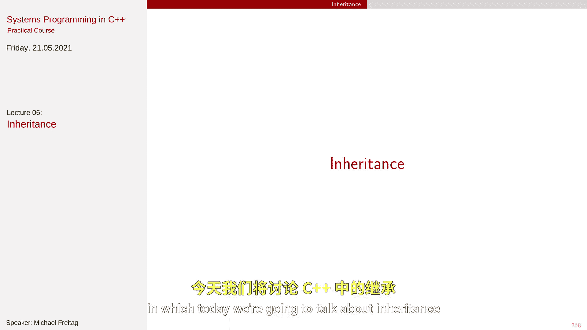

在本节课中，我们将要学习C++面向对象编程的第二个核心支柱——继承。我们将探讨如何定义派生类、理解对象在继承层次结构中的构造与析构顺序，并初步了解继承模式的概念。

## 面向对象编程的三大支柱

上一节我们介绍了数据抽象，它通过类来实现。本节中我们来看看继承。

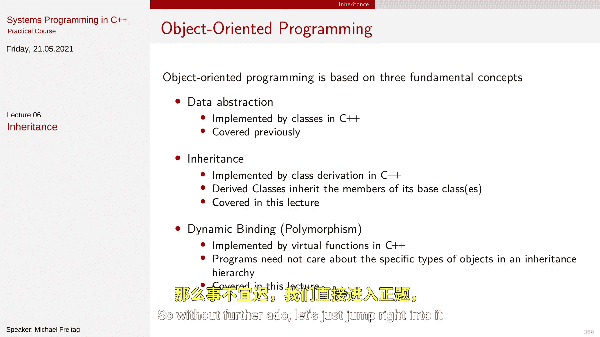

面向对象编程基于三大支柱：
1.  **数据抽象**：通过类实现。
2.  **继承**：通过类派生实现，派生类继承其基类的成员和成员函数。
3.  **动态绑定（多态）**：通过虚函数实现，允许程序在运行时根据对象的实际类型调用相应函数。

## 定义派生类

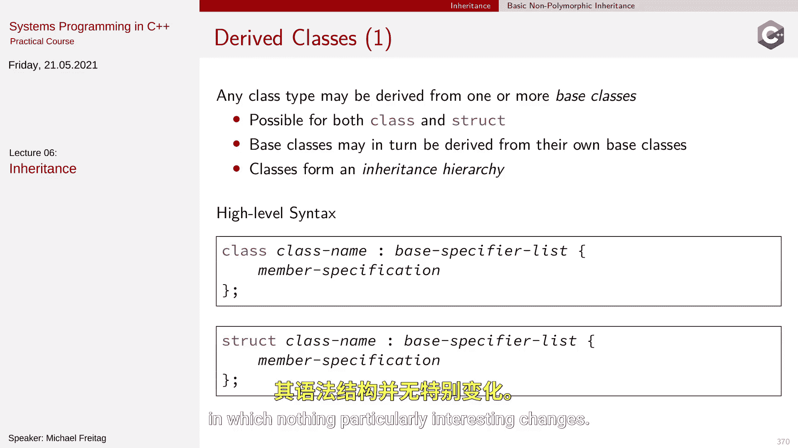

在C++中，任何类类型都可以从一个或多个基类派生。这适用于 `class` 和 `struct`。基类本身也可以有自己的基类，从而构建出任意复杂的继承层次结构。

定义派生类的高级语法如下：
```cpp
class DerivedClassName : BaseSpecifierList {
    // 类成员定义
};
```
对于 `struct`，语法本质相同。

## 基类指定符列表

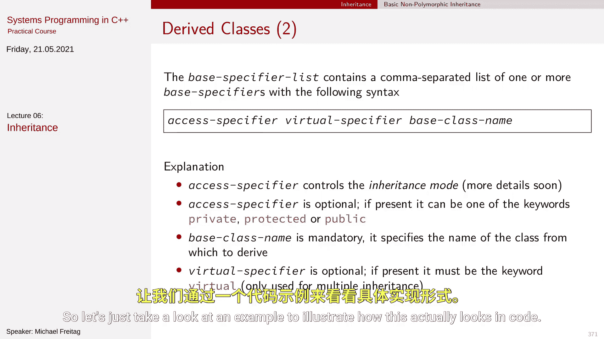

基类指定符列表位于冒号之后，包含一个或多个由逗号分隔的基类指定符。

一个基类指定符的构成如下：
*   **访问说明符**：控制继承模式，可以是 `private`、`protected` 或 `public`。大多数情况下使用 `public`。
*   **`virtual` 关键字（可选）**：用于处理多重继承的特定情况，本课程不深入讨论。
*   **基类名称**：指定要继承的类。

以下是定义派生类的几个示例：
```cpp
class Base {};

// 示例1：隐式私有继承
class Derived0 : Base {};

// 示例2：显式私有继承
class Derived1 : private Base {};

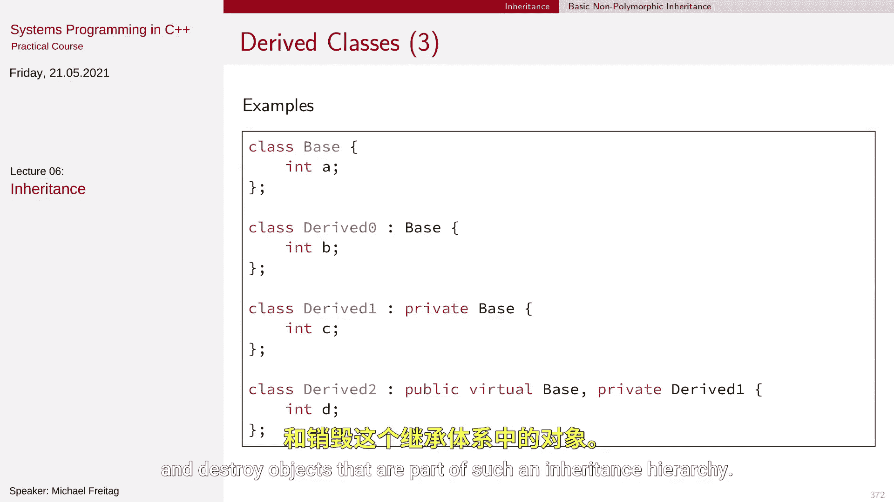

// 示例3：公有继承（最常见）
class Derived2 : public Base {};

// 复杂示例（实践中罕见）：公有虚拟继承与私有继承的组合
class DerivedComplex : public virtual Base, private Derived1 {};
```
在实践中，你几乎只会看到从单个基类进行的公有继承，如 `Derived2` 所示。

## 继承层次结构中的构造与析构

定义了继承层次结构后，我们需要了解其中对象的初始化和销毁过程，这通过构造函数和析构函数完成。

### 构造函数调用顺序

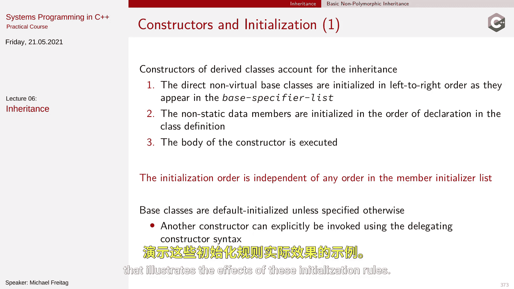

当调用派生类的构造函数时，初始化按以下严格顺序进行：
1.  初始化所有基类。如果存在多个基类，则按照它们在基类指定符列表中出现的顺序从左到右进行初始化。
2.  初始化派生类的数据成员。**初始化顺序完全取决于数据成员在类定义中声明的顺序**，与它们在构造函数初始化列表中的顺序无关。
3.  执行派生类构造函数的函数体。

关于基类初始化的重要说明：
*   默认情况下，基类使用其**默认构造函数**进行初始化。
*   可以通过**委托构造函数语法**显式调用基类的其他构造函数来覆盖此默认行为。

### 示例说明

假设有以下类定义：
```cpp
class Base {
public:
    Base() { /* 打印信息：调用Base默认构造 */ }
    Base(int) { /* 打印信息：调用Base(int)构造 */ }
};

class Derived : public Base {
public:
    Derived() { /* 打印信息：调用Derived默认构造 */ }
    Derived(int a, int b) : Base(a) { /* 打印信息：调用Derived(int, int)构造 */ }
};
```
执行以下代码：
```cpp
Derived d1;         // 调用Derived默认构造函数
Derived d2(1, 2);   // 调用Derived(int, int)构造函数
```
输出结果将是：
```
调用Base默认构造
调用Derived默认构造
调用Base(int)构造
调用Derived(int, int)构造
```
对于 `d1`，虽然 `Derived()` 构造函数没有显式调用基类构造函数，但根据规则，基类 `Base` 仍会先被其默认构造函数初始化。
对于 `d2`，`Derived(int, int)` 构造函数通过 `: Base(a)` 显式调用了 `Base(int)` 构造函数，因此基类使用该构造函数初始化。

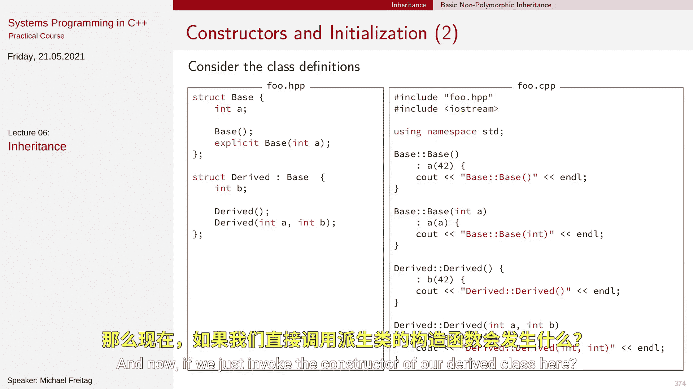

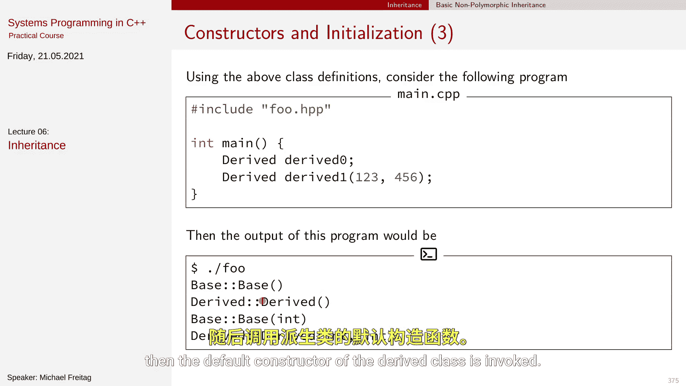

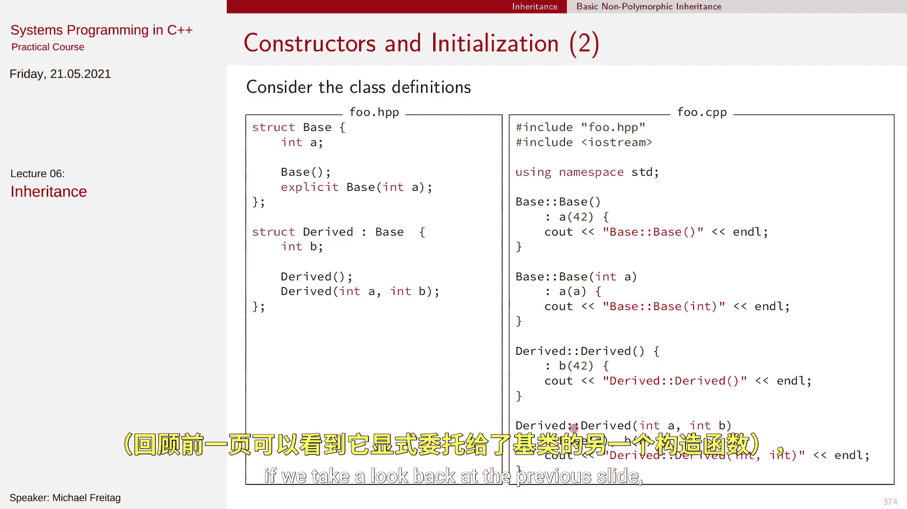

## 总结

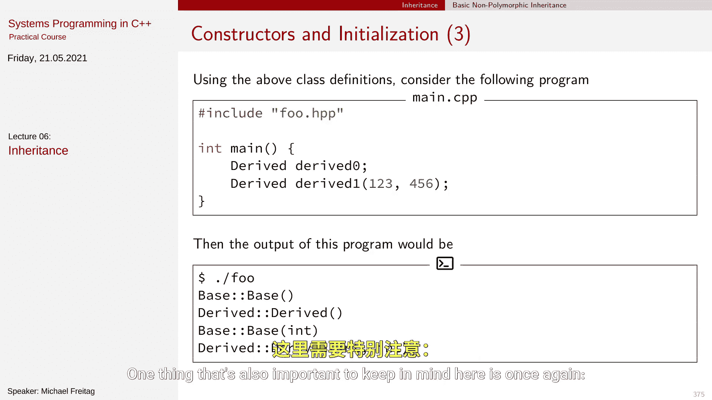

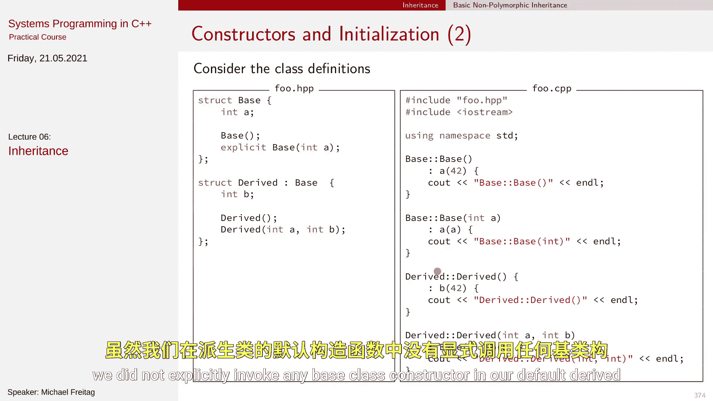

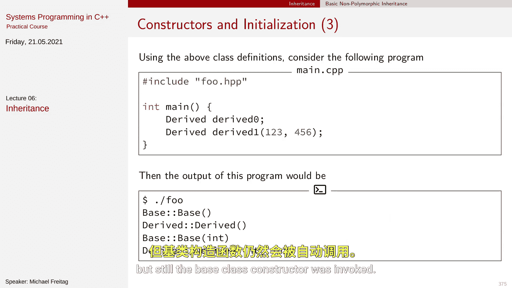

本节课中我们一起学习了C++继承的基础知识。我们了解了如何通过派生类构建继承层次结构，掌握了派生类定义中基类指定符列表的语法。更重要的是，我们深入探讨了派生类对象的构造过程，明确了基类初始化、成员初始化和构造函数体执行的严格顺序。理解这些顺序对于编写正确且可预测的面向对象程序至关重要。下一节，我们将继续探讨继承的另一个关键方面——继承模式与成员访问控制。