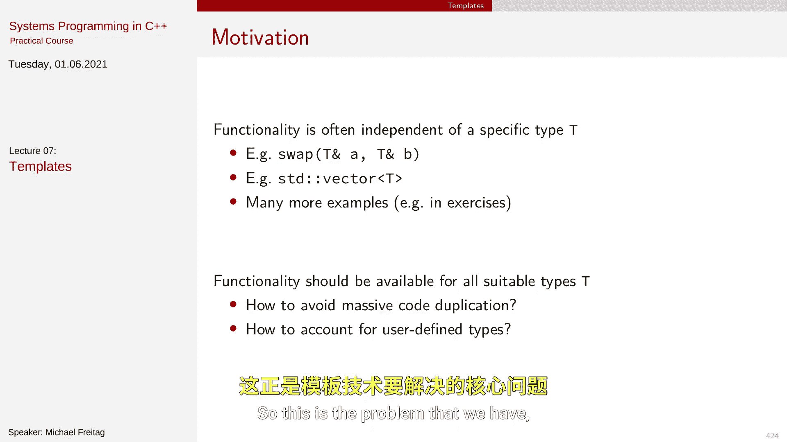
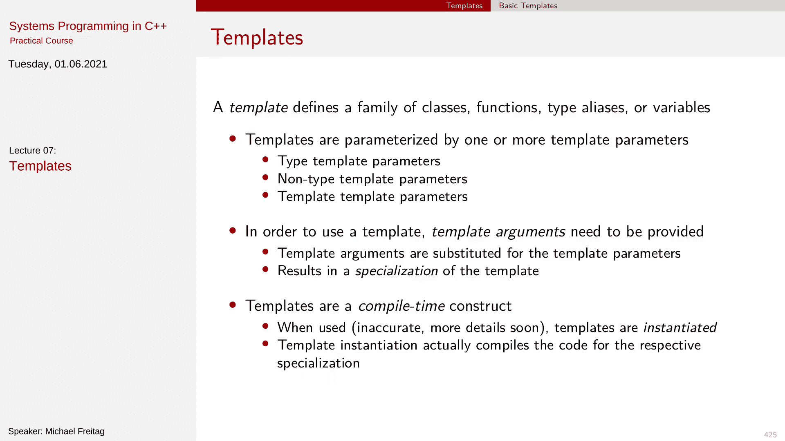
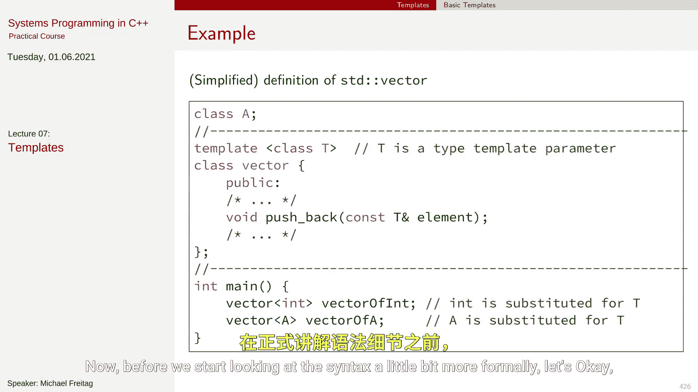
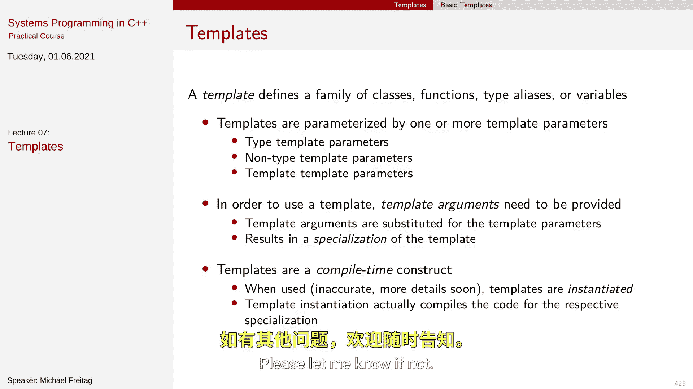
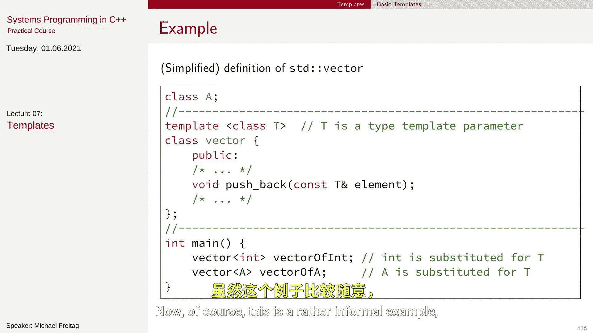
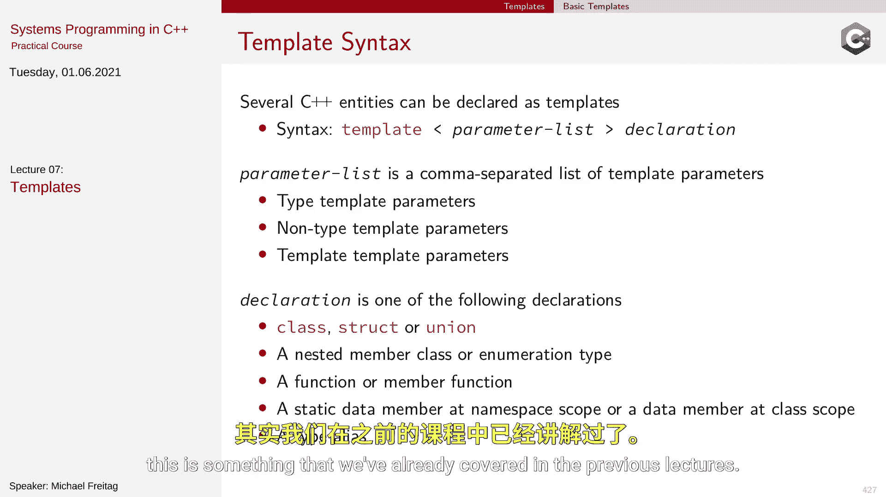
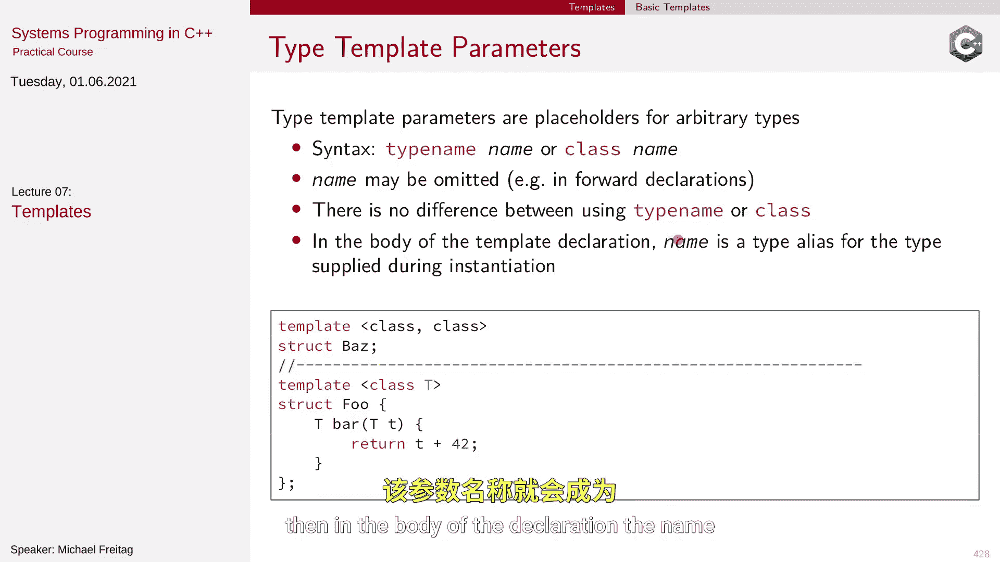

# 009：模板

在本节课中，我们将要学习C++中一个强大的特性——模板。模板允许我们编写与类型无关的通用代码，从而避免代码重复，并创建高度可复用的组件，如标准库中的`std::vector`。

## 为什么需要模板？🤔

上一节我们介绍了系统编程的基础，本节中我们来看看模板。模板是一个比较抽象的概念。其主要动机在于，当我们开始实现某些功能时，常常会遇到一些本质上与特定类型`T`无关的功能。

以下是几个典型的例子：
*   **交换函数**：一个交换函数本质上不关心它交换的是什么类型的元素，只要这些元素满足某些特定要求（如可移动或可复制）即可。
*   **`std::vector`容器**：`std::vector`同样不关心它存储的是什么类型的元素，只要这些元素支持移动或复制等操作即可。

在你的练习中，你可能已经实现过一些容器。由于当时不了解模板，这些容器被限制为只能处理特定类型。但实际上，我们可以用更通用的方式实现它们，使其适用于几乎任意类型。



这里的问题是，我们希望这种功能对所有合适的类型`T`都可用。但我们不希望出现**代码膨胀**——如果必须为每一种可能的类型手动实现，代码量将非常庞大。而且，我们甚至无法为那些在实现时（例如实现`std::vector`数据结构时）还不知道的用户自定义类型编写代码。

这就是模板要解决的问题。

## 模板是什么？🔧

模板允许我们定义一个**类、函数、类型别名或变量的家族**。这个家族可以通过一个或多个**模板参数**进行参数化。

这些模板参数可以是：
*   **类型**：例如`int`或`float`。
*   **非类型参数（常量值）**：例如，`std::array`的大小就是一个非类型模板参数，它允许我们在编译时指定数组的固定大小。
*   **模板模板参数**：参数本身也是一个模板。

为了使用这样的类家族，我们必须提供一个**模板实参**，该实参将替换模板参数。这个过程产生的结果称为模板的**特化**。例如，我们可以使用`std::vector<int>`或`std::vector<float>`，其中`int`和`float`就是模板实参。

## 编译时与运行时的关键区别⚙️

模板的语法看起来可能与其他语言（如Java）中的泛型相似，但关键区别在于：**模板纯粹是一种编译时构造**。

这意味着，当你使用一个模板时（例如`std::vector<int>`），编译器会进行**模板实例化**。这个过程会为你的模板的特定特化（如`vector<int>`）生成实际的汇编代码。如果你再使用`std::vector<float>`，编译器会再次为`vector<float>`生成另一份汇编代码。

这种机制有几个重要后果，特别是如果你习惯了Java的运行时泛型，可能会感到惊讶：
*   所有模板参数都必须在**编译时**确定。你只能将编译时常量或编译时已知的类型名称作为模板实参。
*   在**运行时**，一个模板实例化（如`vector<int>`）就像一个普通的类，你无法再改变它。



**什么是编译时和运行时？**
*   **编译时**是编译器处理代码的阶段。编译器可以计算常量表达式，例如`4 * 3`，这个结果可以作为`std::array`的大小。
*   **运行时**是程序实际执行的阶段。两个非常量变量的乘积结果无法在编译时确定为一个固定值，因此不能用作模板实参。



## 一个简单的模板示例📝

让我们看一个如何自己定义`std::vector`模板的简化示例。

```cpp
template <class T>
class vector {
private:
    T* data_;
    size_t size_;
    size_t capacity_;

public:
    void push_back(const T& value) {
        // ... 实现逻辑，使用 T 类型
    }
    // ... 其他成员函数
};
```

这个定义与普通类相似，关键区别在于`class`关键字前多了一行：
`template <class T>`



这行代码告诉编译器，我们的`vector`类由一个名为`T`的**类型模板参数**进行模板化。然后，我们可以在`vector`的实现中像使用其他类型别名一样使用`T`。

例如，在`push_back`函数中，我们使用`const T&`作为参数类型。当我们用特定类型（如`int`）实例化`vector`时，此处的`T`将成为`int`的别名。当我们用其他类型（如类`A`）实例化时，`T`则被替换为类`A`。

通过这种方式，我们可以轻松实现非常通用的容器，而无需关心`T`具体是什么类型，只需专注于容器本身的功能逻辑。

## 模板的正式语法📚

现在，让我们更正式地看看C++标准是如何定义模板的。



我们可以将多种实体声明为模板，语法总是相同的：
`template < 参数列表 > 声明`

*   **参数列表**：一个逗号分隔的模板参数列表。参数可以是类型、非类型或模板模板参数。
*   **声明**：跟在`template`关键字和参数列表后面的部分。它可以是：
    *   类声明或定义
    *   成员类或枚举类型
    *   函数或类的成员函数
    *   命名空间作用域的静态数据成员或类作用域的数据成员
    *   类型别名

其中，**类模板声明**是在C++代码中最常见的用法。

## 类型模板参数详解🎯



正如我们刚才在幻灯片上看到的，可以放入模板参数列表的第一种东西是**类型模板参数**。它们是任意类型的占位符。

其语法是：`typename` 或 `class`，后跟一个任意名称（可省略）。

以下是关于类型模板参数的要点：
*   使用`typename`或`class`作为关键字完全由你决定，两者没有区别，可以互换使用。
*   一旦在模板声明中有了这样的模板参数，在声明体内，你指定的名称就简单地成为一个**类型别名**。

## 总结✨



本节课中我们一起学习了C++模板的核心概念。我们了解到模板是一种强大的元编程工具，用于创建通用、类型安全的代码，从而避免重复。关键在于理解模板是编译时实例化的，这与某些其他语言的运行时泛型有本质区别。我们通过一个简化的`vector`示例看到了类模板的基本语法，并正式介绍了模板声明及其类型参数的规则。掌握模板是深入理解C++标准库和进行高效系统编程的基础。