# 010：标准库 I 📚

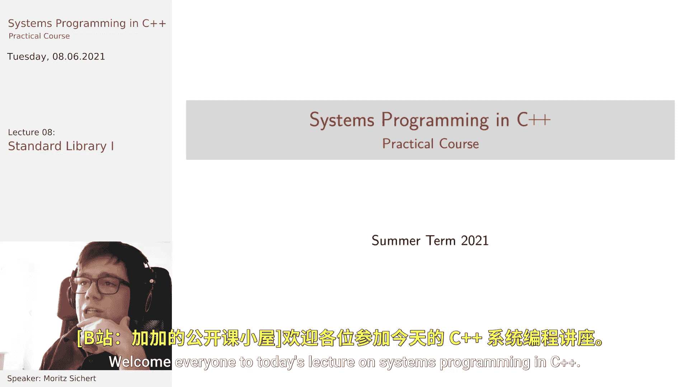

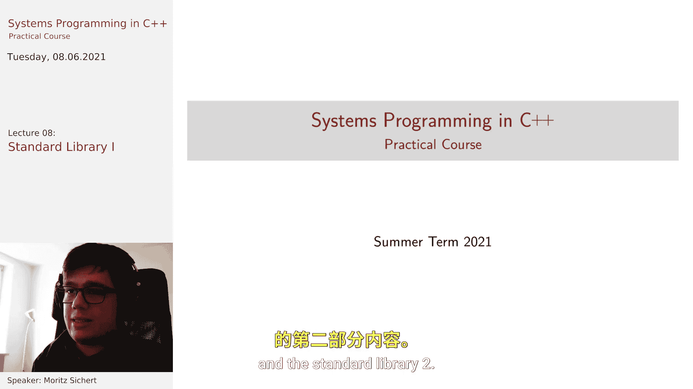

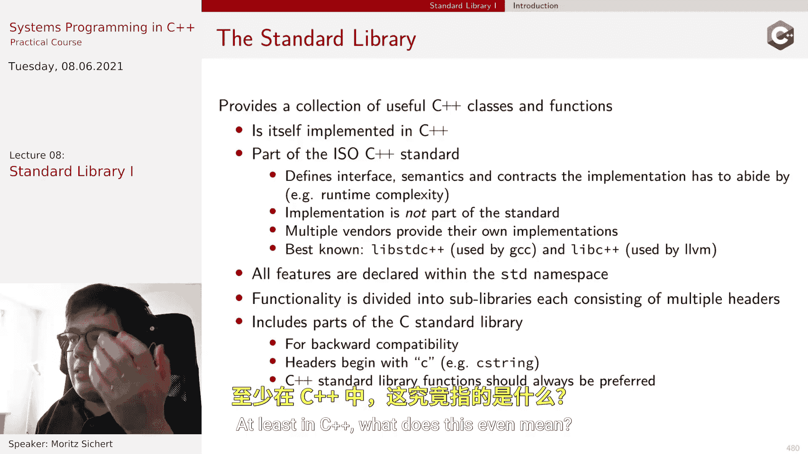

在本节课中，我们将要学习C++标准库的基础知识。标准库是C++编程的核心组成部分，它提供了大量预定义的函数和类，用于处理常见任务，如字符串操作、数据存储和算法。我们将分两次讲座来深入探讨标准库，今天主要介绍其概览和字符串库。

## 概述

上一节我们介绍了C++的基础语法和内存管理。本节中，我们来看看C++标准库是什么，以及它如何帮助我们更高效地编写程序。

标准库是C++语言规范的一部分。它定义了一系列类和函数的接口，所有符合标准的编译器都必须支持这些接口。标准库的实现本身通常是用C++编写的，但规范只定义了接口和行为，并未规定具体的实现方式。这意味着不同的编译器可以使用不同的实现，例如在Linux上常见的GCC的`libstdc++`和Clang的`libc++`。

标准库不仅定义了函数名和参数，还规定了某些操作的**时间复杂度**。例如，对于一个容器，访问其元素的时间复杂度应为常数时间 `O(1)`。

标准库包含多个子库，每个子库都有自己的头文件。许多头文件以字母`c`开头，例如 `<cstring>` 或 `<cmath>`。这是因为它们源自C语言的标准库。在C++中，通常建议使用C++特有的等效功能（如 `std::string` 而非C风格字符串），因为它们通常更安全、更易用，并且支持**函数重载**等特性。只有在进行底层操作或某些功能不存在C++版本时，才应考虑使用C库函数。

以下是标准库主要组成部分的概览：

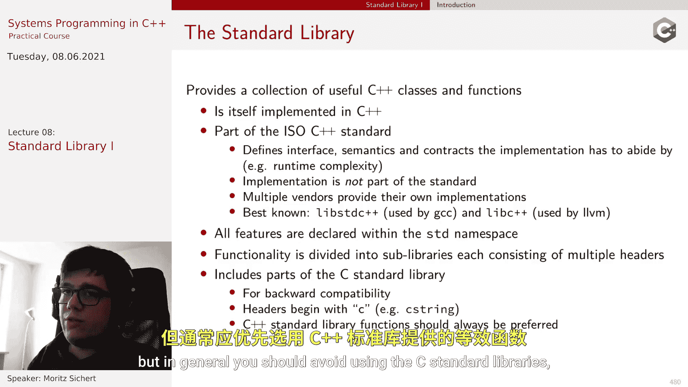

*   **工具库**：包含内存管理（如`placement new`、`shared_ptr`）、工具函数（如`std::optional`、`std::variant`）和时间测量等功能。
*   **字符串库**：提供`std::string`类，用于处理文本。
*   **容器库**：提供诸如`std::vector`、`std::map`等数据结构。
*   **算法库**：提供排序、查找、最大值/最小值等通用算法。
*   **迭代器库**：定义了遍历容器元素的标准方法。
*   **数值库**：包含数学函数（部分来自C的`<cmath>`）、复数运算和随机数生成器。
*   **输入/输出库**：除了`std::cout`，还提供文件流和字符串流。
*   **多线程库**：提供线程创建、同步原语（如互斥锁）等支持。

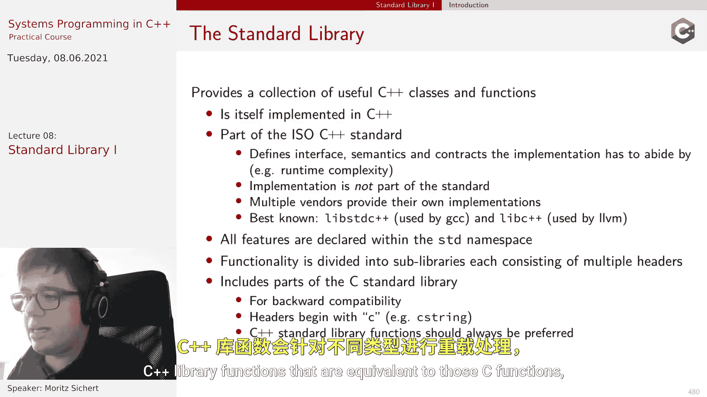

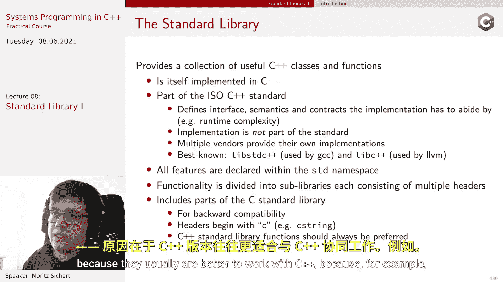

随着C++标准的更新，库的功能也在不断扩展，例如增加了正则表达式、文件系统操作等。未来版本还可能加入网络库。

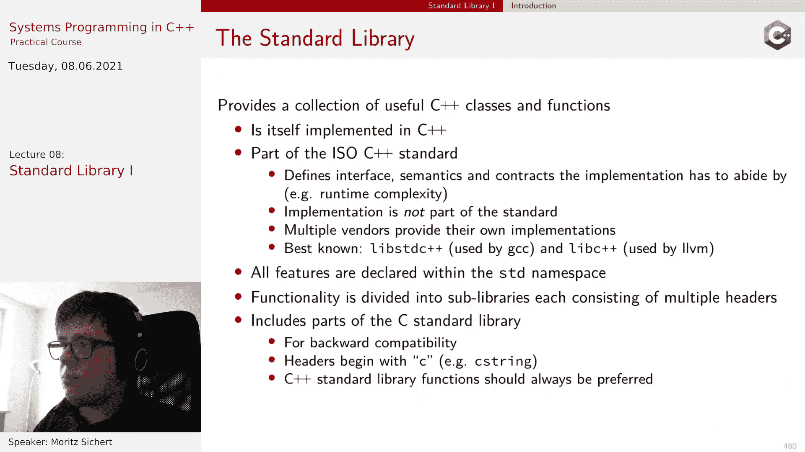

## 字符串库详解

在之前的练习中，我们已经简单使用过字符串。本节中，我们将详细探讨`std::string`。

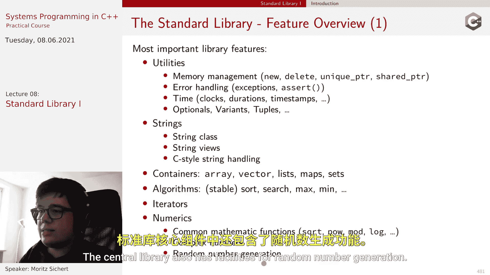

`std::string` 定义在 `<string>` 头文件中。它本质上是一个字符序列。虽然`std::string`本身是一个模板类，可以支持不同的字符类型（如`wchar_t`），但最常用的是基于`char`的类型。

`std::string` 的一个关键特性是它自动管理动态内存。当你创建一个字符串或修改其内容时，类内部会处理内存的分配和释放，这极大地简化了编程，避免了手动使用`new`和`delete`。

与C风格字符串（以空字符`\0`结尾的字符数组）不同，`std::string` 会存储自己的长度信息。这意味着：
1.  `std::string` 可以包含空字符（`\0`），而C风格字符串则不能。
2.  获取字符串长度是一个 `O(1)` 的常数时间操作。

`std::string` 提供了丰富的成员函数，用于字符串操作，例如查找子串、比较、连接和修改内容。

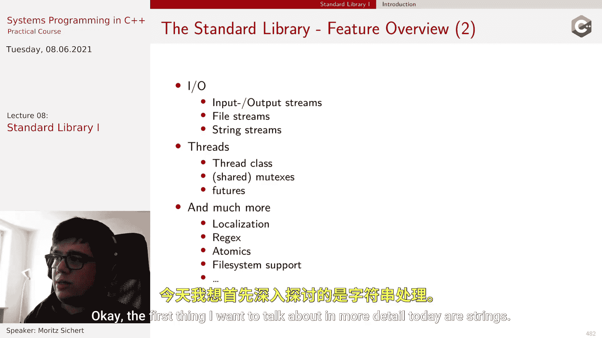

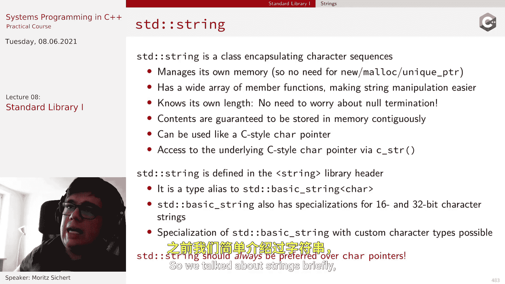

有时，我们仍然需要与只接受C风格字符串的API（例如一些旧的C库函数）进行交互。为此，`std::string` 提供了 `c_str()` 成员函数，它可以返回一个指向内部字符数组的指针（以`\0`结尾）。调用此函数后，只要不修改原`std::string`对象，返回的指针就是有效的。

一般来说，在C++程序中应优先使用 `std::string`。只有在与需要C风格字符串的接口交互时，才使用 `c_str()` 进行转换。我们将在后续课程中介绍另一个有用的工具：`std::string_view`。

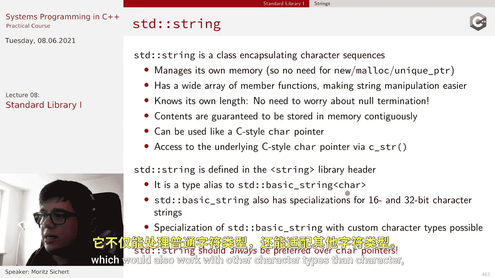

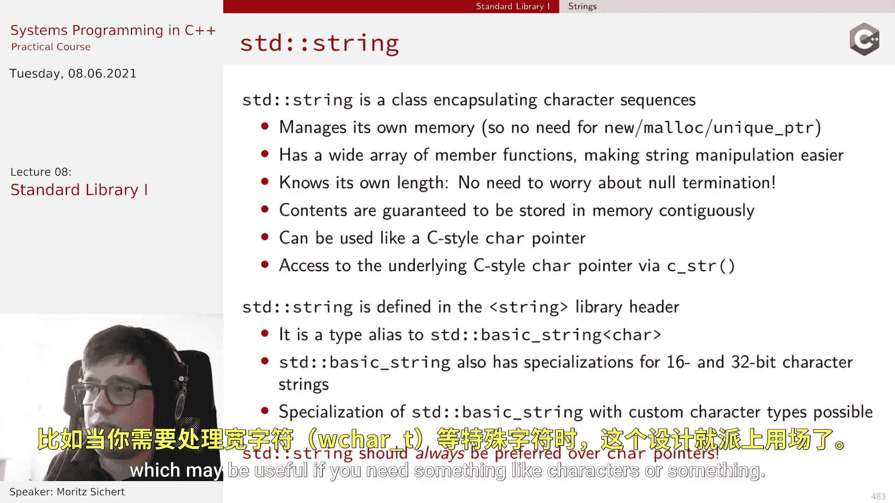

以下是 `std::string` 的一些常用成员函数示例：

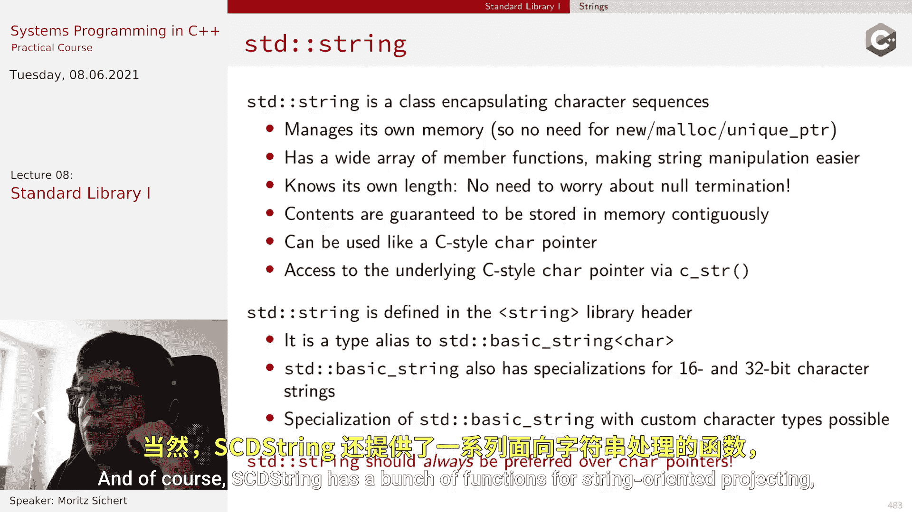

```cpp
#include <string>
#include <iostream>

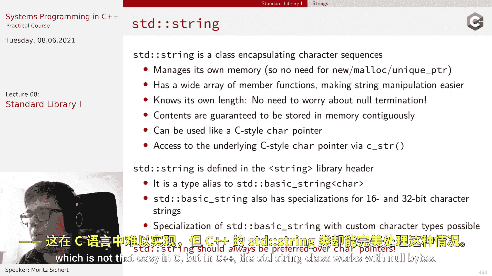

int main() {
    std::string str = "Hello, Systems Programming!";
    // 获取长度
    std::cout << "Length: " << str.length() << std::endl; // 或 str.size()
    // 查找子串
    std::size_t pos = str.find("Systems");
    if (pos != std::string::npos) {
        std::cout << "'Systems' found at position: " << pos << std::endl;
    }
    // 获取C风格字符串
    const char* c_str = str.c_str();
    // 连接字符串
    str += " Welcome!";
    std::cout << str << std::endl;
    return 0;
}
```

## 总结

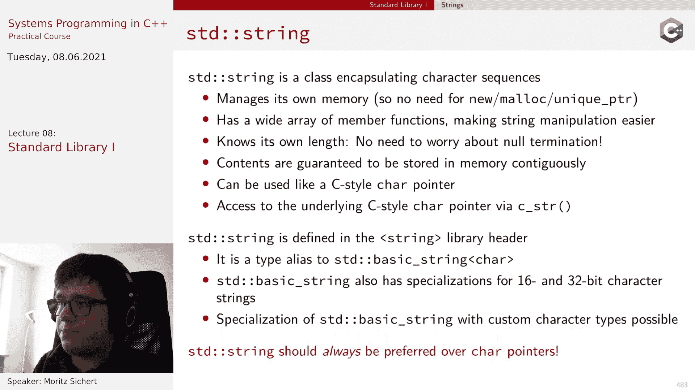

本节课中我们一起学习了C++标准库的基础知识。我们了解了标准库的定义、常见实现以及主要组成部分。我们重点深入探讨了**字符串库**，学习了`std::string`如何自动管理内存、存储长度信息，以及如何通过`c_str()`成员函数与C风格字符串进行互操作。记住，在C++中应优先使用`std::string`以获得更好的安全性和便利性。在下一讲中，我们将继续探索标准库的其他强大组件。