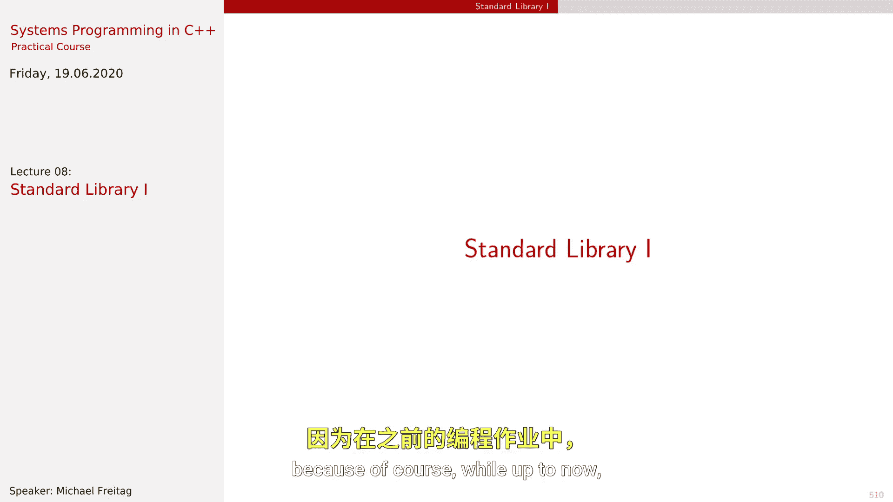
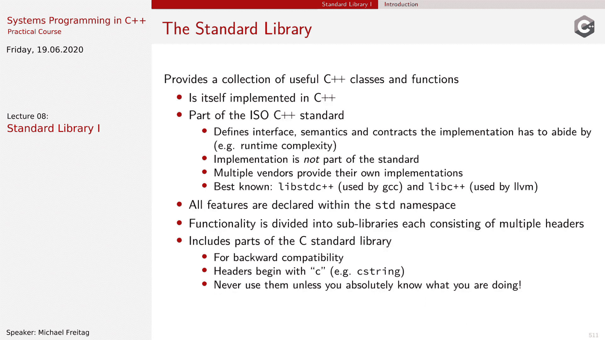
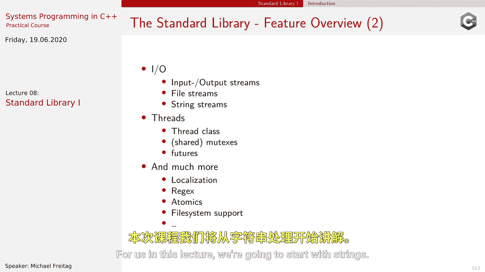
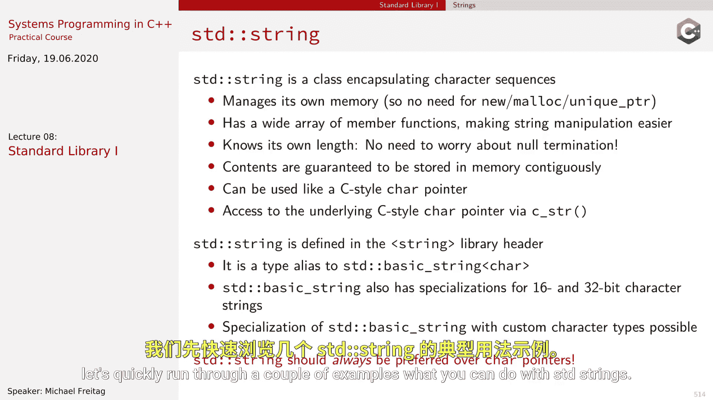
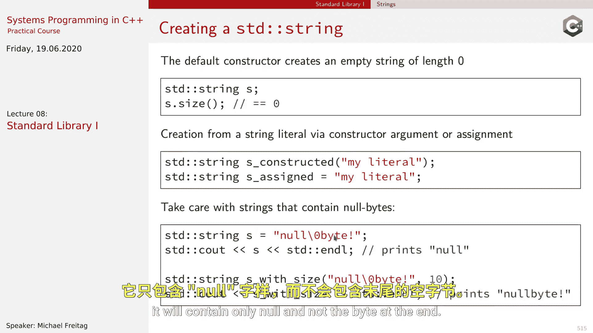

# 011：标准库 I 📚

在本节课中，我们将学习C++标准库的基础知识。标准库提供了大量预构建的数据结构和算法，能够帮助我们更高效、更安全地编写程序。我们将首先了解标准库的整体结构，然后深入探讨字符串库的用法。



## 概述

C++标准库是一个庞大且功能丰富的工具集合，它本身是C++标准的一部分。标准定义了库的接口、语义和实现必须满足的契约（例如某些数据结构的运行时复杂度），但具体实现由编译器供应商提供。例如，GCC使用libstdc++，而Clang使用libc++。

标准库中的所有功能都声明在 `std` 命名空间中，并分为多个子库，每个子库包含多个头文件。此外，为了保持向后兼容性，C++标准库也包含了C标准库的部分内容，但通常建议优先使用C++的等效功能。

以下是标准库包含的主要部分：
*   **实用工具库**：包含智能指针（如 `std::unique_ptr`）、错误处理、时间操作以及 `std::optional`、`std::variant`、`std::tuple` 等有用类型。
*   **字符串库**：包含 `std::string` 类和轻量级的 `std::string_view`。
*   **容器库**：包含 `std::array`、`std::vector`、`std::list`、`std::map` 等数据结构。
*   **算法库**：提供排序、搜索等作用于容器的算法。
*   **迭代器**：作为连接容器和算法的通用抽象层。
*   **数值库**：包含数学函数、复数、随机数生成等。
*   **输入/输出流库**。
*   **多线程库**。

由于内容繁多，我们无法在两次课程中覆盖所有细节。本课程旨在提供一个概览和使用指南，具体细节请查阅官方参考文档。

## 字符串库详解

上一节我们介绍了标准库的整体架构，本节中我们来看看其中一个最常用的部分：字符串库。虽然大家已经在编程作业中接触过 `std::string`，但我们尚未深入探讨其工作原理。



### 什么是 `std::string`？

本质上，`std::string` 是一个专门用于存储字符的 `std::vector`。与 `std::vector` 一样，它管理自己的内存，并且大小可变。不同之处在于，`std::string` 提供了大量针对字符串操作的成员函数，使得字符串处理更加方便。

与C风格字符串（字符数组）相比，`std::string` 的一个显著优点是它**知道自己的长度**。我们无需像在C语言中那样手动添加空终止符（`\0`），也无需调用 `strlen` 这类函数来实时计算长度，因为 `std::string` 内部维护着一个记录字符数量的成员变量。这使其在某些场景下效率更高。

`std::string` 的内容在内存中仍然是连续存储的，并且内部以空字符终止。因此，我们可以通过 `c_str()` 成员函数获取一个指向内部字符数组的C风格字符串指针，并将其传递给期望 `const char*` 参数的C函数。



`std::string` 定义在 `<string>` 头文件中。它实际上是更通用的模板类 `std::basic_string<char>` 的类型别名。C++也支持更宽的字符类型（如 `wchar_t`），并有对应的别名（如 `std::wstring`）用于处理Unicode字符。

**核心建议**：在C++编程中，应优先使用 `std::string` 而非原生的字符指针（`char*`）。但这并不意味着在所有情况下都必须使用 `std::string`，我们稍后会看到其他选择。

### `std::string` 的基本用法

以下是 `std::string` 的一些基本操作示例：

```cpp
#include <iostream>
#include <string>

int main() {
    // 1. 默认构造：创建一个空字符串
    std::string empty_str;

    // 2. 通过字符串字面量构造
    std::string hello = "Hello, World!";
    std::cout << hello << std::endl; // 输出: Hello, World!

    // 3. 注意：如果字符串字面量包含空字节，构造时会在此处截断
    std::string truncated = "Hello\0World";
    // 使用 cout 打印只会输出 "Hello"，因为流在遇到空字符时停止。
    // 要验证长度，可以使用 .size() 成员函数。
    std::cout << "Truncated string: " << truncated << std::endl;
    std::cout << "Its size is: " << truncated.size() << std::endl; // 输出: 5

    // 4. 获取C风格字符串指针
    const char* c_style_ptr = hello.c_str();
    // 现在 c_style_ptr 可以用于需要 const char* 的场合

    return 0;
}
```

**代码说明**：
*   示例3展示了从包含空字节（`\0`）的字面量构造 `std::string` 时的行为：构造函数会在第一个空字节处停止，因此生成的字符串不包含“World”部分。
*   `c_str()` 方法返回一个指向以空字符结尾的字符数组的指针，该数组包含了与 `std::string` 相同的内容。



## 总结



本节课中我们一起学习了C++标准库的基础知识和 `std::string` 类。我们了解到标准库是一个由编译器实现的、功能强大的工具箱，涵盖了从数据结构、算法到系统功能的各个方面。对于字符串处理，`std::string` 相比C风格字符串更安全、更方便，因为它自动管理内存并记录长度。在接下来的课程中，我们将继续探索标准库中的其他容器和工具。