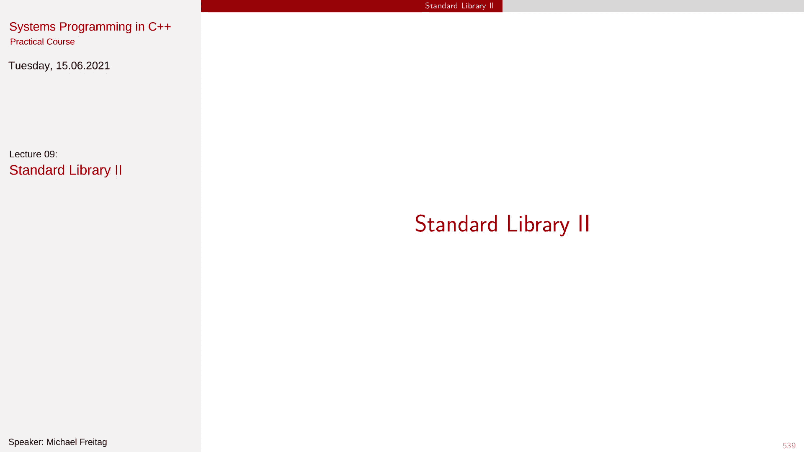
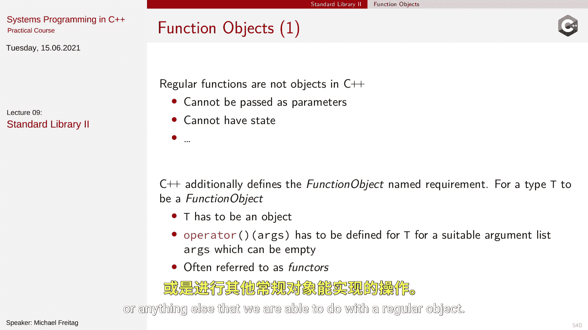
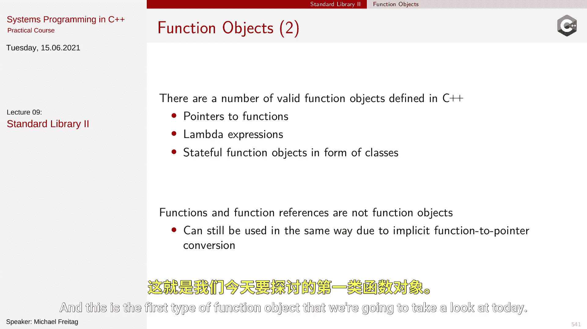
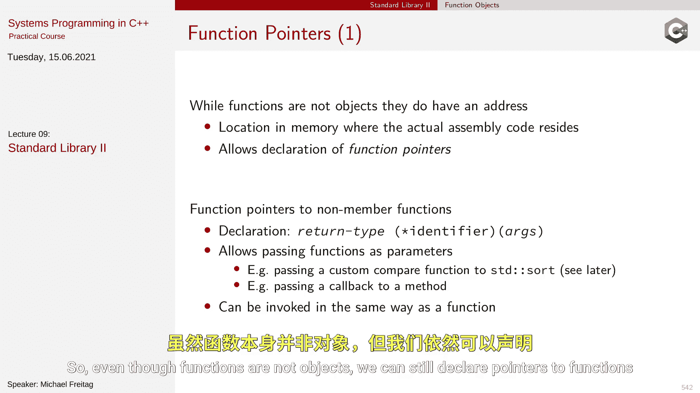
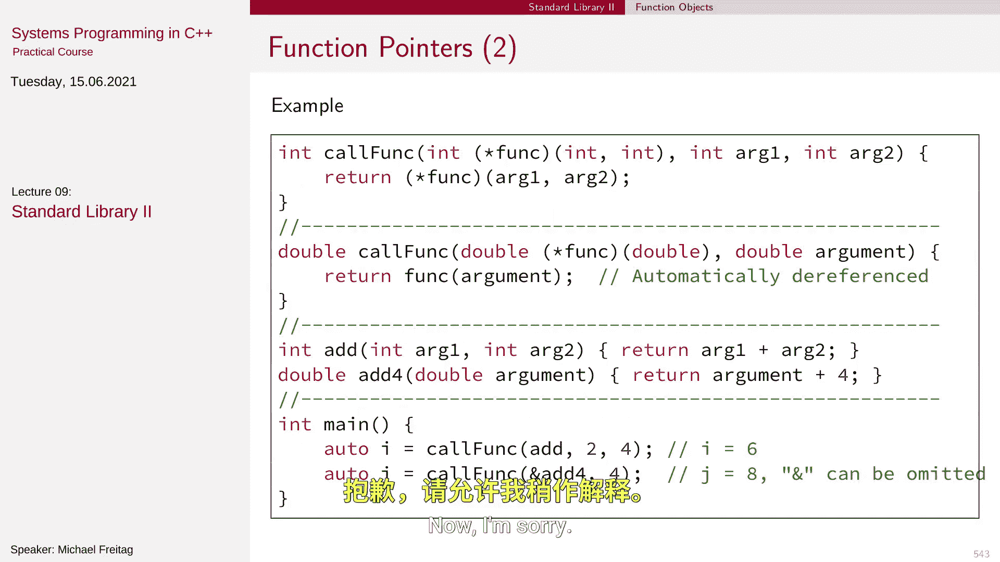
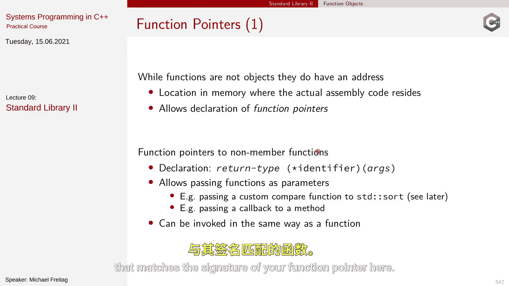
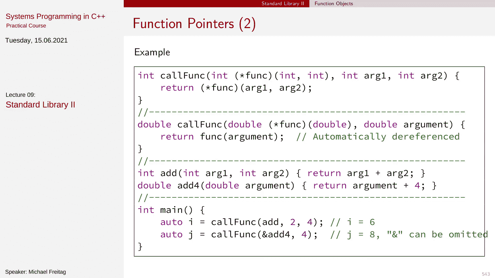
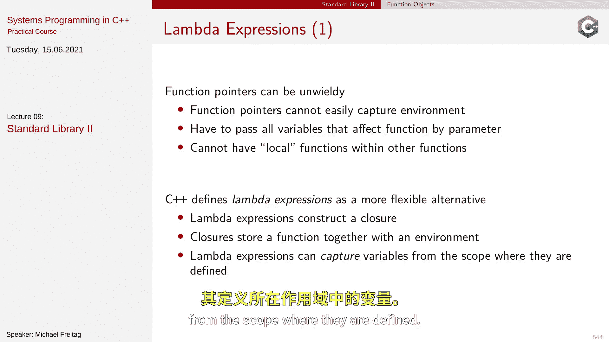

# 012：标准库 II - 函数对象与Lambda表达式



在本节课中，我们将继续探讨C++标准库，重点学习函数对象（Functors）和Lambda表达式。这些概念对于编写灵活、高效的代码至关重要。

上一节我们介绍了标准库的基础容器和算法，本节中我们来看看如何通过函数对象和Lambda表达式来定制算法的行为。

## 函数对象（Functors）

在C++中，普通函数本身不是对象。这带来了一些限制：例如，函数不能直接作为参数传递，也不能拥有自己的状态（除非是类的成员函数）。为了解决这个问题，C++定义了**函数对象**的概念。



一个类型`T`要成为函数对象，必须满足以下要求：
1.  `T`必须是一个对象。
2.  类型`T`必须重载了**函数调用运算符** `operator()`。

满足这些要求的对象通常被称为**仿函数（Functors）**。有了仿函数，我们就可以像操作普通对象一样操作它们，例如将其作为参数传递给其他函数。

C++中已经存在多种有效的函数对象，无需我们自行定义：
*   函数指针
*   Lambda表达式
*   自定义的类（通过重载`operator()`实现）



虽然普通函数本身不是对象，但当我们使用函数名时，它会**隐式转换**为指向该函数的指针，而函数指针是有效的函数对象。

## 函数指针

函数虽然不是对象，但构成函数的汇编指令在内存中占据一段空间，拥有一个起始地址。因此，我们可以声明**指向函数的指针**。

以下是声明一个指向自由函数（非成员函数）的指针的语法：
```cpp
return_type (*pointer_name)(parameter_list);
```
*   `return_type`：函数返回类型。
*   `pointer_name`：函数指针变量的名称。
*   `parameter_list`：函数的参数列表（参数可以有名称，也可以没有）。





声明后，我们可以初始化这个指针，使其指向一个具有匹配签名的函数。这使得我们可以将函数作为参数传递给其他函数、构造函数或成员函数。

常见的应用场景包括：
*   向`std::sort`算法传递自定义的比较函数。
*   向某个方法传递一个回调函数（callback），用于执行特定逻辑。

初始化后，可以通过解引用指针来调用函数。

以下是一个使用函数指针的示例：
```cpp
// 声明一个函数，它接受一个函数指针和两个整数作为参数
int call_function(int (*func)(int, int), int a, int b) {
    return (*func)(a, b); // 通过指针调用函数
    // 也可以简写为：return func(a, b); // 编译器会自动解引用
}



// 定义两个匹配签名的函数
int add(int x, int y) { return x + y; }
int add_four(int x, int y) { return x + y + 4; }

int main() {
    // 调用call_function，传递函数名（隐式转换为指针）
    int result1 = call_function(add, 2, 3);
    // 也可以显式取地址
    int result2 = call_function(&add_four, 2, 3);
}
```

然而，函数指针的语法繁琐且可读性差。此外，它还有一些更微妙的缺点：
1.  **难以捕获环境**：所有影响函数语义的变量都必须作为参数显式传递。
2.  **无法定义局部函数**：例如，如果只想在某个高阶函数内部使用一个自定义比较函数，使用函数指针则必须将其定义为全局或命名空间作用域的函数，破坏了封装性。

## Lambda表达式

为了解决函数指针的局限性，C++引入了**Lambda表达式**。从高层次看，Lambda表达式构造了一个**闭包（closure）**，它将一个函数与其定义时所在的环境（即能影响其行为的变量）捆绑在一起。

Lambda表达式的核心特性是能够**捕获（capture）** 其定义作用域内的变量，并在函数体内引用这些变量。这极大地增强了代码的灵活性和表现力。

一个Lambda表达式的基本语法如下：
```cpp
[capture_list] (parameter_list) -> return_type { function_body }
```
*   `capture_list`：捕获列表，指定哪些外部变量被捕获以及如何捕获（值捕获`[=]`、引用捕获`[&]`或指定变量`[x, &y]`）。
*   `parameter_list`：参数列表（可选）。
*   `return_type`：返回类型（通常可省略，由编译器推导）。
*   `function_body`：函数体。



Lambda表达式生成一个未命名的函数对象（闭包），可以将其赋值给`auto`变量或直接使用。

以下是使用Lambda表达式重写之前排序示例的简单示意（具体`std::sort`用法将在后续课程详述）：
```cpp
std::vector<int> vec = {5, 2, 8, 1};
int offset = 2;

// 使用Lambda表达式定义局部比较逻辑，并捕获外部变量offset
std::sort(vec.begin(), vec.end(),
          [offset](int a, int b) { return (a + offset) < (b + offset); });
```
在这个例子中，Lambda表达式捕获了变量`offset`，使得比较逻辑可以动态地基于外部变量进行调整，而无需修改函数签名或定义全局函数。

---



本节课中我们一起学习了C++中函数对象的核心概念。我们了解到，虽然普通函数不是对象，但通过函数指针、自定义类（仿函数）以及更强大的Lambda表达式，我们可以创建可传递、可存储、并带有状态的可调用实体。特别是Lambda表达式，它通过捕获列表将代码与其上下文环境绑定，提供了比函数指针更简洁、更灵活的解决方案，是现代C++编程中不可或缺的工具。在接下来的课程中，我们将看到这些概念在标准库算法中的广泛应用。