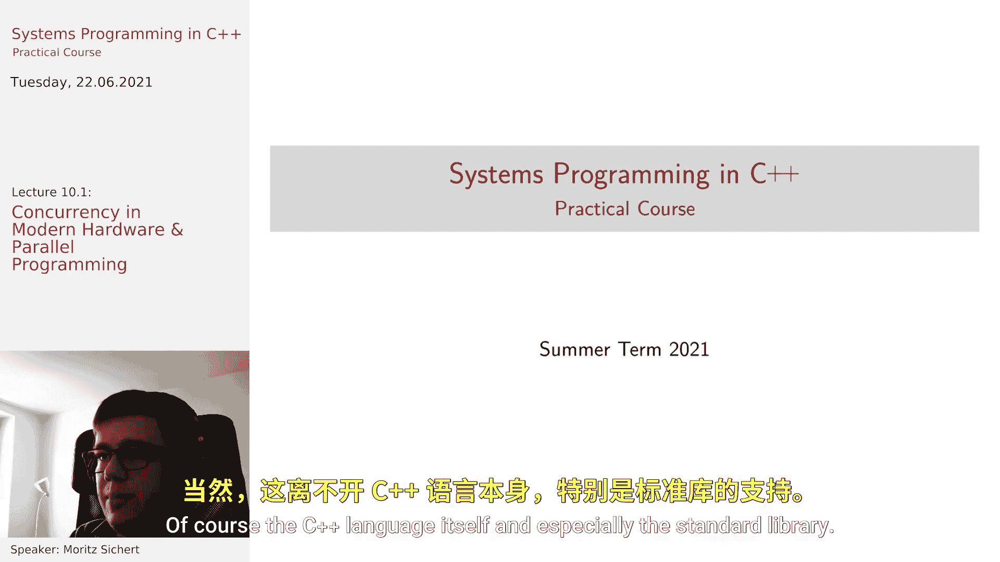
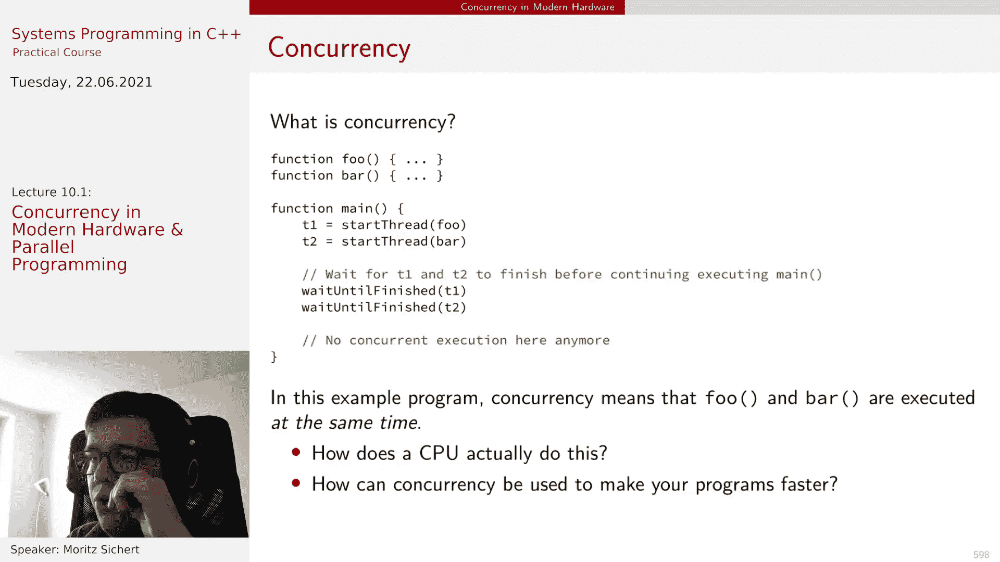
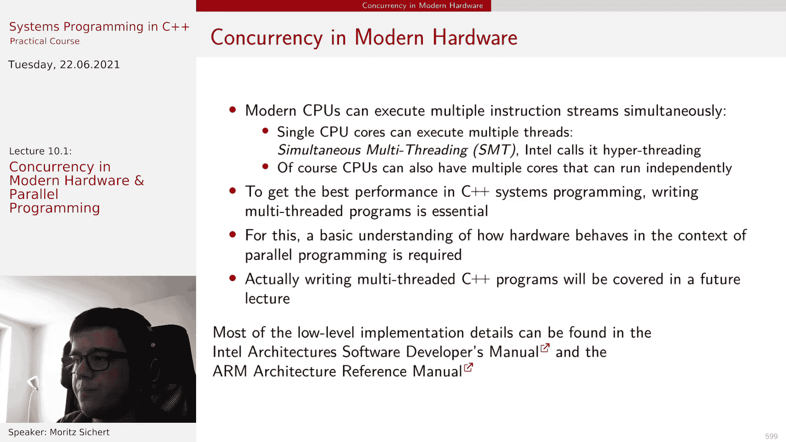
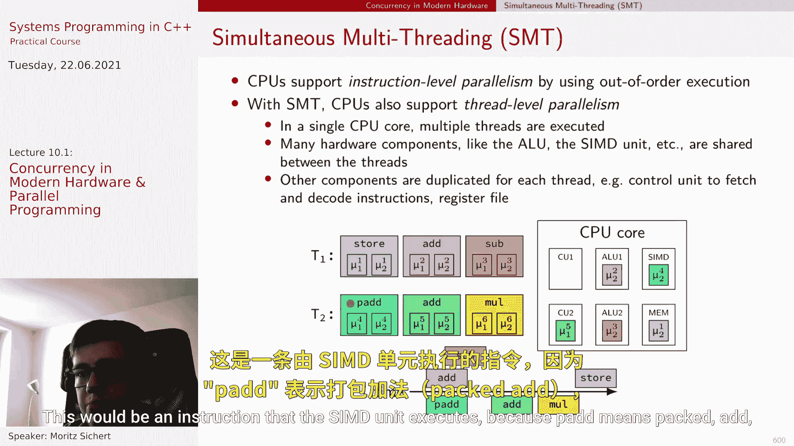

# 013：现代硬件中的并发与并行编程

在本节课中，我们将要学习现代硬件中的并发概念以及并行编程的基础知识。在深入探讨C++语言和标准库提供的具体并发工具之前，理解底层的硬件原理和核心概念至关重要。本节课将主要使用伪代码和概念图进行讲解，为后续学习C++并发编程打下坚实基础。



## 什么是并发？

当我们谈论并发时，首先需要明确其定义。从概念上讲，并发非常简单。假设你有一种编程语言，可以定义函数 `foo` 和 `bar`。

```cpp
void foo() { /* ... */ }
void bar() { /* ... */ }
```

如果该语言提供了启动线程（Thread）的功能，那么你就可以让多个函数并发执行。线程是操作系统中的一个概念，它允许程序同时运行多个任务。

```cpp
// 伪代码示例
Thread t1 = start_thread(foo);
Thread t2 = start_thread(bar);
wait_for(t1);
wait_for(t2);
```

在这个例子中，我们启动了两个线程 `T1` 和 `T2`，每个线程执行一个函数。主函数等待这两个线程执行完毕。这里的“并发”意味着函数 `foo` 和 `bar` 在同一时间段内被执行，它们并非交替执行，而是真正地同时进行。

随之而来的问题是：CPU 如何实现这一点？尤其是当这些函数属于同一个程序时。更广泛的问题是：如何利用并发来加速程序，同时避免引入新的、难以捉摸的错误？



## CPU如何实现并发？

要回答第一个问题，我们需要更深入地了解CPU的设计。现代CPU即使只有一个核心，也能进行乱序执行（Out-of-Order Execution），这本质上提供了**指令级并行**。但这并非我们本节课的重点。

我们关注的是CPU如何同时执行多个不同的**指令流**。指令流可以理解为函数的执行过程，因为不同的函数包含不同的指令。即使从不同线程调用同一个函数，它们在某一时刻也可能执行不同的指令，因为执行速度可能略有差异。

我们主要关注CPU能够同时执行多个指令流的两种情况：

1.  **同时多线程**：单个CPU核心能够执行多个线程。这个概念你可能更熟悉英特尔公司为其命名的“超线程”技术，但通用概念称为**同时多线程**。
2.  **多核心**：拥有多个物理上独立的CPU核心，每个核心可以独立运行线程。

例如，一个四核CPU，如果每个核心支持两个超线程，那么理论上它可以同时执行八个线程。

我们之所以需要并发，是因为如果能让程序在多个线程和核心上同时运行，通常能获得更快的执行速度。C++作为一种相对底层的语言，在系统编程中，我们需要了解CPU实现并发的细节，这样才能理解潜在的隐患和错误，并学会如何正确实现以避免这些问题。

> 本节课内容主要参考CPU厂商的开发手册，例如《Intel架构软件开发人员手册》和ARM的相关文档。这些是理解底层硬件行为的重要资料。



## 深入同时多线程

首先，我们来探讨同时多线程在单个CPU核心内部是如何工作的。

一个不支持多线程的CPU核心，已经通过乱序执行支持了**指令级并行**。这意味着它可以并行执行单个指令流中的多条指令，前提是这些指令相互独立。例如，一条指令向一个内存地址写入数据，另一条指令向另一个地址写入数据，它们互不影响，CPU就可以同时执行它们。

而**同时多线程**在此基础上，增加了**线程级并行**。这意味着在单个CPU核心内，可以同时执行多个线程（现代CPU通常是两个）。

同时多线程的特殊之处在于，不同的线程**共享**许多硬件组件。例如：
*   **算术逻辑单元**：负责整数运算。
*   **SIMD单元**：执行单指令多数据操作，能同时处理多个浮点数或整数，拥有更大的寄存器（如x86架构上的512位寄存器）。

当然，也有一些组件是**每个线程独占**的，无法共享。主要包括：
*   **控制单元**：负责获取指令、决定下一条指令的位置（如处理分支指令）。
*   **寄存器文件**：每个线程需要自己独立的寄存器组来保存当前执行状态。

让我们看一个指令流的例子。假设有两个线程在执行：

*   **线程1** 执行指令：`store`（存储到内存）、`add`（加法）、`sub`（减法）。
*   **线程2** 执行指令：`padd`（SIMD打包加法）、`pmul`（SIMD打包乘法）。

在支持同时多线程的CPU核心中，调度器会尝试将这些来自不同线程的指令，填充到共享的ALU、SIMD单元等执行部件中，只要资源可用且指令之间没有依赖关系，它们就可以真正地同时被执行。这提高了硬件资源的利用率。

## 总结



本节课我们一起学习了并发编程的基础硬件知识。我们明确了**并发**的概念是指多个任务在同一时间段内同时执行。为了实现这一点，现代CPU主要通过**同时多线程**和**多核心**两种技术来支持**线程级并行**。同时多线程允许单个物理核心同时执行多个线程，它们共享部分硬件资源（如ALU、SIMD单元），但也拥有各自独立的资源（如控制单元、寄存器文件）。理解这些底层机制，对于后续在C++中正确、高效地使用并发编程，并规避潜在的数据竞争和同步问题至关重要。下一节课，我们将开始学习C++标准库中具体的并发编程工具。