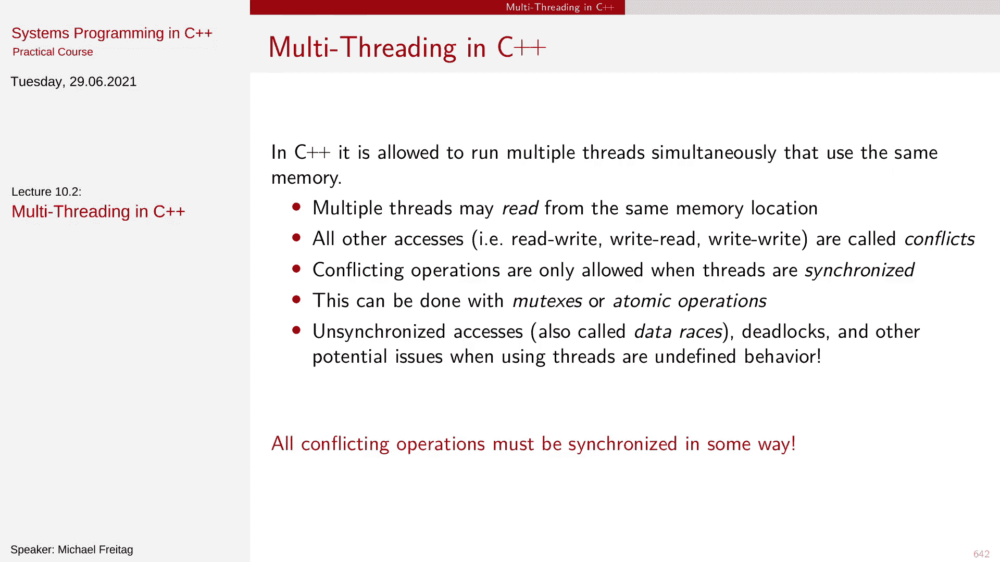
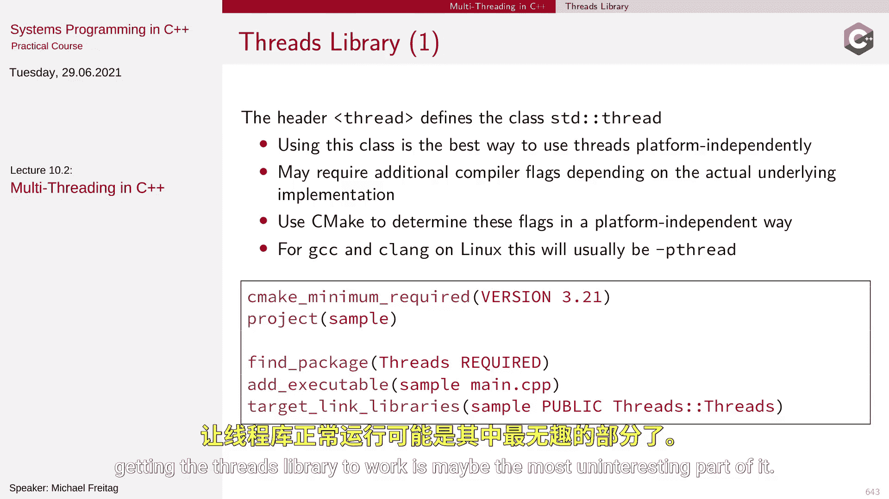
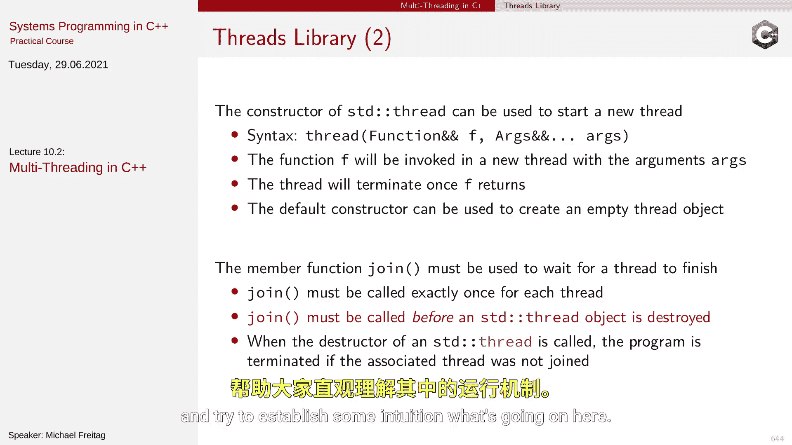
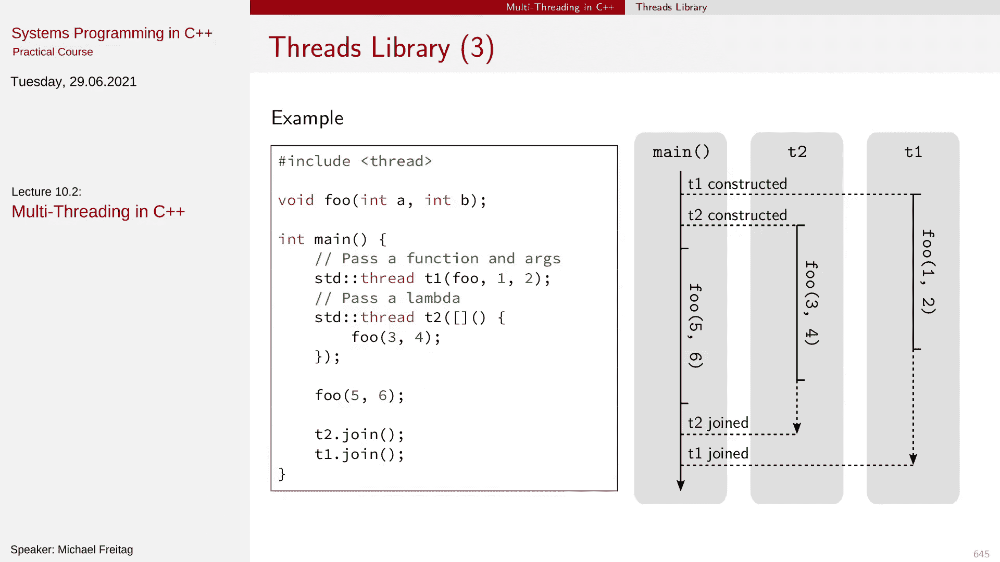

# 014：C++中的多线程

在本节课中，我们将学习如何在C++中使用多线程。我们将从如何创建和启动线程开始，然后探讨多线程编程中至关重要的同步问题，以确保程序行为正确且高效。

上一节我们介绍了多线程的基本概念和潜在问题，本节中我们来看看如何在C++中实际创建和使用线程。

## 线程的创建与使用

C++标准库在 `<thread>` 头文件中提供了 `std::thread` 类，这是我们创建和管理线程的主要工具。这个类是平台无关的，其行为由C++标准定义，底层实现会适配不同的操作系统。

为了启用线程功能，编译时可能需要特定的标志。例如，在Linux上使用GCC或Clang时，通常需要 `-pthread` 标志。为了保持项目的可移植性，建议使用CMake来管理这些依赖。

以下是如何在CMake项目中启用线程支持的代码片段：
```cmake
find_package(Threads REQUIRED)
target_link_libraries(your_target_name PRIVATE Threads::Threads)
```

现在，让我们看看如何使用 `std::thread` 类。

### 启动线程

`std::thread` 的构造函数用于启动一个新线程。其语法是传递一个可调用对象（如函数或lambda表达式）以及该对象所需的参数。

构造函数的基本形式如下：
```cpp
std::thread thread_object(callable_function, arg1, arg2, ...);
```
传递给构造函数的参数会被转发给可调用对象。一旦函数执行完毕并返回，该线程就会终止。



也可以使用默认构造函数创建一个空的、未关联任何执行线程的 `std::thread` 对象。

### 等待线程结束

线程启动后，会在后台执行。在主程序结束前，必须对每个已启动的线程对象调用 `join()` 成员函数。`join()` 会阻塞当前线程（通常是主线程），直到被调用的线程执行完毕。即使你知道线程已经结束，也必须调用 `join()`。

每个通过 `std::thread` 构造函数启动的线程，其对应的 `std::thread` 对象在销毁前必须被 `join()` 恰好一次。如果在对象析构时还未调用 `join()`，程序将被终止。

### 代码示例

以下是创建和运行线程的一个简单示例：

```cpp
#include <thread>



void foo(int a, int b) {
    // 执行一些工作
}

int main() {
    // 方式一：传递函数和参数
    std::thread t1(foo, 1, 2);

    // 方式二：传递lambda表达式
    std::thread t2([]() {
        foo(3, 4); // 在lambda内部调用函数
    });

    // 主线程也可以执行工作
    foo(5, 6);

    // 等待所有线程完成
    t1.join();
    t2.join();

    return 0;
}
```

在这个例子中，我们创建了两个线程 `t1` 和 `t2` 来并发执行 `foo` 函数，同时主线程也执行了一次 `foo`。最后，通过调用 `join()` 确保所有线程在程序退出前完成。

## 线程同步与数据竞争

上一节我们学习了如何创建线程，本节中我们来看看多线程编程中最核心的挑战：同步与数据竞争。

当多个线程共享同一内存空间时，如果它们同时访问（读取或写入）同一内存位置，就可能引发问题。在C++中，这被称为 **冲突** 或 **数据竞争**。

具体来说，以下情况构成冲突：
*   一个或多个线程读取，同时另一个线程写入。
*   一个线程写入，同时另一个线程读取。
*   多个线程同时写入。



**任何存在冲突的未同步操作，在C++中都属于未定义行为。** 这意味着程序可能崩溃、产生错误结果或出现其他不可预测的行为。

唯一安全的情况是：**所有线程都只从同一内存位置读取数据**。

为了使存在冲突的操作具有明确定义的行为，线程之间必须进行 **同步**。主要的同步机制有两种：
1.  **互斥**：确保一次只有一个线程能访问共享资源。
2.  **原子操作**：保证对单个内存位置的读写操作是不可分割的。

在后续的课程中，我们将详细探讨如何在C++中实现这些同步机制。



本节课中我们一起学习了C++多线程编程的基础。我们了解了如何使用 `std::thread` 创建和管理线程，并认识了多线程环境中至关重要的数据竞争与同步问题。记住，任何非纯读取的共享内存访问都必须进行同步，否则会导致未定义行为。在接下来的课程中，我们将深入探讨互斥锁、原子操作等具体的同步工具。