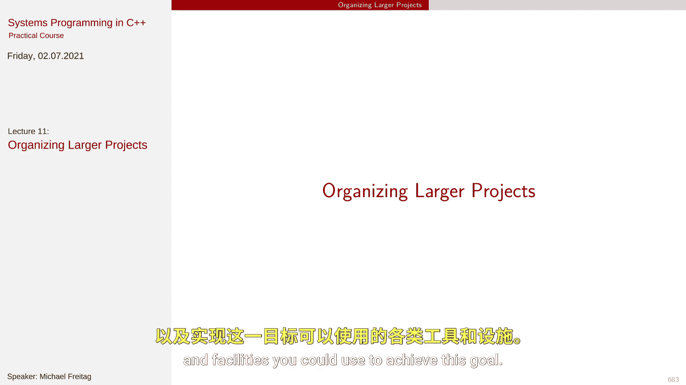
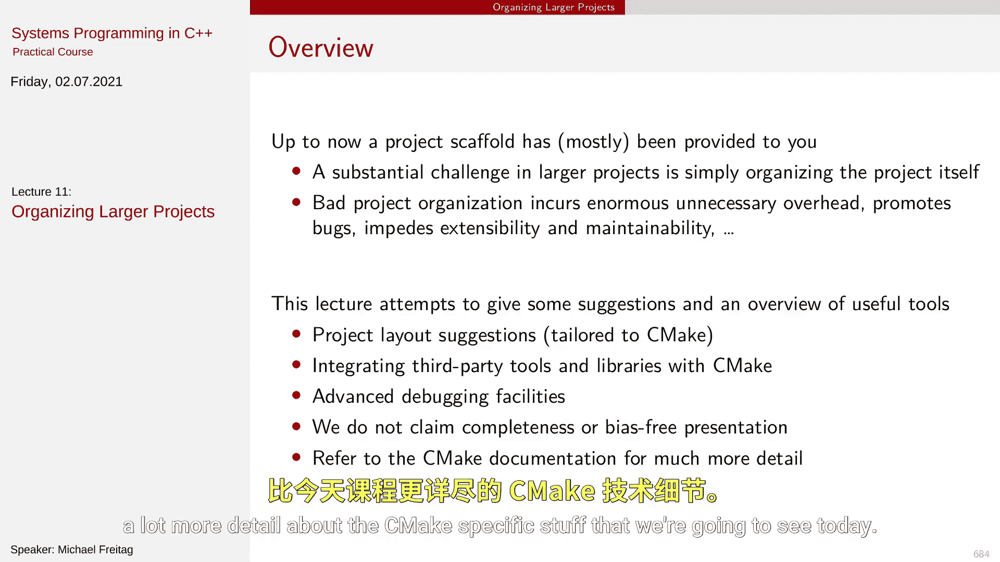
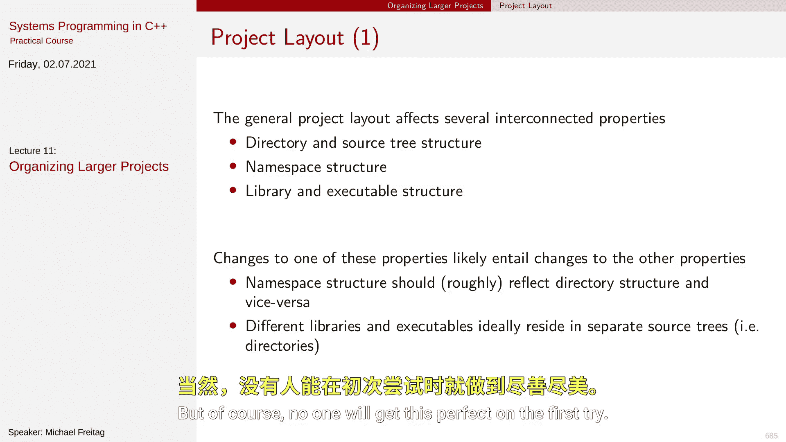
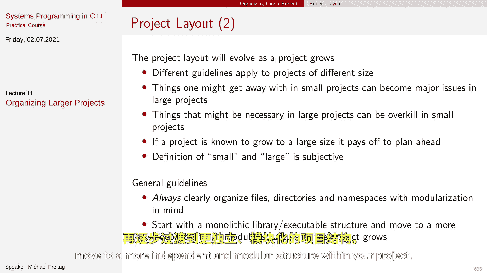
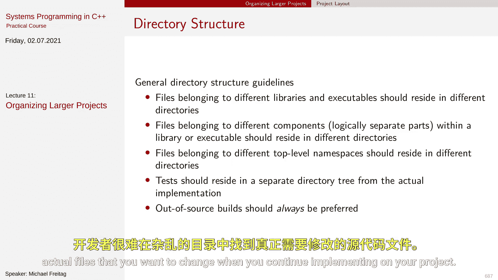
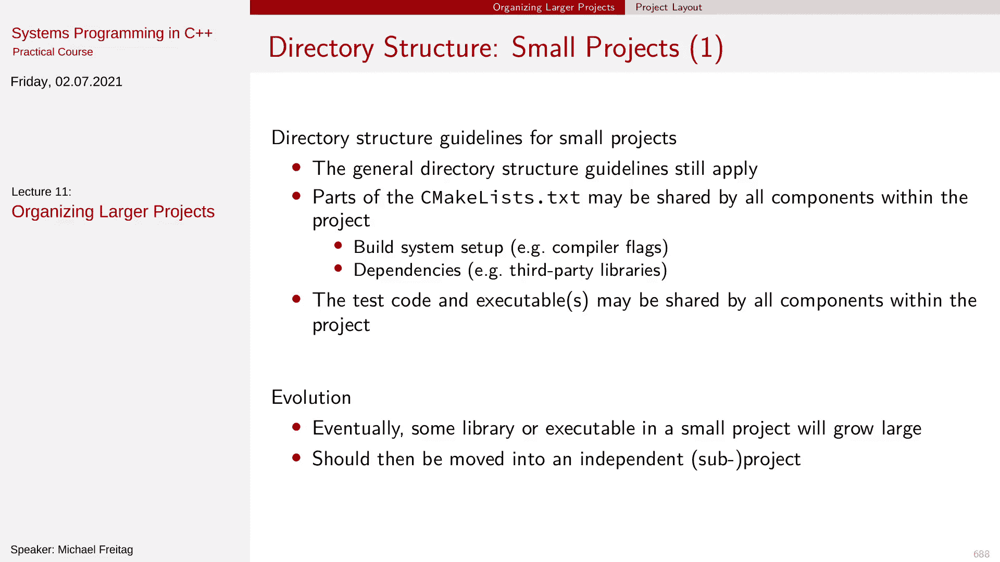

# 015：组织大型项目 🏗️

在本节课中，我们将要学习如何管理和组织大型C++项目，以及可以使用的工具和设施。我们将探讨项目布局、第三方库集成以及高级调试技巧。

## 项目布局与结构 📁

上一节我们介绍了组织大型项目的动机，本节中我们来看看如何具体地构建项目结构。

项目在文件系统上的结构虽然听起来简单，但实际上对整个项目的生命周期有深远影响。项目布局会影响C++代码的多个方面，例如源文件树结构、命名空间结构、头文件包含关系，以及库和可执行文件的组织方式。一个糟糕的项目结构会阻碍项目进展，增加引入错误的可能性，并使维护和扩展变得困难。

因此，遵循一些最佳实践来组织项目至关重要。以下是一些关于目录结构的高级建议：

*   **分离库和可执行文件**：属于不同库或可执行文件的文件应放在不同的目录中，不应将它们混合在同一个目录树下。
*   **分离组件**：即使在同一库或可执行文件中，属于不同组件或模块的文件也应放在不同的目录中。这通常对应着系统中的不同模块，并且这些模块应属于不同的顶级命名空间。
*   **分离测试代码**：测试代码应放在与实际实现代码分离的目录树中。这样可以方便地在发布或构建时剥离测试代码。
*   **优先使用外部构建**：始终推荐使用外部构建。在CMake中，这意味着创建一个单独的`build`目录来存放所有生成的文件，从而避免源文件目录被生成的文件污染，便于查找和修改实际源代码。

## 项目规模考量 ⚖️

项目布局的具体规则会根据项目规模而变化。对于小型项目，一些不完美的解决方案或许可以接受，但在大型项目中会成为主要问题。反之，一些仅适用于大型项目的实践在小型项目中可能显得过度设计。

关键在于，如果你预见到项目未来会增长，提前规划是值得的。可以引入一些在项目初期并非必需，但在项目发展到一定规模后绝对必要的实践。项目规模是主观的，也取决于参与项目的人数。

无论项目大小，我们都建议遵循一些通用准则：始终以清晰的模块化为目标来组织文件、目录和命名空间。这包括实现高内聚、低耦合的代码。一个清晰的目录结构可以反映项目中的不同模块，从而使这一点更容易实现。

大多数情况下，除非你明确知道要启动一个非常庞大的新项目，否则我们建议从一个单一的结构开始（例如一个库或一个可执行文件）。然后随着项目的发展，逐步转向更独立和模块化的内部结构。

## 总结

本节课中我们一起学习了组织大型C++项目的核心原则。我们了解了项目结构的重要性，探讨了关于目录布局、组件分离和测试代码管理的最佳实践。我们还讨论了如何根据项目规模调整组织策略，并强调了为未来增长进行规划的价值。记住，一个清晰、模块化的项目结构是提高代码可维护性、可扩展性和团队协作效率的基础。