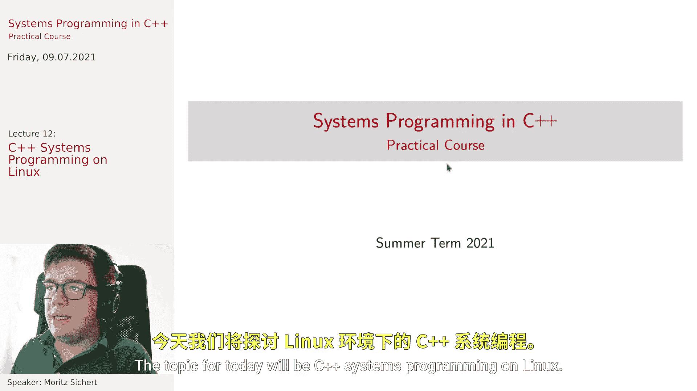
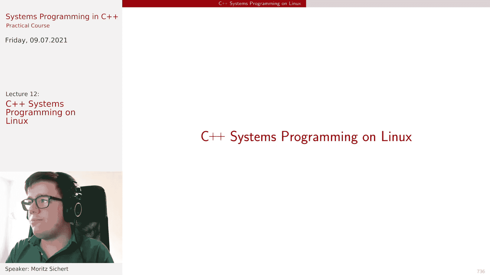
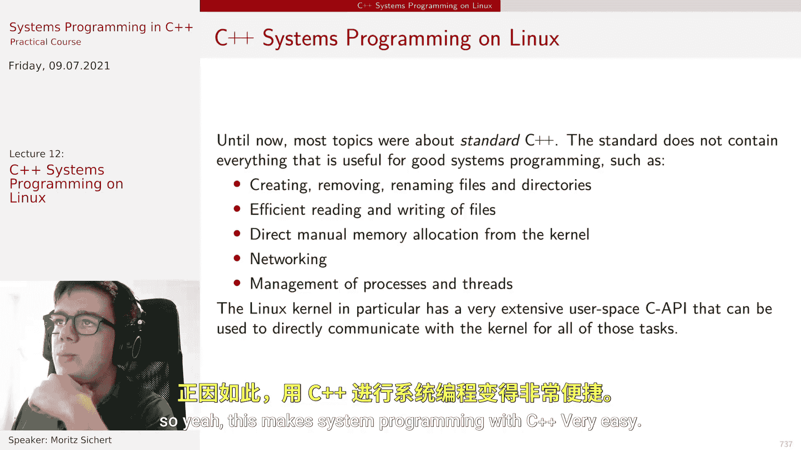
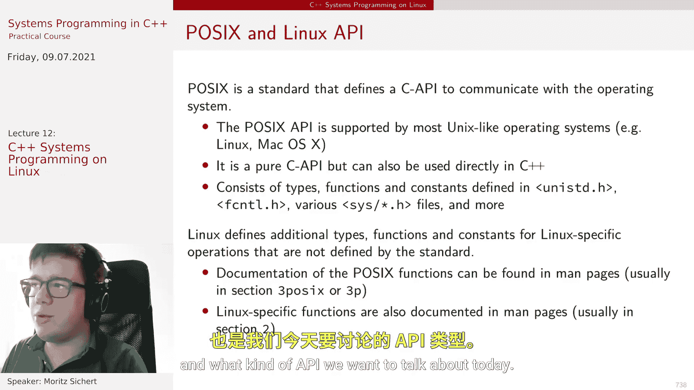
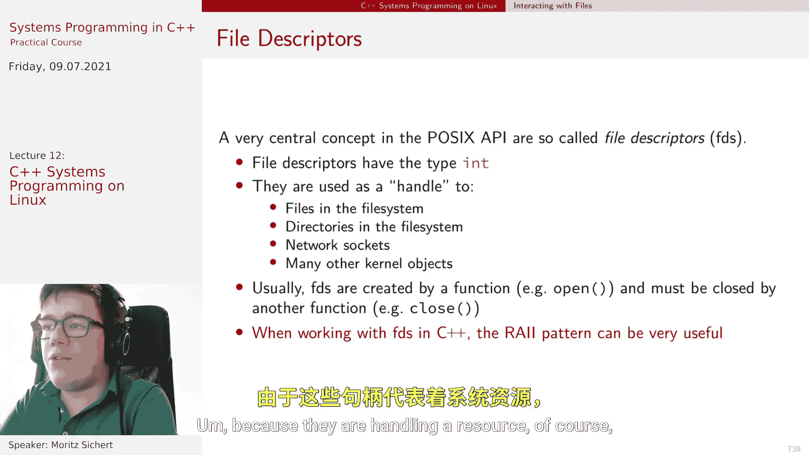

# 016：Linux上的C++系统编程 🐧

在本节课中，我们将学习如何在Linux操作系统上进行C++系统编程。我们将探讨如何超越标准C++库，直接与操作系统交互，以实现更高效、更底层的控制。

## 概述

到目前为止，我们主要讨论了C++语言本身，这是进行C++系统编程的重要基础。今天，我们将重点介绍如何实际与操作系统通信，并以Linux为例进行讲解。我们已经在所有练习中使用了Linux，因此今天将主要聚焦于Linux平台。

## 标准C++与系统交互

我们之前讨论的是标准C++，即C++标准。它确实包含了许多可以与系统交互的函数，例如写入文件、读取文件以及启动线程等。然而，标准库的设计目标是跨架构和跨操作系统兼容性。例如，流（streams）通常速度较慢，并且你无法精确控制标准库将使用的具体功能或系统调用。

对于系统编程，我们通常需要直接访问我们正在使用的操作系统。系统编程的示例包括处理文件和目录。虽然标准库中已有一些相关功能，但操作系统通常提供了更丰富的功能，我们也希望能够使用它们。此外，高效地读写文件也很重要，因为正如之前所说，流操作很慢。不同的文件读写场景需要不同的方法，我们今天将看到一些示例。为了实现这些，你需要直接使用系统调用或系统提供的函数。

## 系统编程的核心领域

以下是系统编程的几个核心领域：

*   **手动内存管理**：到目前为止，我们使用的是C++的标准分配器，它们主要在后台使用 `malloc`。但问题是，如果你认为可以实现更高效的 `malloc`，该如何实现呢？当然，你需要能够与操作系统通信，以便在你的进程中实际分配新内存。
*   **网络编程**：我们今天不会讨论网络编程。主要原因是信息学专业有一门完整的课程专门讲解这个主题，其中重点介绍了Linux上的C网络API。因此，我们今天不涵盖这部分内容，但它无疑是系统编程中非常重要的一部分。
*   **进程和线程管理**：你可以使用C++的 `std::thread` 类，但你可能还想执行诸如启动新程序、自定义新线程或新进程等操作。

这些都是系统编程的典型示例。

## Linux API与POSIX标准

在Linux中，所有这些功能都通过用户空间C API提供。用户空间意味着许多功能尽可能在用户空间（而非内核空间）实现。当然，创建新进程甚至打开文件最终都需要与内核通信。但Linux的标准库（或者说，其实现）试图在用户空间实现尽可能多的功能。

这个API以C API的形式实现，这意味着有为C编写的头文件。这些头文件声明了函数，然后你通常只需要链接系统上的 `libc` 库即可使用这些函数。C++的优势在于它能轻松与C互操作。因此，在C++程序中，你通常可以直接包含这些C头文件，它们会正常工作。这使得用C++进行系统编程变得非常容易。

### POSIX标准

Linux API 很大程度上遵循一个名为 **POSIX** 的标准。POSIX本质上是一组函数和行为的集合，定义了操作系统应如何表现以及应提供哪些类型的函数。Linux提供的大多数函数实际上都在POSIX标准中有所规定。这意味着它们不仅特定于Linux，也可以在所有其他符合POSIX标准的系统中使用。例如，大多数类Unix系统（不仅是Linux，还有macOS以及各种BSD Unix）通常都支持POSIX API。因此，如果你只使用Linux实现的纯POSIX函数，那么你的程序在很大程度上也可以移植到其他使用POSIX API的操作系统上。

正如所说，Linux API主要由C头文件（C API）组成。我们今天将讨论的函数涉及的最重要的头文件包括 `unistd.h`、`fcntl.h` 以及 `sys/` 目录下的几个头文件。当然，在介绍具体函数时，我也会简要说明需要使用哪些头文件。

### Linux特有功能

当然，由于POSIX API试图兼容，或者说它试图成为一个可以在多个操作系统中实现的标准，这通常意味着每个操作系统都会有POSIX未涵盖的额外功能。Linux也不例外。Linux是一个庞大的软件项目，拥有许多非常特定且仅在Linux上工作的功能，它们无法在macOS或任何BSD系统上运行。

这些Linux特有的功能也以C函数的形式定义。但使用较新的功能也意味着，当你执行程序时，需要足够新的Linux内核来实现这些功能。

### 文档查询

对于POSIX API和Linux API，你都可以在手册页（man pages）中找到所有文档。通常，纯POSIX文档位于第3p节（或3 pos节）。如果你只是输入 `man` 后跟函数名，系统通常会自动找到正确的文档。对于Linux特有的函数也是如此，你也可以输入 `man` 后跟函数名，Linux会提供非常详细的函数文档。

以上是对Linux支持的API类型以及我们今天将要讨论的API的概述。

## 文件描述符：核心概念

POSIX以及Linux中一个非常核心的概念是所谓的 **文件描述符**。它们通常缩写为FD（单数）或FDs（复数）。

文件描述符这个名字暗示它当然用于处理文件，但这并非文件描述符的唯一用途。它们通常用作处理许多不同类型资源的句柄。文件是一种资源，为其分配文件描述符是合理的，这也是名称的由来。但你也可以为目录分配文件描述符（“文件”描述符这个说法可能仍然可以接受）。此外，你还可以为网络套接字分配文件描述符（根据Unix哲学“一切皆文件”，或许网络套接字也可以被视为文件）。特别是在Linux上，你还有许多行为完全不像文件的对象，它们仍然由文件描述符处理。

本质上，你可以将文件描述符视为一个任意的整数（`int` 类型）。它只是你当前正在处理的任何对象或资源的某种句柄。

因为它们处理的是资源，所以这个资源最终必须被释放。例如，如果你打开了一个文件...

## 总结

本节课中，我们一起学习了Linux上C++系统编程的基础。我们了解了标准C++库在系统交互方面的局限性，并引出了直接使用操作系统API的必要性。我们介绍了系统编程的几个关键领域，如内存管理、进程线程控制等。重点讲解了Linux提供的用户空间C API及其与POSIX标准的关系，包括可移植的POSIX函数和Linux特有的扩展功能。最后，我们引入了文件描述符这一核心概念，它是Linux/POSIX系统中处理各种I/O资源的统一抽象。在接下来的课程中，我们将基于这些概念，深入探讨具体的系统调用和编程实践。