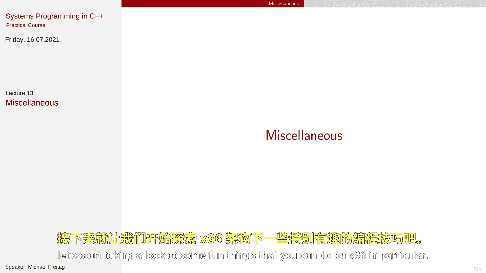
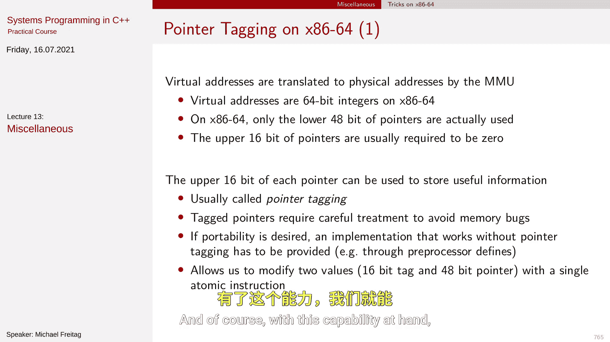
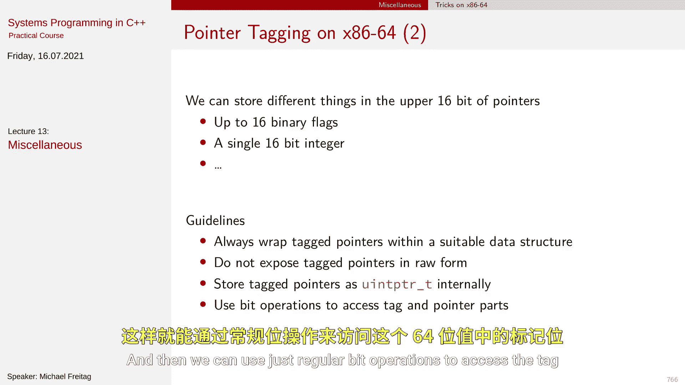
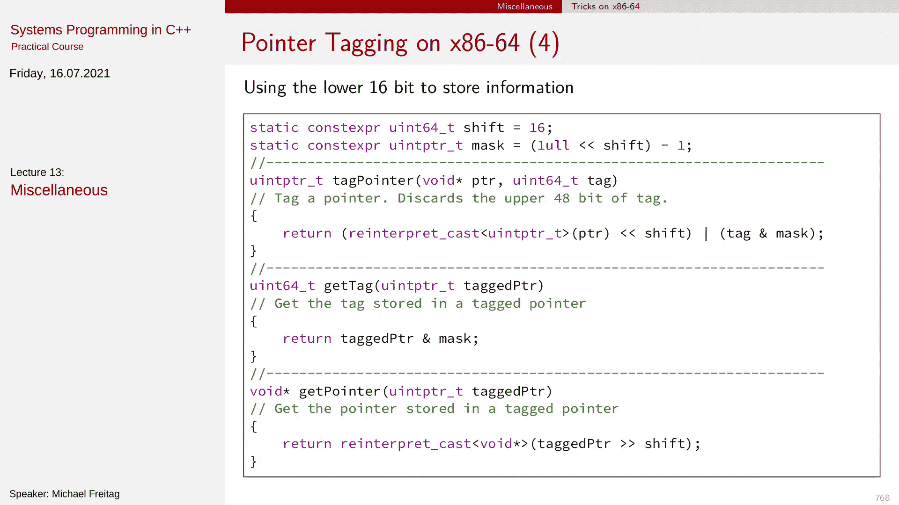

# 017：杂项主题 🧩

在本节课中，我们将探讨一些在前面的课程中没有机会深入讨论，但依然足够有趣的主题。请注意，今天涉及的大部分内容都远比本讲座所展示的要庞大，我们只是浅尝辄止，目的是让大家知道这些概念的存在。如果你对某个主题感兴趣，我们鼓励你自行深入研究。有了这个概览，当你遇到可能用到这些知识的问题时，或许能想起来：“哦，之前有提到过这个主题。”



带着这个目标，让我们开始了解一些在X86架构上可以做的有趣事情。

## 指针标记（Pointer Tagging） 🏷️

首先，我们要简要讨论一个名为“指针标记”的主题。它利用了我们在动态内存管理课程中学到的知识：程序使用的是虚拟地址空间，这些虚拟地址由内存管理单元（MMU）转换为主存中的实际物理地址。

在64位系统（如今已是事实标准）上，虚拟地址是64位整数。但在X86-64架构上，内存管理单元实际上只使用指针的低48位来进行物理地址转换。这意味着我们的指针实际上只包含48位信息，高16位未被系统使用。于是，我们自然想到可以尝试在这高16位中存储一些有用的信息，这就被称为“指针标记”——我们给指针添加了“标记”。

当然，这样做必须非常小心。如果我们意外地设置了高16位中的某一位，然后在将值用作指针之前忘记清除它，就会引发各种难以调试的内存错误，导致程序崩溃。此外，如果我们希望程序具有真正的可移植性，还必须提供一个不使用指针标记的实现，因为这是X86架构特有的，在其他可能使用指针高位的架构上可能无效。

指针标记在特定情况下极其有用的一点是：你可以通过一条**原子指令**同时修改两个值——即指针本身和你想存储在那16位中的任何信息。根据你构建的数据结构类型，利用这一特性可以极大地提高数据结构的同步效率。



有了这个能力，我们基本上可以在这16位里做任何想做的事情。例如，我们可以存储最多16个二进制标志位来告诉我们关于指针目标的某些信息，或者存储一个16位整数，等等。

为了给你一些启发，我可以分享一些实际应用场景。例如，我曾经需要实现一个本质上类似树的数据结构。节点之间存在关系，但节点本身只是原始内存块，你无法预先知道这些内存是如何组织的。这意味着可能存在不同类型的节点，它们都只是原始内存块。因此，我必须在指向这些原始内存块的指针中，编码该内存块的实际类型。在这种情况下，指针标记就非常有用，因为我可以将指针和目标信息一起存储在一个64位整数中，并且能够通过一条原子操作来修改这个64位整数。

另一个例子来自我们的数据库项目。你可以在指针的高16位中存储一个小的布隆过滤器，用于哈希表查找。考虑链式哈希表桶中存储的指针，你只需要使用48位作为指针，剩下的16位可以用来存放一个小型布隆过滤器。在某些情况下，你可以根据这个布隆过滤器推断出某个值肯定不在这个桶中，从而跳过相对昂贵的链式查找。当然，这只是众多例子中的两个，指针标记在很多场景下都相当有用。

但请注意，大多数情况下，指针标记是一种优化手段。此外，由于它很容易引入内存错误，建议始终将带标记的指针包装在一个合适的数据结构中。这个数据结构应提供一个接口，让你能以比直接操作原始64位整数更类型安全的方式提取实际指针和设置标记。不要以原始形式暴露这些带标记的指针，只通过包装数据结构来访问底层数据。

为了实际进行这些花哨的修改，我们首先需要将指针转换为整数类型。合适的类型是 `uintptr_t`。然后，我们可以使用常规的位操作来访问这个64位值的标记部分和指针部分。

以下是一个代码示例，展示了如何使用指针的高16位来存储信息：

```cpp
// 辅助常量
constexpr int kPointerBits = 48;
constexpr uintptr_t kPointerMask = (static_cast<uintptr_t>(1) << kPointerBits) - 1;

// 将指针与标记组合
uintptr_t AddTag(void* ptr, uint16_t tag) {
    uintptr_t int_ptr = reinterpret_cast<uintptr_t>(ptr);
    // 清除指针的高16位，然后将标记左移到高16位，最后组合
    return (int_ptr & kPointerMask) | (static_cast<uintptr_t>(tag) << kPointerBits);
}



// 从带标记的指针中提取原始指针
void* GetPointer(uintptr_t tagged_ptr) {
    return reinterpret_cast<void*>(tagged_ptr & kPointerMask);
}

// 从带标记的指针中提取标记
uint16_t GetTag(uintptr_t tagged_ptr) {
    return static_cast<uint16_t>(tagged_ptr >> kPointerBits);
}
```

当然，你也可以对低16位进行类似操作，只是移位和掩码操作的方向相反，但原理完全相同。

**关于严格别名规则的说明**：这里并不违反严格别名规则，因为我们没有使用不同类型的指针来引用不同类型的数据结构。这里没有别名问题。我们只是将指针的值复制到一个新的 `uintptr_t` 类型变量中，这总是合法的。然后，当我们提取时，将64位整数的字节复制到一个新的指针类型值中，同样没有任何问题。

**关于 `reinterpret_cast` 的说明**：此处的 `reinterpret_cast` 之所以有效，是因为C++标准特别允许将指针类型重新解释为 `uintptr_t`。这是“不能随意重新解释类型”规则的一个特例，因为有时将指针视为整数值是有用的。

**关于实用性的问题**：这听起来可能有点小题大做，确实比较复杂。保持“我可能不需要这个”的心态是件好事。但根据经验，特别是在我们教研室开发的数据库中，我们确实使用了这项技术。

---



本节课中，我们一起学习了**指针标记**这一高级主题。我们了解到，在X86-64架构上，可以利用指针中未使用的高位来存储额外信息，从而将数据和元数据紧凑地结合在一起，并通过原子操作进行修改。虽然这是一个强大的优化技巧，但我们也强调了其平台依赖性和潜在的风险，建议通过包装数据结构来安全地使用它。希望这个概览能为你未来的编程工作提供一个新的思路。