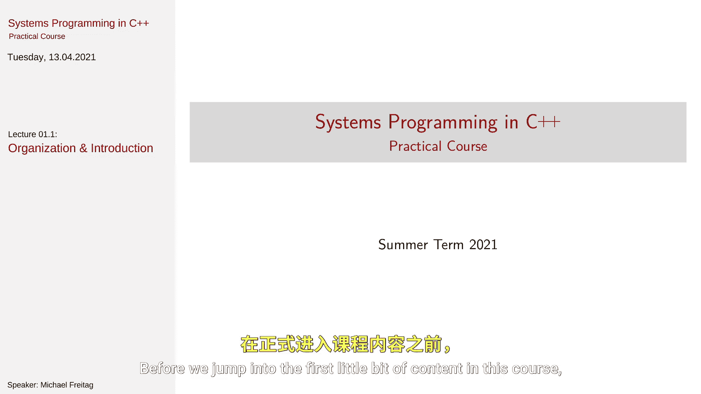
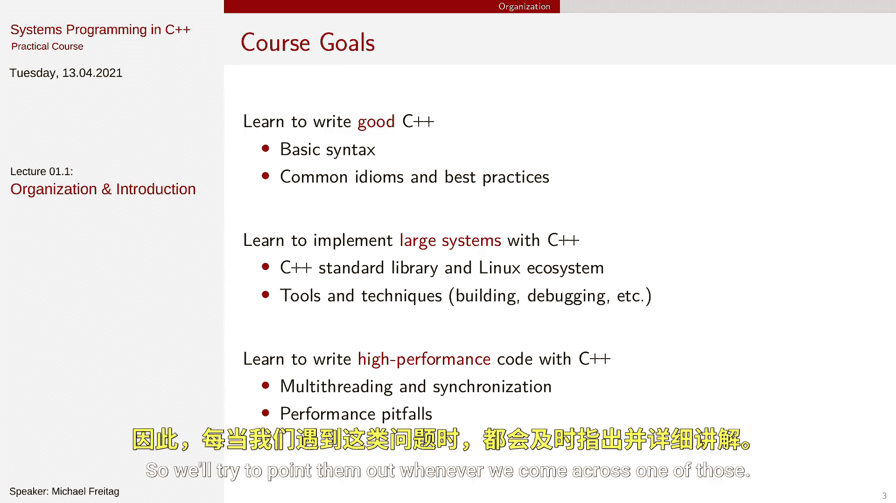
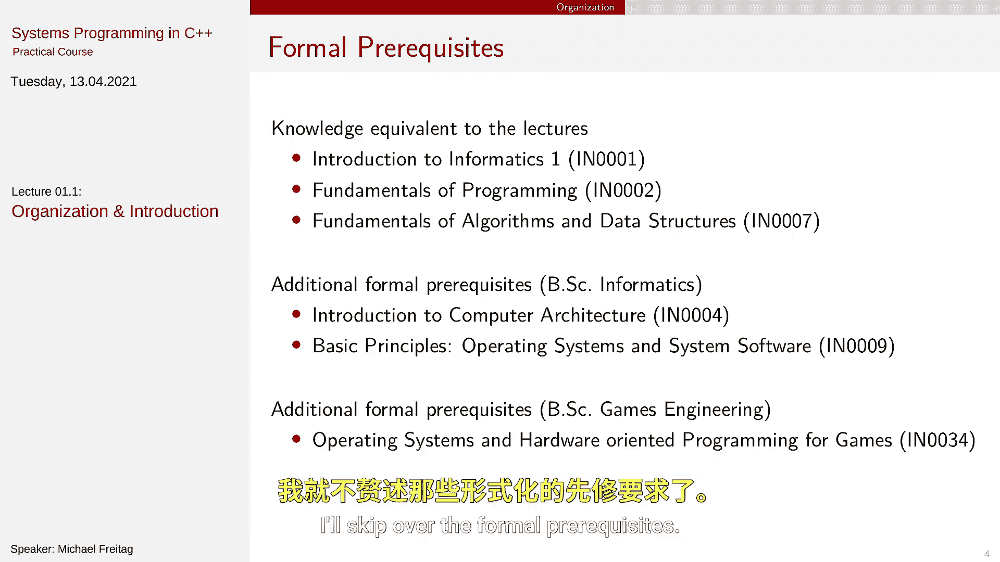
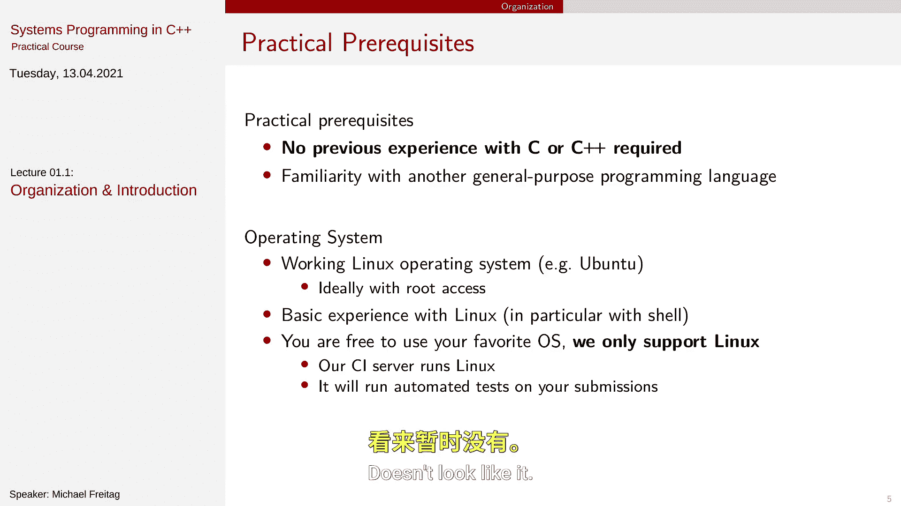
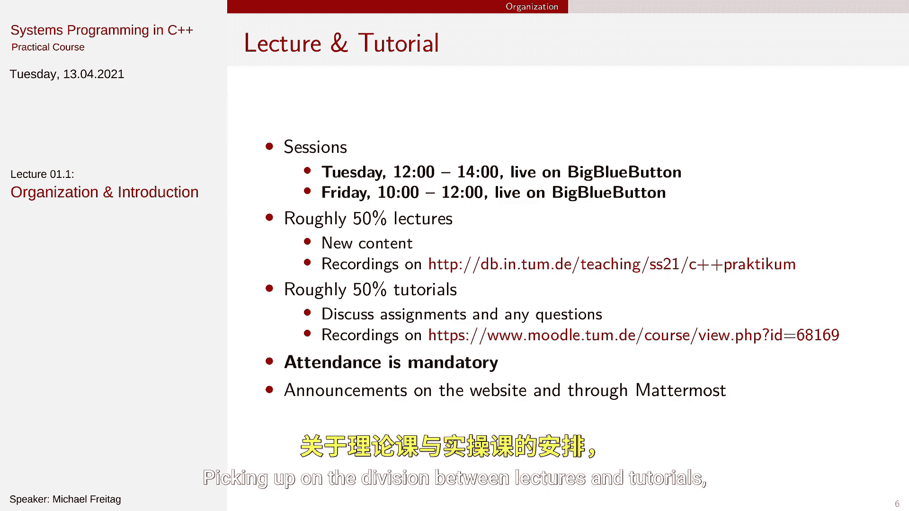
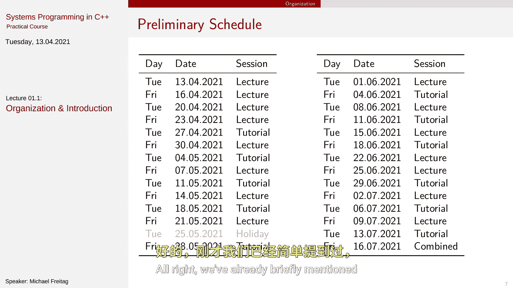
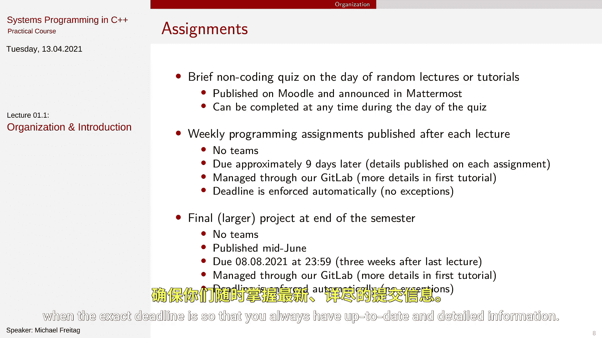

# 慕尼黑工业大学【中英⚡C++系统编程｜Systems Programming in C++】 p01 P1 1： Organization & Introduction -BV1gMbAz2EAk_p1-

All right， hello and welcome everyone once again to the systems programming and C+ plus practical course in this summer term。

Before we jump into the first little bit of content in this course。

 let's take a little bit of time and run over the organizational parts that we need to get out of the way。

Some of what I'm going to talk about has already been covered in the kickoff meeting。

 so if you attended the kickoff meeting， just be patient and we skip over those parts pretty quickly。

 but there is also some new， more detailed information about how we are planning to run this course。

So this is probably nothing new。 What are our general goals in this course。

 of course we want you to learn to write C++ obviously and this of course entails basic syntax idioms and then we also want to teach you how to implement larger systems so for this we're going to cover the C++ standard library how you can interact with Linux and all kinds of tools and techniques that you need for this task and finally a lot of people are drawn rightfully to C++ because it promises to make it easy to write very high performance code and this of course requires us to talk about things like multithreading and synchronization and some common pitfalls that might compromise the performance of your system and as you will see throughout this lecture there are surprisingly many of these performance pitfalls so we'll try to point them out whenever we come across one of those。

I'll skip over the formal prerequisites。 You're already in this course。

 so this is not that relevant anymore。 The practical prerequisites are a little bit more relevant。

So as we've already pointed out in the kickoff meeting。

 we do not expect you to have any previous experience with C or C+ plus and at this point。

 let me even word this a little bit stronger， even if you have any previous experience with C or C++ we would recommend to you that you try to forget this previous experience and really see this course as starting in you not because we don't trust that you already know how to write some programs。

 but because it will make it easier for you to write code in a way that we expect of you because this course is not only about learning how to write C++ but also about learning to write good C plus plus in whatever sense that means we' clarify that of course later throughout this course So if you have some previous experience that's great and it'll make certainly make it easier for you but try to。

To attack the programming assignments with as little previous knowledge as possible and try to use just what we have covered in the lecture so far。

 and I promise you this will make it easier for you to get good grades in the programming assignments。

Of course。Even if you don't have any previous experience。

 you will be able to solve these programming assignments provided that you have familiarity with some other general purpose programming language such as Java or Python。

 so I think this applies to all of you， and then you won't have any trouble。

Concerning your operating system， we。Essentially expect that you work on a Linux system this may be in a virtual machine。

 but even there we cannot guarantee that everything we do will work in there。

 so ideally if you really have a bare bones Linux operating system and ideally with root access because we've had some trouble in previous years with people trying to work on a Linux operating system where they did not have root access。

 such as the computer rooms at tomb， but I think during this semester this won't be an issue anyway given the current situation。

Since we do expect that you work on a Linux operating system。

 you also need to have some basic experience， so in particular with the shell but nothing fancy just being able to move around the system。

 execute commands， and so on。Given all this， of course you can still use whatever operating system you want。

 but if you do use something else， then Linux we will try our best to give you support。

 but if something just doesn't work on a different system。

 you're essentially on your own because this course is tailored towards a Linux system。In particular。

 our continuous integration server about which Muitz will talk some more on Friday runs Linux and this server will run automated tests on your submission。

 so the best way to make sure that these tests actually pass is being able to replicate them on your local system so if your local system runs something different then RCI server it may be possible that your local tests。

 for example， pass and then on the continuous integration server they fail so this is just unnecessary overhead that you can avoid by working with Linux from the get go。

Do we have any questions so far？Doesn't look like it great。

 so let's move on about the timing organization stuff so you've all found the first lecture session so this shouldn't be new to you and we have sessions on Tuesday from 12 to 2 We will start sharp at 12 but we'll try to keep our sessions within 90 minutes so usually we should be done around 130。

And the same goes for Friday there our session is from 10 to 12 once again we start sharp at 10 and we'll try to keep it within 90 minutes so usually we should be done around 1130 both these sessions are going to be live in the big blue button room that we are in now and we' split these sessions between roughly 50% lectures where we present new content and just talk about new stuff in C++ those are the recordings that are going to be publicly available and we roughly have 50% tutorials where we discuss the programming assignments and any questions that may come up while you work on these assignments or just questions in general。

And as I've already said， those recordings are going to be uploaded on Moodle and since these slides are now online。

 thanks Mors， you can just click on the links in these slides here and it'll take you directly to the respective websites。

Both。The lectures and the tutorials have mandatory attendance。

 of course if you have some good reason like a retake exam will make an exception。

 but apart from that we expect that you attend both the lecture anti tutorial sessions and this is for a good part because we will present important and new content in both the Tuesday and the Friday sessions。

Right， and if any。Any important announcements are due well make them through our website and mostly through the metatamost chat。

 so make sure to check the chat regularly。Picking up on the division between lectures and tutorials。

 we have a preliminary schedule here。

For the semester so this is preliminary so we might have to change it if something unforeseen comes up。

 but we'll try to stick to this schedule as far as possible。

 there is one holiday that coincides with a lecture session and of course this won't be taking place and it's your holiday after all。

All right。

We've already briefly mentioned that there are going to be programming assignments of some sort。

 so let's take some time and clarify that some more。

 so I've already mentioned we expect you to attend both the lecture and the tutorial sessions and to encourage attendance there are going to be brief quizzes on the day of random lectures or tutorials。

These are non coding quizzes， so those are just brief questions that can usually be answered in one sentence or even one word。

And they are going to be published on Moodle， and we will announce them in our metaos chat since usually we would just hand out。

Quiz sheets at the beginning of a lecture， but since we were doing the lecture online。

 this is a little bit more decoupled in the sense that these quizzes can be completed at any time during the day of the quiz。

But they are time limited， so you can choose for yourself when you're going to do a quiz。

 but once you start the quiz， there's， I think usually five minutes that count down and in these five minutes you'll have to complete the quiz。

In addition to the quizzes and this is probably at least for the first part of the semester。

 what you're going to spend the most time on， we have weekly programming assignments that are going to be published after each lecture starting today。

These programming assignments have to be completed individually。

 so there should be no teamwork and we will check for plagiarism。

 so just don't share a code between yourself， solve those program assignments on your own。

They are due approximately 9 days after we publish them。

Approximately because this will change just depending on the scheduling throughout the semester。

 but we have exact details on each assignment， so it's stated there when the exact deadline is。

So that you always have up to date and detailed information。

第。