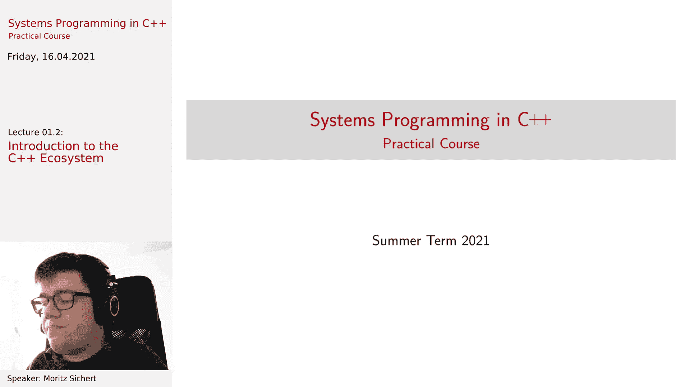
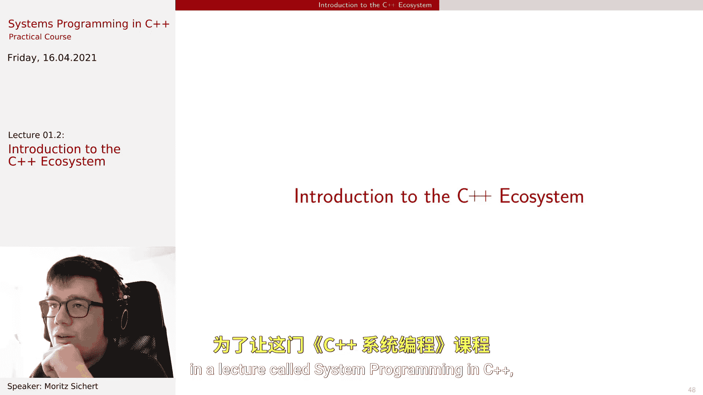
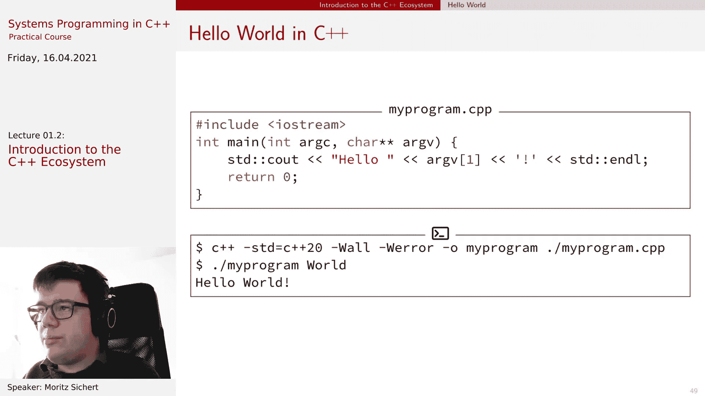
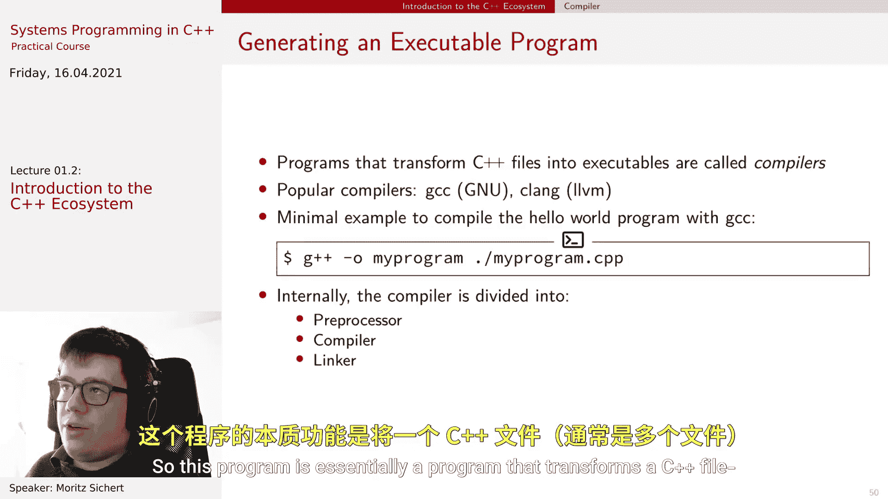
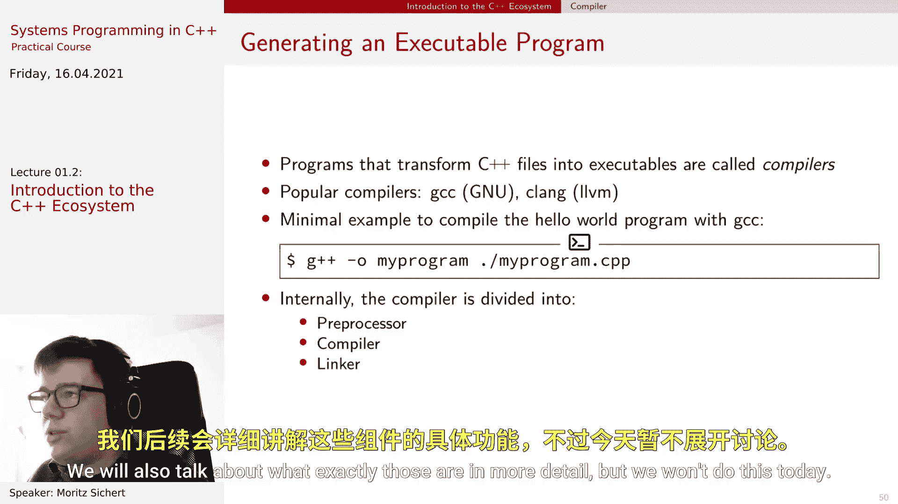
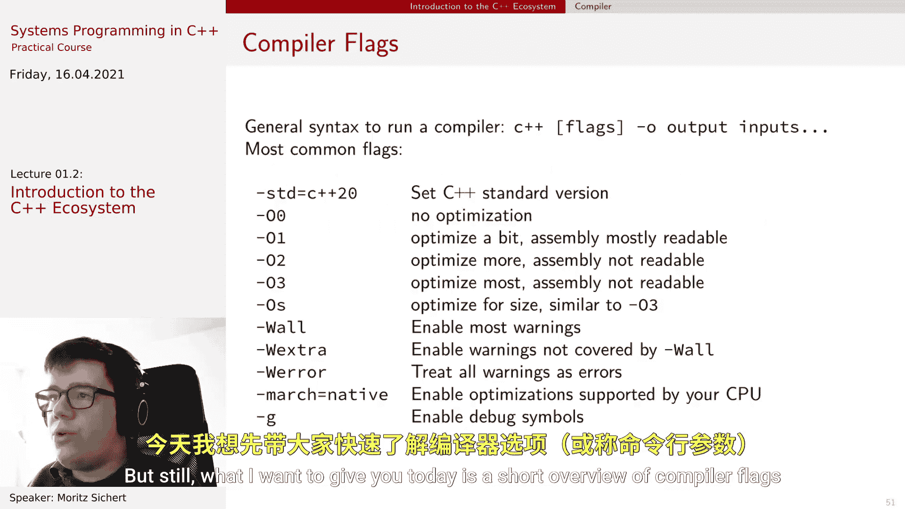
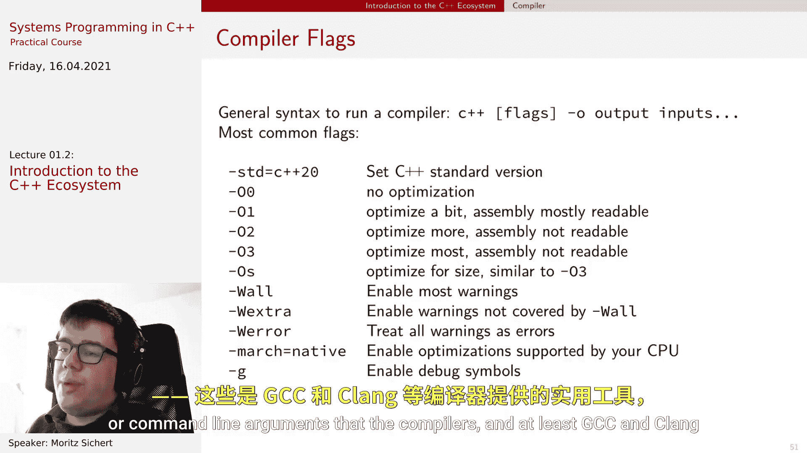
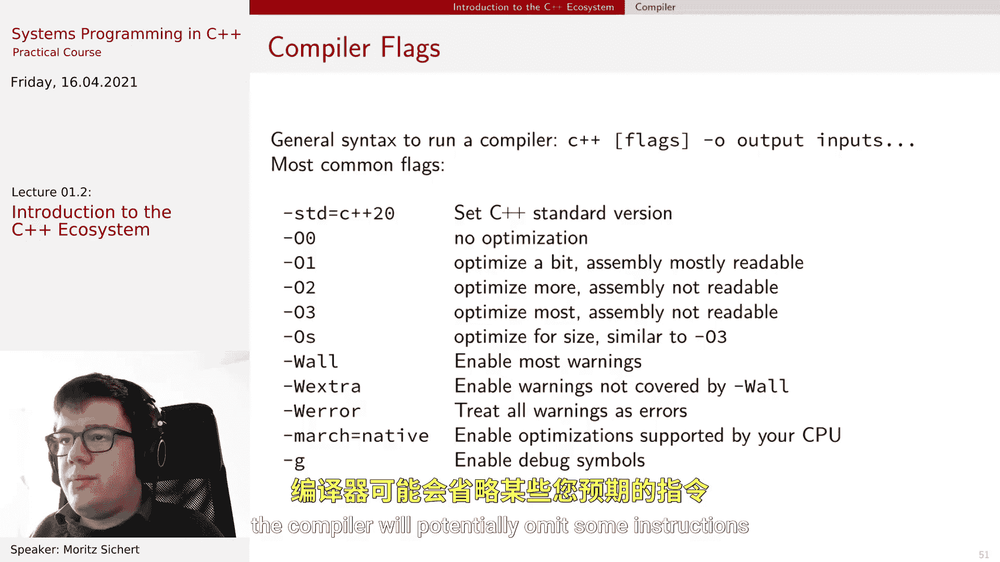

# 慕尼黑工业大学【中英⚡C++系统编程｜Systems Programming in C++】 p02 P2 2： Introduction to the C++ Ecosystem -BV1gMbAz2EAk_p2-

Welcome everyone to today's lecture on systems programming in C++。

Today's topic is is introduction to the C plus+ ecosystem。

 This unfortunately means we will not be talking about。C++ in detail yet。

 we will start to do this next week but there are quite a lot of things that you will come into contact with when working with C++ and we think it's important that I mean not only do we think that it is important that you'll know some of the ecosystem but you will also need a lot of this in your programming exercises in the next weeks。

 so this is why you will talk about them。

Nevertheless。So that you at least can see a bit of C++ code in an lecture called systems program and C++。

 I will show you a small hello world example in C++。

So I will not talk about the syntax today because this this is what we will do next week。

 but just that you have an idea how a C++ program looks like。

 you have a file that's usually has the file ending CPP。 and then you have some I mean。

 some statements there you can define the main function。 and this a bit of weird looking line here。

 this is。Essentially， the standard way to print something in Z++。

And here I mean it's just a hello word example so you print hello and then the first argument you give on the command line and yeah then just return0 and of course as we said on Tuesday Z plus bus is a compile language so you can't just execute it directly the program like you would be able to with Python I mean Python you still didnt interpreter but you don't need to compile it first。

With C++ you do need to do this and for this you need a program in here in this example we call this program C++ so you can see the c and the example terminal here。

We just run the program C+ bus with those arguments。

And then we get a binary file that is called my program and this we can then just execute with the command and argument here and then we get what we expected just to。

Hello words printed on the term。Okay。Before we start talking about the syntax， as I said。

 which we want to today， instead we want to talk about the second example here。

 namely the C plus program， so this program is。

Essentially a program that transforms a C plus plus file or usually itss multiple files into one executable that you will then be able to execute or the operating system knows how to execute and those programs they are called compilers it's just any program that。

Takes some programming language as an input and outputs as outputs and executable is usually called a compiler。

For CAs spa in particular the most popular compilers are GCC。

 this is CGCC is shot for new compiler collection so this is from the new project and there's another very popular compiler which is Kang。

 this is from the LLDM project you may have a heard of it GCC is mostly used on Linux systems so if you develop Linux you will most likely be using GCC。

And GCC， as it is from the new project， you may have expected that this that it is open source and it is of course。

 but Kang or the LVM project entirely is also open source and this is also very common to use on Linux it's just the default usually is GCC but you can easily also install KLang you may also have heard about Kang and LVM when working or developing on Mac OS because I think the default compiler on Mac if you're install there the IDE of Apple this is then Kang instead of GCC。

And GCC so the reason why we also present those two compilers is that they are mostly compatible in command and arguments。

 so if you see an example from GCC with command and arguments。

 you can usually just the executable from GC to Kang and then it will just work most of the time but let's first look at how you use such a compiler。

 so you can see here an example of GCC and the GCC as I said。

 is called or stands for new compiler collection， which means that I mean one thing that it means that it not only support CA+ but it can also support or compile C and other programming languages as well。

 so they are like different ways to execute as compiler and if you want to compile++ program with GCC。

 you have to use the G++ program。the Reper essentially to tell GCC to enable the C++ specific features and the most basic example to create a binary out of a source file is just to call the compiler with an input file and then use the dash O argument for the output file so that you have like so that the compiler writes the excutable to this file。

But internally and compiler， I mean， this just works， but internally， of course， quite a lot happens。

 and the first thing you have to know is that。Internally， compilers are usually divided into。

 or at least C+ plus compilers。 They are usually divided into a preprocessor。

 a compiler and a linker。 I mean， you see here that a compiler contains a compiler。

 This is a bit confusing。It's just that the word compiler。Usually if people talk about compilers。

 they usually mean all of those three steps together。

 even though technically the compiler is only one step of multiple that such a compiler needs or such a program needs to turn an exutable or turn source file into an exploitable。

 we will also talk about what exactly those are more in more detail， but this we won't do this today。

 but still what I want to give you today is a short overview of。

Compilr flex or command and arguments that the compilers and at least Gcc and clang that they have and that you can use to influence the compilation。

 So as you as you saw the general syntax is you just use the C plus plus version of your compiler So for Gcc。

 this would be G plus plus for clang， this would be clang plus plus。

Then you have some optional compiler flags that you usually specify the output file here with the dash O compiler F or command and argument。

 and then youll write all of the source files that youll need as an input。

 you write this last on the command leg。And here you can see。

A few of the most common flags that you will probably always use either explicitly because you just type this out in your terminal or just implicitly by using some kind of IDE or something else that automatically generates those compiler flags for you but still it's useful to know about them I mean the most important one probably is the first one here is dash Sd equals C+ plus 20 this sets the or tells the compiler that you want to use the C++ 20 standard as we said on Tuesday there are several C++ standards and they have I mean the newer standard the more features it has and because some future features are not entirely compatible between versions I mean they mostly are but。

Not all the time。This is the reason why you have to tell the compiler which version of the C+ passing that you expect so that it can compile your program accordingly you。

There are also a bunch of flags that affect the optimization optimization means I mean you have the same source program but of course there are multiple ways to generate assembly for the source program and depending on the optimization flexs the compiler will try harder or not as hard depending on the Fl of course to generate a faster program that is equivalent the to what you would expect from what you've wrote down yeah it just tries harder to generate better assembly essentially the default for at least for playing and deepestpa is00 which means that you have no optimization。

And the reason why you would want this is that this is the so if you want to debug a program。

 it's usually best to not optimize it at all because if you do optimize a program。

 the compiler will potentially omit some instructions or not execute some lines that you would expect because it can。

😊。

