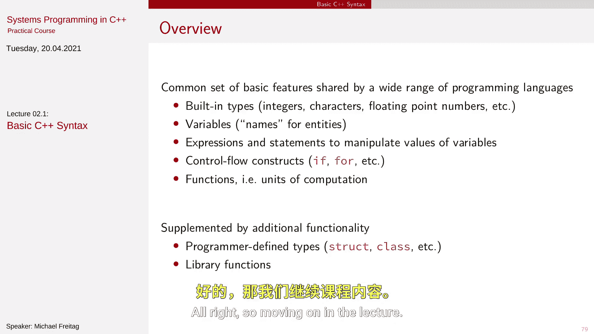
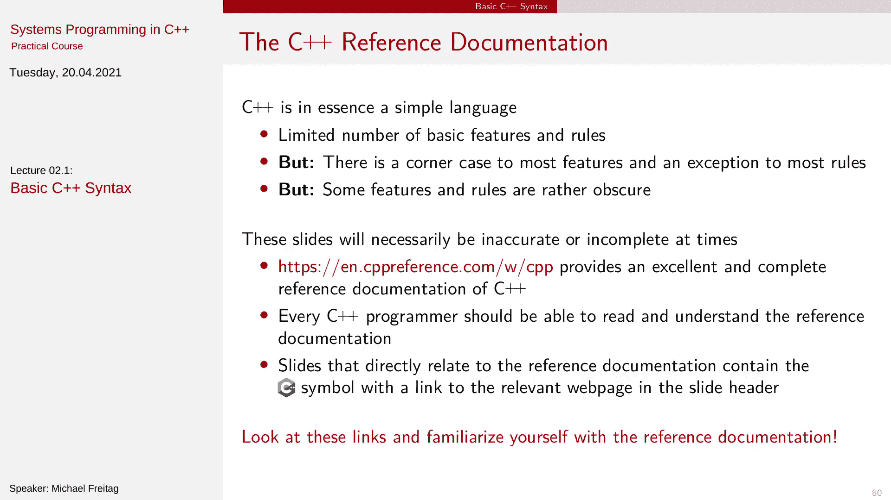
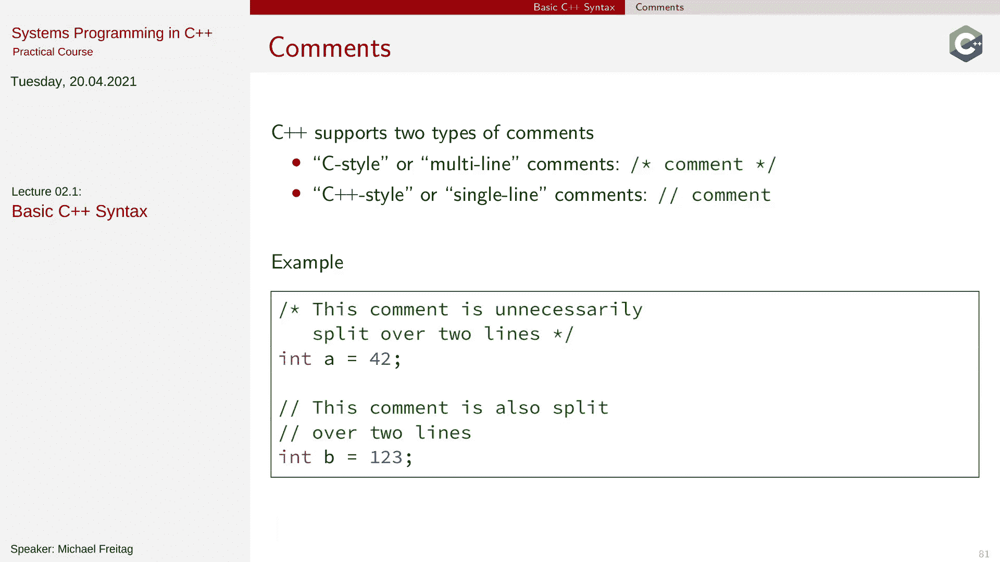
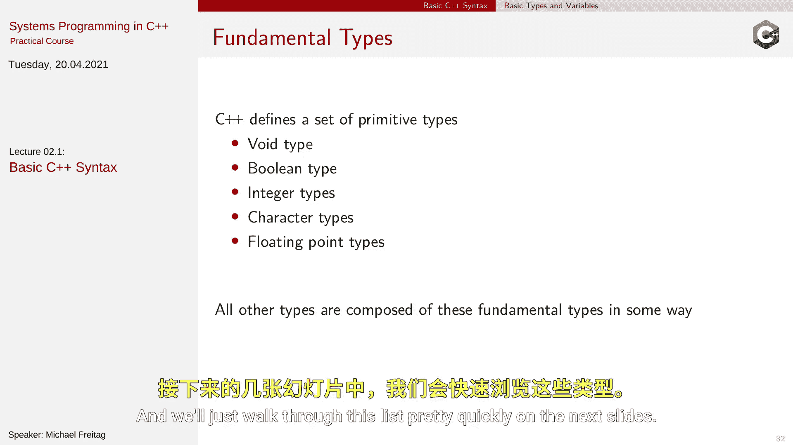
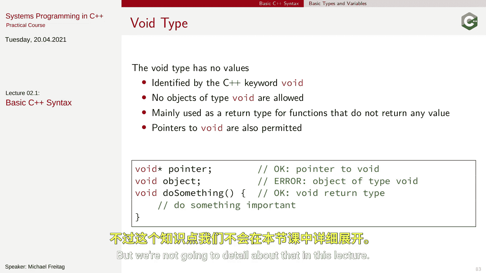
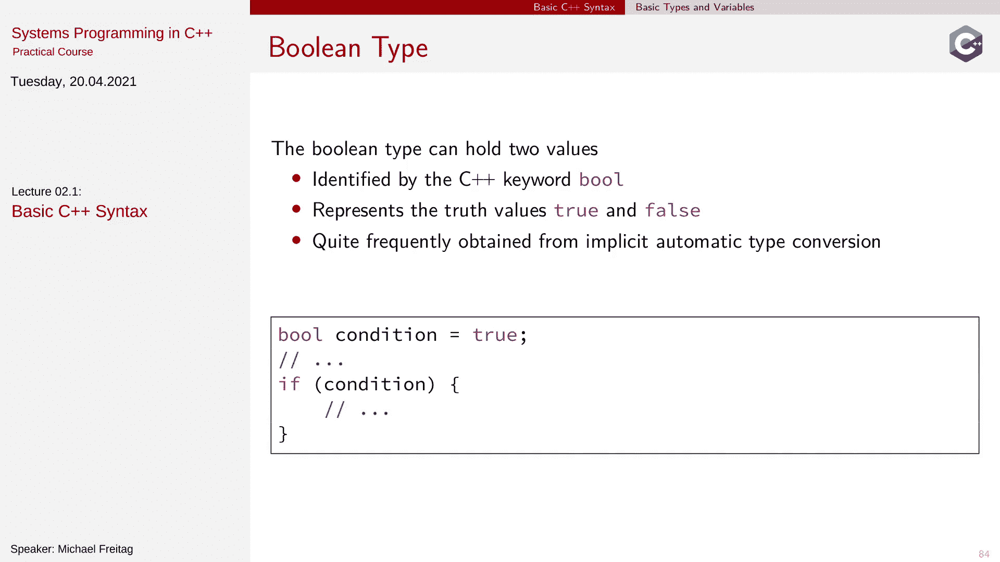
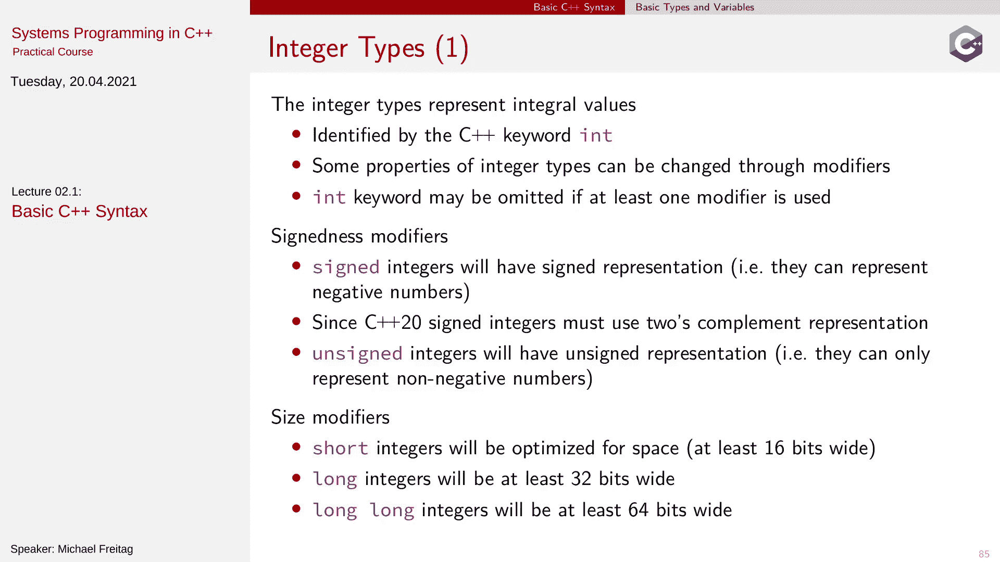
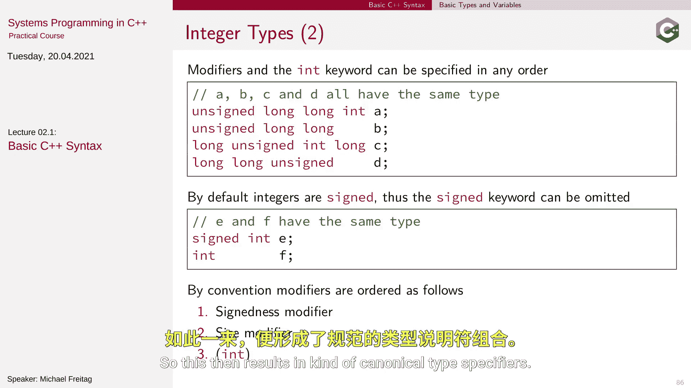
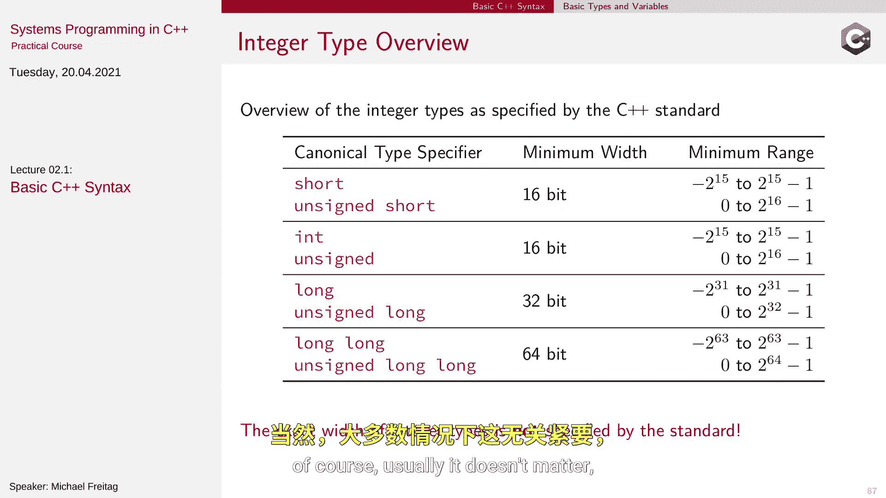
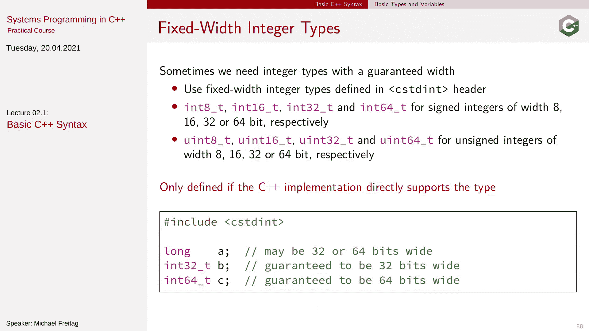

# 慕尼黑工业大学【中英⚡C++系统编程｜Systems Programming in C++】 p03 P3 1： Basic C++ Syntax -BV1gMbAz2EAk_p3-

Welcome back， everyone to another lecture on the systems programming and C++ practical course。

So as the title suggests， you can already imagine that today。

 we're going to cover a pretty large chunk。嗯。Of。C+ plus syntax today。

 and since this is should be pretty familiar to most of you because it doesn't differ too much from other languages in this respect。

 we'll have to cover a lot of content in quite little time today so if at any point I'm losing you。

 please just interrupt me and we' clarify whatever we're just talking about。So like you know。

 almost every highle programming language shares a common set of basic features such as built in types。

 integers or floating point numbers， variables， then expressions and statements so that you can manipulate the values of variables。

 some control flow， stuff and of course functions and then on top of that if you have an object oriented programming language you can add programmer defined types。

Classes essentially， and of course， also library functions。So before we move on。

 there's a quick question in the chat and whether there will be exercise sheets every week for now。

 yes， until approximately the midpoint of the semester， when we will publish the final project。

 then we're not going to publish an exercise sheet every week。Alright， so moving on in the lecture。

Essentially C++ is a rather simple language because there is a limited number of basic features and rules we have in our syntax and that's essentially it and this syntax doesn't differ too much from other programming languages as I've already said。

 but of course the devils in the detail there are a lot of corner cases for features in C++ their are exceptions to most rules and also some features and rules are pretty obscure。

And because C plus plus is。Has a limited set of features。

 but there are so many exceptions and rules our slides will almost inevitably be inaccurate or incomplete at times。

And this is at some points even intentional because we just simply don't want to talk about some obscure feature。

 but you're in luck。 there is an excellent and essentially complete reference documentation of C+ plus that you can find at this link that's put on the slides here and this is essentially the go to documentation if you have any question about C++ and because it's so well written and so informative every C++ program。

Should or even has to be able to read and understand this reference documentation。

So what we did to kind of facilitate the entry into this documentation for you is that on every slide。

 for example， the next slide that's coming up that relates to some information that you can also find in much more detail on this reference documentation we put a symbol in the top right of our slides and this symbol is a link so this is important because it's easy to miss this symbol is a link and if you click on it it'll take it directly to the page in the reference documentation that corresponds to our lecture slide page so please take a look at these links you don't have to do it for every slide of course but just click a couple of those links and familiarize yourself with this reference documentation and spoiler alert there will also be an exercise on this reference documentation。

So let's jump right into it and start with the quote on most useless feature of C++ of course this is comments as other languages we have two types of comments in C++ we have a multiline and a single line comment and that's essentially all that there is to say about comments so of course they're not useless use them if you have to document your code and they work just like you would expect them。

Furthermore， a little bit more interesting than comments， we have a couple of fundamental types。

 which are essentially primitive types。That make up all the other composed types that you can build in C++ and here we have an a void type and then Boolean integer character and floating point types and we'll just walk through this list pretty quickly on the next slides。

Theoid type is a little bit weird because it can have no values and correspondingly no objects of typeboid are allowed and as in other programming languages it's mainly used as a return type for functions that do not return any value with one exception and one difference to other languages in that pointers to the void type are permitted。

 but we're not go into detail about that in this lecture， this is coming up next week in more detail。

The Boolean type is also pretty straightforward， it can have two values。

 it's identified by the keyword pool and apart from the obvious stuff。

 one side note is that it's quite frequently obtained from implicit type conversions and we'll see a little bit more about this data throughout today's lecture。

Integer types are possibly the first type where there are some real differences。

 there may be some real differences to the programming languages that you already know。

AndIt starts pretty straightforward。 So they are all。Identified by the C plus plus keyword inch。

But before I move on， we have another question in our chat。 And the question is。

 how many bytes does a boolean have and。A boion usually has1 B in C plus plus because we have biteed wreable memory。

 It doesn't really make sense to use anything less than1 B and anything more than one B would be a waste of space。

Right back to our integer types。 So all integer types are identified by the C plus plus keyword int。

But then we can change some properties of the integer type that we are specifying through so called modifiers。

And what makes it a little bit more confusing is once you use one of these modifiers。

 you can actually omit the inch keyword and this is something that you see quite frequently in C++ code。

Most often used modifiers are probably the sinness modifiers because C++ distinguishes between s and unsigned integral types。

The signed integers at their name suggests can represent negative numbers and this was not standardized up to now。

 but since C++ 20 signed integers must use the To complement representation。

 so if you use a signed integer， you can be sure if you're using a recent compiler that will use the To complement representation internally。

And then of course， unsigned integers will have unsigned representation。

 and as such they can only represent non negative numbers。

Orthgonically to this we also have size modifiers where the short modifier will optimize integers for space。

 so it will usually be a little bit smaller than regular integers， but at least 16 bits wide。

 and then we have long and long， long integers which will be respectively at least 32 or 64 bit wide。

The modifiers and the end keyword can actually be specified in any order。

 And this gives a wide range of equivalent ways to define the same integer type， which， of course。

 makes code harder to read if you mix and match them。 So just as an example here。

 we have four ways of specifying the same integer type by just mixing the。The different modifiers。

What makes it a little bit simpler is that by default integers are signed。

 and thus we can omit the signed keyword， so you very rarely see the signed keyword in C++ code because a signed in is just the same as an int。

And by convention， and this is our convention， we would like you to order these modifiers in the following order。

 so first you put the this modifier if you have an unsigned integer。

 then if necessary you put the size modifier and then if you don't have any of the above two modifiers。

 you put the into keyword。So this then results in。

Kind of canonical type specifiers。 And we've listed these on this slide here together with their minimum width and corresponding the minimum range of values that they can support。

One thing to keep in mind is that the exact width in bits of the integer types is not specified by these standard。

 so if you just use int， it's guaranteed that it has at least 16 bits。

 but depending on the compiler and the architecture that you on it may have more than 16 bits。

And sometimes this can become a problem， of course， usually it doesn't matter。

 but sometimes we need to be sure that our integer types have an exact width in bits。

 And if this is required then。

As an alternative to the regular integer types， we can use the fixed width integer types that are defined in the header listed here。

 and then you get type names such as eight underscore T and so on for different signed integers with a specified bit width and the same for unsigned integers with a specified number of bits。

The useful thing here is that for example， the U in 64 underscore T。

