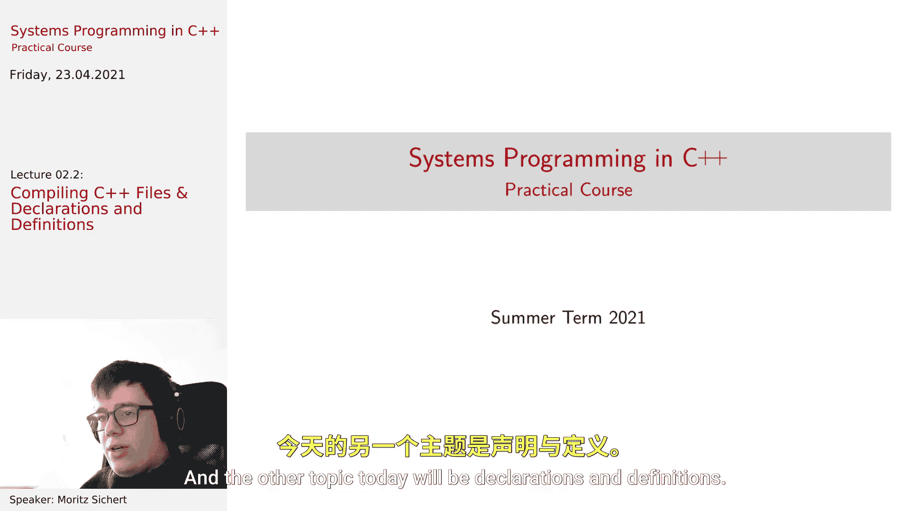
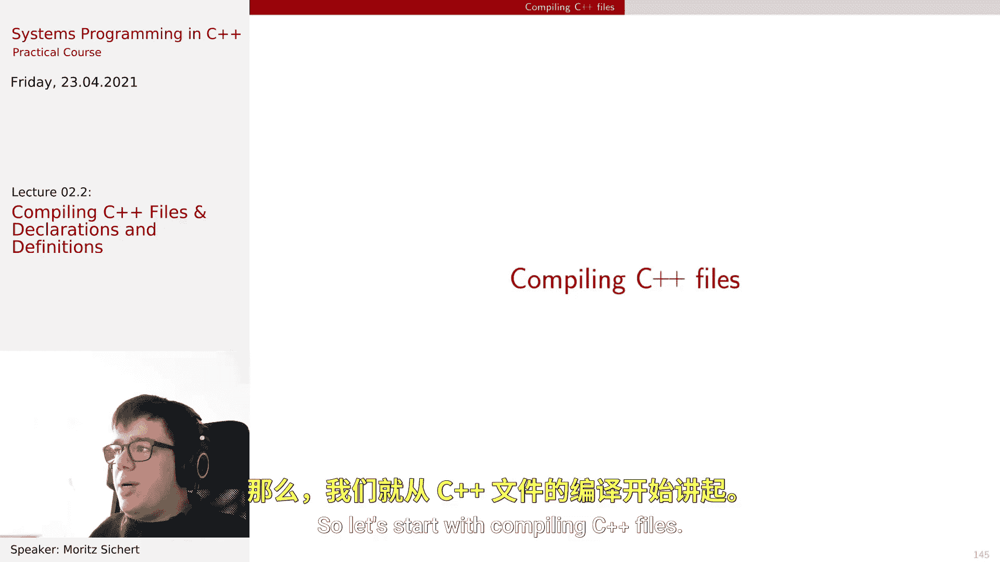
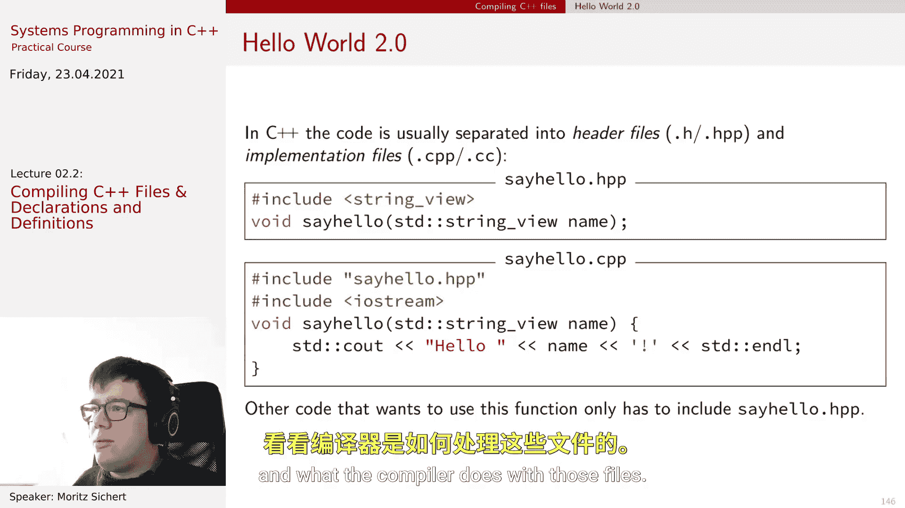
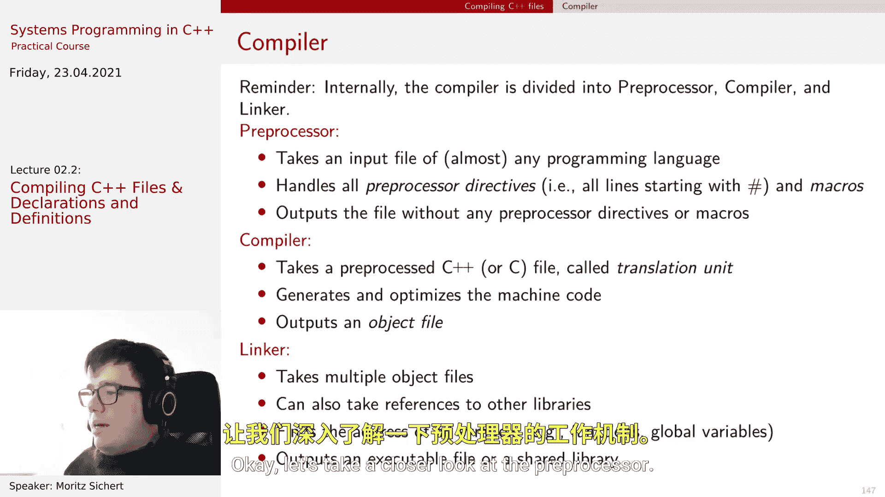
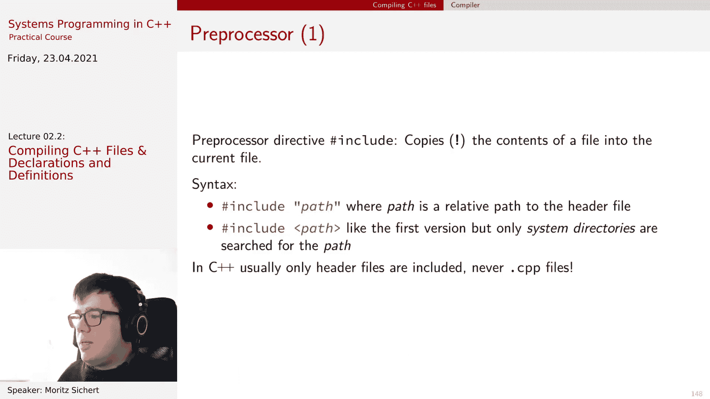
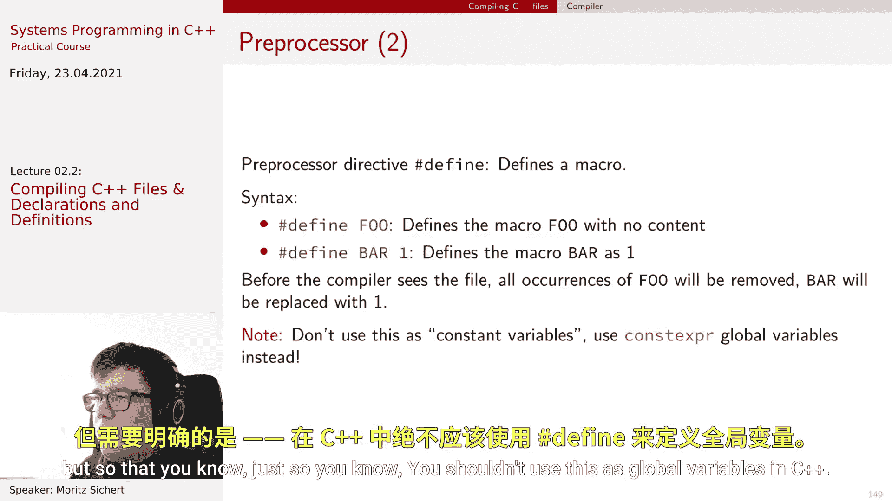
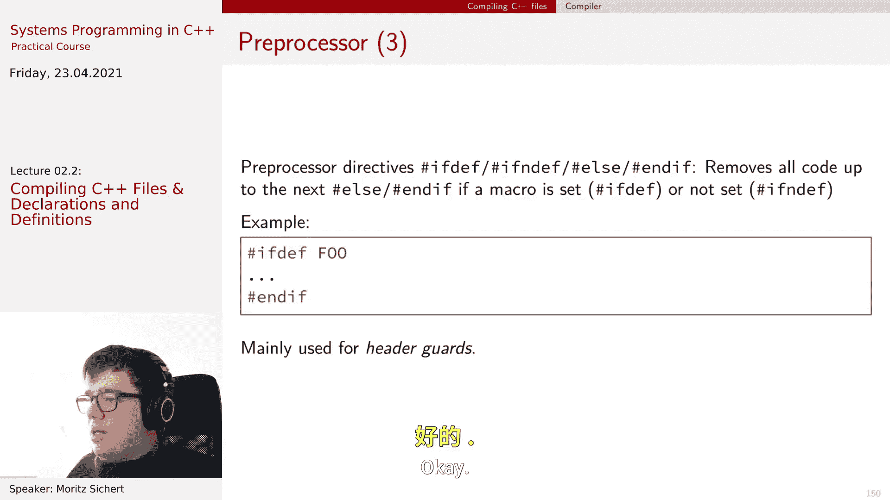
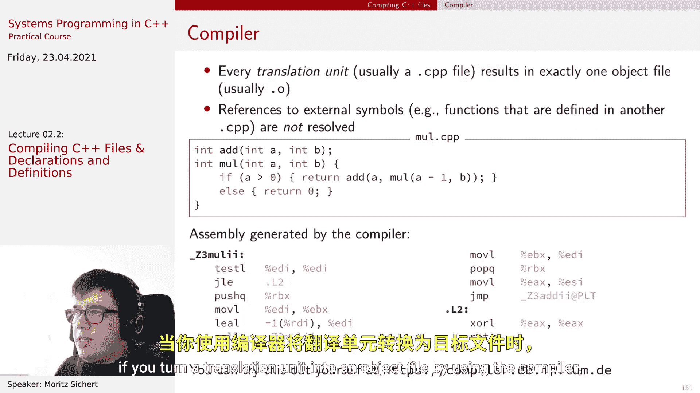

# 慕尼黑工业大学【中英⚡C++系统编程｜Systems Programming in C++】 p04 P4 2： Compiling C++ Files & Declarations and Definitions -BV1gMbAz2EAk_p4-

Welcome everyone to today's lecture on systems programming in C++ today's topics will be compiling C++ files we talked about this briefly last week but we want to go into more detail today and the other topic today will be declarationations and definitions so let's start with compiling C++ files。

As you already saw we had a very short Hello World program now we have a like briefly longer hellello world program。

And also what I told you already is that in C++ the code is usually separated into header files and implementation files。

 and today we will also talk about why this is and what the difference is。

 but for now still stay just you just have to know for now that those are two different kinds of files that or they'll refer to the same function in this case。

 say hello。And now we want to take a closer look at how the compiler actually works and what the compiler does with those files。

As you should know from last week。And internally， the program that we call compiler is actually divided into three parts。

 which are called preprocessor compiler in the linker。 So the compiler。

 the program that people usually call compiler actually contains to other parts that are not technically a compiler and this is sometimes useful because some error messages will appear only in the preprocessor or only in the linker and not in the compiler itself and for this reason it makes sense to at least know conceptually how a compiler works internally。

 So let's look at the preprocessor first。What the preprocessor does is it takes an input file of almost any programming language。

 which means that the preprocessor is not tied to C or C++ in particular。

 it's just mostly used with those two programming languages but you could also use it with any other language because the preprocessor doesn't know about any programming language yet it just as the name indicates a program that preprocessors your input file and what it does it only handles the preprocessor directives and those are the lines that start with the hash symbol。

And macros and we will also see what those are and the output of the preprocessor so so the input of a preprocessor let's start with that is as I said。

 the input file of any program language which will be the file that you actually write so if you write code in your IDE in your editor this file will directly go into the preprocessor first and the output of the preprocessor is the same file but with all preprocessor directives and macros replaced so that it does not contain any preprocessor directives anymore only then it will be given to the compiler and what the compiler then actually does is it takes a preprocessed source file so in our cases would be of course a C++ source file which for the compiler is also called translation unit。

And this parts of the actual compiler then generates and optimizes the machine code。

 so it tries to pass the Z plus buscode， tries to see if the anti syntax  errorss and so on and generates the actual assembly code。

 which is also called an object file， so on object file。Essentially。

 the binary representation and the machine code of your translation unit。

 which is the Cest fast file essentially。😊，And as a last step。

 you have the linker which takes multiple different object files because a project usually consists of many CP+ files。

 which means you will also have many object files and you need to combine them into one program or one library at the end and this is what the linker does。

It takes modern object files and also it understands references to external libraries and what it then does it tries to find all of the symbols that are referenced by all of the object files and just tries to combine them all in an executable or file or library。

Okay， let's。

Take a closer look at the preprocessor and will there are a lot of preprocesor directives we will talk about a few of the most important ones today。

 but as always and there's a lot of documentation about everything related to C+ so if you come across a preprocessor directive that you haven't seen from the lecture then you can look it up online yeah but I mean everything you will need for this practical course we will teach here of course and which for a preprocessor are only a few directives。

 the most important one is probably the include directive and what this does is because as I said the preprocessor does not know about any programming language。

This means that also the include directive doesn't know which programming language you use so it can't know how like the inclusion of external functions and whatever should work。

 So what the include does it's very dumb so to say it just copies the contents of the included file into the current file nothing more。

 there's no magic there and the syntex of this is you just write the hash include and then either in quotes or in angleng brackets and the path。

The only difference between those two versions is that in the first version you can write a relative path to the header file。

 so the path is relative to the include directories that the compiler looks in and those are usually。

 for example， Linux this would be/lash use R/lash includelude and slash includelude in some other locations。

And the angle brackets they of let me continue with the quotes first the if you include something with the quote syntax then this will also look in the directories that you can specify as a user on the compiler command line as custom include path so to say but with the angle brackets it will only look in the system directories。

 which means that if you include something from the standard library， for example。

 you would always use the angle brackets， syntax and if you include something from your project。

 you would always use the quote syntax Another thing you also have to know it usually almost never make sense to include CPP files directly because CPP files they are first compiled to object files and only then they are linked which means that in C+ files。

Usually the only thing youll see is include and then a head file and never a C++ file just as a brief hint。

😊。

Let's look at define， this is the preprecessor directive that defines a macro and you can see the C it's also very basic if you write defined food this just defines a macrofo but doesn't give it any content but you can also write defined bar with one for example where this can be any string。

 anything because as I said again， the preprocessor doesn't know or care about programming languages。

😊，What it will then do if you define this macro， it just takes all occurrences of F in this case and will just remove them because theres no content for this macro and it will take all occurrences of power and replaces them with one Nothing more Also note here for C++ in particular you should。

Never use define macros for like as a way to express constants or constant variables or something。

 this is often done in C++ in C， I mean， so if you look at source code for the Linuxmus kernel for example。

 this will be all over the place but in C++ you should never do this there are way better ways to do this for example。

 constant expert global variables which be which we will talk about in a future lecture。

 but so that you know just so you know you shouldn't use this as global variables in C++。

And the last directive we want to talk about today is the if theF or if N deF and the L and the N ifF。

😊，Those can be used to selectively remove parts of the file before it is given to the compiler。

 So here just as a very brief example， if you write ift F and if this just means that if the macrofo is defined then the preprocessor will just leave everything in between the ift and end of ass。

 but if you did not define the macrofo， then。The contents will be removed I mean this sounds a bit I mean。

 why would you ever do this， the main use for this are header gap， which we will also talk about。

Today and later today， okay。

Let's look now at the next stage of the compiler， which is then the actual compiler and as I already said it。

Turns a translation unit， which in Cta bus is usually a dot CPP file into a。Object file。

 which on Linux at least is usually filed with the ending doO。

And because CPP file may use functions that are not defined in the CPP file itself。

 this means that it may have references to external symbols。

But this is also important to know if you。Turn a trans unit into an object file by using the compiler。

 those external se will not be referenced yet。

