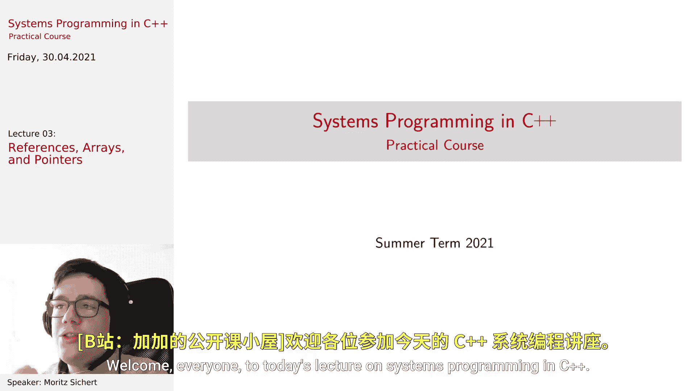
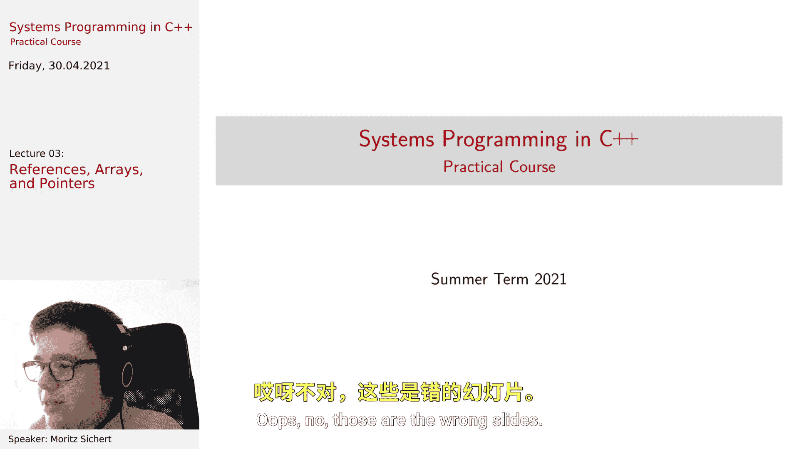
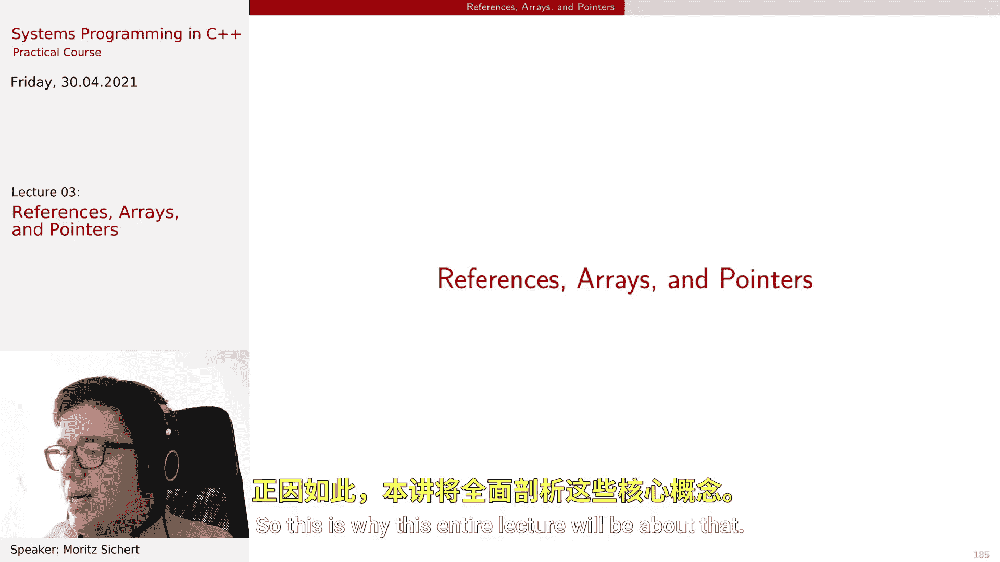
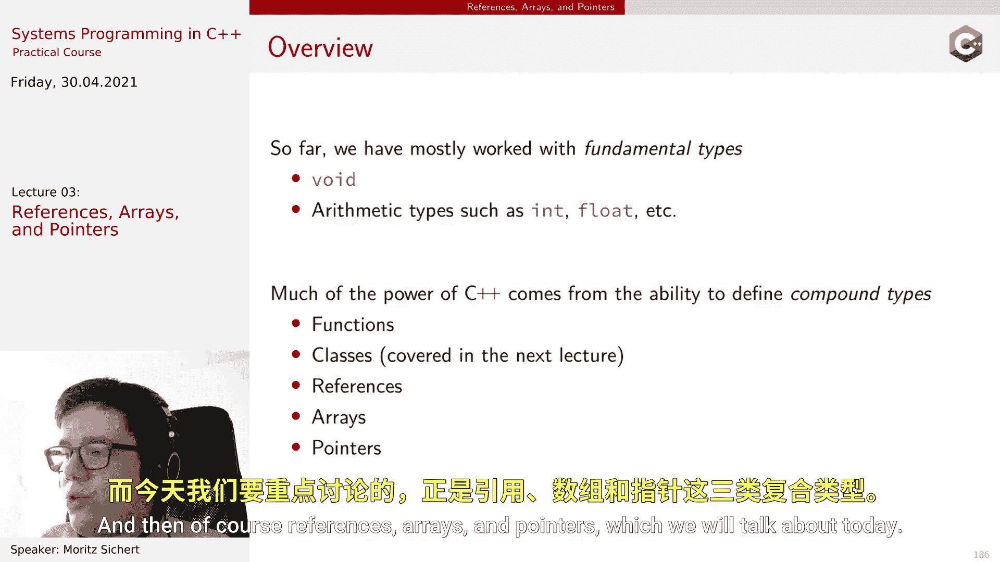
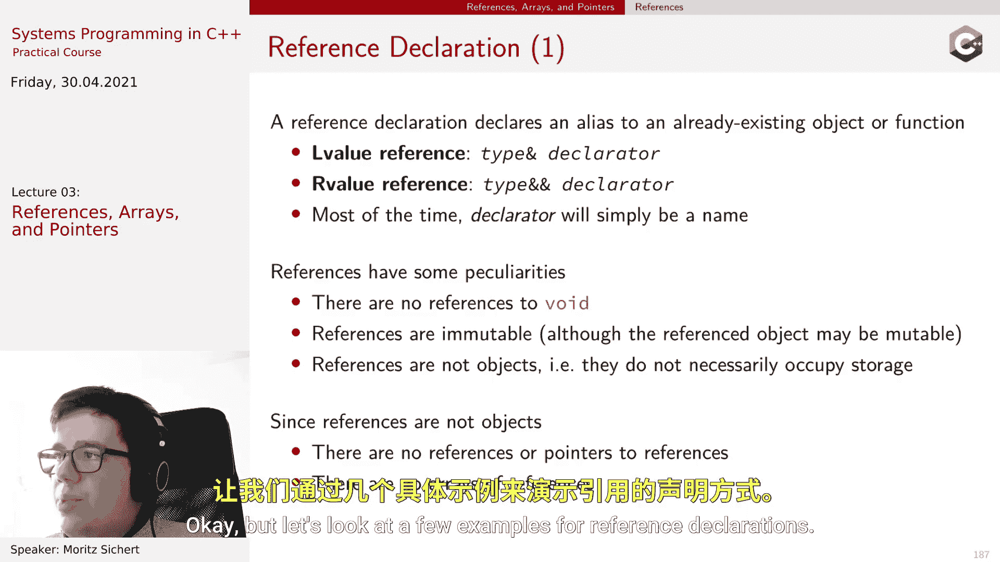
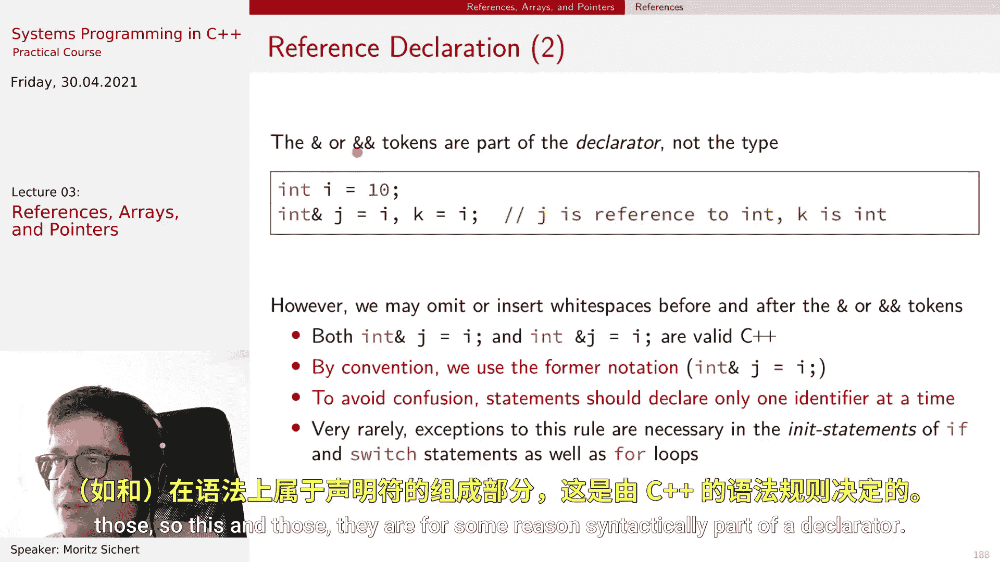
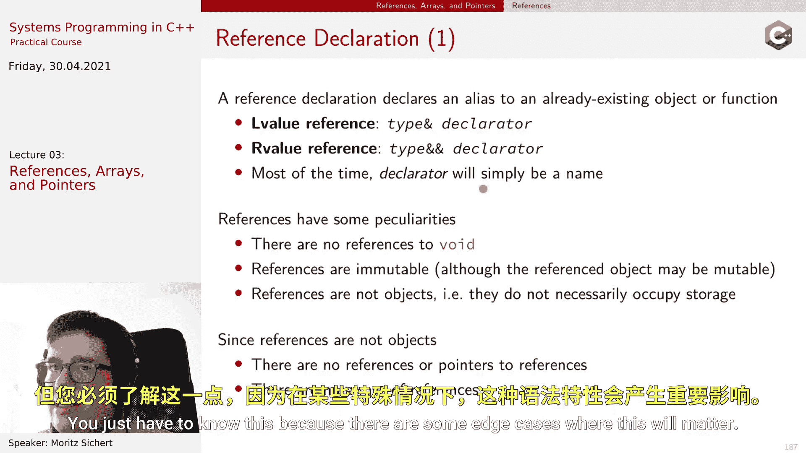
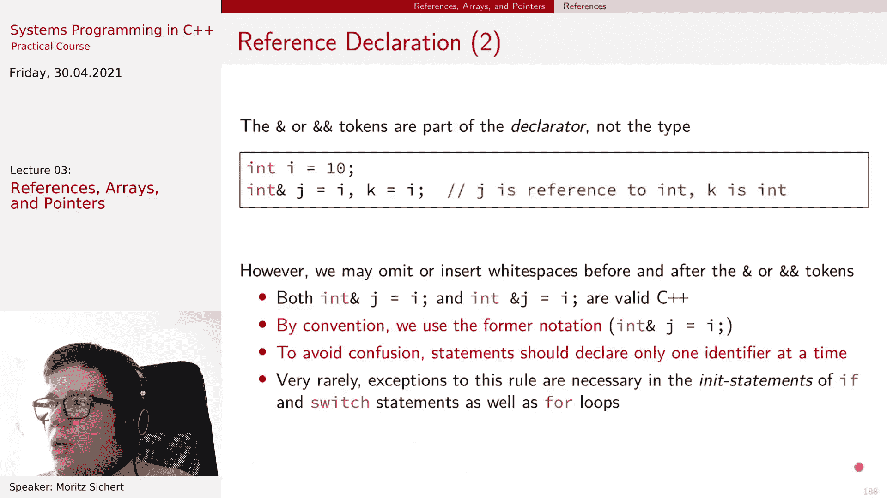
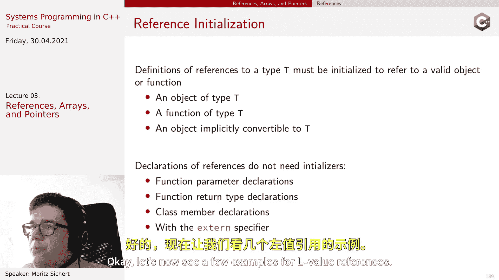
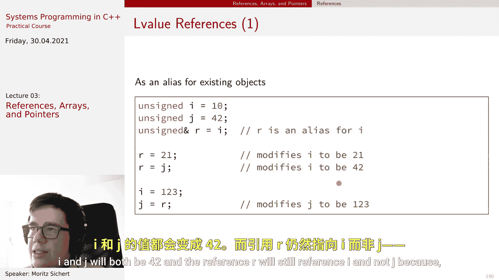

# 慕尼黑工业大学【中英⚡C++系统编程｜Systems Programming in C++】 p05 P5 References, Arrays, and Pointers -BV1gMbAz2EAk_p5-

Welcome everyone to today's lecture on systems programming in C++。

Today we will talk about another very important and interesting， I think， I hope topic。Namely。

 references， arrays and pointer。 oops， all those are the wrong slides at the beginning。

 when we talked about C plus plus。

We talked about C class being a low level language。 but up until now。

 we haven't really talked about any。Very low level things and I mean， I mean。

 references are probably not that low level， but if you think about。

I think usually when people think about C in particular。

 they know that it's about pointers and that pointers usually lead to bugs。

 so this is why this entire lecture will be about that。😊。

So。So far。We have， I mean， as I said， we talked about the sequence plus as a low level language。

 but for the types we have talked about， we have only talked about the special void type and the arithmetic types such as int and float。

As we also said in the motivation for C+ is that most of the power of the language comes from the ability to define compound types that。

Consist of also user defined types and then that usually are very fast or as fast as the hardware allows and some examples for compound types are functions。

 they are considered compound types because a function type consists of a return type and the argument types。

 then we have classes of course which is also a very large topic which is why we will have an entire lecture about this and then of course references areas and pointers which we will talk about today。

Okay， let's start writing in by talking about references。So this is like the syntctic。

 this is everything you have to know about the syntax of references if you want to declare reference。

😊，To an existing object or function so this is important to know a reference can only reference an existing object or a function and as you also know a function is not an object so this is why this is explicitly mentioned here and these two for this is you just write the type and then the em symbol and then a deator decorators I mean the technical synax description for this you can see when you follow the CPP reference link but this would just usually be a variable name for example。

 and there are actually two different types of references in C+ there are L value references and R value references we talked about value categories very briefly and those references reference types of course are closely related to those value categories but we will go into more detail I mean I wish show some examples today but the motivation for why we have two types of reference。

We will also cover in another lecture。What you have to know about reference though is that you can't reference everything。

 I mean because I said you can only reference an object or a function。

 this means that you can't reference void because void is not a type of an object what is also important to know is that references are immutable which means that the reference itself so。

The thing that represents the reference cannot be changed anymore。

 so if you set a reference to reference an existing object once。

 you cannot change the reference to reference another object。

 This means that only the reference itself is immutable。

 but this does not mean that the object that you do reference is immutable。

 This is entirely independent concept。Also references themselves are not objects。

 we talk briefly about this last vector the consequences of references not being objects are that they are for example that they do not necessarily occupy storage which may be surprising but this means that if you have a reference variable in your function。

 this means that this variable may not occupy any storage on this deck for example。

And of course since they are not objects there can't also be pointless for reference and we will talk about this in a second and also there can't be areas of reference because an area also only stores objects and reference and objects Okay。

 but let's look at a few examples for reference declarations。

So if。So here you can see in simple example and you can see the first pitfall with the references is that。

The and token so the end symbols here。Those and those they are for some reason synically part of a declarator so let me go back one slide so technically in the C plus pass syntax the an symbols here are part of a declarator and not part of the type I don't know why this is the case you just have to notice this because there are some H cases this will matter So if you define a variable I and just give it a value and then try to define a reference J that references the object I this will work but then if you try to declare and define a second variable in the same line then K will not be a reference it will be an in without reference because this n symbol belongs to the J declarator and not to the type so because this。

Can be very surprising， our convention is that we never declare more than one variable per line then this can't happen。

And also we will always write the type like this， and you will see other language guides where they actually write in space as so what you can see here in space。

 ands symbol and then J because this is how the PAa treats it syntically。

 but we always consider the reference or the ensemble part of the type。

 so this is why we always write it like this and to avoid any confusions with the weird syntax rules we also only declare one identifier at a time。

😊，There are some very rare exceptions， for example。

 in the in statement of an if you can only write exactly one declaration but that can。😊。

Include more than one identifier， so this is an exactly way you can't。I mean。

 we have to break this rule， but apart from that， you should always follow this。Okay。

Let's briefly talk about initialization of references。😊，As I said， if you define a reference。

 it must be initialized to refer to an existing object at the point of definition。

 so every time you define a reference you have to immediately initialize it and so you can't do this later because as I said references are immutable。

Which means that any reference or define must be initialized to refer to one of those three things。

 either an object of type T， a function of type T or an object that can be converted to the type T。

There's the question， what is the convention if you want both J and K to be references。

 just write two lines and write in every line int and symbol j equals something and then a new line int and symbol K equals something else。

 and then you will have two references。So just don't declare two variables in the same decoration。

 then you will be fine。嗯。Okay let's go back to the initialization and of course there are cases where you only declare a reference without defining it and in this case of course they do not need an initializer and examples for this are function parameter declarations。

 of course in a parameter of a function you don't necessarily define it so you don't need initialization。

😊，The same goes of function return types， you can also declare a reference as a class member variable。

 which we will also see when we talk about classes and of course。

 as you already know when you want to declare a variable without defining it。

 you can do this by using the external specifier。There's a question so an area of partas is not possible。

 no an area of partis is possible， we are only talking about references right now。

 pointas are a bit different， we will talk about them in a second。😊，Okay。

 let's now see a few examples for L value references。

 so you can see here again we defined two variables。😊。

Of type unsign with the names I and J， and then we define a reference with the name R that refers to I。

 which means that essentially R is now an aius for I， which means that if you change R。

 this will modify I to be the new number here 21 and。

What you may expect or what you should know that if you write r equals J。

 this does not change your reference r to now reference J。

 instead it will update the reference object which is I to be the value that J currently has。

 which means that after this line I and J will both be 42 and the reference R will still reference I and not J。

