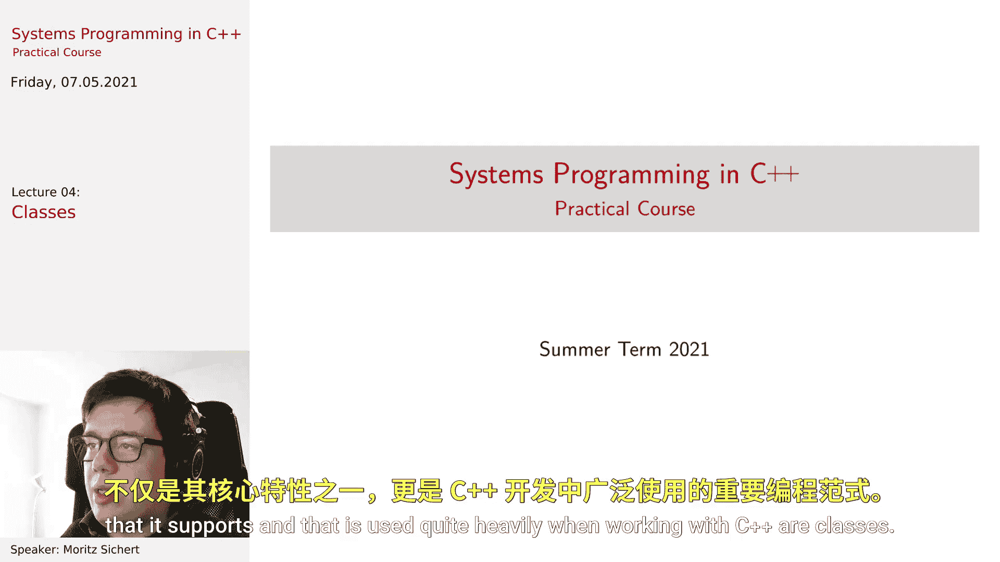
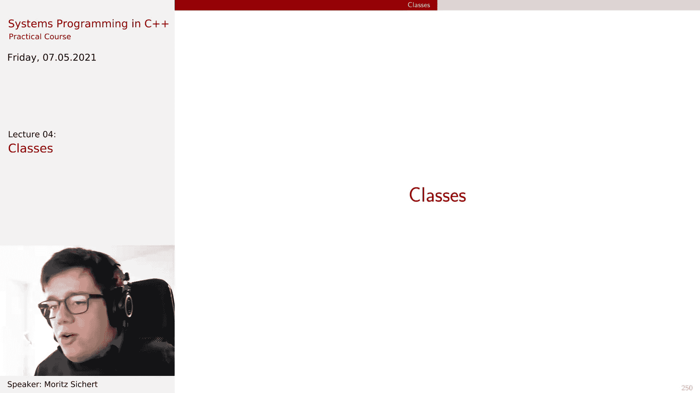
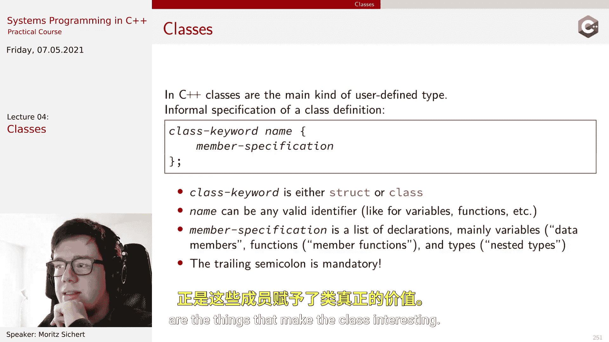
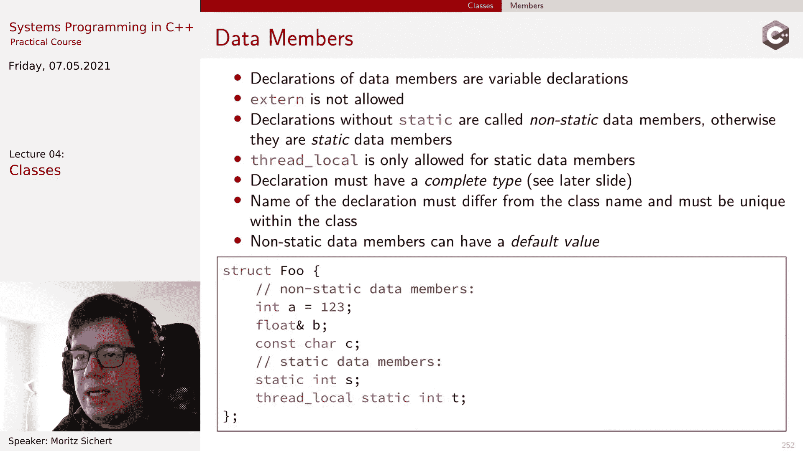
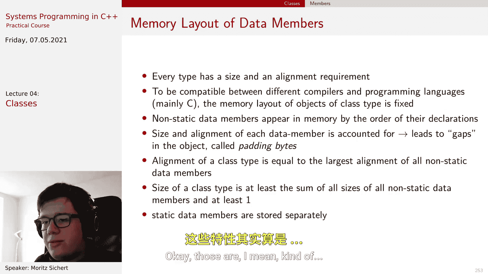
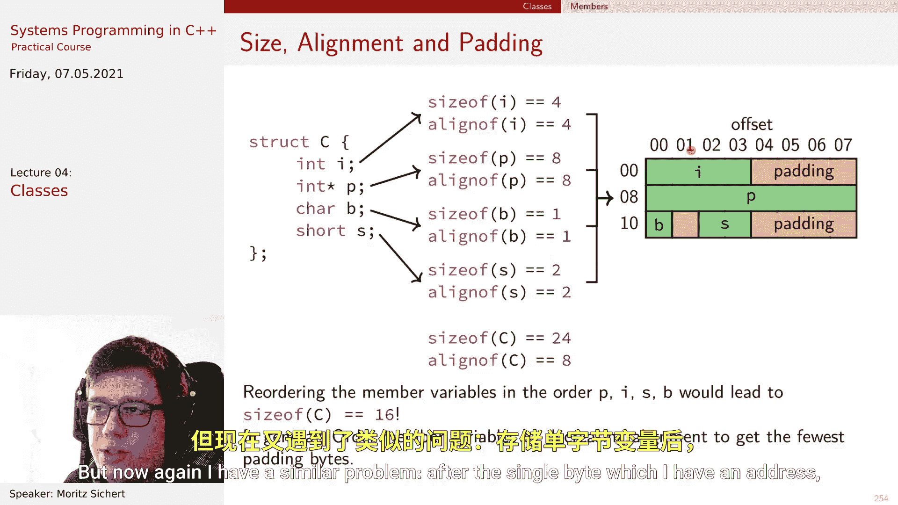

# 慕尼黑工业大学【中英⚡C++系统编程｜Systems Programming in C++】 p06 P6 Classes -BV1gMbAz2EAk_p6-

Welcome everyone to today's lecture on systems programming in C++。

The cover we will the topic we will cover today finally is classes and as we said in the very beginning when we talked about C++ is that。

C++ is a multi paradigm language and one of those paradigms that it supports and that is used quite heavily when working with C++ are classes。

 so this is why。

We would have an entire lecture on them。Okay let's start right in with this syntax so to define a class which is one of the user defined types that are possible in T++。

 you have to use the following syntax you just right。

The class keyword， which is either struck or class you may know struck from C， the keyword。

 but C++ also has the Ql class and the name of the class and then embraces the member specifications so those are all class members which we will talk about in the next slides。

The name is just like for variables it can be any valid name for the members we will talk about all of those types so you have either variables which are called data members functions which in C are called member functions and you can also have types as members which are then called nestA types and one maybe weird thing that you are not used to if you for example if you know Java already is that you have to have a trailing semicon here at the end if you don't have this this will lead to some very weird compiler messages so don't forget the semi columnlon Okay so this is just the basic syntax let's talk about the members because they of course are the things that make the class interesting。

Let's first talk about data members， data members， they are essentially variable declarations。😊。

So not definitions。 That's an important difference inside of a class。

And they mainly work like regular variable declarations that you already know there are some differences。

 for example you can't use external， I mean external for a variable declaration we learned means that it has external linkage and that it's only a declaration and not a definition but both those things don't apply to classes anyway because I mean a class member itself is not a variable so it is not a definition anyway and also can't have any linkage so the keyword doesn't extend so it can't be used。

You can use static， all members without static are called non static data members。

Kind of obvious and the other ones are called static data members and the difference between those two is like you should know from Java for example is nonstatic data members。

 they are specific to each object that has this type but static data members they only exists once in the entire program so in our example here theres only one in S in the entire program but for every object of type 2 we have an A a B and C for example。

😊，What you can also do， you can not only write static。

 but you can also use a threat local for static data members。

 which essentially then works like a threat local global variable。

Just that it's defined or declared inside of the class。

What you have to know is that all data members they have to have a complete type。

 which we will also talk about today。So I'll just defer to the next slide when we talk about it。

And of course the name of each data member must be unique so you can't have two data members with the same name。

 which is also probably should be kind of obvious and what's also interesting is that non-tigated members they can have a default value so as you can see here this does not mean that this is a definition this is still a declaration so this is only a declaration it looks like a definition but it's only a declaration of the data member a but with the default value of 123 and we will see in a bit what the effects of this default is。

But let's first talk about the memory layout of data members because C++ is a kind of low level pro language and we also said at the beginning that C++ achieves the same speed for user defined types as for built in types。

I mean， one of the reasons for this is that it is strictly defined。

How data members of a class are layout and memory。 So you know exactly how this will work in memory。

 And if， if you know this to be inefficient， then you can change this。

 But let's first start talk about how this actually works。

 So you know already that every type has a size and an alignment requirement。嗯。And I mean。

 well let's phrase like this， every object has a size and an alignment and the size and alignment requirement from an object they come from the type。

 so when we talked about the introduction to CPU architectures we said that many architectures require that for example integers are aligned on a multiple of their size。

So this is what we mean by this line and also unfortunately or unfortunately depends on how you see it。

😊，C++ tries to be compatible to other programming programming languages mainly C and for this to work the layout of the of class types or objects of class type is fixed so that it remains the same regardless of which compiler you use and which programming language you'd use and in this case fixed means that the nons static data members。

 they just appear memory by the order of a declaration so if you declare ABC then A will appear first memory than BN then C so that's pretty straightforward but you have to take care that every data member potentially has a different size and different alignment requirement so this could lead to gaps which are called padding bytes in C++ to make sure that all of the alignment requirements are still still。

satisfiedsfied。And the entire object itself， of course。

 also needs to be aligned so that all of the members within are aligned correctly。

 which means that the alignment requirement of a class type is equal to the largest alignment out of all non static data members。

😊，And the size， of course， is。I mean you could think that the size of class type is just the sum of all sizes of the non static data members but we write here is at least the sum of all sizes and the reason for this is exactly those padding bytes and because if you have padding bytes and the size of course will be larger and also because every class type or every object that has a class type needs to O storage has to have a size of at least one。

 it's just the semantics of C++ and also as I said already static data members they are only stored onces and which means that they are not stored inside of the object they are just stored separately somewhere else which is not defined precisely by the C++ standard those are I mean kind of formal definitions let's now look as an example of how this works with alignment and padding bytes and so on so we have here a class type C which has the four members。

 IPB and S。😊。

All of those have different types and sizes and different alignments。

 so let's say on our architecture in test the size 4。

 which also means that it probably has an alignment of four。😊。

Let's say we have a system where the pointers are have the size8 and also an alignment of 8 and character。

 you know by definition they have to have a size of one and also an alignment of one。

 so this will be the same for regardless of the architecture you are using and let's say short has the size2 and alignment 2 okay。

I said if we now have an object of this type， the members are just laid out a memory in the order they are declared。

 which means that the very first thing that stored a memory is the member I so at the very first byte at the offset zero we store the four bytes of the integer I okay so fast so good but now we have the next member which has a higher alignment requirement。

But if we would start storing it here， then it would be stored at an address which only is a multiple of four and not a multiple of eight。

 which means we can't store the pointer starting here instead we have to skip four bytes so that we again have a multiple of eight and only then we can start storing the pointer and the free space here this is exactly what I call padding in the last slide。

And of course， if following the pointer， I have something which has a lower alignment requirement。

 I can just store it directly after the pointer that doesn't matter。

 but now again I have a similar problem after the single byte I have an address which has an odd address。

 but I need an。😊。

