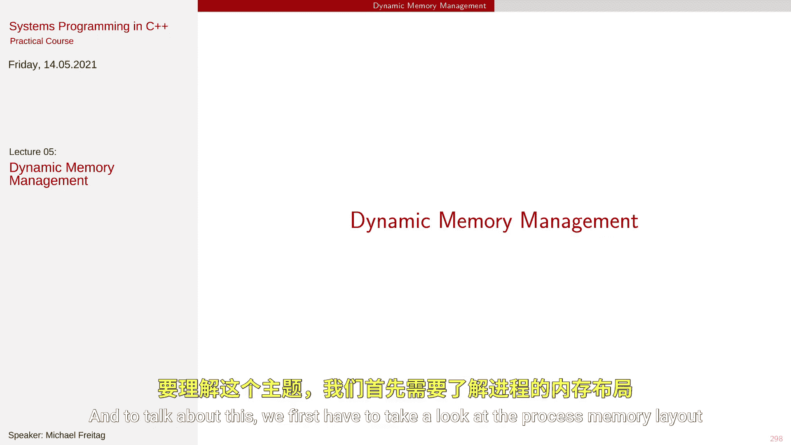
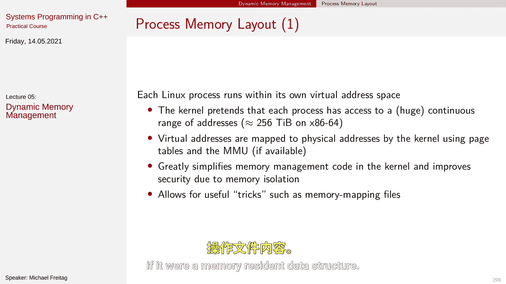
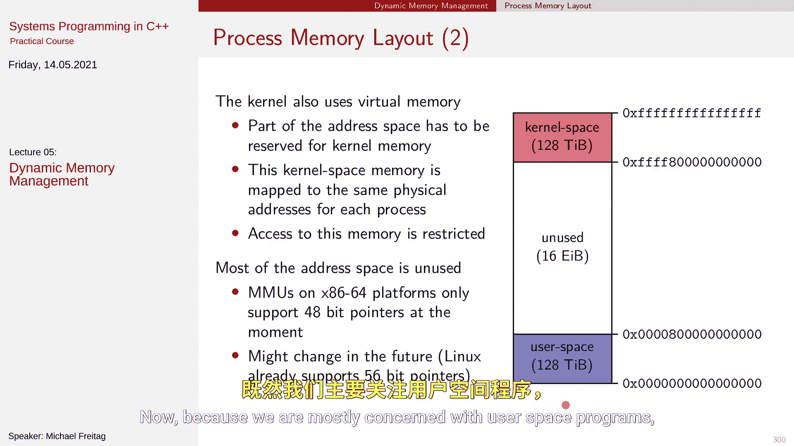
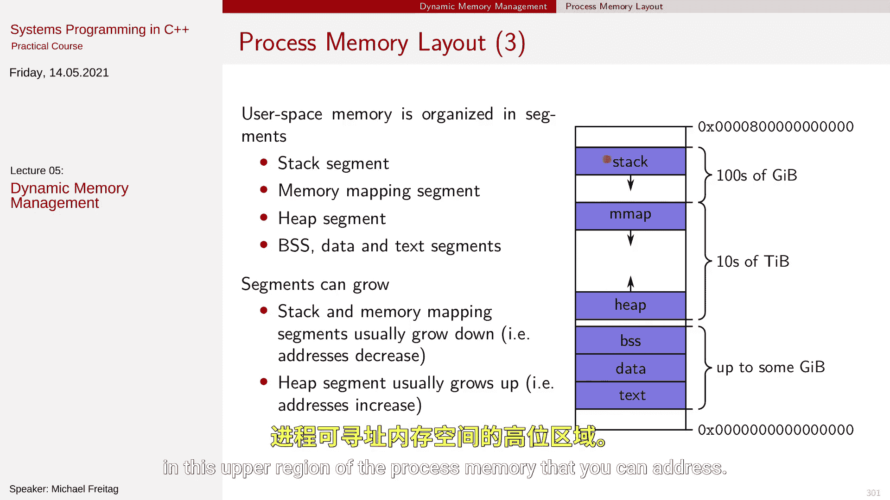
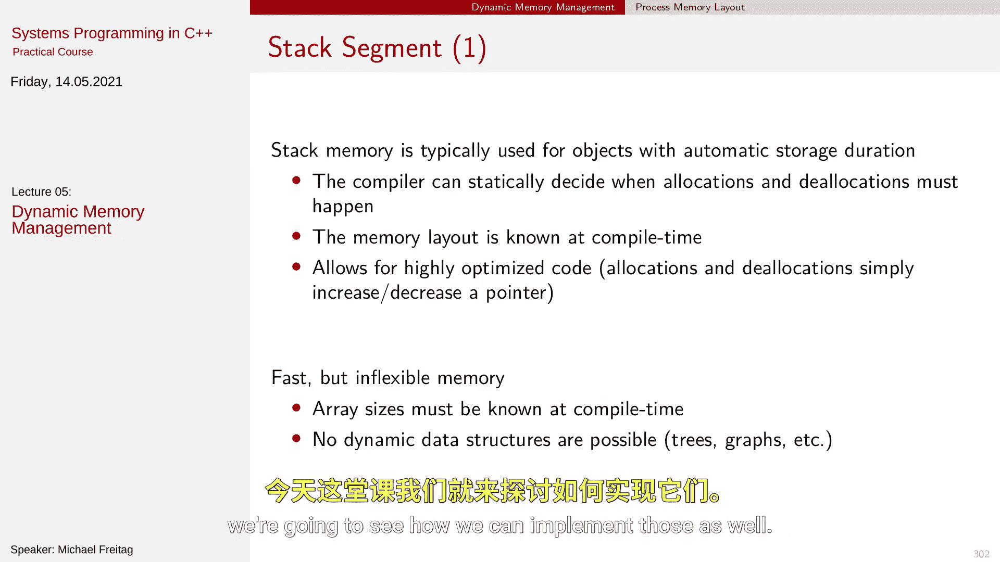
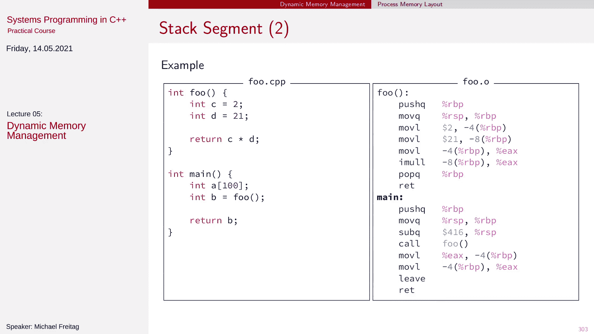
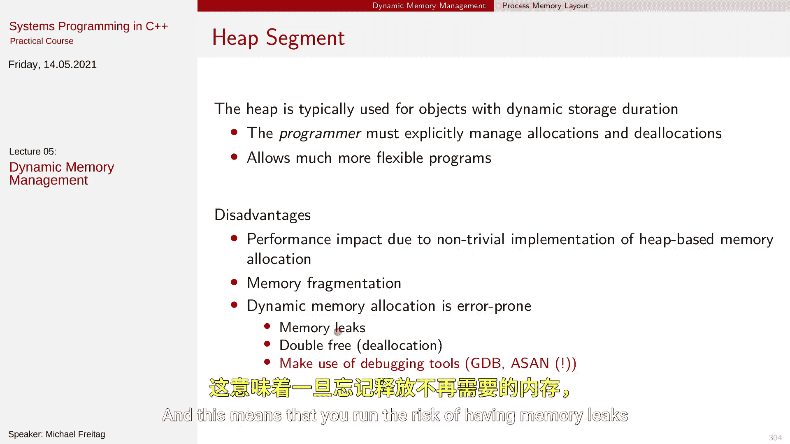

# 慕尼黑工业大学【中英⚡C++系统编程｜Systems Programming in C++】 p07 P7 Dynamic Memory Management & Ownership -BV1gMbAz2EAk_p7-

And with this， welcome back to another lecture of the systems programming in C plus plus practical course in which we're going to talk about dynamic memory management and some closely related topics that are very important when it comes to writing modern C plus plus。

 Unfortunately， these are also some of the most difficult。Aspects of C plus， plus for。Newcomers。

 So just in advance， please do ask as many questions as you can， because from our experience。

 this is something that people typically struggle with a little bit what we're going to cover today。

 And this lecture is your best opportunity to get answers to any immediate question that that might arise。

 So with this reminder， let's jump right into our first topic for today， which is。

 as this slide already states states dynamic memory management。 And to talk about this。

 we first have to take a look at。

The process memory layout that we typically find on Linux， and also。

Quite similar on other operating systems。 So as you might probably know。

 every Linux process runs within its own virtual address space。

 And what this means is that the kernel pretends that each process has access to a huge continuous range of addresses。

 So on a 64 B system， This range can be as large as2 to the power of 64 Bs。 But， of course。

 this is far larger than the actual physical memory that's present within a system。

 So what the kernel then does internally is that these virtual addresses are mapped to physical addresses。

 using page tables， the memory management unit。 If there is one available in。

Some more data structures that are managed internally。

 So what this gives us is our processes can just pretend there that there is this huge address range。

 and the kernel takes care of mapping this huge address range to the actual physical memory that's present within a system。

And this greatly simplifies memory management code in the kernel and also as a nice side effect improves security because each process gets its own outer space。

 we do not run the risk that one process inadvertently accesses or changes memory that belongs to some other process。

And finally， and this is something we're going to see in some of the later lectures。

 This also allows for some useful tricks， such as memory mapping files where you just。😊。

Pretend that a file that's present on a disk is mapped to a range of virtual addresses。

 and you can access the contents of this file as if it were a memory resident data structure。

One thing that we have to keep in mind that of course。

 the kernel itself also requires some memory and the kernel itself also uses some part of this virtual address range。

So because of this， the address range is usually partitioned into parts that are reserved for kernel memory。

And parts that are accessible to user space programs。 And we see。

A figure how this looks on a typical Linux system over here。

 So usually we take the upper2 to the power of 48 addresses and reserve them for the kernel。

 And you can see this by just the。Bs set to all ones here in the addresses。

 Then we have a very large unused part of our address space。

 and then the lower2 to the power of 48 bytes are addressable from user space。

 So the reason why we only use 48，2 to the power 48 bytes here is that most memory management units on x 86 platforms only support 48 B pointers at the moment。

 So we simply cannot。Adds more memory， but this might change in the future。

 and the Linux kernel already supports 56 bit pointers in which case， of course。

 the amount of addressable memory would increase。But even with this restriction of only 48 bit pointers。

 we can see that and there is still a huge amount of memory that we can realistically address。

 so we see that we have 128 TV bytes of addressable memory for user space programs and the same for kernel space。

 which。For the time being is more than enough for the usual programs that you will write now because we are mostly concerned with user space programs let's zoom in on this user space part of the address space and there we can see that it is itself once again organized and distinct segment。

 so we have the stack segment which contains your program stack all your local variables。

We have a memory mapping segment which is not that relevant for our course here。

 then we have a S segment and some more segments that contain mostly static data。

And as we can already see here is these segments can grow and usually this is for example， required。

 if we call a function， then we need to allocate more stack space for the local variables of this function possibly for any parameters and return values and usually the stack memory segment grows down。

 so addresses decrease as we allocate more stack memory。

In contrast the heap segment usually grows up， that means that addresses usually increase if we allocate more he memory。

So this is just。Some background information that might become handy in some use cases。 And also。

 it makes it a little bit easier to read pointers， because if we take a look at the minimum and the maximum addresses within the addressable user space memory。

 you see that they。Are rather restricted。 And if you take a look at the pointers within your programs。

 you will see that usually they start with a 7 in this place here。

 And that is simply because your pointers are usually located towards the top of this segment。

 So the uppermost。Used bits in your pointers are going to be set to all onces。

 and this means that your point has point is somewhere in this upper region of the process memory that you can address。

Mostly up to now， you have been interacting with the stack segment because the segment is usually used for objects with automatic storage duration。

So local variables that you have almost exclusively used up to now， and this memory is of course。

 very convenient because the compiler can statically decide when allocations and delocations must happen and the memory layout is known at compile time because。

 of course the compiler knows which local variables you use in your function。

And this allows for highly optimized codes because any allocations and dlocations on this stack segment simply increase and decrease a pointer。

 so base and the stack pointer registers in assembly。Because of this， this segment is very fast。

 we don't have to have any complicated code。To allocate memory。

 but it's very inflexible in particular， array sizes， for example， must be known at compile time。

 and we cannot implement any dynamic data structures on the stacks such as trees， graphs and so on。

 But of course， these are very useful。 And today in this lecture we're going to see how we can implement those as well。

So just to give you。An example that you can take a look at offline。

 We have a very simple program here with two functions where we have some statically allocated。

Variables are better variables with automatic storage duration。

 and on the right we can see how this translates into into assembly and we can see that essentially we are just manipulating the stack base and the stack pointer in assembly to allocate memory for these local variables and once again we're not going to go into more detail on this example here。

 but I encourage you to study this example offline in your on your own time。

Now。The stack segment is rather straightforward。 You essentially use stack memory transparently in your code by just writing local variables。

 and you don't have to。Do a lot more to make it work。 This is different for the heap segment。

 which usually is used for objects that have dynamic storage durations where the programmer。

 that means you have to explicitly manage allocations and de allocationlocs。

Up to now you've only indirectly used He memory， for example， through STD vector。

 which internally performs this allocationation and deallocation of dynamic memory depending on how large the vector is。

 and this is already one example of how using heat memory can allow you to write much more flexible programs because youre not constrained to constant sizes that are known at compile time anymore。

But of course， there are some major disadvantages to using heat memory as well。

 not the least the performance impact that using heat memory has because allocations on the heap need some highly non-trivial implementation to track which parts of heat memory are allocated。

 which are free and can be reused and so on。And of course a related problem is that when using heat memory you always risk fragmenting your memory if you have。

 for example， very many small allocations， then you can actually manage to run out of heat memory although this is unlikely and finally and this is something that a lot of the remainder of this lecture will focus on is that dynamic memory allocation is of course very error prone because once again you have to manage allocations and delocs and this means that you run the risk of having memory leaks when you forget to delocate memory that you do not need anymore more。

