# 慕尼黑工业大学【中英⚡C++系统编程｜Systems Programming in C++】 p08 P8 Inheritance -BV1gMbAz2EAk_p8-

Welcome back， everyone to the next lecture of the systems programming in C++ practical course in which today we're going to talk about inheritance and object oriented programming in C++。

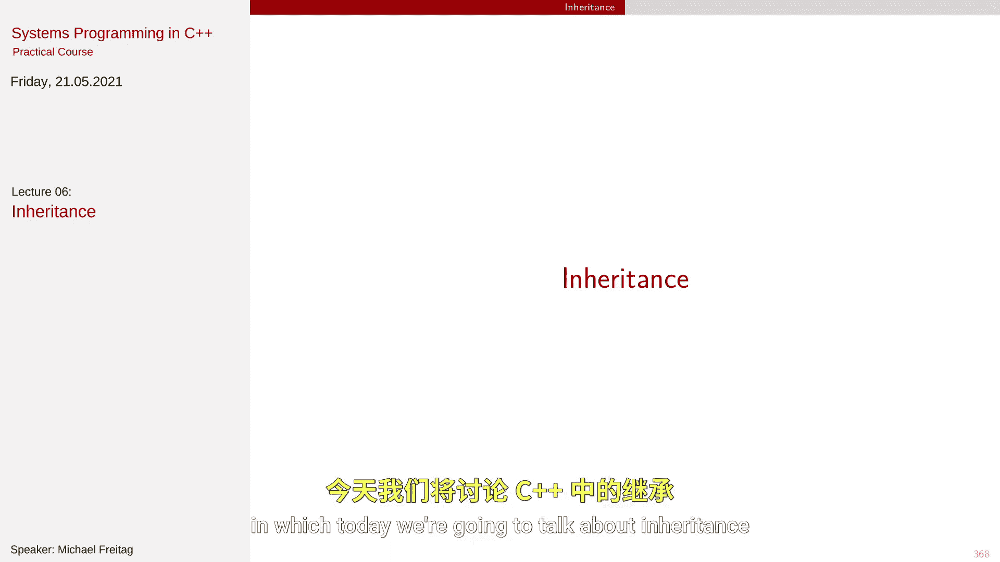

So as you all probably know object oriented programming is essentially based on three pillars。

 we have data abstraction， which is implemented by classes in C++ and many other programming languages。

 of course， and we've already covered this in a previous lecture。

Then the second pillar is inheritance， which is implemented by class derivation in C plus plus。

In which the derived classes inherit the members and member functions of their base class or base classes。

 And this is the first topic that we're going to talk about in this lecture today。

 And then the final pillar of object oriented programming is dynamic binding or also polymorphism。

 which is implemented by virtual functions in C plus plus。

And this allows us to write programs that do not really have to care about the specific types of objects in an inheritance hierarchy because we have this dynamic binding mechanism that allows us to call functions on an A base class and in fact in bulk the behavior that is implemented in some derived class。

 and this is the second large topic that we're going to talk about today in this lecture。

So without further ado， let's just jump right into it and take a look at how we can implement derived classes in C++。

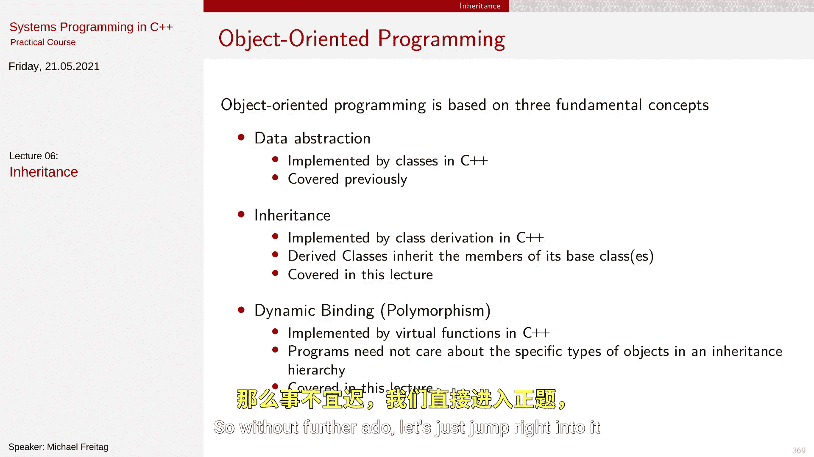

And this is relatively straightforward because any class type that you define in C plus plus may be derived from one or more base classes。

 and this is possible for both classes。Andstructs。Of course， the base class itself may。

 in turn be derived from their own base class so that we can build。

An arbitrarily complex inheritance hierarchy through these derivation relationships and the highleve syntax for this looks as follows。

 so both for class instructor it's essentially the same we have our regular class definition here with the class keyword and our class name and then if you wanted to define a base class we use the colon and then a so-called base specifier list in which we list the base classes and some modifiers that influence how exactly this derivation looks like and we're going to take a look at this base specifier list next。

Because apart from this， there's nothing special， we just have our regular class definition here。

In which nothing particularly interesting changes。

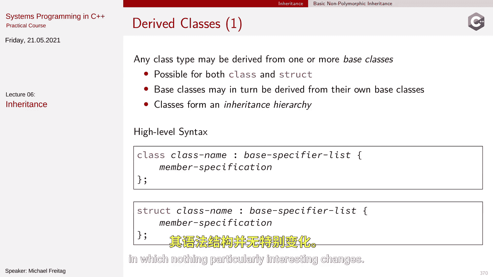

This base specifier list that we have after the colon just contains a comma separated list of one or more once again。

 technical term base specifiers essentially just base class names and this one of these entries is just an Excel specifier。

Which controls the inheritance mode。 This is something that we're going to see towards the end of the lecture。

 For now， it's sufficient to just remember that it can be either private， protected or public。

 and most of the time it will be public。In some very rare cases that are not really relevant for this practical course here。

 we can also have the virtual keyword in this base specifier。

 but this is something that we're not really going to talk about today because it is only used for multiple inheritance。

 which is essentially discouraged anyway。 And then finally。

 the only thing that's mandatory in one such base specifier here is the actual name of the base clubs。

So， of course， this is rather technical。 And you don't really think about。

Driving from a class in terms of these highly technical terms。

 So let's just take a look at an example to illustrate how this actually looks in code。

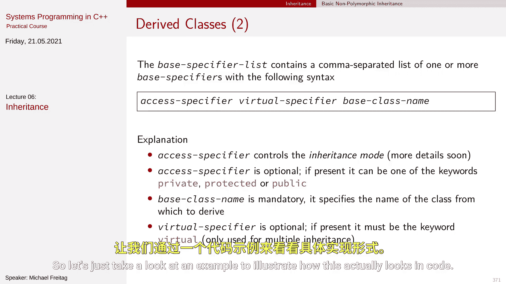

So in our example here， we have one base class。 Of course， it does nothing really interesting。

 And then we have a number of derived classes that just illustrate how we can define such base specs Yes。

 So in our first example， we simply have the colon followed only by a class name。

 And this means that。According to the rules on the previous slide。

 we implicitly have private inheritance。Here， so this is equivalent to writing this line here in the second example and derived0 and derived  one。

 of course， are derived from the base class here。And then a slightly more complex example that you will probably never see in actual code。

is shown down here where we have a public inheritance from the base class that is also virtual。

 and then another base class from which we privately derive。

In which we privately derive from the derived one class here。

 So this example is really just here to illustrate how these base specifiers could in theory look in practice。

 you will almost exclusively see public inheritance from a single base class。

So essentially in the same way as in the third example here， just that instead of private。

 we have public here。 So this is just something to keep in mind for the remainder of our lecture until we actually talk about inheritance modes。

So now that we know how to define an inheritance hierarchy， we have to， of course。

 think a little bit about how we can actually initialize and destroy objects that are part of such an inheritance hierarchy。

 And of course， this is， as usual done through the constructor and de of these classes。

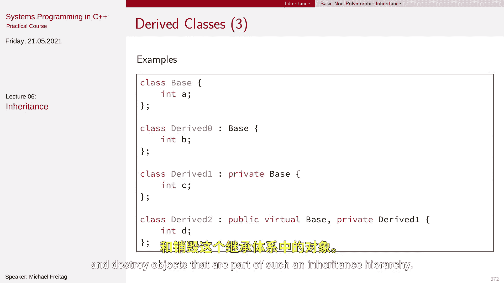

And they account for the inheritance that you have defined。And in particular。

 if we take a look at constructors first。If we invoke the constructor of a derived class。

Then first of all， all the base classes are initialized and in case there are multiple base classes。

 they are just walked through and left to right order as you have specified them in this base specifier list。

Afterwards， the data members of your derived class are initialized。

 so this is the behavior of a constructor that you've seen up to now and these are initialized in the order that they are declared in the class definition and then finally after these two steps have happened then is the body of your derived class constructor executed So we have this very wellspecified order first of all the all base classes are initialized then the data members are initialized and then finally the constructor body is executed。

One thing that is particularly important to keep in mind here that in step 2。

 the order in which data members are initialized is entirely independent of the order in which you specify them in the initializer list of the construct so that this only depends on the order in which they are declared in the class definition。

 and this is the reason why sometimes you get compiler warnings if you mix up the order in this initialization list。

And as a final note， if we think once more about initialization of the base classes here。

They are by default default initialized， so the default constructor of these base classes is used for this initialization step here unless we have specified something else and this can be done by explicitly invoking another constructor using the delegating constructor syntax that you' have already seen。

And once again， to make this a little bit more tangible。

 let's take a look at an example that illustrates the effects of these initialization rules。

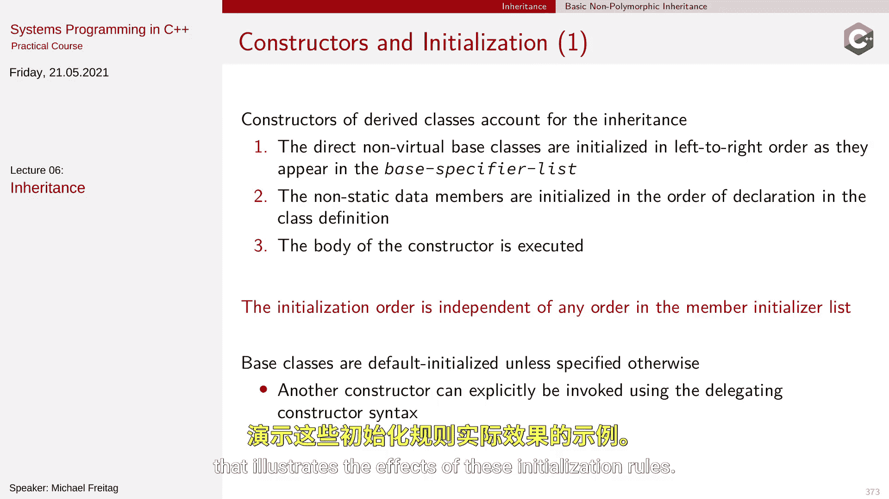

So let's assume we have the class definitions that are shown on the left here。

 we have a base class with two constructors， a default constructor and another constructor that takes a single int argument。

 and then we have a class that derives from this base class here that also has a default constructor and another constructor that takes two int arguments and then for the purpose of this example let's assume that the implementation looks as follows so essentially we initialize a couple of member variables。

 the important thing here is that in each constructor we print some information that allows us to trace what is actually being invoked。

Now。The one thing that I want to point out here concerning initialization is that in all the constructors。

 except for the last one， we do not explicitly invoke this delegating constructors synax。

So in the derived constructor here， as we've seen on the previous slide。

 the base class is going to be initialized using the default constructor。

 whereas in the second variant of the derived constructor here。

 we explicitly invoke the single argument constructor of our base class。And of course。

 then this is going to be used over the default constructor of the base class。

And now if we just invoke the constructor of our derived class here。

 so one time we invoke the default constructor one time we invoke the two argument constructor。

 we will see that the output of our program will be first the base class is constructed in this first constructor call。

 then the default constructor of the derived class is invoked and if we invoke this two argument constructor that if we take a look back at the previous slide explicitly delegates to another base class constructor。

 we will see that first the single argument constructor of the base class is going to be invoked and then the body of our derived two argument constructor is going to be invoked。

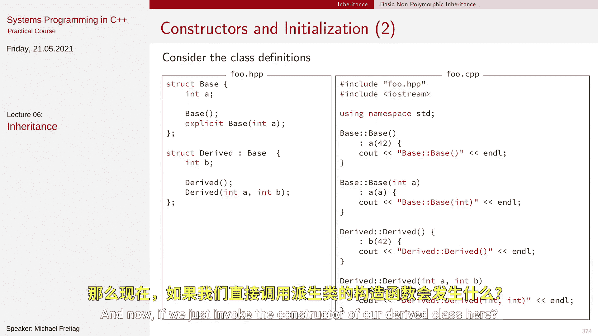

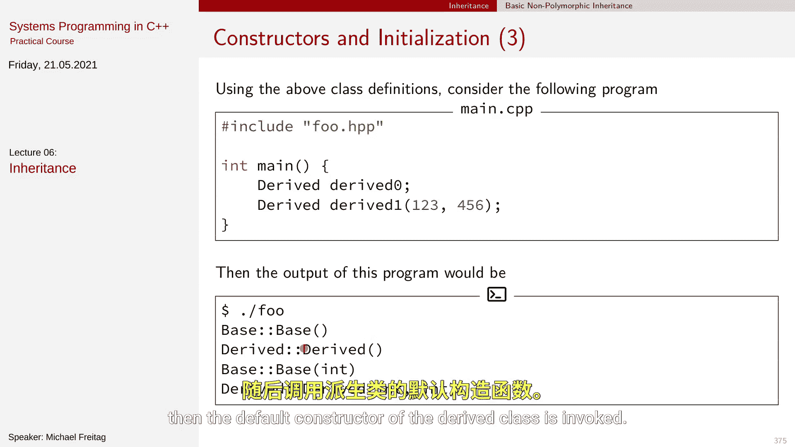

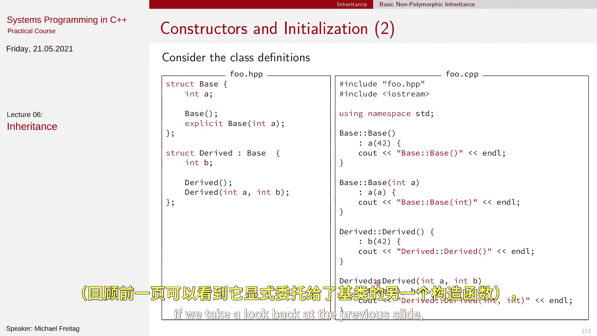

One thing that's also important to keep in mind here is once again。

 we did not explicitly invoke any base class constructor in our default derived constructor here。

 but still the base class constructor was invoked and this is just a result of the rules that we've seen that all base class。

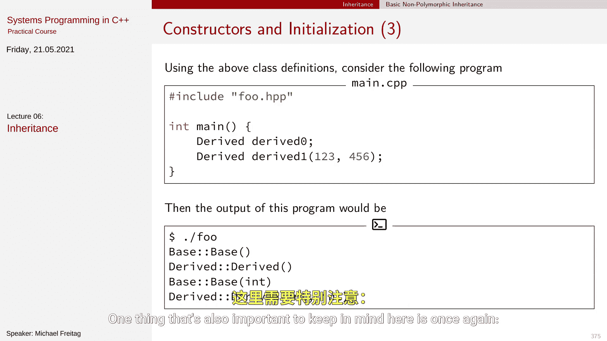

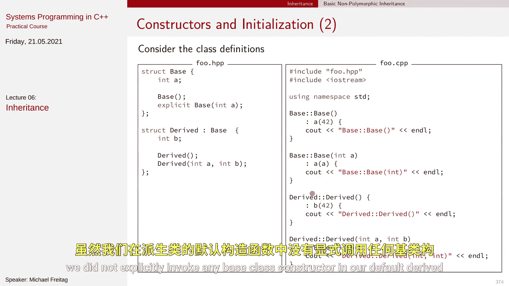

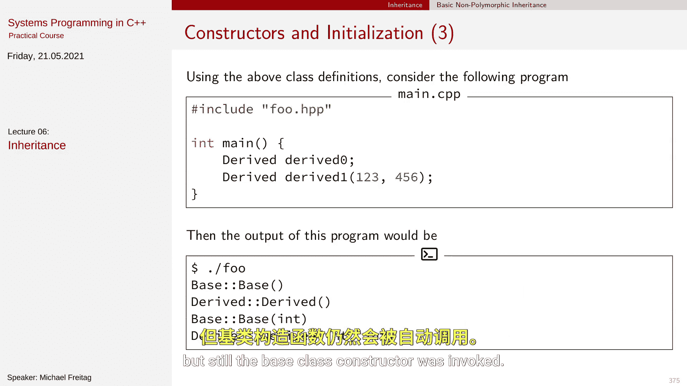