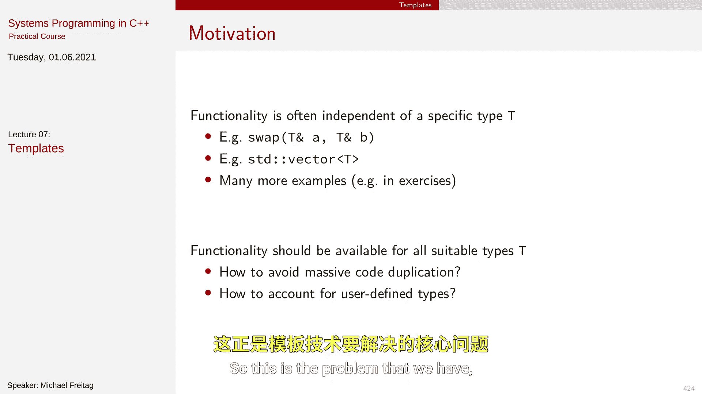
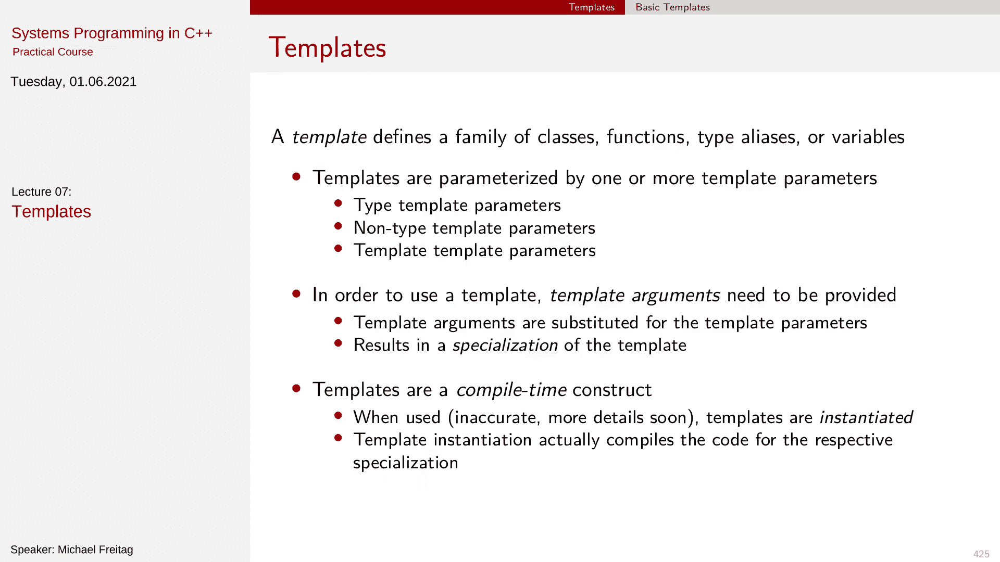
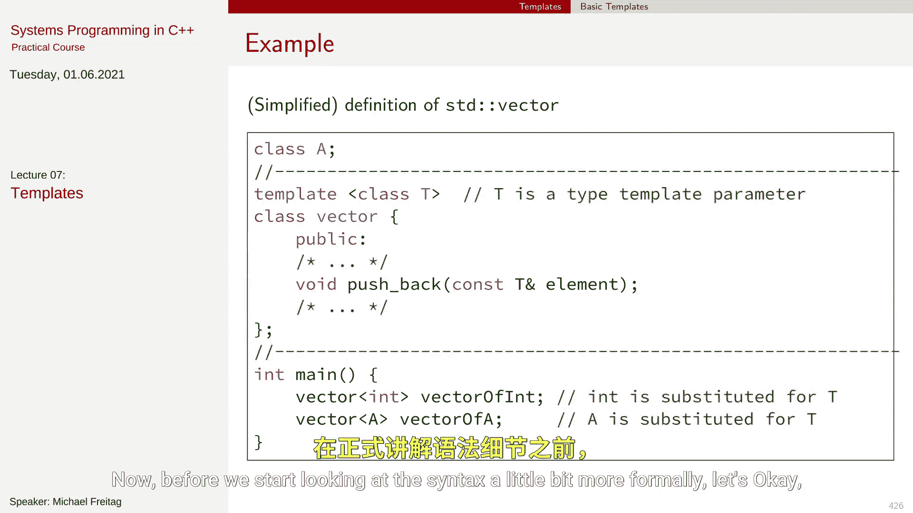
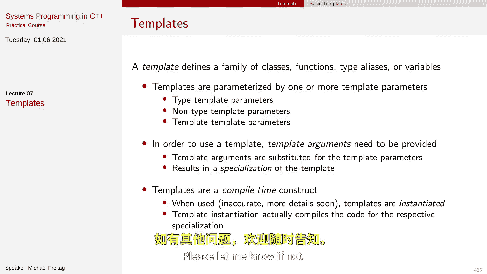
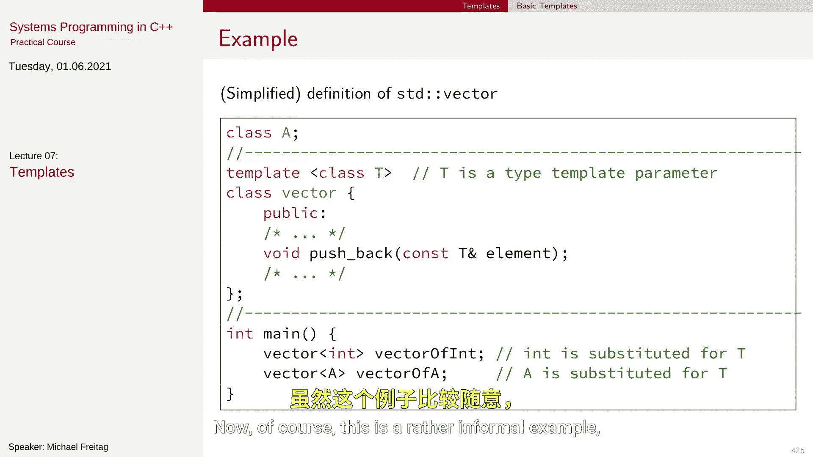
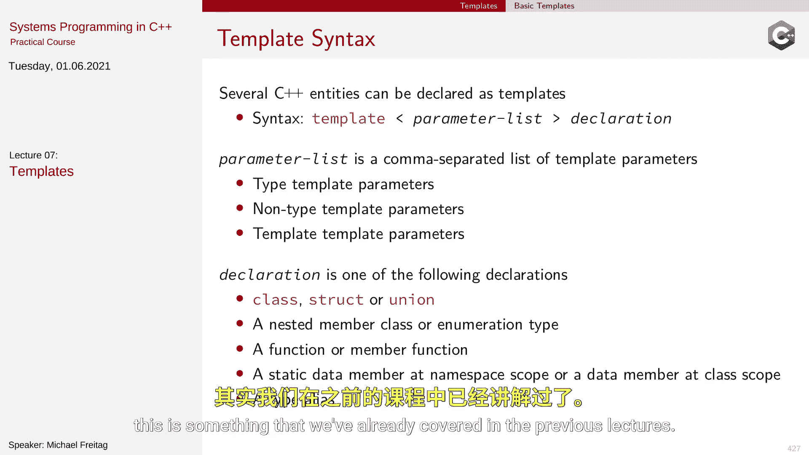
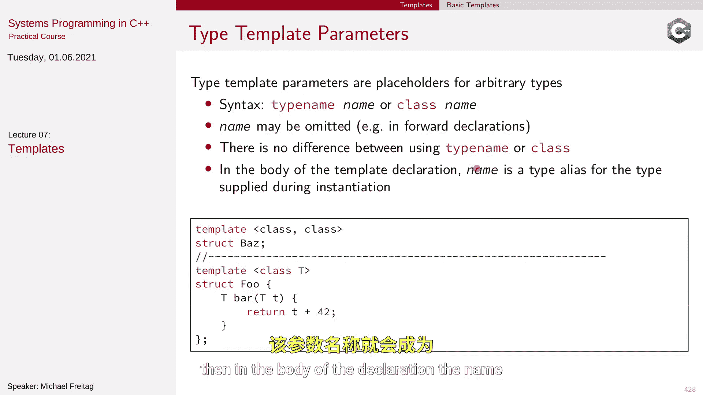

# 慕尼黑工业大学【中英⚡C++系统编程｜Systems Programming in C++】 p09 P9 Templates -BV1gMbAz2EAk_p9-

Welcome back， everyone to another lecture of the systems programming in C++ practical course in which today we're going to talk about templates。

Now， templates is a pretty vague term， if you've never heard about it。

 so let's take a look at why we actually want to have these in our favorite programming language。

 So the main motivation here is that whenever you start implementing something you will inevitably come across some functionality that is essentially independent of a specific type T and some prime examples here are。

 for example， a swap function， which shouldn't really care at all which types of elements it swaps as long as they  fulfill some specific requirements。

 Similarlyly， an STD vector doesn't really have to care about what type of elements it stores once again。

 as long as they support some operations such as moving or copying。 and there are many。

 many more examples that you've for example， seen in your exercises as well。Here。

 you've also implemented some containers that were since you didn't know about templates yet constrained to a specific type。

 but we could just as well have implemented them in a generic way so that they work for almost arbitrary types。

Now， the problem here is that， of course， this functionality should be available for all suitable types T。

 but。We do not want code application， which would be massive if we had to implement this manually for every possible type。

 and even then we couldn't account for user defined types that maybe we don't even know about when we are actually implementing。

 for example， our STD vector vector data structure。But this is the problem。Let we have。

 And templates help us solve this problem。

By allowing us to define a family of classes， functions， type aliases or variables。

That we can then parameterize by one or more template parameters。

 And these template parameters can name types。 for example， an integer or a float， and they can also。

Name some kinds of constant numbers。 for example， the size of an SDD array is such an example where we have a non type template parameter that allows us to specify the compile time fixed size of such an array。

 And then there are some more。N applications for template parameters where we can， for example。

 define template template parameters that are themselves templates once again。

Now in order to use such a family of classes， we have to provide a template argument which is then substituted for these template parameters。

And this then results in what is called a specialization of the template。That we can then use。

 for example， as an STD vector of integers or floating point numbers or whatever we put into the template argument of STD vector。

Now， the key thing here is if once we start taking a look at the syntax for templates。

 they look rather similar， for example， to generics in Java。

 but the key difference here is that templates are purely a compile time construct。

And this means that whenever you use a template， which， of course， and for now， is rather inaccurate。

 we'll take a look at more details about what this actually means in a couple of slides。

 But once we use a template it is instantiateated and template instantiation。

 then actually compiles the code for a specific specialization of your template。

 So when you write a vector of int and you start using this。

 then the compiler will behind the scenes actually generate assembly for this specific specialization of a vector of integers。

 And now if you start using a vector of floating point numbers。

 this is different from a vector of integers， then the compiler will behind the scenes once again generate the assembly code for a vector of floating point numbers。

And this has a couple of consequences that might be a little bit surprising if you're used。

 for example， to Java generics which are a runtime construct。

 one consequence that essentially explains everything else that might happen is that all template parameters have to be bound at compile time so you can only put things that are compile time constants or compile time type names into template arguments。

 you cannot do anything at runtime at runtime a template instantiation is just like any other class it's a specific version of the template and you cannot change it anymore。

Now， before we start looking at the sentence a little bit more formally， let's。

Okay， we have already a question that we can address before we move forward the question is what is the difference between runtime and compile time well。

Compile time is anything that the compiler does。 The compiler， for example。

 can compute some simple computations on constants if you multiply two literals。

 this is something that the compiler can evaluate while compiling your code so you can， for example。

 have an SDD array with a size that you write as four times3。

 this is something that the compiler can evaluate while translating your program。

 but you cannot have the multiplication of two variables that are not constants SD template argument because this is something that the compiler cannot evaluate to one fixed value while compiling your program So then something that has to be done at runtime and consequently cannot be used as a template argument。

So I hope this answers your question。 Please let me know if not。 In the meantime。

 let's take a look at a motivating example how we could try to define the STD vector template ourselves。

 Of course， this example is necessarily a little bit simplified so that we can focus on what's really important here。

 So the definition here， if we disregard this line here for a second is essentially the same as for any other class we have our class vector。

 We have then some public member functions。

And that's essentially the difference is that before the class keyword here。

 we write this template and then Angular brackets class t line and this tells the compiler that our vector class here is templated by a single type template parameter which we call T and then we can use this type template parameter essentially like any other type alias within our vector implementation。

 for example in the push vector function instead of specifying a certain type here。

 we simply use this t type alias so that whenever we specialize our vector Im sorry whenever we instantiate our vector with a specific type for example an int this T here is going to be an alias for int and when we do it with something else。

 for example， a class a here， then t is going to be substituted for a and as a type alias to class a here。

And by doing this， we can then rather easily implement very generic containers， for example。

 or anything else， because here we do not have to care about what type T is specifically。

 we can just focus on the vector functionality。And then we can use this without any code application throughout our projects。

Now of course， this is a rather informal example， so let's take a look at how formally this is specified by the C+ La standard。

Now we can declare several entities as templates not just glasses。

 but the syn is always the same the syn is the template keyword， then enclosed in Angular brackets。

 a parameter list， and then some declaration。The parameter list is a comma separated list of template parameters。

 which can be typed template parameters。 This is what we've seen on the previous slide。

 and they can also be non type or template template parameters。

And which we're going to see on the following slides。

The declaration that comes after this template keyword and parameter list can either be a class declaration or definition can be a member class or enmieration type can be a function or a member function of a class。

 it can also be a static data member at namespace scope or a data member at class scope and it can be a type Alias and all of these alternatives have some uses。

 although some of them are used more often than others in particular the class template declaration is I think the alternative here that's used most often throughout the Z++ code that I have seen。

Okay。Now， the declaration， of course， this is something that we've already covered in the previous lectures。

 the parameterist merit some more discussion here。 and as we。

Seen on this slide just now， the first thing that we can put into this template parameter list is a type template parameter。

 and these are placeholders for arbitrary types。This syntax， how you can put them in a template。

Prameter list is type name or class， followed by an arbitrary name。

But this name can also be omitted if it' is not necessary similar to how you can omit the name of a function parameter if it is not used。

 and this is sometimes useful if you just have to， declare a template and not actually define it。

Whether you use type name or class as the keyword here is entirely up to you， there is no difference。

 I don't know exactly why theres two options， I think it has some historical reasons。

 but you can use them completely interchangeably there's no effect on thecode that you write。Now。

 once you have such a template parameter in your template declaration。

 then in the body of the declaration， the name that you've specified is simply a type alias。

