# 慕尼黑工业大学【中英⚡C++系统编程｜Systems Programming in C++】 p10 P10 Standard Library I -BV1gMbAz2EAk_p10-

Everyone to today's lecture on systems programming in C。

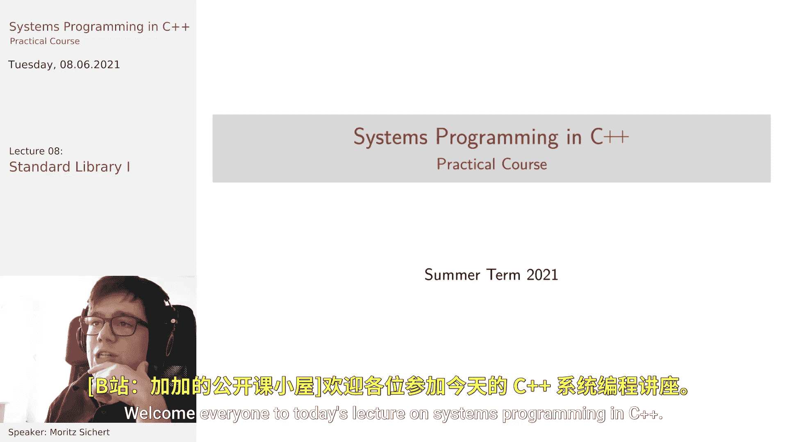

Today will be the standard。The is like we into two lecture。 So and today with。Just1。 And we would。

Can you library2。

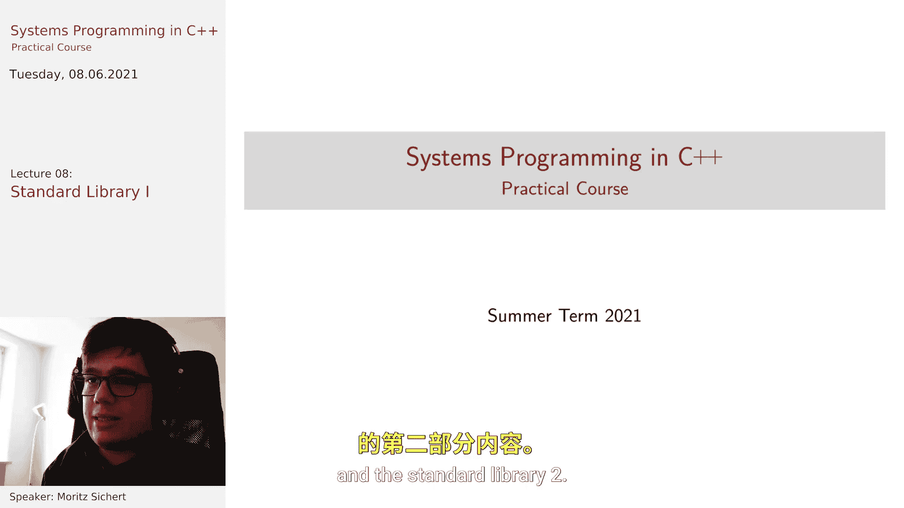

So。Yeah， the fish is what is the site library， at least in in C supply， what is the。

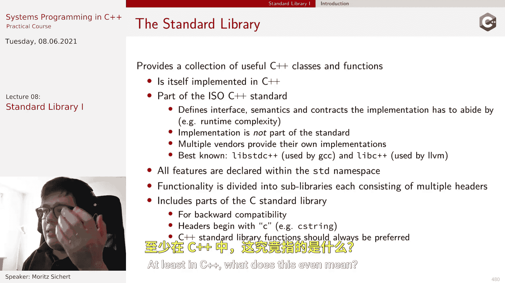

What does this even mean， So the super standard itself。Rights of several classes in。

And every received pilot should support。And。公司。Ormost libraries are， of course。

 implemented in the space itself。Yes， I mean。I just should those passes and functions should extend they should be able to the process。

It would be harder for the of the compilers。Any else done just bus。嗯。So the。

 what is said also define does not only define the names and the interfaces about the。关于。

We can see here， so it doesn't only define the interface in thematics。

Defins for several functions aroundtime complexities， for example。 So if you have a container that。

the。The excess of elements has say they should also complex air。Con。But of course。

 the implementation itself is not part of this not because I said you could theoretically write them in any language what you want。

 And of course， they they to give the implementation of freedom and the implement。

Which means that there actually exists different implementations of this in a。 So the。

Most common ones that are used on Linux。This is part of CCCC。

 so if you compile your problem with CCCC， which is what our Gitla server does。

 then you will be using the SDC as。There's also lip。Which is by the LVM。嗯。Which means that you can。

 I mean， you can use Li C++ with the D C compiler and vice versa。

 but usually on Linuxacy would use one of those two on Apple。

 you would probably rather use Li C+ plus。 And of course。

 theres also implementation for the Microsoft compiler， which is not listed here Yeah。

 there are there are more than there are a few implementation that are mostly。异。Of course。

 as you know by now， all of those functions in the C library they are thespace。

 so this is common for all functions and classes in the。嗯。are several sub libraries are to same。

 which each have much head， but yeah， we will talk about them today next week。Some of。喺边度。For better。

library and those headers they usually start with the C So things like C string or your also。

 you know， C math。 And the reason for this is that functions are not。

Some that already exists in the sea in San A。And in thezeus western of that resource。

 some functions only exist in the C。Those using those， of course， but general。You should avoid using。

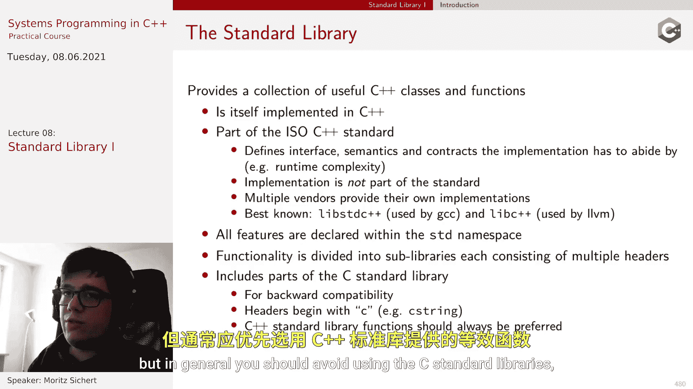

C+ and the library functions that are equivalent to those C functions because they usually are better to work with with because they。

 for example here they are over。

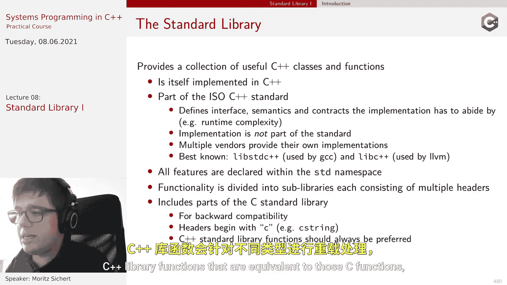

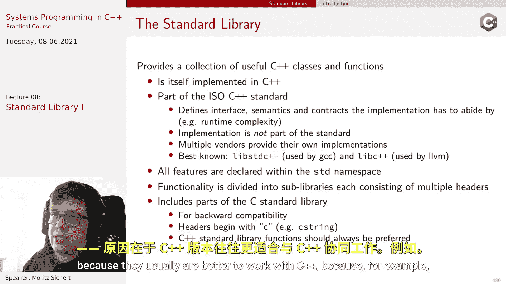

And。You should only see seasonal library functions for low level operations or for functions that don't exist otherwise。

Okay， so for short overview of the screen we have the utilities library。

 it has a lot of it has all everything that relates to memory management so that you already saw the placement new。

 for example and the shared partner also all the acceptable find there you can also do things like measure the time and there's also things like optional and。

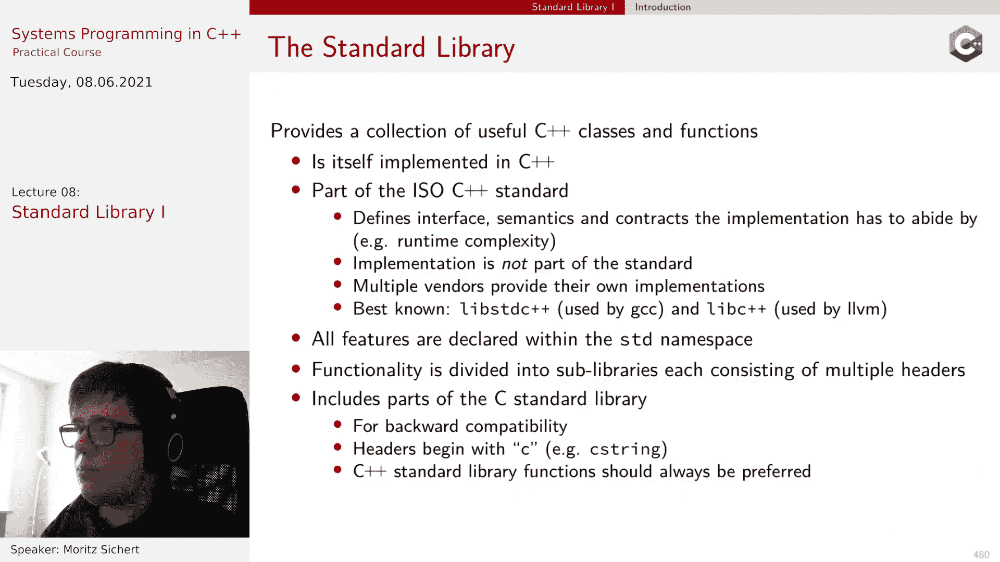

And so on。 Of course， we have strings。 You also。Containers， of course they are useful。 There's also。

This is for。Many very commonly use algorithm such as sorting or like certain time or the maximum of something。

That's an entire library dedicated to iterate。SoThey are widely used in the entire。 of course。

Then we have the numerics batteries， which is the the。诶。Most come from C。 So you。

 if you want to use very， for example， you can use C maththeda， there's also。

Hepo functions for complex numbers the also has facilities for random numbers。

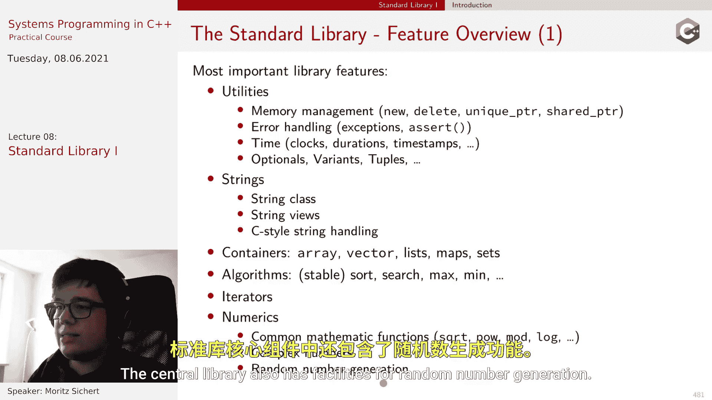

And there's even more。 There's also a lot of stuff related to A O。

 So you know the see out stream already， but there's also streams for files and for strings。

 There's an entire section about threads。 So if you want to start new threads if you want to use threat synchronization。

 prims and so on， we will also talk about all of those things in detail。

 but so that you have an overview。Now， there's also even more。

This plus1 version usually adds even more female in the example library。 So， I mean。

 just a non exhaustive theory。 also have regular expression support。 You haveomicomic solidization。

 file system support and the future there will prompt。

The Senate will also have something for networking which does not。In the standards， but for example。

 the threads teachers also relatively new threads were added into C+ in the C+ version。11。Yeah。

 but since then they they are useful to have a platform independent standard library for threats with you probably want to。

 which you usually need writing a systems program。Okay， firstly I want to talk。

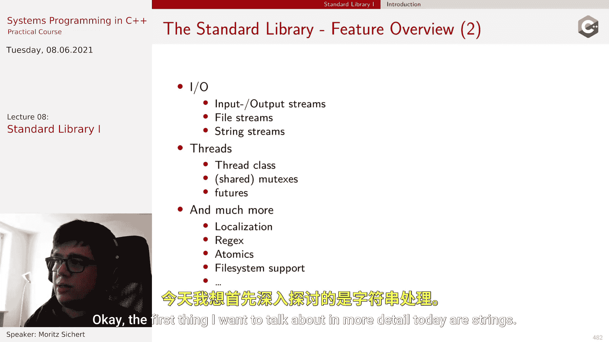

About in module， today are strings。 So we talked about strings briefly mainly because we wanted you to use strings some exercises。

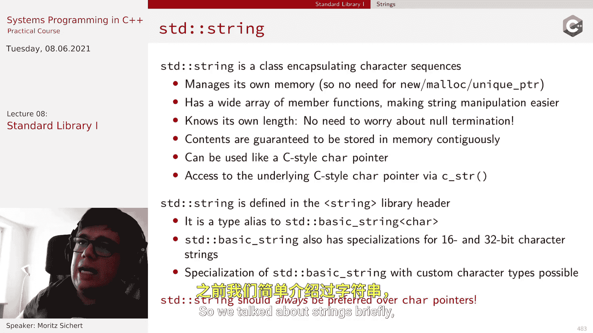

关。I want to。In detail。 So both SD string， SD string of in the in the string header。This essentially。

sA sequence of characters。 So the type of this character you would usually this is it's just the type character here。

 but S3 itself is actually a template。It's a type areas that it is the six string template。

 which would also work with other character types than character。

 which may be useful if you need some characters or something， but as the string does。

 it measures more memories to construct a thing it will store all of its characters dynamic memory management。

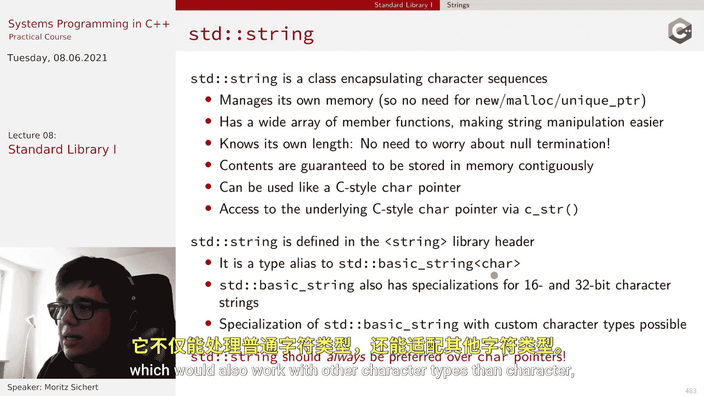

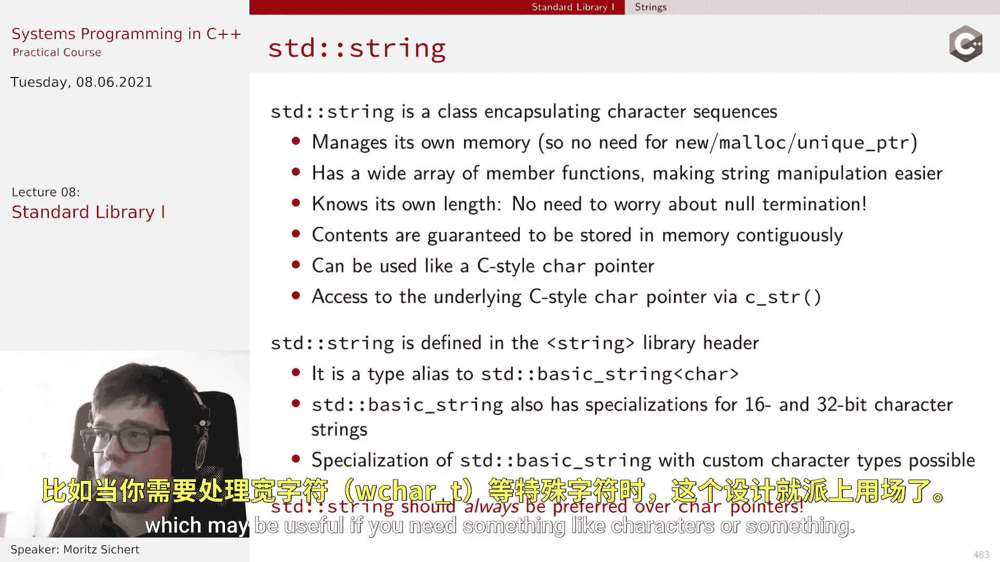

Which， of course， is useful because。I mean， you in a sense。

 it's that the class everything is essentially an life so you don't have to deal with new it。

And of course， S screen has a bunch of functions for string input。

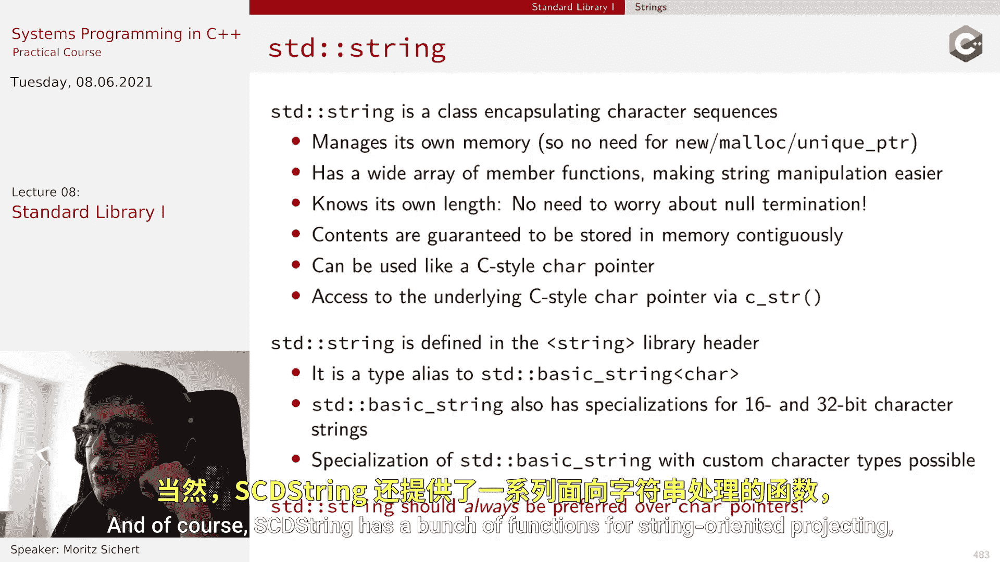

Do things I。对。And so on another。D compared to these。Is that the S string itself。stores。It's。

It's own link as well， so it's not terminated like sea strings。

Which means that you can have strings that contain mobiles， which is not that easy in C。

 but in C plus plus， the SD string class。Works。P with nubu。

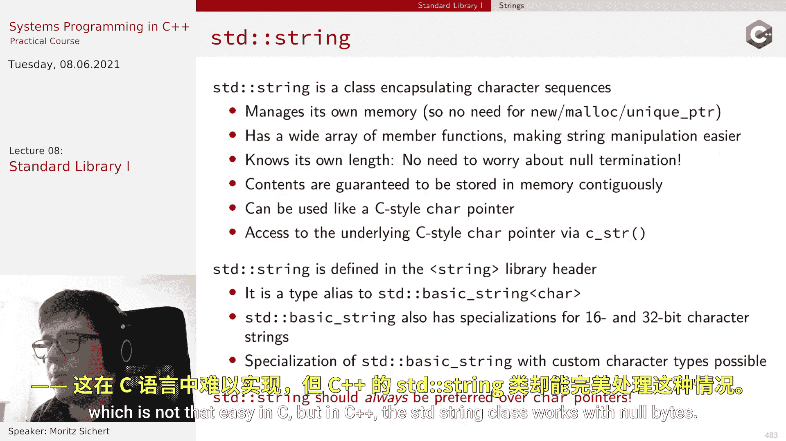

。嗯。Of course， you often do still need C style strings and the Se string has the function which is called C as cluster for to get the C style string of Se string and of course to be able to do this the actual characters need to be stored in memory particularly so if you get the C string。

The program still understand it。Yeah， in general， I think what you already said is you should。依就。我。

C st strings， people using some API， which is on a support sea string。ItD string or S string view。

 which we will talk about in。In a minute。

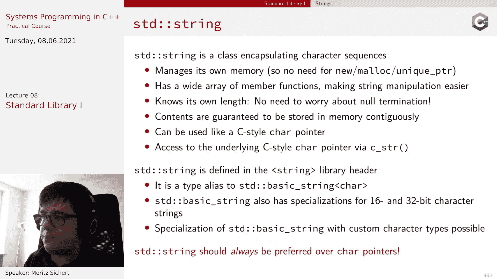

So let's look at a few member functions that S supports。

