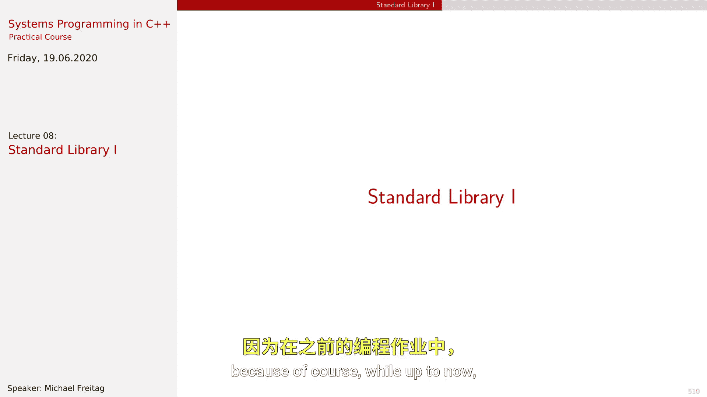
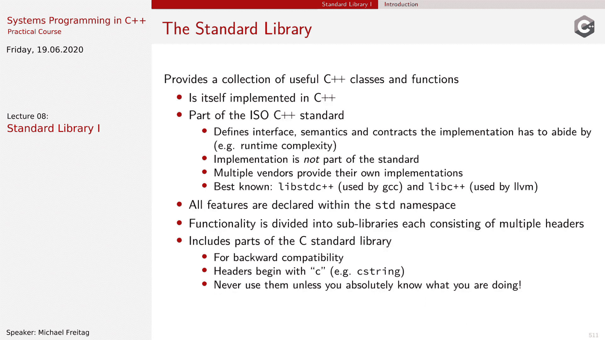
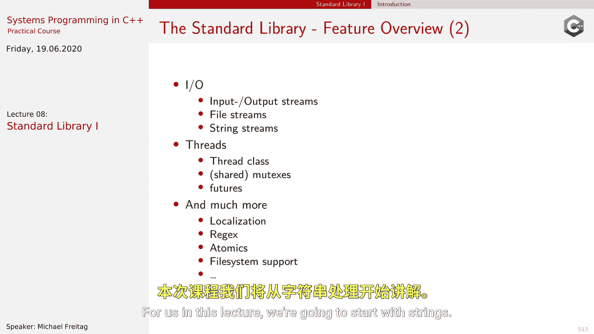
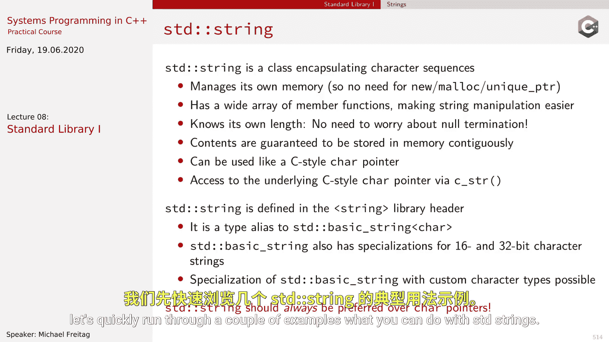
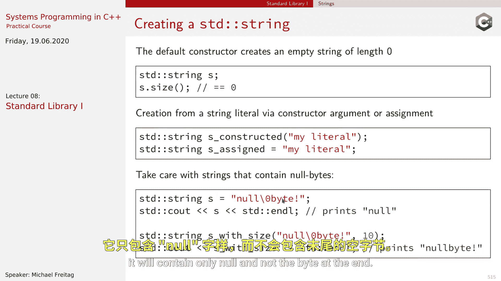

# 慕尼黑工业大学【中英⚡C++系统编程｜Systems Programming in C++】 p11 P11 Standard Library I_2020 -BV1gMbAz2EAk_p11-

Good morning and welcome back， everyone to the systems programming and C plus plus practical course。

 Today， we have another lecture in which we are going to talk about the standard library of C++。

Because of course， while up to now we forced you to implement all kinds of data structures and algorithms in the programming assignments。

 usually if you actually use C++ to implement some kind of project you don't want to do this because the standard library provides a huge collection of useful C++ classes and functions that cover most of these data structures and algorithms。

 and most of the time they're probably implemented more efficiently or more safely。

 then we could do it ourselves so we should use those implementations whenever we can。

So the purpose of this and also the next lecture is just to give you a brief overview of the contents of the standard library in C++ and a brief glimpse at how to use everything that's contained in here。

 Of course， like with most standard libraries and modern programming languages the C++ standard libraries also very。

 very large and contains a lot of functionality， so there's no way that we're going to be able to cover everything in detail in just two lectures。

 So the takeaway here is we give you an overview in these lectures and provide some insights into tradeoffs and usage guidelines that we would like to see but then if you want to know the details about anything as usual jump to the reference documentation through the links here in the top right corner and you can read in much more detail about the specific data structure or algorithm that you're interested in right So that said let's take a very high level overview of。

From how the standard library in C++ works， of course it's itself implemented in C++ and is's actually part of the C++ standard so the standard defines the interface the semantics and some further contracts that the implementation of the standard library has to fulfill and such contracts could for example be the runtime complexity of certain data structures but the implementation itself is not part of the standard so the different compiler vendors provide their own implementations so for example。

 MGcc uses the STDC++ and the LLVM framework and the Kang compiler for example。

 uses Lib C++ and those are just two different implementations of the requirements that are mandated by the C++ standard。

All the features in the standard library are declared within the STD namespace and you've already interacted with this quite a few times in the programming assignments。

 so this should be nothing new to you， the functionality that's contained in the standard library is then divided into sublibraries that each consists of multiple headers and all of these are prescribed by the standards so you can take a look at the reference documentation and there it will say in detail which library and which header you need for a certain functionality。

The C++ standard library also includes parts of the C standard library。

 mostly just to ensure backward compatibility and the headers of the C standard library begin with a C and the C++ standard library。

 so for example， the C string header is just the string do H header from the C standard library。

They are useful and they have their use cases。 one of them， for example。

 are the fixed with integer type aliases that are defined in the CDD and header。

 but apart from that and especially concerning the functions that are defined in these MC headers you should avoid using them unless you absolutely know what you're doing sometimes you might actually really want to use a specific function from the C library。

 but in most cases there's probably an equivalent function in the C plus plus library that should be preferred over the C library functions。

So let's before we start talking in detail about some contents of the standard library just take a look at what's actually contained in there。

 so there's a fairly large utilities library that contains memory management you've already used this for unique Sha pointers for example and we have era handling in there we have timing operations and a couple of other useful types such as optionals。

 variant topples， pairs and so on。Then we have a string library that contains the SDD string class that you've already used and it contains a very useful lightweight representation for strings。

 which is called string views， and of course it provides some interoperability with C style strings that are just pointers to character arrays。

Then we have a large number of containers such as arrays， vectors， lists， maps， and so on。

 We have a number of algorithms on such containers such as sorting， searching and so on。

A very important part of the standard library， because it's a common abstraction above all of these containers are iterators。

 Then we have numerics， such as mathematical functions that you have already used and complex numbers。

 random number generation and so on。Of course， the standard library also provides us with the facilities for input and output through streams。

 Then we have a whole threading library。Which can be used for， first of all。

 getting multi threading into your programs and then synchronizing all of this and even more that we're going to either not talk at all or just very briefly touch on in this lecture。

 Once again， if you want to know more， just go to the reference documentation and take a look for yourself。

For us in this lecture， we're going to start with strings。

So while you've already worked with strings a little bit。

 this was more in an ad hoc fashion and we haven't really talked about how SCD string actually works。

 So this is the purpose of the next couple of slides。

So what an SDD string essentially is it's an SDD vector that contains a number of characters。

 So just like an SDD vector， an SDD string manages its own memory。

 so we don't have to worry about allocating memory for our strings ourselves and it of course。

 has a variable size just like SDD vector。And then this is what makes it different from STD vector。

 SDD string contains a lot of member functions that are string specific and that make string manipulation a lot easier。

A very nice feature of S TD string。As opposed to C style strings is that an SDD string knows its own length。

 So we don't need to worry about nu terminating our strings like we would have to do in C。

 And we also don't need functions like string length。

 which compute the length of a string on demand because our SDD string just says a member variable that contains the number of characters。

 So this also makes it slightly more efficient in some settings。

The contents of an SDD string are still guaranteed to be stored in memory contiguously。

 and because of this we can still use the contents of an STD string like a Ct character pointer and internally an STD string is also nu terminated such that with the C string or C underscore STR function to be precise we can access this character array and then use it just like a Ct char pointer because it just a pointer to a chunk of memory which contains a nutermination character so we can directly pass the contents of an STD string to see Ct functions that expect a character pointer。

It's defined in the string library header， and it's actually a type alias to a more generic implementation of strings。

 which is called SDD basic string and the string type is just an alias for this generic implementation where it takes characters so objects of type char as its characters。

 but there are also specializations for the wider character types that are supported by C+ plus。

 So if at any point you need a string that contains a wider unicode characters。

 this is still possible and there's probably。Also， a type alias in the standard library that you can just directly use。

Yeah。And of course， this is a common theme throughout this lecture。

 If you're implementing something in C+ plus you should always prefer SDD string over char pointas。

 but this does not mean that you should always use SDD string as we will see in a couple of slides。

 But first let's quickly run through a couple of examples what you can do with them SDD strings。

 So of course you can default constructed in which case you just get an empty string。

 then you can use the。

Hopefully until up to now a well known constructor and initialization syntax to just create an SDD string from a string literal。

 but if we do that， we have to be careful because SDD string still tries to be compatible with C style string。

 So if our string literal contains a nullabyte， which is indicated by this escape sequence here。

Then the constructor of SDD string will notice this and just contain the string up to this null termination in our string lateral。

 so if we do something like this we'll see that when printing this string it will contain only null and not the byte at the end。

 we can work around this。

