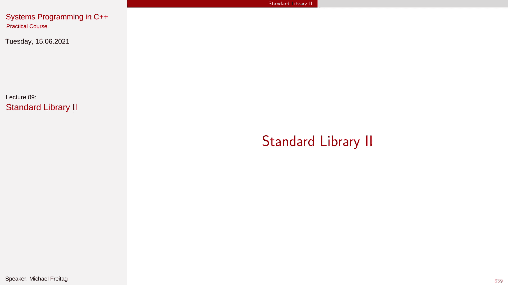
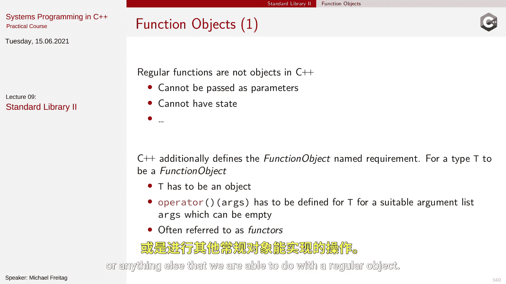
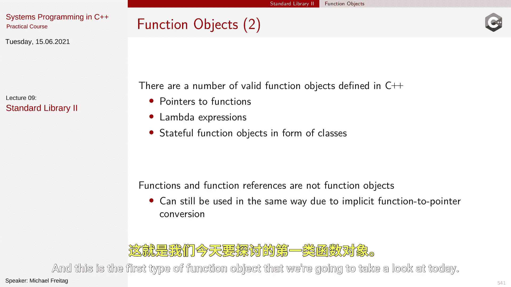
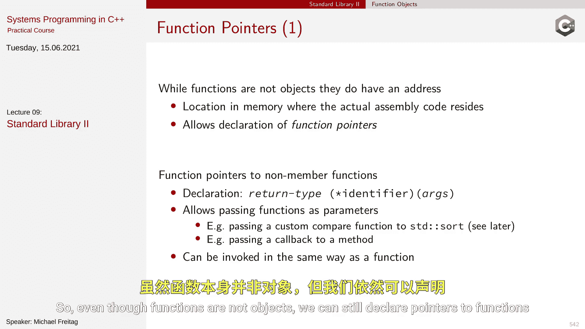
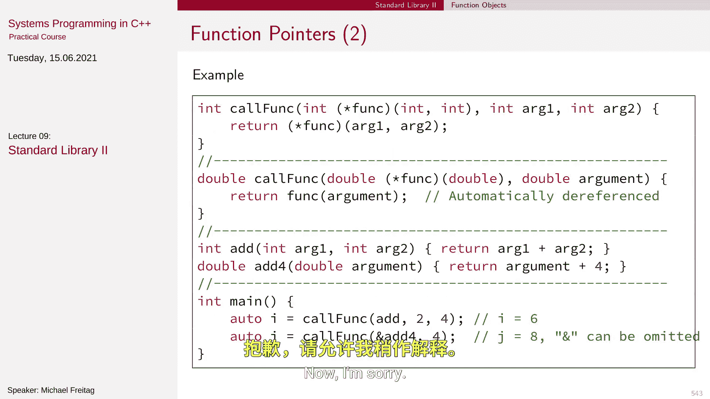
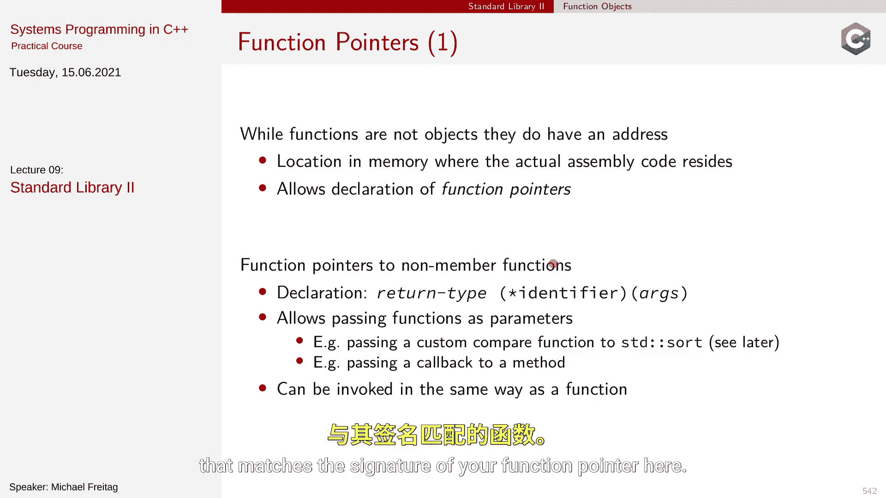
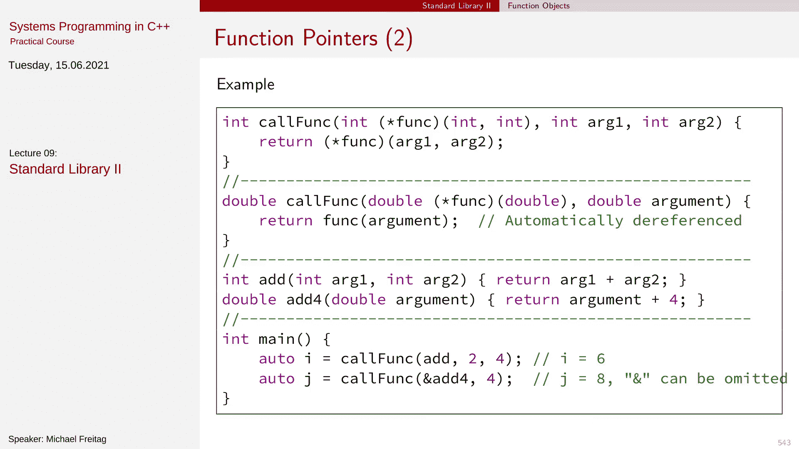
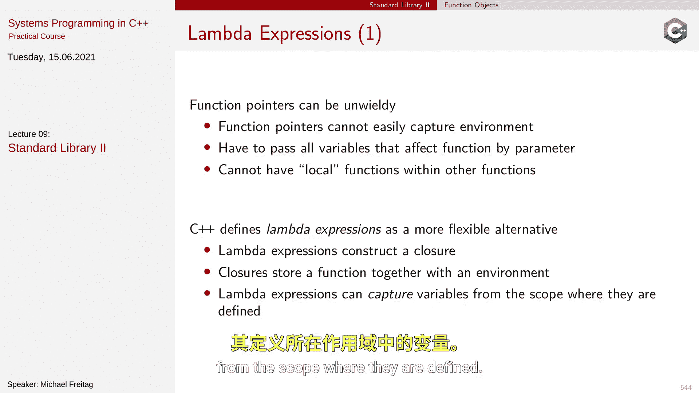

# 慕尼黑工业大学【中英⚡C++系统编程｜Systems Programming in C++】 p12 P12 Standard Library II -BV1gMbAz2EAk_p12-

Yeah。Hello and welcome everyone to another lecture of the systems programming and C++ Practic course in which today we will continue talking about the standard library and some related concepts that we are still missing。

And， and the most important of these missing concepts is on our first topic for today， which。

Refers to function objects and functions in general because there is a couple of things that we can do with those that we haven't seen so far。

 So right from the beginning of this course， we have learned that a regular function in C plus plus is initially not an object。

 and this has a couple of implications。 So for example。

 we cannot pass functions as parameter functions cannot have any state themselves， of course。

 they could be member functions of a class， which then can have state and there are a couple of other implications as well。

 for example， we cannot define references to functions and so on。

 This is a little bit constraining because we would sometimes， for example。

 like to be able to pass a function as a parameter for this reason。

 C plus plus additionally defines a socalled function object named requirement。

 which applies to an arbitrary type T， which has a couple of。

Properties and the first of these obviously has to be is that T has to be an object and then the core property is that the function call operator is overloaded for this type T and that this function call operator takes a suitable argument list which of course can be empty and such objects are then often referred to as funcs and we can do fun things with these because we are now able to pass such a fun as a parameter to a function。

 for example， or anything else that we are able to do with a regular object。

Now， of course， this requirement wouldn't be complete without some examples and luckily there are already a number of valid function objects defined in C++ without requiring us to do anything。

The first valid function object is a pointer to a function。

 and then we also have Lada expressions which we're going to take a look at today and finally stateful function objects in the form of classes。

 so if you just take this function object requirement literally and implement a class that fulfills these requirements then of course you also get a valid function object。

Although regular functions and a reference to a function by just typing the name of a function are not function objects themselves。

 they are not objects so they don't fulfill the first requirement of a function object we can still use them in the same way because implicitly if you just write the name of a function。

 this is converted to a pointer to this function。 and this is the first type of function object that we're going to take a look at today。

 so functions are not objects we've repeated this quite a few times already， so。

You would initially think because we have when we talked about memory layout and these things we talked about the address of an object and since we said functions are not objects。

 you could think that functions do not have an address。

 but this is not true because any function just consists of a sequence of assembly instructions and if you think back to the dynamic memory lecture we talked a little bit about the process layout。

You will maybe remember that the actual assembly code that makes up our executable is at some point loaded into memory and of course。

 this assembly code then is simply a number of bytes starting at a specific memory address and then taking the pointer of a function makes a little bit more sense because this function pointer is simply a pointer into the region of memory where the actual assembly instructions that make up your function are located so even though functions are not objects we can still declare pointers to functions which then point to these assembly instructions。

No， I'm sorry。

Now for simplicity we will mostly talk about function pointers to non-mem functions so to free functions and these can be declared as shown here so first we have to specify the return type then and this is important always in parentheses we have to write the an identifier for our function pointer preceded by the star character here and then after this identify in parentheses we have to write out the argument list and these once again as for regular function declarationations can either contain named。

Prameter or unname parameters， I think。Now， once that we've declared such a function pointer here。

 of course， we would like to be able to initialize this in some way， and once we've done this。

 this allows us to pass functions as parameters to other functions such as constructors or member functions or free functions。

And some common examples of this， just to give you some motivations are to maybe pass a custom comparison functions to the STD sort function。

 which we're also going to see today， or a little bit more generically just passing a colve to some method that you can then use for whatever logic you're implementing。

And such a function pointer can then be invoked in the same way as a function just that it's not a static function that you've declared somewhere。

 but this function pointer that can point to any function that matches the signature of your function pointer here。

。So to give you an example here， let's take a look at this short code snippet here。So first。

 we declare a function call function， which does nothing else but take a function pointer and then and two arguments and then invoke the function point the function through this pointer with these two arguments。

 So it's rather useless， but it's useful to demonstrate how we can actually declare such things。

 So the first。A parameterrameter of our call function function here is the actual function pointer。

 and we see that the declarationation matches what we've seen on the previous slide。

 So first comes the return types so this function returns an integer， then comes an identifier。

 So a name for this function pointer just following the syntax as it's required。

 So parentheses star and then the identifier。 And then finally we have our argument list indicating that this function。

The functions that we want to pass into this call function should take two integers as arguments。

And then， of course， we have our two actual arguments here。 And then finally。

 we call the function point， the function through this pointer by dereencing the function pointer。

And then I'm supplying our two arguments here。We could also let the compiler automatically dereference our function point。

 so this is demonstrated in our second snippet here。

 which apart from this small difference does exactly the same as our first code snippet。

And then just to demonstrate how we can call such functions that take function point as we now define two functions that actually match these signatures here so the add function here matches the signature of the function pointer in our first call function and this add for function here。

 matches the signature by our of our second call function function here。

 and then in our main method we simply call these rather useless functions one time we simply pass the name of our add function。

So here we see an example of automatic implicit conversion from a function to a function pointer。

 but we could also make this explicit by taking the address of the function that we want to pass as a function pointer here。

Any questions so far？Looking good。 So let's move on。 So as you can probably guess from this example。

Function pointers are pretty annoying to use because you have to write a lot of text to make them work and they just look plain ugly they make it really hard to see at one glance what's going on here。

And there are some。Additional more subtle disadvantages of function pointers as well。

 because with function pointas， for example， you cannot easily capture the environment at the point when you call a function。

 so all variables that affect the semantics of a function have to be passed as actual parameters to this function。

And you cannot have something like a local function within other functions。

 So returning to the example of using SDD sort with a custom comparison function。

 maybe you just need this custom comparison function within another Heer function。

 but if we only had function point to us， we couldn't really make this comparison function local。

 we would have to define it as a free function。 And then of course。

 it would be visible outside of the function where we actually need it。

And as a more flexible alternative to this two function pointers that resolve most of these disadvantages。

 C++ additionally defines Lada expressions， which on a high level construct a closure which then stores a function together with some environment that affects how this function works。

And in particular， this means that lambda expressions can capture variables from the scope where they are defined。

 and then within a lambda expression， you can refer to these variables。

