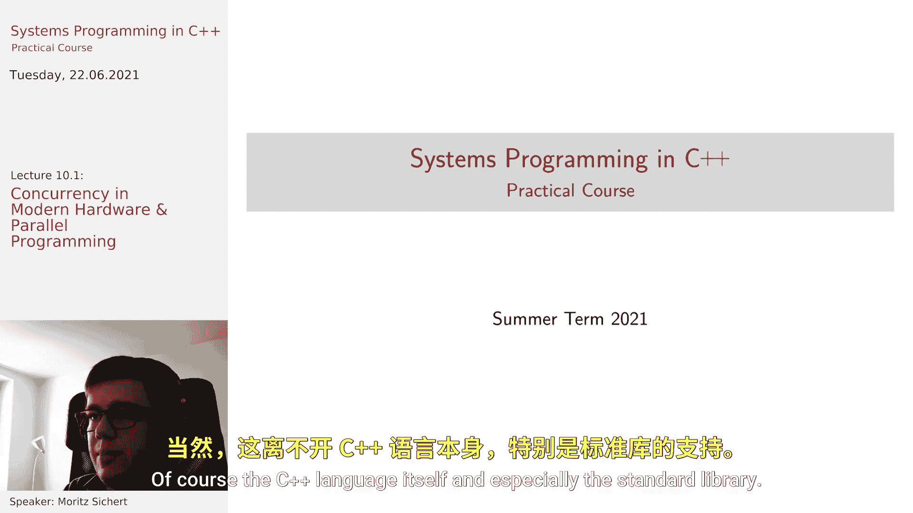
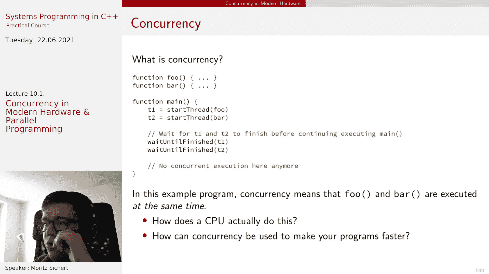
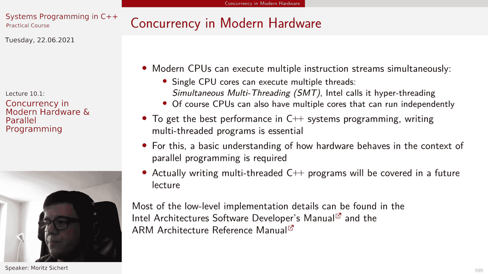
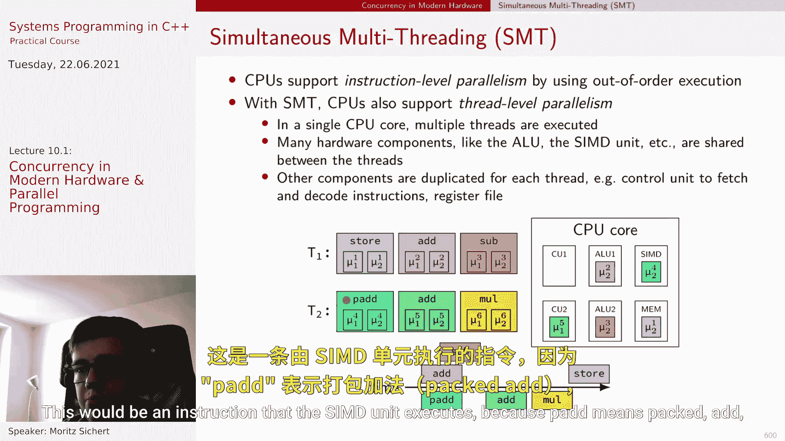

# 慕尼黑工业大学【中英⚡C++系统编程｜Systems Programming in C++】 p13 P13 1： Concurrency in Modern Hardware & Parallel Programming -BV1gMbAz2EAk_p13-

。Welcome everyone to today's lecture on systems programming in C++ the topic for today will be concurrency in modern hardware and parallel programming of course the C++ language itself and especially the standard library they have a lot of classes and functions and so on that can be used to do concurrency and parallel programming and so on。

 but before we dive into the actual C++ language and library features we want to spend this entire lecture about just talking about concurrency in general and parallel program in general。

 so today we will mostly see。

Like C++， like pseudo code， but we will not talk about actual C++ classes because we want you to have a bit of background knowledge of what concurrency modern hardware means and what parallel programming is before we talk about the the actual ways how to implement this in C++。

So when we talk about concurrency， the first question is， of course， what is concurrency。

 This is conceptually very simple to answer。 So if you have some language where you can define functions fo and bar。

Then this language probably has some kind of function that can start a threat。 So a threat is。

Its something that or in most operating systems， it's just called a threat。

 which will allow you to run a program concurrently or two functional currentlyrently。

 And this example we。Start two threads。 We call them T1 and T2 and each thread gets a function that it should execute and then in the end we just wait for the two to finish and then this is our main function。

 So if we talk about concurrency， this means that in this program two functions full and bar they are executed concurrently which means that they are executed at the same time。

 So they are not interlea or something they are really executed at the very same time and the question now is。

 of course， how does a CPU actually implement this so how how can this actually work。

 especially if those two functions are from the same program and of course。

 then the more broader question is how cancurrency be used to make your programs faster while not introducing any new weird  errorss。

So to answer the first question， yeah we have to look into the CPU design a bit more so what modern CPUs can already do on also if they only have a single thread or single core。

 they can do out of order execution which means that you essentially get instruction level parallelism。

 but this is not what we're interested here， but we are interested here is that we have multiple different instruction streams。

 so an instruction stream， you can think of an instruction stream something like the execution of a function because different functions have different instructions or even if you call the same functions from different threads。

 they may not be at one point in time they may not execute the same instruction because they slightly drift because one is faster than the other or something like this。

We want to look at the cases where a CPU can execute multiple instruction streams simultaneously。

One thing that a single CPU core can do。 So a physical。Like a CPU core on your CPU。

 there's something that's called simultaneous multithreading。

 which means that a single CPU core is able to execute multiple threats and you may know this better under the name that gives it because calls at hyperthreading but the concept in general is I mean it's the same hyperthreading is the name that In gives it but the general concept is called simultaneous multithreading and of course。

 you can also have multiple different CPU course that are mostly independent so they can also run it independently So this is so if you for example have a quad core CPU a quad where interc usually have four actually physically separate cores。

 where each of the course has two hyperths， which means that each core can execute two extra instruction streams at the same time。

 which means that you basically have something like eight threads in total。

whyhy do we want this because of course， if you execute if you manage to execute a program on multiple threats and course at the same time。

 you will usually end up with a FAFSA program and if you're talking about system programming in C++。

 which is a rather low level language of course， we also want to be able to use this。

Because Deep+ is a rather low level language， you need to know a few of the details of how S CPU actually implements this so that you can understand the potential issues and bugs and also how you should implement this so that no issues can happen。

But as I said， actually using this inC++ itself， so talking about the actual C++ functions and classes and so on。

 we will do this next week， today we will fully focus on the concepts。😊，As a reference。

 usually we reference the CPP reference website， but because you're not talking about CP+ today。

 most of the contents we talk about today come from the developer manuals from the CPU window。

 So there's the Intel architecture software developers manual。

 there's also an URL here which you can click and the same for Ar So arms and the CPU architecture that is used on most mobile phones。

 for example， they's also the same software developers manual for MD。

 they are just mostly similar because they both describe the X86 architecture So we just chose to use the Intel thing here。

 but this mostly applies to MD processor as well。

Okay， so let's first talk about simultaneous multi threading and how this actually looks within a CPU core。

 So Essa already said a CPU with without multi threadreading。

 so without simultaneous multi threading， already supports something that's called instruction level parallelism。

 which is also sometimes just called out of odd execution， which means that。

It can take a single instruction stream， so something like as I said。

 a function that is executed and can choose to execute multiple instructions of this single instruction streams in parallel and this the reason why this works is because if you have independent instruction。

 for example， one instruction writes into one memory location。

 the other instruction writes into the other memory location。

 they are essentially independent So the CPU can execute them simultaneously and this actually works without any multi threadreading without any simultaneouslyimaneous multi thread without any multico CPUs。

 this already works with with an individual instruction stream。

 but of course we want to focus on the actual multi threadreading here and then especially the simultaneous multi threading。

😊，Which means that in addition to instruction level parallelism。

 the CPU will also support threatle parallelism。 What this means is then， of course。

 that in a single CPU core， as I said， multiple threads。

 which on today's CPUs is mostly two are executed at the same time。

 but since so the special thing about simultaneous mud threading is that the different threads。

 they share many hardware components， so they share the Alu for example。

 which is the arithmetic logical unit， this is the part of the CPU that does the integer arithmetic for example。

 we have the SD unit S stands for a single instruction multiple data。

 this are some advanced instructions that can process multiple floating point numbers or integers at the same time and also have larger registerars so on x86 for example。

 or at these on intel processors， the largest S registerars have 512 bits as opposed to the largest integer registers of course。

on have 64 bits so this is just another part of the CPU and you have some other units and they mostly are shared between oil threats within a semi CPU core but of course there are also some execution units or some components that cannot be shared and this is mainly for example。

 the control unit， the control unit which you can see in the figure here。

 is is the part of the CPU that actually fetches new instructions and then decides。

Where the next instruction pointer will be， for example it processes branch instruction and so on and of course each thread also needs its separate register file and some other things。

 so in essence we can say there are some components that are shared between all threats and CPU core and some that are exclusive to each thread。

So let's look now at two instruction streams so we have essentially threat1 and thread2 and thread1。

 let's say executes the instructions store at and sub。

 so store just store something in memory adds to at to number sub to subtract to numbers and then we have thread2 which has P at at and Mole and P this is an example of on X86。

 this would be an instruction that the SD unit。Executs because P a meanss packed at。

 so we have multiple or we add a larger array。

