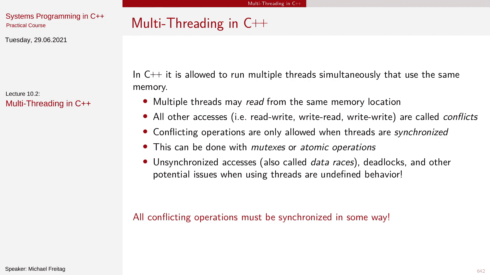
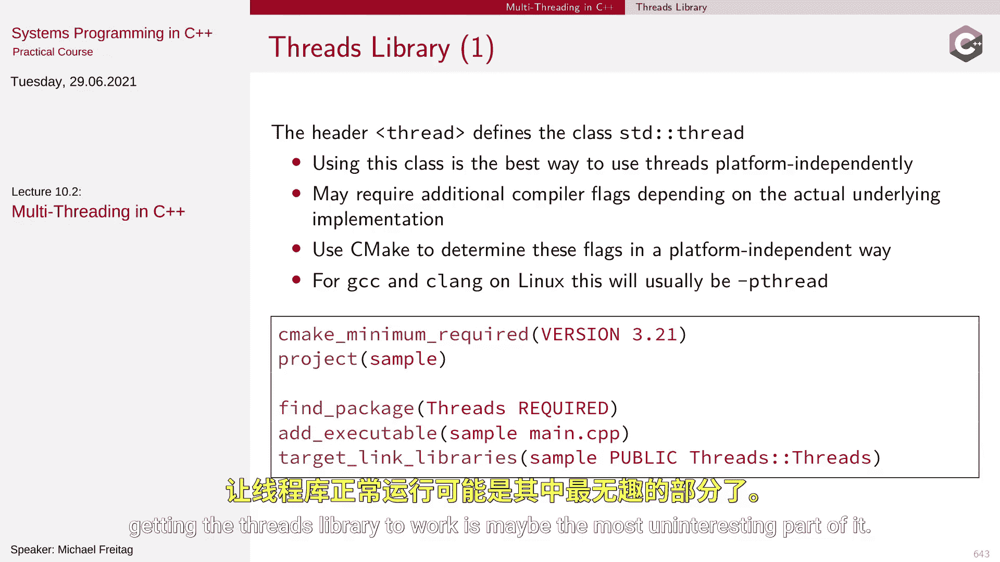
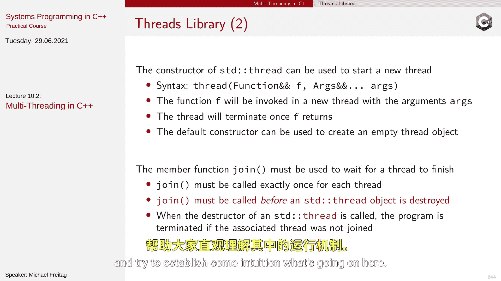
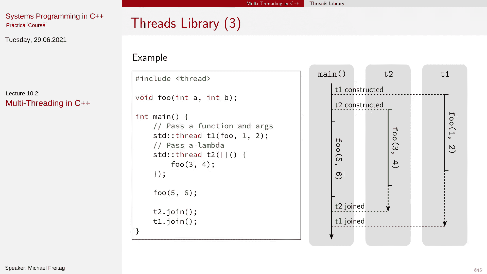

# 慕尼黑工业大学【中英⚡C++系统编程｜Systems Programming in C++】 p14 P14 2： Multi-Threading in C++ -BV1gMbAz2EAk_p14-

Welcome back everyone to another lecture of the systems programming and C++ practical course in which today we're going to talk about multithreading in C++ So of course we already had previous the previous lecture last week which talked about multithreading in general。

 how it's implemented on modern hardware， what kind of pitfalls there are what kind of specifics we have to keep in mind when talking about multithreading independent of any programming language and today we're going to take this knowledge and we're going to see how。

We can actually make use of the facilities that are provided by the CPU in C+ plus what are the language features to do this and so on。

So， of course， on a high level， there's nothing too surprising。 C plus plus， of course。

 allows us to run multiple threads simultaneously and， of course。

These threads use the same shared memory， so we've seen this quite early during this lecture that we have this virtual address space of a process and all threads that we may start within such a process share this address space so they can of course access the same memory location and they will both see provided that we take some care。

 they will both see changes to this memory location that are made by the respectively the other thread。

So this is the classic share memory model for multi threadreading N C++ allows us to make use of this。

Of course。Immediately after we are done being happy about this and we can start thinking about all the problems that come with this and the major cause of this problem is。

 of course， that precisely multiple threads can access the same memory location。

So what is perfectly fine is when multiple threads read from the same memory location。

 Nothing exciting is going on there。 they're all going to see the same contents of our memory memory location and we're happy。

 But as soon as we start doing anything else， but reading from the same memory location。

 we get what is called a conflict in C+ plus So this means that any combination of one or multiple threads reading and some other threads writing the other way around someone writing and someone is reading or both or multiple threads writing to the same memory location are called conflicts。

😊，And all of these conflicting operations are only allowed when the threads are synchronized in some way。

 So this means even if you have the situation that only one thread is writing to a memor occasion and all other threads are reading。

 you'll still need some sort of synchronization。😊，To make this well defined behavior。Of course。

 and this is something that you may remember from last week's lecture this synchronization can be done with mutual exclusion or atomic operations。

And we're going to see today how this is implemented in C plus。And just to stress this one more time。

 any unsynchronized access that has a conflict， which is also called a data race。

 any deadlock or any other of the many potential issues that you can run into when using threats are undefined behavior in C++ and this once more means that any conflicting operation。

 anything that is not exclusively reading from a memory location has to be synchronized in some way。

So we cannot simply take our single thread at C++ coach and slap some threads around that and then expect it to work。

 we have to do some additional work to achieve the synchronization that is required。But of course。

 today's lecture will spend a great deal of time talking about how exactly we can achieve this。

 but before we can talk about synchronization， we have to talk about threads first。

 So let's take a look at how we can start multiple threads and use those within C++。😊。

So in this standard library we have the very useful thread header which defines the class STD thread and this class is our main way to use threads in C++ programs because this class is platform independent so the standard specifies how this class has to look and how it has to behave and then the underlying implementation of the C++ standard library can adapt to the different platforms that your code might run on but we always use STD thread and we don't have to worry about that。

But because threads are such an invasive feature， it's still possible that some additional compiler flags are required to actually enable this threading functionality and of course this once again depends on the actual underlying implementation of the standard library so here our recommendation is to use CMake to determine these flags in a platform independent way so that also on the build system side you don't have to worry about portability。

And just for completeness， if youre using GCC or Kang on Linux。

 this flag will usually be the minus P thread flag， so just for those who are interested。

 this means that usually on Linux the threading functionality in C++ is implemented using the P threads library。

And for completeness。If you do want to include threats in your own project。

 there's a very brief C make code snippet down here that shows you how to do this。

Compilile a flag detection in CMake。 So all that we do is we call find package with the threads package at our executable as usual。

 and then we have to add to the target link libraries this threats target here。

 So for now you can just copy and paste this code snippet。 but of course。

 I think it's next week we're also going to talk about CMake in a little bit more detail and specifically we're also going to see what exactly these fine package and target link libraries function calls in CMake do。

 But for now， as I said， just take the snippet， and it should work provided that we didn't include any typos in here。

Now of course， getting the threats library to work is maybe the most uninteresting part of it。

 how can we actually use this STD thread class？

So the constructor of this STD thread class。Usually starts a new execution thread and the syntax of this constructor simply takes a function and a veryadatic list of arguments。

 so this is a little bit similar for example to the syntax of make unique where you also have this variableable list of arguments that are then simply forwarded to the constructor here in the case of threads and the arguments that you specify are simply going to be forwarded to the function that you pass here。

Then this function here will be involvedked in a new thread with the arguments that you provided。

 and then once your function F returns， through some means， the thread will terminate。In some cases。

 it's useful to not immediately start a thread once you construct an STD thread object。 and for this。

 you can simply use the default constructor， which will create an empty thread object。

 So a thread object that simply does not have an associated thread yet。

Once you have started a thread， of course， and this thread will run for some time。

 do some useful work hopefully and eventually it will terminate。

At the end of your overall program execution， you have to call the member function join on this thread object to potentially wait for a thread to finish or simply make sure that the thread has already finished。

 So this is。Even if you know that your thread has already finished by the time that you call join。

 you still have to call join。To explicitly merge these separate execution threads once again。

 So join must be called exactly once for each execution thread that you have started through the constructor of STD thread。

 And this join call must happen before the STD thread object itself is destroyed because when the deor of an STD thread is called。

 and the join function was not invoked previously。 then your whole program is going to be terminated。

 So this is a potential source of bugs， but luckily。

 it's rather easy to spot these bugs because then your program will simply terminate if you forgot to call join。

So let's take a look at an example how this could actually look in code and what try to establish some intuition。

 what's going on here。

So first of all， let's take a look at the code snippet on the left here。

 so let's just assume we have some opaque function food that takes two arguments and does some kind of work and we don't really care about what this is for now Of course we have to include the thread header to be able to use SDD thread and then we construct two threads here using the constructor syntax from the previous slide So first in the first version here we simply pass the function and then two arguments for the a and B parameters bottom word is also possible of course is to pass a lambda as the function and then because our lambda here doesn't take any parameters we don't have to pass any parameters to the SDD thread constructor but of course within the lambda here we can then do essentially whatever we want including calling our full function here with some different parameters so this is just to illustrate that you can use both functions with arguments and lambdas as the arguments to the SDD thread constructor。

And then once we have started these two threads， of course。

 the main function also runs in a thread the main thread。

 and we could simply call fo with yet another set of parameters here。 And then finally， we call join。

