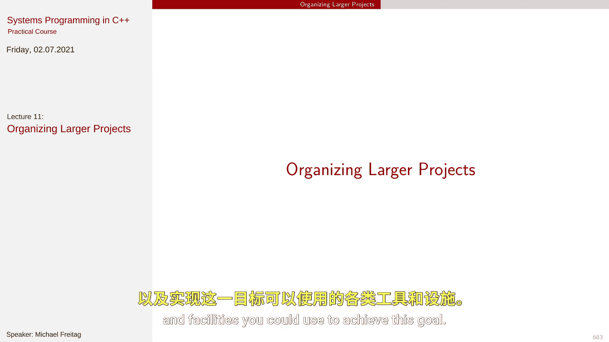
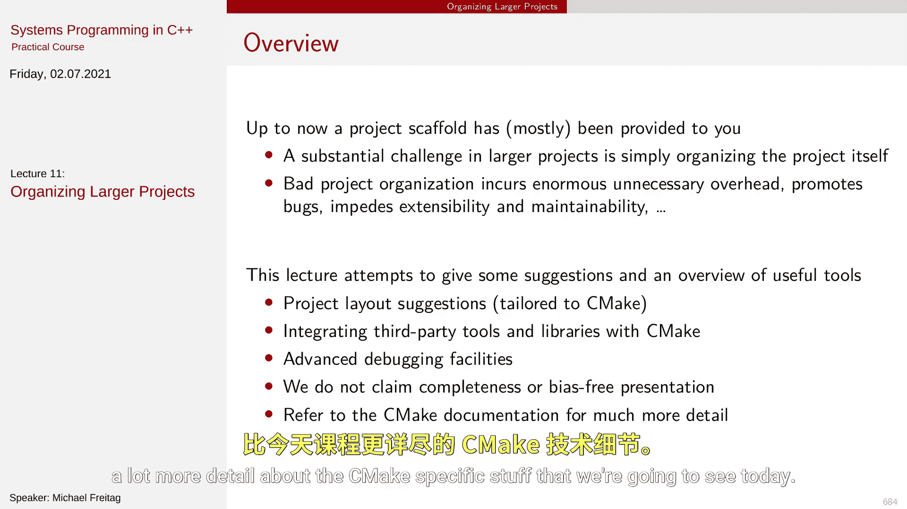
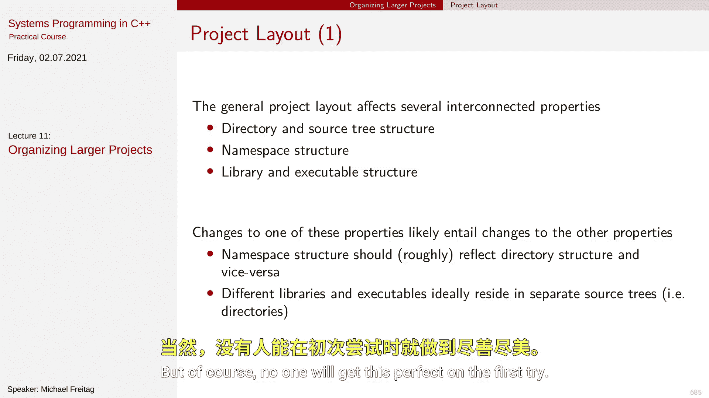
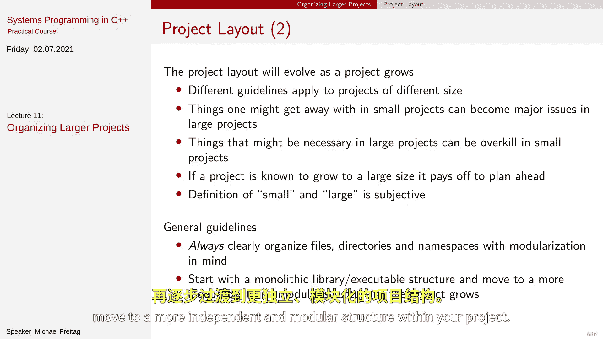
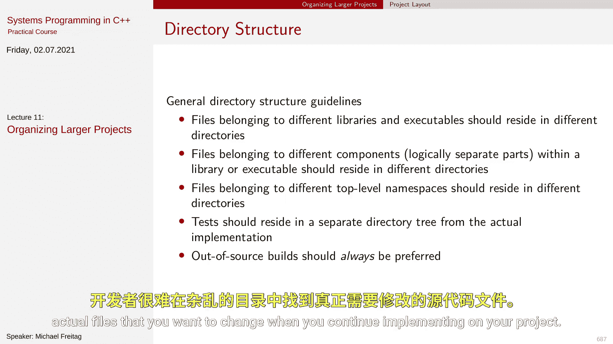
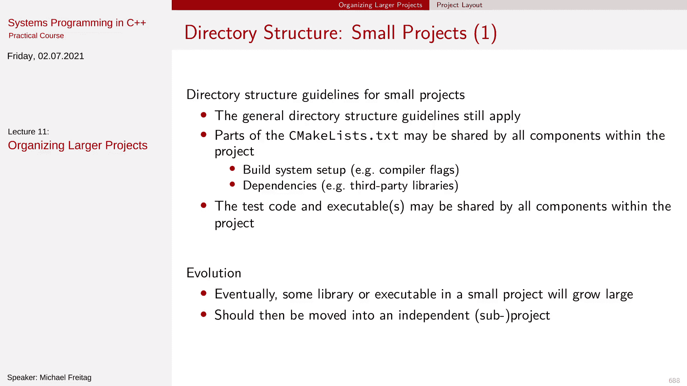

# 慕尼黑工业大学【中英⚡C++系统编程｜Systems Programming in C++】 p15 P15 Organizing Larger Projects -BV1gMbAz2EAk_p15-

Welcome back everyone to another lecture of the systems programming and C++ Pra course in which today we're not going to talk about C++ as much but more about how to manage and organize larger projects and what kind of tools and facilities you could use to achieve this goal。

So what is the motivation behind this simply that up to now in the programming assignments we've mostly provided a project scaffold to use。

 so there were some predefined source and header files there was a CMake setup that already worked and you essentially just had to fill in some source code into these predefined files。

But of course， usually if you think beyond this practical course。

 this is not how things are going to be， so usually you start from scratch you have an empty directory and then you have to set up all this stuff yourself and today's lecture tries to give at least an introduction into how this can be done and tries to provide some general guidelines that help you along the way。

Because one of the main problems is that once your projects start growing a little bit larger and large is of course。

 subjective here， then simply organizing the project can be quite a major challenge and at the same time if you have a bad project organization and this can be either bad processes for communicating between people just simply bad directory layout bad architecture all these things。

 this can really impede the progress that you can make in your project so you get this enormous essentially unnecessary overhead because it's much easier to introduce bugs into a badly organized project and it's much harder to extend them。

Sometimes they are so confusingly organized that it's really hard to maintain them when something breaks at some place or you have to upgrade a library and so on。

 so there's a huge number of things that can go wrong that each of you I think can think of and once you have a badly setup project。

So what we try to do here is to give an overview of some best practices that you can adhere to and some useful tools that help you stick to these best practices。

So a rough overview is that we talk a little bit about project layout。

 This is tailored to CMake of course， because we're using that in this lecture。

 then we're also going to talk about how to work together with third party tools and libraries once again how to achieve this in CMake and also some advanced debugging facilities that we haven't really touched on up to now。

So of course our lectures are rather short and this is a huge area which you could probably spend weeks talking about so by no means do we claim completeness or biasfree presentation here so this is what we have found to work well and this is a rough overview of we have found to work well you're free to talk to us or read up on this topic yourself and one good starting point for a lot of the content in this lecture is to simply read the CMake documentation which contains。

 of course， a lot more detail about the CMakeake specific stuff that we're going to see today。

So， let's start with the。First， broader area， which is simply how to structure your project。

On your file system and although this sounds somewhat trivial。

 it actually has quite deep a quite deep impact on essentially the entire project lifetime。

 because the general project layout affects things that you will observe to have effects within your actual C plus plus part of the project。

 and this is， for example， the source tree structure， the namespace structure。

 how your includes look like maybe you have cycles in your includes that are introduced by choosing a bad file system layout。

 and then you also have the library and executable structure。That also。For example。

 effect extensibility， maybe you want to split your project into two projects。

 This is much easier if you have a suitable file structure from the beginning。

 as opposed to when you have everything mixed up and then you have to painstakingly separate individual files from each other。

 So once again， I think the basic motivation here should be rather obvious。And of course。

 if you change one of these properties， for example， if you change your directory structure。

 then most likely you will also have to adjust some of the other properties。

 So especially if you if you change the directory structure。

 then the namespaces should probably also change。And also。

 if you have different libraries and executables， for example， if you add another library。

 then this should be in a separate source tree from the remainder of your project。But， of course。

No one will get this perfect on the first try。 So usually this project layout will evolve as a project grows。

 And also depending on how large your project is， you will most likely want to follow some different rules。

 depending on the size of your project。 So， for example。

 if you know that your project will remain small。 It's just a small tool to achieve some minor task。

 you can probably get away with some inaccuracies or。

Someopmal solutions that are fine in a small project。

 but would become major issues in a large project。And on the contrary。

 if some things you only have to do in large projects because they would be plain overkill in small projects。

So the takeaway here is if you know that your project will likely grow in the future。

 then it pays off to plan ahead and maybe introduce some things that are not necessary in the beginning of your project but will definitely become necessary once your project has grown to a sufficient side and of course small and large here is subjective。

 so this also also depends on how many people are going to work on your project if it's only you then also maybe don't have to spend too much time on making it easy for many people to work on the same project and so on。

Regardless of the size of your project， there are still some general guidelines that we would recommend you to follow。

 such as always cleanly organizing files， directories。

 and namespaces with the objective of having proper modularization。So this。

 this is probably a a area that you have already heard about in different lectures。

 So the general guidelines of how you can achieve modular code you want to have。High cohesion。

 low coupling and so on this also of course applies to C plus+ and you can make this a little bit easier by having a clean directory structure that maybe reflects the different modules that you have within your project。

And if you most of the time， unless you really start a huge new project that you already know will be very large。

 our recommendation would be to start with a monolithic setup where we have one library or one executable。

 and then as the project evolves， a move to a more independent and modular structure within your project。

So。In general， when it comes to directories， we have found the following to work quite well， so。嗯。

Definitely if you have files that belong to different libraries and executables。

 these should reside in different directories so you shouldn't mix two or more libraries or executables within the same directory tree。

And this also continues to components within the same library or executable files that belong to different components within your project should also reside in different directories。

So this。Maybe this corresponds to modules or components within your system and of course。

 and if you have different modules or components， then these should probably also belong to different top level name spaces and therefore once again reside in different directories。

And something that's also quite useful is that when you write tests。

 those should also be placed in a separate directory tree from the actual implementation so that it's easy to。

 for example， strip test code from your project。Or distribution or building and something that we have already talked about and that I think by now all of you do is of course。

 that out of source builds should always be preferred， so with CMake。

 this means that you have this separate build directory which then contains all the generated files and your actual source files are not cluttered with this generated stuff that then makes it very hard to find the actual files that you want to change when you continue implementing on your project。

So what follows now are some high level recommendations。

Distinguished between smaller and larger。