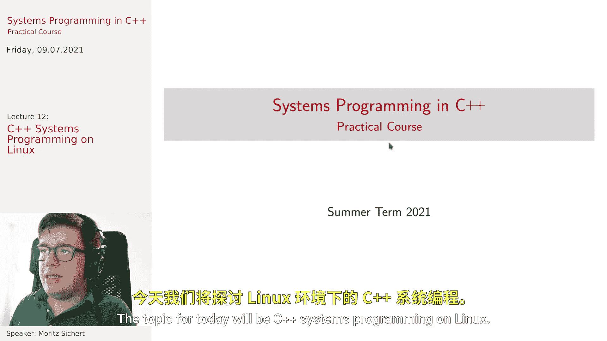
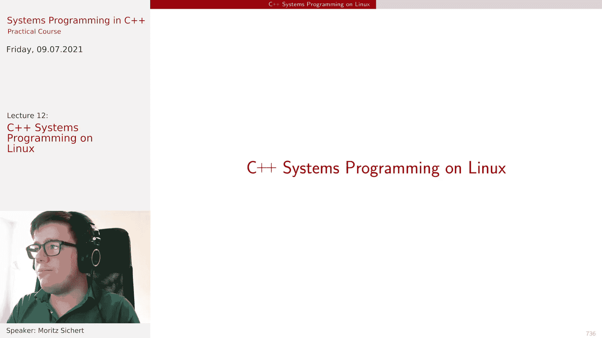
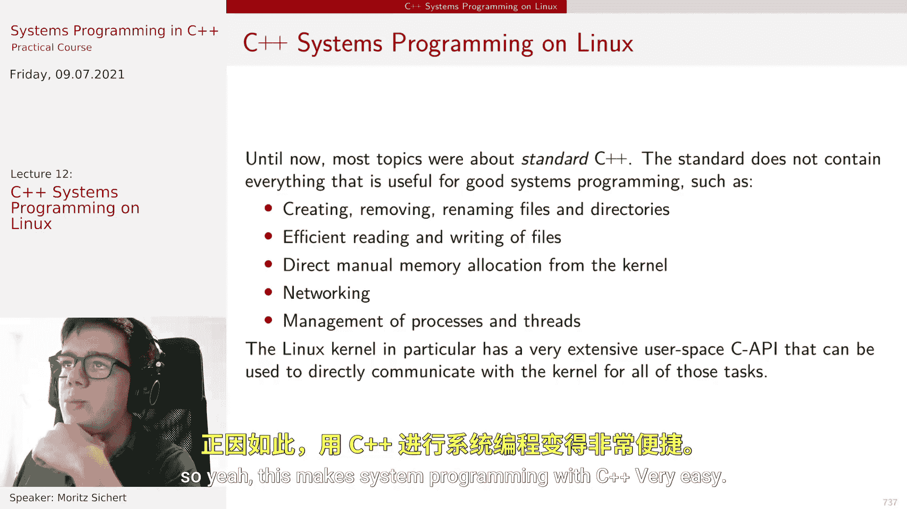
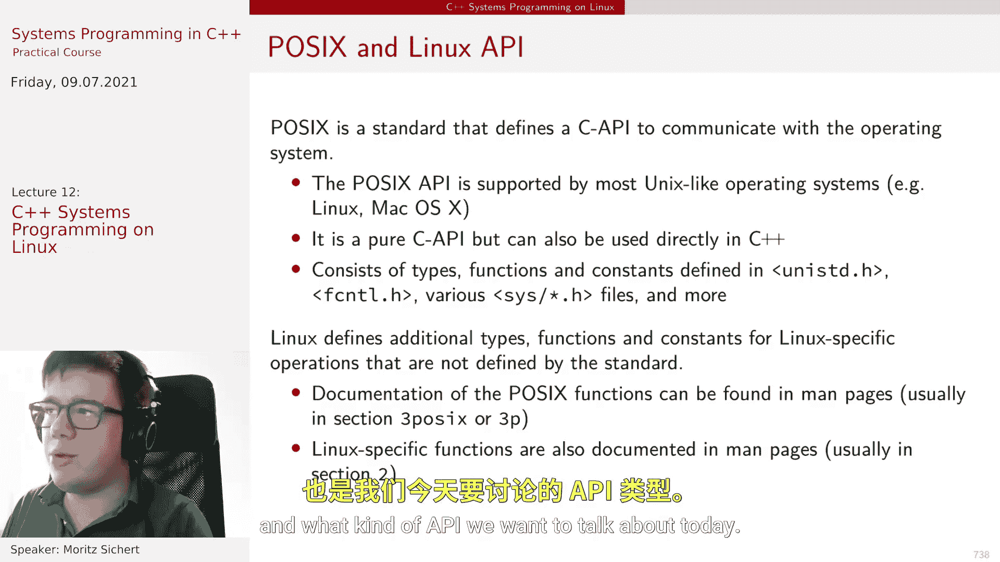
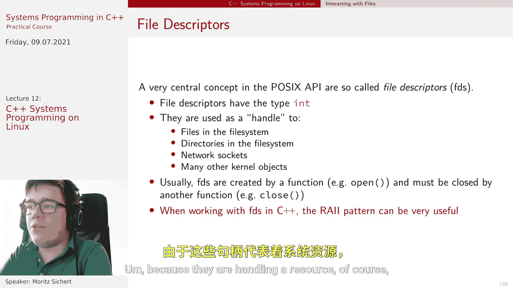

# 慕尼黑工业大学【中英⚡C++系统编程｜Systems Programming in C++】 p16 P16 C++ Systems Programming on Linux -BV1gMbAz2EAk_p16-

Welcome everyone to today's lecture on systems programming in C++ the topic for today will be C++ systems programming on Linux so far we have Mandy talked about C++ so the language itself and this is of course a very important。

Part of being able to do systems programming in C++。

 but today we want to talk about how you can actually communicate with the operating system and we will use Linux here as we of course have already used Linux for all the exercise sheets and yeah。

 so we will mostly focus on Linuxux today。

Okay， so as I said， the what we talked about。So far is standard C++ so the Z++ standard it does contain a lot of functions that can communicate with the system so you can write to files。

 you can read from files， you can also do things such as start threads and so on but。This is。I mean。

 for example for streams we said streams are usually very slow and you also don't get very much control over the exact functionality or the exact system calls the standard library will use and of course there's a reason for that namely because the standard library it should work on all architectures and all operating systems but of course if we are doing system programming we usually will some somehow need eventually access or direct access to the extra system we are working on so I mean examples for system programming are things like handling files and directories。

So said there are some features in the center library already for this。

 but usually the operating system gives you quite a lot of more functionality and that you also want to be able to use then of course reading and writing files but efficiently because。

As I said， streams are very slow and there are different use cases for reading and writing files and we will see a few of them today。

 but of course for this you need directly you need to use the system cos or the functions provided by the system。

Then of course， also manual memory management or manual memory allocation。

 because so far we have used the standard allocations of C++， which。

Mainly use malllo in the background， but the question is how would you implement Malooc yourself if you for some reason think you can implement a more efficient malloc？

Of course， they didn't also need to be able to talk to the operating system to be able to actually allocate new memory in your。

In your process， then we also have things like networking。 We will not talk about networking today。

 The main reason for this is that you。I mean there's an entire lecture on this in the informatic specialistcheulas so which focuses a lot on also the CAAPpi for networking on Linux so we will not cover this today。

 but of course this is also a very important part of systems programming and then of course you have the management of processes and threats because I mean you can use the SD threat class in C+ but you also may want to do things like start a new program or customize your new thread or your new process or something so yeah those are all good examples for systems programming。

And in Linux， all of those functions they are available in a user space CAAP。

 so user space means that many of those things are implemented as much as possible in the user so not in the kernel。

 I mean of course creating a new process or even opening a file you need to talk to the kernel eventually。

 but the standard library of Linux are to say it tries to implement as much as it can in the user space。

 and this is implemented in a CAAP which means that you have headers that are written for C。

And those headers will declare functions and then you will need to link with the usually with just with the lip C on your system。

 and then you can yeah， then those functions can be used。 and of course， the advantage of。

Using C++ is that it is easily interoperable with C so you can usually in a C+ Earth program you can just include those C headers and they will work just fine so and yeah this makes system programming with C++。

Very easy， I would say。Okay so let's talk about the Linux API in particular a bit more。

 so there is a standard that is called Posss and Posss is essentially collection or functions and behaviors and so on that defines how operating system should behave and what kind of functions it should have so Posss actuallyifies most of the functions that Linux provides are actually specified in the Pos standard which means that they are not only specific to Linux they can also use used in all other PoOSic systems and examples for those are I mean most Uniix like systems so not only Linux but also like MeS for example are also the several BSD Unies that exist so those usually support the Poss API as well which means that if you only use the pure Posss functions that Linux implements then your program is mostly。

Ptable also to other operating systems that use deposits API。And as I said， I mean。

 this is just like for the Linux API they are also of course mostly comprised of C headers so C API and the most important headers we can see here。

 there are the UniiSD dot H you have the F and T L dot H and then you have several headers in the Suis directory and we will for the functions we will talk about today。

 of course I will also briefly tell you which headers to use。😊。

Of course the because the Aposs API tries to be compatible with or at least it tries to be a stand that can be implemented in multiple operating systems。

 this also means that。Usually every operating system will have additional functionality which is not covered by the Pos API and this of course is also the case for Linux Linux is quite a large software project and it has a lot of features that are very specific and only work on Linux so they will not work on MegoOS they will not work on any BSD。

And。Yeah， they are very similar in that they are also defined as C functions。

 but of course they will then only work on Linux and especially if you're using rather than new functionality。

 then this will also mean that when you execute your program you need kernel a Linux kernel that is new enough so that it implement this functionality。

 but for both so for the Pos API and the Linux API you can't find all of the documentation in man pages。

 so usually it's divided into the pure Pos documentation is in the section 3p or three pos so it doesnt really matter if you just write men and then the function it will automatically find the correct documentation and for Linux specific functions just the same you can also just write men and then the function name and Linux and you will find a very descriptive documentation of the function。

Okay so this is the overview of what kind of API Linux supports and what kind of API we want to talk about today。

😊。

A very central concept in Poss and then of course also Linux are so called file descriptors so they are usually abbreviated as FD or like the plural as FDs and file descriptors。

 I mean the name indicates that they are of course used to handle files but this is not the only only a case where file descriptors are used。

 they are usually used as a handle for。Many different kinds of resources so of course a file is a resource that makes sense to have a file descriptor for。

 that's where the name comes from， but you can also have a file descriptor for directories and the file of stimulus may also still be okay acceptable but then you also have file descriptors for network circuitckets which of course you could still argue that in like the Unix philosophy is everything is a file so maybe a network circuit is also file but then especially on Linux you have a lot of current objects that do not behave like files whatsoever which are still handled by file descriptors。

 so essentially you have to think of as a filescriptor is some arbitrary int so its and the types of file descriptors are always in and this is just some kind of handle to whatever object or or resource you are currently hand。

And because they are handling a resource， of course， this resource must be freed eventually again。

 so for example， if you open a file。😊。

