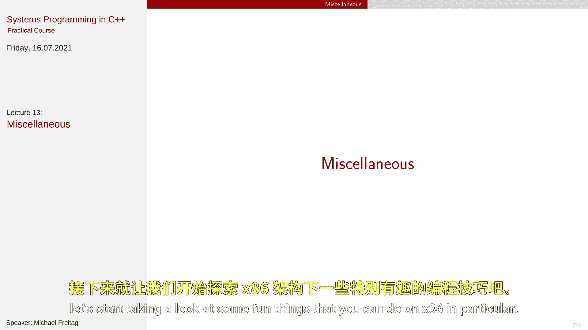
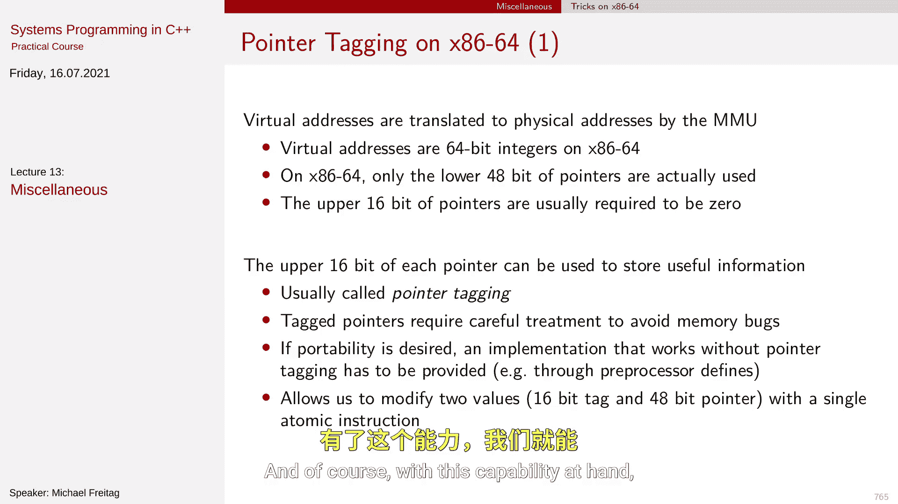
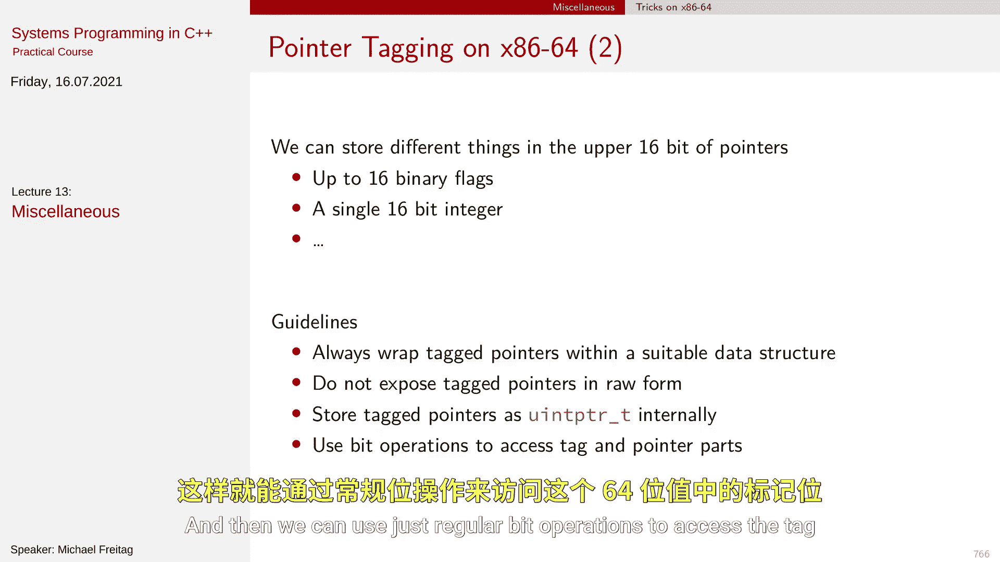
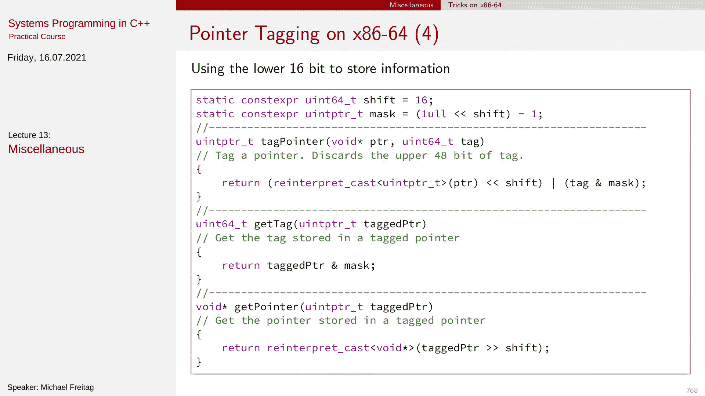

# 慕尼黑工业大学【中英⚡C++系统编程｜Systems Programming in C++】 p17 P17 Miscellaneous -BV1gMbAz2EAk_p17-

Hello and welcome back everyone to the final lecture of the systems programming and C++ practice course in which today we're going to talk about a couple of different things that we haven't really had the chance to talk about in the previous lectures but that we still consider to be sufficiently interesting to give them some time in our lecture here。

 so most of this stuff is actually much larger than it might appear in this lecture today so we are only going to scratch the surface of many topics so that you at least know that they exist and if you're interested then of course we encourage you to read up on these topics yourself but at least with this overview you may remember oh there was this topic or that topic in case you run into a problem where they may be helpful。

So with this in mind， let's start taking a look at some fun things that you can do on X86 in particular。

 and the first thing that we want to briefly talk about is a topic called pointer tagging。

Which exploits that， as we may remember from our lectures about dynamic memory management。

 and we have this virtual address space that we use in our programs and these virtual addresses are translated to actual physical addresses within our main memory by the memory management unit。

And these virtual addresses， if you have a 64 bit system。

 which by now I think is the defect facto standard。

 then of course your virtual addresses are also going to be 64 bit integers。

 but the memory management unit on X84 only uses the lower 48 bit of pointers as actually relevant for translation to physical addresses。

So what this gives us is that our pointers actually only contain 48 bit of information and the upper 16 bit of our pointers are unused by the system and of course we can get the idea to try to store some useful information in these upper 16 bits of our pointers and this is then called pointer tagging because we are adding these tags if we were talking about individual bits to our pointers。

Of course， we have to be quite careful if we do this because if we accidentally set one of these upper 16 bits and then forget to clear it again before using our value as a pointer。

 then we will run into all sorts of fun memory bugs that will screw up our program。And of course。

 if we want to have truly portable programs， then we also have to provide an implementation that works without such pointer tagging because this is specific to X86。

 so it might not work on other architectures where these upper bits of pointers are actually used。

Another thing that is depending on the situation that you're in extremely useful is that with pointer tagging。

 you can modify two values， so a pointer and these 16 bits containing whatever information you want to store in those with a single atomic instruction and depending on what kind of data structures you're building。

 this can be an extremely useful property to exploit to make synchronizing your data structure much more efficient。

And， of course， with this capability at hand， we can。

Do essentially whatever we want with these 16 bits。 so we can， for example。

 store up to 16 binary flags that tell us something maybe about the target of our pointer or we can store a single 16 bit integer or whatever else you may think of。

 and just to give you some ideas of what this can be useful for is so I personally， for example。

 had to implement at some point a data structure that was essentially like a tree。

 So we had this relationship between nodes， but the nodes themselves were just chunks of raw memory and you couldn't really know beforehand how this memory was structured。

 So that was the possibility that you have different type of nodes that are all just raw chunks of memory。

 So we had what I had to do is I had to encode in the pointer that points to such a raw chunk of memory what the type of this raw chunk of memory actually was and this is a situation where pointer tagging was very。

Useful because then I could store the pointer and the information about the target together in one single 64 bit integer。

 and I was also able to modify this 64 bit integer with a single atomic operation So this is one possibility Another possibility what you can do is This is something that we do in our database you can for example。

 that have a small bloom filter in these 16 bit for hash table lookups if you think about the pointer that you store in the buckets of a chaining hash table then you also only have to use 48 bits for a pointer and you can use these 16 bit bits to have a small bloom filter to in some cases skip a lookup over the chain which is comparably expensive if you can deduce from this bloom filter that a specific value is certainly not contained in this bucket here So these are just two examples of course there are many more examples that you can think of and it's quite often actually pretty useful to use pointer tagging。

But of course， most of the time it's an optimization。In addition， if you do use pointer tagging。

 since it's so easy to introduce memory bugs into your programs。

 try to always wrap taggged pointers within a suitable data structure that allows you that gives you some interface to extract the actual pointer and to set these tags in a little bit more typeafe manner than just having a raw 64 bit integer so do not expose these taggged pointers in raw form only use this wrapping data structure to access the actual underlying data。

Of course， to be able to actually do all these fancy modifications here。

 we have to convert our pointers to an integer first and the suitable type for this。

 of course is un pointer underscoreoscor T internally and then we can use just regular bit operations to access the tag and point up parts of this 64 bit value So as an example in this code snippet here we are using the upper 16 bit of a pointer to store some information。

 so we have some。

Auxiliary constants here。 We have the number of pointer bits， which is 48。

 And then we compute a mask， which simply contains。

Con zeros in the upper 16 bit and ones in the lower 48 bit。

 And then we can use this mask to extract the pointer or the。The the tag from our 64 bit integer。

 So if we want to add a tag to a pointer and we take the regular pointer value and our tag here and then return a un pointer T and we do this by simply converting our pointer to a 64 bit integer。

 clearing the。The upper 16 bit of our pointer shifting our tag so that the lower 16 bit now become the upper 16 bit and then use a bitwise or to combine these two values together and get our final tag pointer and of course we do the same thing in reverse to then extract the tag or the pointer from such a tag pointer again。

Of course， you can do the same thing with the lower 16 bit than just the shifting and masking is a little bit inverted。

 but essentially the example is exactly the same， so let's skip over that here。

Any questions about pointer tagging so far。Yeah。The strict aliasing rule here does not apply in any way because we're not using a pointer to a different type to refer to to a data structure of a different type。

 so there is no aliasing here， we're actually copying the value of this pointer here into a new variable of type U in pointer t and this is always legal。

And then when we extract this and we have our 64 bit integer here， and we。

We copy the bytes of the 64 bit integer into a new value of a pointer type。

 so also nothing evil is going on here。I hope this clarifies your question about the strict aing rule。

嗯。Follow a question on this。 So before we move on to the next question is but if it was from double to India。

 So I you're probably talking about the reinterpret cast here， this wouldn't be allowed。

 This is correct。 So the reinterpret cast here works only because it is allowed by the T plus plus standard to reinterpret cast pointer types 2 U in pointer T。

 So this is a specific exception to the rule that we cannot arbitrarily reinterpret cast stuff around。

And， and this is。An intentional exception here because sometimes it is useful to treat a pointer as an integer value here。

Allright， so that seems to be cleared up the next question is about whether this is actually used because it sounds a bit like overkill。

 Of course it is quite complicated and it's a good thing to have the mindset of I probably don't need this。

 but speaking from experience especially within the database that we're developing at our chair we do。

