# 001：引言 🏛️

在本节课中，我们将要学习数据库系统实现的基础知识，了解其重要性、核心挑战以及课程的整体结构。数据库系统是现代计算中管理大规模和关键数据的核心组件，理解其内部工作原理对于构建高效、可靠的应用至关重要。

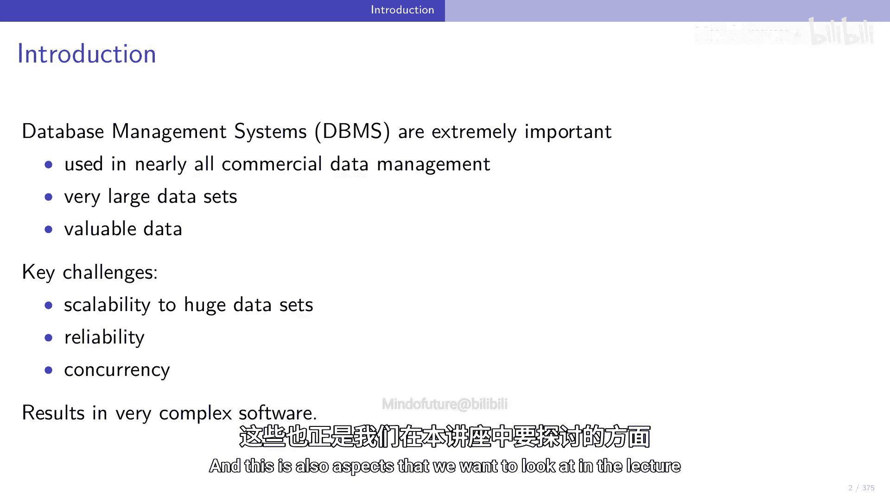

## 课程概述与目标 🎯

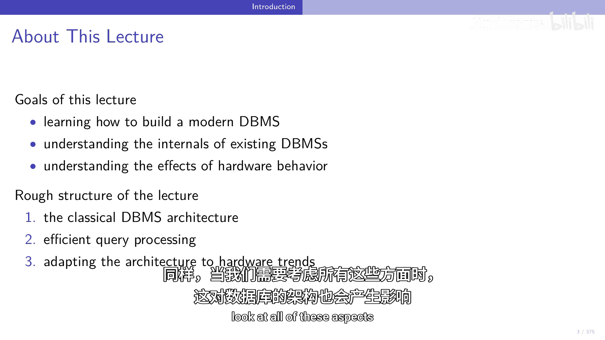

欢迎来到数据库系统实现课程。我是Thomas Neumann，慕尼黑工业大学的数据库系统教授。本学期，由于特殊情况，我们将主要通过录制视频进行授课，无法进行现场讲座。因此，积极参与练习课变得尤为重要。在练习课中，我们将安排互动环节和作业提交，以便大家提问和解决学习中的困难。

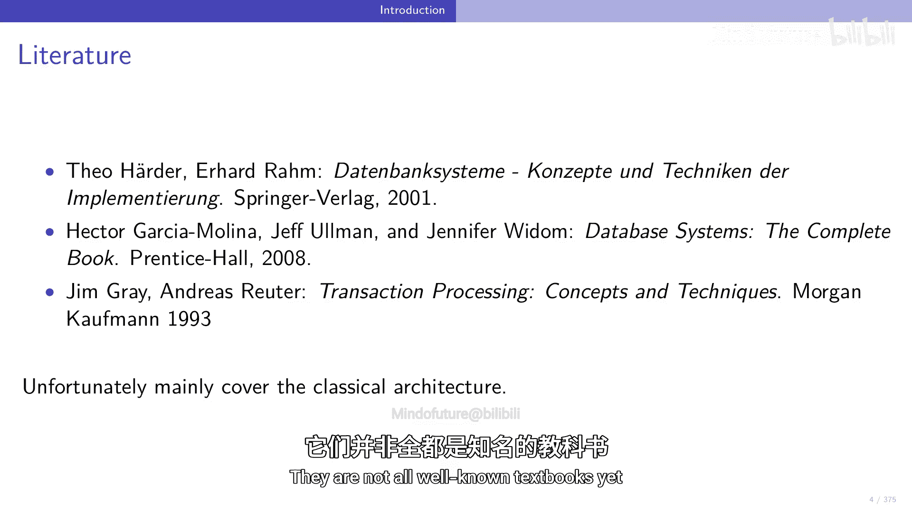

本课程的目标主要有三个：
1.  学习如何构建一个现代的数据库系统，掌握相关的核心技术。
2.  理解现有数据库系统的内部工作原理。即使未来不构建新系统，了解其机制也能帮助你更好地使用和优化现有系统。
3.  理解硬件行为对系统性能的影响。这对于任何需要高速处理海量数据的场景都至关重要。

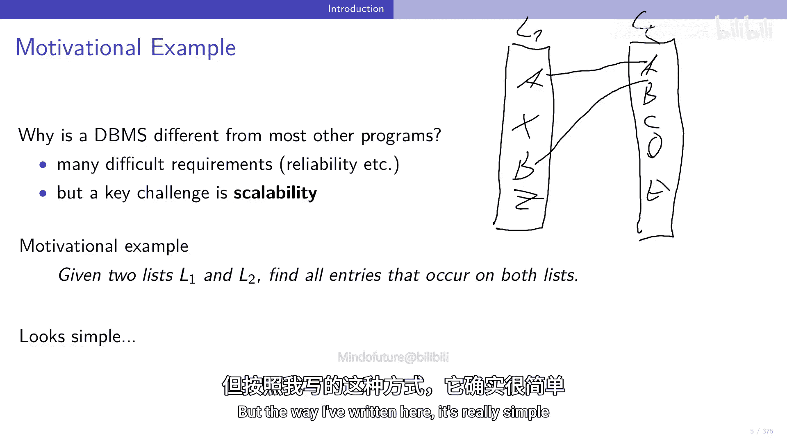

## 为什么数据库系统与众不同？🤔

数据库系统与普通程序在许多方面存在显著差异。我们已经提到了可靠性、并发性等挑战。这里，我们重点探讨**可扩展性**。

为了理解这一点，我们来看一个非常简单的例子：给定两个列表 L1 和 L2，找出同时出现在两个列表中的所有元素。

如果数据量小，可以完全放入内存，这个问题很简单。例如，我们可以先对两个列表排序，然后进行一次线性扫描来找出交集。排序的时间复杂度是 **O(n log n)**，而扫描是 **O(n)**。

我们也可以使用哈希表。先将较小的列表（例如 L1）构建成哈希表，然后遍历 L2 中的每个元素，在哈希表中进行查找。如果哈希函数良好且冲突少，构建和查找都可以在近似常数时间内完成，从而实现接近 **O(n)** 的线性时间复杂度。

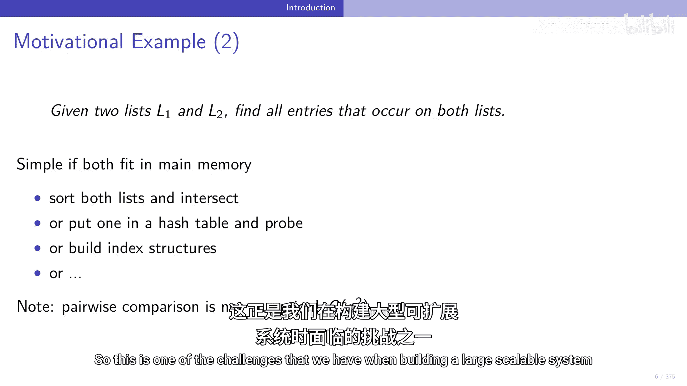

**绝对要避免**的方法是使用嵌套循环进行暴力比较：
```python
for x in L1:
    for y in L2:
        if x == y:
            # 找到匹配项
```
这种算法的时间复杂度是 **O(n²)**。当 n 很大时（例如百万级别），n² 将是一个天文数字，完全不可接受。在数据库系统中，我们通常只考虑时间复杂度为 **O(n log n)** 或更优的算法。

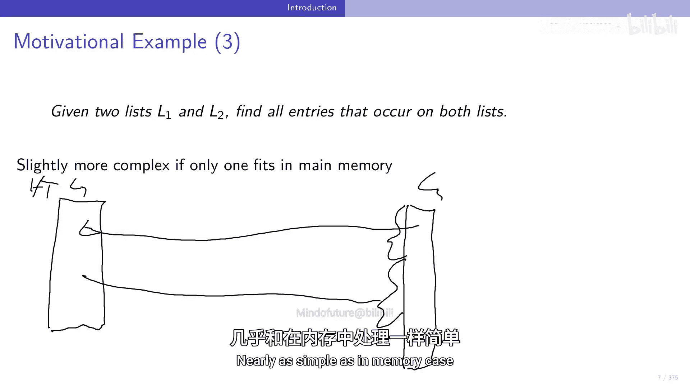

## 应对外部存储的挑战 💾

当数据无法完全放入内存时，问题变得更加复杂。我们进入了**外部存储算法**的领域。

**情况一：一个列表能放入内存**
如果其中一个列表（如 L1）较小，可以放入内存，而另一个列表（L2）很大。解决方案很简单：将 L1 构建成内存中的哈希表或索引，然后分块读取 L2，每块与内存中的结构进行比对。这几乎和纯内存操作一样简单。

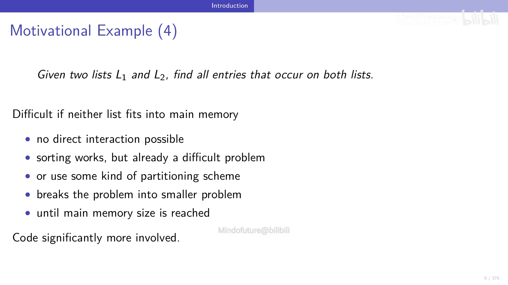

**情况二：两个列表都远超内存容量**
这是最具挑战性的情况。我们无法进行直接的逐元素比较，因为磁盘I/O（即使是SSD）也比内存访问慢数个数量级。

一种方法是使用**外部排序**。先对两个超大列表进行外部排序（例如使用归并排序算法），然后对两个已排序的列表进行线性扫描找出交集。虽然排序本身复杂，但之后的交集计算很高效。

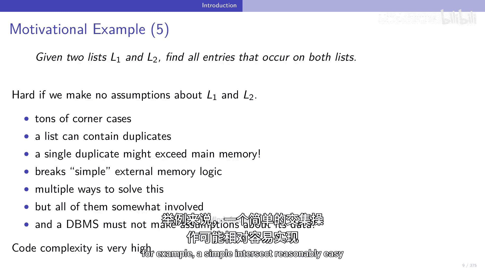

另一种方法是使用**分区**。将两个列表按照某种规则（如值的范围）分割成多个较小的分区，确保每个分区都能放入内存。然后，将对应分区在内存中进行匹配。这需要精心设计分区策略，并处理各种边界情况，例如某个值出现次数极多（数据倾斜），导致单个分区仍然过大。

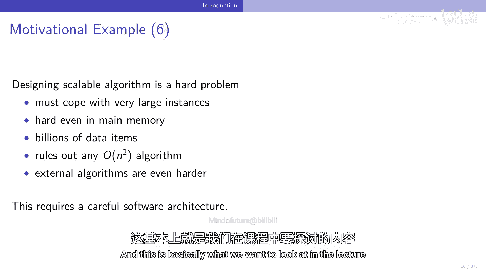

处理这些未知的、可能包含重复、倾斜等复杂情况的数据集，需要编写健壮且复杂的代码。一个简单的列表交集问题，从几行代码的暴力解法，演变为可能需要成千上万行代码才能稳健处理的系统模块。这凸显了数据库系统实现的复杂性，也说明了为什么我们需要一个良好的架构和基础设施来简化这些任务的实现。

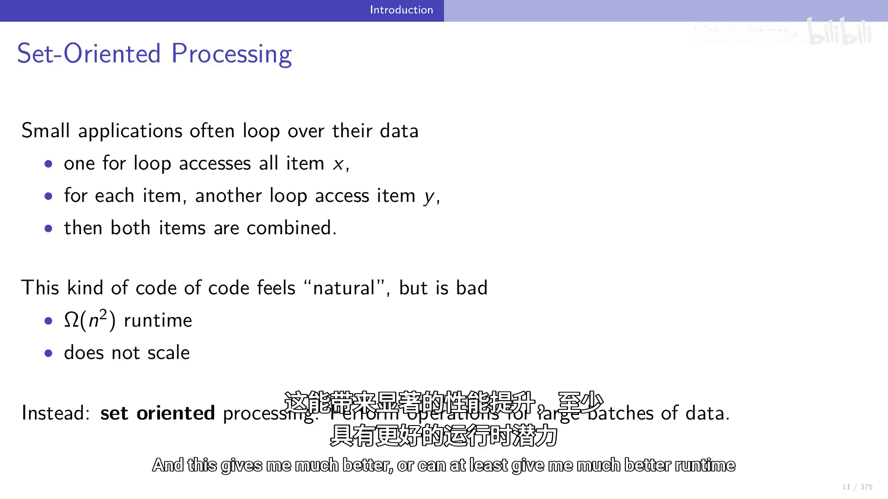

## 面向集合的处理与关系代数 📊

为了实现可扩展性，数据库系统采用**面向集合的处理**模式，而不是面向单个元素的循环处理。

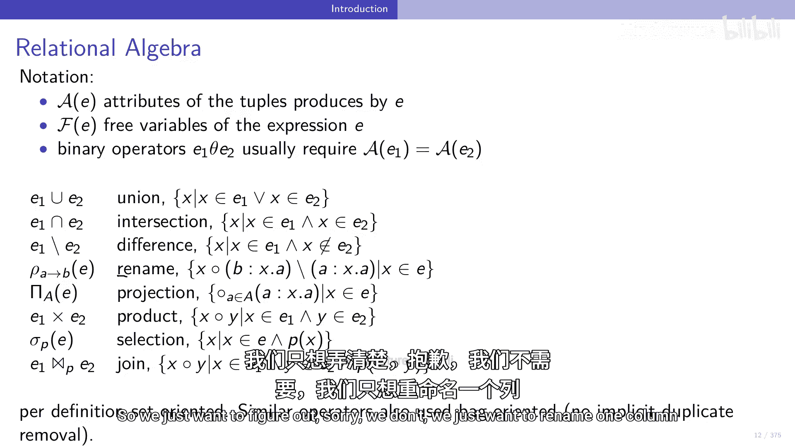

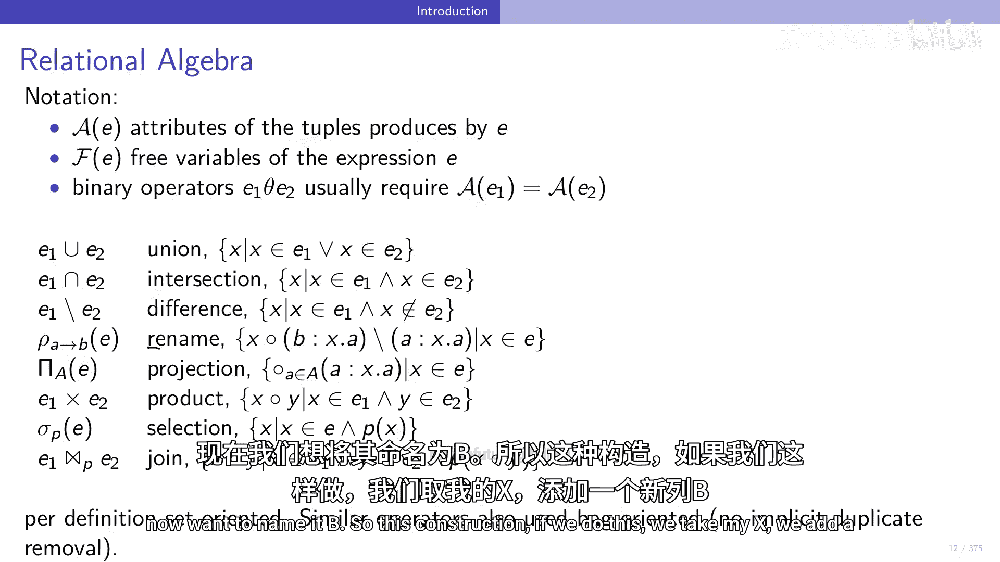

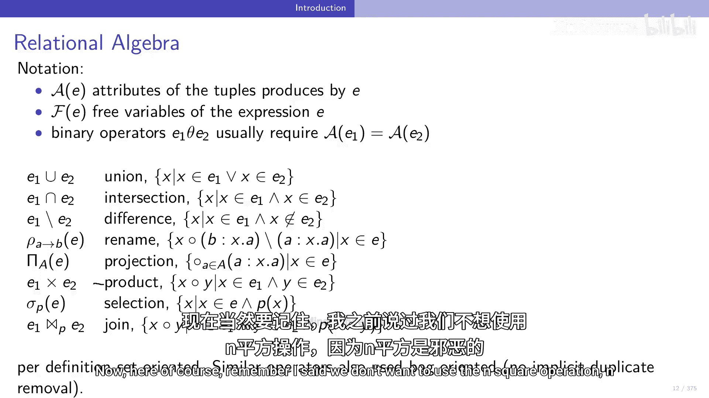

其核心是**关系代数**，它定义了一系列在关系（即集合）上进行的基本操作。以下是一些核心运算符：
*   **并集 (Union)**, **交集 (Intersection)**, **差集 (Difference)**: 对两个关系进行集合运算。
*   **选择 (Selection, σ)**: 根据条件过滤元组。`σ_{predicate}(R)`
*   **投影 (Projection, π)**: 选择关系的部分列。`π_{A,B,...}(R)`
*   **重命名 (Rename, ρ)**: 重命名关系的属性。
*   **笛卡尔积 (Cartesian Product, ×)**: 生成所有可能的元组组合。`R × S`。**应尽量避免**，因为其输出大小和计算复杂度都是 **O(n²)**。
*   **连接 (Join, ⋈)**: 根据条件组合两个关系的元组。`R ⋈_{condition} S`。高效连接算法（如哈希连接、排序合并连接）的目标复杂度远优于笛卡尔积。

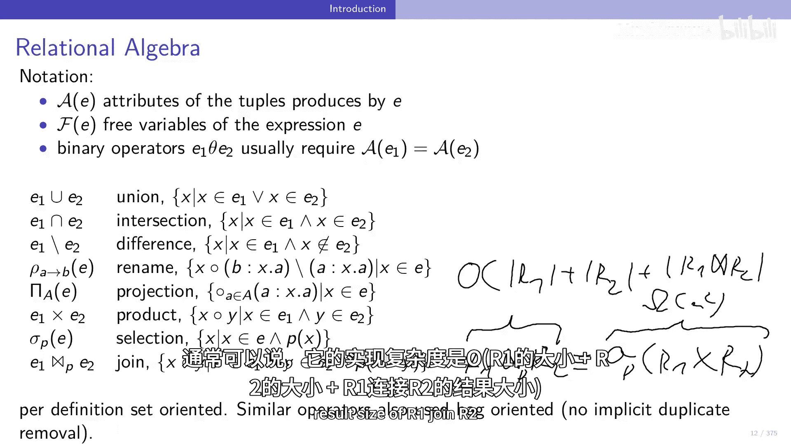

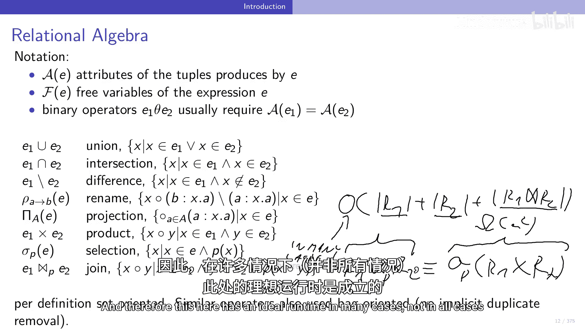

严格来说，SQL和数据库处理的是**包(Multiset/Bag)**，即允许重复元素的集合。但关系代数的基本思想同样适用。

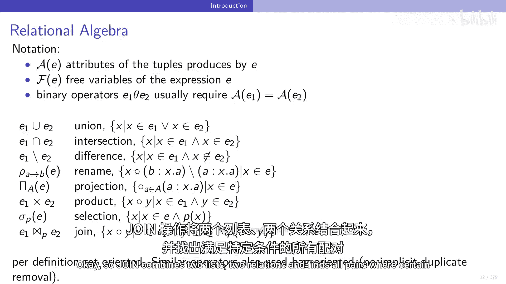

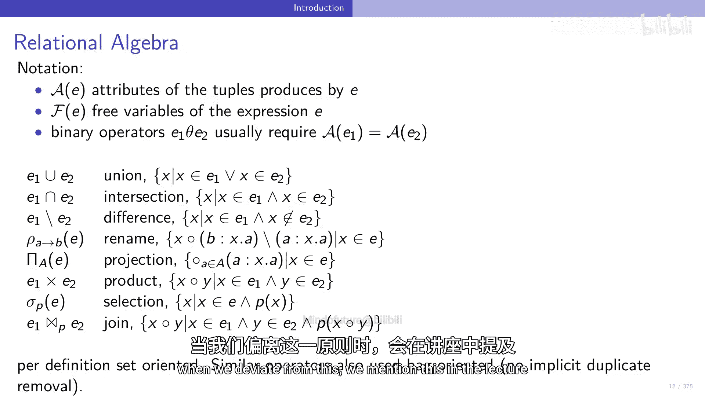

除了基本运算符，实践中还需要一些扩展运算符：
*   **半连接 (Semi-Join)** 和 **反连接 (Anti-Join)**: 用于高效实现 `EXISTS`、`NOT EXISTS` 等子查询。
*   **外连接 (Outer Joins)**: 包括左外连接、右外连接和全外连接，用于保留未匹配的元组。
*   **映射 (Map)**: 根据表达式计算新列。`Map_{A:=f(...)}(R)`
*   **分组聚合 (Group-by & Aggregate, γ)**: 对数据进行分组并计算聚合值（如 SUM, COUNT）。`γ_{grouping, aggregates}(R)`
*   **相关连接 (Dependent Join)**: 右侧表达式的求值依赖于左侧的元组。这通常由相关子查询转换而来，性能可能很差，查询优化器会尽力将其转换为普通连接。

面向集合的处理允许我们利用索引、排序、哈希、分区等批量操作技术，极大地提升处理海量数据的效率。

## 硬件演进与架构变迁 ⚙️

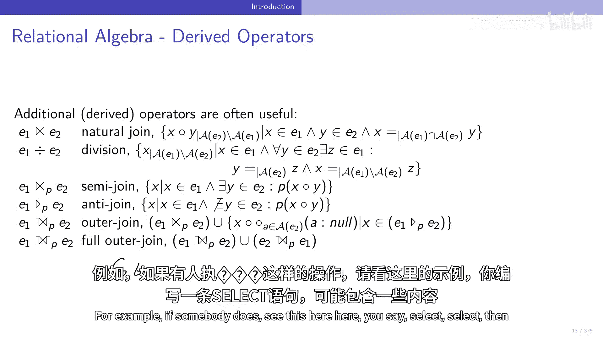

传统的数据库系统架构基于几十年前的硬件假设：
1.  **数据远大于内存**，处理性能受**磁盘I/O**主导。
2.  **随机磁盘访问极其昂贵**（机械硬盘寻道时间约4ms），因此必须极力避免随机I/O，倾向于顺序访问。

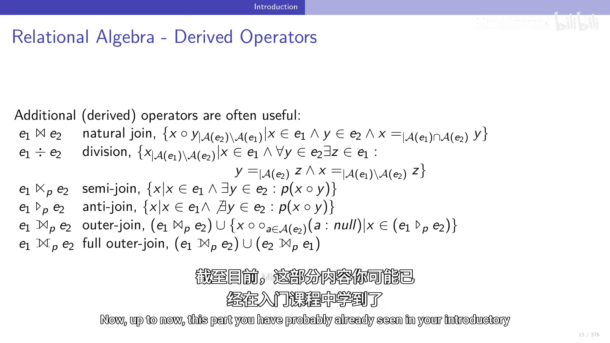

这些假设催生了非常保守但可扩展性良好的系统设计。

如今，硬件发生了巨大变化：
1.  **内存容量剧增**（TB级内存已不罕见），许多工作负载可以完全在内存中处理，**CPU成本**成为新的性能瓶颈。
2.  **固态硬盘(SSD)** 取代机械硬盘成为主流，其随机I/O性能比机械硬盘高出数个数量级。

这意味着，传统的、为优化磁盘I/O而设计的架构在现代硬件上可能无法发挥最佳性能。我们需要重新审视存储架构、缓存局部性、并发控制等方面。本课程将首先介绍经典架构，然后探讨如何为现代硬件进行适配和优化，例如构建内存数据库系统。

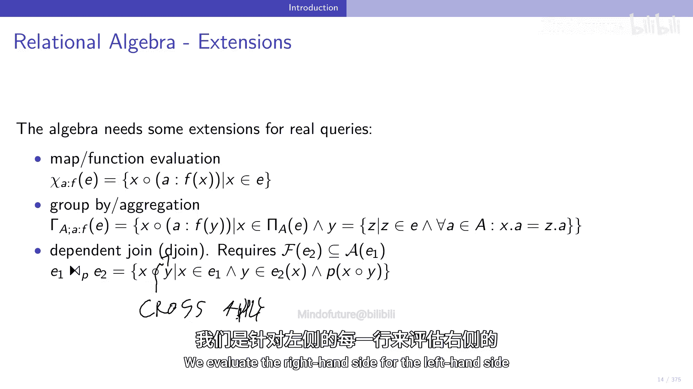

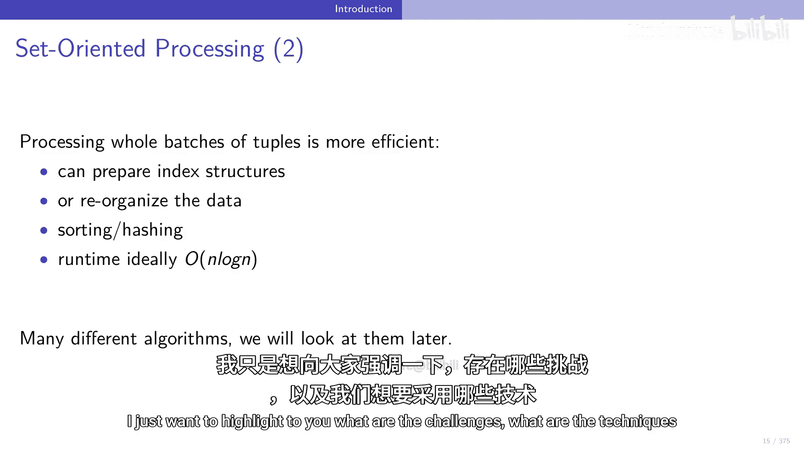

## 数据库系统的核心理想 🌟

构建数据库系统的核心理想是：
*   **处理任意规模的数据**，并保持高效。
*   **永不丢失数据**，即使在软件崩溃、断电等故障后也能保证数据一致性和持久性。
*   **提供高级接口**（如SQL），将应用程序从复杂的数据管理细节中屏蔽开来。
*   **对任意数据和查询提供优秀性能**，无需用户对数据分布做特定假设。

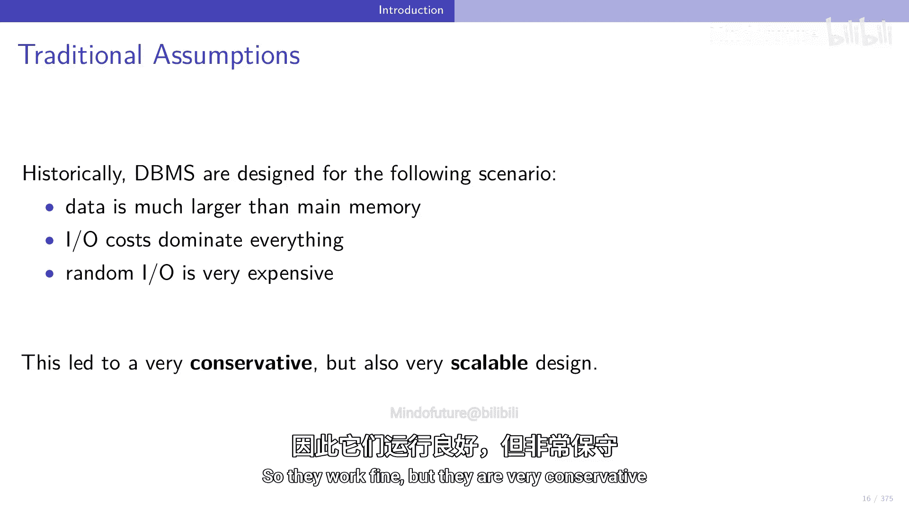

虽然这是一个极具雄心的目标，实现起来非常复杂，但数据库系统作为一种基础软件，其开发成本可以被无数应用程序分摊，因此是值得投入的。

## 课程结构总览 📚

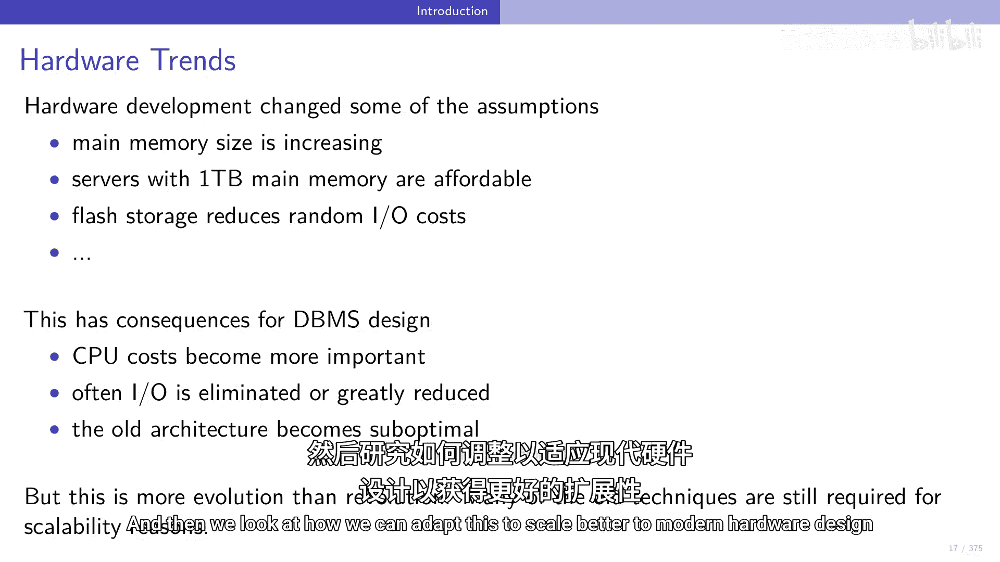

本课程大致分为三大部分：
1.  **经典数据库架构**：探讨传统商业数据库系统的组织方式。
    *   存储管理：数据如何在物理介质上组织。
    *   访问路径：索引结构，如何高效查找数据。
    *   事务与恢复：如何处理并发访问和系统故障。
2.  **高效查询处理**：如何实现面向集合的高性能处理。
    *   查询处理模型：数据如何在系统中流动。
    *   关系代数运算符的实现：如何高效实现连接、聚合等所有操作。
    *   查询编译与代码生成：如何将高级查询转换为可执行代码。
3.  **面向现代硬件的数据库设计**：如何调整架构以适应新硬件。
    *   存储架构的调整：应对大内存。
    *   缓存局部性优化。
    *   内存数据库系统的构建。

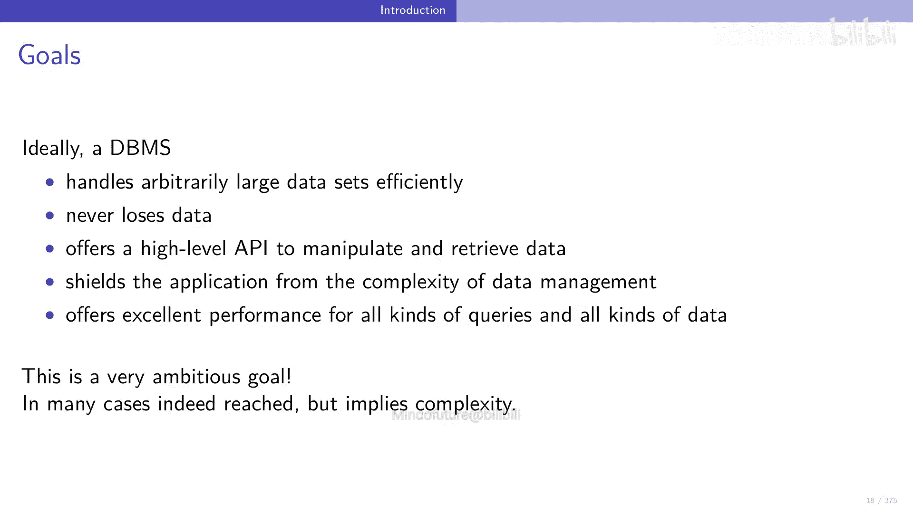

## 总结 📝

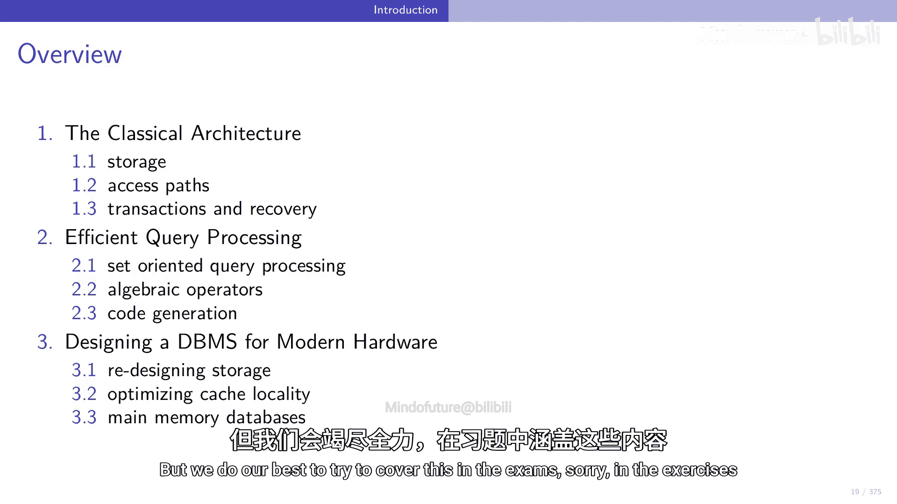

本节课中，我们一起学习了数据库系统实现课程的引言部分。我们了解了数据库系统的重要性、其面临的核心挑战（可扩展性、可靠性、并发性），并通过一个列表交集的例子，直观感受了从简单算法到可扩展、健壮的工业级实现之间的巨大鸿沟。我们介绍了面向集合的处理思想及其数学基础——关系代数，并讨论了硬件演进如何推动数据库架构的变迁。最后，我们概述了本课程将涵盖的三大知识模块：经典架构、查询处理优化和现代硬件适配。希望这为你接下来的深入学习奠定了良好的基础。请务必关注并积极参与练习课，以巩固所学知识。