# 003：存储访问

## 概述

在本节课中，我们将要学习数据库系统中存储访问的核心概念。我们将从上一节介绍的缓冲区管理基础出发，探讨如何组织跨越多页的大型数据结构，并深入理解段（Segment）这一关键抽象。我们将学习段的接口、实现方式、不同类型以及相关的存储管理策略，如影子分页和增量文件。

## 从页到段：管理大型数据结构

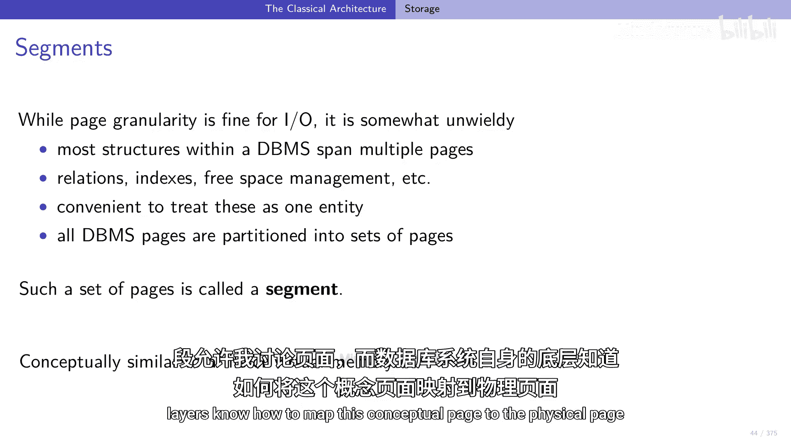

上一节我们介绍了缓冲区管理和数据库系统如何以页为单位组织数据。但对于大多数高级操作而言，页的粒度太低。我们通常需要处理比单页更大的数据结构，因此需要一种机制来管理跨越多页的数据结构。在数据库系统中，组织跨页数据结构的传统方式是使用所谓的“段”。

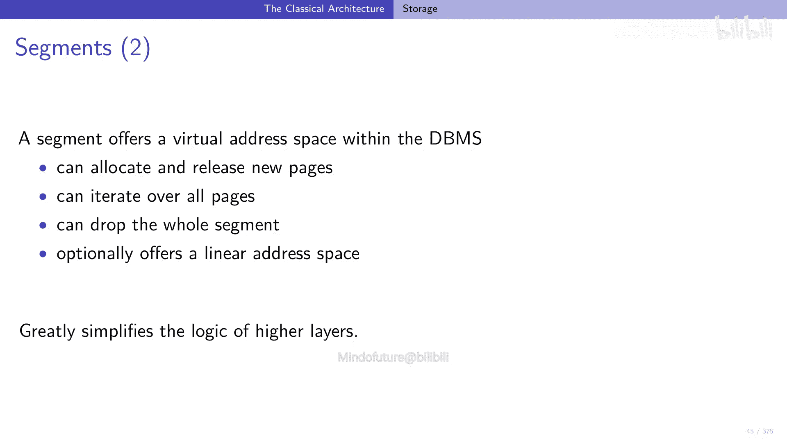

那么，为什么需要段？最明显的例子是关系（表）。如果你想在数据库系统中存储一个关系，这个关系很可能比一个页大。因此，我们需要一种机制来将数据组织到多个页中。但关系并不是我们存储的唯一内容。数据库系统中还存储许多其他东西，例如索引结构（如B+树）也由多个页组成，我们需要某种机制来组织它们。还有内部数据结构，例如空闲空间管理，也需要跨页组织。

出于管理目的，将这一组页视为一个实体来处理非常方便。例如，如果有人执行 `DROP TABLE` 语句，我们必须释放属于该表的所有页。因此，我们需要一种方式来指代一组页，以便能够将它们作为实体进行操作。这就是通过“段”来实现的。

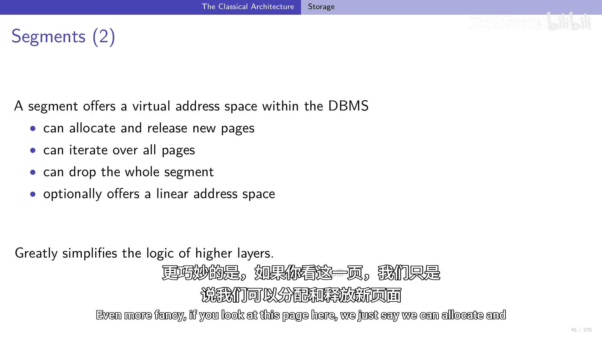

## 什么是段？🔍

粗略地讲，一个段类似于文件系统中的文件。就像在文件系统中创建一个新文件，然后可以存储数据并读回一样，我们在段中也可以做类似的事情。但我说“类似”，是因为存在一些差异。

例如，在一个传统文件中，我们期望文件按写入顺序增长。但在段中，我们不一定保证这种顺序。基本上，文件抽象包含两件事：一是存储量，二是固有的顺序。而在段中，没有这种固有的顺序。这实际上有很好的技术原因，我们并不希望段有严格的顺序。

因此，段只是一个粗略的类比。在段中，可能先分配一些页，然后再分配另一些页，之后可能在中间再分配一些页。随着分配的演变，这种情况可能发生。这与文件有所不同。但当我们讨论不同类型的段时，会再回到这个差异。请记住，粗略地讲，段就像一个类文件结构：我们分配多个页，段可以随时间增长，但通常不保证线性顺序。

另一种思考段的方式是将其视为虚拟内存。如果你熟悉操作系统，我们知道有一个虚拟地址空间，可以寻址，然后映射到物理数据。段也类似，它允许我们谈论数据库系统中的页，底层知道如何将概念上的页映射到物理页。

## 段的接口 📡

段向我们提供的最基本接口当然是分配和释放。我们可以说“我需要一个新页”或者“我不再需要这个页了”。分配一直在发生，例如当数据增长时。释放则相对少见，但也会发生，例如在B+树中删除某些内容后，一个B+树节点不再需要，我们就可以告诉数据库系统：“这个页空闲了，你可以用它做别的事”。基本操作就是分配和释放。

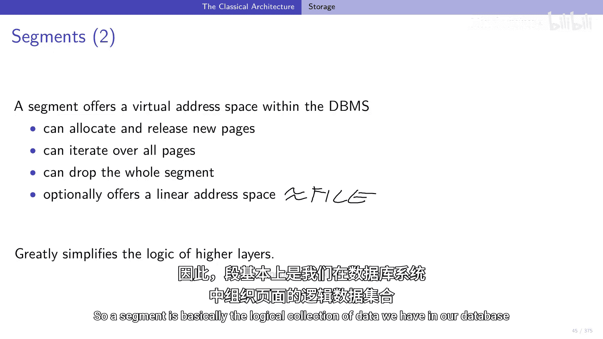

还有一些其他操作。我们可以遍历所有页，例如从开头读取。这在你想进行表扫描时非常方便。如果你想读取存储在关系中的所有内容，我们就遍历该关系的所有页。我们还可以删除整个段，如果有人执行 `DROP TABLE` 语句，系统会释放所有数据。

我之前提到过，段默认不提供线性地址空间。这是什么意思？首先，让我们举个例子。

假设这是我的数据库系统。这里有关系1存储一些数据。我们在关系1中存储了一些东西。之后，其他人创建了关系2，系统在关系2中存储数据。然后，又有更多数据插入到关系1中。没问题。随着时间增长，你会看到这里的段（关系1）不是连续的。我们在这里有段中的一些页，然后关系2的页插在中间，之后关系1又有更多页。但这没关系，我们可以处理。

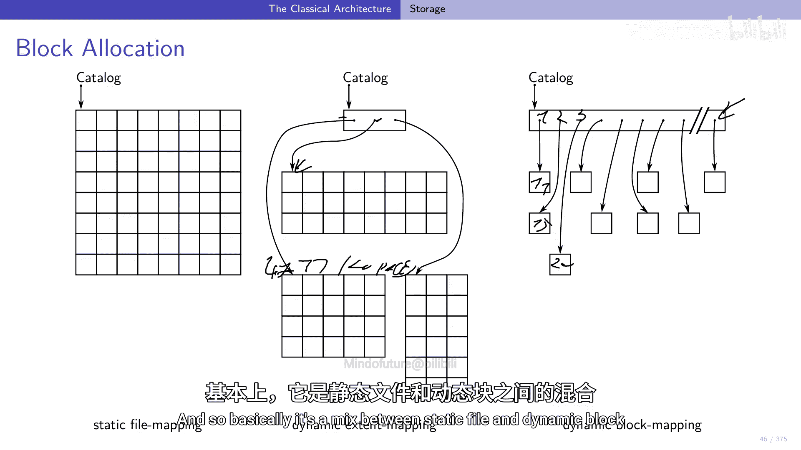

现在，如果有人执行 `DROP TABLE 2` 语句，突然我们就有了一个“空洞”。数据库系统会怎么做？如果关系1需要分配新页，我们当然可以在末尾增长，但我们不一定会这样做。因为至少潜在地，我们可能认识到这两个部分之间有一个空洞可以填补。所以，与其在末尾增长，不如在这里增长，从而使空洞变小。

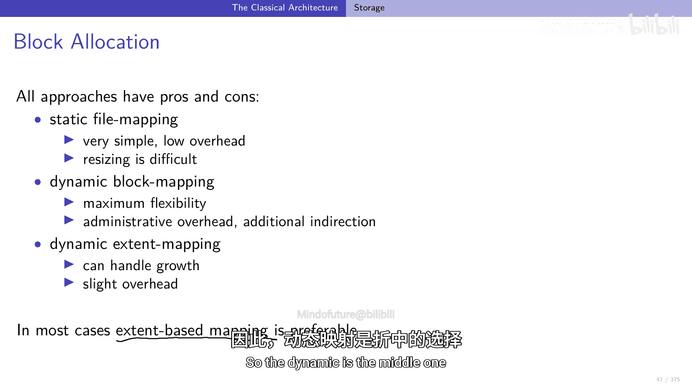

更巧妙的是，分配操作。如果你看这个页，我们只是说可以分配和释放新页。通常，系统会做一些更奇怪的事情，至少如果你只熟悉简单的内存分配器的话。你可以告诉段：“我需要一个页”。但你可以说，例如，我知道有更多数据要来，我想要五个页。系统会查看并说：“哦，这里有一个非常方便的空间给你”。然后它可能说：“你得到了这个页，你向我要五个页，但我给了你八个”。所以你得到了比你要求的更多的页。

这当然可能有点令人惊讶。但现在一切都在一起了。填补这个空洞是一个非常好的主意，因为从I/O的角度来看，我们又有了连续的内容，可以很好地顺序扫描。重构这一点非常好。所以你得到的回答是：你要求五个，但你可能得到七个，这样空洞就消失了。

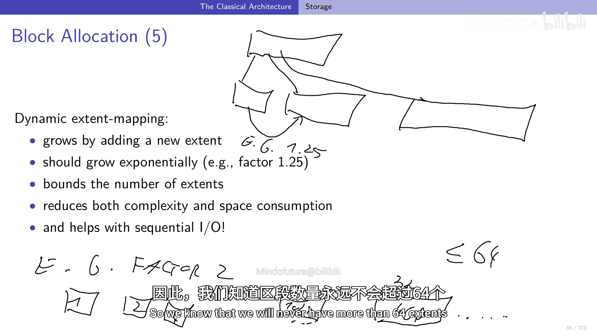

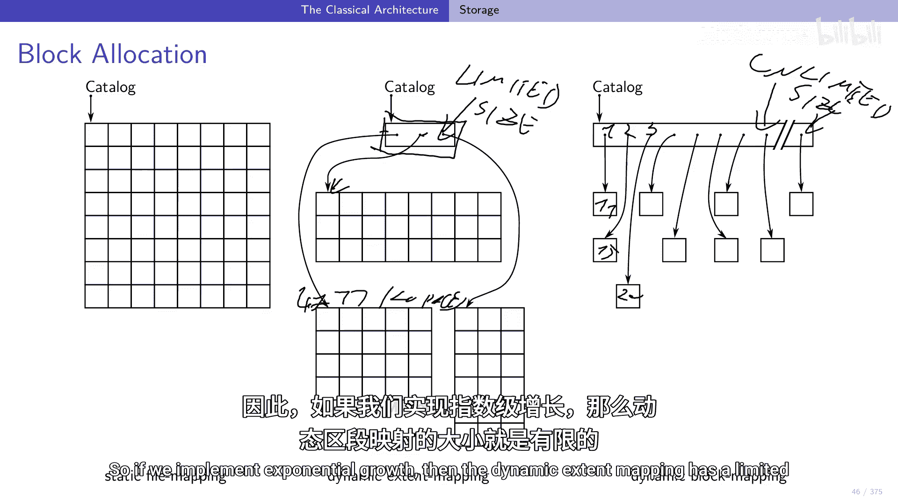

因此，这里的接口甚至更复杂。我在这里说“分配5”，但实际上可能给你更多。你可以再次告诉它给你两个数字。例如，你可以说：“我至少需要一个页，但如果你有更多，我想我可以用五个”。所以这基本上是一个最小值和首选大小。但尽管如此，系统可以决定给得更多，因为如果只给你五个，那么这里会留下一个小间隙。如果给你五个，这里会剩下两个页，这两个页很小，我们不喜欢有小的页碎片存在。因此，我们给你比你要求的更多。现在，数据库系统（或段）必须利用这一点，但这通常不是问题。我们稍后会讨论空闲空间管理，但可以说，关系只是有更多空间暂时为空，当未来插入新元组时，我们可以利用这些空间。至少从长远来看，我们可以利用。因此，我们这样做，这样做的一个巨大好处是大大减少了碎片问题。

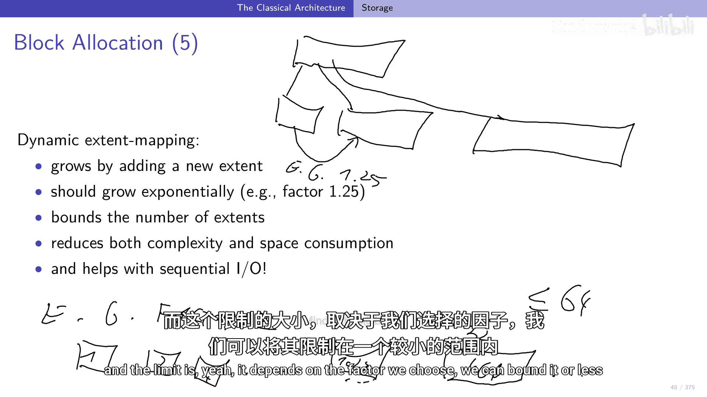

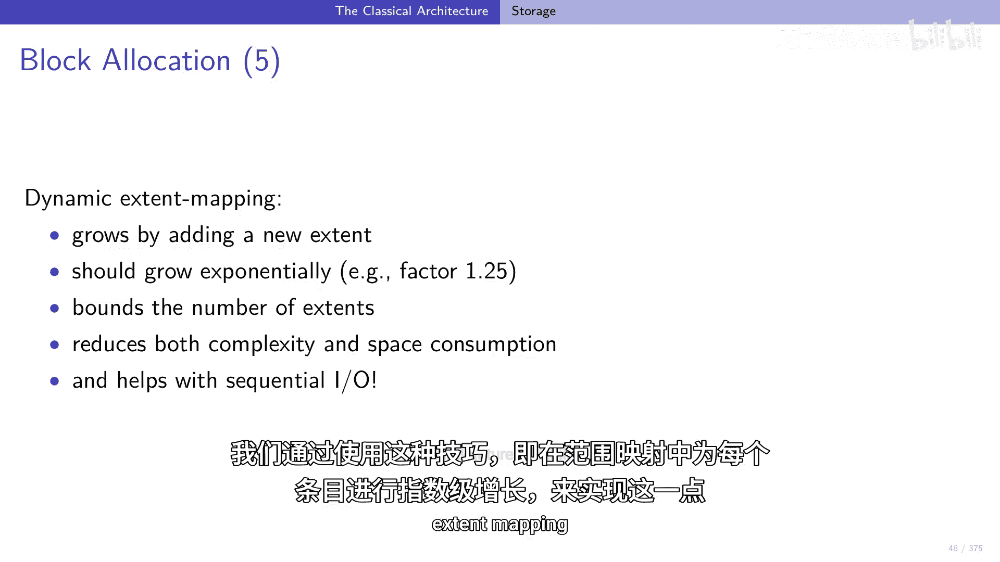

如果你曾经自己实现过内存分配器，或者看过内存分配器如何工作，你经常会遇到一个问题：如果你有分配和释放的模式，分配一些东西，再分配一些东西，再分配其他东西，然后释放一些东西，再进行更多分配，经常发生的情况是你产生了碎片。这意味着你留下了小的空间，这些小空间因为太小而无法放置任何有用的东西，它们只是坐在两个块之间，很难利用。

在段的世界里，我们避免了这个问题。也就是说，在那一刻，当这个家伙请求空间时，你会告诉他：“你只想要这么多，但你得到了更多，以便完全填补这个空隙，请好好利用它”。这就是段世界中分配的工作方式。这对物理布局非常有利，大大减少了碎片，一切都很好。

当然，这可能会带来一些令人惊讶的后果。即，如果你在数据库系统中插入数据，你插入第一个元组、第二个、第三个等等。在许多这样的插入之后，你执行查询，大多数时候你会按插入顺序取回它们。但随着时间的推移，由于这种填补空洞的行为，可能第2000个和第2001个元组恰好被插入到这两个之间，因为那里有一个方便的空闲空间，我们正好把它们放进去。这意味着插入顺序不一定对应于查询结果的顺序。

第一次看到这个你可能会惊讶，但这是有技术原因的。正如我所说，段并不真正是一个文件，所以段没有固有的顺序。因此，我们被允许在中间插入数据。基本上，如果这是我的第一个数据块，这是我的第二个数据块，在中间插入我的第三个数据块是完全没问题的。我们必须接受这一点。因此，我们有一个非线性顺序，插入顺序与结果顺序不对应。

我们这样做实际上是一个好主意，这也符合关系语义。因为如果你思考一下，关系没有固有的顺序。如果你执行 `SELECT * FROM relation`，你不知道会以什么顺序得到元组。元组顺序是未定义的。如果你想要一个顺序，你必须使用 `ORDER BY`。如果你不使用 `ORDER BY`，那么你得到的结果顺序是未定义的。因此，我们完全可以自由地这样做。

虽然我必须说，在本课程中我们可能不会讨论它们，但有少数数据结构确实希望拥有所谓的线性地址空间。这意味着段绝对希望迭代顺序对应于插入顺序，即你插入第一个块，第二个块，第三个块必须跟在后面。基本上有两种方法来保证这一点：要么你真的把第三个块放在最后一个块后面，但这样可能会有空洞问题；要么你把它插入中间，但记住原始顺序，然后在迭代时先读第一个，再读第二个，再读第三个。如果你必须保证线性，即线性地址空间，那么这会带来一些开销。这基本上就像一个文件。默认情况下，出于好的原因，我们不这样做。如果你必须提供这个，那么会带来一些成本，因为你必须记住顺序。

总的来说，段是一个非常方便的接口。它允许我们轻松地思考一组页，并相当方便地操作它们。所以，段基本上是我们数据库系统中组织页的逻辑数据集合。

## 如何组织段中的页？🗂️

现在，一个问题是，我们如何在段中组织页？基本上，这与决定如何在磁盘上组织块是相同的问题。如何将物理存储单元（页或块）映射到逻辑容器？基本上，我们想看看三种方法。

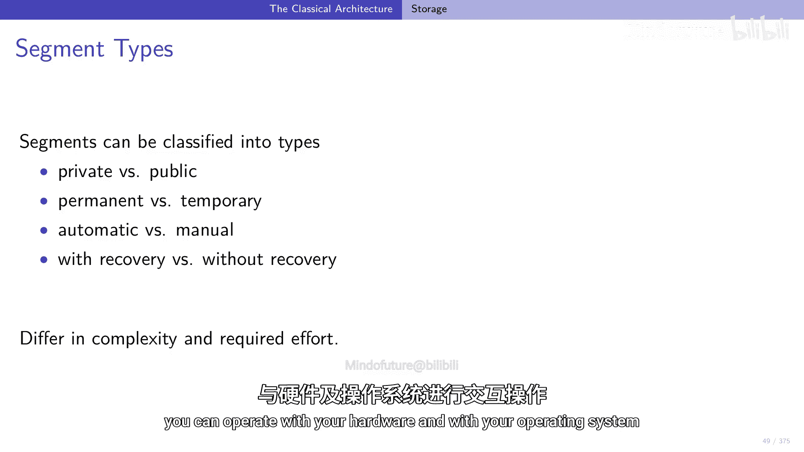

左右两种是最极端的，中间一种是折中方案。最左边的是静态文件映射。这只是在目录中记住，例如，段从第11页开始，然后有这么多页。非常简单，两个数字：第一页和页数。开销很小，性能很好，但当然，它不够灵活，因为只能做一次，然后就这样了。所以称为静态文件映射。

另一个极端是右边的动态块映射。在目录中，你基本上有一个所有页的列表，然后你说第一页是这个，第二页是那个，第三页是那个。所以每个条目指向一个单独的页。这当然给了你最大的灵活性，但也相当昂贵。你会看到这个列表可能变得非常大，因为每一页都需要一个条目，所以这是自动的。

这两者之间的折中是所谓的动态区段映射。它说你有一个目录，包含一个列表，但这个列表不指向单个页，而是指向区段，即连续的页序列。例如，这里你可以说从第4711页开始，我们有20个页。所以我们有一个条目指向一个块，然后有另一个条目指向另一个块。这给了你类似于动态块映射的灵活性，但列表不像动态块映射那么大，所以我们有一个更紧凑的表示。这基本上是静态文件和动态块之间的混合。

不同的优缺点我想我已经说过了。静态文件映射实现起来非常简单，开销非常低，但调整大小很困难或不可能，取决于你如何实现，但调整大小是非常有问题的。在最坏的情况下，你可能必须复制所有数据，这当然是你不想做的。所以调整大小很困难。

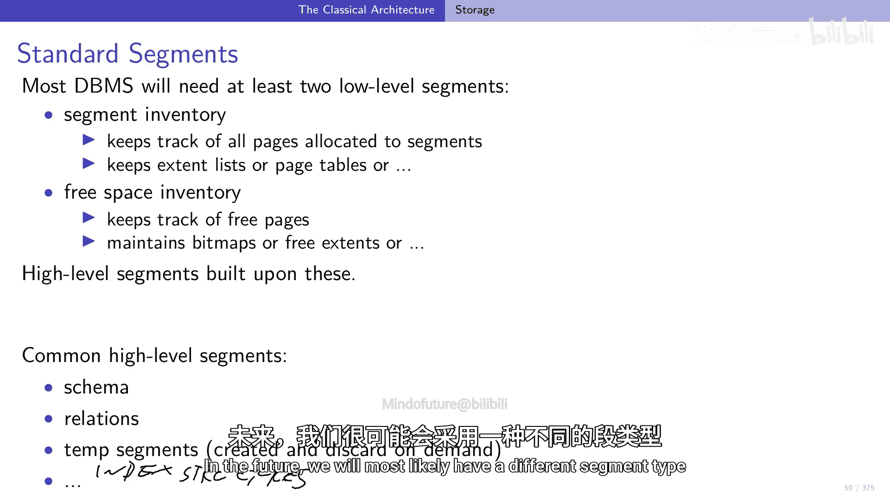

动态块映射最灵活，因为我们可以将每个条目映射到一个块，但问题是我们有很高的管理开销，有额外的间接性，这也是我们不想做的。动态区段映射可以增长，但开销比动态块映射小。所以在大多数情况下，我们会更喜欢基于区段的映射，即中间那种。

## 动态区段映射的实现 🛠️

动态区段映射通过添加新区段来增长。基本上，我一开始有我的映射，然后我需要分配一点数据，分配一些空间。所以当我的关系增长时，我就说：“这里你有另一个区段，这里你有另一个区段”，等等。

这里的技巧是，当你实现这个时，你应该以指数方式增长。这意味着第二个块比第一个块大一个特定因子，依此类推。例如，因子1.25。当然，因子是设计选择，但应该在它们之间有一个指数因子。为什么我们希望使用块大小之间的指数因子？这样做的一个巨大优势是它限制了区段的数量。

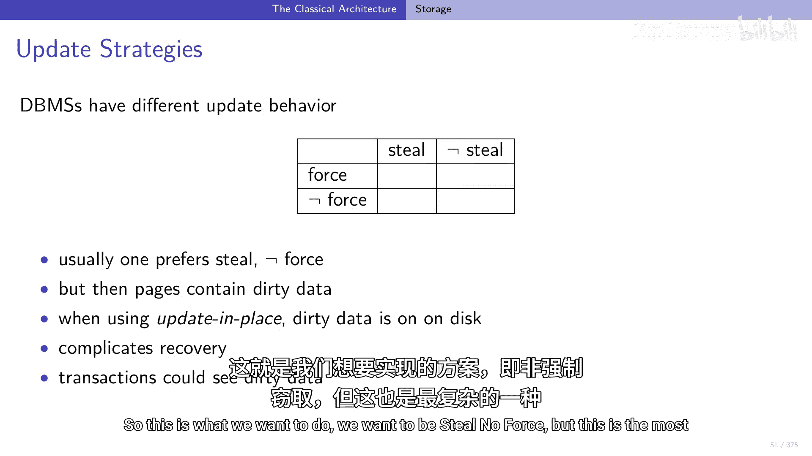

为了说明这一点，假设我们不使用因子1.25，因为计算起来有点困难。让我们假设我们使用因子2，顺便说一下，我们通常不会这样做，2有点激进。例如，如果你使用2。那么，当然，第一个块的大小，假设是1（我们通常不会从1开始，通常更大一些，但假设第一个是1）。然后我们有2，然后有4，依此类推。所以在10步之后，我们有1024。在32步之后，我们大约有4GB，等等。我们知道我们拥有的区段总数将小于或等于64。为什么？因为我们的地址空间在64位架构上最多只能寻址那么多。所以我们知道我们永远不会有超过64个区段，这当然是一件非常好的事情，因为这意味着我们可以限制这个框的大小。这个框的大小是有限的，这是一件非常好的事情。而在动态块映射中，这个框的大小是无限的。如果我们实现指数增长，那么动态区段映射的大小是有限的。这个限制取决于我们选择的因子，但通常最多只有几百个条目。这使得我们的生活更容易，因为然后我们可以存储这个间接映射，我们总是必须存储它。例如，我们可以保证这个间接映射总是适合一个单页，因为它不能增长超过那个大小。

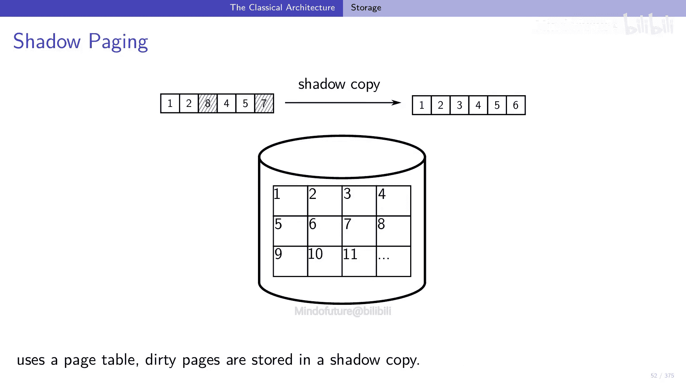

因此，这一点大大降低了实现的复杂性，也改善了I/O，因为当我们有越来越多连续的页块时，这意味着我们将做越来越多的顺序I/O，这是一件非常好的事情，因为顺序I/O比随机I/O快。因此，我们非常希望有大的连续跨度，我们通过使用指数增长每个区段映射条目的技巧来获得这一点。

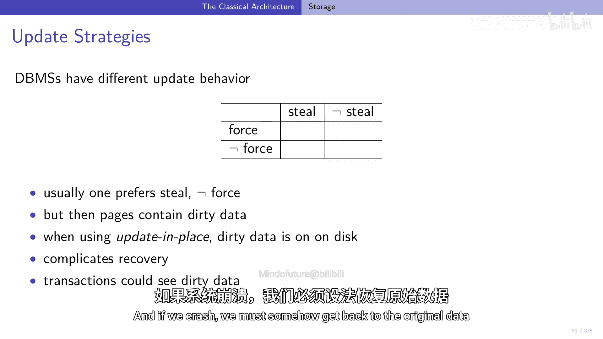

## 段的分类 📊

一开始我说过我们有不同类型的段，例如关系和索引。我们存储许多不同类型的段，这里我们想简要地对它们进行分类。

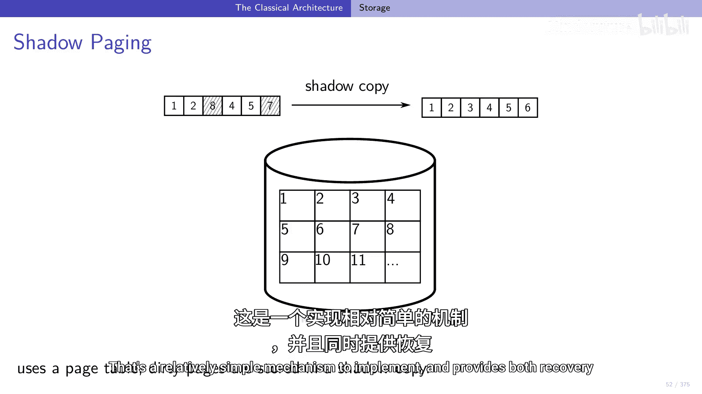

使用不同的维度，第一个维度是私有段与公共段。私有段是数据库系统内部的东西，用户看不到，通常不应该关心。例如，我们需要一些空间来存储我们有哪些段，这很可能是一个私有段。而公共段的例子是关系，关系当然是用户看到的东西，我们想展示给用户看。如果你曾经使用过数据库系统的管理工具，你可能见过这个，比如它告诉你哪种数据占用了哪些空间。所以我们有公共和私有段。

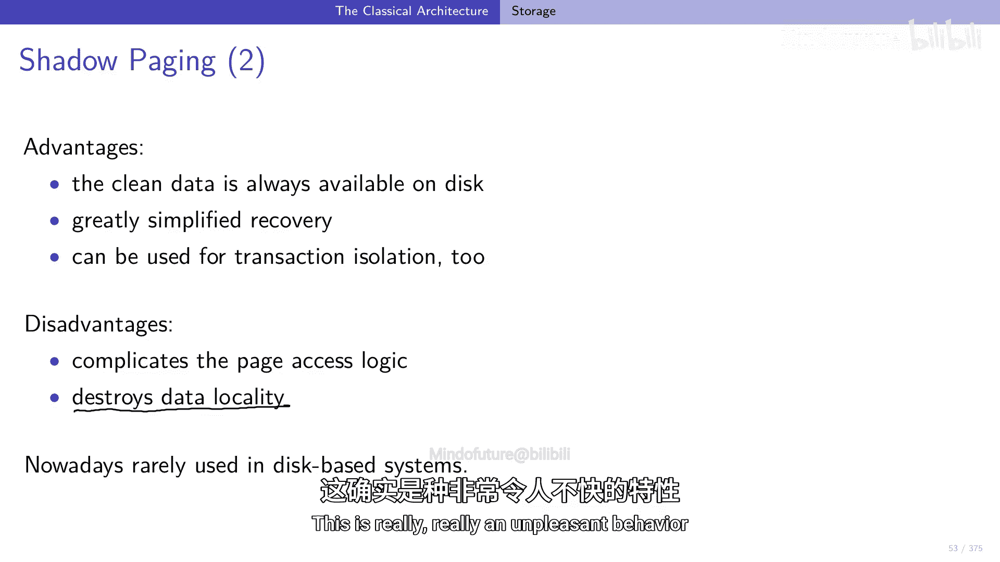

第二个维度是永久段与临时段。关系当然是永久的，因为我们不想丢失数据。我们存储的是永久段。临时段我们可能有，例如，如果你有一个产生中间结果的查询。你执行一个复杂的排序或分组，这个中间结果太大，无法放入内存，那么数据库系统必须将其存储在某个地方，为此它可以使用一个临时段。数据块为查询分配，但当查询结束时，我们可以丢弃它。顺便说一下，对系统来说，知道段是永久的还是临时的很重要，因为对于临时段，我们并不那么关心。如果系统崩溃，临时数据反正会丢失，所以我们不关心，我们不必花费太多精力。但对于永久段，当然我们必须保持其存活，因此我们在处理数据时必须更加保守。

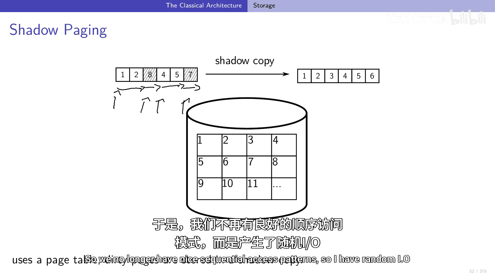

第三个维度是自动段与手动段。现在大多数段都是自动的。区别在于你是否可以自动访问数据，或者你是否必须做些什么。手动段有意义，例如，如果你的数据存储在近线存储上，它不是在线的，用户必须做些什么，例如安装外部磁盘。通常我们不想这样做，但你必须安装一些物理介质才能访问数据。所以这是手动段的一个例子。我认为这在很大程度上已经过时了，现在大多数段都是自动的，我们不想手动做任何事情。但当然，系统支持我们。所以支持并不总是可用的段。

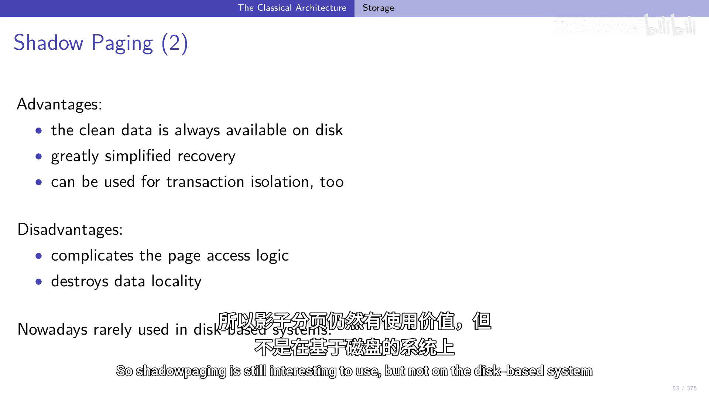

最后一个维度是支持恢复与不支持恢复。这与我之前说的有关。例如，我的关系中的真实数据当然需要恢复，这意味着如果我崩溃，我可以重建所有数据，这样什么都不会丢失。但如果我有中间结果，那么我不需要恢复，我可以直接丢弃它们。另一个你可能不需要恢复的例子，但可能不是。或者我说可能不需要，意思是大多数人无论如何都会恢复这个，但我知道有些人不恢复，例如他们的索引结构，如B+树。为什么不恢复索引结构？论点是：首先崩溃很少见，大多数时候系统不会崩溃，然后如果我们关闭它，我们以干净的方式关闭，所以不会发生坏事。真正的崩溃，如电源故障，是罕见的。在索引结构的例子中，你可以说，在不太可能的情况下，我的系统硬崩溃，那么当然我磁盘上的索引结构可能损坏，可能处于不一致状态，但我总是可以丢弃我的索引结构并重建它，因为索引指向原始数据。因此，我可以忘记我所有的索引结构，然后在需要时重建它们。这样做是否值得取决于你崩溃的可能性有多大以及你的索引重建速度有多快。但可以说，我知道一些实现过这个的人说：“我不恢复我的索引”。这样做的好处是索引更新更快，所以你为更新索引付出的开销更少，你加速了你的索引，你愿意接受你的索引可能损坏。但如果这真的很少见，那么你说：“好吧，我们接受这个”。如果发生这种情况，就丢弃并重建。所以这是我们可以区分不同类型段的四个主要维度。当然，取决于你选择哪种组合，这个段的复杂程度以及它需要多少努力或成本会有所不同。例如，恢复会带来成本，永久性当然也会带来成本。

## 存储策略：强制与窃取 💾

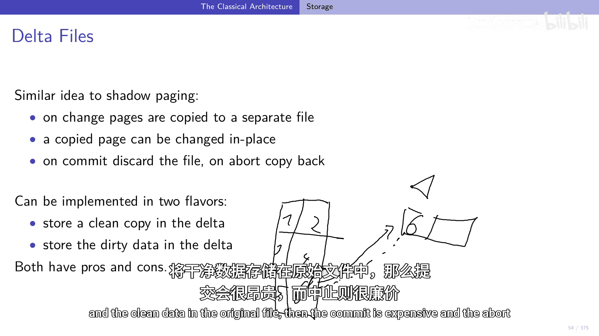

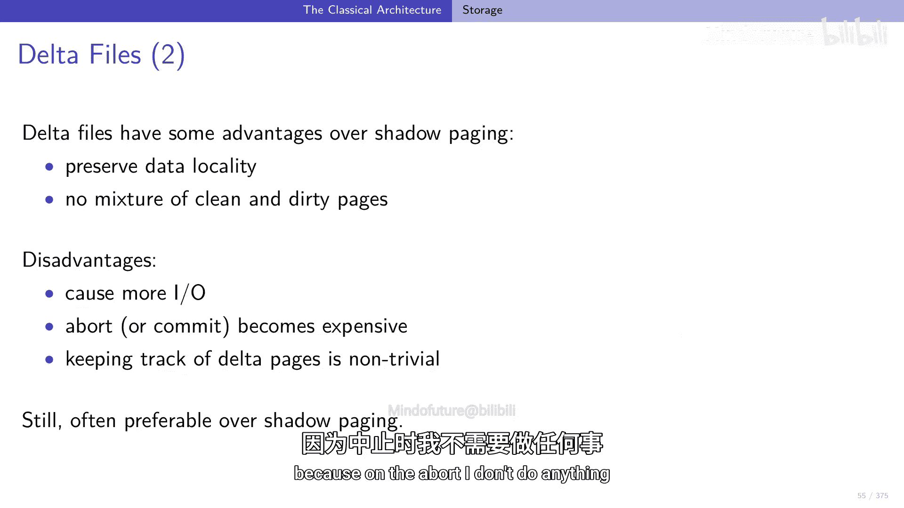

当我们讨论数据库系统内部如何工作时，特别是在存储方面，有两个维度我们特别感兴趣。即，首先，你如何执行页替换；其次，当你处理事务时，如何应对崩溃。这两个维度在这里被称为“强制”和“窃取”。

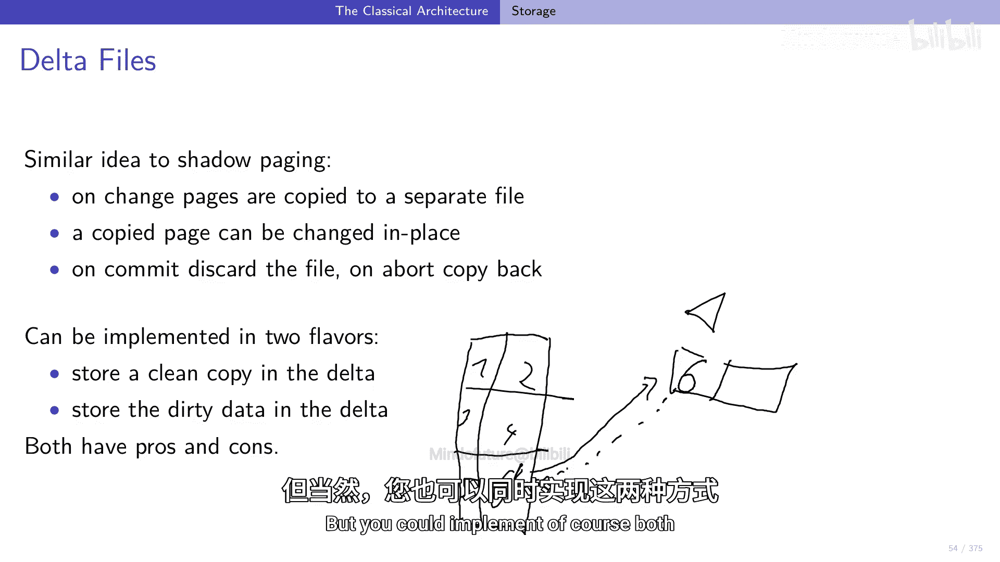

这是什么意思？如果我的系统运行“窃取”策略，这意味着我可以拿走一个页，即使该页包含未提交的更改。假设这是第11页。只要这个页未被修改，我当然可以随时丢弃它，因为如果我内存不足，我只是丢弃这个页，没问题，因为我可以从磁盘读回。这是简单的情况。

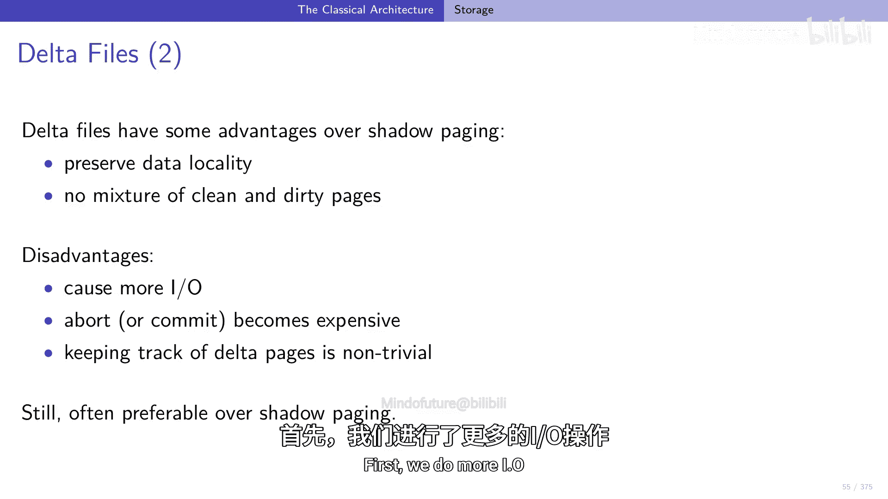

现在，不那么简单的情况：有人在这里执行了更新，现在数据被修改了。页变脏了。再次，我内存不足。现在我该怎么做？我是否允许从内存中移除第11页？即，我可以“窃取”第11页吗？显然，如果我能这样做，那么我有更大的灵活性，因为我可以根据需要重用内存，不管它是否被修改。但这样做的问题是，如果我这样做，那么我必须记住我的第11页包含脏数据，因为这里的更新尚未提交，所以没有人应该看到这个更新。例如，如果我崩溃，假设我窃取了该页，将其写入磁盘，然后我崩溃，之后我重新启动，那么这个更新必须消失，因为它没有提交。因此，这个更新必须从页中移除。所以窃取给了我灵活性，但也带来了一些成本。

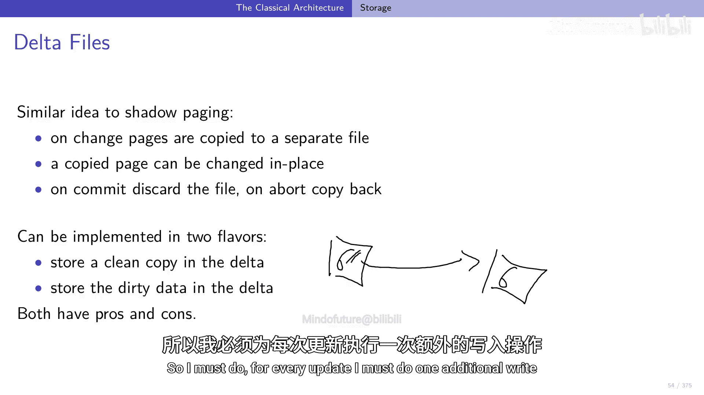

第二个维度是“强制”。问题是，当强制发生时，我有一个包含更改的页。假设第17页包含某种更新。现在，执行此更新的事务提交了。现在，我们如何处理这个页？我们是否在提交的那一刻将其写入磁盘？这就是强制策略。强制意味着如果提交发生，我将受此事务影响的所有页写入磁盘。当然，优点是如果我之后崩溃，一切都在磁盘上，所以我知道如果我崩溃，每个更改都在磁盘上。缺点是我比必须的更频繁地写入磁盘，因为每次有人提交，我都写入磁盘。如果我运行“非强制”策略，那么我可以将其保留在内存中。当然，这意味着一个页可能永远不会被写入磁盘。如果一个页被频繁更新，那么这个页将总是“热”的，总是被修改，可能永远不会写入磁盘。如果你真的不幸，可能几天或几个月脏页都不写入磁盘。所以这也不太好，你不喜欢这样。

那么，我们想要哪种策略？当然，最简单的框是这个，但不幸的是，我们通常更喜欢相反的，即“窃取非强制”。这意味着我们可以从内存中逐出一个页，即使它是脏的，并且即使它的事务已提交，我们也不写入磁盘。这就是我们想做的。我们想成为“窃取非强制”。但这是最复杂的一种。

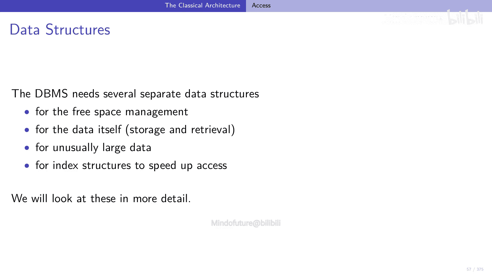

## 处理脏数据：影子分页与增量文件 🧩

脏数据的一个问题是，我们不是唯一使用数据库系统的人。一个事务使用数据库系统，可以修改数据直到提交。但其他用户呢？其他用户不允许看到我的更改，直到我提交。当然，一种方法是说，如果这是我的页，我修改了这里的某些东西，只要这个更改没有提交，其他人就不允许读取这个页。这相对容易实现，我们只是锁定该页，说其他人不能读取它。但这样做是不可取的，因为你会从中获得较差的并发性，因为其他人不能读取我已经锁定的页。这不太好。另外，我们还有恢复问题。记住，当我们在这里运行窃取策略时，可能修改过的数据会进入磁盘。如果我们崩溃，我们必须以某种方式回到原始数据，这并不容易。

处理这个问题的一个特别优雅或好的方法是所谓的“影子分页”。影子分页的想法是什么？想法是你有你的数据。假设我从数据库系统开始，只有7个页。这是我的原始数据集，有6个页。现在，如果有人修改第6页，我们做的是创建第6页的一个副本，称之为第7页。所以我们有第6页的副本，这是你的第7页。然后我们有一个页表，说明哪个页是当前的。如果修改第6页到第7页的事务崩溃，那么我们可以直接在这个目录中撤销这些更新，因为我们仍然有第6页。所以我们可以直接撤销这里的更改，然后回到原来的状态。另外，如果一个并发事务来，它可以只读取第6页而不是第7页，它仍然会得到一个正确的版本。同样，后来我们更新第3页，我们最终得到第8页，我们修改第8页。其他人都可以继续读取第3页。现在，如果修改第6页和第8页的事务提交了，那么这成为官方页。然后，当然，内部地，原始页第6页和第3页变成空闲的。然后我们可以重用它们，把数据放进去。这就是所谓的影子分页。基本上，我们有逻辑页。在这个例子中，我们有6个逻辑页。这些以某种方式映射到物理页，我们有一个用户页表。尚未提交的修改页存储在影子副本中，我们两个副本都可用，既有原始副本也有影子副本。然后在某个时刻，你当然会使其再次正式，所以副本第6页变成第7页，我们将这里的第6页改为第7页，然后它是官方页，就这样了。

这是一个相对简单的机制来实现，并提供恢复和事务隔离。所以影子分页的优点是我们总是有干净的数据在磁盘上。恢复容易。如果你能使用事务隔离。缺点是：两个缺点。首先，我的页访问逻辑更复杂，因为我必须总是查看这个页表间接映射，以检查我应该读取哪个页，以及我必须查看数据的当前版本。这已经不太好了，但这并不是真正阻止人们这样做的原因。更令人不快的部分是数据局部性。这真的是一个令人不愉快的行为。因为如果你想想这里的原始数据，所有页都是彼此相邻的。所以如果我想读取它们，我可以从第一个开始，然后顺序读取它们。现在，如果我有一个像这样的影子页表，那么我不再有单个顺序运行。基本上，我有四个运行而不是一个。所以在这里我们有一个寻道，这里有一个寻道，这里有一个寻道，这里有一个寻道。所以我们不再有良好的顺序访问模式，我有随机I/O，而随机I/O是慢的，因此人们不喜欢这个。

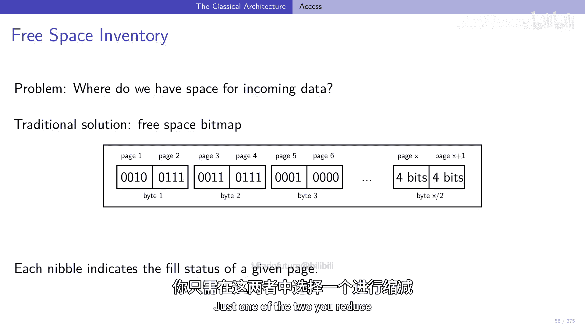

如今，很少有人在使用基于磁盘的系统上使用这个，因为在基于磁盘的系统上，寻道是如此糟糕且极其昂贵。因此，你不想使用它。另一方面，正如我上次提到的，硬件正在改变。在SSD上，例如，这可能不那么灾难性。即使在SSD上，这也有问题，但可以说，没有那么糟糕。更极端的例子是在内存中，你可以这样做，因为内存对随机访问的影响很小。我的意思是，这不是真的，也有一些随机效应，但这只发生在页内。如果你从一个页跳到另一个页，这并不重要，因为无论物理上是否相邻，都是一样的。所以在内存中，你可以实现像影子分页这样的东西来隔离事务。在那里，这实际上是负担得起的。所以影子分页仍然有趣，但不是在磁盘数据库系统上，只适用于其他应用。

除了影子分页，你还可以实现一个不同的策略，看起来有点不同，但概念上非常相似。它有一个简单的想法，即我们也有原始数据和一个副本，但这个副本现在被称为增量文件。

那么，这是如何工作的？这是原始数据。假设这里有页1、2、3、4、5、6。现在，假设我想更新第6页。然后我做的是将第6页复制到我的增量文件中。这是我的增量文件。我将第6页复制到这里。然后我在这里将其更改为第6页的修改版。在制作副本后，我现在可以就地更改它。当我提交时，如果操作第6页修改版的事务提交，那么我就丢弃这个副本，因为我不再需要它，它已经提交了。如果我的事务中止，那么我这里仍然有第6页，然后我忘记第6页修改版的内容，我将我的第6页复制回原位。我将我的第6页复制到第6页修改版中。所以我使用增量文件进行恢复。当然，我也可以用它进行事务隔离，因为我仍然有副本可用，但问题是副本会随时间消失。所以如果一个事务以提交或中止结束，之后副本就消失了。概念上，我是在原地更新，或者可以说我仍然在增量文件中有原始数据。

当然，我们可以以两种方式实现增量文件，即问题是你把原始数据放在哪里，把脏数据放在哪里。我首先画的是原始数据（未修改的数据）在增量文件中，修改后的数据在主文件中。两者都有优缺点。如果你这样做，那么提交是廉价的，因为提交时只需丢弃增量文件。但中止是昂贵的，因为必须将数据复制回页。如果反过来，我把脏数据放在增量文件中，干净数据是原始的，那么提交是昂贵的，中止是廉价的，因为中止时什么也不做。那么我们应该更喜欢哪一种？取决于你为提交还是中止优化。我通常会说，你为提交优化，因为你假设大多数事务会提交。所以中止应该是例外，因此使提交廉价。所以我们将原始数据放在增量文件中，修改后的数据放在主文件中，然后提交廉价，回滚昂贵。这通常是我们更喜欢的，但你当然可以实现两者。

增量文件相对于影子分页有一些优点。首先，最好的优点是它保留了数据局部性。因为在一切提交后，我的数据再次很好地连续，我们获得良好的读取性能。这就是我们想要的，所以我们不会搞乱局部性。另外，我们不会在不同的文件中混合干净和脏的页，这也使你的恢复更容易。但对我来说，局部性是最有利的事情。当然，它也提供了一些缺点。首先，我们做更多的I/O，因为在你做副本的那一刻，如果你想想这个例子，在我修改第6页之前，我有一页。假设这是第6页，在我修改第6页之前，我必须制作一个副本并将其写入磁盘。所以我有一个副本在磁盘上。这当然花费我一次I/O写入。第二次写入是免费的。只要没有人提交，我可以继续修改第6页修改版，因为我有原始的第6页。只要没有人提交。如果你提交，当然，我将其复制回去。然后我再次写入。所以我必须为每次更新做一次额外的写入。这是缺点，我做更多的I/O。第二个缺点当然是，要么提交，要么中止变得更昂贵。这取决于你如何实现它。正如我所说，我们将原始数据存储在额外文件中，那么中止变得更昂贵。提交是廉价的。你可以选择切换到你想要廉价的那个。当然，你还必须检查增量文件页，但这也不是超级简单。记住我们有多个线程。我们必须协调更新，但我们肯定可以实现这个。

尽管有这些缺点，增量文件通常比影子分页更受欢迎。所以，如果我要实现一个系统，我宁愿选择增量文件而不是影子分页，因为局部性问题。保留数据局部性是一个非常好的属性，因为从长远来看，如果你的数据很好地连续，你会获得更好的性能。增量文件实际上是一个相当好的主意。

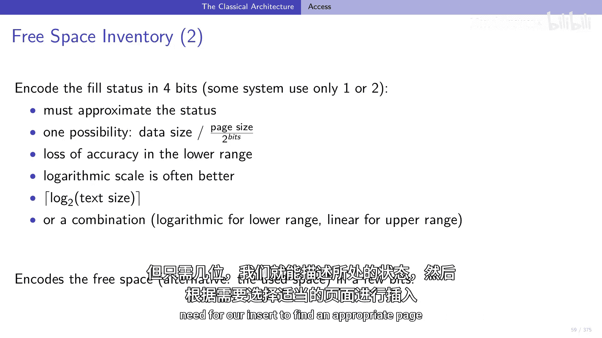

## 空闲空间管理 🧱

这把我带到了存储部分的结尾。现在，接下来我们至少想开始看看访问路径。我说访问路径，这是索引结构和关系的一种概括。这里的数据存储在数据库系统中，所以为了协调对数据的访问，我们需要一些不同的数据结构，我们当然会按顺序来看。首先，我们需要某种空闲空间管理。正如我之前提到的，我们需要一种机制来找出哪里有空闲空间，我可以把更多数据放在哪里。这必须发生得相当快。我们需要这种机制。然后我们需要数据结构来存储数据本身。所以首先是空闲空间管理。这是内部的。然后是关系的数据结构。然后我们需要一些数据结构来处理非常大的数据。例如，极端的例子是BLOB（二进制大对象），或者更常见的，大字符串。如果用户给我一个大字符串，我可能必须为字符串做些什么。最后，当然，我们需要索引结构来加速访问，因为如果我的数据库中有数百万个元组，我通常不想查看所有元组，如果我搜索特定的一个，我需要某种方式来加速搜索。所以这是四个部分，我们现在想按顺序来看它们。今天我将无法看完所有部分，但至少我会开始看前两个。

所以，空闲空间管理。第一个问题是：用户插入并给我一个元组。我可能知道，例如，我的元组大小为200字节。我把它放在哪里？特别是，如果你看到并非所有元组大小相同，可能下一个元组或前一个元组是短字符串的元组，因此前一个元组可能只有50字节。我可能必须把它们放在不同的地方，因为我以页为单位组织数据。这是页1，这是页2。然后这里可能已经满了到这里，这里可能已经满了到这里。显然，这里有一个小的空隙，但较大的元组可能只适合这里。顺便说一下，如果我以不同的顺序做。所以如果我在这之后做第二个元组，称它们为T2和T1，可能T1最终出现在这里，因为有足够的空间给T1，而T2必须去这里，或者它可以去这里。T1不能去这里，T2可以去这里，因为有足够的空闲空间。当然，这也是为什么当你选择时，结果顺序与插入顺序不对应的原因，只是因为页末尾的空闲空间，可能某些东西很小，它仍然适合，而某些大的东西不适合。

现在，我们需要一种方法来找出我们应该把它放在哪里？我们需要一种快速的方法来找出哪个页仍然可以容纳200字节或其他数量的空间。传统的做法是使用所谓的空闲空间位图。但基本上意味着对于段中的每个页，你有一个大数组。不，对于段中的每个页，你有一个条目，通常每个页使用半个字节（4位）。当然，你可以更慷慨，给每个页一个字节，你可以更准确，但传统的实现看起来像这样。你只给4位，这意味着半个字节。第一个4位描述第一页，下一个4位描述第二页，依此类推。这里描述了每个页的填充程度。我们为每个页维护这个。现在，如果插入到来，想要插入新数据，我们查看这个数组，然后找出哪个页包含足够的空闲空间给我的元组。第一个包含足够空闲空间的页，我插入到那里，然后当然，如果填充程度改变了，我更新这个条目。所以这是高层次的想法。我们有一个位图，对于每个页，我们保留，例如，4位，然后我们存储填充程度。现在，一个问题当然是，你存储多少数据，你如何存储有多少空闲空间？这并不重要，因为如果一个是已使用的，那么我们知道空闲空间等于页大小减去已使用的。所以存储已使用的或空闲的并不重要。两者都是空闲的，基本上是一样的，因为你可以从一个计算出另一个。通常，我会说你存储已使用的，即你使用了多少页。只是因为这样我们可以方便地将全零解释为页是空的。但这真的取决于你。所以这并不重要，两者都可以。只是两者之一你减少。

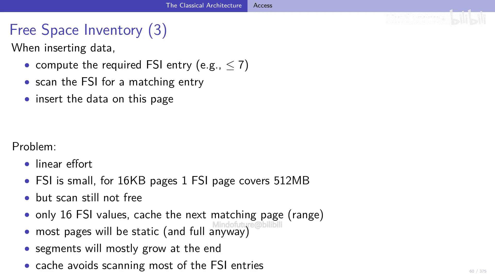

现在，我们必须用4位编码一个页的填充程度，当然4位不多。有些系统甚至更疯狂，只使用2位甚至1位每页。我认为这不好，1位真的太少，2位好一点，但也不是很准确。用4位，我们已经可以写更准确的信息。4位至少有16种不同的状态。当然，你使用的位数越多，你就越准确，但问题是你使用的位数越多，你的空闲空间清单就越大。你可能会说，嘿，这很便宜，我不关心空间利用率，让我们使用8位。但问题是，如果我们做一个更大的扫描，它会变得更慢。所以你有一定的动机使其变小。但尽管如此，我认为4位是你想要使用的最小值。

所以，假设我们使用4位。现在我们如何编码我的填充程度？只有4位。一种方法是说我只做线性插值。基本上，我在这4位中编码我的数据大小除以页大小除以2的位数次方。例如，如果我使用4位，那么除以16，所以我说这里：数据大小除以页大小的1/16，然后向上取整。如果我向上取整，将其用作填充程度，那么我可以从这4位决定我是否有足够的空间给我的传入元组。当然，有一些不准确性，因为我总是向上取整，这意味着我的准确性只有页大小除以16。例如，如果我有16KB的页，那么我有16种状态。那么我的块因子这里是1KB。基本上，最后一个KB我无法轻易填满。因为当我进入页的最后一个KB时，页看起来是满的，我的填充程度将是最大值。当我进入页的最后一个KB时，这意味着很难使页完全满。所以这有点问题。因此，我可以说，与其使用线性比例，不如使用对数比例。与其做线性近似，我说我存储对数，然后我可以很好地描述极端值。现在我们使用已使用大小的对数。这意味着1、2、4、8、16等等，我们指数增长。这当然允许我非常精确地描述小值，而线性近似会失去准确性。或者，顺便说一下，你可能不想用已使用大小来做这个，你想用空闲大小来做。因为我们更喜欢当我们几乎用完空间时，我们想知道这个，然后我们想使其完全满。或者，你甚至可以结合两者。你可以说，对于前8个值，我使用线性比例，然后对于后8个值，我使用对数比例。这可能更好，因为对数的问题是，在某些点上值变得太大，我们不再关心它们。所以你可能使用组合。我的意思是，在我的例子中，我说最小值是1，我们有1、2、4、8等等。我们可能不关心1和2，因为没有元组只有1字节或2字节。所以可能我的元组至少有4字节。所以因此，我知道更可能的值是4，然后我只在那之后指数增长。所以你可能会有一个精心手工构造的表格，例如，值15表示剩余4字节，14表示剩余8字节，13表示剩余16字节，12表示剩余32字节，11表示剩余64字节，10表示剩余128字节，然后更多。然后之后，我们转到线性。例如，然后值9、8等等，之后你做线性。这允许我使我的页相当满，我仍然可以使用最后几个位很好地描述页的其余部分。这就是你会选择的那种编码。然后这4位实际上足以相当准确地描述你页的空闲程度。所以你可以为每个元组找到一个合适的地方来放置它。

我们用它来编码空闲空间，已经说过，编码空闲空间还是已使用空间并不重要。因为一个是页大小减去另一个，所以使用哪个并不重要。但用几位我们描述我们处于哪种状态，然后我们选择我们内部需要的任何东西来找到一个合适的页。

因此，当我们插入数据时，我们计算所需的空闲空间清单条目。例如，我可能要求我的页有一个最多为7的条目，因为我知道如果是7或更少，我的数据适合。然后我扫描空闲空间清单以寻找匹配的条目，然后我将数据插入到这个页上，当然，如果我的插入足够大，以至于跨越到下一个空闲空间清单类别，我更新条目。这就是想法：扫描、插入。

现在，这实现起来相当简单，唯一的问题是这可能会出奇地昂贵。问题是，如果扫描清单，那么我有线性开销。我从第一页开始，然后检查。当然，如果线性开销，空闲空间清单的大小并不是超级大。如果你有16KB的页，那么一页的空闲空间清单足以覆盖半GB的数据，所以你没有很多页。但尽管如此，它会花费你一些东西。我可以告诉你我的个人经验。我第一次实现这个时，我按照书上的方法实现，运行了一些实验，一切都很顺利。然后我开始插入10GB的数据。突然，系统变得越来越慢。当然，如果你有10GB的数据，我们有20页的空闲空间清单，每个包含几千个条目。我们正在检查成千上万个条目。这花费了一些东西。所以突然，我的性能被扫描空闲空间清单所主导。这当然是一个更好的主意。

那么，我们如何使这个扫描更便宜？实际上很容易，因为我们知道只有16种空闲空间清单值，我们知道这个。因此，我们可以缓存下一个匹配的页，或者可能下一组页，一个页的范围。所以我们只记住具有这个条目的下一页是什么。这个缓存工作得很好，因为大多数页是静态的，这意味着你将其插入数据库，然后大多数时候你不对它们做任何事情。它们只是坐在那里，你可能稍后读取它们，但大多数时候你不修改。可能你做一个批量操作，删除所有条目，所以缓存必须不时失效，但大多数时候缓存将是正确的。所以如果你只记住具有特定填充值的第一个页，那么你永远不必检查之前，只需检查之后。所以如果这是我的清单，我可能记住，例如，具有条目7的第一页在这里。所以如果有人问我7，我到这里开始检查。现在，这个组是正确的页。如果不是，如果它不是正确的页，让我继续向右直到我找到第一个正确的匹配页。然后，当然，我更新我的缓存。所以我永远不会再次搜索具有小于这个缓存值的值为7的页。所以这是我的缓存。所以我只扫描我的空间清单的末尾，从不检查之前。现在，可能如我所说，有人在中间删除了一些东西，那么当然我必须执行删除，然后当然我必须更新我的缓存，但这很少发生。大多数时候我们不这样做，然后我再次读取其余部分，但在第一次扫描之后，我再次缓存这个，我将永远不会再看这个。这工作得很好，因为段倾向于在末尾增长，所以我们大多数时候只发生在末尾，然后我们没有这里昂贵的检查。

## 分配策略与优化 🚀

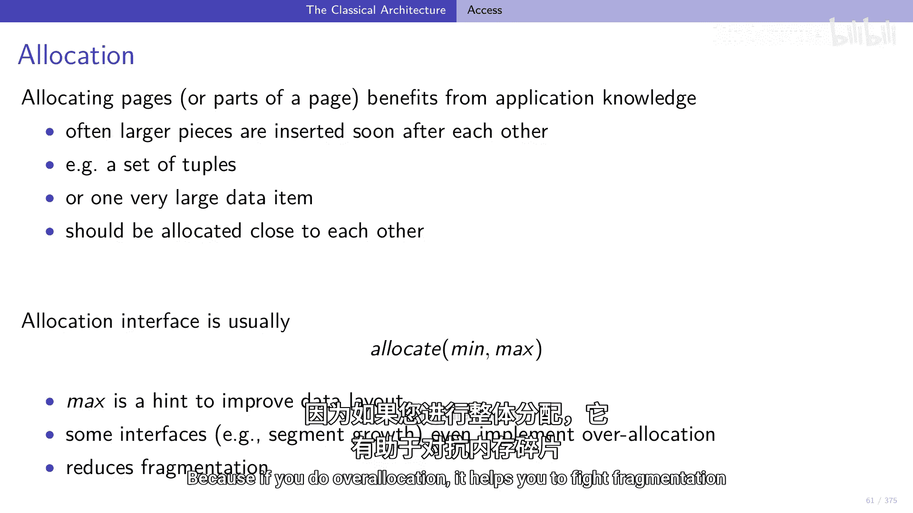

当我们执行分配时，我们从应用程序知识中受益。顺便说一下，这对页和元组都适用。我们之前讨论段时已经举过例子，例如，你可以说，嘿，要么你分配一页数据，要么你插入，例如，一些元组。这里有人有一个插入语句，例如，一个语句看起来像这样：`INSERT INTO R SELECT ...`。然后当然，我们有一个当前正在来的单个元组，如果我们需要一个单个元组的空间。但我们可能已经知道或有办法知道会有更多元组来，因为我们知道选择会产生元组，我们可能知道这个，我们可以利用这个知识。

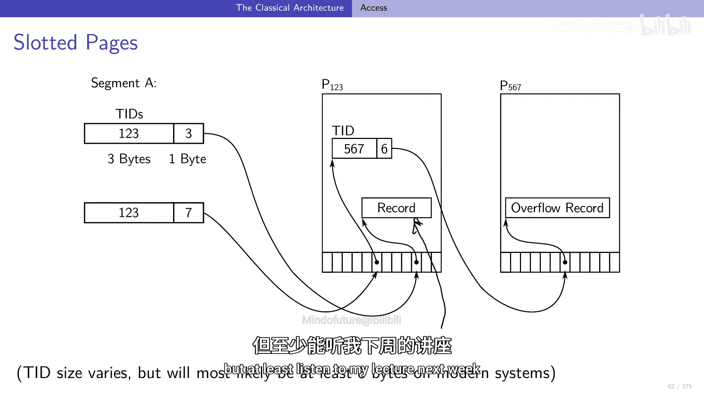

这里的另一个例子是，我们可能理解我们需要分配非常大的数据项，我们不会在今天讨论，但在下一节，但不是说也有我们需要分配的东西。所以我们当然希望分配彼此接近，当分配时，我们可以做的是给系统提示。基本上我们说，就单个元组而言，因此说分配我需要，例如，200字节。是的，我说最小值是200，因为我必须把下一个元组放在那里。但我可能已经知道有更多元组要来。因此，我说200字节是最小值，但如果你有，例如，20KB的空间，那很好。所以因此，系统可以利用这个信息，说好的，200是最小值，但如果我有一个更好的位置适合20，我会这样做，它会给出20KB，当然，然后它有20KB，然后它可以把下一个元组放在第一个旁边。这样我们减少了碎片，所以我们倾向于更喜欢数据彼此相邻放置。