# 006：访问B树 🗂️

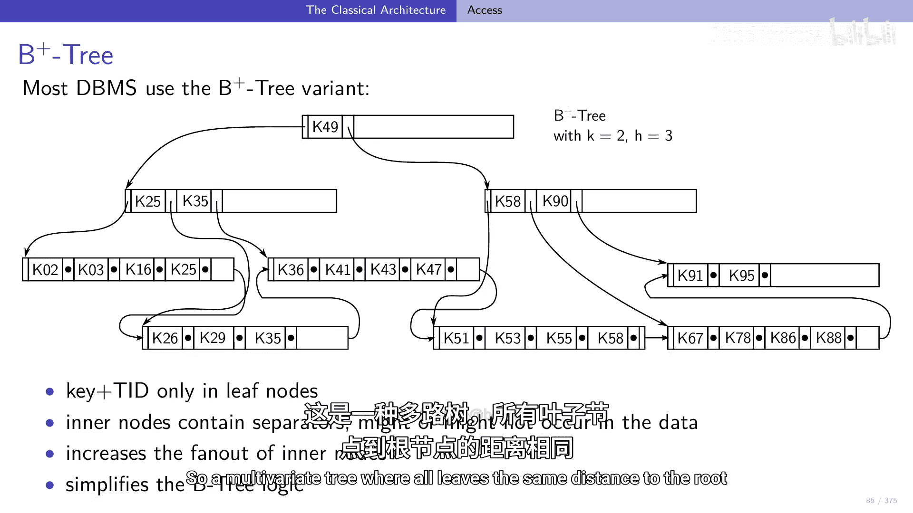

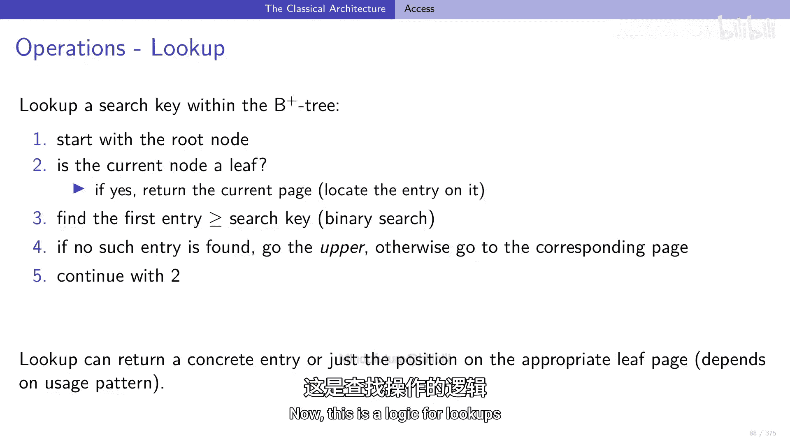

在本节课中，我们将要学习B树（B+树）的核心操作，包括查找、插入、删除、范围扫描以及并发控制和批量加载等高级主题。B树是数据库索引的基石，理解其内部机制对于实现高效的数据系统至关重要。

## 逻辑结构与基本操作 🔍

上一节我们介绍了数据库系统的基本概念，本节中我们来看看B树的逻辑结构。B+树是一种多路平衡树，其中所有叶子节点到根节点的距离相同，并且除根节点外，每个节点至少半满。

下图展示了一个B+树的示例：

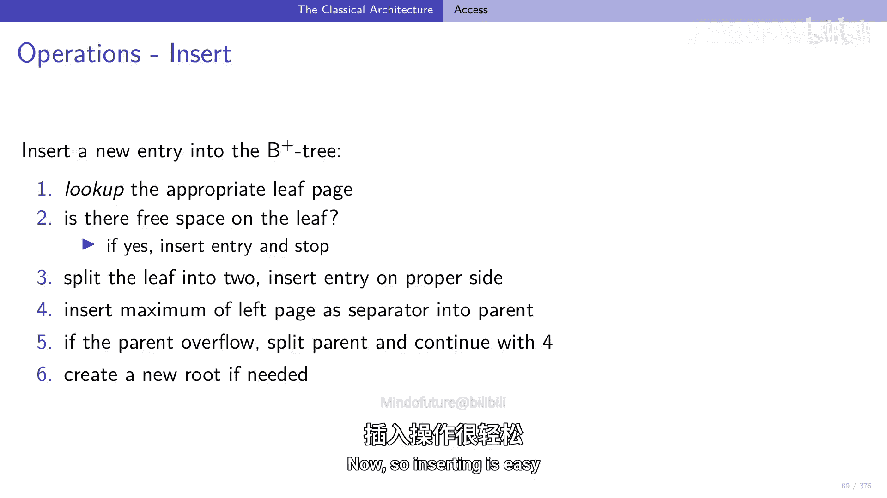

查找操作从根节点开始，沿着指针向下遍历，直到找到目标条目。由于节点通常很宽（可容纳数百甚至数千个条目），我们在节点内部使用**二分查找**来加速定位过程。还有一些更高级的优化技巧，如分支二分查找或插值查找。

## 插入操作 ➕

上一节我们介绍了查找，本节中我们来看看插入操作。B树的插入逻辑相对简单。

插入操作的第一步是执行一次查找，以定位新条目应该插入的叶子节点。这与搜索过程类似，我们沿着树向下遍历，直到找到目标叶子页。

第二步是检查目标叶子节点是否有足够的空闲空间。如果有，我们只需将新条目插入到正确的位置。唯一的难点在于，B树要求叶子节点内的条目保持有序。如果新条目需要插入到中间位置，则必须将右侧的所有条目向右移动，为新条目腾出空间。除此之外，插入操作很简单。

当然，棘手的情况发生在节点已满时。此时，我们需要将页面**分裂**成两个。

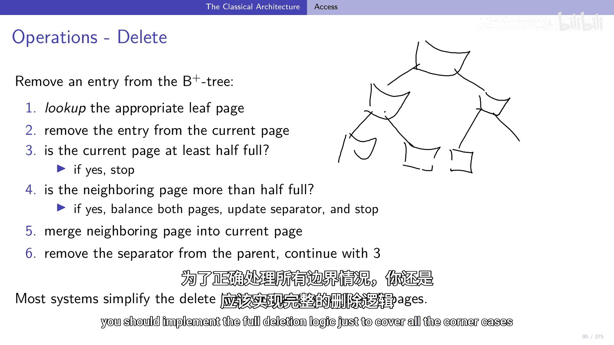

以下是分裂过程的精确描述：假设我们有一个已满的页面，其中包含许多已排序的条目。我们将其大致分成两半。分裂后，我们得到两个未满的新页面。假设分割点处的元素为 `M`（即中位数）。那么，第一个页面包含所有小于等于 `M` 的条目，第二个页面包含所有大于 `M` 的条目。分裂后，两个页面都有足够的空间来插入新条目，我们将其插入到它所属的页面（根据其值与 `M` 的比较结果）。

然而，现在我们有两个页面，但它们的父节点原本只有一个指针指向旧的子页面。因此，我们需要更新父节点：将旧的分隔键更新为 `M`，并添加一个指向新页面的指针。本质上，我们将 `M` 插入到父节点中，并更新旧的指针。

如果父节点也因此变满，我们将递归地执行相同的分裂操作，直到根节点。如果根节点也满了，我们就创建一个新的根节点。插入逻辑可以总结为：如果页面未满则直接插入；如果页面已满则分裂成两个半满的页面，并将新的分隔键插入父节点，此过程递归进行。

下图展示了插入和分裂的过程：

## 删除操作 ➖

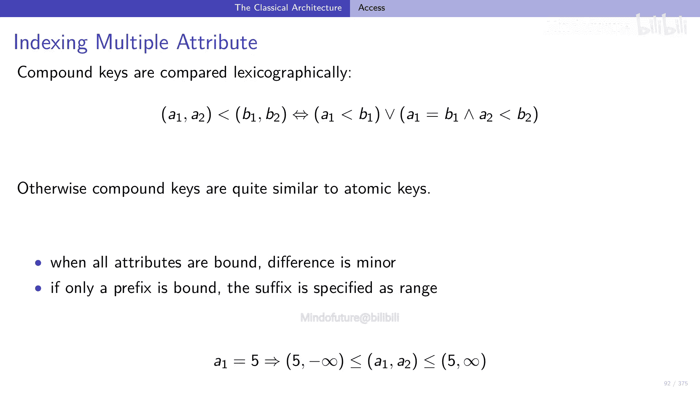

上一节我们介绍了简单的插入操作，本节中我们来看看更复杂的删除操作。删除操作并不简单，因为可能发生多种情况。

B树需要保证两个属性：1) 所有叶子节点到根的距离相同；2) 除根节点外，每个节点至少半满。插入逻辑能自动维持这些属性，但删除操作可能会违反“半满”准则。

删除操作首先执行一次常规查找，定位到包含目标条目的叶子节点。然后，我们移除该条目。之后，检查该叶子节点是否仍然至少半满。如果是，则操作完成。

如果叶子节点变得不足半满，我们就遇到了问题，因为需要保证对数级的访问成本。此时，我们查看其**邻居节点**。基本上有两种情况：
1.  如果邻居节点超过半满，我们可以从邻居节点“借”一些条目过来，使两个节点都至少半满。
2.  如果邻居节点也刚好半满（或更少），则我们不能从中取走条目，否则邻居也会变得不足半满。此时，我们将当前节点与邻居节点**合并**成一个节点。合并后，我们从父节点中移除指向被合并子页面的分隔键。这个操作可能导致父节点也变得不足半满，因此我们需要递归地向上处理，直到所有节点都满足半满条件。

一个重要的技巧是如何找到合适的邻居节点。从逻辑上讲，一个节点可能有两个邻居（左和右），但找到逻辑上的“下一个”邻居可能非常困难，因为它可能在树中很远的位置。实践中，我们寻找**共享同一个父节点**的邻居。由于父节点至少半满，这样的邻居必然存在。我们只需向上一步到父节点，再向下一步到邻居节点即可，无需在树中长距离移动。

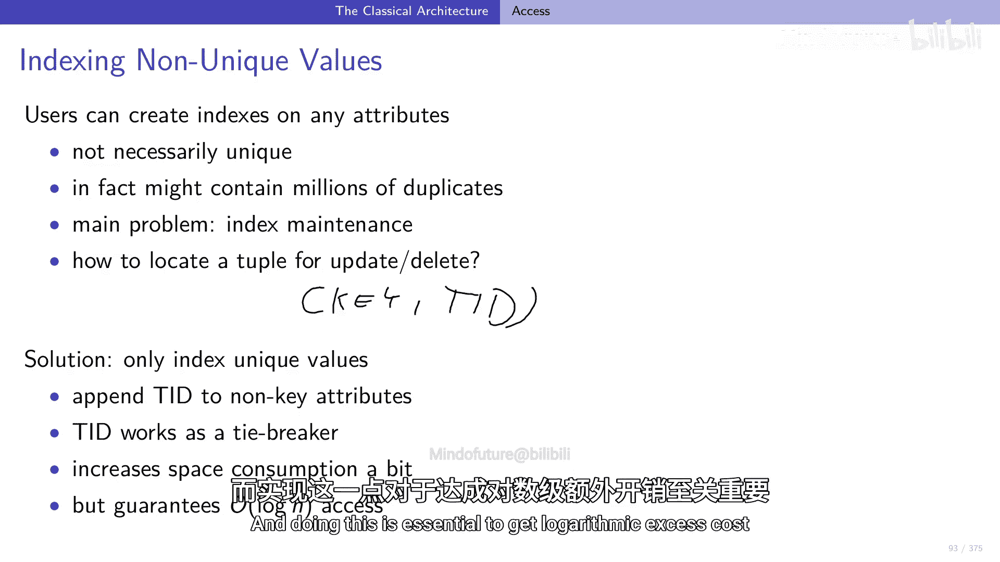

尽管如此，删除的实现仍然相当复杂，尤其是在支持多用户并发访问的系统中。由于这个问题，许多系统选择不实现完整的删除逻辑。它们只会在页面完全为空时删除整个页面，而容忍不足半满的页面存在。支持这种简化策略的论点是：从长远来看，数据库的插入操作通常多于删除操作（否则数据库最终会变空）。因此，空页面最终会被新的插入填满。然而，这个论点只在插入和删除均匀分布在整个值域时才成立。可以构造特定的插入删除序列（例如，持续插入递增数字，然后定期删除所有非10的倍数），导致产生大量永远不会被再利用的空闲空间。因此，尽管复杂，为了实现健壮性，还是应该实现完整的删除逻辑。

下图展示了删除和合并的过程：

## 范围扫描与复合键 🔎

上一节我们介绍了点查询的插入和删除，本节中我们来看看范围扫描。B树索引需要支持点查询和范围查询。

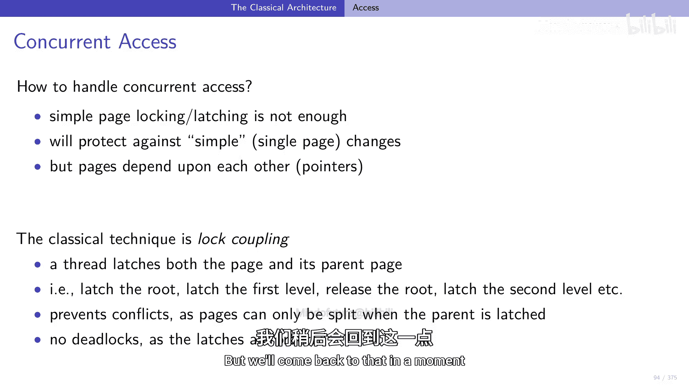

范围扫描很简单：首先对范围的起始条件执行一次常规查找（点查询），沿着树向下直到找到包含起始值的叶子节点（如果起始值不存在，则定位到大于它的下一个值）。然后，从这个叶子节点开始，向右顺序读取所有条目。当到达页面末尾时，通过叶子节点间的**链式指针**跳转到下一个叶子节点，继续读取。这个过程一直持续，直到遇到一个大于范围终止条件的值，此时停止扫描。这种方法非常高效，特别是当叶子节点在物理存储上连续时，可以产生近乎顺序的磁盘I/O，性能极佳。

接下来讨论**复合键**索引。在SQL中，可以在多个属性上创建索引（例如 `PRIMARY KEY (A, B)`）。对于索引而言，复合键 `(A, B)` 被视为一个整体的值，只是比单个数字更大一些。我们使用**字典序**进行比较：`(A1, B1) < (A2, B2)` 当且仅当 `A1 < A2` 或 `(A1 == A2 且 B1 < B2)`。这就像电话簿先按姓氏排序，同姓再按名字排序。

对于点查询（精确匹配所有属性），复合键与单键没有区别。有趣的是**前缀查询**：例如，如果复合键是 `(A, B)`，而查询只指定了 `A = 5`。这会被内部转换为一个范围查询：`(A, B) BETWEEN (5, -inf) AND (5, +inf)`，然后按范围扫描执行。

但是，如果查询只指定了第二个属性（例如 `B = 5`），则无法有效使用该索引，因为索引的排序首先是基于 `A` 的。这就像在电话簿中只知道名字而不知道姓氏，将不得不扫描所有条目。

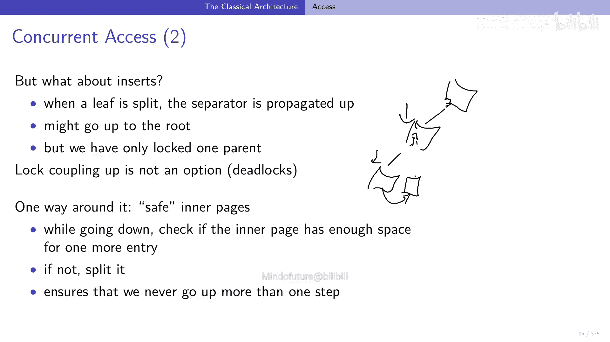

下图说明了范围扫描和复合键：

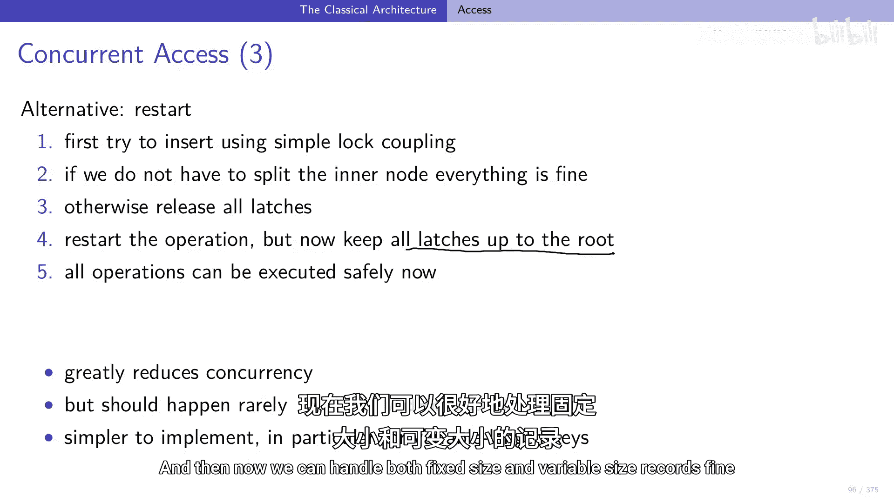

## 处理非唯一索引 🔑

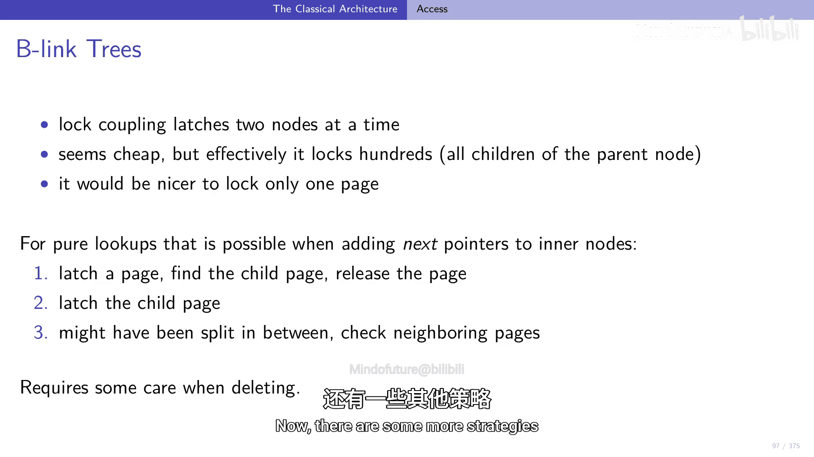

上一节我们讨论了复合键，本节中我们来看看非唯一索引带来的挑战。主键自然是唯一的，但使用 `CREATE INDEX` 创建的二级索引可能包含重复值。

问题在于删除或更新时：假设有一个基于 `country` 的非唯一索引，许多学生都来自“Germany”。当通过主键删除一个学生记录时，我们也需要从 `country` 索引中删除对应的条目。但如果只凭 `country = ‘Germany‘` 去索引中查找，会得到大量重复条目，无法高效定位到具体要删除的那一个。

解决方案是确保索引中存储的每个键值都是唯一的。为此，我们在用户提供的索引键后面**追加表的行ID（TID）**。这样，即使业务键（如 `country`）相同，`(key, TID)` 这个组合也总是唯一的。在删除时，我们先通过主键找到行及其 `country` 值，然后用 `(country, TID)` 这个唯一组合去索引中进行对数时间的高效删除。

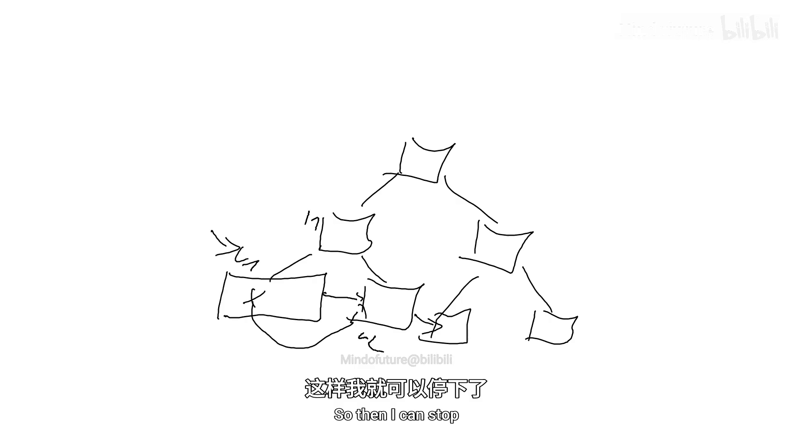

这样做的代价是增加了少量的空间开销，因为需要在内部节点中也存储TID。但由于内部节点数量远少于叶子节点，且叶子节点本来就需要存储TID，因此总体开销很小，是可以接受的。

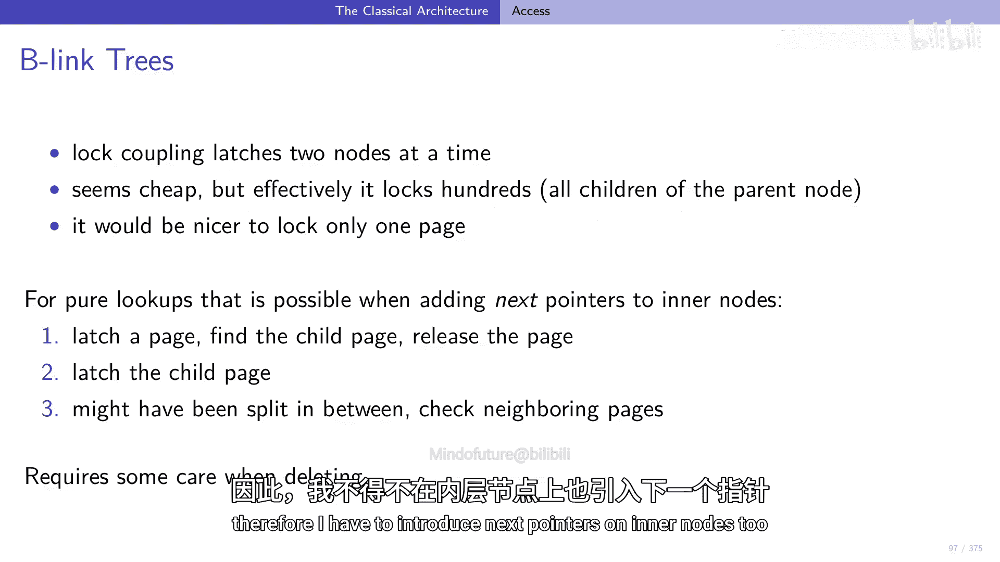

下图展示了非唯一索引的解决方案：

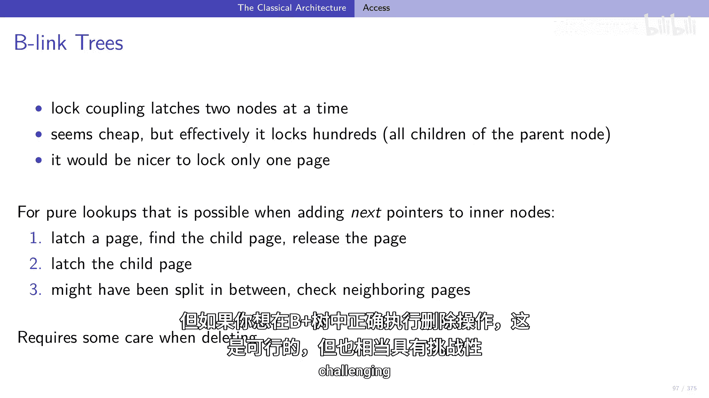

## 并发控制：锁耦合 🔒

上一节我们介绍了单线程下的操作，本节中我们来看看多用户并发访问时的保护机制。之前使用的缓冲区管理器锁（闩锁）单个页面是不够的。

对于叶子节点，锁定它本身是可行的。但对于内部节点，仅锁定当前节点然后释放并向下层移动是不安全的。在释放父节点锁和获取子节点锁的短暂间隙内，另一个线程可能修改了树的结构（例如分裂了子节点），导致当前线程访问到错误的页面。

传统的解决方案是**锁耦合**。其思想是：在访问一个页面时，同时持有该页面及其父页面的锁。
1.  从根节点开始，锁定根节点。
2.  确定要访问的子节点（例如左孩子），锁定该子节点。此时同时持有父（根）和子节点的锁。
3.  安全地释放父节点（根）的锁。
4.  现在持有子节点锁，确定下一个要访问的孙节点，锁定孙节点。
5.  释放当前子节点锁，依此类推。

这个过程就像一个小玩具“滑梯板”下楼梯：它总是同时接触两个台阶，然后向前移动。锁耦合不仅解决了并发问题，而且由于加锁顺序总是从根到叶，因此不会产生死锁。

下图展示了锁耦合的过程：

## 插入时的并发挑战与安全页面 🛡️

上一节我们介绍了查找时的锁耦合，本节中我们来看看插入操作带来的额外并发挑战。查找时我们总是向下遍历，但插入可能引起分裂并向上传播。

假设我们使用锁耦合向下遍历到叶子节点并准备插入。如果叶子节点需要分裂，我们需要更新其父节点。由于我们采用锁耦合，在访问叶子节点时，我们曾短暂地同时持有父节点和叶子节点的锁。此时，我们可以检查叶子节点空间是否充足。如果充足，就释放父节点锁；如果不足（需要分裂），则**保持父节点锁**，然后分裂叶子节点并更新父节点。

问题在于，如果父节点也因此变满需要分裂，我们就需要继续向上修改祖父节点，但我们可能已经释放了祖父节点的锁。一种解决方案是使用**安全页面**策略：在向下遍历时，即使当前不需要，也检查每个内部节点是否已满。如果已满，则立即分裂它（因为我们仍持有其父节点的锁）。这样，我们就提前进行了分裂，确保在后续插入叶子节点时，分裂不会向上传播超过一级。这种方法的缺点是可能提前分裂页面，造成微小的空间浪费，但逻辑简单，避免了复杂的向上回溯加锁。

安全页面策略的主要问题在于处理**变长记录**（如字符串）。对于定长记录，很容易判断页面是否“满”。但对于变长字符串，无法准确预知是否还能容纳下一个条目，因此难以决定是否提前分裂。

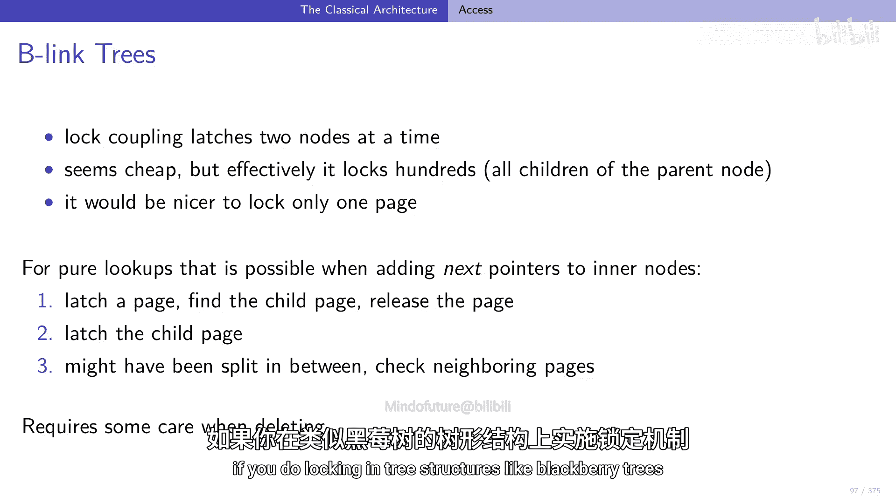

下图说明了插入时的并发控制：

## 重启策略与B-link树 🔄

对于变长记录，安全页面策略不适用。另一种方法是**重启策略**：
1.  首先，尝试使用简单的锁耦合向下遍历，假设不需要分裂内部节点。
2.  如果到达叶子节点后，发现需要分裂内部节点（由于叶子分裂引起），则**释放所有已持有的锁**。
3.  重新开始遍历，但这次从根节点开始，**持有路径上所有节点的锁直到叶子节点**（不释放中间锁）。这样就能安全地执行所有分裂操作。

这种方法的优点是实现简单。缺点是当需要保持从根到叶的所有锁时，侵入性较强，会阻塞整棵子树。但幸运的是，内部节点分裂的频率很低（大约每千次叶子插入发生一次），因此重启事件非常罕见，可以接受。

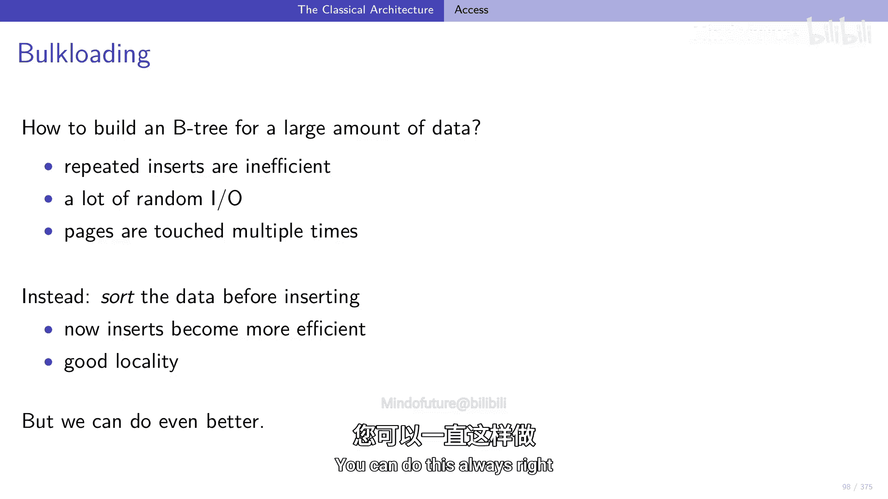

即使锁耦合正确，也存在性能问题：锁住一个高层内部节点，会隐式地阻塞其所有后代节点的并发访问。例如，锁住一个可容纳1000个键的内部节点，可能阻塞了其下100万个条目的访问。

为了获得更高的并发性，人们提出了 **B-link树** 的想法。其目标是**最多只锁住一个节点**。基本思路是：在节点间添加横向的“下一个”指针。查找时，锁定当前节点，确定子节点后释放当前锁，然后去锁子节点。如果在此期间子节点被其他线程分裂，导致目标键被移走，当前线程可能找不到它。此时，利用“下一个”指针向右搜索，直到找到目标键或确定其不存在。B-link树需要在内部节点和叶子节点都维护这种横向指针。

B-link树在只有查找和插入时可以实现得相当好，但**删除操作是噩梦**。因为删除可能导致节点合并，使得键向左移动，而不仅仅是向右。仅靠“下一个”指针无法处理向左的移动。实现带删除的B-link树需要更复杂的机制（如epoch机制），非常具有挑战性。因此，许多系统在B-link树中也不实现完整的删除逻辑。

下图展示了B-link树的结构：

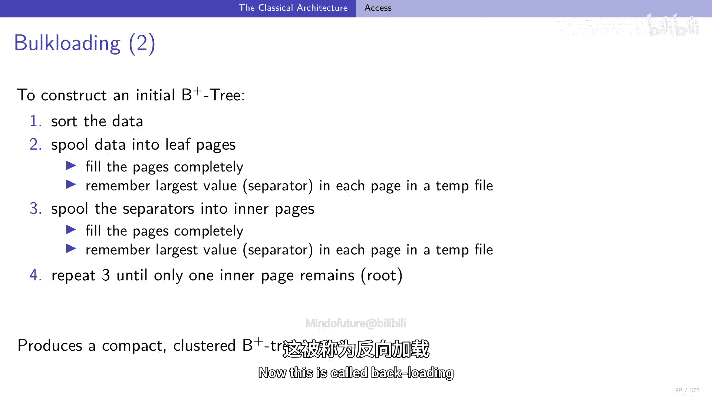

## 乐观锁耦合 ⚡

锁耦合的另一个问题是，即使没有写写冲突，高层的读锁也可能成为性能瓶颈。传统的读写锁实现中，大量线程频繁更新根节点的读计数器会导致缓存行在CPU核心间“弹跳”，速度很慢。

**乐观锁耦合** 是一种新技巧，它假设在快速系统中冲突很少见，并为此优化。
*   **写操作**：使用传统的排他锁。
*   **读操作（内部节点）**：不获取读锁，而是采用乐观策略。每个页面有一个版本号和一个排他位。
    1.  访问页面时，先记录其当前版本号 `V0` 并检查排他位是否为0。
    2.  然后读取页面内容并进行操作（如二分查找确定子节点）。
    3.  在向下移动前，进行**验证**：检查页面的版本号是否仍为 `V0` 且排他位为0。如果验证通过，说明在读取期间页面未被修改，读取有效。
    4.  如果验证失败，则**重启**整个遍历过程。
*   **读操作（叶子节点）**：对于长时间持有的扫描，可以获取真正的读锁或排他锁，因为叶子节点冲突较少。

乐观锁耦合就像乐观的锁耦合：你“乐观地”向下遍历，只在最后验证你的假设是否成立。这避免了高层节点的锁竞争，实现了高并发。这是一项较新的技术，在传统数据库书籍中可能找不到，但在研究论文中有描述。

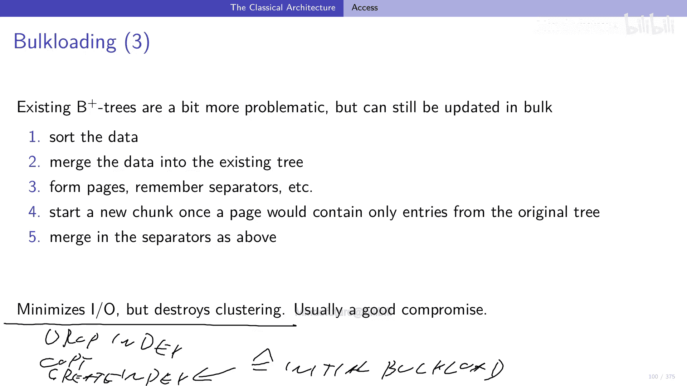

下图概括了并发控制策略：

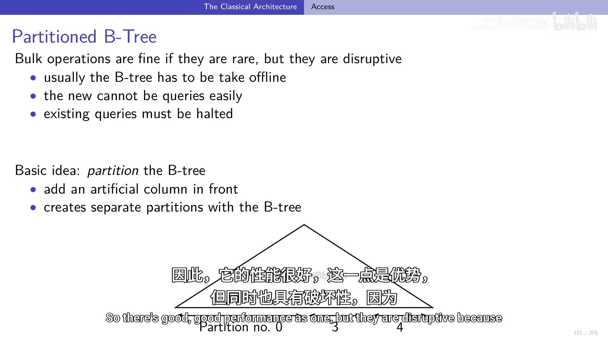

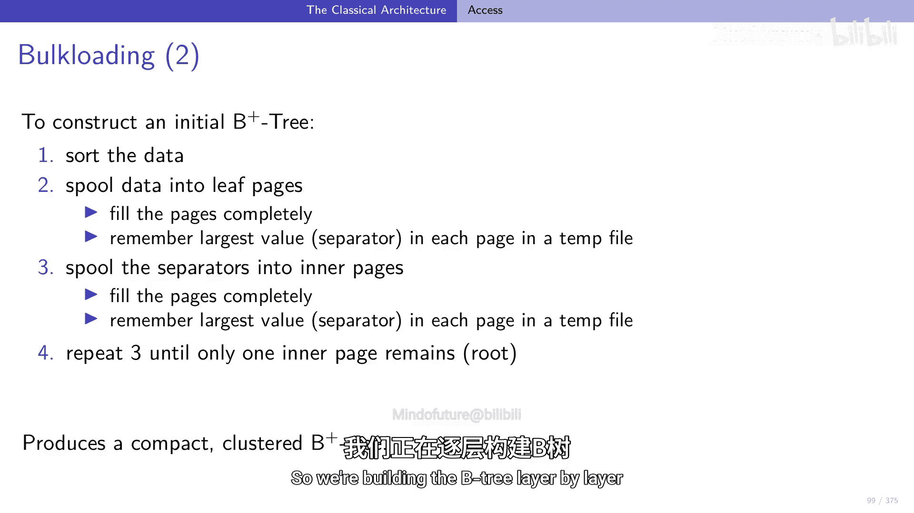

## 批量加载 🚀

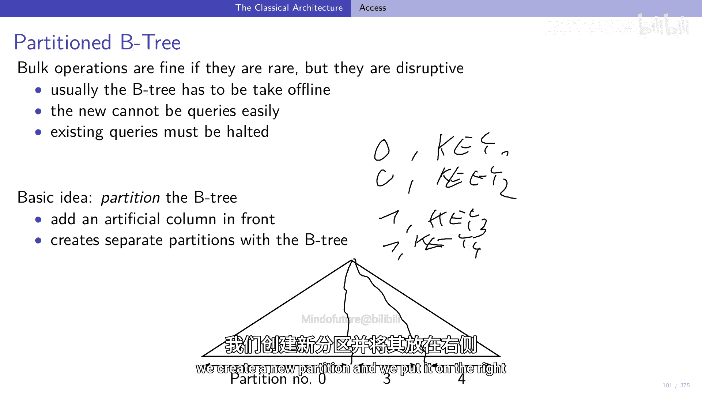

上一节我们讨论了并发操作，本节中我们来看看如何高效地批量导入大量数据。逐条插入数百万条记录非常慢。

更好的方法是**批量加载**。首先，按照索引键对输入数据排序。然后，自底向上构建B树：
1.  **构建叶子层**：将排序后的数据顺序填充到叶子页面，**填满整个页面**（而不是半满）。记下每个页面的最大键作为分隔键。所有叶子页面都是满的（除了最后一个）。
2.  **构建内部层**：将上一级产生的分隔键作为输入，同样顺序填充到内部页面，并填满。记下每个内部页面的最大键。
3.  **递归构建**：重复步骤2，用产生的分隔键构建更高层，直到所有键能放入单个根页面。

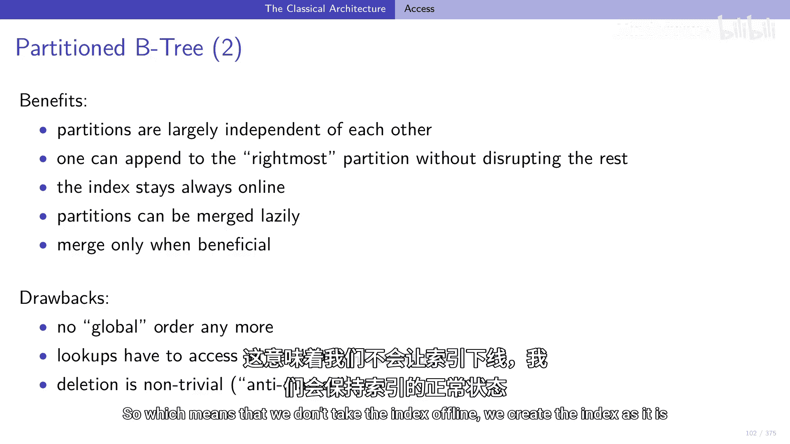

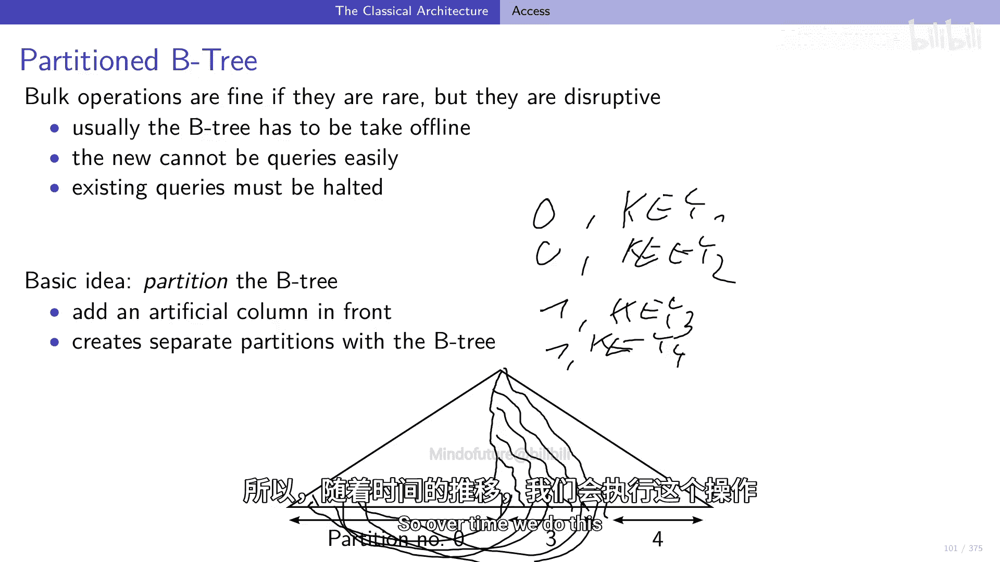

这种方法只进行顺序I/O，构建的B树非常紧凑（所有页面全满），并且叶子节点物理连续，对范围查询性能极佳。这称为**初始批量加载**。

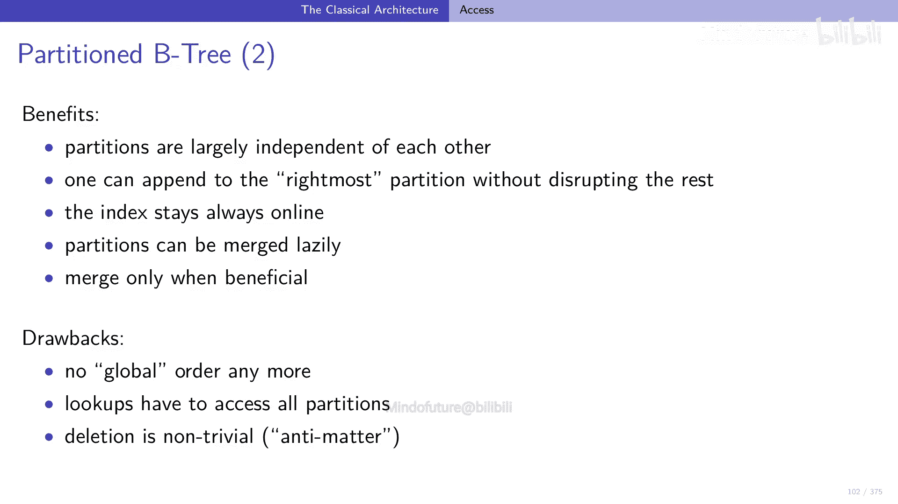

对于**增量批量加载**（向已有B树中批量插入），可以将已排序的新数据与现有树的叶子节点进行归并。这比单条插入快，但会破坏物理聚类性，且实现更复杂。一些系统（如PostgreSQL）的替代方案是：先删除旧索引，导入所有数据（包括旧的），然后重新创建索引，这本质上就是初始批量加载。

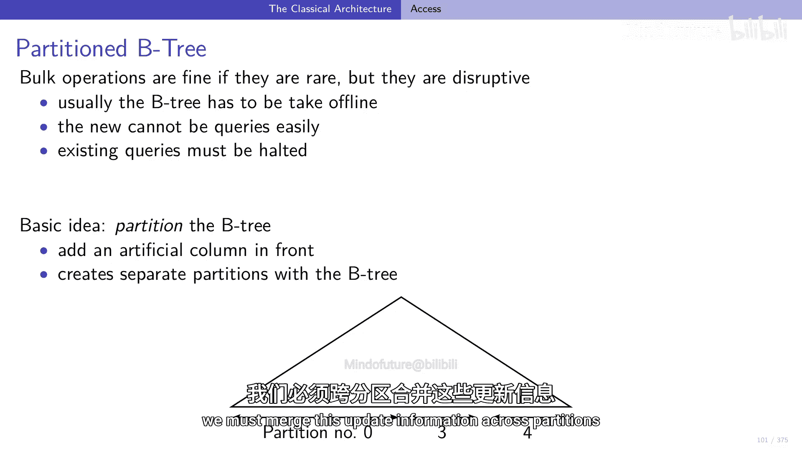

下图展示了批量加载的过程：

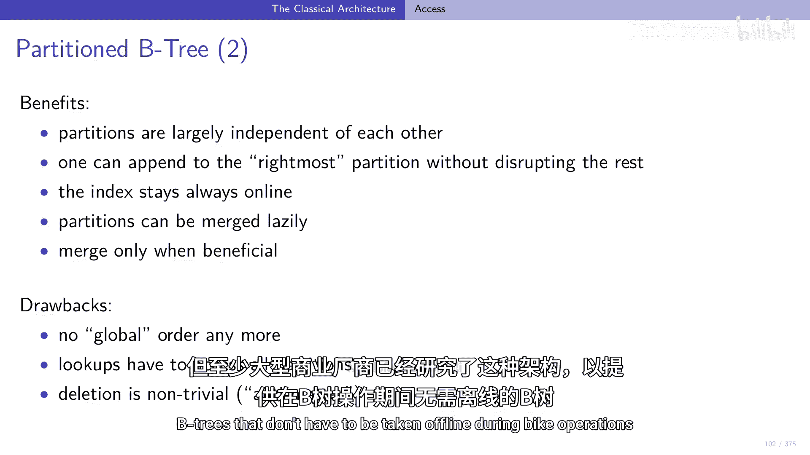

## 分区B树与可变长键处理 🧩

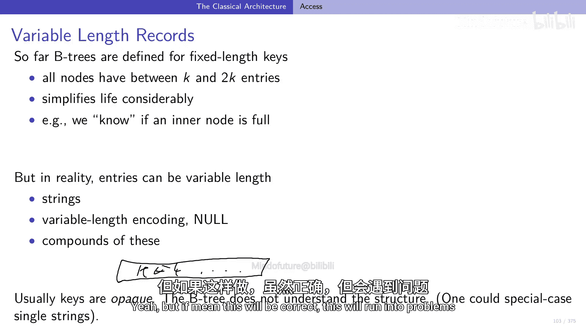

为了在批量加载时保持索引在线，可以使用**分区B树**。它在所有键前添加一个虚拟的“分区ID”列（如0, 1, 2…）。初始数据在分区0。新的批量数据被放入一个新的分区（如分区1），其所有键在逻辑上都大于分区0的键，因此被附加在树的右侧。这样，新分区的构建不会干扰旧分区的查询。随后，后台任务可以逐步将新分区的数据合并回旧分区。缺点是查询时需要搜索所有分区，因此分区数量不宜过多，且需要后台合并。

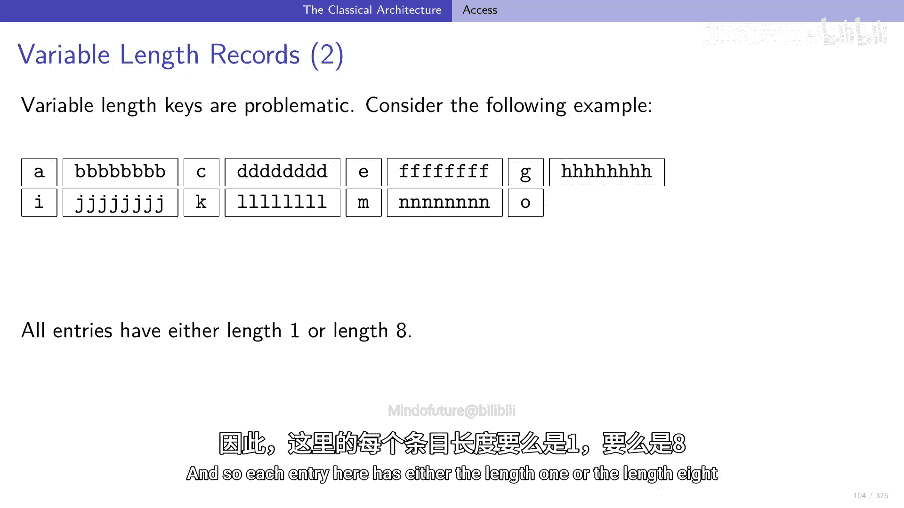

分区B树还需要处理批量删除或更新，这可以通过在新区存储“反物质”（删除标记）来实现，查询时合并结果。

最后，处理**可变长键**（如字符串）是B树的一个复杂之处。对于定长键，分裂点（中位数）很容易确定。对于变长键，简单地选择中位数作为分隔键可能导致分隔键很长，使得内部节点只能容纳很少的指针，树变深。

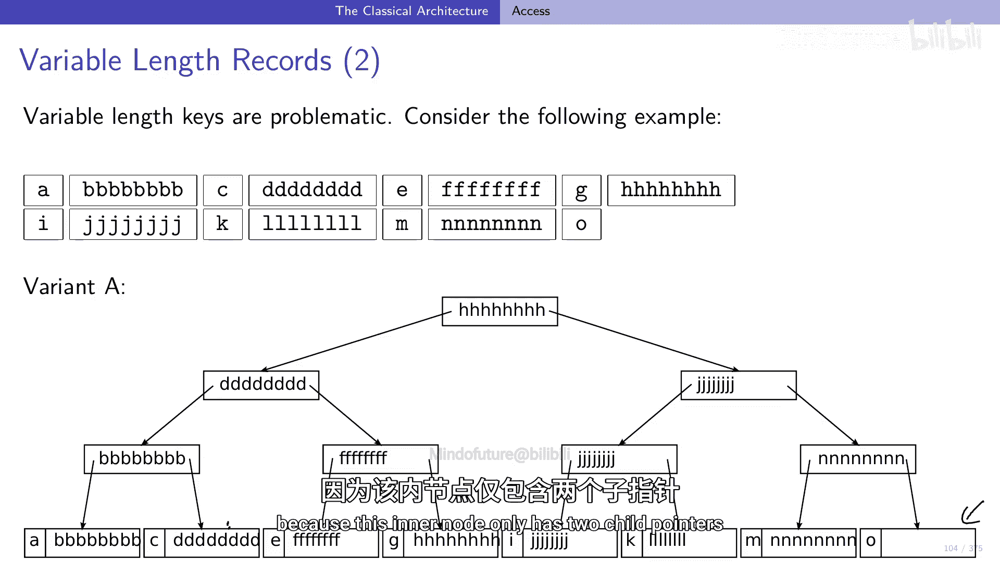

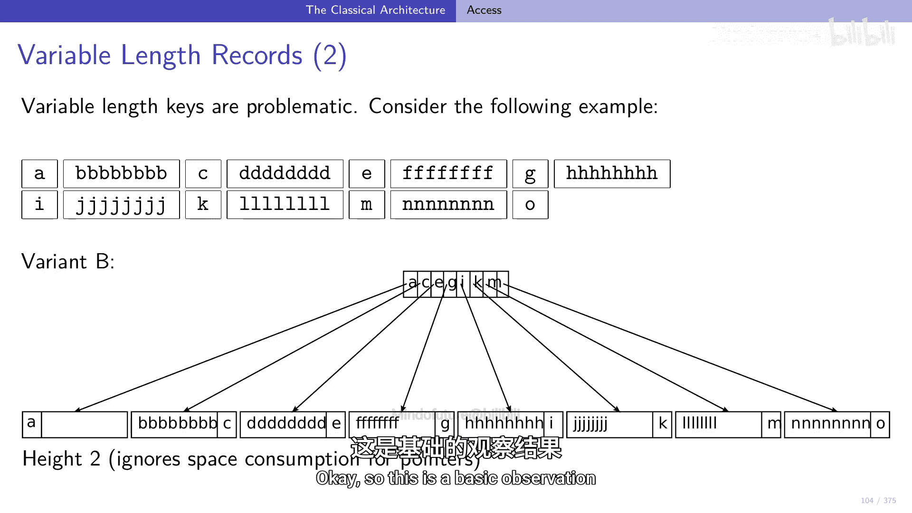

一个实用的启发式方法是修改分裂逻辑：当页面溢出时，不在严格中位数处分裂，而是在中位数附近一个范围（例如前后20%）内，选择**长度最短的键**作为分隔键。如果长度相同，则选择最接近中位数的一个。这虽然不能保证理论最优，但在实践中能显著改善性能，且易于实现。

下图展示了可变长键的挑战与解决方案：

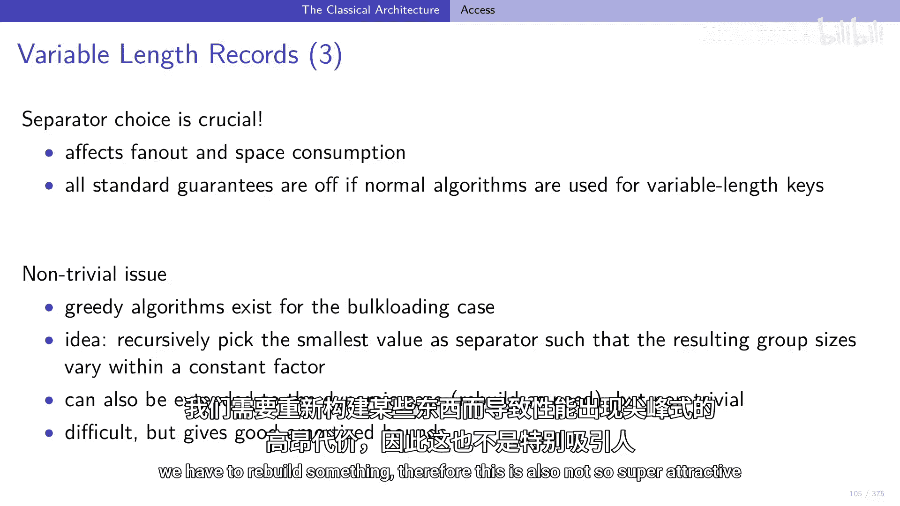

## 总结 📚

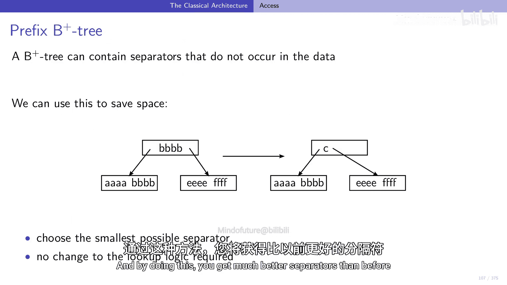

本节课中我们一起学习了B树（B+树）的核心实现细节。我们从逻辑结构和基本查找入手，深入探讨了插入、删除以及保证树平衡的算法。我们了解了如何支持范围扫描和复合键查询，并解决了非唯一索引带来的挑战。在并发控制方面，我们介绍了锁耦合、安全页面、重启策略、B-link树以及乐观锁耦合等多种技术，以应对多线程同时访问时的正确性与性能问题。最后，我们探讨了高效的批量加载策略，以及处理可变长键和分区B树等高级主题。B树是数据库系统的核心数据结构，掌握其丰富的实现变体和优化技巧对于构建高性能数据库至关重要。