# 007：访问扩展哈希 🔍

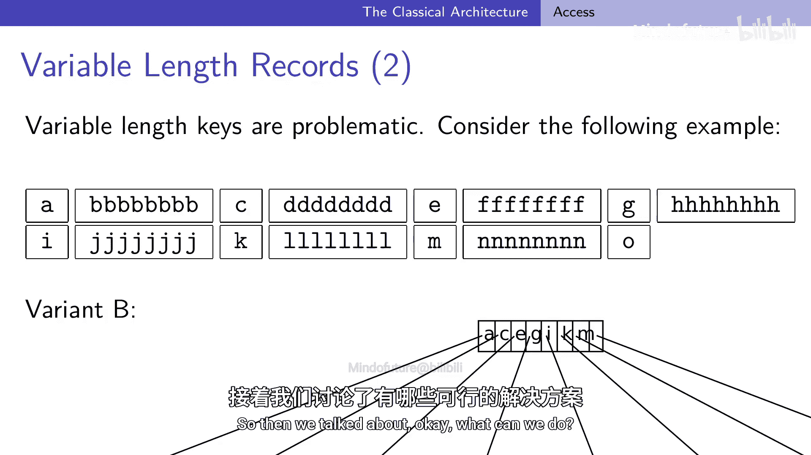

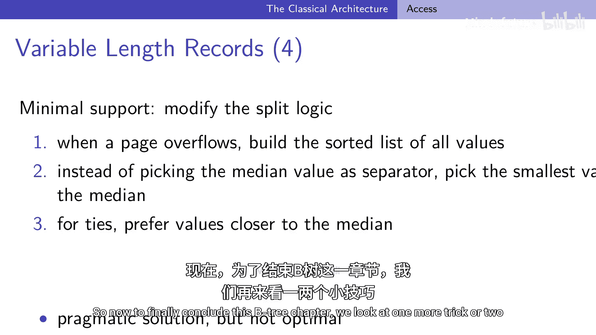

在本节课中，我们将学习B+树章节的最后一个优化技巧——前缀B+树，并开始探讨数据库索引的另一个重要家族：哈希表。我们将从内存中的哈希表实现讲起，分析其优缺点，并最终引出适用于外部存储（如磁盘）的扩展哈希技术。

## 前缀B+树 🌲

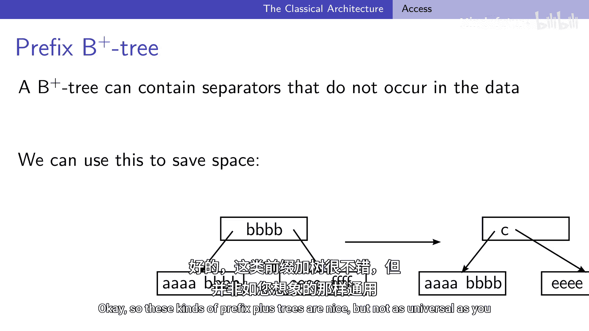

上一节我们讨论了如何通过选择合适的分隔符来提高B+树的扇出。本节中，我们来看看两种被称为“前缀B+树”的技术，它们可以进一步优化存储空间和扇出。

### 前缀B+树（技术一）

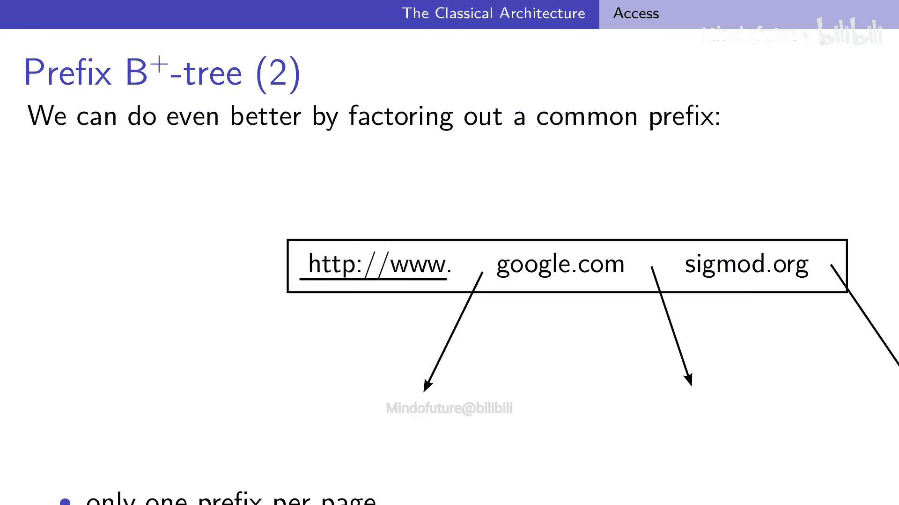

第一种技术基于一个简单的观察：分隔符不必是实际存在于数据中的键值。只要一个值能正确地区分左子树和右子树的所有键，它就可以作为分隔符。

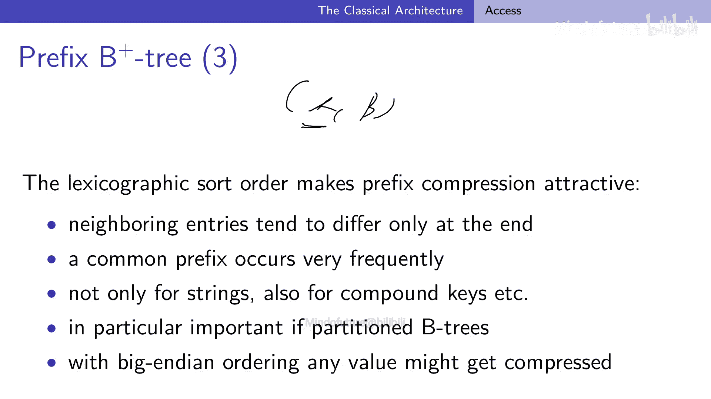

**核心思想**：选择**尽可能小的分隔符**来区分左右子树。

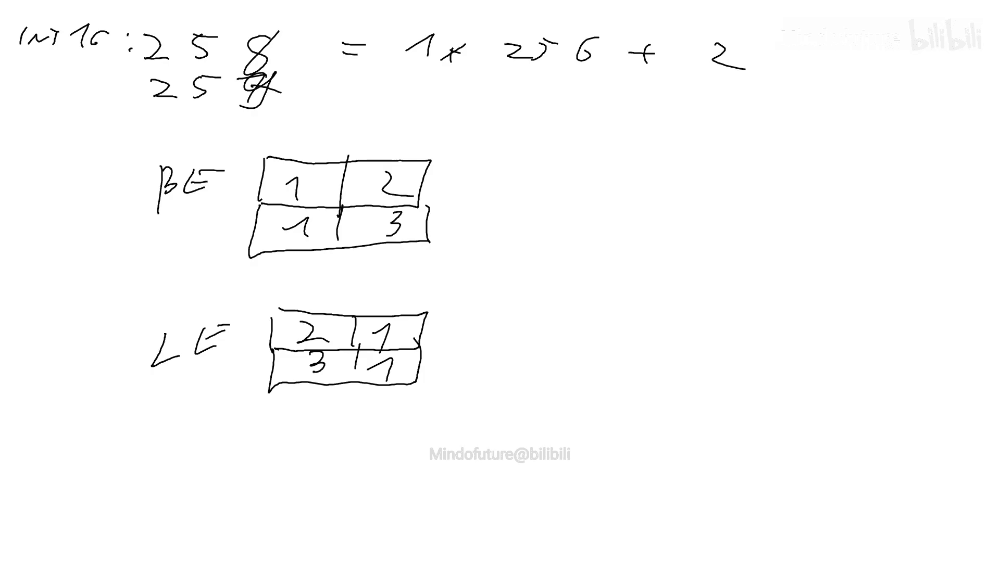

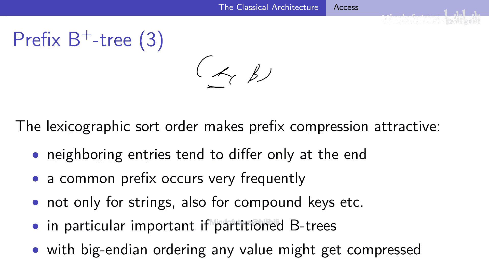

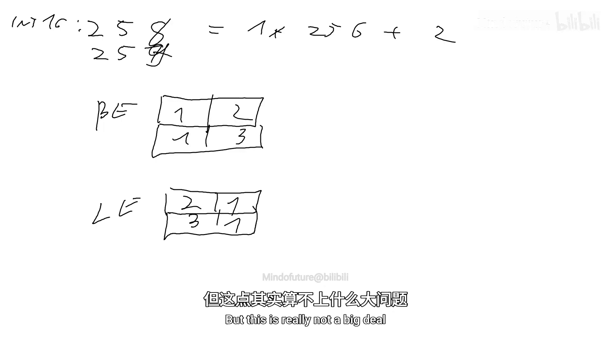

例如，假设一个节点包含字符串 “AA” 和 “BB”，而下一个桶的起始键是 “E”。在 “B” 和 “E” 之间存在其他字母（如 “C” 或 “D”）。我们可以选择 “C” 作为分隔符，它虽然不在数据中，但能有效区分 “AA/BB” 和 “E”。

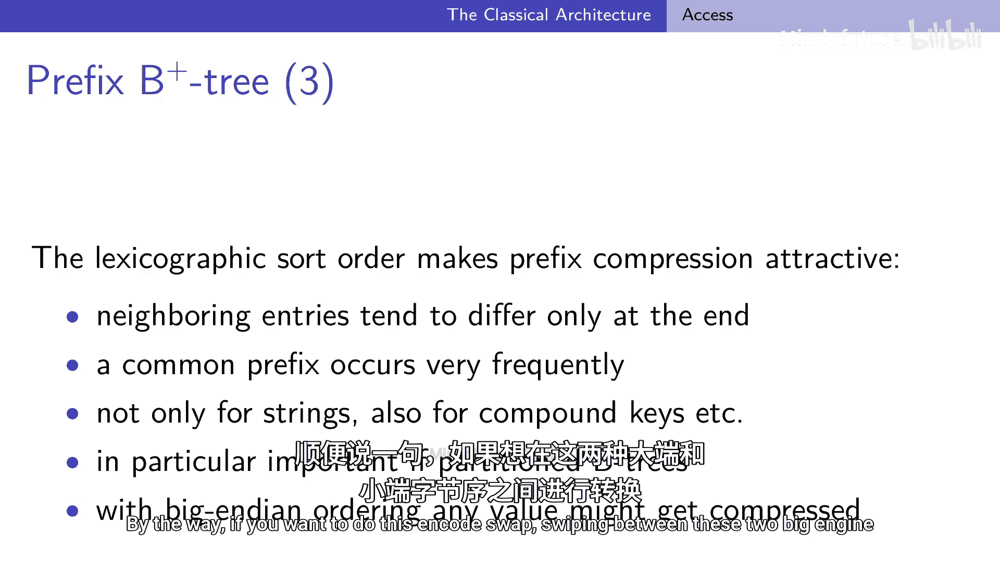

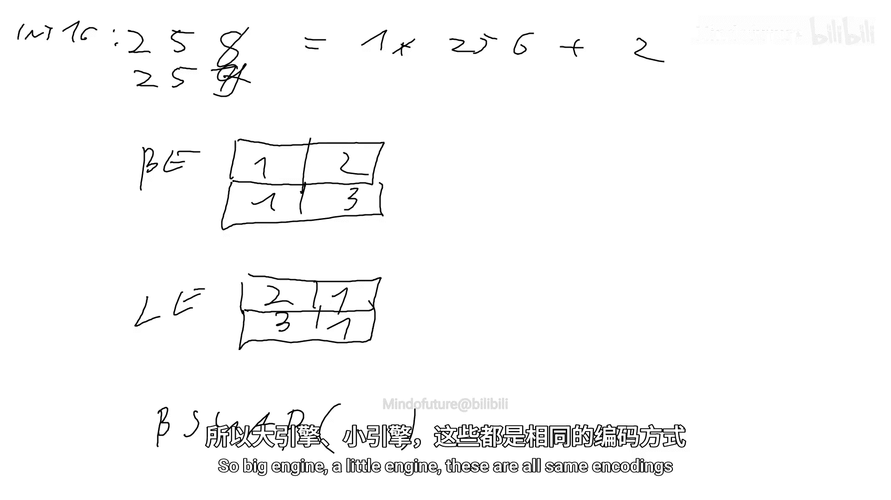

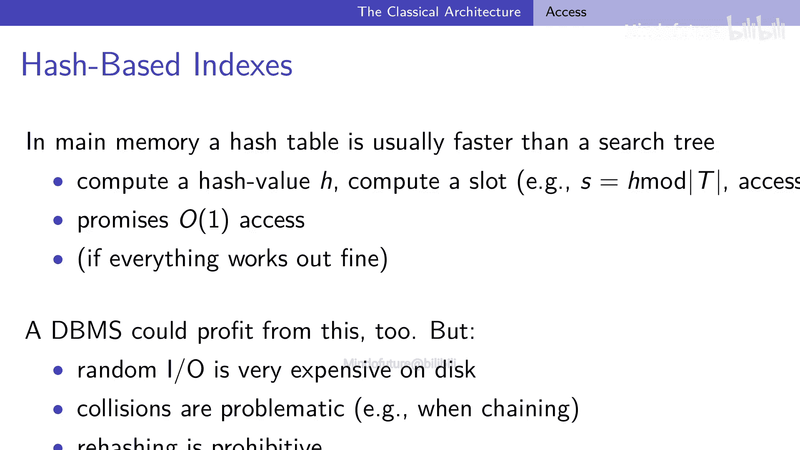

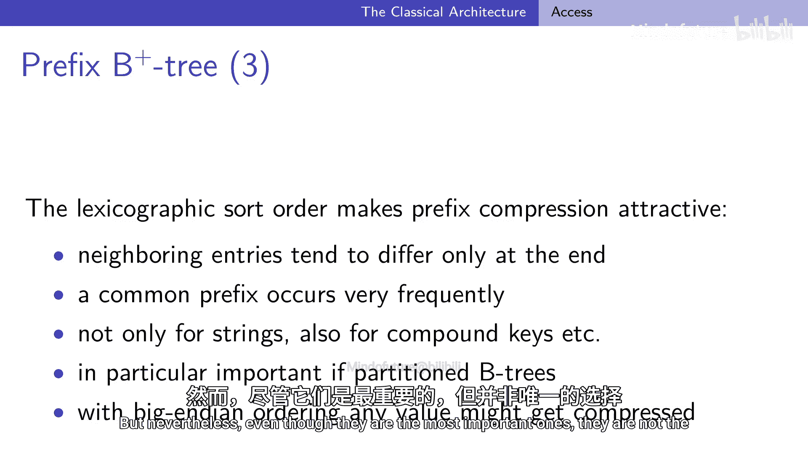

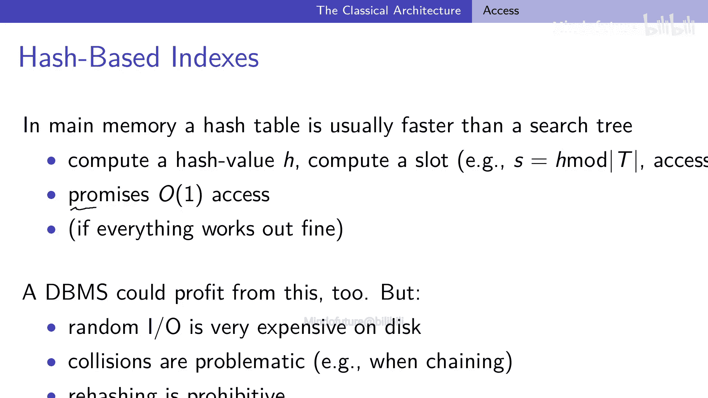

*   **优点**：查找逻辑几乎无需改变，只需在插入时调整选择分隔符的逻辑。
*   **挑战**：对于复杂的数据类型（如包含特殊字符的Unicode字符串），自动找到一个“介于两者之间”的分隔符可能非常困难，甚至不可能。

因此，这种技术虽然巧妙，但通用性有限。

### 前缀B+树（技术二）

第二种技术利用了B+树数据按序存储的特性：相邻的条目往往有相同的前缀。

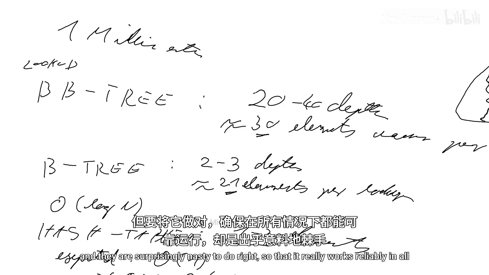

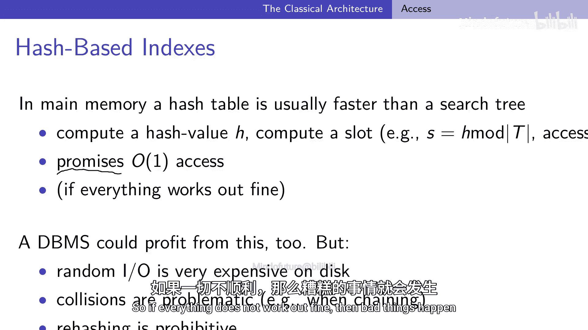

**核心思想**：在**每个页面（节点）** 上，提取并只存储一次所有键的**公共前缀**，页面内的每个条目只存储前缀之后的部分。

例如，存储一系列URL时，同一页面上的多个条目可能都以 `http://www.google.com/` 开头。我们可以将这个公共前缀存储在页面头部，而每个条目只存储像 `search` 或 `maps` 这样的后缀。

*   **查找流程**：
    1.  到达一个页面时，先将搜索键与该页面的公共前缀比较。
    2.  如果匹配，则去掉前缀，在页面内剩余部分中查找。
    3.  如果不匹配，则根据比较结果决定前往相邻页面。
*   **优点**：显著节省存储空间，从而提高扇出，降低树高。查找逻辑改动很小。
*   **考虑**：进行范围扫描或仅索引查询时，需要将前缀和后缀拼接回完整的键。通常这仍是值得的，尤其是在叶子节点存储长字符串时。

**对复合键和数值的优化**：
*   对于复合键（如 `(A, B)`），相邻条目通常有相同的 `A` 值，前缀压缩可以将其提取出来。
*   对于数值，为了便于前缀压缩，应按照**大端序**存储。因为大端序（高位字节在前）能保证数值相近的键在字节表示上也拥有更长的公共前缀。虽然现代CPU多为小端序，但使用一条指令进行字节交换的成本很低。

---

## 哈希表基础 🧮

尽管B+树是外部存储中最重要的数据结构，但它并非唯一选择。哈希表是另一个重要的家族。

哈希表的核心承诺是**常数时间的预期查找性能**，这比B+树的 `O(log n)` 更有吸引力。然而，哈希表通常**不支持高效的范围查询**。

### 哈希表性能对比

假设有100万个条目：
*   在红黑树中，查找平均需要访问约30个元素。
*   在扇出为1000的B+树中，查找平均需要访问约21个元素（在根节点和叶子节点进行二分查找）。
*   在一个设计良好的哈希表中，查找**预期只访问1到2个元素**。

因此，哈希表在点查询上具有潜在的速度优势。

### 哈希表的实现与挑战

哈希表主要有两种实现方式：**链地址法** 和 **开放地址法**。我们以链地址法为例说明基本结构和挑战。

一个简单的链式哈希表结构如下：
```c
typedef struct Entry {
    int key;
    struct Entry* next;
    // ... 可能的负载数据
} Entry;

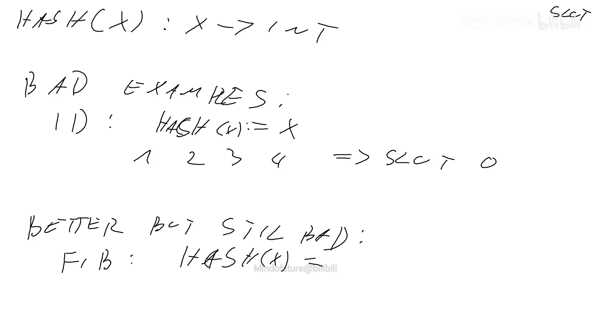

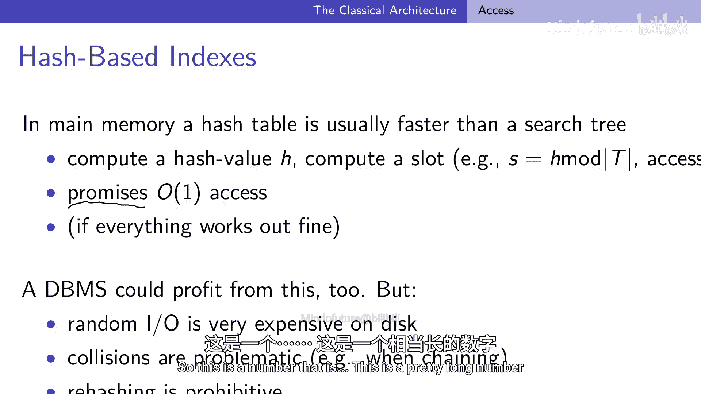

Entry* hash_table[HASH_TABLE_SIZE]; // 初始化为NULL
```
查找一个键 `k` 时，计算 `slot = hash(k) % HASH_TABLE_SIZE`，然后遍历该槽位对应的链表。

**实现中的关键挑战：**

1.  **哈希表大小与模运算**：
    *   **大小选择**：哈希表应比元素数量稍大（例如，负载因子低于70%），以减少冲突。
    *   **传统建议**：表大小 `N` 最好取**质数**。这主要是为了抵消质量不佳的哈希函数可能产生的“线性因子”（例如，总是产生偶数），从而保证键值能均匀分布。如果 `N` 能被该线性因子整除，某些槽位可能永远无法被使用。
    *   **模运算开销**：取模运算（`%`）在CPU上非常昂贵（约100个周期）。应尽量避免。
        *   **方案A（魔法数）**：编译器或库可能使用预计算的“魔法数”通过乘法和移位来模拟除法/取模，但实现复杂。
        *   **方案B（2的幂）**：令 `N` 为2的幂。此时 `hash(k) % N` 等价于 `hash(k) & (N-1)`，这是一个非常廉价的位操作。缺点是表大小选择不灵活，且对哈希函数质量要求更高。
        *   **方案C（乘法+移位）**：`slot = (hash(k) * N) >> 32`（对于32位哈希值）。这种方法允许任意的 `N`，且成本低廉，但同样要求哈希函数质量极高。

2.  **哈希函数的选择**：
    *   **目标**：将输入键均匀、独立地映射到整个整数域，避免输出与输入存在可预测的关联。
    *   **错误示例**：`hash(x) = x`（恒等函数）。如果输入是连续整数，将导致灾难性的冲突。
    *   **尚可但不够好**：斐波那契哈希。它改善了高位位的分布，但低位位分布不佳。
    *   **过犹不及**：加密哈希函数（如SHA）。分布极好，但计算成本太高。
    *   **推荐的折中方案**：
        *   **CRC32**：硬件支持，速度极快（约4个周期），分布性足够好。
        *   **AES**（有限轮次）：较新的CPU支持硬件AES指令，进行少量加密轮次，成本合理，分布性好。
        *   **MurmurHash**：纯软件实现，可移植，分布性好，但比硬件方案慢。
    *   **防止哈希洪水攻击**：使用**随机种子**（Salt）。在程序启动时随机生成一个种子值用于哈希计算，使得攻击者难以构造大量冲突的输入。


3.  **性能优化技巧**：
    *   **指针标记**：在64位系统中，实际只使用了48位地址，高16位为0。可以利用这16位存储哈希值的一部分（例如4位）。在查找时，先检查指针标记位是否与搜索键的对应哈希位匹配，如果不匹配可立即终止，避免了一次缓存未命中的访问。
    *   **开放地址法（如罗宾汉哈希）**：将元素直接存储在哈希表数组本身中，发生冲突时，按照某种探测序列（如线性探测）寻找下一个空位。罗宾汉哈希通过交换元素，确保每个元素的位置尽可能接近其理想槽位，从而限制查找长度。这种方法缓存局部性更好，但实现更复杂，且并发控制困难。

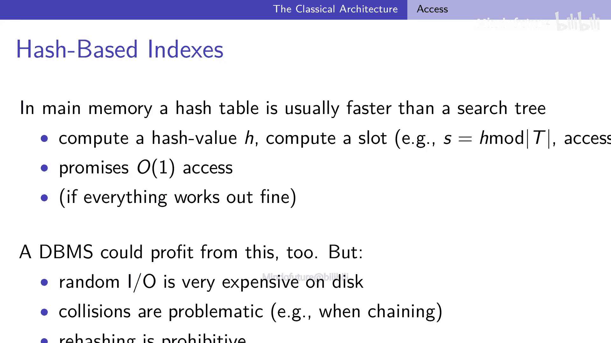

对于大多数情况，实现一个**链式哈希表**是性能与复杂度之间一个很好的折中。

---

## 扩展哈希 🌱

将哈希表用于外部存储（如磁盘）面临严峻挑战：
1.  **链式访问成本高**：每次链表跳转都可能是一次昂贵的磁盘I/O。
2.  **动态扩容（再哈希）成本高**：当表填满时，创建一个更大的新表并重新插入所有元素，涉及大量随机I/O，性能极差。

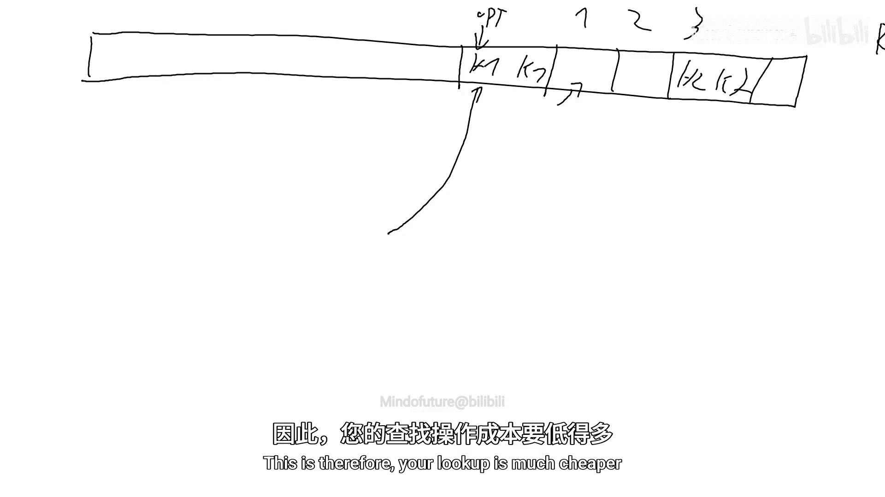

**扩展哈希** 就是为了解决这些问题而设计的磁盘友好型哈希方案。

### 核心思想

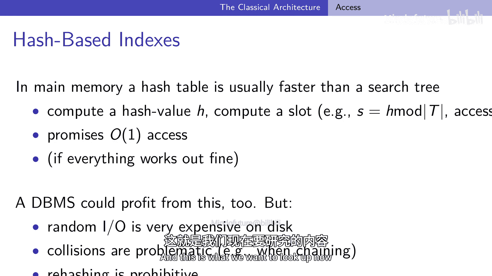

*   哈希表（目录）大小始终是**2的幂**。
*   目录项指向存储数据的**桶**（页面）。多个目录项可以指向同一个桶（共享）。
*   桶的**局部深度**表示区分该桶内元素所使用的哈希值位数。
*   当桶溢出时，进行**分裂**：增加局部深度，使用多一位哈希值来区分桶内元素，并将其分配到两个新桶中。然后更新指向原桶的那些目录项，让它们分别指向新的桶。
*   如果分裂需要但目录项未被共享（即无法仅通过更新部分指针完成），则**倍增目录大小**（全局深度加1）。这是一个相对较小的操作，因为目录远小于数据桶。

### 工作流程示例

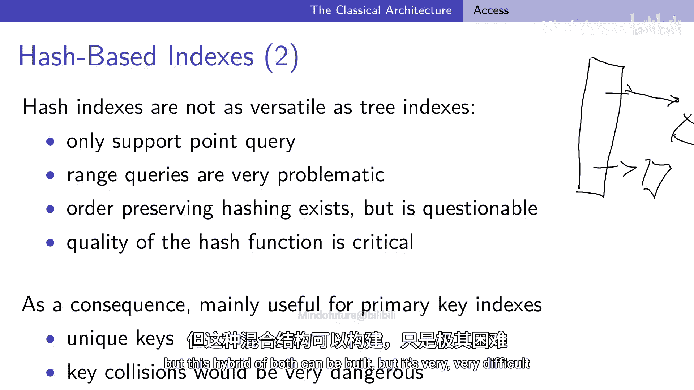

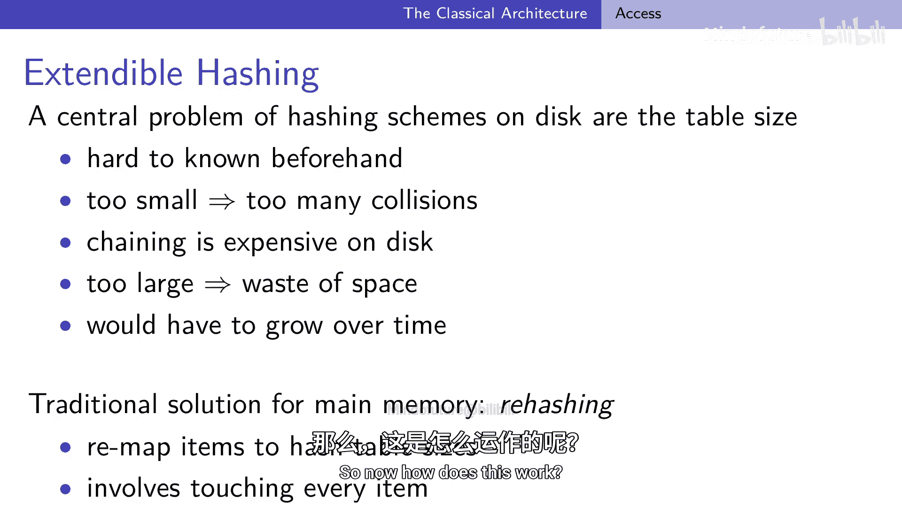

1.  **初始状态**：全局深度=1，目录大小=2。两个目录项都指向同一个桶A（包含元素E, F）。
2.  **插入冲突**：插入新元素G，桶A已满。
3.  **分裂桶**：桶A的局部深度从1增加到2。使用哈希值的第2位来区分元素。假设E和G的第2位为0，F的第2位为1。于是创建新桶B。将E和G留在（新）桶A，将F移到桶B。
4.  **更新目录**：现在需要让目录中哈希值第2位为0的项指向桶A，为1的项指向桶B。这可能需要将目录大小倍增到4（全局深度=2），并重新设置指针。

### 优点与缺点

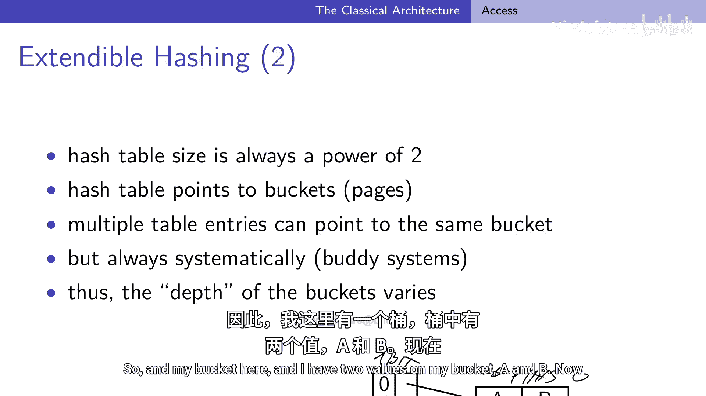

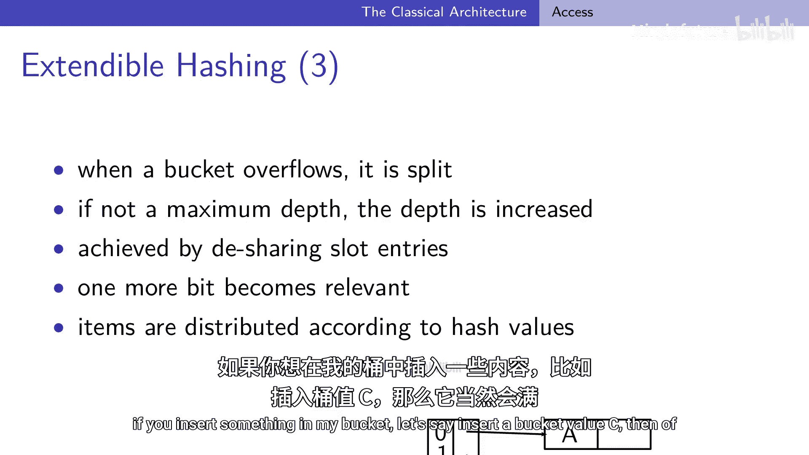

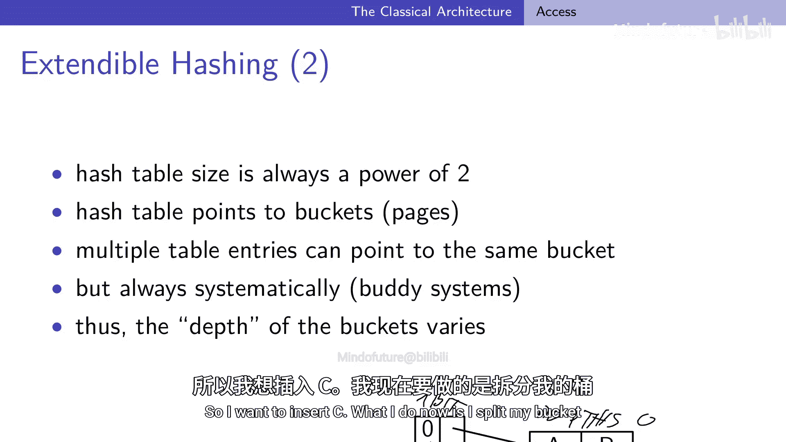

*   **优点**：
    *   **预期两次访问**：一次读目录（通常在内存），一次读数据桶。
    *   **增量式增长**：避免全局再哈希，目录倍增的成本相对较低。
    *   **空间效率**：目录远小于数据。
*   **缺点**：
    *   **目录倍增**：虽然比再哈希好，但仍是“大动作”。
    *   **空间增长不连续**：目录大小呈指数级跳跃。
    *   **处理真实冲突**：如果大量不同键哈希到完全相同的值（哈希碰撞），扩展目录也无济于事，最终可能仍需退化成链式结构。需要额外机制处理。

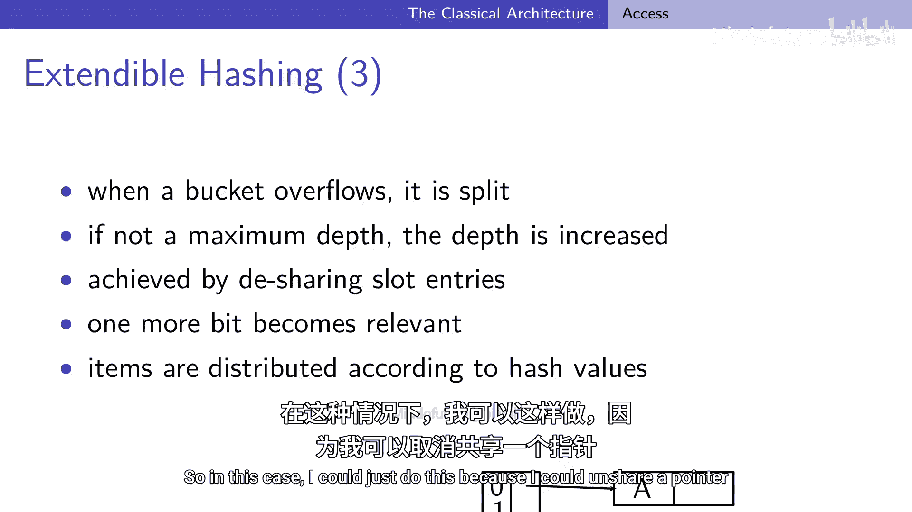

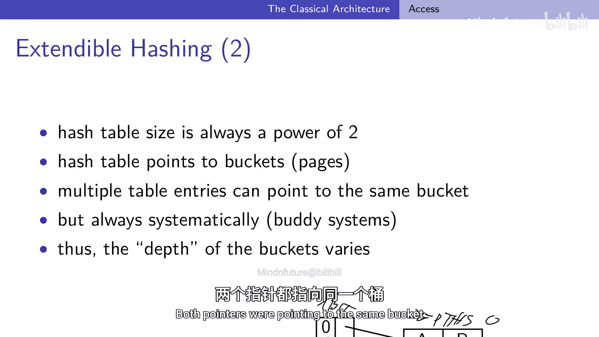

---

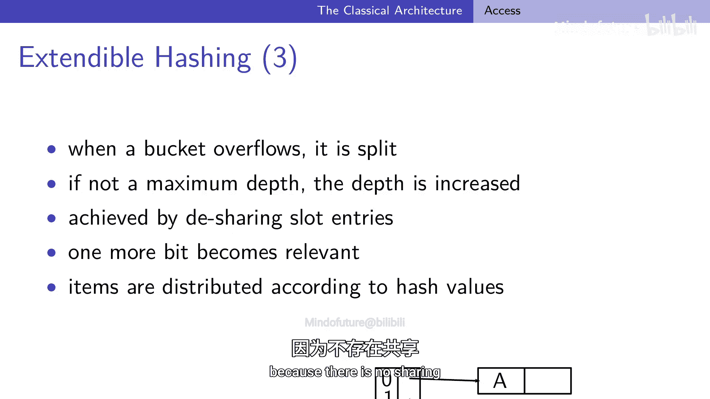

## 总结 📚

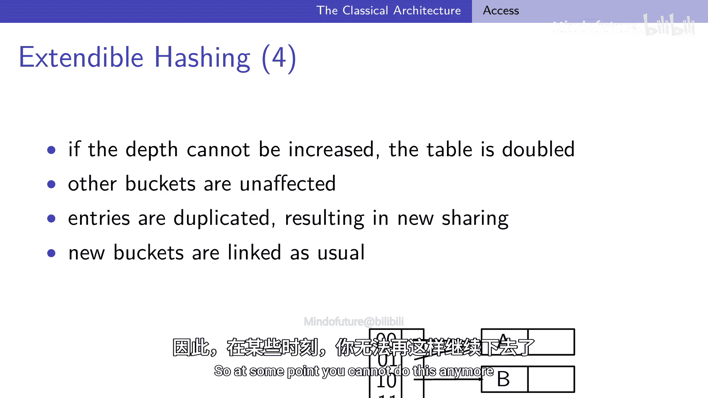

本节课中我们一起学习了：
1.  **前缀B+树**的两种技术，它们通过压缩公共前缀来节省空间、提高扇出，是优化B+树性能的有效手段。
2.  **内存哈希表**的基本原理、实现挑战（哈希函数、表大小、模运算）以及性能优化技巧（指针标记、开放地址法）。
3.  **扩展哈希**的基本思想，它通过可扩展的目录和桶分裂机制，为哈希表在磁盘等外部存储上的应用提供了可行的方案，能够在避免昂贵再哈希的同时，支持数据的动态增长。

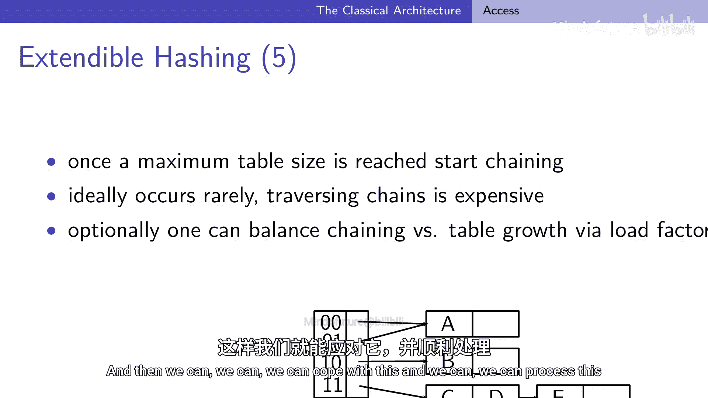

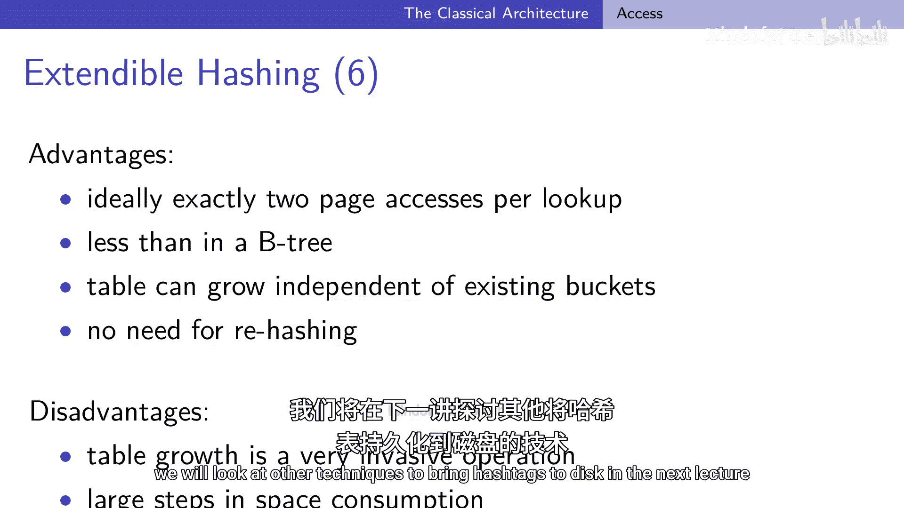

哈希表为点查询提供了优异的预期性能，但B+树在支持范围查询和通用性上更胜一筹。在实际数据库系统中，需要根据具体的查询负载和数据特性来选择合适的索引结构。