# 009：恢复机制 🛡️

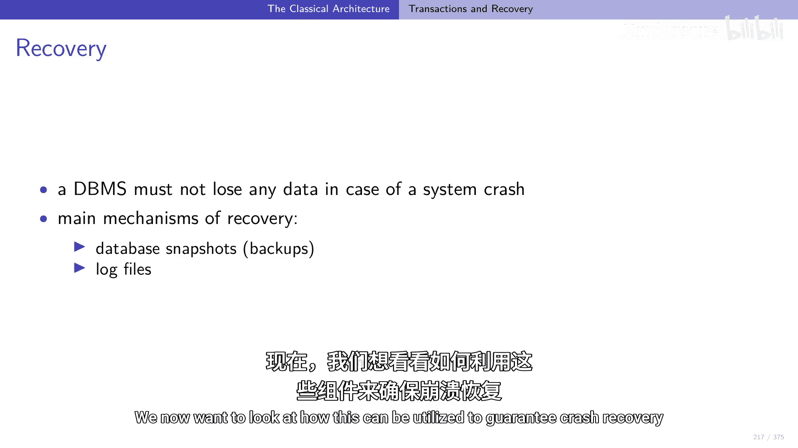

在本节课中，我们将学习数据库恢复机制的核心概念。恢复组件负责处理系统错误，特别是系统崩溃，确保数据在故障后能够幸存。我们将探讨如何结合数据库快照和日志文件来实现这一目标。

## 数据库恢复概述 📋

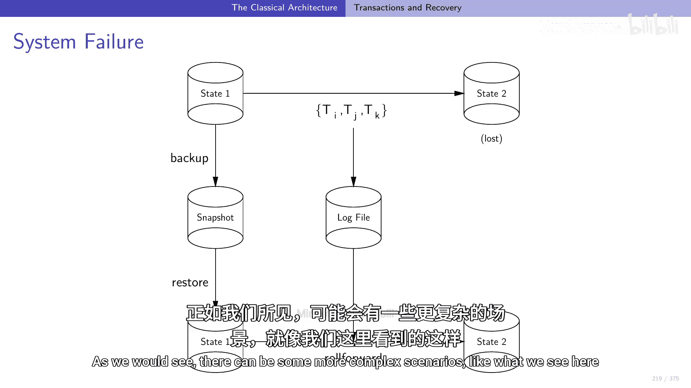

上一节我们介绍了事务的概念，本节我们将探讨实现事务所需的第二个关键组件：恢复组件。

恢复组件负责处理错误，特别是系统崩溃。我们必须确保系统在崩溃后能够恢复，因为这是最困难的情况。为此，我们主要使用两种机制：
1.  **数据库快照**：即数据库在某个时间点的备份。
2.  **日志文件**：记录自某个时间点以来所有更改的顺序列表。

结合某个时间点的快照和之后的所有更改，我们可以重建出之后某个时间点的数据库状态。这是恢复机制的核心思想。当然，技术细节比这更复杂。

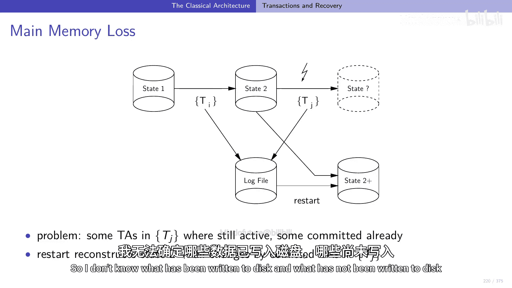

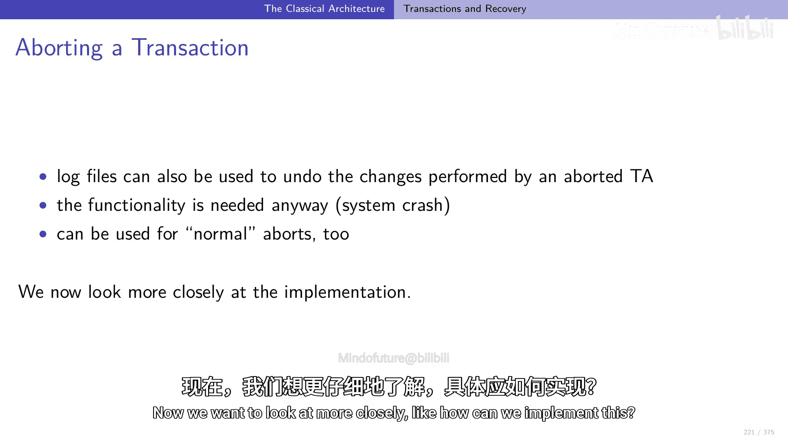

一个重要的原则是，主数据库、数据快照和日志文件不应存储在同一台机器上。理想情况下，它们应存储在不同的建筑物中，以应对火灾等灾难性事件，确保系统在极端错误情况下也能幸存。

## 应对系统故障 🔄

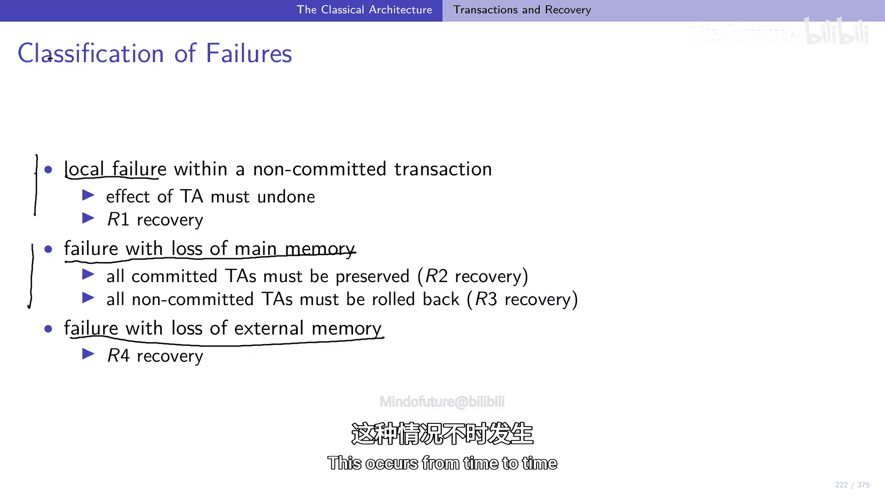

现在，我们来看看如何应对系统故障。这是一个相对简单的情况。

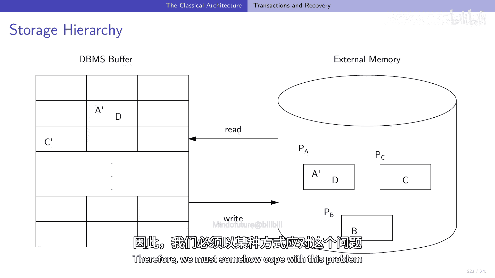

假设数据库初始处于状态1。随着时间的推移，我们应用了一系列事务，使其达到状态2。如果此时机器发生故障，状态2丢失，我们需要重建它。

我们使用两个组件：
*   **备份**：提供状态1的快照。
*   **日志文件**：存储了所有事务。

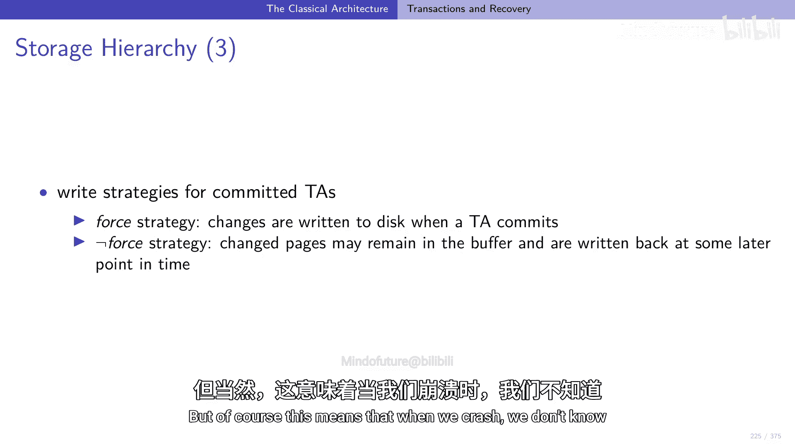

重建数据库时，我们首先**恢复快照**，回到状态1。然后，我们查看日志文件并进行**前滚**：即重新执行（更准确地说，是重做）日志中记录的事务更改。这将我们从状态1带到状态2，从而恢复了数据库状态。

即使硬盘因外部事件损坏，我们也可以通过快照和日志文件恢复所有数据。这是一个高层次的恢复概述。

## 应对内存丢失（崩溃）的挑战 ⚡

然而，实际情况可能更复杂。考虑内存丢失（即崩溃）的场景，例如发生断电。

假设我们从状态1开始，应用一些事务后到达状态2，并访问日志文件。然后，更多事务（TJ）开始运行，其中一些可能已提交，一些可能仍在活动。此时突然发生断电。

棘手之处在于，我们无法确定磁盘上的数据库状态。因为有些事务可能已经尝试写入磁盘或正在写入磁盘。当断电发生时，我们无法知道某个页面的写入是否已完成。因此，磁盘上的数据库状态是不确定的，这使得恢复变得更加困难。

当电力恢复、机器重启后，我们有一个数据库文件，但我们事先不知道哪些更改已写入文件，哪些没有。我们的目标是：将数据库带入一个干净的状态，然后使用日志文件进行重建。我们需要重建所有已提交事务的更改（状态2+），同时确保所有未提交的更改不在系统中，即使它们可能已经写入了磁盘。这是一个挑战。

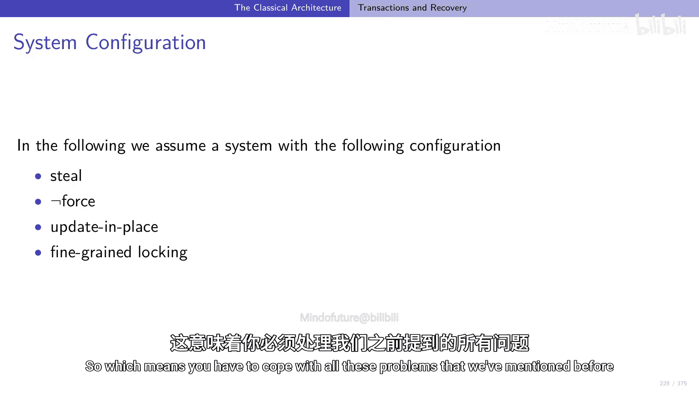

## 事务中止与恢复 🔄

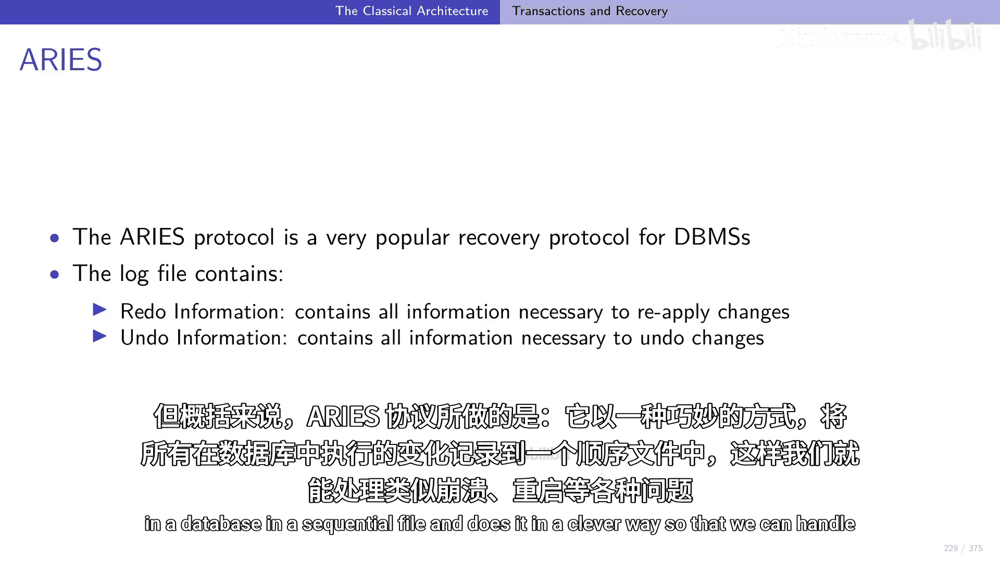

恢复日志的另一个功能是支持**中止事务**，即撤销事务的所有更改。这不仅可以由用户通过 `ROLLBACK` 命令触发，也是崩溃恢复所必需的，因为我们必须撤销所有未提交的事务。因此，事务中止功能是恢复机制的一个特例。

## 故障场景分类 🗂️

现在，我们更仔细地看看如何实现恢复。首先，我们可以根据处理难度对故障场景进行分类：

1.  **本地故障（R1恢复）**：最简单的情况。例如，用户发出回滚或执行了无效操作（如除以零）。这只需要撤销该单个事务所做的所有更改，其他事务不受影响。
2.  **内存丢失（R2和R3恢复）**：更困难的情况，即系统崩溃。我们必须做两件事：
    *   **R2恢复**：确保所有已提交的更改都被保留。
    *   **R3恢复**：回滚所有未提交的事务，即从数据库系统中移除所有未提交的更改。
3.  **外部存储丢失（介质恢复）**：最严重的情况，服务器完全损坏。这需要从备份和日志归档中重建一切，是最昂贵的方式，我们希望它永不发生。

R1恢复非常频繁；R2/R3恢复偶尔发生；介质恢复希望永不发生，但必须能应对。

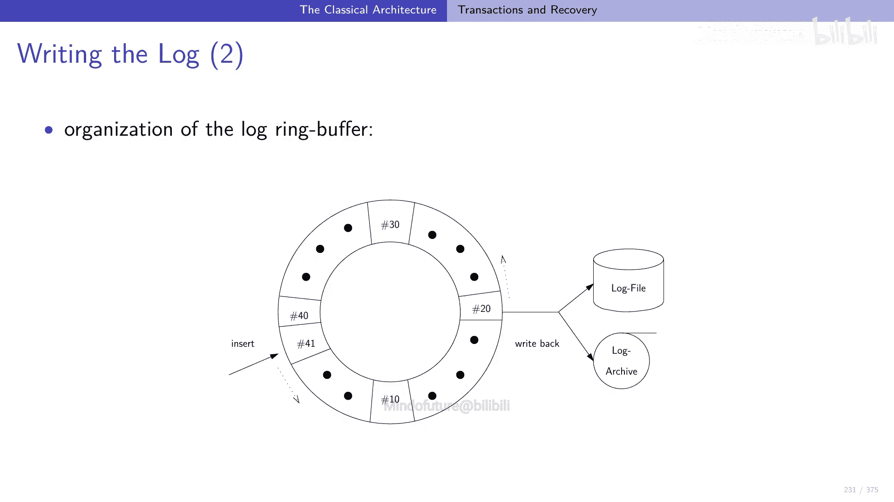

## 存储层次与写入不确定性 💾

我们之前讨论过存储层次：外部存储（磁盘）和数据库缓冲区。崩溃后的棘手问题在于，我们不知道这两者是如何交互的。缓冲区中的一些更改可能已写入磁盘，但我们无法确切知道，因为写入是异步发生的。

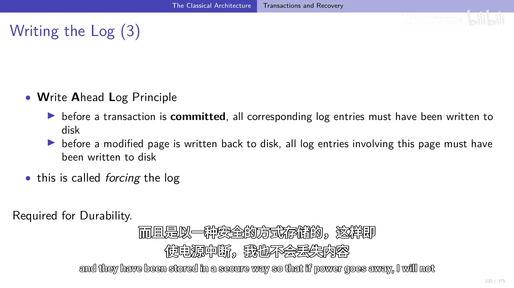

例如，我们有一个页面 `C`，修改为 `C‘`，然后向磁盘控制器发送写入 `C‘` 的请求。之后系统崩溃。重启后，我们通常无法知道页面 `C` 是否已更新为 `C‘`。我们必须处理这种不确定性。

## 缓冲区管理策略的影响 ⚙️

问题的难度取决于我们如何实现缓冲区管理，具体是 **Steal/No-Steal** 和 **Force/No-Force** 策略的组合：

*   **No-Steal**：活动事务修改的页面在事务提交前不能写回磁盘。这意味着R3恢复（撤销）不是必需的，因为只有已提交的更改才会写入磁盘。但缺点是，如果更新数据大于内存，可能会耗尽页面。
*   **Steal**：允许将活动事务修改的页面写回磁盘。这通常是我们想要的策略，因为它能处理大于内存的数据更新，但意味着需要R3恢复。
*   **Force**：当事务提交时，立即将所有更改刷新到磁盘。这使得恢复更容易，但频繁写入磁盘性能开销大。
*   **No-Force**：事务提交时，不立即写入磁盘，稍后再写。这出于性能考虑，但意味着崩溃时我们不知道事务更改是否已写入磁盘，因此需要R2恢复（重做）。

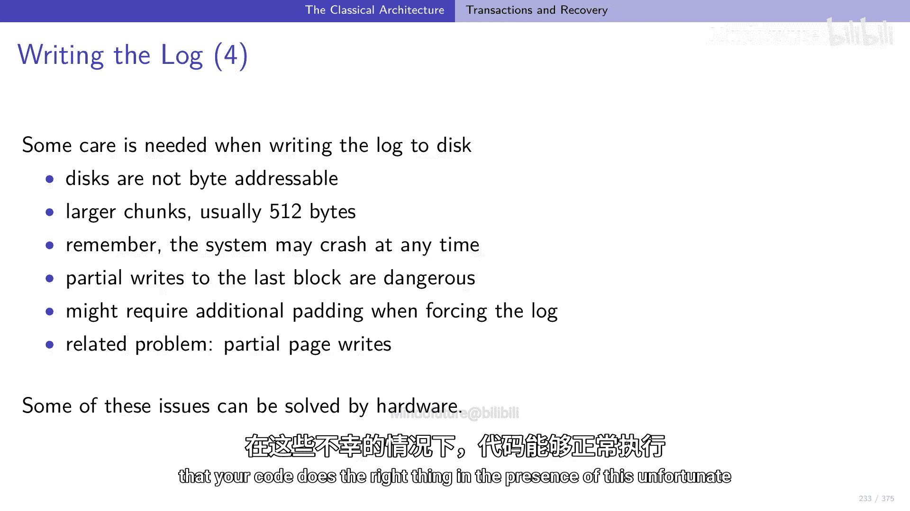

不同组合的影响如下：
*   **Force & No-Steal**：最简单，无需重做也无需撤销。
*   **No-Force & Steal**：最通用但最复杂，需要重做和撤销。出于性能原因，这通常是最佳选择，也是我们通常假设数据库系统采用的设置。

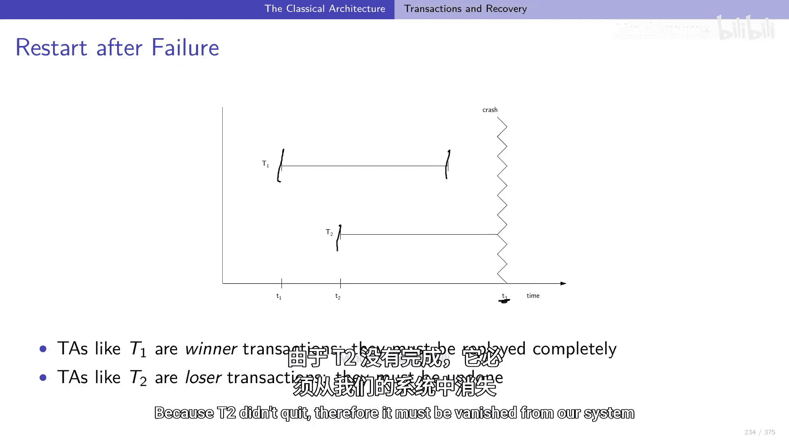

## 更新策略与部分写入问题 ⚠️

更新策略也会影响恢复：
*   **就地更新**：直接在原页面位置覆盖写入。空间效率高，但恢复复杂，因为磁盘上可能有未提交的数据。
*   **双块法**：每个页面存两份（如0和1）。更新时修改副本，提交时切换角色。抗崩溃能力强，但空间消耗翻倍，切换逻辑也不简单。
*   **影子页面**：只复制被更改的页面，冗余较少但更复杂，可能失去聚簇性。

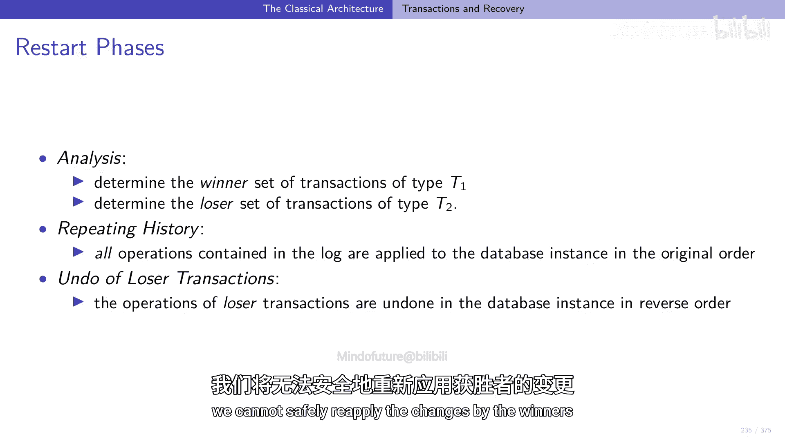

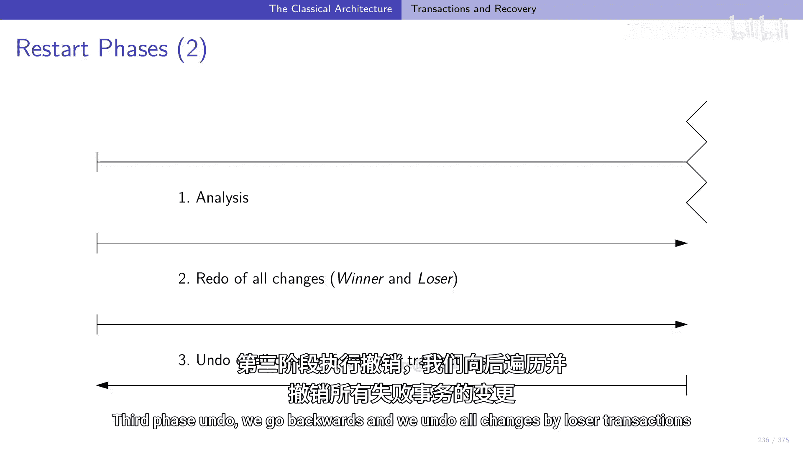

就地更新会带来一个棘手问题：**部分写入**。例如，在写入一个页面（如从全1改为全0）的过程中断电，可能导致页面一部分是新值，一部分是旧值。处理部分写入有三种方法：
1.  **使用带电池缓冲的磁盘**：最佳方案，磁盘保证写入的原子性，但大多数系统没有这种硬件。
2.  **检测并触发完全恢复**：例如IBM的方案，在页面首尾设置标记位，检测不一致时通知用户进行介质恢复，侵入性强且昂贵。
3.  **写两次**：例如SQLite等系统的做法。先将“预写日志”（描述要做的更改）安全写入磁盘，再执行实际页面更新。如果更新发生部分写入，重启后可以根据预写日志重做。这种方法较昂贵但更友好。

在后续讨论中，我们假设最通用也最高性能的设置：**Steal、No-Force、就地更新和严格锁**。

## ARIES恢复协议 📜

应对上述复杂情况的标准且流行的策略是 **ARIES协议**。该协议由IBM的Mohan发明，已成为数据库恢复的事实标准。

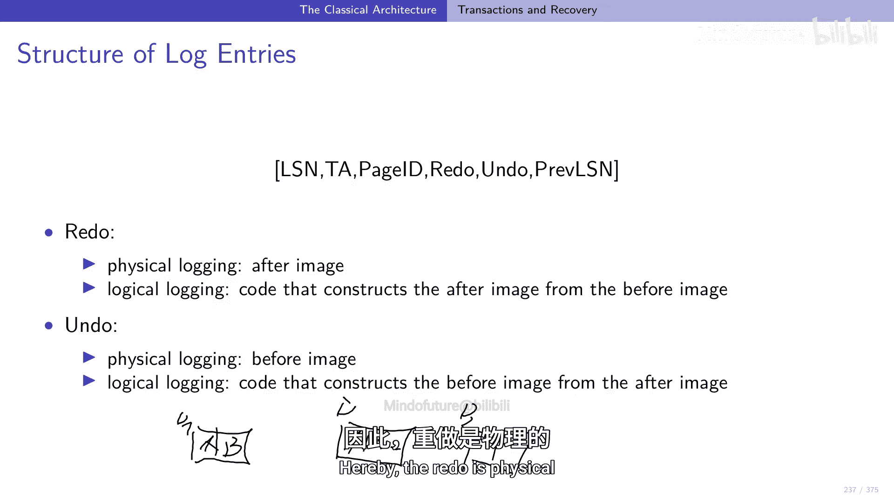

ARIES协议将所有数据库更改顺序记录到日志文件中，并以一种巧妙的方式处理崩溃、重启等问题。在日志中，它存储**重做**和**撤销**信息：
*   **重做信息**：如何再次执行更改。
*   **撤销信息**：如何将系统恢复到更改前的状态。

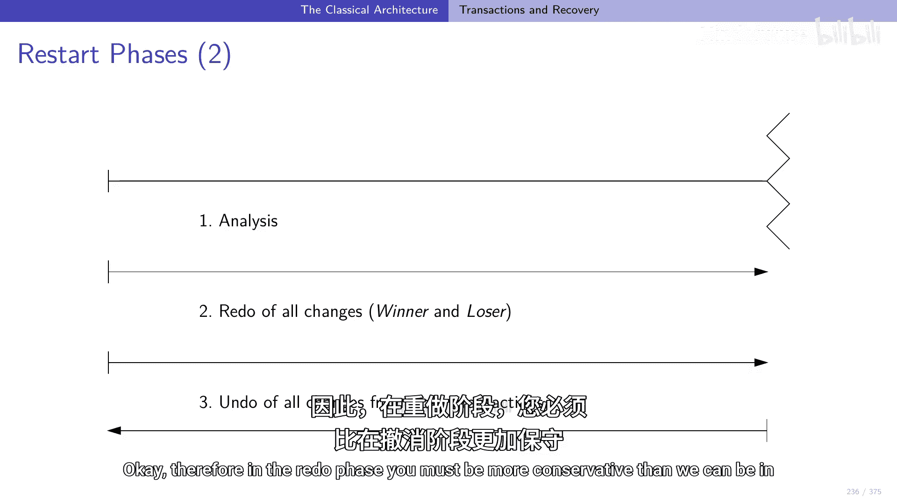

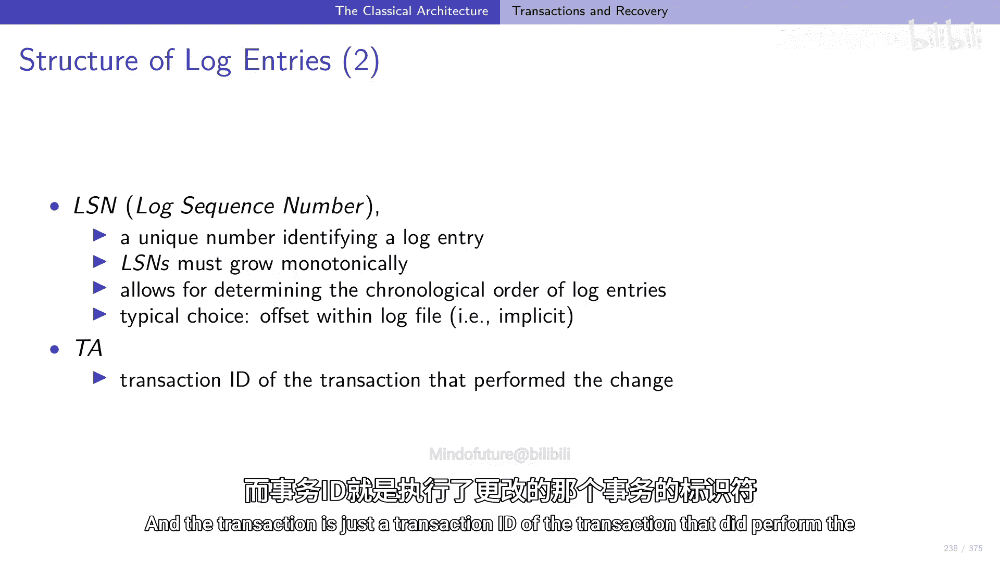

ARIES采用**生理日志**：重做信息是物理的（针对单个页面），而撤销信息是逻辑的（可以跨页面）。我们稍后会详细解释。

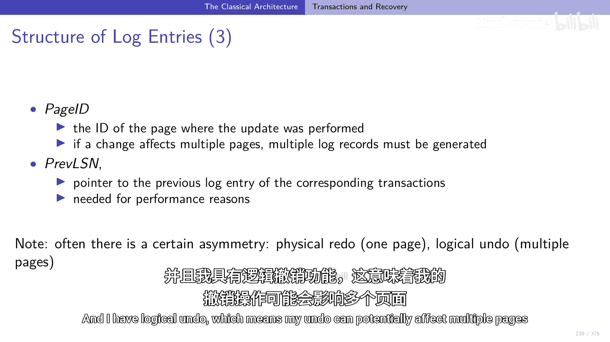

## 系统架构与日志缓冲区 🏗️

在数据库系统运行时，应用程序产生事务，更新数据库缓冲区，缓冲区再与物理磁盘同步。与此同时，所有更改被写入**日志缓冲区**，日志缓冲区再写入日志文件。

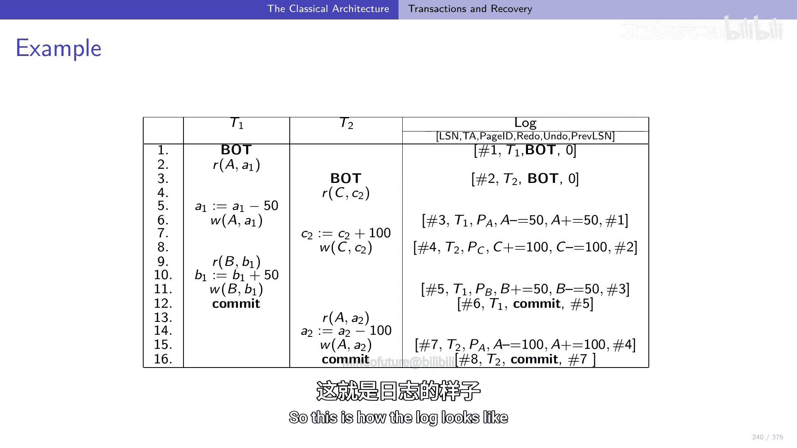

利用日志文件和数据库数据，我们可以进行R1、R2、R3恢复。此外，为了安全，我们还需要**数据库归档**（备份）和**日志归档**（将日志文件存到其他机器），用于介质恢复。

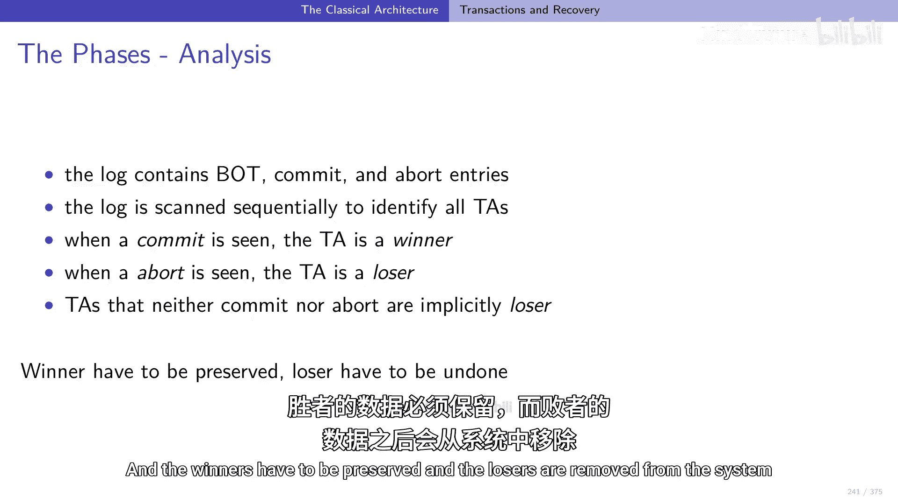

日志缓冲区通常实现为**环形缓冲区**。新的日志记录追加到写入端，当缓冲区满时，从读取端将旧的日志记录写入磁盘文件以释放空间。一个巧妙的实现方法是：将同一块物理内存映射两次到连续的虚拟地址空间。这样，写入时就可以假装没有环绕问题，简化了逻辑。

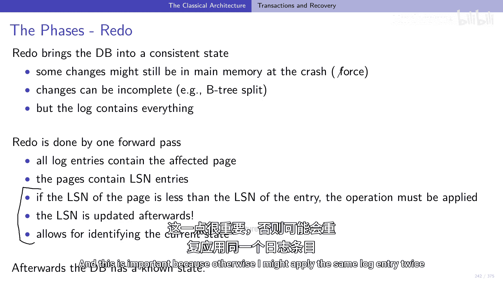

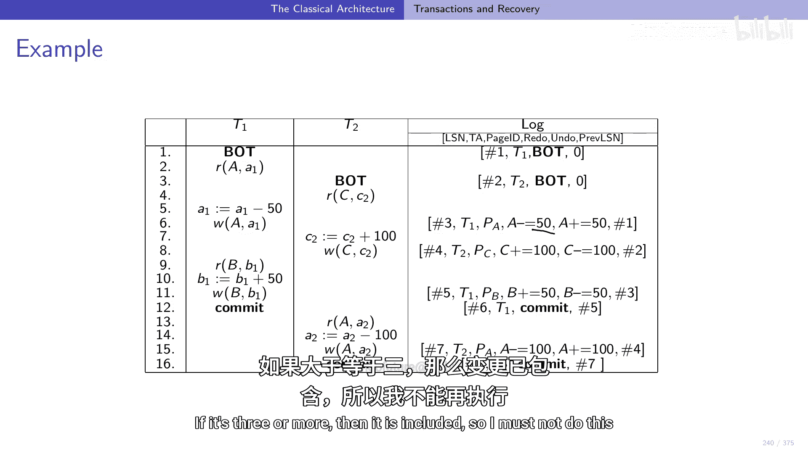

## 预写日志原则 📝

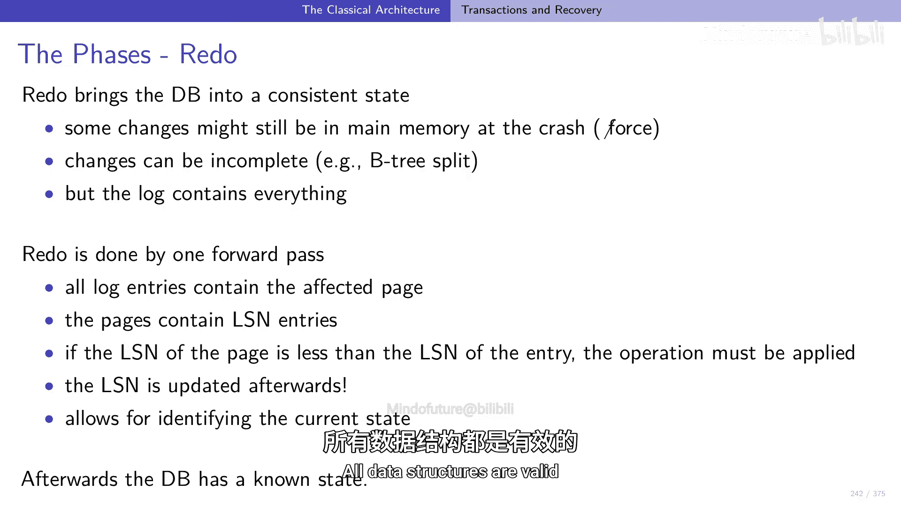

一个至关重要的原则是**预写日志原则**：
1.  在事务提交**之前**，所有对应的日志条目必须已写入磁盘。
2.  在修改的页面写回磁盘**之前**，涉及该页面的所有日志条目必须已写入磁盘。

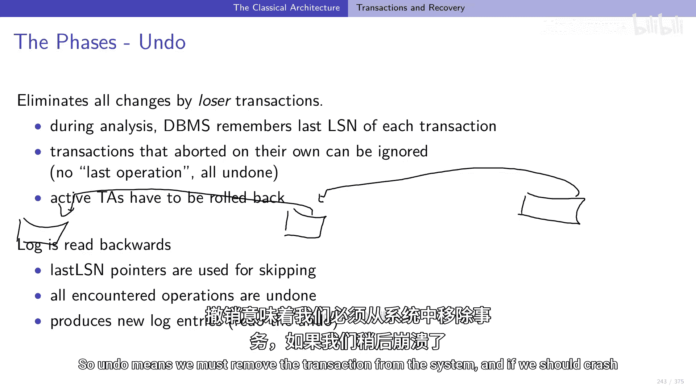

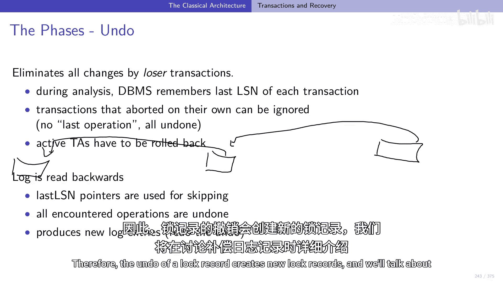

这称为**强制写日志**。这意味着在确认提交或写回脏页前，必须确保相关日志条目已持久化到磁盘（通常需要使用 `fsync` 等调用）。这是持久性的保证。

## 日志记录的结构 📄

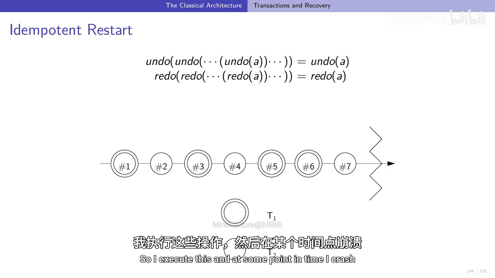

那么，日志中到底记录了什么？每个日志记录包含以下元素：
*   **日志序列号**：单调递增的数字，唯一标识日志记录。通常使用日志文件中的字节偏移量作为隐式的LSN。
*   **事务ID**：执行更改的事务。
*   **页面ID**：被修改的页面。如果一个更改影响多个页面（如B树分裂），则需要写多个日志记录。
*   **重做信息**：如何再次执行这个更改。可以是物理的（存储整个页面或页面内的字节变化）。
*   **撤销信息**：如何撤销这个更改。在ARIES中是逻辑的（例如“删除记录B”）。
*   **前一个LSN**：同一事务的上一个日志记录的LSN。用于高效地回滚事务。

**生理日志**意味着：重做是物理的（影响单个页面），撤销是逻辑的（可能影响多个页面）。

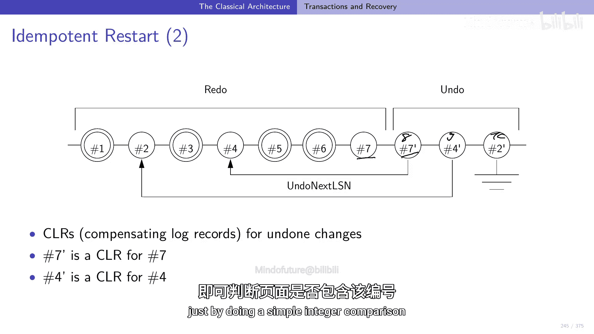

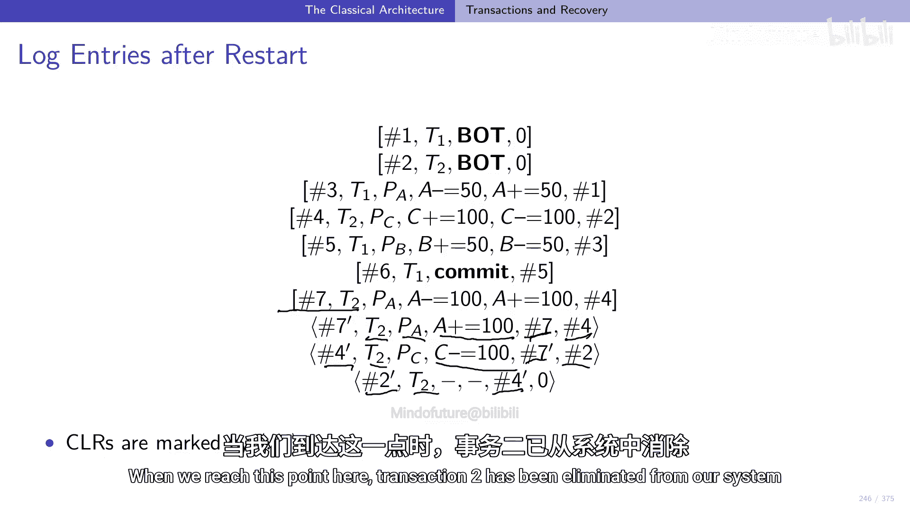

## 重启恢复的三阶段 🚦

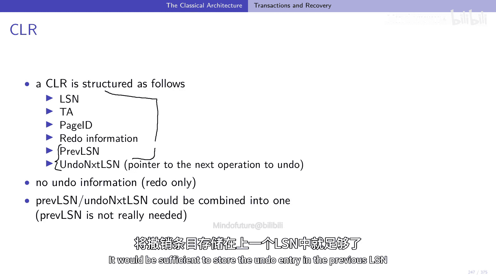

当系统崩溃后重启时，ARIES协议通过三个阶段进行恢复：

1.  **分析阶段**：从头到尾扫描日志文件，确定哪些事务是**胜者**（已提交），哪些是**败者**（未提交或已中止）。
2.  **重做阶段**：再次从头扫描日志。对于每个日志记录，加载对应页面，比较页面上的LSN和日志记录的LSN。如果页面LSN小于日志LSN，说明更改尚未应用到磁盘，则应用重做操作，并更新页面LSN。**注意，重做阶段会重做胜者和败者事务的所有更改**。这是必要的，因为败者事务的更改（如B树分裂）可能影响了胜者事务数据的物理位置。此阶段结束后，数据库处于崩溃瞬间的一致状态。
3.  **撤销阶段**：从后向前扫描日志，撤销所有败者事务的更改。撤销操作会产生**补偿日志记录**，以确保恢复的幂等性。

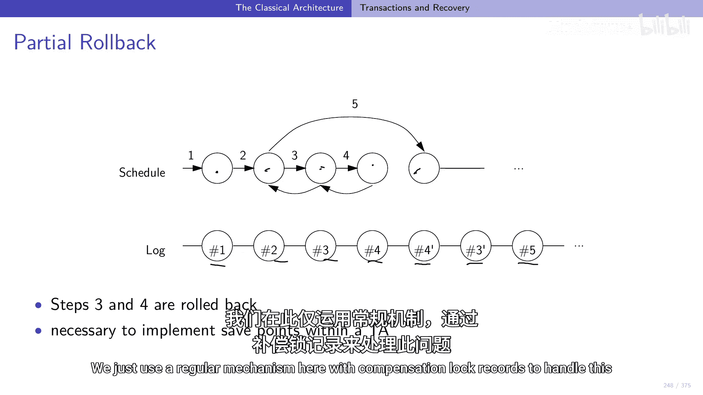

## 幂等重启与补偿日志记录 🔁

重启必须是**幂等**的，即可以安全地重复执行多次而得到相同的数据库状态。这是通过**补偿日志记录**实现的。

在撤销阶段，当我们撤销一个败者事务的更改时，会写入一个CLR。CLR只包含重做信息（即如何再次执行这个“撤销”操作），以及`UndoNextLSN`指针，指向该事务下一个需要撤销的日志记录。如果系统在撤销过程中再次崩溃，重启后会重做已写入的CLR，然后继续根据`UndoNextLSN`指针进行撤销。这样，无论崩溃多少次，为撤销一个事务所写的CLR数量是有限的（最多等于该事务的日志记录数）。

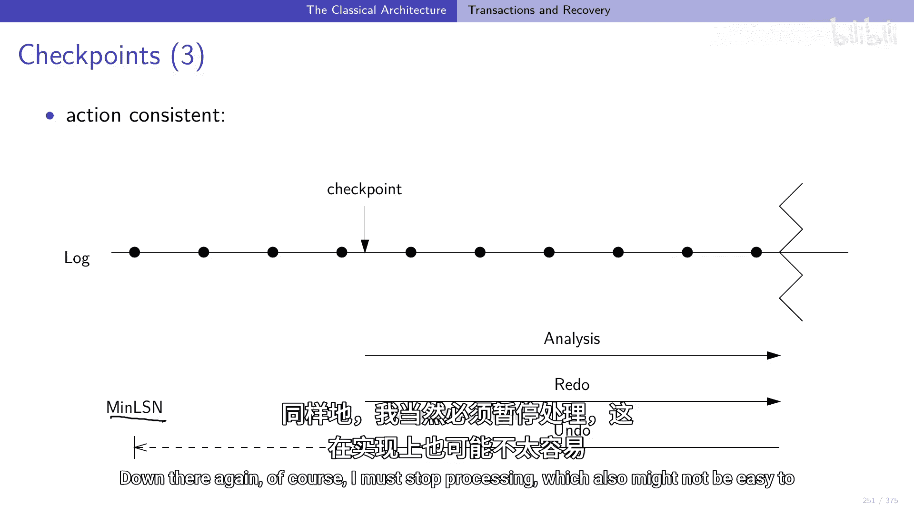

CLR看起来像普通日志记录，但只包含重做信息，并用`UndoNextLSN`替代了`Undo`信息。

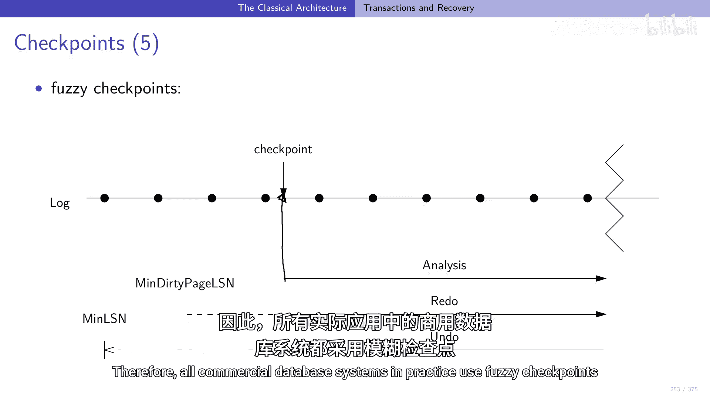

## 检查点机制 ⏱️

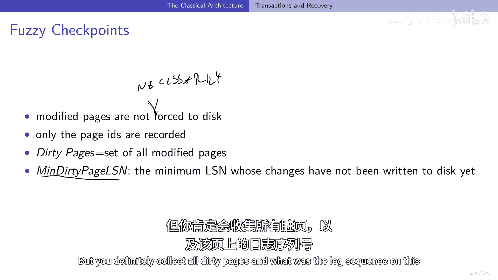

为了加速恢复过程（避免每次都从头扫描整个巨大的日志文件），我们引入了**检查点**机制。检查点定期在日志中记录系统某一时刻的状态信息。

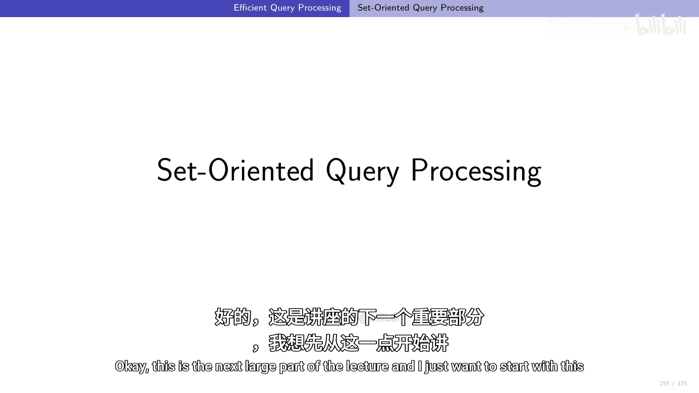

检查点有多种类型：
*   **事务一致检查点**：在没有任何事务运行时创建。最简单，恢复只需从检查点开始，但难以获得。
*   **动作一致检查点**：暂停所有事务处理，然后创建检查点。恢复分析只需从检查点开始，但需要停止系统。
*   **模糊检查点**：最通用的类型。系统在运行时创建检查点，记录当前活跃事务列表和脏页信息（页面ID及其最小的未写入磁盘的LSN）。恢复时，分析阶段从检查点开始；重做阶段从所有脏页中最小的LSN开始；撤销阶段则需要处理所有活跃事务。虽然恢复逻辑更复杂，但模糊检查点对系统运行影响最小，因此商用数据库系统普遍使用。

## 总结 📚

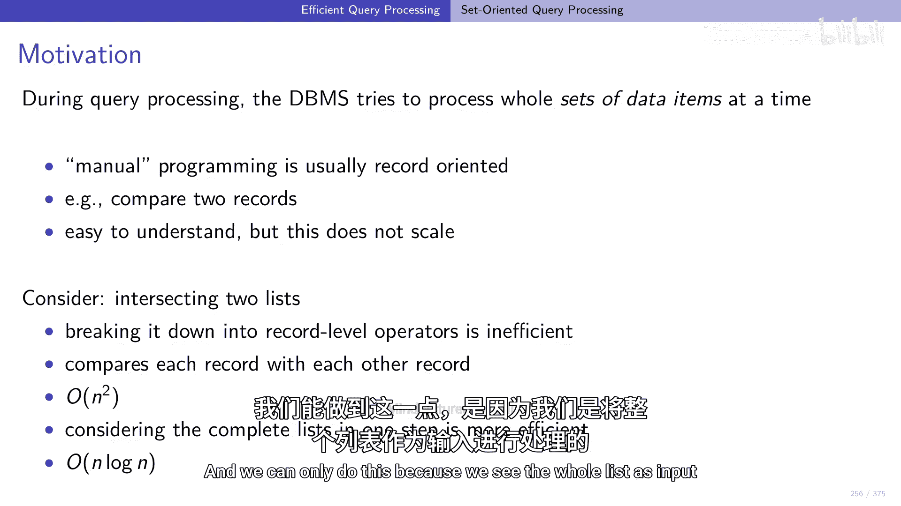

本节课我们一起学习了数据库恢复机制的核心内容。我们了解到恢复是确保数据库在故障后保持一致性和持久性的关键。通过结合**数据库快照**和**日志文件**，我们可以从各种故障中恢复。

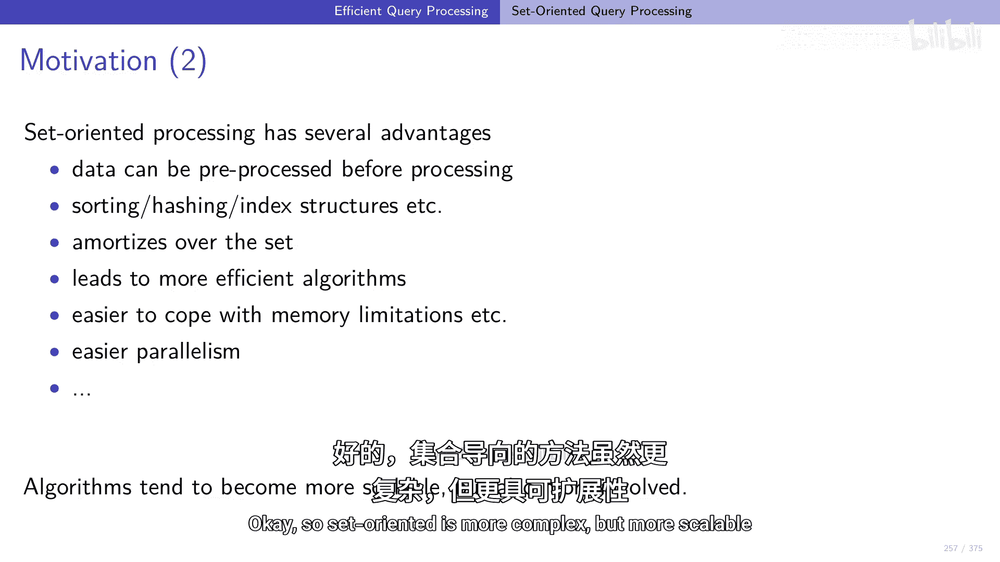

我们深入探讨了不同的故障场景、缓冲区管理策略（Steal/No-Steal, Force/No-Force）对恢复的影响，以及棘手的部分写入问题。重点介绍了工业标准的**ARIES恢复协议**，它通过**生理日志**、**预写日志原则**以及**重启三阶段（分析、重做、撤销）** 来高效、可靠地处理崩溃恢复。此外，我们还了解了**补偿日志记录**如何保证恢复的幂等性，以及**检查点**机制如何优化恢复性能。

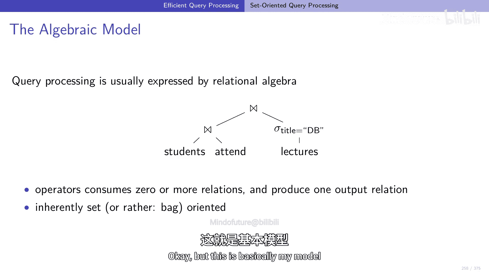

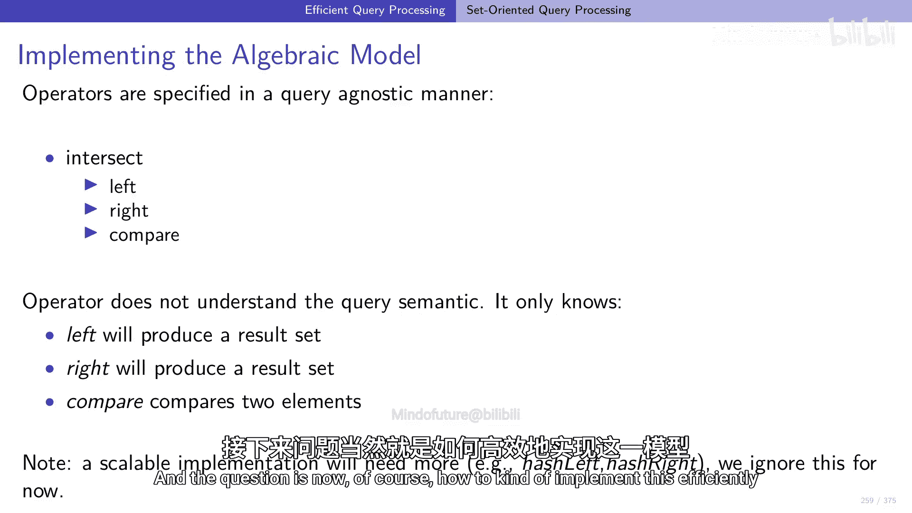

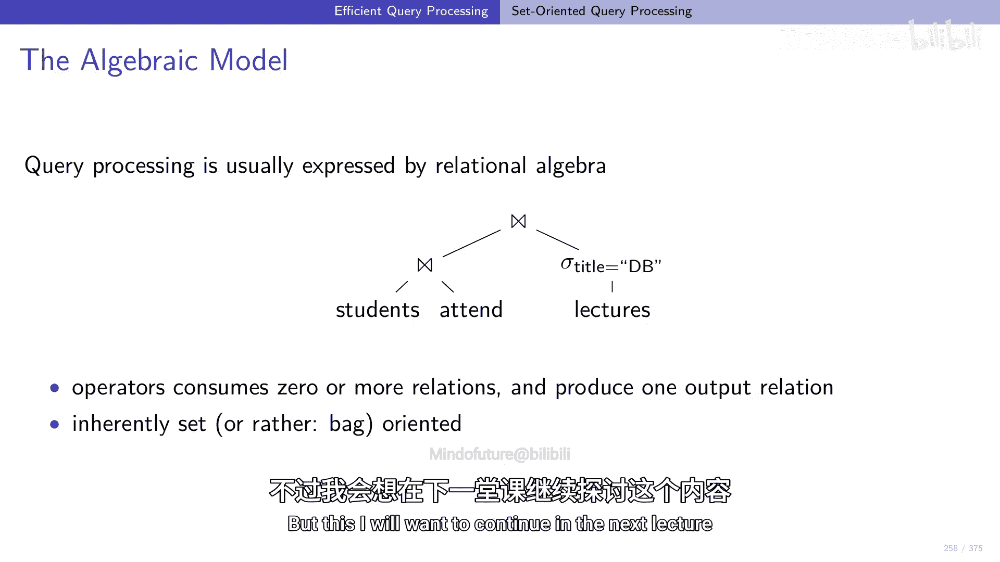

这些机制共同构成了现代数据库系统坚实的数据安全基石。