# 【慕尼黑理工大学】现代CPU架构上的数据库系统实现-｜-Database-Systems-On-Modern-Cpu-Architectures-2021-p01-P01_01_引言--BV1asiJBeE6j_p1-

Welcome to the lecture on De implementation。I'm Thomas Norman。

 I'm a there a for database system here， so technically mimic。And as you all know， this semester。

 unfortunately， we have a very difficult time teaching， namely。

 we will at least in the beginning and potentially first of whole semester。😔。

Be able to do live presentation in lecture with an audience， which is very unfortunate。

 which means that I will。Record the lectures， at least in the beginning and potentially the whole semester。

 and you will have to watch a recording of this。This is， of course， due to the difficulties。

 but for the teaching experience is not。Ideal， of course。Therefore， this semester。

 it's more important than usual that you do exercises because。

Of course prepare exercise for you we also plan to have submission of the exercises。

 we plan to have interactive sessions in exercises so you can ask questions if something is not clear。

 so please engage。Relltance exercise。so if you have question。

 if you have difficulties with the material that we cover。So in this recording。

 I will just talk about the materials that we do and the。😔，Qu answering it。

Training part is more done in the exercise。Okay， so let's start with the lecture itself。

 So what are we talking about in the lecture。Soll be talking about the implementation of database systems now why do we for the care about this first we see that database systems are extremely important。

 so they are used in nearly all cases where we want to manage very large quantities of data。

Or there the data is particularly valuable。 So either if we have a lot of this or potentially both of course。

 or if you care about the value of this。Zen database systems are probably over 100 data solutions in most cases。

 And thats be， of course， we would see why this is the case and now ready to。

Point and some key challenges that we have。 the first challenge is that we want to be able to scale to huge amounts of data。

 so it should be easily possible to of course， process gigabats of data or question about this terabytes of data should also be feasible perhaps even more than this as we want to support very。

 very large volumes of data and we want to do this efficiently and we want to scale to large machines if we have some available。

 So this is one aspect。 Another aspect that we care about is reliability。

Wwhichch means that even if bad things happen like a power failure or as hunter failure in your system or just a software failure so operating system crashes or so data system crashes。

 or this kind of situations do occur and we want to handle them where so in the sense that we don't want to lose the data also we want that everything works。

After the crash as it was before the crash， as we are not supposed to lose data in particular we are not supposed to corrupt data。

 so our database system must be consistent。Even though a catastrophic events。And again。

 this is pretty difficult to guarantee and most non database dont have this kind of functionality。

And a search aspect that I want to highlight is concurrency。

 So we want to allow us that many people use our system concurrently， not only one user。

 but many of these， again， everything should work， should should scale， should give correct results。

 even with a large number of users。 This is also a pretty difficult problem。

 And all these challenges each to an。Very complex of very。

 very complex infrastructure that we must build。Now the challenge here has to build the system that even though it's complex。

 its manage abilities can understand how it works and we can evolve it over time and this is also aspects that we want to look at in the lecture。

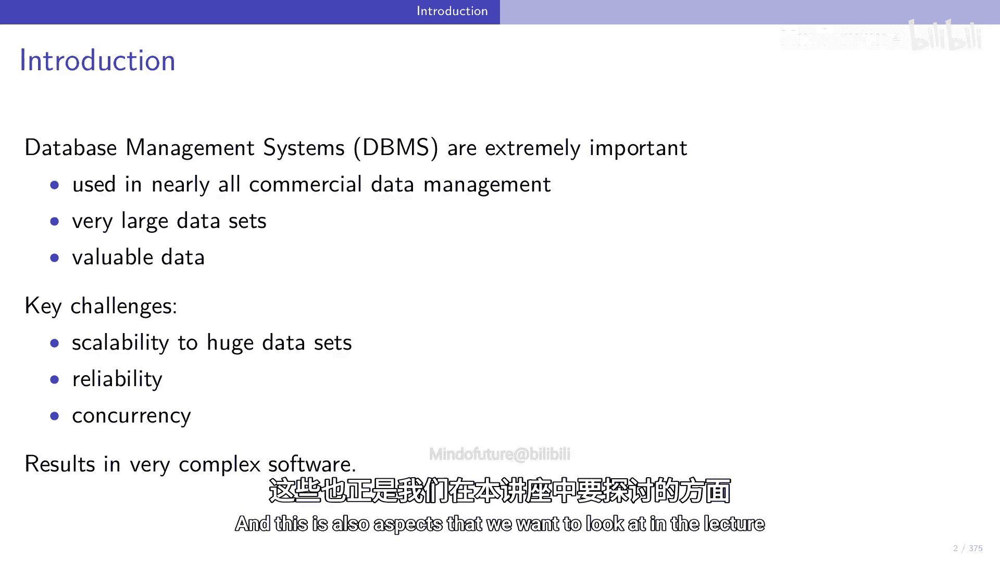

Okay， now so the goals of these lectures are first we should learn how to build a modern database system so you look at many techniques that we can use on this。

Then。Another goal is that we want to understand the eternal of existing database systems。

 because even if you're late in your life not building a new database system。

 you have to use an existing database system， therefore it's pretty important to understand how this works。

Often you can help the system and。A figure is system intes that it works better if you understand how said。

OkayAnd third goal， of course， is to understand effects of hardware behavior。

 particularly in the later part of the lecture， if will look look at many things that are affected by hardware。

And this is important for all kinds of eye performanceform processing， a data systems。

 of course one declare instance， but even if later you're not working in data systems。

 you might be working at similar problems where you have to process autos of data at high speed and therefore this knowledge is also useful。

Okay so the lecture is very roughly structured in three large parts。

 so we start with a classical database architecture。

 so like if you look at the commercial systems like oral secretservvos， these kind of beasts。

How are they architectures， So so we look at the traditional way to architecture dead racism。

Then we will look at。Second part， we will look at techniques how to process queries or should say how to process large volumes of data efficiently。

This of course， is connected to the classical database architecture。

 but this already deviates from this a bit as we will see how we can do this particularly efficiently。

 how we can get fast。😊，And in the last part， we want to look at how we have to adapt the architecture to hardware trends。

😔，We see that the hardware is changing， for example。

 one prominent itself we in the place have much larger my memories than we had in the past。

So it's common to have machines with many gigabytes。

 if perhaps even terabytes of memorys has some effect on the architecture。

 we see that we have a large number of cores as we can now byprocess that have 32 core 64 core even as if we look at recent processor by MD and so this means that we have a very high degree of。

Enalism of our system。And again， this has some effect on the architecture of our database when we want to look at all of these aspects。

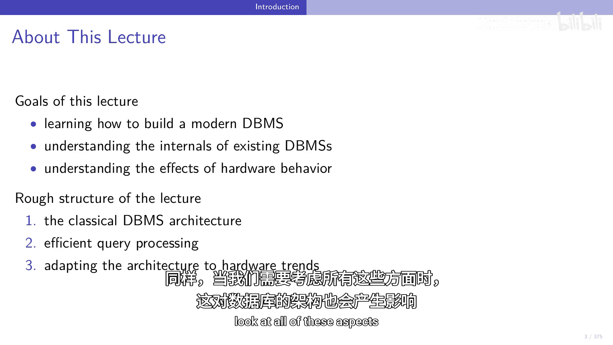

好。Which kind of literature can you use， So， of course。We will cover all the material that you be。

 if you just are interested in being doing this course all materials that you need to be covered in the slides and in exercises。

 you don't have to read the digital literature term。 but if you want。

 if you want more details or if you want to。Just interested in this topic you just want to read all about this。

 then if we have three suggestions for you。About the database implementation， the first one。

 actually， I consider the best of a very nice and readable book， Unfortunately， it's in German。

 So there's a coincidence。And so that's the author。

As the first author comes from Germany and as a written the book in German。

 So probably have a wider audience if you choose English instead。

 so this one is Tiha had Ram that mark'ste concept in making the employment it's a very nice book。嗯。

😊，But of course， yeah， also other books that talk about dataism implementation， for example。

 is the second one year。Acasio Mona women， Wi database systems to complete books is also covers at least some aspects of。

Daatabase implementation less than the first book method it does cover some。 And then there are。

 of course， more specialized books like Thirdbon Re Reta transaction processing。

 a pretty well known one。Particularly aspect of transaction processing。

 So this is already quite specialized。 So this is more if you are really interested in transaction systems。

The therefore， this is also widely known use book。Now。

 the later parts of what doing the lecture are unfortunately not covered by textbooks yet most of the time so these books mainly cover the classical architecture。

 so like again， the big players like Oracle look like if you are interested in。

The later part of select and more details， you must unfortunately read papers and are not all well known textbooks yet this。

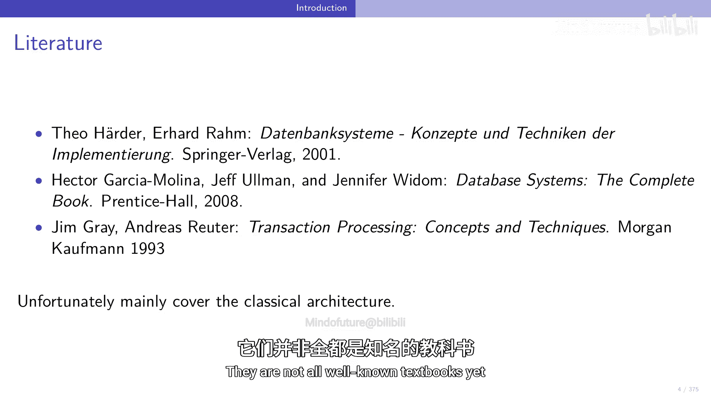

。Okay， now just to give you an idea why we are looking at an interesting problem and so why are database systems different than other programs？

Of course， there are many aspects to this。 if we mentioned some already in the introduction。

 so there's not only one， so there are many aspects。Like reliability， congcurrenency and so on。

 But one aspect I want to concentrate on particular here is scalability。

 So this is something that is。Really different between a database system and at least a traditional way how people write small programs。

 Okay， and to make this。E to understand， we look at a very， very simple problem。

 As will we be be giving two lists 1 there2， and I want to find all entries that occurs in both lists。

 and so a very simple problem。 So just to。Draw here an example instance on the screen。

 I hope this is readable in the recording。So let's say we have a list a1。And want。

 this contains a X Z， and they we have a list。呃。L 2 and this contains perhapss A， B， T， E。

 then we immediately see， okay， this element here occurs in both lists。

 this element occurs in both lists， the other elements do not Okay。

 so very simple problem and you can probably if you would ask you to implement in the program of your choice。

 you could probably need no more than four lines of code or so to answer this。 So is a very。

 very simple problem at least in the beginning。 here you will see in a moment that it's perhaps not as simple as you Okay。

 but the way I've written here its really simple。

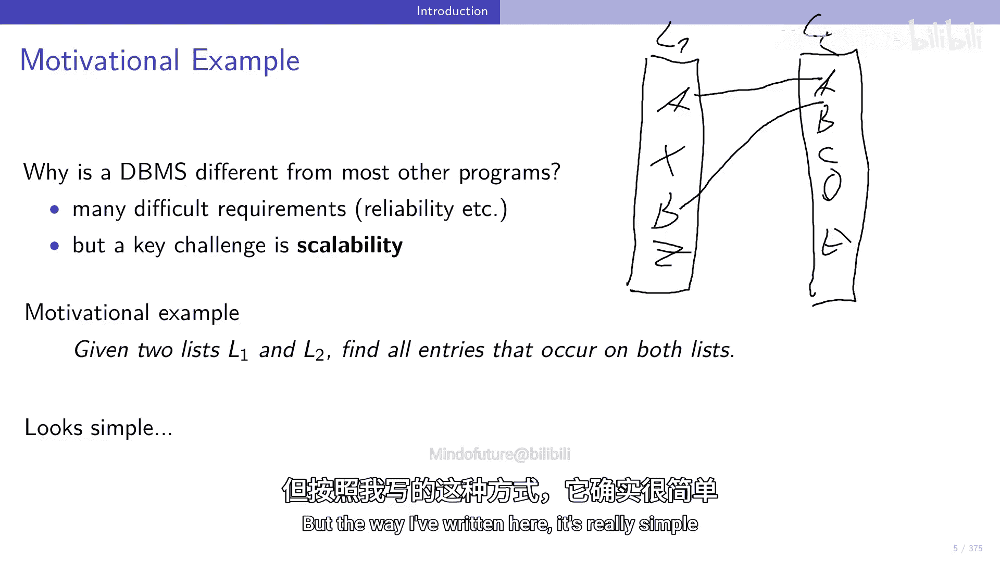

Now as I said so this we are giving two lists， we want to find entries at the account list and this problem is simple if both lists fit in my memory so if the list are small then this is a very simple problem now there's not only one solution to this there are many ways so。

😊，Anyway ways we could answer this。Perhaps the most simple one is the following。嗯。😊。

The most easy way to implement this is take my two lists。

So I said example it previously was had I said A X。So， E C， and then this was a1。

 and then this was a2。And。This hits A B D E。 Okay， now what I could do to answer this problem is I could sort both lists。

 Now， this because I have written this way a2 is already sorted， so I don't have to do anything。

 A one is not sorted， but I can sorted easily。Sorry road to C should be。Y， I think so we say A， B， X。

 Y。 And so this was the example I had previously。And so now I have two sort lists。

 and now finding all elements that occur on both lists is a very， very simple problem。

 So now this is pretty easy。 So I just scan both lists eventually。

 So I look at the first element on both lists。 This is other the same and in this case， is yes。

 so Ill put an A say A is image。 Then I go to the next element here。 B B is is the same。 Yes。

Now it goes to the next element as the same no okay now we have a difference so let's skip the smaller of the to so we skip the C lets then we come to D Dx is the same no。

 we skip the smaller ones we dip skip the D we come to an E x equals E no then we skip the E and then we reach end of the list then we know that we have node it so so we know that we have exactly two common entries。

And we did this with one linear scan over both lists。

 Now this first it is easy to implement not very fast。Okay， but。So。

Interssecting to sort list is cheap and easy。The main difficulty here is we have to sort the list so I had an example here four elements but for sorting four elements as triviala now if you have a few million elements then it's still not very difficult but it this cost you some time at least so we or knows it sorting lists and you have to realize that I use the term list here loosely you don't want to implement this as a linked list this would be a terrible but let's say you implement it in some nice compact representation like in vector and then we can sort this in Nlock n so this。

😊，Not super expensive， but cost are something。 As we have all a linear run time。

Now question is how can we do better than this and so how can we be faster than endlock n and of course we can we can for example。

 take the left side we read a hit table from this so again I take my elements here then I。

Let's just make something up， so let's say this is my H table。😔，And。So then I take， for example。

 my A's， this might add here hast here， so I take my A's and I has my B B and up here。Yeah。

And then I have my X。Whi I should have seen the other way around because I originally had to order A X。

B Y， but nevertheless so have an X， let's say this is here。Then I have perhaps my why is a collision。

 Then I gave another one here。That is。 Okay， so I have has tab。And then I take my other list。

 So this was the one that I had here with。H head ABC，s sorrys supposed to be B， ABC， D， E。

 then I take my A， A hast。 I I has my A， I go to this list。 find a hit。 I take my B has hit。

 go to that list。 find the hit。 Take my C has hit。 go to， for example。

 this list because then I have a miss。 and so no hit。 then I take my D has again。

 I have no hit and so on。 Okay， now the。The example before was the way we first sorted then edit did intersection。

 we had a round time of Nlock n because we are dominated by sorting so sorting is expensive。

 the intersection itself is then cheap afterwards so we do a linearar scan this is pretty cheap。

Right here， our runtime is。questionestion about our run time is。

 now we expect our runtime to be in O of N。And so because when I built my table。

 I took at every element。Pint of Ro， put it in there， takes cuts some time。诶。哦。Now。

 if I say it takes constant time， if I'm pedantic， I should modify my H table。Al， you know。

It likely to look like this and depends on how you implement it， of course。

 but most likely it will look like this。😊，Okay， but it doesn't matter so we can do it's a HW in constant time。

😊，And then when we probe the hash table so when we read the other side。

 for each element we compute hash radio takes got some time， we go to。

To go to an element in the hasht takes constant time。 then we check if it's equal。

 and now if this takes constant time or not， depends on how much faith you have in statistics and how good your hash function is。

 And so if you have a good hash function and you don't have a lot of collisions。

 hopefully no collisions or very few collisions。 then this also takes constant time。

 then we get end up is linear run。 Okay， so hasht are usually better than sorting if the data fits in。

Okay， so then we can get nice linear access time。So and so this if it two options。 of course。

 there are many， many， many other ways。 you could use some other data structures to to search it instead of sorting。

 we could use。Sucharch trees。 so red trees， also。Usually you don't want to do this by the way。

 repies are pretty slow， but youd be good and some other mechanisms we have familiar choices here。

 and of course we will look at some details later in the lecture when we come to index structures。

And so this is already mentioned so we could small post those intersect， orbit the ht。

 orbit the infrastructure or many， many other。Tentus。

Now note what is not an option so I will now write down some code that you will hopefully not use。

 I just included it for completeness also if I would have asked an arbitrary。Programs will say。

 please you have two lists find if all entries that account in both lists。

 you could be tempted to do the following。Would say， I do a follow loop for。X in everyone。哇。Y in L2。

If。X equals y。so you could be tempted to do this。Don't do this， also don't do this。

Even though it's just full length of code， it of course it has terrible run time。

And because the runtime of this year is in the order of。Size of air1。Times size of a 2。

And this means asymptically， beyond this word here。

 we have an n square run time we N is the size of the smallest。

So chance three is being even the size with a larger list。

 so n is the list size and then we get n square runtime don't do this。😊。

N square algorithms are usually。And so we cannot use n square algorithms。 And so our algorithm。

Have to be better than n square usually Now why is that the case Because our n tends to be use So if you have a database system。

Then your n tends to be in the order of a few million， perhaps even many million。

 and clearly if we say n is 1 million， so then n square is a really unpleasant number。

because this here is 10 to the part of 6 and then n square here is 10 to part of 12 and 10 to the power 2 is definitely a number that you don't want to senior your execution time。

😊，And so therefore don't do this， n square is not good。As a rough rule of thumb。

 you can say in the database system， you only want to use algorithms that have a runtime of Nlock n or better。

Now admittedly it's not always possible to get this。

 but we want that everything that we do is unlocklock n R faster just because our n is so incredibly huge and if you have a huge end you cannot afford to do an n square algorithm。

So this is one of the challenges that we have when building a large scalealable system。😊。

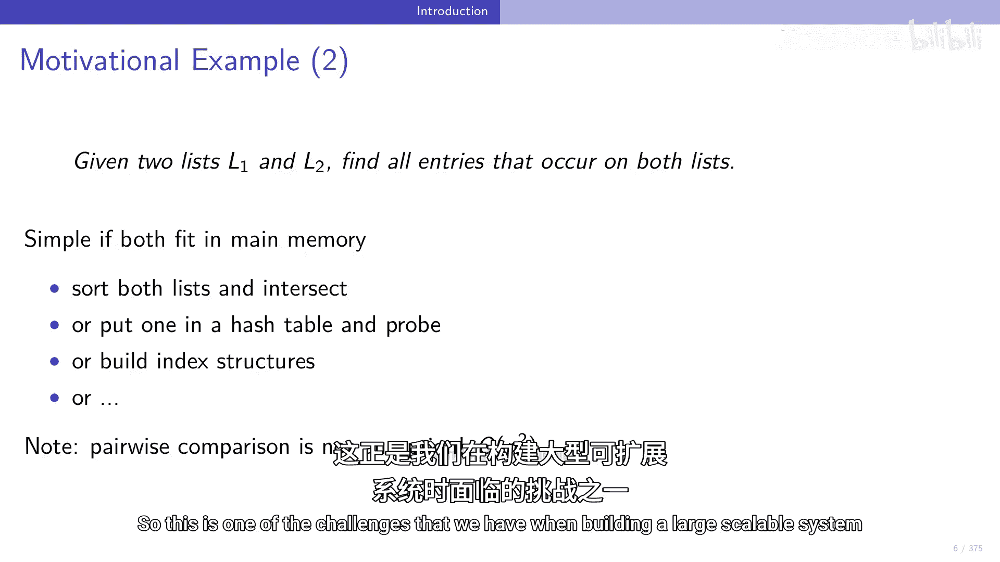

Okay， now。Again， I said the problem is simply if the data fits in memory。

 what do do with data does not fit in memory so it could be that we have so many elements in my database system that I cannot store all of them。

😊，So what should we do Now there are good and also good cases。 So the good case is。

 let's assume if remember， we have two lists。Let's assume。One of the two lists does fit in memory。

 then everything is okay。 so if if one fits， let's say a1 is a smaller one， if a1 fits in memory。

 but L2 does not， that's okay because the only thing I have to do is I take my a1 again。

 a bit large hash table here。 So this this has table for a1。😊，So H table H table before a1。

 and then I take my L2 and says now this L2 is huge， but this doesn't matter。 So even if it's really。

 really， huge。😊，I want I current load in my memory then I read part of L2 that fits for example this one here。

 then I probe my the part that I've read from here to my has table find all the matches。

 then I forget the part of L2 that I've read I read the next part again perform a lookup。

 find all the matches and so on。 Yeah so we just。Process a two piece by piece。

 And we keep a one in memory all the time。 Another， this is。Nearly as simple as in memory case。

 it's slightly more complicated but not much。 so that's okay。

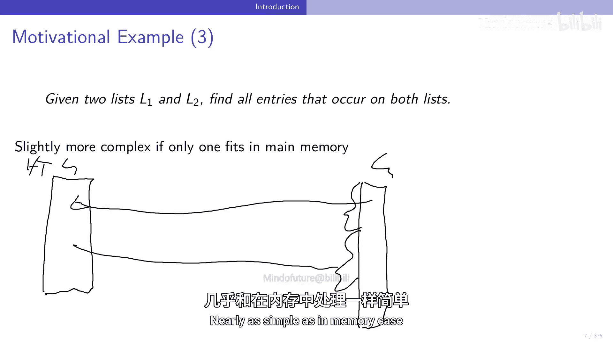

Have we just loads a smaller list to memory， be it some index structure or H table or something。

 basically scan the large list and then we find all images。Really， no， no big team。

Now of course there you probably see what's coming now。😊，The interesting case， of course。

 is what happens if。Both lists are so large that they do not fit in memory so we have a really really large input if you wanted to intersect two lists that are simply too large for my my memory so for example it could be that I have a my memory of 64 gigte by my input as a teryte so then I cannot keep it so I must do something still had the matches now we come to external memory algorithms and these tend to be much more nasty and difficult than the memory case。

😊，Okay， so first thing what you see is no direct interaction is possible。

 So it's simply not tractable to compare element from one list to the other like in a loop or anything like。

 This is infeasible。 Now why， because accessing something from external memory so。😊。

Firstt case a rotating disc， but even if it's not a rotating disc but an SSD， which is much faster。

 even then accessing SSD， it's much， much， much， much slower than my memory Okay so we cannot just go to the disk and read something as this is much too expensive。

 We cannot use this。😊，Now what we could do， we could use sorting。😮。

if we could take the tool lists and then sort the tool lists and then the intersection because after sort the problem is easy。

 remember how the intersection of two sorted list worked。

 so we just take two my two sorted lists here。😊，And I start reading its beginning and I always skips the smallest element until F match so this is a strategy basically。

😊，And this works of course beautifully even if the lists are too large because I just read the next element and of course I have to go to disk from time to time to fetch the next block from data from this。

 but that's okay because in memory I only have to keep one element so I can easily keep this and I can do this kind of processing for arbitrary large lists one this works beautifully。

😊，The main problem here is salting。How do I swap a list that does not fit in memory believe we cover this as a lecture you might know this or if you encounter it in a lecture on algorithms and data structures you might have heard about in sting。

 for example this is one technique to do this there are algorithms to sort data that is data in memory memory。

For now we ignore this we just saying， okay， this is one approach， but this is difficult。

All alternative is you use a kind of partitioning scheme。

 which means you break your problem into smaller problems until the smaller problems fit in memory and this is usually attractive solution but this is again much more difficult than what we did before so for example what we can do is here this is my again I have a very large input here。

😊，This is a very large input。 and now I read my input。😊，For example， this， I can fit in memory。

 I take the parts that I can fit in memory， and then I partition it， which means I splits this into。

😊，To multiple。Ros， for example， let say every value between 0 and 100 comes here。This this bucket。

 then everything between100 and100 or so comes see here and so on。 and I have many。

 many buckets and organize all my elements in buckets so I do this for the first chunk。

 then I do this for the next chunk again， distributing it in different buckets。😔，As on the end on。

 I use this for all my input。😊，And afterwards， I know that。First bucket contains alwayss between 000。

 second one between 100 and1000 and so on， and edit is hopefully in a way such that each bucket fits in my memory。

😊，That I can can keep it in memory if it does not fit you must use more buckets so I must just use more partitions。

 use as many partitions as I need until the result fits in memory and once I have done this。

 then we come back to the example where before， namely data fits in memory。😊，Now， again。

 we have two choices either we part both sides。 so then we can fall back to the real in memory case or we just part one side。

 then we come back to the case once that fits as if her does not。

Advantage is we need less parting disadvantage as we read the other side multiple times。

 alternative super attractive， usually we want to partition both sides。

We will I just sketched the solution here。 We will look at more examples how this partition records of partitioning works in the lecture when we come to external memory heing because sorry external memory joins because this is exactly one the kind of problems that we have here。

 but I'm just saying this is already much， much more complex so we must read my input I must partition it I must make sure my partitions are not too large and all kind of special cases that they can occur And also external memory is。

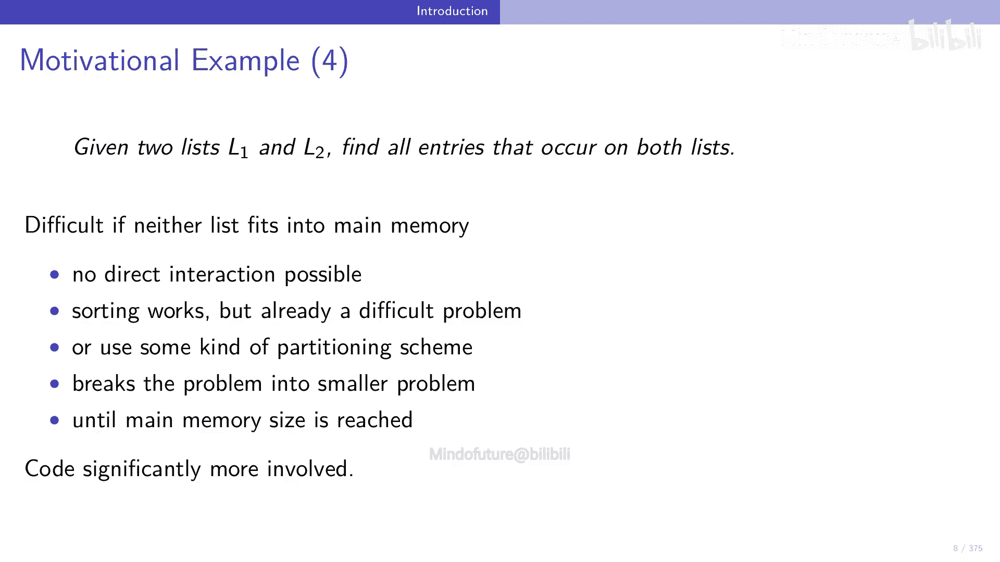

Much more difficult， Okay， and now。This is particular hard。

 It's not if the if the input is not only large， but if you make no assumptions about L1 and L2。

 Okay， so if， if my algorithm must work for out L1 and L2， this is a really。

 really difficult problem because out unfortunately includes a many corner cases。

 that you would think， oh， this will never occur in practice， but it can occur。 Yeah。

 so we don't know this。And so， yeah， so there are many。

 many corner cases that we perhaps have to cover。 Yeah， so for example。

But with never was the case for my example here， the list might contain duplicates。

OkayNow if it's a true duplicate in the sense that the elements are really identical and doesn't matter because we can just collapse them。

 but it could be that often will be the case that is a duplicate this attached additional information。

 which means you have a certain value and this has additional information that we must preserve。

 which means we cannot just remove the duplicates， but we must keeps them and we must output the duplicates correctly。

 Okay， so this of course very frequently。😊，And then the duplicates create。

Problems for us so we must cope with these problems that we have duplicates and we must preserve some in the output and now it could be are very unlikely is that we have so many duplicates that even a single duplicate exceeds my memory size so one value with attached extra information that is so so frequent that I cannot store even all instances of this single value in memory now this breaks my simple external memory logic that just say hey choose small auditings and everything fits because this never happens so it's just impossible to position data so that it fits because of this duplicate problem now there are many ways to sort as for example。

 you could recognize this you could say， I know this is one value that occurs very。

 very often so just store separately so stores the extra information somewhere is the key only ones then when you when we do graph mention the other list。

😊，Then we reconstruct all my pairs and outputs and as we can special cases。

 but again this needs coat so we we must write this。Or there are other ways to take this。

 but all of them。😊，Require us to write something thing。

Daabware systems have a particular problem that when you implement them you don't know what the user will do with them later and basically implement them once。

 then you give them to somebody else and this somebody else will store data inside that you have no idea about beforehand what this data will be so you can insert everything and if your system is supposed to handle everything reasonably well so gracefully。

😊，Then， we must。Coode for all the special cases that can occur。 as this means， of course。

 that the code complexity is very high。 it can be very high because of all the things that we must cover。

😊，And so to handle all this here。😊，Correctly， we would。

Definitely we need many hundred liness of code， potentially thousands lines of code。

And this in contrast to this trivial four line trivial four loops that we did in the beginning so if you use Efo loop。

 we need four lines of code， if you want to do this in a scalable way that goes beyond memory re we will need probably thousands of lines of code so code complexity is definitely an issue Now So this highlights of problems of course if we are more interested in solutions therefore in the lecture。

 see how we can design a system that such that we can implement all this reasonably easy so that we don't have to write this thousand lines of code every time but we adjust build infrastructure so that we can。

Rely upon the infrastructure then implement， for example， is simple intersect， reasonably easy。

 and so it's not that bad。

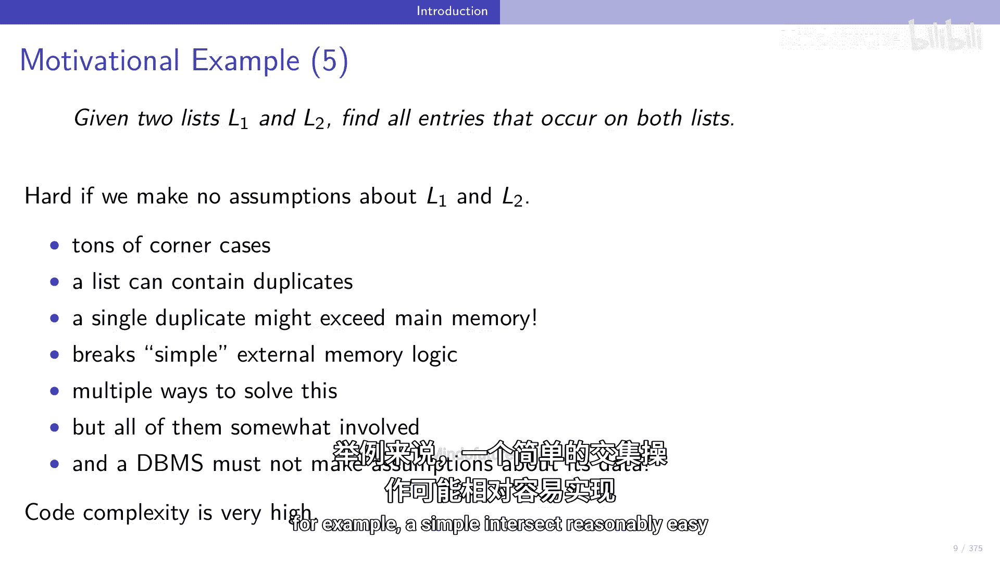

Okay， so。In general， coming back from from the list intersection example。

If you want to design scalable algorithms。For different against problems， then this is very hard。

 Mar， it's very difficult to do this。Because you must cope with very large instances you could get very large input。

 this is difficult even in memory memory Now so there's a pretty nice book that's actually talking about more information retrieval problems than about database problems。

 but it has a funny or very nice book title， and this is called managing giggaytes。😊。

Now what's particularly interesting about this book is that the book is already quite a few years old。

 its not news， probably at least 20 years old。And of course， in this time。

 a gigabyte was more than is today because for us， a gigabyte， you。

 my memory that's larger than this。 but the interesting thing is that even today。

Doing non trivial processing in a few gigabytes of data is difficult。

 even though it easily fits in my memory。😊，If the number of elements that you have is large enough。

 or if you have millions of elements， tens for hundreds of millions of elements。

 or in worst case billion of dead elements， then algorithms algorithm complexity becomes an issue。😊。

Clearly， we cannot do anything that has an n square runtime。 Now。

 the n square runtime just doesn't scale if n is large。As we must be better。

And if we have to do this in external memory， which means we cannot just load everything in by memory but we must handle disks。

 then everything becomes even worse of course and this requires us to build systems very carefully such that we have building blocks available to implement all the algorithm that we need efficiently and scalable and this is basically what we want to look at in the lecture。

😊。

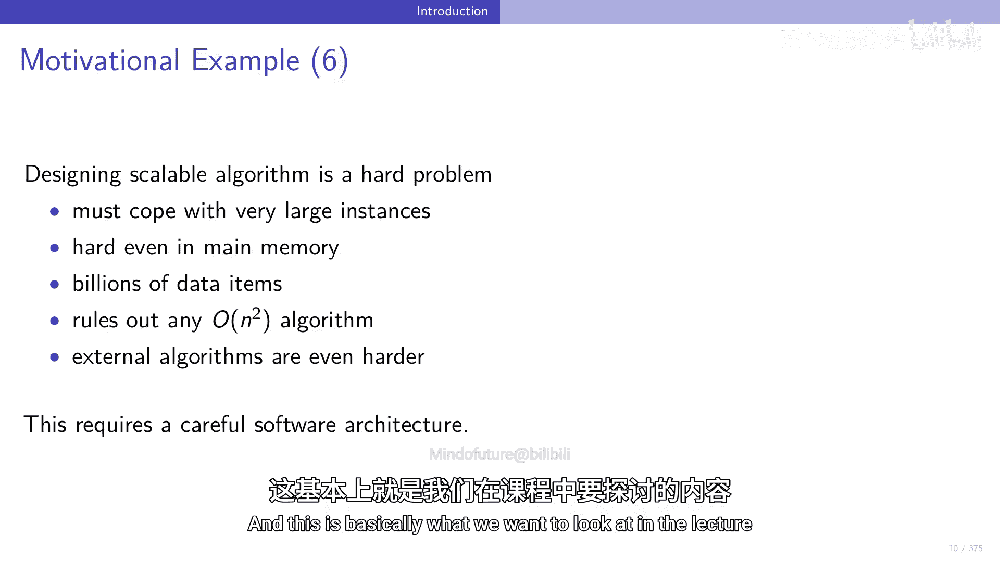

Now。One particular techniques that we use to get scalable performance is something that we call set oriented processing。

 Now what a set oriented processing。Before we come to that。

 perhaps we look at how typical small applications look like。

 yeah if you write some that of Python code or any other programming a language。

 so that it's very easy， very natural to say。Hey， I have this collection of elements。

 I just loop over all elements。 and then I do some operation。 Yeah So this is。

 remember the example that I did in the beginning where we say， hey for。😊，X in one。For y in L2。

 So this is something I would consider loop oriented programming here。 So then we say if does matter。

 I say it's x equals y or something else， then we do some something so this is a very natural way to code this。

 Unfortunately natural is bad so。Looks easy and nice but we don't want this because this has inherently n square runtime and you multiply the number of elements in l1 with the number of elements in L2 as this doesn't scale and so we are not supposed to do this so loop this kind of looping of elements is bad。

What we want instead is we want set oriented processing。

 which means that we don't look at one element and another element。

 but if we look at large groups of elements， for example。

 all by input elements or potentially not all but at least large sets of them。

 whereas if we look at large batches of data and then we do something with a large better of data and another large batch of data。

 and this gives me much better can at least give me much better runta。😊。

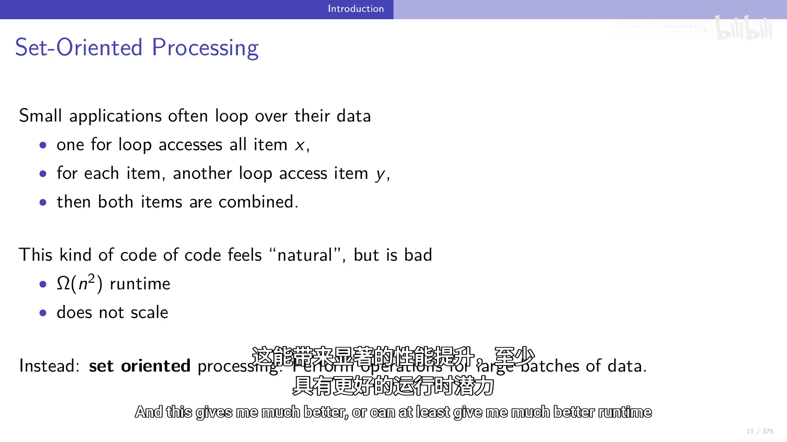

Now， concrete algorithms to process these sets we'll look at later。 but first。

 what are the high level primitives that we want to process on。Setets of input elements。

 we start with something that you hopefully all remember very well from your introduction to database lecture。

😊，And this is a relational algebra。 Okay， so this are a。

Basic primitives that we can perform own relations and these are of course by definition set oriented as if we don't look at individual elements。

 but we take one set another set and then we combine them in a certain way and then we get an output so now first some notation to mean you hopefully all remember this from an introductory course。

 but just for completeness some notation。😊，So we say we denote with Ae。

 the attributes of tablets produced by E， so E is an arbitrary expression。Another way。

 instead of a of E， what you could say this is a schema and so a of E is a schema of the elementss。

 so if I produce columns ABC then the A of my expression is ABC so this is a schema as attribute。

Now F are the three variables， I'm not sure if it needs this in the beginning here。

 so this matters if you have variables。😊，That come from the outside， for example。

 for correlated subries， then my F contains an entries here。

I we this again when we come this to lates lecture， just for reference F as a few words。

Now if we perform a binary operation like union intersect difference then we usually require that's a schema off to one side and the sma of those size is the same now for completeness if you do a join or a cross product。

 then of course we require something else name is that we require that so for example if we have a1 cross E2 requires。

So， I guess that's a schema of E1。And the schema of。E2 is destroyed。

 so it been because the same attribute must not occur on both sides。 Okay。

 so this is the same for this is for cross products for celebrations because it is the same。Now。

 which operations can we perform So of course， these are the standard operations that we know。

 So we have unions who just take。Two sets of elements and we just combine them intersection find all elements that occur on both sides。

 This is basically the introductory example that we did。

 we find everything that occurs on both sides， then set difference。

 find everything on the left side that does not occur on the right side。

Then here we have a rename operator。So we just want to figure out sorry if we don't we just want to rename one column。

 So let's say if we had a column that are privilegely named a。

 we don't want to name it B And so it construction we do this， we take my x。

 the x and U column B and this as the value x to A and we remove the column A with the value x of a Okay so then we。

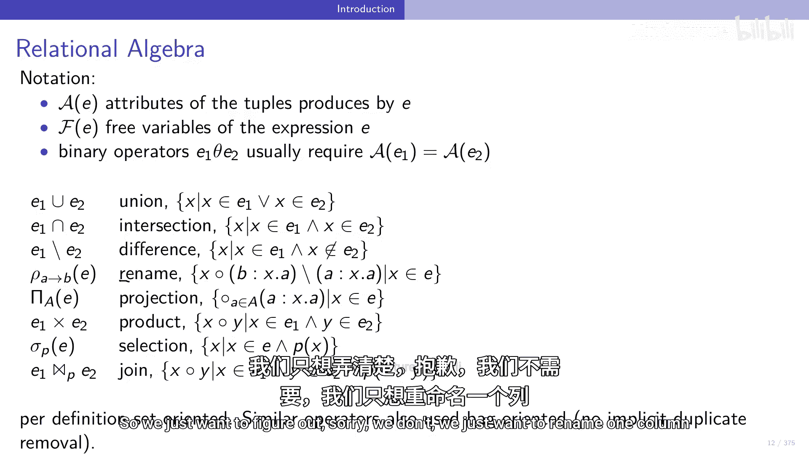

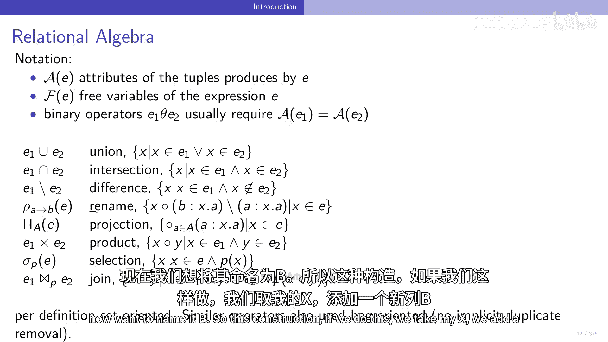

Yeah。Rename column， then projection， we just contain retain a set of attributes here we keep。

Oil attributes A in by subscript A。 Otherwise you discard them。 And we just project to this element。

Yeah， the next one， cross product， we take all elements from e1， all elements from E2。

 and we combine them into1。Yeah， of course， remember I said we don't want to use an n square operation n squares either if you look at the cross product。

 then clearly this year has a runtime of n square because。

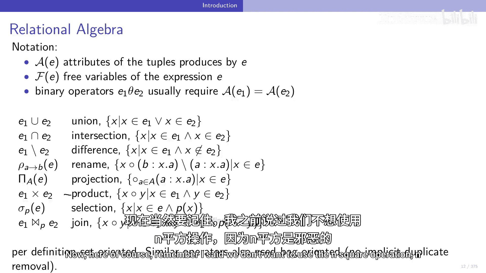

My output is N squareR， and of course， I cannot be faster than my output。

 as so no algorithm can be faster than its output。😊，Therefore。

 cross products are end operation and coming back to what I said in the beginning。

 we do not want to do cross products Cross products are bad if you can avoid it。

 we never want to use a cross product， Sometimes really they are unavoidable then we have to do this of course。

 but we don't want to do this Crossbs are really really bad。Okay， so next selection。

 so we just keep all templates where certain predicate is true。Everything else is discarded。

 and then the join conceptually， the join is， of course。

So we could say that1 join 2 is equivalent to 1 plus 2。Olowed by a predicate P P a predicate P。And。

This is true concerning the result， but of course this is not true concerning the implementation。

And a join we can implement efficiently so we can't find algorithms that gives me this result here。

 as though this can be implemented in。Did it dangerous to say something here？😔，嗯。

So let's say this can be implemented efficiently， whatever efficiently is。

 Why this one here is inherently bad。 So this here is in in。😊，N square runtime。

 Now is this here a better term？😊，Let's say this can be implemented， usually it's in。All off。

Size of a 1 plus size of a 2 plus。Resside size of a one drawing or two。

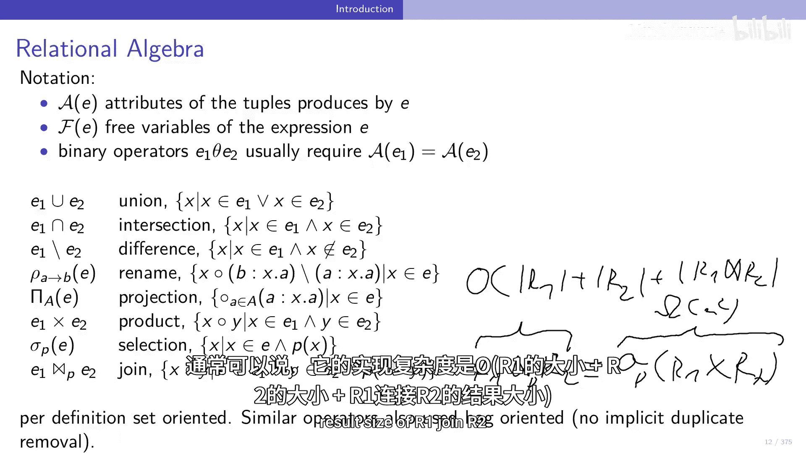

U。This is not always true unfortunatelyly， let's say in many cases。Cases。Cases。

In this class okay not always but in many cases， particularly the frequently used cases we can implement it in this runtime Okay and then this is of course past so I must read my input so this is okay I read must read my input I must read my input and I must produce small output okay clearly and therefore this here has an idea runtime in many cases not in all cases。

😊。

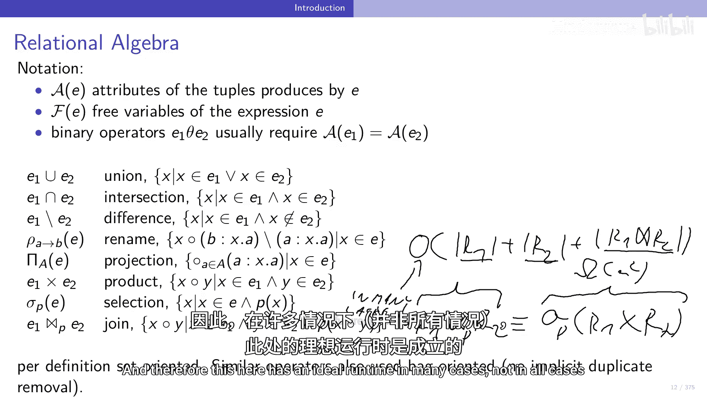

We will look at implementation of drawings later。 Yeah， I just want to list the definition。 Okay。

 so join combines two lists two relations and finds or pay where certain condition is true now all this operations are inherently set oriented because we have defined them on sense so clearly we are set oriented。

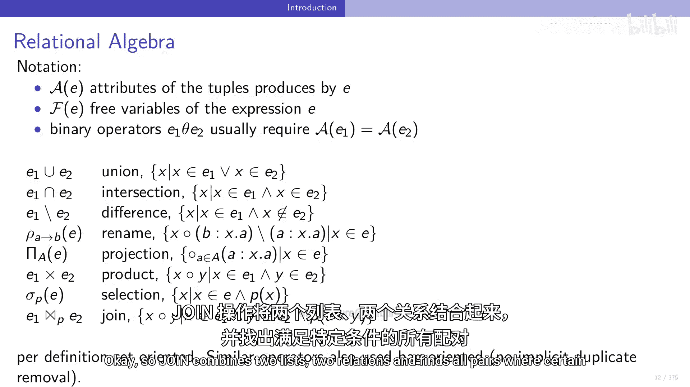

Now if you are really pedantic， we must say that in the database system strictly speaking。

 we will not use sets， but we will use bags Now back means a multiy set so a set that can contain duplicates。

😊， if you remember back about a SQL allows you to output a value that equal multiple times。

 so we can have a a relation that contains column X， then has the value 1，2，2。

In mathematical relations， this would not be possible because in a sets。

 this would not be possible because if this time this video occurs two times so in a set this cannot be the case because set can only contain one or two。

😊，But in the real implementation， we have multi sets。

 which means we are allowed to produce duplicates。 Okay， so this requires an extra care。

 but for at least for now， we can ignore this and just say heavy we operate on sets。 everything is。

App is Tlic at 3。When we deviate from this， we mentioned this lecture。

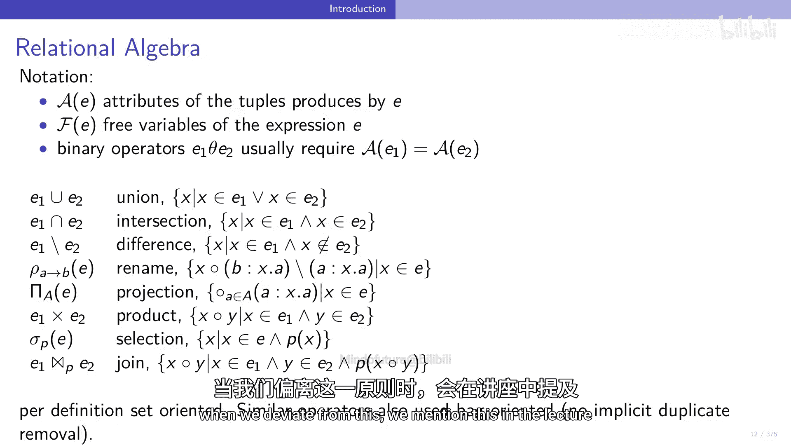

Okay， so this as the basic operations you know from your introductory lectures。

 this one are some derived operators that you can express them using the already existing ones。

 but they are also useful， at least some of them。😊。

The first two here I just included for completeness is so called natural drawing。

 so a drawing without explicit drum predicate， so this is if we join two sides here。

 A1 a2 and then if you look at this one yeah it's the equality condition。Find all and from e1。

 all x from e1 and all y from e2 which are the same concerning the attributes that occurs on both sides。

 as here we takes the schema of E1， the schema of E2 intersected and this gives me all the attributes that occurs on both sides and then I restrict my equality predicate to these attributes。

 so I want that these attributes are the same。So so quite natural drawing。

 also we include everything we join on the commonly account。

Picates and also you see in the result construction be restrict y to the attributes that occur only on the right hand side。

 the common attributes are removed because they occur as the same of course due to this equality condition Okay so as a natural drawing is see what you find the textbooks if you ask me nobody ever uses natural drawings mean at least no system。

So humans likes natural drawings because they are easy to write。

 you can make nice textbook examples for natural drawings。

 but no data system uses natural drawings because internally every column we will get a unique name anyway so what your query compiler will do from your secret query it will most likely assign a unique name to each columns therefore natural drawing never occurs because we have no column that occurs on both sides that's just a no but I include nevertheless because you find it in textbooks same with relational division。

As we find all elements from the left side that can be combined with all values from the right side。

 because anyway， this is the inverse of a cross product。Sa as the name division。

 you cant use this to implement this or quantifiers in SQL again， nobody uses this okay。

 a few people， but I'm not aware of any systems that would make use of this。

 So these are here a textbook So these are textbook examples So you've had to made books but not done systems。

Entries below those lines， these are not textbooks， These are real。

 So these are used for implementing their systems。So similar joins。

 we want to find all elements from the left side that do have a joint partner on the right hand side and we look at elements from the left or x from the left and then we check if they exist an element from the right where the project gets through。

 it doesn't matter if it is1 or 20，000， we just care yes or no is there a join partner or no。

 if yes we output it if no we discard X。😊，And then the anti join。

 this is a complement of Seimo join as we we output everything where there's not a drawn button。

Now you could ask yourself why do we need this can already tell you this CM corresponds roughly to sorry you should draw it differently so this here。

For responsese roughly to exists in CQ exists。That's an exist componentifier but this year。😊。

W responds roughly to surprise what exists。Okay， so we can use this to translate commodified expression and secret with sron and2utron and are some other use cases。

😊，And effect life is difficult。😊，For example， not exist with anti joins。

Works unless you can for some strange reason， have N results which unfortunately sometimes occur okay。

 but if you ignore this， then exists maps to Zimmajo， not exist maps to antijo。

Except for some special cases。Oh。Okay， and then as next one here， auto drawings。😊。

So we output everything from so this is basically a regular drawing followed by so this here a regular drawing followed by we find all elements that did not find a drawn partner for this here we use the anti join we find all elements that do not have a drawn partner and then we output them regardless and we pet the missing values same as nodes and so we take look at all the values from E2 which were missing we add nu there and then we add them anyway。

Now so is this yes a left outer join。We output everything that。

Either has a drawn pattern or it from left that does not have a drawn pattern and pet it with sns。

You get this for two reasons， either if user asks for it because in Se。

 you can write so you can say table。Table one or some other subcurium then left。I ajo。D table。

They were。2。On。X equals y。 this correspond directly to an autoron。

 So this is an explicit autoron in the query。 There are other ways you can get autorons。 For example。

 if somebody does use this here here， you say select。

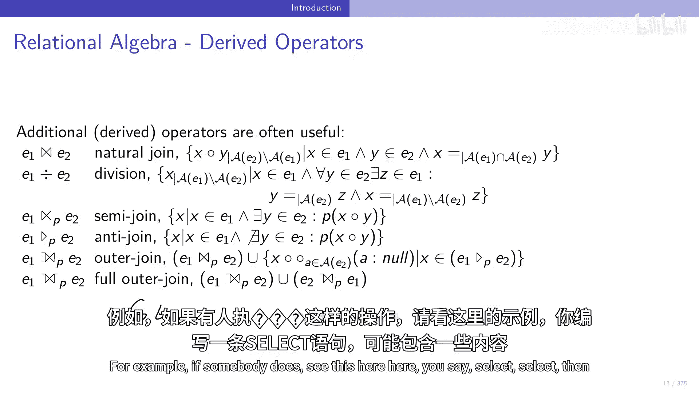

Select then some stuff and then you do inside the select， you do another select。Select。诶。hy。From。

And some other that。Okay so this implicitly auto creates an autoron because if there this inner result is empty。

 so if you do not find a y， then we get a nu。😊，Okay。

 and if you get more than one why you get an error message， but nevertheless。

 this correspond to especially kind of audio joints。😊，Also that。We also require them。

But then a single drawing because you're only allowed to have one drawing partner。

 but this corresponds roughly to an audit draw。Okay and finally we have a full outer drawn that inte the combination of left and right outer join which means we take the regular join and then output everything from the left that does not have a drawn pattern then everything from the right that does not have a drawn partner and note that this year only holds the simple union because we use set seman with back smatic exist does not work because we would include the regular drawn result twice so this is a combination of left and right drawing only with sets if you have duplicates we must be more careful then we just take the regular join and add everything paded from left and from the right again you can ask us a sQL using full outer drawn。

😊，Now so this up to now this part you have probably hopefully already seen in the introductory lecture。

 these are some operators that you might not have seen in introductory lecture。

 but we nevertheless need。😊。

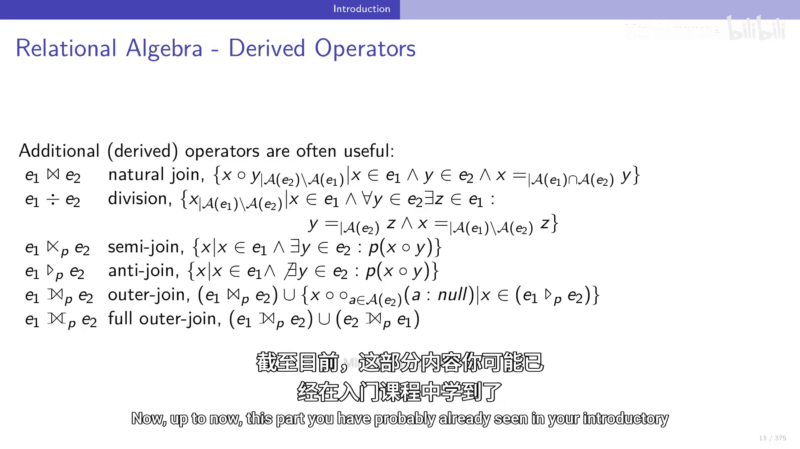

Also for real S to support， we need some more construct， this first one here is a map operator。

Basically， we construct a new column so we say we want to output the new column A and the one that for we construct a new column A by verify a function F on my input words。

Now， why do we need this for example， very simple reasons， somebody says select。Select x plus y。S。

That's okay， from our。So if you do this in sequenceQL， V translates as in relation edge like this。

 take my relation R， then I do a map。And I say the columns that has the value x plus y。 Okay。

 so this is a way to compute to compute a new column by evaluating a function。

 So this is a map function。Then we have a group by an aggregate。

 so I take my input group it by a certain number of edgebos， then evaluate a function F。

 or this again corresponds to a soil。If I in secret we to select。嗯。Some。X。S， S。From。Ara。Group by。

By A B C， this corresponds to the relation relation algebra construct。 Take my relation R。

 Then I add on top of this at group I， I group I。诶。E， then evaluate。Segregation。Okay。

 so this is how we can translate groupi and SQL into relation algebra using a groupai operator。

And finally， dependent join here we come back to the。

Free variables that we before so this looks like a drawing but behaves slightly differently。

 namely what we do here is we have two expressions E1 to e2 and we evaluate the expression E1 for the values from E2 as if you look at the definition。

 we take an x from E1 and then we take a y from E2 evaluated 4 x。

As works to make an edgeback example。 We say， oh I want to output。I have a one。 than I do here。😔。

De join。It's a depends join。Says。嗯。Say are 1 dot x equals a 2 dot y。Then I have an at2。

INot that this part。Is problematic because we try to evaluate predicate but using his value from our1 or2。

 but at this point I do not have our1 evaluate。 So if we just you look at this part。

 so if we ignore the rest it let's look at this box。You just look at the box。😊。

This relation attribute operator is not well formed Y。

 because we are accessing attributes that does not exist our 1 does not exist because e within the box only have a 2 and I can evaluate a 2 y no problem。

 but I cannot evaluate a 2 a 1 x whereas this doest exist Okay， so I therefore we call。

I wanted x to the F of my box。F of my box here is。1 x。 So this is a free verbal。

 which means I don't know it。 Now so I have to bind it。

 And this is exactly what the depend drawn does dependon join says within the right hand side。

 you please use the following value namely we can use my x pass it into the right hand side and then we can it says okay。

 so regular joint wouldn't work， but depend drawn does work。

I just evaluate this box for the top from left side。Now， clearly this year has again。😊。

N square runtime。 Y， because I take element from the left and then evaluates the right hand side for each element from the left。

 This is bad。 Therefore， what the system will try to do is it will try to remove oil dependent joints。

 Depend joints are perform by is very， very bad。 We don't want to do this。

 But they are secret constructs that force us to do this。 As the most trivial example。

 you can construct with this one here。You say， select star from。😔，One， now we start sub cur。

 they select。Select star。😔，R。2。Where。1 dot x equals 2 dot y， and if you have this。

 then you get exactly this construct。Then you get exactly dependent drawn Now the depend drawn again。

 are terribly， therefore， the first thing is the system we do it will try to remove the depend drawn and you can hopefully easily see that you can transform this one here into one。

Join。2 on the edge boot。Why do't x equals a2 dot y？Okay。

 we can rewrite this so that the predicate moves up to the joins and it's no longer dependent and then we can use the regular joins that everything is good。

 Okay， so in this simple case， it's easy to but I can write much more complicated secret statements as it not that easy to remove the correlation。

 Therefore， systems do support dependent join。😊，诶。Now just for nomen， if you look at， for example。

 secret server， secret server doesn't code as it' been join their quote as， I think pro apply。

So but sorry， miss。 Okay， so cross apply， but nevertheless， this is the same as the pen join。

 we evaluate the right hand drawing side for the for the left hand side。

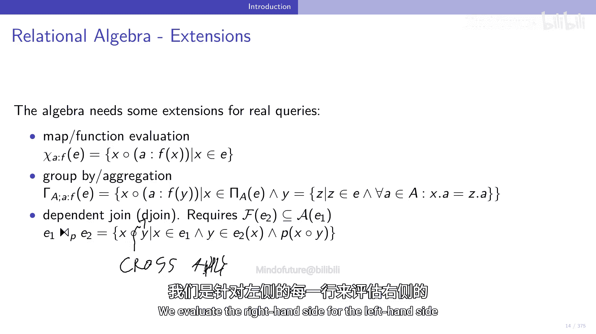

Okay， now why are we interested in such automatedient processing because we can implement this much more efficiently so like if you are processing not one value and one value。

 but if you're processing a million values in a million values then we can perform operations that makes the whole process more efficiently。

 for example， we can build an index structure。😊，Or we can reorganize the data like partitioning。

 or we can use sorting or hesing， as if we can do something without our data that we could not do if we just look at individual values and this preprocessing makes my whole process more efficient。

😊，In the air we want that all algorithms have runtime of analog n or better ideally now to be fair this is not always possible if the user asks me to produce an n square output I cannot be fastest than n square clearly。

Yeah， but if the user does not force me to produce an n square output。

 then I want to be faster than n square so Nlock n is what we want to have。

And now there are many ways to achieve so many algorithm we can use。

 We look at them much later in the lecture we still in thetroductory chapter here。

 I just want to highlight to you what are the。Challenger is one of the techniques that we want to use。

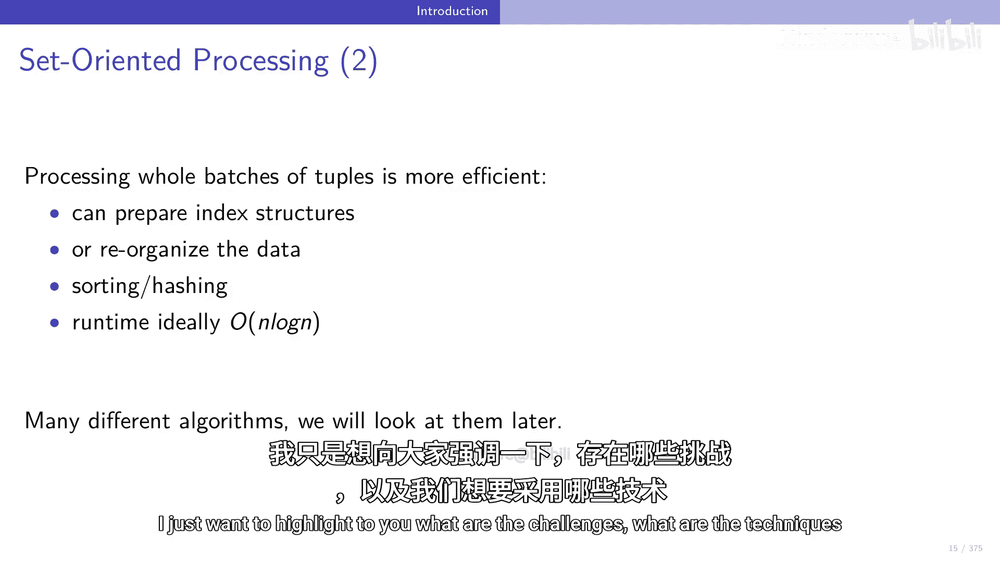

Okay， now traditionally， when we build a database systems， we make a number of assumptions。😊。

So traditionally in the sense that if you built a system 20 or 30 years ago。

 we makes the following assumptions first we assume that data is much larger than my memory。

 and so not only a bit larger and much larger。😊，And therefore。

 my whole processing is dominated by IO， so by input output。

 so reading data from disk or writing data to disk dominates everything。

It's much more important than what do in memory and a co of this is。😊。

Again giving the address that had 20 or 30 years ago that random access to my data is very。

 very expensive because I would have to do this as random IO。

 so which means I would have to move ahead on a rotating disk disc and this takes very long time so just to give you an idea doing a random access on a rotating disk disc costs you something like the boypar of let's say4 milliseconds if you're lucky it's just three or so but random access on a rotating disc。

This on the wallpark of4 milliseconds。This means that we can only do this about we can only do roughly。

250 random excesses per second。Roughee。Yeah， 250 is not a very impressive number。

 250 is a very low number， so which means that if you want to access 1000 data elements。😊。

And he do this at random。We need four seconds for this。

And this is forever also we cannot do this and so random access on a rotating disk is terribly expensive。

😊，And therefore， systems said， oh， we must never do this or extremely rarely do this as we try to avoid random IO whenever we can。

 so this was the traditional model we were dominated by disk access。

 disk access is slow and random disk access is even more slow Hence this was the assumption that we that way made。

😊，And then you build a database system using these assumptions， you get two things。

 you get a very conservative model because you never want to do random access and so on。😊。

But you also get a very scalable model。 So this is a good part。

 So if you look at the systems that are built at this time。😊，They did scale pretty well。

 as even to very large data to amount of data， so they work fine， but they are very conservative。

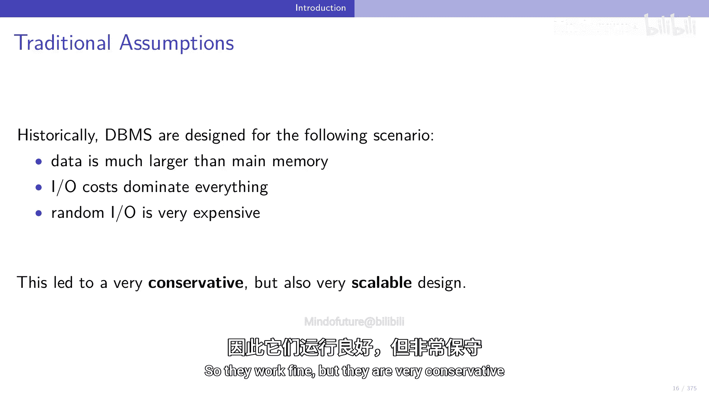

Now。If you look at how the hardware looks today and not 20 or 30 years ago。

 we see that many things have changed in particular we see that my memory has increased dramatically。

😊，You can easily buy machines that has a terabyte of memory， it's not very expensive。

 I mean it's not exactly cheap easier， but if you pay for this a bit more than 10。

000 euro probably so it's not super expensive。😊，Compared to the cost of a programmers is actually quite cheap。

So you a company can easily buy machineists to have a memory。

 you probably don't want to do this at home unless your budget is a bit higher than I would ever expected。

 but for companies there's not a big deal so you can easily do this。

And if you have such a large amount of memory， then of course this access gets much more rare。

 so we access much more infrequent and therefore we are no longer dominated by the diskobbar footpas by in memorymory processing。

😊，Another thing that we see is that people are moving away from rotating discs。Every。

Tend to use solid day drives of flash storage。And these allow much faster random IO。

Even at this piece it's cheaper to read large blocks of data than small parts so we still have an effective random access。

 so you can only do a finite number of random accesses per second on these machines。

 but this finite number is much， much， much much higher or than a rotating disk as you can easily do thousands of random access per second many thousands random access per second which you could never do on rotating disk so。

Harware has changed， therefore the soil assumptions are not necessarily true。

And this has some consequences for the design of a database system first what we see is。😊。

CPU costs suddenly become much， much more important。While in the past， while we are waiting our disk。

 disk is so incredibly slow， and it doesn't matter that matter what we do with the CPU。

 it does matter。 I mean we start burning CPU massively。

 but as long as we are reasonably with our CPU then disk almost everything。

 This is no longer the case because data isn in my memory to begin with at least often and then disk does matter at all。

 if we only look at CPU processing。 so becomes important。Because we。

Often we have no IO at all or only very little。 and then if you do IO。

 we could potentially afford to do a bit more random I than we did in the past because my IO device is much faster and it does allow for random access and this means that the old architecture that people have used in the past it becomes suboptium also mean you can run a traditional database architecture on a modern system it will work nor problem。

 but it will not give you ideal performance。😊，And of course we look at species in the lecture。

 but on the other hand this is more an evolution than a revolution。

 so this doesn't mean you have to throw away all your database systems you just have to immediately have to change something you must change some of the techniques but some of the things that we use in the past are still valid today and therefore we start by looking at。

😊，Traditional architecture also because this is what you will mostly account if you look at the big commercial vendor。

 they still tend to be more designed like a traditional database system therefore we start this。

 and then we look at how we can adapt this to scale better to auto hardware design。

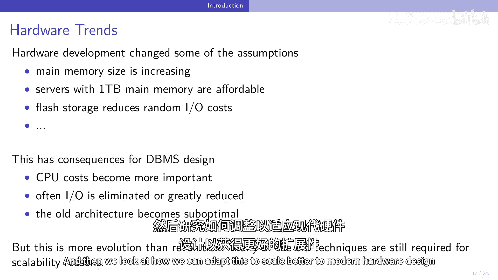

Okay， so the goal idea in database system is。😊，Ideally we want the following first we want to be able to handle arbitrary large amounts of data and if we want to do this efficiently。

 doesn't matter if you have a gigabyte or you have many terabytes。

 everything should work smoothly and efficiently for arbitrary sizes。

Now another goal is of course we never want to lose data it doesn't matter what happens if we have a crash software crash。

 power failure， whatever we never want to lose data this of course also requires care then we want to offer a highlevel interface to manipulate or retrieve data usually our case is a sQl but could also be something else you want to have some highlevel API we want to shield application from the complexity of data management。

 which means that the says application just says get my data please store pre retrieve it for me I don't care how you do this internally store it and processes S is works best for my use case。

 this is what we want as the system does it automatically or at least mostly automatically。

And of course we won't get excellent performance for all kinds of curves and archive of data。

 no assumptions about the data， do haveq their data。

 so uneven distribution you have duplicates doesn't matter should work in all cases。

 as this is our goal and。This is， of course， a very ambitious goal。

 It's very difficult to satisfy all these code。 On other hand。

 we usually can do this just with edit complexity in the software。 But that's okay。

 because this is the idea that we made when we create a database system， database systems。

Pretty difficult to build， but you build them only once or a few times。

 There are not that many database systems out there。 or actually， there are many database systems。

 here， if you're honest， but nevertheless， there are much even more applications out there in database systems。

 so usually one database system can be used by many different kinds of applications。 Therefore。

 just worthwhile to spread the implementation effort。And do it once。

 then everybody can profit for this。Okay。😊。

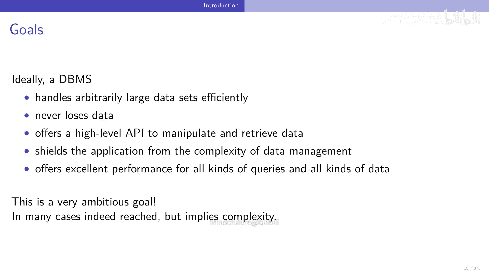

So then this year is a rough overview over what we want to do in the lecture。

 so we start withcycleltic architecture， which means we look at how traditional learning systems are organized。

We start with storage as how， how do we store data on disk or one。physical medium。

 then we look at access pass if you don't know what access pass means first approximation access pass is an index structure and how can we access my data efficiently。

 how can I find my data efficiently， then we look at transactions and recovery。

 So how can we cope with concurrent users and how can we cope with crashes。Hence。

 for this covers the first big part of the lecture。Next big part。

Efficient query processing So how do we set arrange processing。How do we implement this efficiently。

 how can we pass data around and so on， then we look at algebra operators。

 how can we implement all of them efficiently so that we can fast answers for all these primitives and third party as codegen。

 if we have a query how do we translate this into something executable because ultimately we must execute a query。

 because we want to get result if we must execute a query， how do we do this？😊，And in the third part。

 designing a database system for the modern hardware。

 so what do we have to change in the storage architectures to cope with， for example。

 large main memory。Then how do you optimize cache locality。And， finally。

We fear are building in main memory database system so that assumes that all my data is memory nearly all the time what we have to do there because this affects not just storage but many other parts like transaction processing and recovery and so on。

 and thises a rough overview over the lecture。😊，Okay so I will stop here with a recording for the first part。

 I will record the subsequent part as we go through the semester and remember please look at the exercise sides as moodle and then everything will be provided for you this semester will be more difficult than usual because of the lack of interactive teaching unfortunately but we do our best to try to cover this in the exams sorry exercise okay thank you。

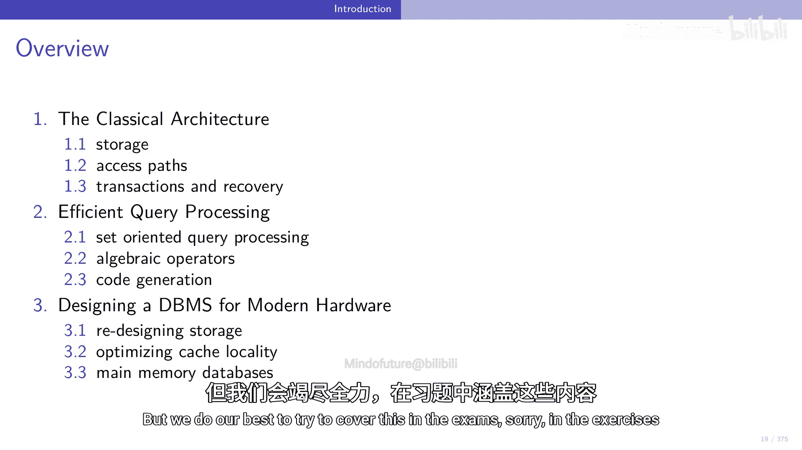