# 【慕尼黑理工大学】现代CPU架构上的数据库系统实现-｜-Database-Systems-On-Modern-Cpu-Architectures-2021-p02-P02_02_存储--BV1asiJBeE6j_p2-

。Welcome to the lecture under with implementation。Today we want to look at the first big part of a database architecture namely storage and so the problem that we want to address here conceptually very simple also on the upper end here we have application data as we have some kind of user data that is semantally stored in a database and as the lower level we have how the data is really stored like on the lowest level of course we have a physical drive this is something we have data physically written to then we might have a logical drive on top of this for example because of a rate array or volume manager sources we this year from our perspective usually is the drive if you wish so。

So drive here。Logical physical drive， then we have a flight system that is provided to us per the operating system。

And then there must be some magical component in between that somehow maps the application data down to the file system so the question is now how do we do this and it's not so obvious how to do this because they are design choices what you can do for example the first question is should we use the file system at all because we could say we want to forget the file system instead we want to directly access the this drive historically this is what data systems have done they have preferred to not to use the file system but instead directly access the drive because it gives you more control so you can more fine grain control。

Our data stored。 But in the long run， people stop doing this because for an administrator。

 it's a pain。 If the data system uses raw disk access instead of part systems。

 banks much more and so on。 Yeah， so people went away from doing this over time。

 But it less so we have a choice So we can。We have degrees of freedom and how we map application data to the drive and we want to look at different aspects of this。

 so this is what this part is all about。

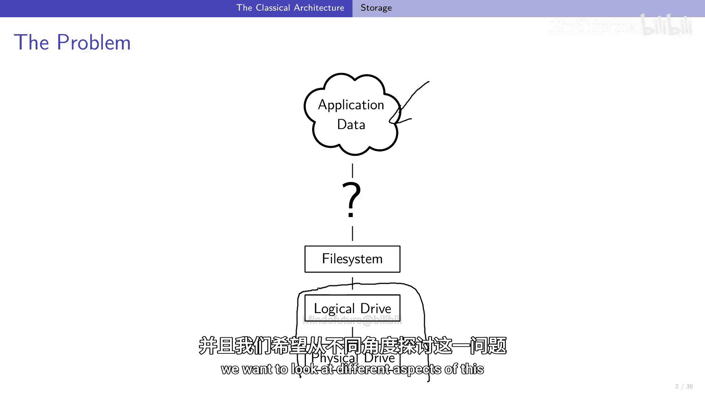

Okay。😊，Now， when talking about storage， we have， of course。

 a number of different requirements that we want to satisfy。 First one is we want data independence。

 Now， what does this mean data independent。 So we want to do dec。The data and the physical storage。

 Now， why more do we want to do this first。What is absolutely important here is we do not want that application knows how the data is physically stored so basically my application here。

 if you write it once and then I store to my data to my disk and then later I can change my disk for example I can buy new disks or I can for example migrate from a rotating disk to SSDs or can introduce a rate array or might even use introduce network components。

🤢，Its application should be totally unaffected by this That suppose application logic has to be decouped from physical search。

 This is a very good property because course this gives us a freedom to reorganize my hardware as it makes sense if data grows of access patterns change without doing anything with application So data independence means we shield the user or I should say the application or a reuse it because re users we usually don't even allow to access the database。

 but we shield the application from physical search this is because data independence。

Next point here， scalability， we want， of course， that the database system skates to nearly out data sizes。

 of course we can only say nearly because at some point we will not be able to scale。

 but if for example you can address tus above 64 byte this is a reasonably large number so this is an okay size so this is usually what to consider large enough。

So we want to scale very large sizes。And still， even though we do this， we want， of course。

 fast success。So this means we must have a way for example。

 to jump to an arbitrary data element in my data so implicitly this means we need some mechanism to say。

 okay， please retrieve this individual value so so we take one individual data item and we want to be able to retrieve this without reading everything else。

Yeah，Because if if you would know that you only need sequential access to your data。

 you could make different implementation choices than if you need to be able to jump in the middle of the data。

 But we assume that you must jump into the middle of the data， which iss clear why it needs this。

 Yeah， because if somebody says something like this。 we say。

 retrieve me something before my database， select stuff from our。Where。Where， key is equal。2，1，2，3。

 And of course， we expect that this curious fast。As we expect it， we get an answer to this。

In a few millise at most， hopefully faster。 Yeah， and this means you need to definitely leave random access to a data views bounces。

And of course， what want to be able to update out data。 again。

 this roots out some storage alternatives， for example， what you could do is you。We don't do this。

 But what you could do is you could take all your data compress it very tightly into nice condensed format。

 This has， of course， also advantages。 if you do this， but in in general。

 we don't want to do this at least not everything in one big block because otherwise。

 individual data access is difficult and individual updates individual data items usually not possible。

 So therefore， this rules out some different implementation。

Okay and the third big part is it reliability。 so once we have written something into the database as it's committed。

 we must never lose this again。 that the database is supposed to be a very。

 very durable and reliable storage medium So if you write we never loses even if we have a power failure。

 hardware crash， whatever software failure and so so even error situations we must survive and we must never lose data these are the requirements and of course we have some more but these are the most three most potent requirements。

And now yeah， we must think about how how do we get all it is Okay。

 now what we could do is we could just write one big program， say， okay。

 this is my my database and then just。

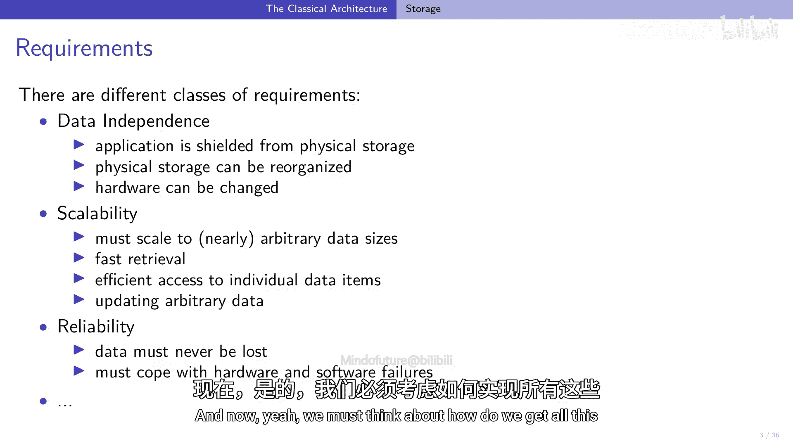

And every time we go do something when we go to disk， we read something from diskco。

 we write something to disk， then we think about all the problems that you might have。

 then we hard code them in this moment。 This is not desirable so you should not do this。

And so it's implementing everything at one big block so here in the slides because it's implementing it in bare metal so directly on the device。

Is very difficult。And also， it's not desirable because we want to be able to maintain and evolve the system。

 Like you see， hardware changes over time。 Yeah， in the in the past， everybody here has had。

It head and hard disk and then the K same can contains some component and then you perhaps a cache then yeah that cache。

 or I just write can't read this。Just right can see for cash。

 then if for cash and then some other parts on the top hand so this is how traditionally system was。

😊，Then over time， hardware changed and for nowadays。

 for example in very frequently you don't have a hard diskk game ball， you have an SSD。😊。

And you could say is a D artist disk or the same。It's not completely true。

 these have very similar but's not the same SSD has different performance characteristics and you might want to change something into this system if you have an SSD but nevertheless you want to be able to replace one hardware technology with the other without rewriting the rest of this stack because on top of this we might have something queer processing and whatever and you don't want to rewrite everything just because I switch from hard disk to SSD so we must decoup them somehow and the traditional way to do this and a pretty good idea to do this is to use a so- called layer architecture which means you cut your database into different layers of functionality and each layer and implement some specific。

Feature and the layers only talk to each other only talk to layers that are directly next to each other also like you have your layer 1 so you have layer2。

And you have layer 3， and so on。 And we say。Okay， that these two talk to each other and these two talk to each other。

 but layer 3 does not talk to layer 1。And if you build such an architecture。

 you can replace layers relatively easily because if， for example。

 replace my layer1 with new implementation， let's call it a1 prime。 We， for example。

 decided that hard old fashion， we no longer want to do this do everything at SSDs。

 And because we know that for example， that SSDs only support block arrays。

 then so we can we cannot erase an out small piece of data， but just blocks。

 therefore we change some implementation things。 you might want to do this。😊，And if you do this。

 you have to change something in L2 because a2 now must be aware of this property。

 but a3 is unaffected。 Yes so this means that changes don't evolve through the whole code base。

 but just to neighboring layers。 this is a very good properties。

 So a layer architecture is very frequently a good idea。

 So if you can do this writing systems layer is good thing。

 Now you might notice similar layer architecture， for example， from the network stack。

 which is also it pieces upon pieces。 like on the lowest layer。

 you might have something like I and on top of this， you might have UP or TCP or this kind of thing。

 Here have and top of this， you have application。 So you stack them on top of each other and you do it similar for a database system。

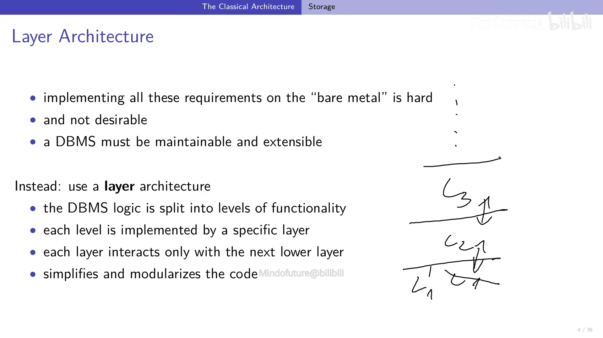

哎。Now， the question is， which layers do we have？😊，And。

This is not always the same with different systems cut somewhat differently。

 but as you will see not on this slide because it's just an overview， but on the next slide。

 many systems tend to have a similar layer architecture， not exactly the same but very similar。

 But first， let's look at a very simplified layer architecture。

 So this just give you an idea what we have。Then we say on the lowest level here， of course。

 we have to。 So this is this， this。Soylinda here， this is my physical storage。 At some point。

 of course， I write data to some physical medium lessD or hard disk。Okay，Now on top of this。

 the have is a storage layer。 So this is what we are currently looking at in the lecture。

 So storage layer is what were interested in。 and as the component there is we have a database buffer。

 which means the database buffer data in memory instead of going to disk because of course memory is much faster than disk。

 So we we buffer in memory and we talk to the hardware below us so we orchestrates read and write from physical storage。

 So this is the functionality of the storage layer。😊。

And the storage layer exposes to the next layer pages。

 Well as you hopefully remember from your introduction to databases that databases tend to store data organized in pages。

 we of course we have to repeat this in the lecture， but so we。

Fixed size page that be exposed to the outside Tm。And using this page as the next layer so called access layer。

 now manages records， which means individual tops and access paths。

 So index structures and extends this kind of things。

 this is what the access layer does and the access layer exposes to the next higher layer records so the access layer says。

 okay we have a set of records you can read this or you can write this and sitting on top of this we have the query layer So the query layer now this runs queries performs translates secret into some executivee optimization on this runs runs this query and this just things in records and then of course exposed again once to now to the application。

 the in application is now declarative queries and set of records。

 So we get declarative queries in if we get set of records out。

Okay so this is a very simple layer architecture we say storage is everything that talks about pages。

 excess layer does everything it talks about records andque layer talks about queries and then sets up records as results also a bit simplified but this makes it easy to understand and now if you look at this layer architecture closer you' see that's a query layer knows nothing at least the first approximation knows the last thing about the storage layer。

 so if we should decide to say oh knows pages and we don't want to do pages instead let's do but could we actually do I mean everybody basically does pages。

 but we could decide， for example， to say we used instead how do you call it。We just map。

Records and memory。So if you want if you decide to do this， we don't do a paging anymore。

 we just directly map physical record in my memory， for example。

 using M or something similar techniques。 So if you want to do this。

I'm not saying it's a good idea to do this here， but if we could。 We could implement it like this。

 And then we would have to change something the access layer because， of course。

 the access layer would be affected， but the secure layer knows nothing about this So the clear layer doesn't care。

 so as this means we can do even such a drastic change， and this is a drastic change。

 We can do such a drastic change without rewriting the whole system。

 We just have to adjust some parts of the system。 And this is a benefit。😊，Offusing。

A lay architecture。

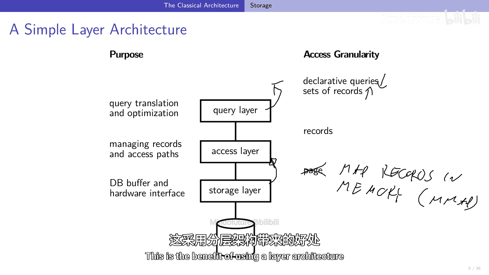

Okay。Now what we have seen is the layers can be characterized by the data items that the manipulate layer beside said the lowest layer。

 for example， talks about pages， next one about records and so on and a lower layer of us functionality to the next higher layer So they built more and more highle constructs based upon the lower layers and this means that each layer has only limited complexity and this is good because we that the layers are something that we can think about what they are doing。

 we understand and we can change them changing is a pretty important thing。

 database systems have to evolve over time because of use cases change how to change and on。

 we have to revolve the system and therefore want to keep the complexity manageable。😊，Yeah。

 very roughly what we've seen as we start with the physical layer which it really talks about。Now。

 some like talking to the writing system。 Then on top of this， we have a low level functionality。

The recordscor is then high level ofqueries okay。😊，Now。

 so this architecture in general makes sense so you want to build it roughly like this。

 but architecture is too simple right you need more components。Therefore。

 we now look at a bit more detailed architecture。😊，Some are splified。

 but it's a bit more detailed architecture that really looks like existing systems broadly。

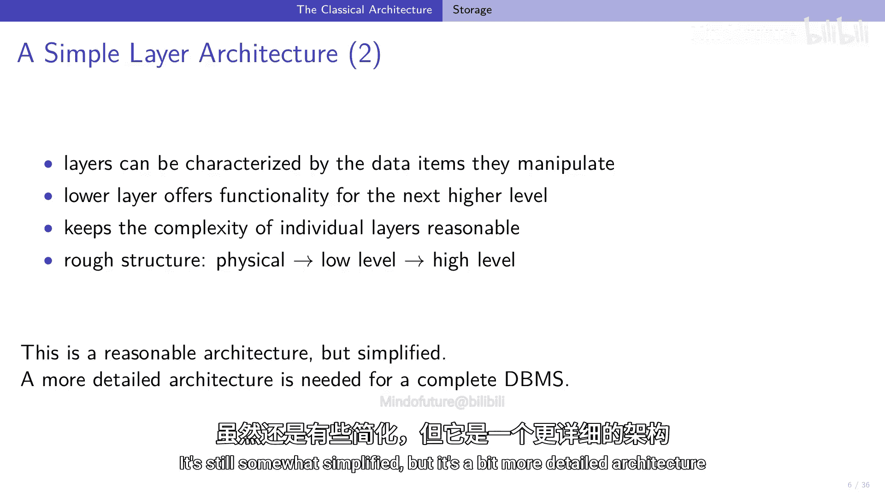

Okay， so this is a more detailed architecture。 again， we start from the bottom。

 so we start with a physical storage， external storage。😊。

And now we the on top of this VFC CBF of the。The file layer here the file interface。

 and we say the access from the outside so what comes in is somebody says I want to read block K and I want to write block K so I want to read and write something。

😊，And now this must be then be mapped。 If we really talked about the physical system。

 this has been mapped to something like things like track and cylinder。

 I'm not sure if you remember what this really is because。

Most of you probably don't even use a rotating disc anymore at home now because there's little nowadays。

 there's little reason to do this。 And like if you think about how a rotating disc look like we had a。

So this is the disk。 And then， of course， so vi。And this rotates here， example like this。

 be rotate and the NBA to read right head。So this is， for example。

Here so then we had a bright bright hat that can move in and out。 So rotating， of course。

 around this young so this is we rotate around this。And then oh I didn't。

 didn't place the rotation point right。 It doesn matter。

 I imagine you no what's this so we can move the this in and out。

 even though my physics here doesn't work。 it should have moved the points away its。

And and and this means therefore if you want to read or writeom of the disk。

 we have to tell the disk， okay， how far in and out are you and this is what we usually call a track and then the tracks are one way around here。

 This is cut into into segments and so on。 so we have different base to address this disk。😊，Okay。

 and if you want to really talk to the physical device， you have to understand this。😊。

And now usually nowadays we don't want to do this first because you have to understand how the Al work looks like and who wants to do this。

😊，And then we might have， as I said， we might have an SSD instead。 So and even nowadays。

 even rotating disk have moved away from using this track clinda addressing to instead logically block addressing and so on。

 But yeah， so if you extract away from all this。Nevertheless。

 we somehow have to map my conceptual block， so I say I have a file I want to read a block in a file and must map this to physical search devices somehow。

 And for this we also need some data structures you see as mentioned here like we need free space inventoryories so we must know what on the disk is to free and we need to extend table and so。

 Now so this is the very lowest layer and you might wish to say I don't care about file system。

And I just delegates this whole problem here to the operating system Yeah。

 and then somebody elses does this problem for me Okay， then still all these interfaces exist。

 but its operating system can can do this for me and then I just don't can just go to the next side level。

This is possible definitely， but you have to realize that you and there's not only possible。

 but most systems， in fact， do this。 most systems say up double bottom to mess with physical storage delegates as a training system。

But of course， you lose control if you do this， and now why would you care。

 Think back this example that I did of a rotating disc。😊，Yeah。

 so this is my rotating disk supposed to be a circle。 And so this is my rotation point。

 And now this rotationium is a fixed speed。 So like， for example， don't know， something like。

3300 rotations per minute or something， and。So we have a fixed rotation speed。

 and we then we have a head that can reach， for example， either here or here。

 That's because we can move it in a do。And clearly what you quickly realize is that if you read something from the outer rim。

 this is faster than if you read it from the inner part now why is this the case？😊。

Because the rotation speed of the disk is fixed。 And we have a fixed number of rotation per minute。

And this means that on the outer rim， we pass a longer。Trerack here。 So we have a longer distance。

 So the track on the otherer room is longer than a track on the inner room。Yeah。

 this just means that we see more tk per second。 So to say， yes， we have a higher speed。

 higher speed relative to the surface on the other part than the inner part。 Yeah。

 this means if data displays on the other part， you can read it faster than on the inner part。😊。

And sometimes you might care about this， for example。

 if you want to within a benchmark so if you look at the numbers at least in the past when nowadays people again using SSDs。

 but in the past， if you look at what people did in the very known TPCH benchmark。

 you can look it up if you search for this， find specification like for child as they used and so on。

 and if you look at this。You realized that people bought far more drives than they needed。 Yes。

 let's say if they had needed 1 TB disk space for the benchmark， they bought， for example。

5 or 10 TB disk space。 Now， you would ask yourself， why do this。 Yeah。

 So why should we buy more disks than you need， because it costs money。 Yeah， it costs money。

 But if if your disk is nearly empty or only only partially full。

 you can put all your data on the outer part of the disk。Yeah， and not on X part。

 And do you want to do this， because the other part is fast as than X part。

 brings your performance advantage to do this。 So having empty disk is a good idea for a performance perspective。

 At least if you don't care about money。 But if you want to win a benchmark。

 you usually don't care about money that much you won't just want to be fast。 Therefore。

 this kind of control is attractive。Okay， so but this is a very loose layer layer here。

 It might be in the operating system。 So The next layer here that you talk about that really all database systems have now is a so called database buffer。

 So what the buffer does is my interface is I want to access a page J or want to release a page J。

 So this is my interface。 Some says I need a certain page， please keep it to me。 And at some point。

 of course， you say I'm done with a page you can you can have it back。😊。

And so by therefore for my my interface to the outside here has a page or alternatively。

 we might additionally， we might also want to know something about segments。

 We talk about segments later， but。Primarily perhaps pages， if we need pages。 and， of course。

 we this versus layer does it。 it maps the page to the block。 also untilified。 Also。

 we say if somebody says。Please read page number。 So somebody says read page number。This one here。

 And then this is internal mapped into， mapped into 5，7 block5 something axis。

 So this is how this mapping works。At end， of course。

 the apptic system can reach this from this file and this block and you have it。😊，Okay。

 and internally， the buffer manager needs a page table and a block map so to know okay。

Which page do I have a memory， where is it and so on。

 how us this map to the page and this these structures？Okay， so if you go to the next higher level。

 So this is now the record access layer。 So here interface is， okay。

 I want to read a record or want to write a record。And so this layer here， maps。

Physically records to pages and segments。Okay， so a segment， first we talk about sequence data。

 first approximation， a segment is like like a logical file。 so like a logical file in the database。

 this is what we call a segment。😊，Okay， and so we map physical records to pages。And if we do this。

 also， again， using data structures like free space image majority page index and so on。

 So this tells us okay， which， which segments sit to sit where and so on not。

 Where do a free space So where can I enter something。

 So this is information we have in the record access。And here we are talking about physical records。

 Ph record means basically， so this。Sa thisbody yeah。This is bites。So we have some bites。And this。

 of course is， this by block here has a number。 Again， let's call it this record number 4，5，6。

 And this is in our physical record。This is what we manage here。Now， on top of this。

 we have the record interface。 now， this one talks about logical records。 Okay， so now here in V say。

 for example， I have don't know。The student and the student here。Student record。And the key of this。

Student here might be 1，2，3。 Okay， ats end of this， of course， a name and P and on。And so， okay。

 so now this is the logical record。And the record interface maps logical records。

 physical records and so the interface to the outside here now is from coming from top。😊。

Is there a logical record ID D if he have this or key， for example。

 as some way to describe this record。And then this is map to a physical record。

 and the data structures here that we have here are now。Exces path。

Now access pass is in first proclamation in index， for example。

 a B3 so an access pass and we have a physical schema。

 so we know okay how is this record really stored physically。

 So this is what we have and then we map it to the next lower level and then on top of this of this record interface we have a clear interface and now this point here talks about really select。

 for example， So you get sequence input we have records outputs with hey， for example， it select。😊。

うん。😊，Select star from。From students。Students where。Key equal。 let's not call this key。

 Let's cause this student ID。Where诶。Student I D。Equalates 1，2，3。 Okay， so this is a。

 the cur interface I equal。And then this is then mapped down to the logical record with then down to the physical record with next layer on。

 and so with the security phase。😊，Has exposes to the outside relations and views。

 we tell the outside R after the student relation that on and the andV map。

Quates on this relations that views down to logic record access。

 And for this we need here as data structures。 So logic schema， we must know okay。

 virtual relation exists， which attributes to F on logic schema and integrity constraints。

 Like what is the primary key to we have non constraints at all。

 So this is like query layer And then on the very top， of course。

 the applicationplication is just in relation with views and secret。

 So knows nothing about the implementation。 So this is。

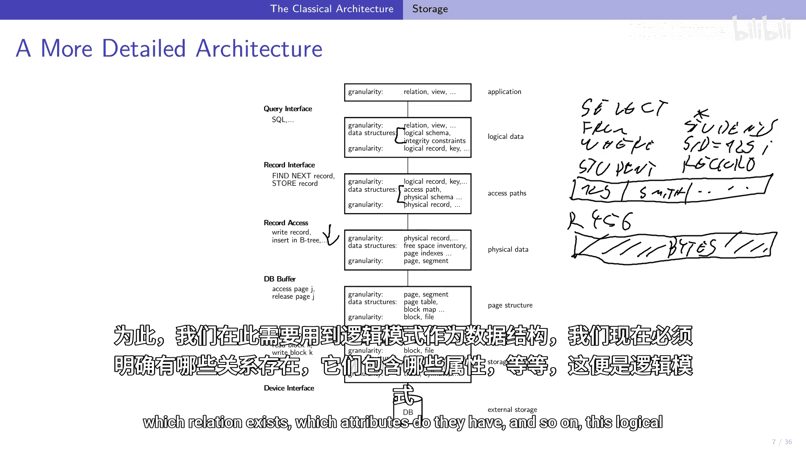

The bitment detail is still abstracting away。 but this is roughly how。A database system is organized。

 Yeah， and indeed， most database systems look roughly Alexis。

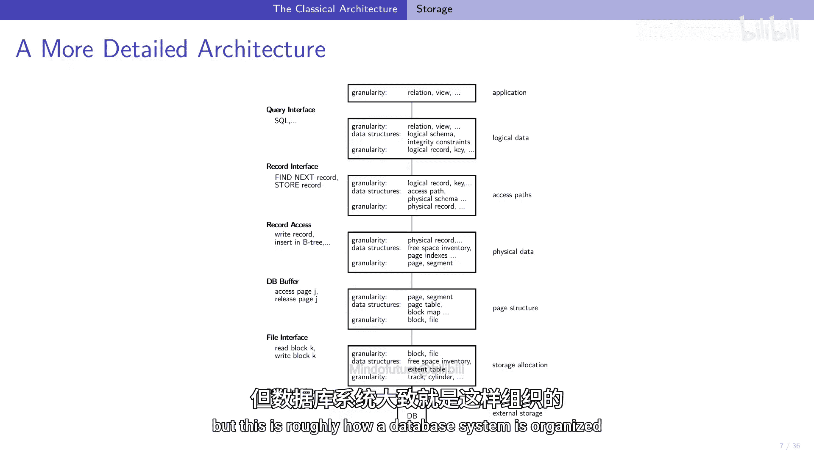

Okay， now there are some pieces that we are still missing。

 the most important one that we're missing transaction isolation and recovery。

 we will talk about both in the lecture now the reason why we don't draw this in this。😊。

Picture here because unfortunately， these two tend to be layer cutting。

 So this is difficult to keep them just hidden in one layer。

 So different layers must know at least a bit about how recovery works。

 how transaction isolation works。 This makes this very nice picture a bit more messy。

 but nevertheless。 So these are just two more components that we need。

So just to give a 3 second summary， transaction isolation means how do we con users of the database from each other so that they can operate in the same data without producing wrong results and recovery means how do we cope with errors is either a user error or。

Operating system or hardware failure。 so how do you do this how we recover without losing data。

 So if we we you look at these components later。Okay， so but nevertheless。

 this is a reasonable approximation to a database architecture。

 Now some database systems deviate a bit from this。

 like what I said previously most database systems nowadays delegates drive access to the bra system。

 So this component here might be missing from your database system instead we just say a is operating system does it for me I don't care。

 And so this is the case in some systems。 So then we are missing as a bottom layer some people go even further say buffer manager or let's delegate oh this here to the operating system too。

 here we just say operating system can do this for me replace my buffer manager basically with's a call to M map。

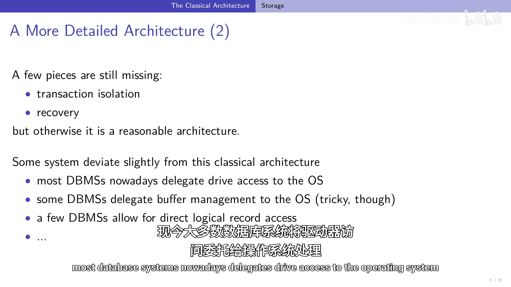

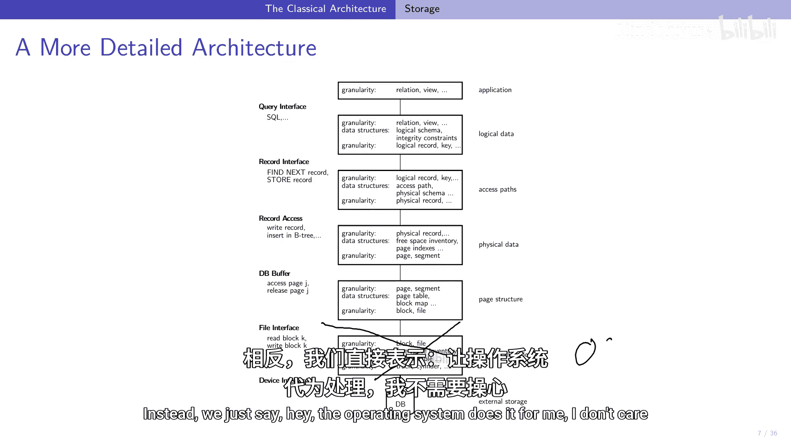

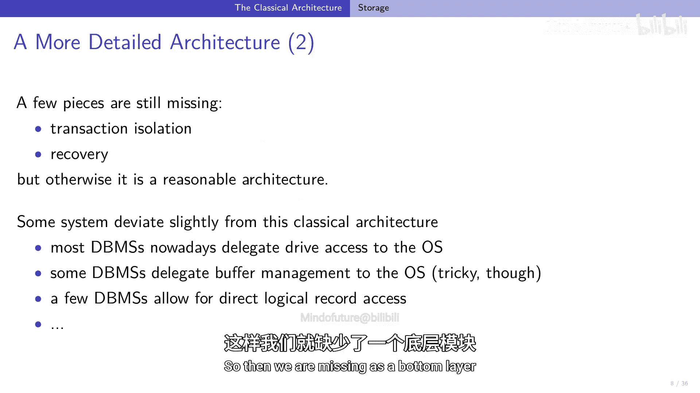

So M is if you don't know this is a system call that says please map a file into my address base so I can access this data as if I would have loaded it into memory so it's very easy to use。

😊。

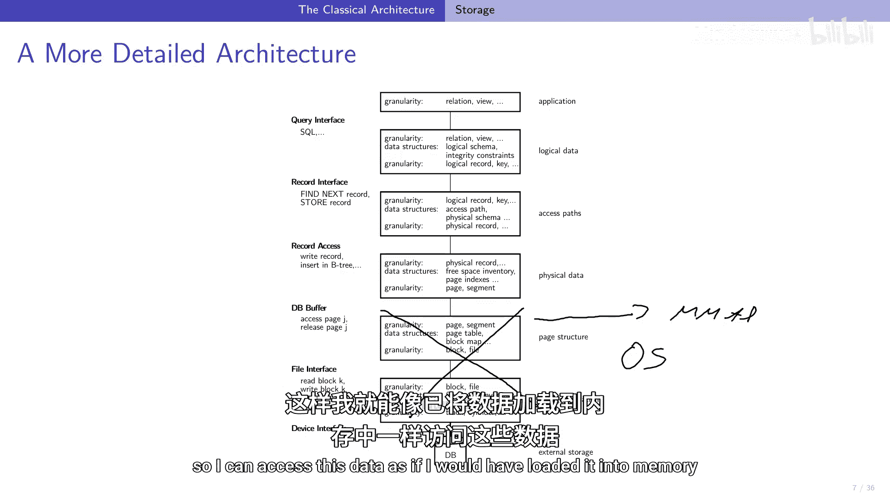

Yeah， as long as you're only reading so the moment you start writing。

 then suddenly it's not so easy anymore here therefore is' about to be right here。

 it's tricky reading for the operating system with M this works fine writing is the problem because of the things like recovery now because if you write through an M。

 you don't know when this right happens， operating system can perform the right any moment at once。😊。

You have no control of it。 You can force it to bright， but you cannot prevent it from writing。

 Yeah this makes life hard because some could be that it does a partial bright like chance to make an example's assume we have two pages here it's called this P1 and P2 and you have modified bow。

 So say yeah we have some bright and here's some bright。

 And then the operating system for some reason， decided oh， I'm running out of memory。

 So let's write this one here to disk。 So this is written。 this is not written。

 So the right box here is not written。 then my system crashes。 So power goes away。

 So the first page was written。 My second page was not written。

 this is So have inconsistent data all kinds of problems。 Now you can dance around all this problems。

 but it's not so easy anymore。Yeah， and as I'm just saying。

 so some people do this delegates buffer management to the bra system， but most people don't。 Okay。

 And then from the other side， the other end of the spectrum said my interface has sQ。😊。

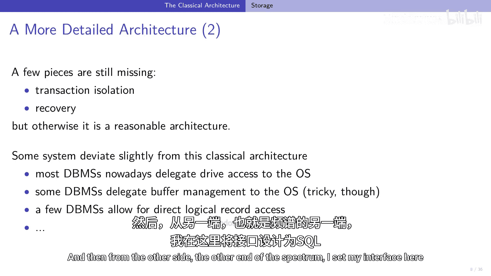

And usually， this is the case。 A few systems allow you to bypass the SQL layer I say， oh。

 if you really know what you're doing， you can directly access logical records without sending queries if you want。

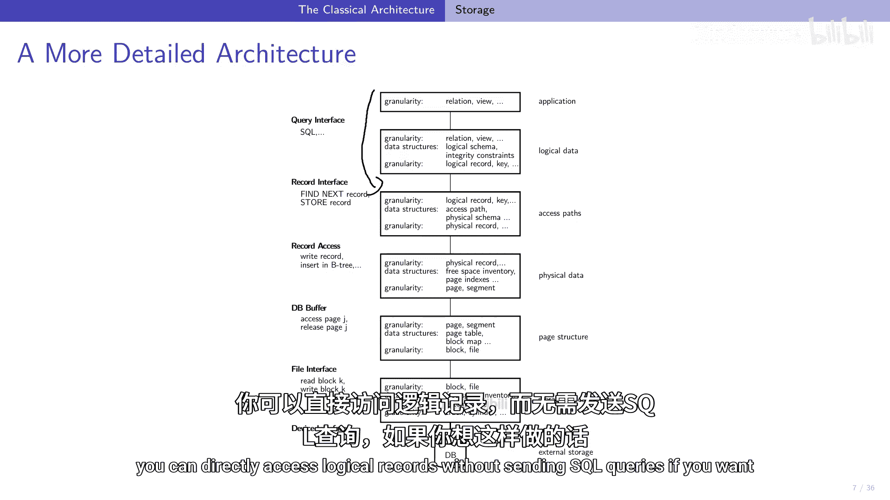

Not so common， but a few people that allows us， so I'm just saying so some people deviate from this picture a bit。

 but most systems follows this layer。

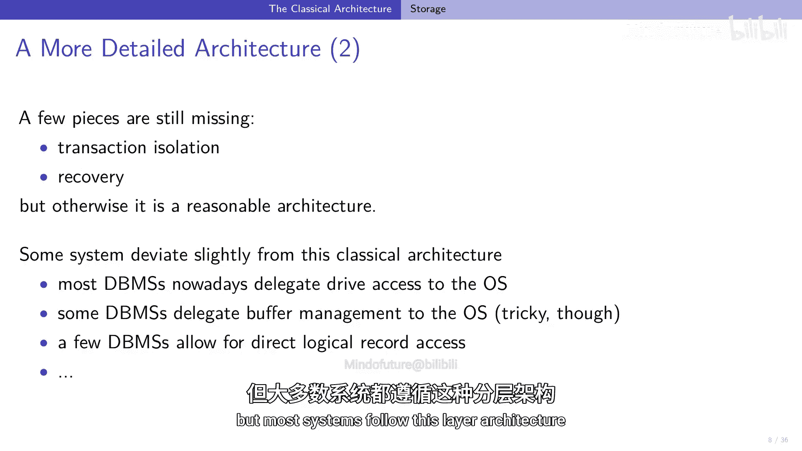

Okay， now when we talk about an architecture of the system， we must， of course， always keep in mind。

😊，On what hardware are we running， so our hardware has changed a lot in the last。

3040 years so and therefore the some auto must mean， say 40 years。

 because this is roughly how old database systems are。

 at least if you count the relational database systems， hierarch systems are even older。😊。

YeahAnd if the hardwareer changes so much， then we must， of course。

 somehow do this in our system too we must change our system。And for a very long time。

 we were dominated by what you most likely know， Moores law。

 Moores law said the number of transistors on the ship doubles every 18 months the exponential grows。

Of course， we all know that exponential growth cannot be sustained infinitely because you know。

After her， at some point， you will have more at least theoretically more transistors than atoms of the universe。

 so this cleaniness cannot cannot go on forever， but for a long time， this was true。

 the number of transistors did indeed double roughly every 18 months and indirectly。

 this draw a number of other parameters too。 like we had exponential growths in memory size too。Yeah。

This is also no longer true。 mean， remember we're still growing。

 but not as fast as it did in the past so。We have large memory。

 but much larger memory than we have before， but it's not growing exponentially anymore。

 Also CPU speed did grow exponentially。This is no longer true。

 It it's already no longer true for quite a while。 so CPUs no longer get faster。

For a number of reasons， main reason is heat， power， power and heat。 so therefore CPUUs do not get。

Faa， and you know， but at least what is happening is that the number of core is growing not as fast as in the past perhaps。

 but number of course is growing。 as you can buy CPU that have3 to even 64 core on the seal die。

 So this is a immense number of core。 So there is something going。

 all but speed itself itself is no longer going up as it did in the past。

And ultimately grow exponentially at least in the past was hard disk size。

 this starts to get problematic too as we have got hard disk are coming to the limits of physics。

 we cannot make。read right head abitarily small， otherwise， we cannot read write reliable。

 So there are some limits to density。 And so capacity does not grow as much as it did in the past。

 but nevertheless for a long time， It did grow very quickly。 Nowadays， it does not。 You Now。

 one unfortunate aspect that I want to mention here is this one。 The last one。Sorry。

 I mess up millennium。 and so。Hard disk capacity grow exponential over a long time。

 which means you could go by larger and larger disks。

 So if you wait if you guess the disk is much larger than it was before。

 so the hard disk size did grow in the past， but did not grow unfortunately was excess time so excess times means how long does it take me to access an arbitrary piece of data on my disk and the excess time is in the ballrepar or depends on the hard disk concern on but is in the ballpar of 4 milliseconds roughly。

And this did not change at all basically for the last 20 years。

 Now if you buy a hot disk today or buy hat disk at 20 years old， has the same excess time。

Which is very sad and which has implications， which means you do not want to access random piece of data on your disk is very slow。

Yeah and the reason， of course， for this 4 milliseconds is because you have to move your readr into position weight for rotation as so well。

 suppose this't happen。 on the other hand， even though hard disk does not increase something else that's happen namely we we got SSDs and SSDs do have much better access times than than hard disk now that don is are more expensive and so。

 but even they are seems to happening So nowadays probably。We can bet on having SSDs available。 Okay。

 so how that changing。 now another thing that we're interested in is because we not only have one piece of hardware that we're using。

 but we have a hierarchy so called memory hierarchy and the memory hierarchy is pretty important for us because there's a lot of implications on performance and storage。

😊。

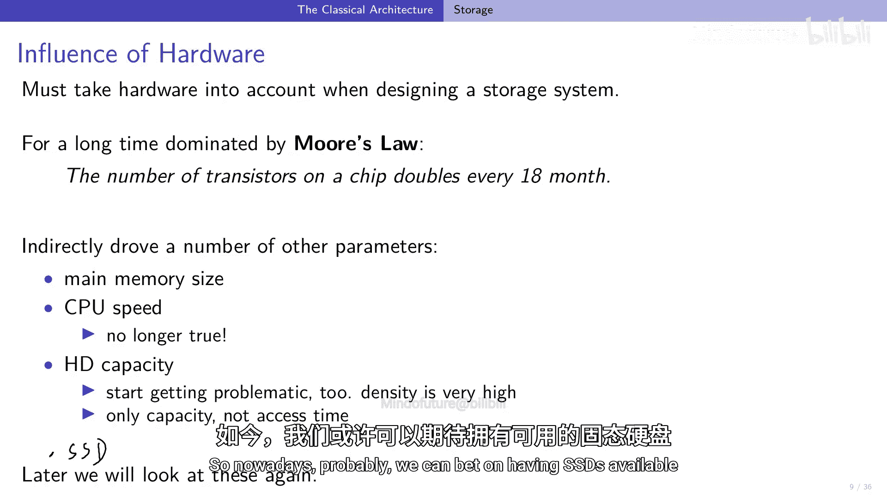

Now here let's start in the top so if you look at the top of my hierarchy。

 the fastest things that I have is my CPU register here we just write register。

 we can sort write the CPU register。And so this is the fastest that I have， and I can access this。

In each instruction， basically， and I my access time。 Yes。

 is the board part of 1 nanosecond has a very， very fast access to a CPU register。

Now but so this is the fastest that I have， but I don't have a lot of this。 Now how many register。

 how much do I have depends of course which CPU architecture you are using And if you use a 32 or 64 bit architecture now first I hope you all use 64 bit architecture might I。

Assumably this is the case。 Nowadays， there's absolutely no reason to use a 32 bit architectures don't do this just for for reference and a 32 bit architecture which you should not use。

 we had something like six general purpose registers。You see my 6 looks like a G。 Okay。

6 general purpose。Registers。 So see Res。Which means six times4 byte， which means we get 24 bytes。

And this is a very， very bite。 This is a very， very low number。

 so you definitely don't want to do this。Okay， now if you use。

 hopefully you do this if you use the 64 bit architecture， then we have 16 general purposerate。

 this is much more。😊，YeahSo and we have 16 times 8， which means we have 128 bytes。

So this is much more， but still not a lot。 Yes， so we have something like 1208 bytes or so。

In in registers。And this is the fastest that we have， but it's limited in space。 Now。

 if you go further down to hierarchy， the each CPU has caches， usually we have one cache。

 which is depends。 But in the ballpar。 usually a one case the same。

 one cache is usually like 32 kB of space， This is。Still pretty fast。 The we have a2 cache。

 which is already quite a bit slower。 and this is the bit of which system here for。

 But let's say in the boilpar of 512 kiloby size。 and then we have a3 cache。

 this is let's say in the boil pack of。😊，16 megabytes。Depends on the processor you have。

 Also you at three caches usually shared between cores so the 60 megaby looks better than it is。

 but nevertheless， so this is roughly is the size that we have。

And one problem is the further down we get here is the larger VR。

 but also the slower VR A3 cache is definitely slower much slower than ever cache。😊，And。

So if we remember we started with one nanosecond in the register in the cache。

 we might have a time of roughly 10 nanoseconds。 It could be fast or slow。

 depending on where in the hierarchy you are， but let's say 10 nanosecons or something。

 So you already lose effect factor of 10 by going from register to caches。 Now。

 if we go further down。 if we go out beyond my cache size。 I go to main memory。 now， main memory。

 I have many gigte。 it's much， much larger。 So I have many gigte even you can even buy a machine with a terte or 2  TBte of main memory is not exactly cheap but affordable。

 course a few thousand0。 you can buy a machine with 2000 TBte for not too extreme price。

So this is so it's very large it's good， but it's also much slower。 so we again。

 we use factor our 10 compared to caches in effect 100 compared to registers so much it's larger but much slower。

😊，Okay， then if we go to one layer further。 So if if you step beyond main memory。

 if we go to external storage， now， even more extreme things happen。

 First size again grows dramatically。 now we have definitely terabytes potentially mini terabytes。

 So this is pretty large， but it' is also very， very slow。

 said like rotating this has4 millisecond response time。 Well， this is really terrible。

 Yeah so nonesecond to milliseconds。 know， there's a different order that you are skipping here。

 namely microseconds are sitting between these two。 so this is now really， really， really slow。

 external storage is terribly slow compared to main memory。Now， if we don't have hard disk with SSD。

 then we are back again to microsecond。 So it's better。

 but nevertheless less even microsecond is much lower than nanoseconds。 So external sources。Lch。

 but slow。Now you might so this is external online storage which we usually talk about now you might have nearline storage I think personally that Neline storage went a bit out of fashion few people I think use Ne land storage so Neline storage means is external storage that you can access but you need a moment to for example。

 spin up or disk or to some as a mechanical thing to start the external so aap storage and then so Neline storage then we have offline storage and this is usually tape。

😊，Anwer this year。Many cases means tape。And so this is where we can store data for a long time。

 and of course， this tape is huge。 we can store petabytes of data and tape。P large。

Another good thing is that the tape doesn't use power， yes if you store something on the tape。

 you can put it on a shelf， you can read it when you need it。

 takes a while because you sent a robot fetching the tape put into a drive rev into the rack position and so also as the accessing tape is really really slow you see the time is grid here as minutes as it could be that we have to wait a minute or two。

 but it's cheap uses no power at very large。Now， there are some so these are the traditional layers。

 some trailers you can use。 for example， I once read that Facebook uses here as an airlineline basic storage uses a blue ray。

Instead of tape。Now， why blue ray the。Means the argument first like tape。

 a blue ray doesn't use power if you don't use it， and a blue ray is a bit faster to access and tape because the tape is really。

 really， really slow or refinding the tape takes a long time。Blue ray。

 you have to send a robot fetch the blue ray into the drive。 But afterwards。

 you can jump to a position Yeah。 So it's a bit more faster than excess than send a tape。

 So you have some， some choices here。But nevertheless， we will have a hierarchy of storage mediums。

 and the fastest one will be limited in size。 So this is the reality that we have。

 and we must somehow coes in the database architecture。

 So the database must try to keep the frequently accessed data as high up as it can。 for example。

 here。 So this is usually what we assume。 We want to keep everything that we access frequently in memory。

 Idely， if you even want to keep it in cache if you can。😊，Yeah。

 but definitely want to give it my memory。 And we go down there only if we have to。

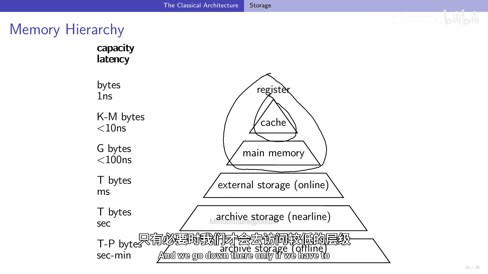

Okay， so this is what I already mentioned。 So we have huge gaps between the hierarchy levels。

 So traditionally the。Gap between main memory and disc is the most important one because this is such a huge factor in performance。

But also the other step I'm interested in it the step between memory and cache because the cache is much faster than memory so big about this and in general the delivery system must try to maximize locality。

 which means we try to keep odd the data that access frequently high up in the hierarchy and fast success。

 so this is what we want to have。😊。

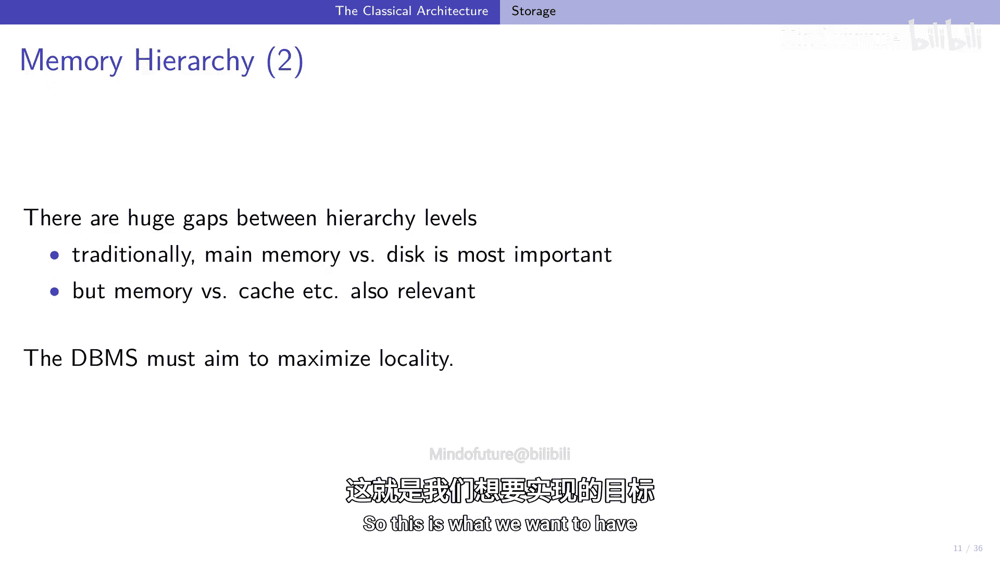

Okay， and so。If you think about external storage， that hot disk still dominant external storage。 Now。

 this might be changing currently。 I， I would guess that at least if from new installed solar systems。

 SSD are probably more。Prominence and hard disk。Probably now that's all our。Different factors。 Yeah。

 I says these are most faster Downside is they are more expensive。

 and so but the numbers are going down， so。I I probably in the long run。

 hard disk will be completely replaced by S， but nevertheless people still using hard disk for storage because you can get very。

 very large hard disk cheaply。 So this， of course， makes it attractive。

Now downside of hard disk gives we rotating plateletau with mechanical effects so we have to wait something the correct position and so on。

 and here we have a transfer rate of something like 150 megabyte per second。😊，And。

Which is not so super fast， of course。 And， but even worse。

 we have a seat time here of 3 milliseconds。 I said previously at 4。

 I think3 milliseconds might actually be optimistic。 It depends on your drive that you have and so。

 But nevertheless， so let's say it's 3 to 4 milliseconds as well we have。

And the interesting thing is transfer rate you can buy。Now， why， I I mean， if。

 if one this gives me 150 m MBby per second， I can just build a rate array。

 which means I take many of these drives here。So I can many of these drives。Itroll them parallel。

 So then if you build a rate of this。Then I can read with 1。5 GB sorry，1。5 k per second。

 but it is not too bad。 mean more than a gig per second。 This is a serious performance。

If I just read my disk drives and parallel， so this means transfer rate I can buy。

 I just buy a second drive。Okay， but seek time， I can unfortunately not buy because of this this。😊。

Mechanical effects。 So if I want to jump adapter position in rate。

 I still have to wait until this corresponding disc that contains the data that I need has moved the head to the correct position and has rotated the data to be under the head。

 And so I cannot do much about seek time。 I can by transfer rate。

 I cannot improve seek time significantly。And this means that there's a huge em between random and sequential I O。

 So if I read something sequentially from just sequentially means， I start reading here。

 then I just read until end。 So this is a sequential read。

 Start as I position then read sequentially。 This is reasonably fast and I can make it absolutely fast by spending money as I just by more and I can make it fast。

😊，Okay， so can I O is somewhat。 Okay， random I O random means this is my data。

 I just read this and this and this so I just jump。This， I cannot improve much， and this is much。

 much， much， much slower。And。And so the database must understand this problem。

 and therefore the database must try to use sequential access。

 so we want to raise sequentially if we can， because this is much better than jumping around the disk and unfortunately the problem is going even worse because transfer rate in fact is improving so if you buy a newer disk you might reach for example。

 something with 200 megaby per second。😊，Now， if you have a faster disk。

 but the CT tab does not improve much probably not at all， CTTs are affected。

AndAs where seek time is more or less fixed， transfer rate improves over time。

 so it means the difference between sequential random becomes theverse。

Now this is concerns rotating disk if you have an SD， then of course we have better。😊。

We have better random system， but even there， you have an asymmetry here， because if you。

 if you reach1 byte at random。 So if you say， so this are I。My my this is my storage medium。

 and I go here and I read one byte and read one byte，1 byte and so on。 so we single bytes。And。

 if you do this， for example，16 times to agree 16 times a total。See， sometimes all， if you say。

I go here and I read 60 bytes on block。 So from one party。

 this would be much faster than the other one， even on necessity。Good。🤢，And SD， of course。

 have other problems like reading SSD is fine。 W is not so great because you cannot erase arbitrary pieces of so。

 So we must always erase full blocks。 And so write behavior of SD is a bit problematic。

 And another worrying thing about SDs is right endurance， because at some point。

 if you write too much on SSD SSD dies。 and you cannot write arbitrary much amount of data on yourD。

 There's a limited amount of data that you can write unless this drive is dead。

So this doesn't matter much for your personal photos。

 if you just start store some data that you have is not the problem。

 but if you have a database system that constantly writes to disk or writes all the time。

 then write end。Becomes an issue。 Yeah， so therefore， SDs are not0 percent trouble free either。

 But regardless， I think the futures are definitely。SSD is or some other technologies。

 so we will move away from rotating disk in the long run。 according these， people are using SD sorry。

 rotating disk these for database systems。

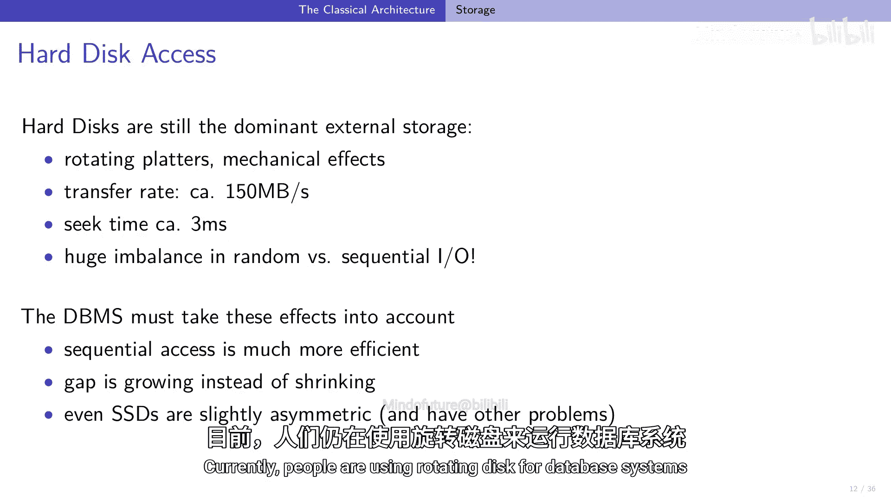

Okay， now how we can make disk effects faster。 So first observation is we do not want to move to diskcat for every single table because moving diskcat is terribly。

 terribly expensive。 Therefore， we don't want to do this。 Okay instead once we have moved diskcat。

 we want to load something larger。 So that's a movement has amortized。

 We get large amount of data with one excess。 And typically what we read is a socalled page。

 So page is basically fixed size piece of data。 And now a question is how large as the page。

 This is not so easy to answer because this depends on many many factors。 Now。

 traditionally people have used 4 kiloB pages。 And if you remember your lecture on operating systems。

 you might have encountered 4 kiloBte pages too。 because the operating system uses。

For hardware reasons， also uses for kilobittes。 So forcuyte has been traditionally the size of the page。

 We say see we， you read forlkte and write foryte and never anything is smaller than this。And now。

 Foleyide。It's a circular amount nowadays， you probably prefer something larger， for example。

60 Kbyte， or perhaps even more。 So you took 64 kiloby。

 And so using a larger page is usually advantage as the trade of。 So if you use have larger pages。

 this means you do less access to disk。So because you get back more data versus access this is good for performance。

 Therefore you want your page to be reasonably large。 on the other hand。

 the downside of having a large page is that if you read a page then you just need a tiny piece of data here from this page because you' are just interested in this small tu and nothing else。

The larger my page is the more memory I waste。 and because I always read a full page。

 And so if my page is too large， I waste a lot of memory for data that I not care about。

 And so this is also not good。😊，Therefore， you don't want to make it up large， but definitely。

Multiple kilobytes， probably 16 and 32 or something like this。 This is a typical size。Oh。

And some niche use cases， people even started using megabyte pages。Usually。

 you only do this if you are pretty sure that they needs a whole page。 For example。

 if you're an analytical system， So a system that analyzes large amounts of data and reads all of this。

 So usually without using in structures， if you are pretty sure that you will need。

Most of the page anyway， so a large part of the page， then you can afford to use larger pages like。

 for example， a megamt page。If you in a transaction processing system that jumps to arbitrary pieces of data then you don't want to have do。

 then you want to have smaller pages， it's a trade of。

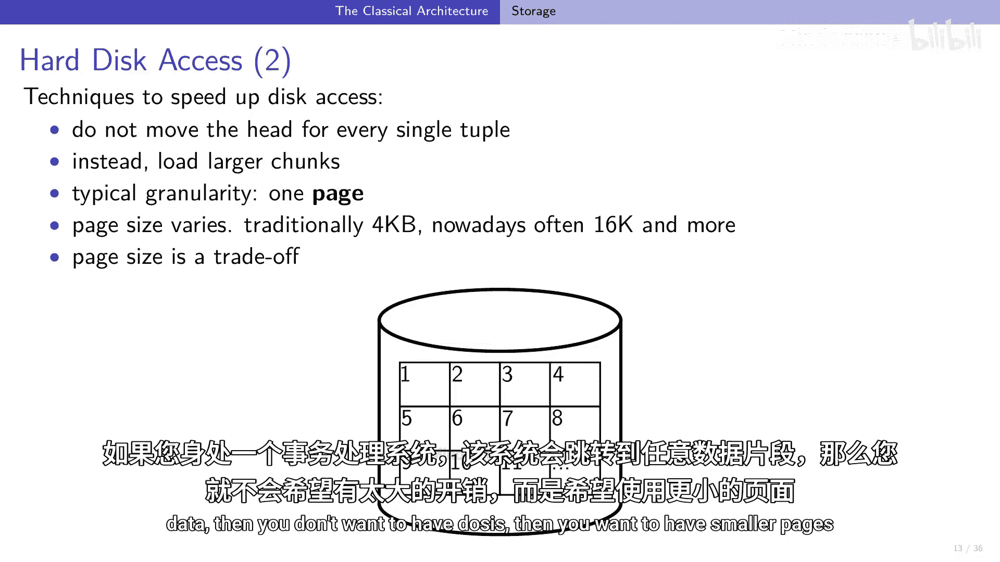

Okay， now inside the database system itselfs， the paycheck is very， very visible。Very visible thing。

😊，Because I always do， I O in page size。 So this is the smallest thing I can read about is a page also for buffering。

 So if I catch something in memory。😊，Or if I look memory， this is often done in page sizes。

 as a page is use for buffering， often not of allocation or out of a recovery。

So if I crash and I come back， I must restore the content of the database I was before。

 And this is done on a page level。 So the page is very， very visible。🤧嗯。And。😊。

But even though we made a page larger to avoid going to disk all the time。

 the as the page is still too small to completely a hydr random because even if you read one page and then the next page and so on on a rotating disc。

 we still in first case have to wait until the disk rotate it or if we have might have to move into disk So this cost me many microes perhaps even milliseconds reading just do a page read another page read Now therefore we want to read sequential pages if you can and。

Dataware systems use typically two techniques to speed this up。 First is really head。

 Like so you see if this is my database system。 So I have many pages。So this is page1。Page 2。Ba3。

Page4。 Now you see a query read page1 okay then you see it reads page2 and then the system says if you read page1 and then page2。

 most likely you will also need page3 So even though you only ask me for page2 I will in the background already read page3 anticipating that you will most likely need this then there is one that not only read page3。

 we don't have to fetch us because order there and we might even at this moment start reading page4 because we say。

 oh I understand that this is a select theory or some scan query and therefore most likely this they will need the other pages two and then just read them even before they access and this is called what we call read ahead So reading more than what we currently need and this helps us to avoid or to hide the latency of doing graio。

😊，So this concept reads the same for rights。 So if you have modified the number of pages。

 so let's say this is modified， this is modified and so on。

 then when the point of write changes to disk， we collect。

 we figure out okay all pages that are modified we sort them so we figure out okay even though you might have modified page 4 first then page2 is then page page5 we can reorder them to do this right back as p4 p5 and then p2 And so then we can nicer sequential access pattern and we do this in the background again to hide the latency from Zo so we try to。

Hi said you have to wait for the hundred， if he can。

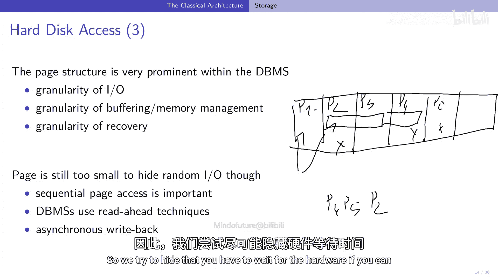

Now， they have mentioned this already before， so when we access disk is pretty slow and to height us we use something that would be called buffer management。

 And also this means that pages frequently occasionally in memory。

And so if somebody reads once access this page again， we just give them the copy memory。

 But of course， at some point， we must write it back to disk because if you shut down of we crash。

 then we must have the data on persistent storage therefore we from time to time write data back to disk Also because we run out of memory simply because let's say I might have 64 GB memory。

 but I might have2 ter data。 therefore I cannot keep everything in memory。

 we just keep what frequently use of what we currently use and everything else is stored a disk。

 So we discard or write back when we when we run out of memory。😊。

And now here this is already look ahead to what we covered through late ins lecture this has to be covered with recovery because remember we always assume that we can crash at any point in time and survives this even though we do buffering means that the buffer component and the recovery component must talk to each other so we must understand what is written to disk but not written to disk and they must do this carefully so that we can survive power failures。

 but we do this late ins lecture。Okay， now its perform are conceptual pretty simple because my interface is just two functions。

 First functions is traditional called fixed or another name perhaps would be to say load。😊，Oh。

 perhaps loads not really a better name because it could be that is the data or perhaps a fix you might cause this access。

 also， but the traditional name is fixed。 So fix， for example。

 if I want to access a for certain page， I say。I want to access page number page number 11。

And then second parameter。 I give it a moment。 And then the the abovemeter says， okay。

 I have the page for you。 and it's here and gives me back a pointer to， to the memory。 So can now I。

 I can， can directly access the page because I have a copy of the page in memory。 Okay。

 and this in memory before I can now do whatever I want。 I can read。 I can write。

 I can do whatever I want。 Yeah，1 to3 and it's in there。 and I can。😊。

I can manipulate this page until I'm done。 when I'm done， I call unfixed and unfixed says。 Basically。

 I'm I'm finished， you can now release the memory or not。 Maybe I no longer need it。

 As long as it's fixed， of course， we cannot discard the page because if， if the page is fixed。

 it means someone is accessing it。When it's done， then we call unfix。

 so we fix we get it and then we call unfixed。Unfix。

 and then the system can discard or write a pack a。Okay。

 now you see that fixed and fixed get two additional parameters not on the page about something else。

 Now， the fixed one here gets a flag。 Do we need shared access， Yes or no， who we could， for example。

 say shared。And shared access means I only read because if I read a page。

 somebody else can read the same page too， and so upturn many people can read the same page。

 so shared access means reading if I want to change the page so then of course it's not shared but exclusive。

😊，Exclusive and in exclusive mode， only one transaction is sell out or one query。

 Let's say we didn't talk about transaction yet。 Let's say only one。Quio。

 only one user is allowed to have exclusive access to a page at the same time。

 and when you have exclusive access， then you can modify it。And when you unfix a page。

 you must tell the system if you did modify it because because you were allowed to modify it does not necessarily means that you did modify because could be that you have for example。

 you delete statement let's if something like this say you have。😊，Delette。From our。Where。

X less than 5。 So what happens now， you， you， you have， this is a page from， let's say。

APage from the R。 So I now because I want to delete， I fetch this page there I want to modify this。

 Please give system me if you say yeah， fix exclusive。Okay， now I check。

The entries on the page 17101215。 I see。 Oh， none of them are less than 5。 So sorry， therefore。

 in even though access the page exclusively， there later decide that will not modifies because there were no qualified template。

 therefore just unfix it。I said no， I did not quantify it， you can discard it if you want。

But if I did， if the content was not a 7， but was a3， for example。Then I would delete it。

 so I would take the three and I would cross it out， I would delete it。

 and then I would in my unfiix say， oh， this is  dirty0。Okay， this is dirty， dirty。

 please write it back to disk。So this is interface。😊，Fix。Shard or exclusive and unfixed。

 Did you modify yes or no。 Of course， you are only allowed to modify if you have exclusive access。

 answer， if you have shared access， you are not allowed to modify。

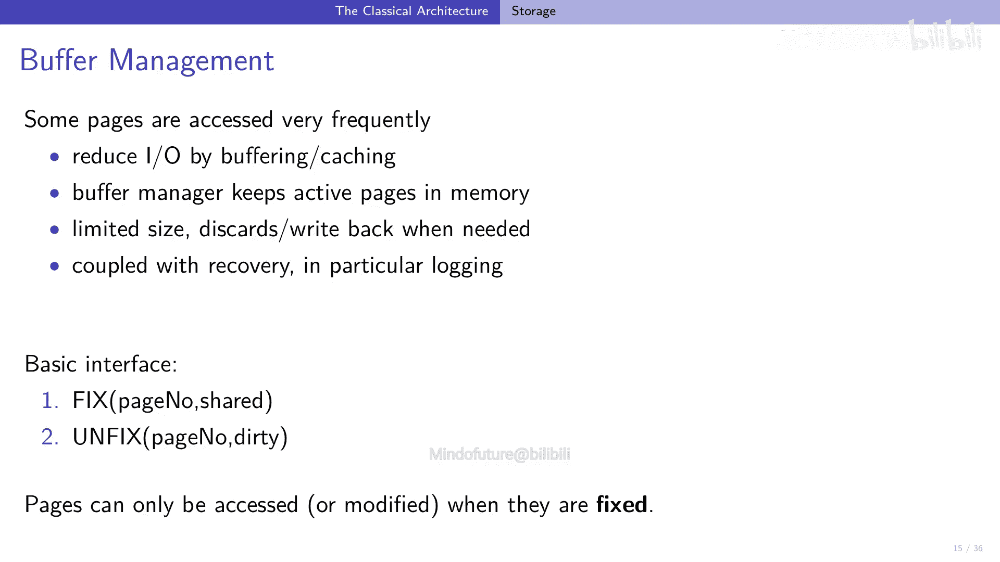

Now， how do you implement such a buffer manager， Yes。

 after all we are the database lecture implementation。

 So how do you implement this A buffer manager is at least in first approximation。

 roughly a hash table that maps page numbers to。😊，Throughose the physical pages。 So this， for this。

 we use something that we call a buffer frame。 buffer frame basically is the description of a page。

 So you have a big big hash table here on the left。 So this is my big hash table。 Now。

 if somebody wants to， for example， say， I want to access page number。4711。

 So I want to take this one。 I then a heet。And I add up in this is this slot in my table。Okay。

 and now I check the entries in my I here， in this case， I have two entries。

 I go to my first entry is my first buffer frame。 I check。

 I use the page number 4711 if the answer is yes。😊，Then， I。Acquire here。

 lecture Let is I've talk about in moments roughly some I mutex。 I I protect the page now。

 and then I can follow this point here to the real data。 You see the data itself。

 So the page content is not stored in the buffer frame， but somewhere else。😊，Yeah。

 and the buffer frame just points to the real data。 So basically I have some huge mode of memory。三么啊。

And the page sits。For example， this year I might point into my my。Buffer range。

 Now this contains another page。 Currently， this can change over time。 Of course， I can。

 because I can discard the page， load of ads on so on。 And。

 but the buffer frame is the hash table entry that points to the real， real content of the page。😊。

Okay， and because I can have has collisions could be that two pages end up in the same has table slot Sa of course。

 of can have a second buffer frame this then again auto points to another。😊，To another page。

 so this is roughly how we implement a buffer manager。

 Now we need some more mechanism because you know buffer manager is a hotspot。

 basically everybody's trying to access the buffer manager simultaneously because all is will frequently access the buffer manager and we must make sure that this is safe because pages。

 new pages get loaded Page get evicted and so on。 So a lot of things are happening and you must do this in a stretcha manner。

😊，And therefore， we must protect the above image itself itself all of this led。

 or actually with multiple edgees， because if you would just use one ledtch， as I said。

 first approximation in ledge as a a a mutex or more precisely a read writer log so。

So we protect the tab against Q code access。 if it would use just one latch here。

 then everybody would constantly fight for the latch like assume query one wants to read this page。

Query2 wants to reach that page oh sorry I mess it up with that page and now before accessing this chain you must first protect yourself against concurrend updates because you must make sure that nobody evicts the page while you currently try to check the buffer frame。

Now， what you could do is that Q1 grabs this ledtch here。

 So as you grabs this ledtch and Q2 grabs the same ledtch And then as long as here have you let。

 you check， and if you are done your release ledtch， you could do it like this。

 but you don't want to because otherwise you get a very poor concurity because only one thread is allowed to access the buffermeter。

 So instead what you do instead is。Within each entry here， you have a small ledch。

AndSo each therefore you can now you can lock each chain entry individually。

 So this one gets this ledge here， this one gets that ledge。

 and so you no longer have the problem that you are fighting against each other if they're accessing different pages as well as you must protect yourself against this。

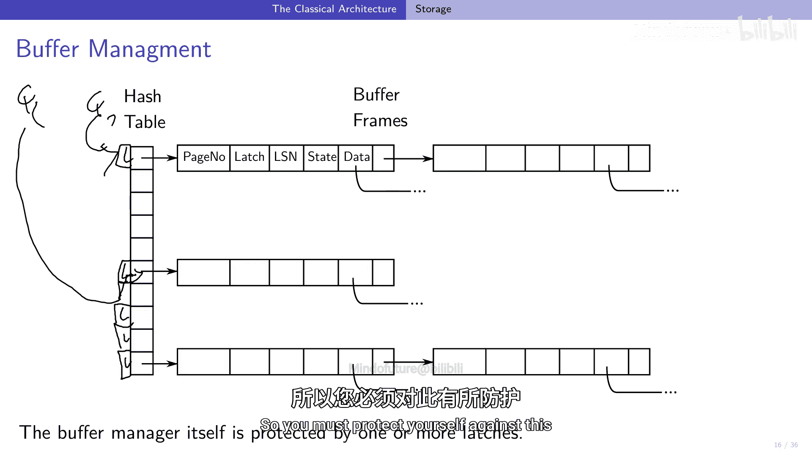

。Okay， and the buffer frame。 So this was this record we have seen before。

 this remembers what is the state of a certain page that I have in the buffer。Okay， so。First。

 of course， we have a page number because you must know。Which for which page are we call responsible。

 then we have select lett read writer log that protects the page。

 a read writer log means that we can lock the ledt user and share an exclusive mode in a shared mode so you can have many people who gets the same latch and shared mode but only one who gets an exclusive mode so classical read write log。

And。Now， this letter is already noted on the slide。

 So this letter is a bit more subtle than you might think。

Dpping this ledge is not so super easy because remember we my if I draw pictures。

 this was my buffer mention and then had to slot here with a ledge。And this points to buffer frame。

At this point， then to another buffer frame。So let's call this yes page 1。 this yes page 2。

 Now assume thread1 tries to grab。 So Str1。Wants to read P1。 Yeah， wants to read P1 and thread 2。

Wants to read。P2。Okay， now what's happening is。Thread1 grabs。 We could say every grabs this。 Yeah。

 we lock this。All let's， let's say we be too。Yeah， so let's say we or let's let's make。Yeah。

 so if we just a look and there different ways of， just say we look it， just here we lock this one。😊。

And then we want to， we want then say， we want do。Let's do lock， shadow exclusive。

And now assume for some reason we don't get this look because somebody else is called manipulating P1 and we don't get this we wait。

😊，Okay， now comes to threats 2 as I want to reach P2。 and this is in principle。

 it's no problem because， you know， sorry it is supposed to be 2 because P2 is different from P1。

 So we can do this。 Yeah， but again， we start with doing edit log。

And we don't get this because thread1 currently holds this look。And so this is problematic。

 so we must have a way to allow us to bypass this P1 so we can access P2 without blocking on the sledge so tricky to implement and I think actually I'm pretty sure you will do an exercise for this because it is not first you understand it better if you have done this yourself also it's not so super easy so we talk about this in exercises how to do this。

Okay， so just saying it's locking election is more complicated than you might think。 Now。

 there's another component LSN， the so called log sequence number。

 This is the last change that was performed on this page and we need this for recovery。

 So we come back to the log sequence number later in the lecture When we talk about recovery。😊，And。

Basically， we just remember we last change and when we write B change to disk。

 we must make sure that the lock has been written before but again we do this late in the recovery part。

Then we remember the state of page。 So as the state is， for example， clean。

 dirty or newly created or what does this mean， A clean means I can just discard the page if I want and。

I don't have to write it back。 dirtyty means somebody will modified it。

 And if I want to discard then I must write it back， newly created means to this create new patron。

Freshly created so if somebody tries to access it， we can just zero it we don't have to load it from this because we know there's only zeros in there so we can just zero it if somebody access it and then we don't have to do this there can be other states depending on the implementation but these are the basic states that you need and then of course the data so this is now pointer to the real data so whether it's contained in the page that is usually stored some ways and probably you will also need some other information for buffer replacement because we want to keep the frequently used pages in buffer。

 there infrequently used pages going to remove from the buffer there are different ways to implement this for these different ways we probably need some extra information。

And then but this of course depends on the plantation and the buffer frames themselves are usually organized in a P table。

😊。

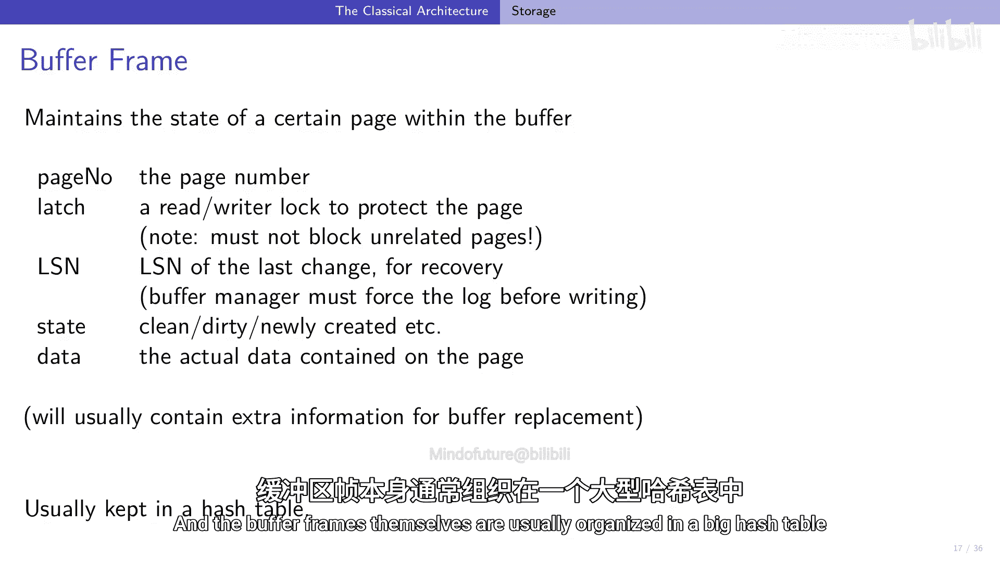

Now I've already imagined buffer replacement， so when my buffer is fulled， at some point。

 I don't have any more space， I must evict something。

And mean a clean page I can just discard a dirty page I must write back to disk before I discard。

 but nevertheless I discard pages at some point， I must somehow decide how should I do this and here this picture you know this is an illustration not really measurement but nevertheless this is how it really looks like this picture here shows you which kinds of page fors do we get so page for means how often do I have to access disk page for means we access a page that is not in the buffer so how many page fors do I get depending on the buffer size Of course ifm buffer is very large is and here have to spectrum then I will have very few page of page for because once I have read everything I can keep everything memory so there's no reason to go to disk anymore so clearly if everything fits in memory。

 I just access every page once and that's it but this is very large memory as other had if I have very。

Me so here。Then I can barely keep anything in memory so the more accessible I do the more I have to reach S clear okay there is no choice。

 the more interesting case of course somewhere in the middle here。

 so I don't have enough memory for everything but for example I might be able to keep 10% of my data memory which I will just to make up some number。

😊，So what I should to do then？And now here you see two extreme curves。

 one is here's a so called random curve。 random means when I run out of memory。

 I just pick a random page at I call a memory and discard it。OkayOf course。

 you might say random is a bit extreme because it could be is that it's a very important page so picking a random page is really a dangerous thing because。

😊，Might be that needed immediately。 The answer extreme here is so called opt。

 So this is an optimum replacement。So this is the best page to replace so unfortunately how should I know what the best page is because I only know this retrospective and so I would have to be able to look into the future so I would have to know what will the user do in the future to decide what the best page to replace is because of course I want to keep the pages that are need it in the future but I don't know what these pages are so it's difficult to know and therefore in reality we cannot implement opt now opt is unimplementable and because we simply cannot know the future so what we will do on practice is we will do some compromise between random and optim optimum and so this is this area here that is highlighted so in somewhere this boardpar we will have strategies。

😊，And your good news is we can be better than random。

 bad news is we usually are not much better than random。 For example。

 the LIU strategy that we will look at in a moment。

 very popular strategy is roughly 10% better than random meaning it is better than random but not super much better than random。

 it's a bit better than random but that's of course we want to do this because if you can be better than random。

 we should be better than random， at least a bit。😊。

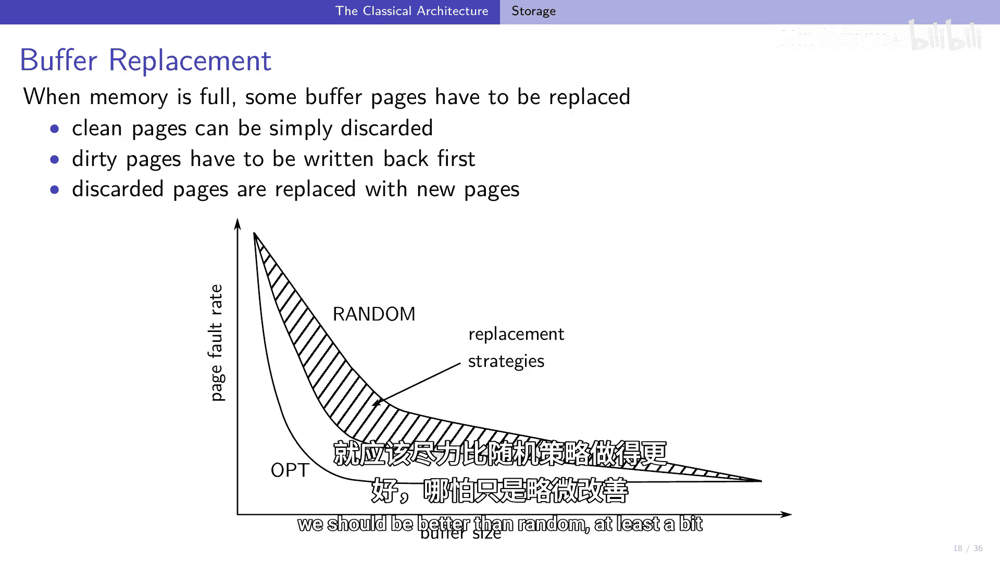

Now you might know these strategies at least the first ones from a lecture in operating systems。

 because operating systems of course have exactly the same problem。

And at if we look at database specific strategies， but we start with the classical ones。

First one fee first in first out so when we run out of memory the evited page that we have loaded first good thing is can be implemented very easily。

 very simple they just keep all my buffer frames in a linked list and I insert a new page at the end and remove page for eviction from the head so old pages are removed first so this is。

😊，Good， not too great is so this strategy does not take locality into account。😊。

So if some of your pages are accessed over and over again， the PO strategy doesn't recognize this。

 we just evict the oldest page first and that it Another unpleasantancy is people have found out that there are cases where P4 becomes worse when you increase the memory sizes it is also a bit unpleasant you usually expect that if memory increases your buffering get better that is not guaranteed with P4 P sometimes you get worse with small memory results or not too pleasant So therefore people is easy but people don't usually don't do this。

So a very， very popular strategy is this point here， LIU。😊，So LU means least recently used。😮。

So basically we want to remove some pages that have not been used for a long time。

 And so like in P4 we keep frames in a list in this case， in a double linked list。

 you will quickly realize why。Now and so this list there is which pages you can remove And if you want to evict a page。

 we text the head of the list and just evict it。 Okay， that's easy。

 now but how do we maintain this list。 So when we unfix a page so when we are done with a frame So we don't use this anymore then we remove it from the list and put it it's the end。

 So basically this is a list of my pages。😊，This of my pages said I first read page 1。

 then I read page2， then I read page3， and then I read for example page two again。

 and then what happens is I remove page2 from this list position and instead edit at the end of my list。

😊，Now， at this point， I hope you realize why we've used a double linked list now because in a double linked list。

 you can remove an element in constant time， so if remove it from a constant time from from current position and put it at the end。

And the effect of this is that the frequently used pages， those the socalled hot pages。

 so pages are used all the time。 these are at the end of the list and the infrequently used pages at the beginning of the list therefore we pages that have not been used for a while and this is usually a good idea Now this is a very。

 very good and sorry， not very good a very， very popular strategy many systems used L。😊，Very popular。

😊，The main unpleasant about Lu is。How do you maintain this LU list？Because remember。

 multiple people are trying to use abovement at the same time。

 potentially you have 6000 threats fighting for this list because updating this list all the time because they're accessing pages all the time。

 So therefore， the list itself。 So this list here。It requires some synchronization say lettingching you regard some care so we must synchronize this。

 and if you synchronize this， then this listed safe can becomes a performatorypot so the listed safe makes you slow because obtaining the list makes you slow as it suspect。

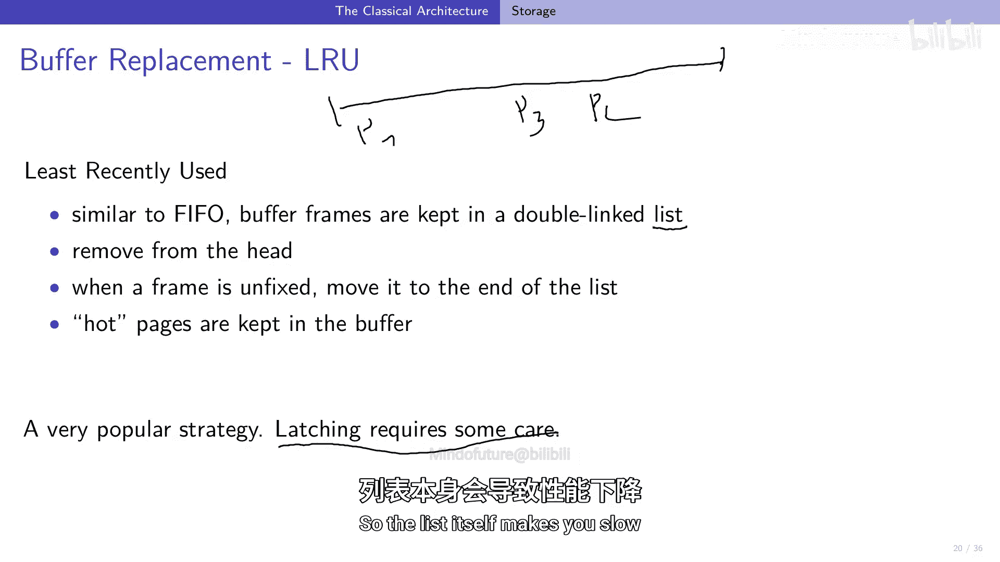

Now what other strategies are there they are one LF list frequently used。

 so instead of adjust same way crude list， so this is just the LU is just a simple list and you move everybody to the end and LFU instead you count the frequency of excess and then you may turn a priority queue instead of having a simple list of a queue the infrequent elements or the frequency elements at。

😊。

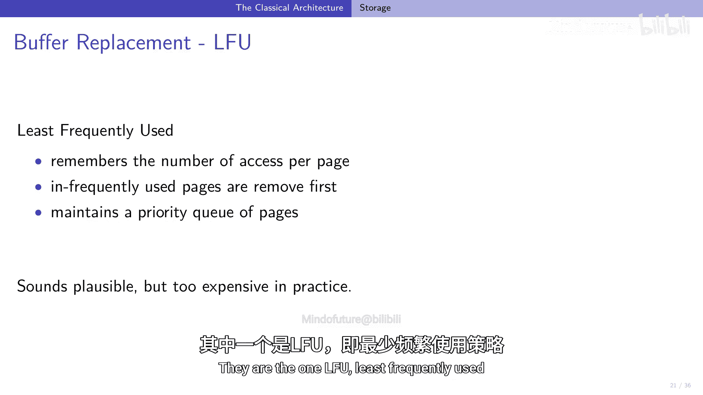

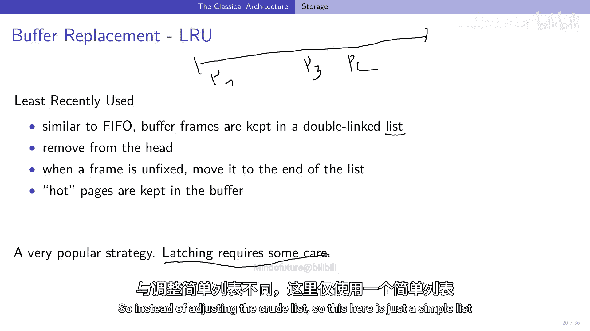

It depends on what you call as head and tail and says infrequent elements at the beginning so you can evict them as the frequent ones at the end as you organize them by frequency。

😊，Now in theory， this is a beautiful strategy has many nice properties。

 but in reality is too expensive as this pro is even worse to maintain than stubling list。

 super expensive。 therefore I don't think anybody uses this for productive systems。

 there are some research papers on this， but I think nobody uses this production。😊，It looks nice。

 but it's too expensive in reality。

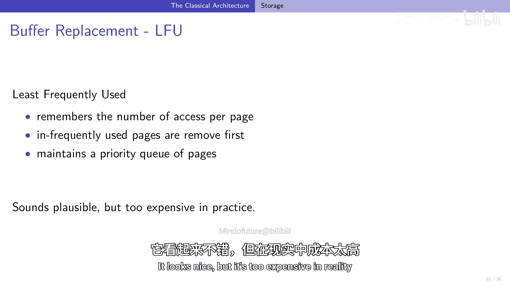

Okay， now what else can we do？Now， we could say LIU is nice。😊，Contempually。

 but the LU list itself is a hotspot。 and because we're updating this list all the time。Therefore。

 we want something that behaves like LIU， but it' cheaper and one mechanism to do is a so called second chance algorithm or another name for this algorithm is clock。

😊，YeahSome people call this clock。Okay， now how does clock work？Or a second chance， Basically。

 we approximates this list using just one bit in the page。 As if these are all my pages。

These are all my pages that I have in my buffer。And then I use one bit to say， what's this page。

 use T S N O。 So I says I use this page， I use that page， I use that page。 whenever I access a page。

 I set this bit to say more productive when I unfix the page， I set this bit to say， okay。

 I have used this page。Now， when I want to evict a page。Oh sorry， I should put the one on top。

When I want to evict the a page I have counter here that checks for an unused page so we say this page unused no。

 so somebody has used it so I cannot evict it， but I clear this bit so then I move my checkhead here to the next position。

To this one， Yeah can I evict this page， No， clear this bit， can I evict this the next page here。

Can I predict this point here。 No， clears a bit。 Now， in the in the meantime。

 somebody has again used the previous slide。 previous page again， this bit is reoccurring。

 but that's okay。 So but my my check here goes around and then says， okay， can I can I use this no。

Clears this and then we clear this bit here and then at some point we come here。And then says， oh。

 this does not have to bit said。 Now， this page I can evict and will now use this page。 Therefore。

 it is the name second chances。 And so the first time you see a used page。

 you give it still a second chance， you just clear it bit。

 But the second time if you see a page a second time nobody has used it in the meantime。

 then you evict it。Okay， second glance， second chance， and or to name Croock。

 cr because this counter here moves around like a crock moves around a text person and next ones available。

😊，Okay， good thing about second chance its pretty easy to implement a pretty cheap。But of course。

 there's a bit crude。 we could just give it one bit of information for each each page a bit crude。

 but nevertheless， performance bias is probably better than LIU because we if a large amount of threats。

 then LIU is very difficult to implement efficiently。😊，Second chances is crude。

 but can be implemented cheaply。 Now， previously， as a as the previous approaches。

 were also all known from。

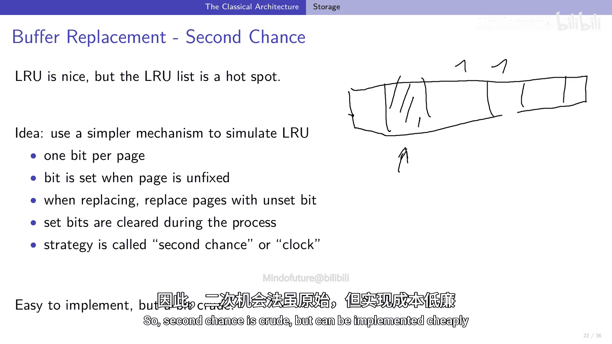

From operating system。But at this point， here now2 Q。

 So this advanced that is specific to database systems or what invented for database systems。

And now the observation is there are different kinds of， not all pages are the same basically。😊。

For example， if you have a large relation， so this is my relation。Its very last release are。

And I reads this sequentially。Then there' little point in buffering pages。At least if hour is large。

 If error is small then different be of is large， then I read a page。So I read this here。

 Then I go to this next page and I will never go back to the previous page。

 at least not in this query。 Another query of course can。

 but this query will not go back to this page because you just pass over。 Okay。

 so and therefore this page should only be buffered if you have a lot of memory。

 So if you have enough memory， then of course， we want to buffer everything。

 But if you want to run out of memory， then we can evict this page pretty safely because nobody actually read it most likely。

At these notice in near future。Now the other pages like， for example， if you have a B tree。😊，B3。

 then the root of this Bea tree should be buffered all the time because everybody goes through the route。

 even this page is here access frequently。 That if you access a page frequently。

 then we want to buffer it。 if you access page only once。

 then we don't want to buffer this at least if we run out of memory So but how do we know if this is a frequently used page or not。

The2q strategy says we just try to figure out because by by observation。

 so basically first time we see page we put it in a fi Q like very simple fi strategy。

 we put it in a fi Q so we just say okay first you read one then you read twos then you P2 then you read3 as one。

 we just remember this and when you run out of memory we evict the first page from the Fi Q。😊，Okay。

 so simple estimate is cheap。Now， some of these pages might not be and for scan， by the way。

 this is a good strategy because if were run out of memory during a scan。

 there's no point but for example， we can safely move them。Now。

 if some of these pages should be frequently used pages like Bea3 pages also。

 then the C access the page that is already in my Fi queue for this， I use a second page。

 second Q and a UQ。😊，And there I remember， okay， how often do I access P2 and so on So these these are organized by frequency Okay。

 therefore frequently accessed pages are in a UQ infrequent pages are in a FiF Q。😊，Okay。

 and we prefer a victim from the Fi cube， but of course。

 we must alter bit from the LAU to Q from time to time。

 because otherwise everything ends up in the LAUQ my I don't buffer anything。😊。

So V from both while we prefer vector comes FiQ and effect here is that the hot pages are in LAAU。

 the read once pages are in FiQ and for many， many database applications。

 this is a very good strategy because。😊，Again， scans。

 there's little point buffering if you run off of memory anyway。

 put them in if peopleQ will get a greater done quickly for in， try to keep them in a UQ。

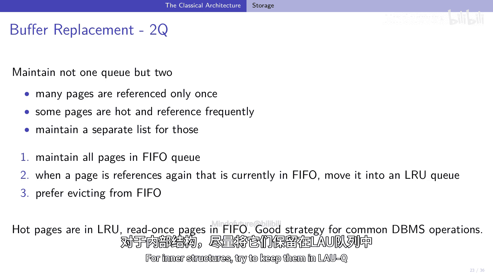

Okay last here the last thing is the toolQ basically exploits knowledge about database application because it realizes that not all page accesses are the same twoque tries to recognize read ones pages and hence are differently on the other hand means this a good idea of course on the other hand we might know this statically because we understand the query so if we see if this is a query and uses an index access then I understand that I mean an index and I will probably access the index repeatedly while if I perform a large scan that I know that if we most likely not accesses repeatedly and we cant pass wrong this information to the buffer manager by giving it hints also when you unfi the page you can give it hint for example。

 the most simple hints are you could say will need or will not need so like in an node of an index you will say we need because most likely you will do will need is this。

And therefore， you will。Place it， for example， at the end of the queue。

 or we say we not need it as just a scanner。 will probably not do this。

 therefore place it more in the middle or closer to the front of the queue。

 As we can change the placement of the queue， depending on the hints that we get for by an unfining page。

 And this is usually what。But of course， this is the most difficult to implement because you know。

 must pass data pass knowledge around。From query processing to buffer management。

 but this is what if you prevent it correctly works best because then you exploit the knowledge that you have。

 then you can unfix pages as this make sense。😊，Okay。

 didn't manage to finish a storage chapter in this block here。

 but I will stop here now and I will continue with storage for the next lecture。

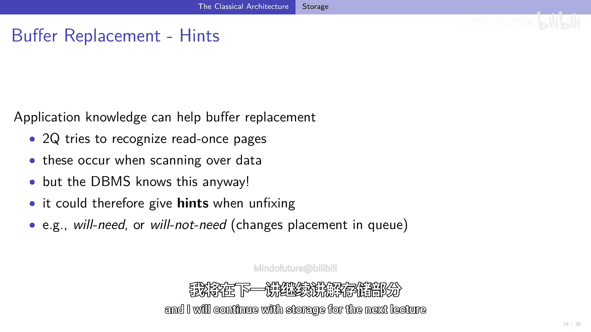

OkayThank you。