# 现代CPU架构上的数据库系统实现：P02：存储架构与缓冲管理

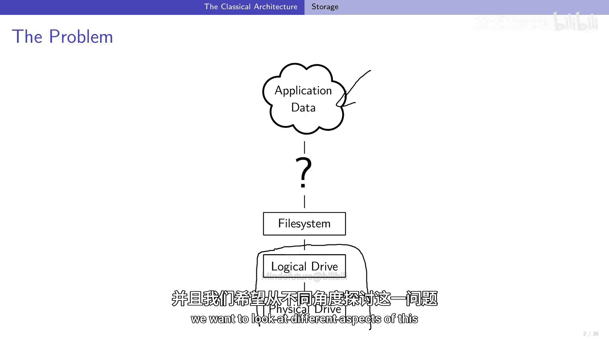

## 概述

在本节课中，我们将要学习数据库系统架构的第一个重要组成部分：存储。我们将探讨如何将应用数据映射到物理存储设备，理解数据库系统的分层架构设计，并深入研究缓冲管理的核心机制与实现策略。

## 从应用数据到物理存储

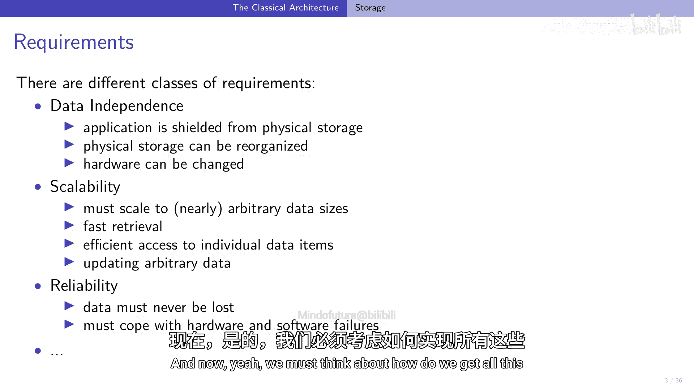

数据库系统面临的核心问题之一是如何将上层的应用数据映射到底层的物理存储设备。从概念上看，上层是用户语义数据，下层是物理驱动器。在它们之间，通常存在文件系统。一个关键的设计选择是：是否使用操作系统提供的文件系统？

历史上，数据库系统倾向于绕过文件系统，直接访问原始磁盘（Raw Disk Access），以获得更精细的控制。然而，这种做法给系统管理员带来了巨大的管理负担。因此，现代数据库系统普遍选择使用文件系统，将底层存储管理的复杂性委托给操作系统。

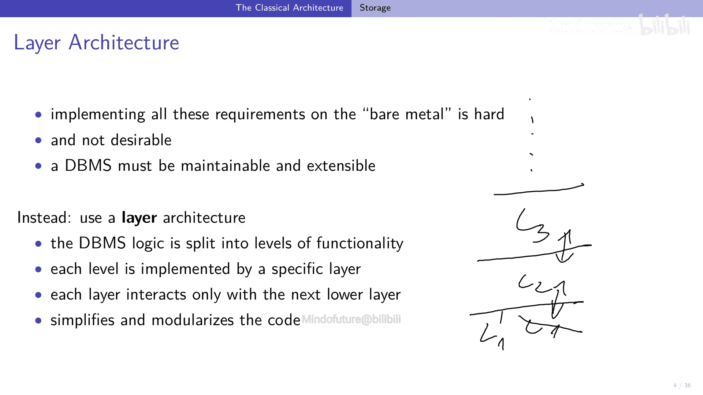

尽管如此，数据库系统在如何将数据映射到磁盘方面，仍然拥有相当程度的自由度。这正是本部分内容要探讨的核心。

## 数据库系统的核心要求

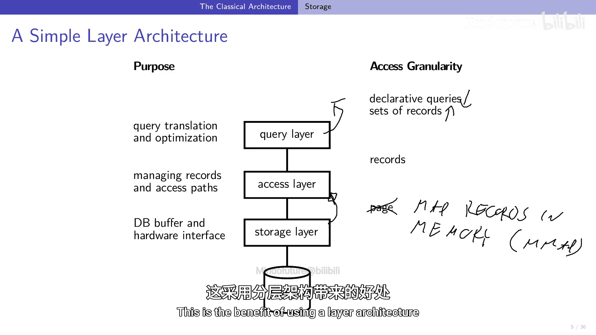

在设计存储系统时，我们必须满足几个核心要求：

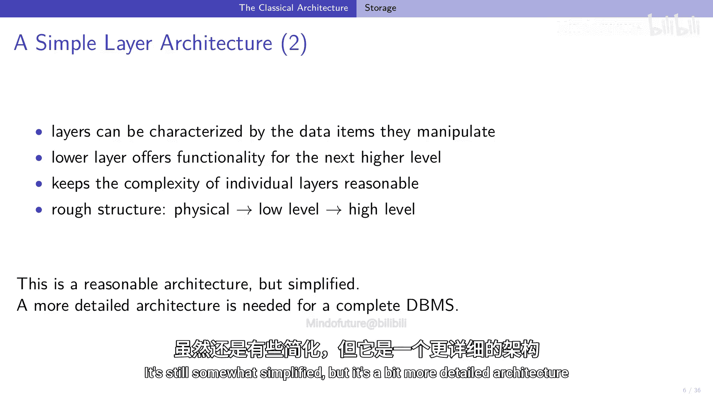

1.  **数据独立性**：应用逻辑必须与物理存储方式解耦。这意味着我们可以更换硬件（例如，从机械硬盘升级到SSD，或引入RAID阵列）而无需修改应用程序。数据独立性将应用程序与物理存储细节屏蔽开来。

2.  **可扩展性**：数据库系统必须能够扩展到非常大的数据量。虽然理论上存在极限，但一个设计良好的系统应能处理海量数据。

3.  **快速访问**：系统必须支持对任意数据元素的快速随机访问。例如，执行 `SELECT * FROM table WHERE key = 123` 这样的查询时，我们期望在毫秒级甚至更短时间内得到结果，而不是顺序读取所有数据。这要求存储层提供高效的随机访问机制。

4.  **可更新性**：系统必须支持对单个数据项的更新。这排除了将整个数据库压缩成单个不可变数据块的方案。

5.  **可靠性**：一旦数据被提交，就必须保证永不丢失。数据库系统必须能够在电源故障、硬件崩溃、软件错误等各种异常情况下幸存，并确保数据的持久性。

## 分层架构的优势

为了避免将所有功能硬编码到一个庞大的程序中，现代数据库系统普遍采用分层架构。分层架构将系统划分为多个功能层，每层只与相邻的层通信。

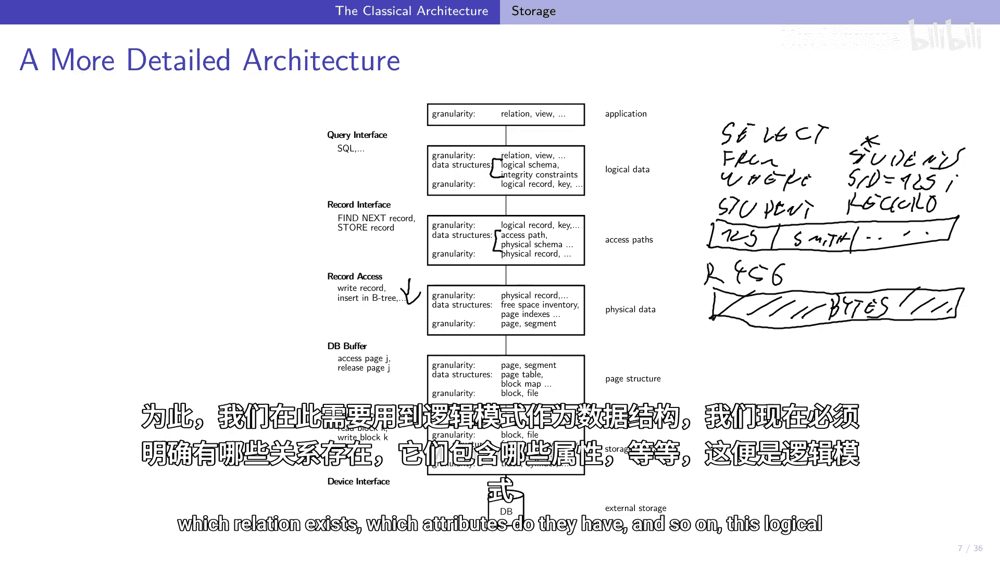

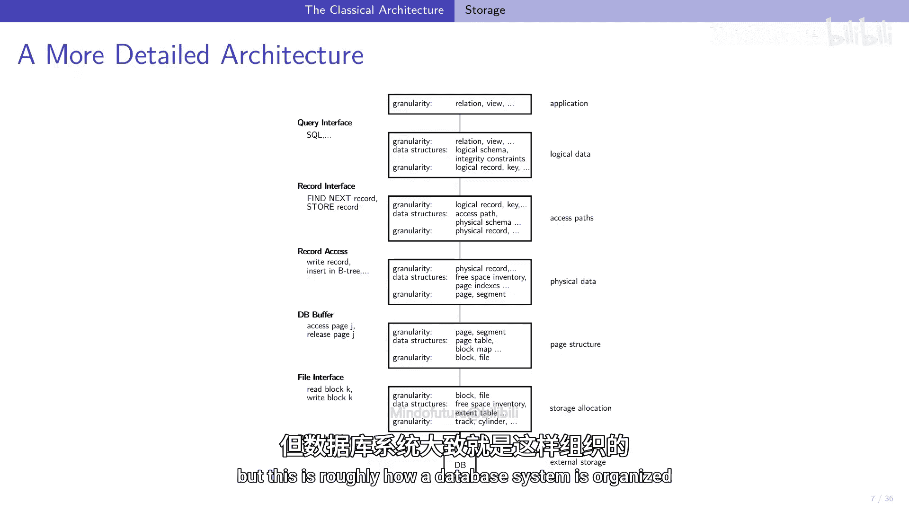

**分层架构的优势**：
*   **可维护性与可演化性**：当硬件或需求变化时，通常只需修改受影响的相邻层，而无需重写整个系统。例如，从机械硬盘切换到SSD可能只需要修改最底层的存储接口层。
*   **复杂度管理**：每层只关注有限的功能和特定抽象级别的数据项（如页、记录、查询），使得系统更易于理解、设计和修改。

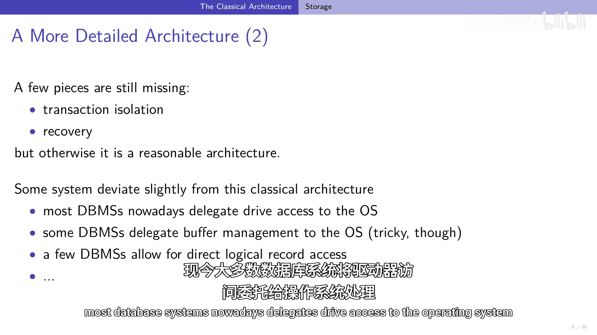

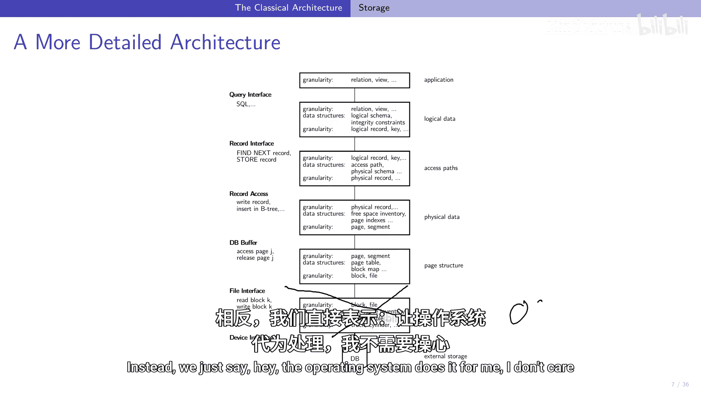

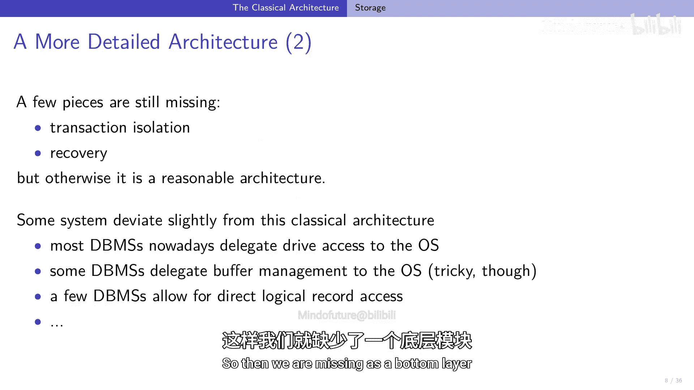

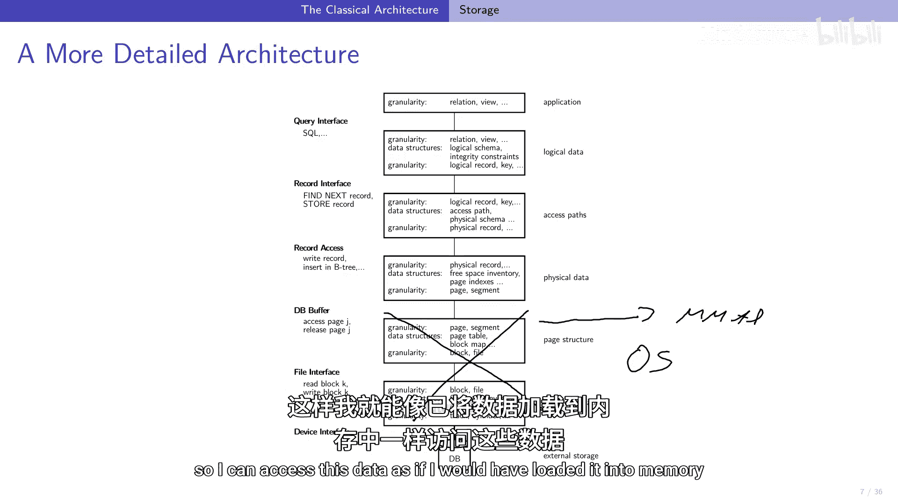

一个简化的分层架构通常包括：
1.  **存储层**：管理页（Page）的读写，与物理存储设备交互，并维护数据库缓冲池。
2.  **访问层**：管理记录（Record）和访问路径（如索引结构），将记录映射到页。
3.  **查询层**：解析、优化并执行SQL查询，处理基于记录集的查询和结果。

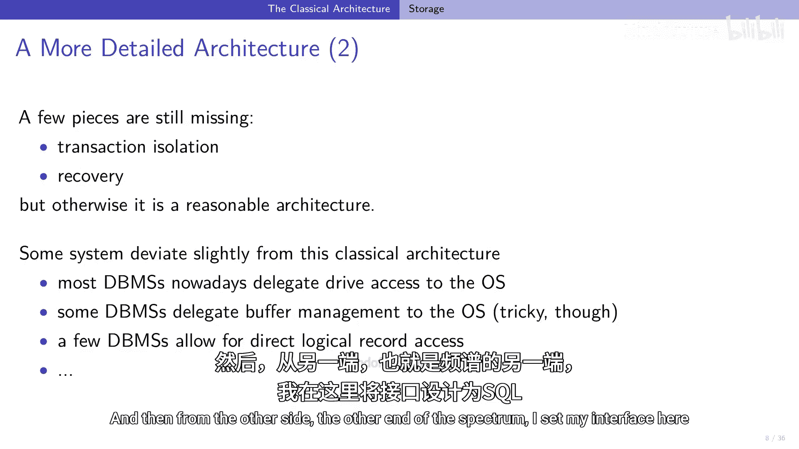

通过这种分层，查询层完全不了解存储层的具体实现（例如，使用的是分页机制还是内存映射），从而实现了高度的模块化和灵活性。

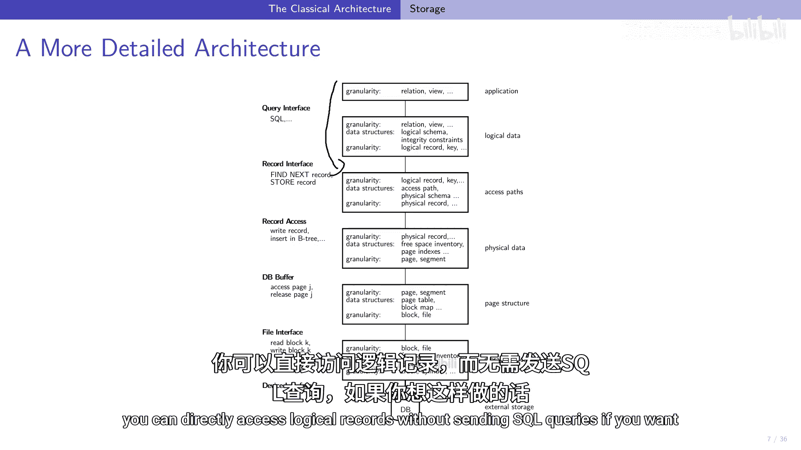

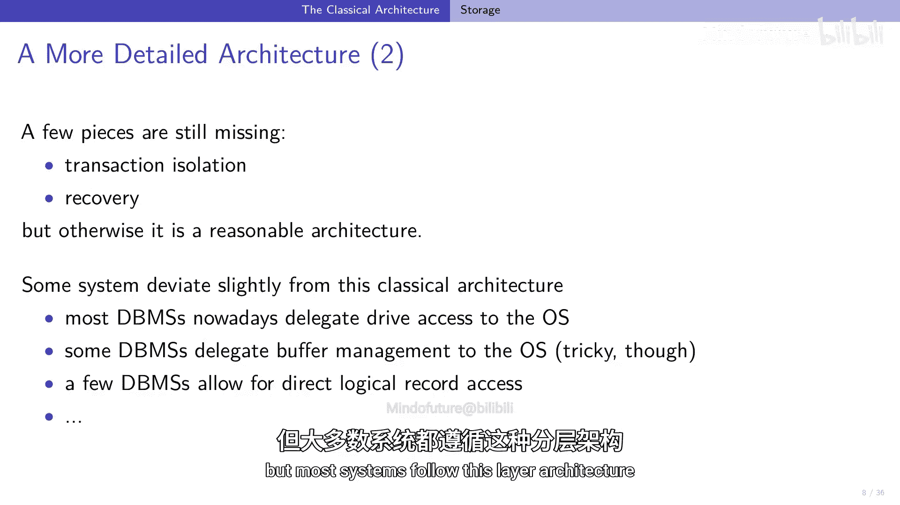

## 详细的数据库系统架构

一个更贴近实际数据库系统的详细架构如下，我们从底层向上看：

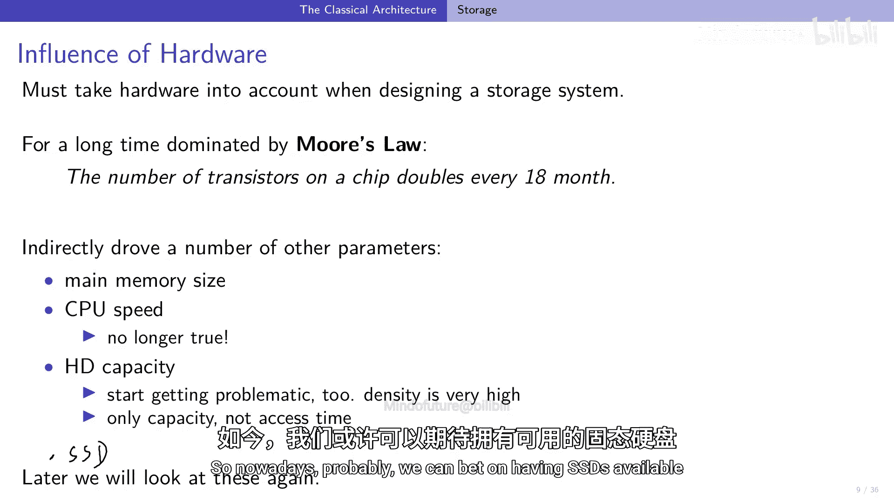

1.  **物理存储/文件接口层**：
    *   **功能**：将逻辑块（Block）的读写请求映射到物理存储设备（如磁盘的磁道、柱面或SSD的逻辑块地址）。
    *   **关键数据结构**：空闲空间清单、区段表等，用于跟踪磁盘空间的分配情况。
    *   **现状**：大多数现代数据库系统将此层功能委托给操作系统文件系统，以简化实现，但会因此丧失一些底层性能调优的控制权（例如，将“热”数据放在磁盘外圈以获得更高读取速度）。

2.  **数据库缓冲管理器**：
    *   **接口**：`fix(page_id, mode)` 和 `unfix(page_id, dirty_flag)`。
        *   `fix`：请求将指定页调入内存（如果尚未在内存中），并返回一个指向该页内存的指针。`mode` 指定共享（读）或独占（写）访问权限。
        *   `unfix`：通知系统不再需要访问该页。`dirty_flag` 指示该页是否被修改过。
    *   **功能**：管理内存中的页缓存，减少昂贵的磁盘I/O。它维护页表（Page Table）和块映射（Block Map），以跟踪哪些页在内存中以及它们在磁盘上的位置。
    *   **关键数据结构**：哈希表（将页号映射到缓冲帧）、缓冲帧（包含页状态、锁、数据指针等）。

3.  **记录访问层**：
    *   **功能**：将物理记录映射到页和段（Segment）。段可以理解为数据库内的逻辑文件。
    *   **关键数据结构**：空闲空间映像、页内索引等，用于管理段内记录的存储位置。

4.  **记录接口层**：
    *   **功能**：将逻辑记录（例如，具有学号、姓名等属性的学生记录）映射到物理记录（原始的字节块）。
    *   **关键数据结构**：访问路径（如B+树索引）、物理模式（定义记录的物理存储格式）。

5.  **查询接口层**：
    *   **功能**：将SQL查询（如 `SELECT ... WHERE ...`）转换为对逻辑记录的访问。
    *   **关键数据结构**：逻辑模式、完整性约束等。

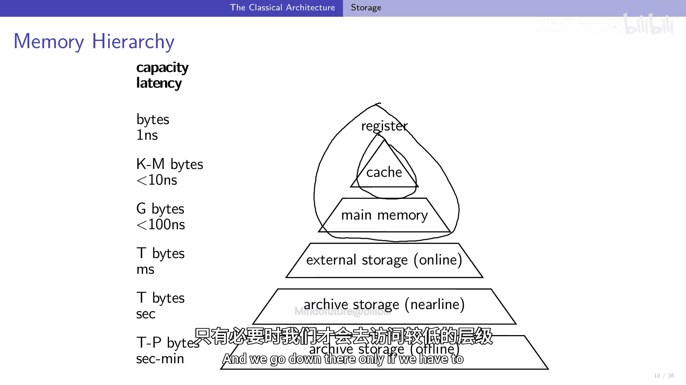

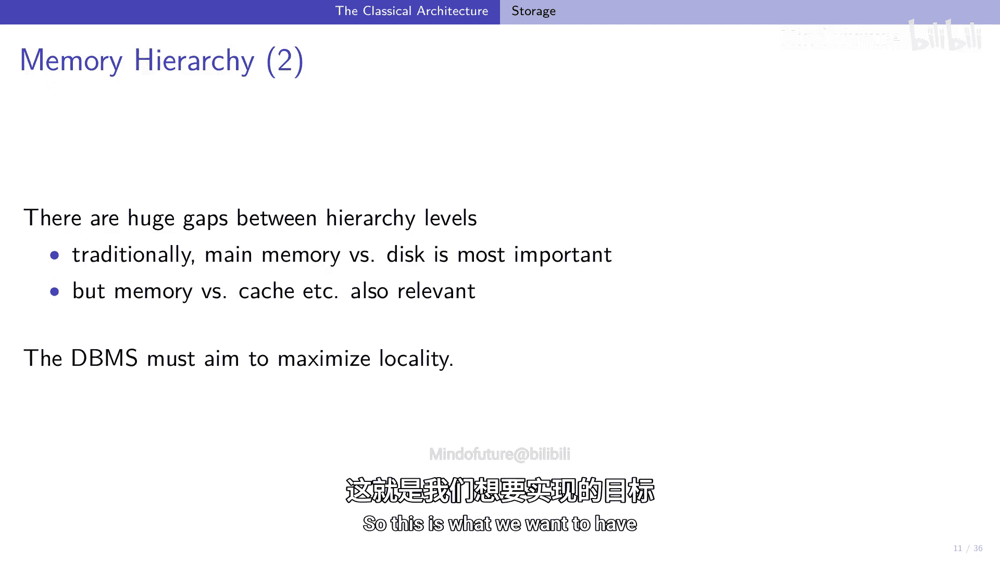

此外，**事务隔离**和**恢复**是两个横切关注点，它们的功能渗透在多个层次中，分别用于处理并发访问和数据持久性/错误恢复。

## 硬件层次结构的影响

数据库系统的设计深受计算机硬件层次结构的影响：

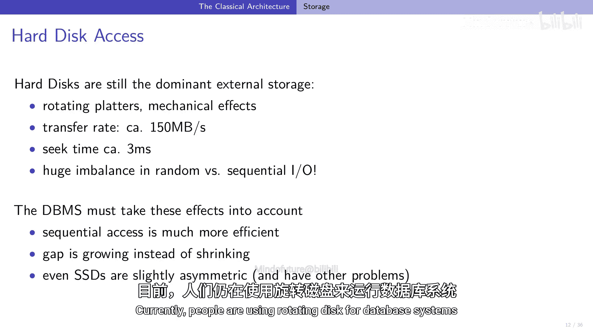

*   **CPU寄存器**：速度极快（约1纳秒），但容量极小（64位架构下约16个通用寄存器，共128字节）。
*   **CPU缓存**：速度较快（L1约1-10纳秒），容量有限（L1约32KB，L3约16-32MB）。
*   **主内存**：速度较慢（约100纳秒），容量大（可达数TB）。
*   **外部存储**：
    *   **机械硬盘**：速度极慢（寻道时间约3-4毫秒），容量大，价格低。**顺序I/O**与**随机I/O**性能差异巨大。
    *   **固态硬盘**：速度快很多（微秒级），随机读写性能好，但存在写入放大、磨损均衡等问题。
*   **近线/离线存储**：如磁带库，容量极大（PB级），访问速度极慢（分钟级），用于归档。

**核心启示**：数据库系统必须努力将频繁访问的数据保持在尽可能高的层次（如内存甚至缓存中），并最大限度地利用顺序I/O来隐藏延迟。

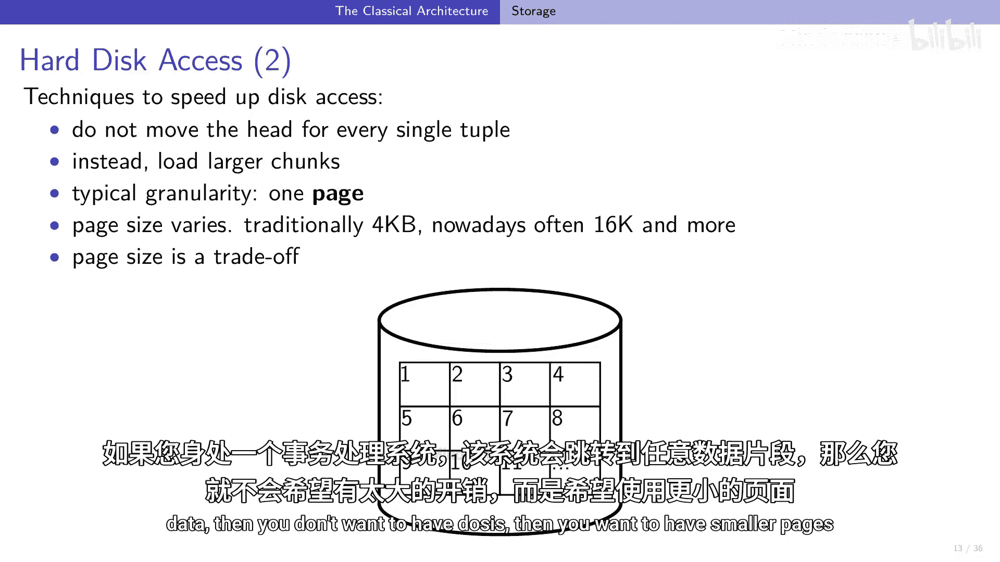

## 页：存储的基本单位

为了分摊昂贵的磁盘寻道开销，数据库以**页**为单位进行读写。页是固定大小的数据块。

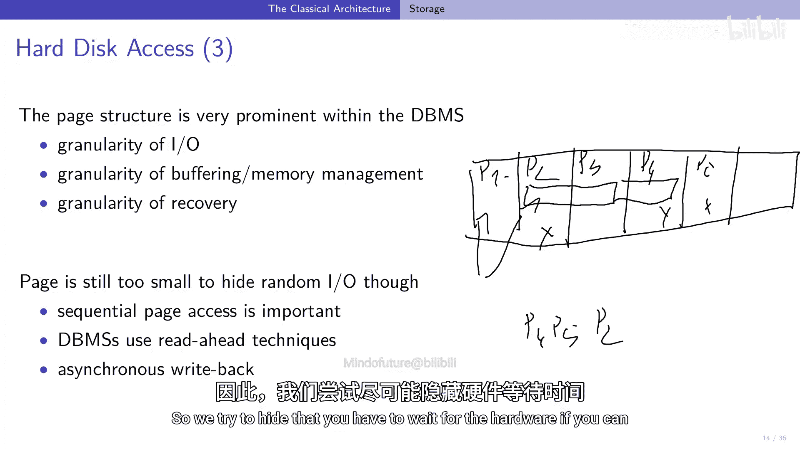

*   **传统大小**：4KB（与操作系统页大小对齐）。
*   **现代大小**：根据负载调整，可能是16KB、32KB、64KB甚至1MB。
*   **权衡**：
    *   **大页**：减少磁盘I/O次数，提高顺序扫描性能，适合分析型负载。
    *   **小页**：减少内存浪费，提高缓存利用率，适合频繁随机访问的事务处理负载。

页在数据库系统中无处不在：它是I/O单位、缓冲单位、锁定单位和恢复单位。

为了进一步优化I/O，数据库系统采用：
*   **预读**：在应用程序请求之前，提前顺序读取后续的页。
*   **写聚集**：将多个脏页的写操作排序，合并为更高效的顺序写。

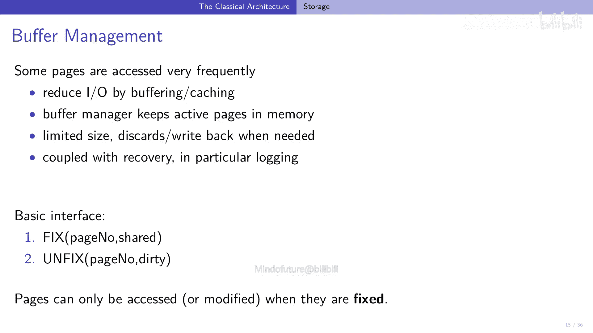

## 缓冲管理器实现

缓冲管理器是存储层的核心组件。

**基本实现**：
缓冲管理器本质上是一个大型哈希表，将**页号**映射到**缓冲帧**。缓冲帧是一个元数据结构，包含：
*   `page_id`：页标识符。
*   `latch`：读写锁，用于保护该页的并发访问。
*   `state`：页状态（干净、脏、新建等）。
*   `data_pointer`：指向页实际内容在内存中位置的指针。
*   `LSN`：日志序列号，用于恢复。
*   其他用于页面替换算法的信息（如访问时间戳、引用计数）。

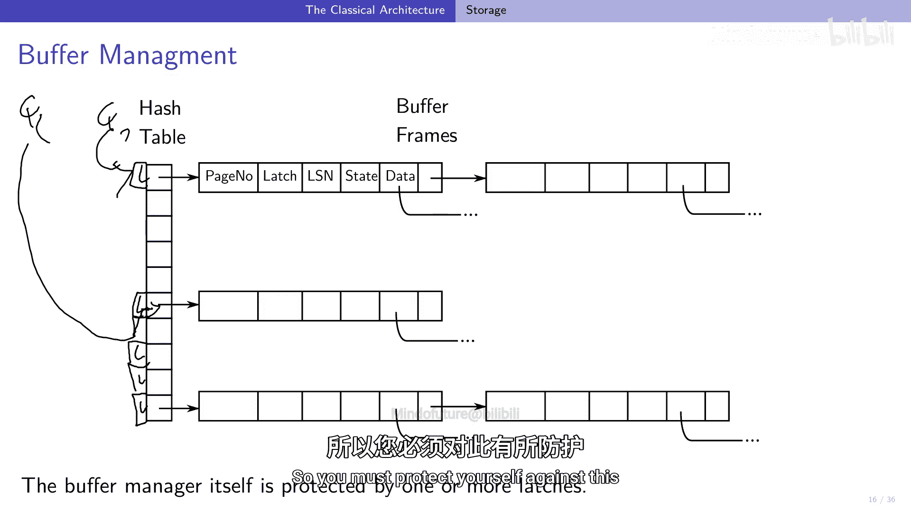

**接口实现**：
`fix` 操作通过哈希表查找页。如果页在内存中，则根据请求模式获取锁并返回指针。如果不在，则需要选择一个 victim 页进行替换，将其写回磁盘（如果是脏页），然后读入新页。
`unfix` 操作释放锁，并根据 `dirty_flag` 更新页状态。

**并发控制难点**：
保护整个哈希表的锁会成为性能瓶颈。因此，通常采用更细粒度的锁，例如为哈希表的每个桶（bucket）或每个缓冲帧配备独立的锁。但实现时需小心避免死锁和保证高性能。

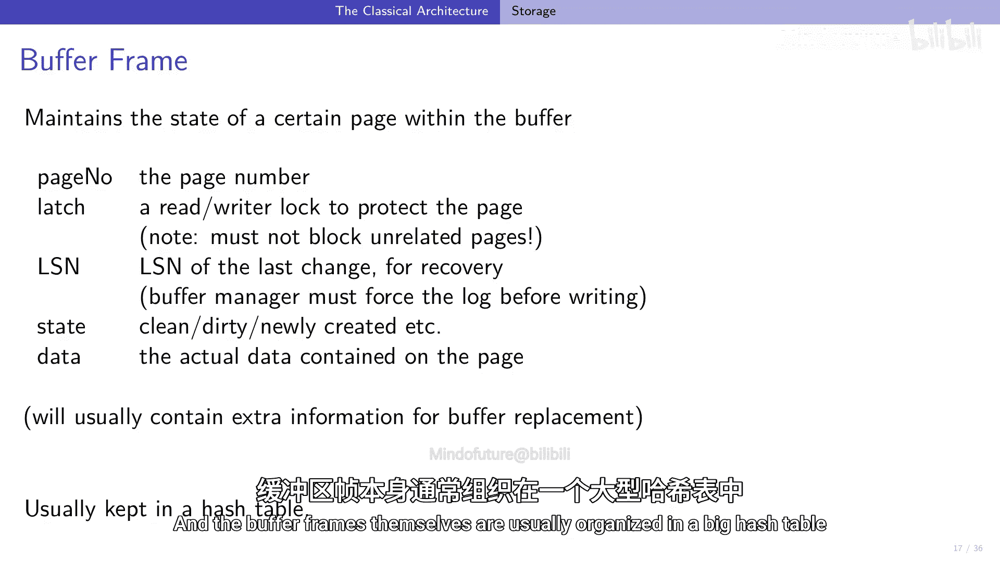

## 页面替换策略

当缓冲池已满，需要加载新页时，必须选择一个旧页（victim）替换出去。以下是常见策略：

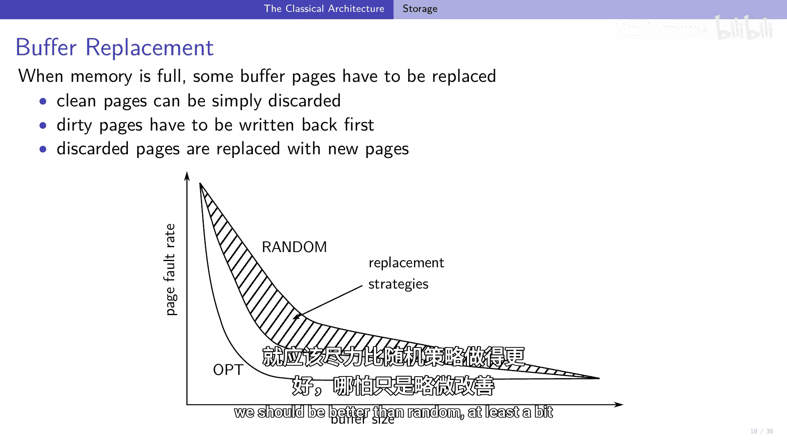

1.  **FIFO**：替换最早进入缓冲池的页。实现简单，但未考虑访问局部性，性能可能很差，甚至可能出现“Belady异常”（增加缓存容量反而导致命中率下降）。

2.  **LRU**：替换最近最久未使用的页。
    *   **实现**：将所有缓冲帧组织成双向链表。访问某页时，将其移动到链表尾部。替换时，选择链表头部的页。
    *   **优点**：能很好地反映访问局部性。
    *   **缺点**：维护链表的操作（移动节点）需要全局同步，在高并发下可能成为性能热点。

3.  **Clock**：LRU的近似算法，又称二次机会算法。
    *   **实现**：为每个页维护一个“使用位”。访问页时，将其使用位置1。替换时，指针循环扫描所有页。如果遇到使用位为1的页，将其置0并跳过；如果遇到使用位为0的页，则将其替换。
    *   **优点**：实现简单，开销低，避免了LRU链表维护的并发开销。
    *   **缺点**：是LRU的粗糙近似。

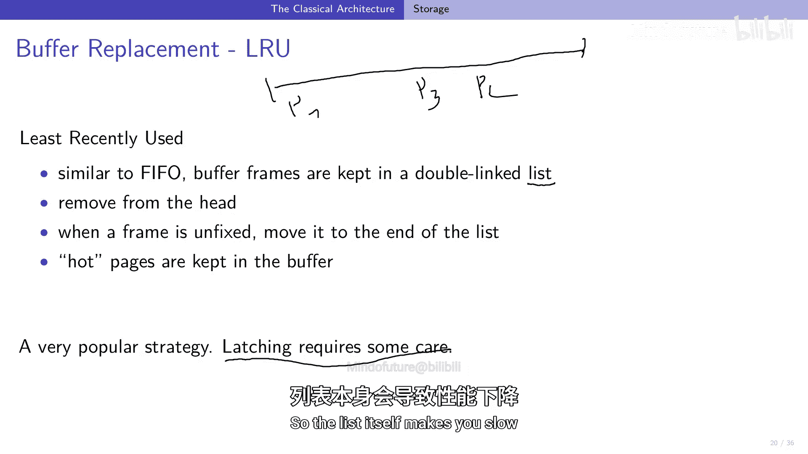

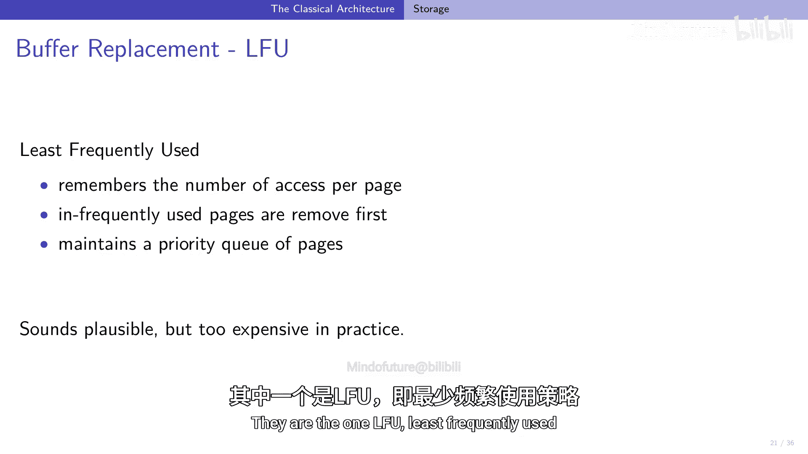

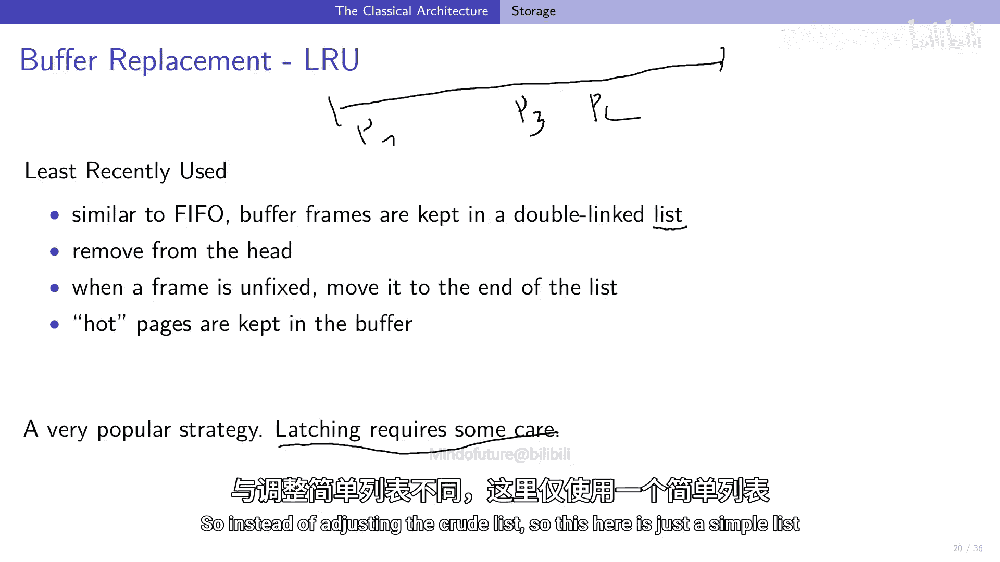

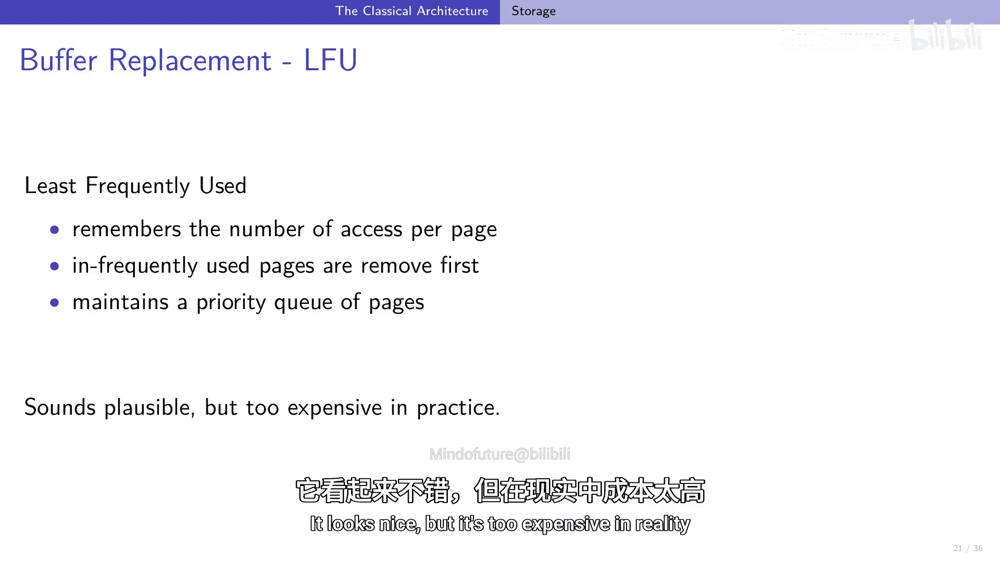

4.  **2Q**：专门针对数据库负载设计的算法。
    *   **观察**：数据库访问模式中，页可分为“只访问一次”的页（如全表扫描的页）和“频繁访问”的页（如B+树根节点）。
    *   **实现**：维护两个队列：
        *   `FIFO Queue`：存放第一次访问的页。
        *   `LRU Queue`：存放被再次访问的页（即“热”页）。
    *   **替换策略**：优先从 `FIFO Queue` 中替换页。只有当页在 `FIFO Queue` 中被再次访问时，才将其移入 `LRU Queue`。
    *   **优点**：能有效区分一次性访问和热点访问，在实际数据库负载中表现良好。

5.  **提示驱动策略**：
    *   **思想**：让上层查询处理器将访问模式的知识传递给缓冲管理器。例如，在 `unfix` 时提供提示，如“将来需要”或“将来不需要”。
    *   **优点**：理论上能做出最优决策。
    *   **缺点**：需要跨层传递信息，增加系统复杂性。

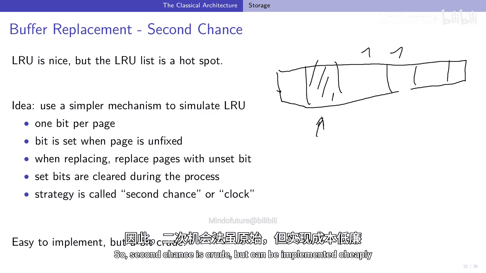

## 总结

本节课我们一起学习了数据库存储系统的核心概念。我们从数据映射的基本问题出发，探讨了数据库系统为了满足数据独立性、可扩展性、快速访问和可靠性等要求而采用的分层架构。我们详细剖析了一个从物理存储到查询接口的详细分层模型，并理解了硬件层次结构（特别是内存与磁盘的巨大速度差异）对数据库设计的深刻影响。

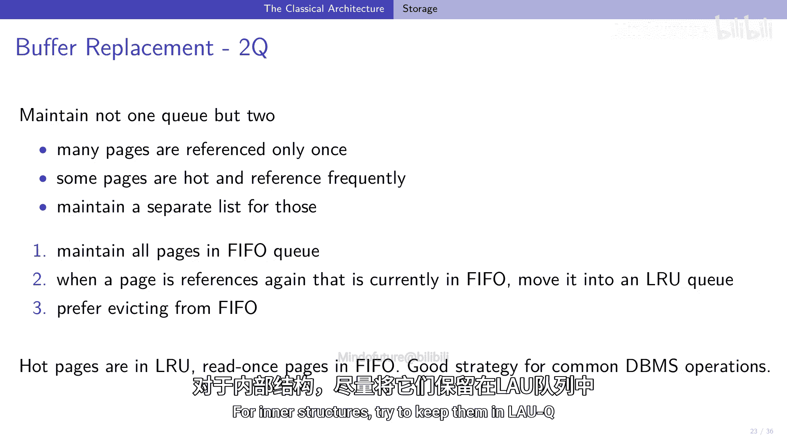

在此基础上，我们深入研究了存储管理的基本单位——页，以及为了弥合速度差距而设计的核心组件——缓冲管理器。我们分析了缓冲管理器的接口、实现机制以及关键的页面替换算法，从经典的FIFO、LRU到更适应数据库负载的2Q和提示驱动策略。

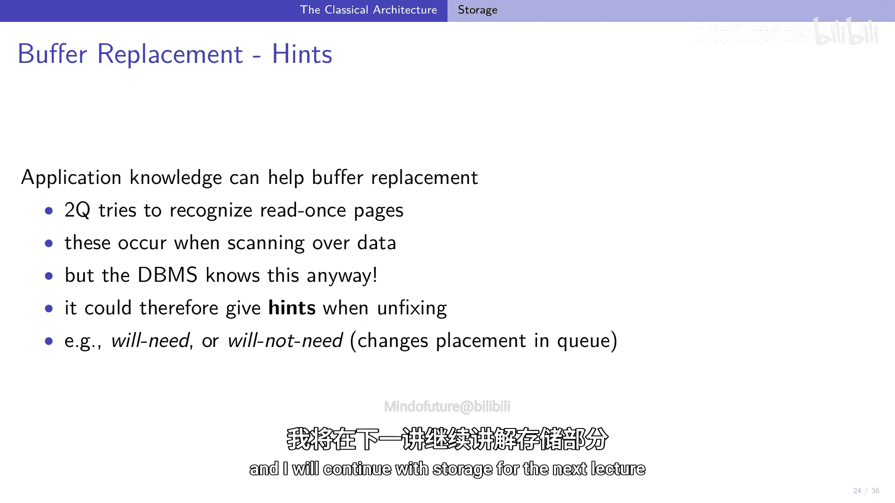

存储管理是数据库系统的基石，它为上层查询处理提供了高效、可靠的数据访问接口。在接下来的课程中，我们将继续探讨与存储紧密相关的事务隔离与恢复机制。