# 【慕尼黑理工大学】现代CPU架构上的数据库系统实现-｜-Database-Systems-On-Modern-Cpu-Architectures-2021-p03-P03_03_存储访问--BV1asiJBeE6j_p3-

。Welcome to the lecture on Data implementationm。So in the last lecture we have looked at buffer management and how the database system organizes data and pages and these pages that are buffer the memory and these are the low level primitive space of which we build everything else。

 but for most highle operation pages that which two lowle else we be rarely think in raw pages template we do but most of the time we prefer something that's a bit larger as we have data structures that are larger than a page and we need a mechanism to handle these the traditional way to organize data structures that cross pages in the database system are socalled segments now what do we need segments for means the most obvious examples are relations if you want to store relation in the database system relations most likely larger than a page if there's a lot of data in therefore we need a mechanism。

To organize something into multiple pages but relation to not the only thing we restore there are many other things that we store in the database system。

 for example， index structures， B3 or something， also consists of multiple pages and we need some mechanism to organize this or internal data structures。

 for example free space management so as tell as well as as free space available and so on。

And for management purposes it's very convenient to treat these set of pages as an entity therefore。

 for example， if somebody does a drop table statement。

 so if we send a secret statement that says drop table4， then of course。

 this means we must now delocate DLO page number 11。😊，Page number 17 as well。

 So this is so therefore we need a way to talk about a set of pages that we can manipulate them as entities。

And so we do this as a segment。 Now， what is the segment in first approximation。

 a segment is like a file in a file system， as like in a file system。😊。

You you create a new file then you can store data and you can read it back this is more or less like we do in a segment Now I say more or less because there are some differences。

 for example， in a traditional file we expect that if let's look at a file so if you have a file when you start here then we start writing data so then you variety of course the file grows as needed so this is just as we also need your database system。

😊，But we see that we do write first we do write 1，2，3，4，5。

 So this is the order that we get in a5 in a segment we do not necessarily have this Now so basically a file andphyism I took two things first as a amount of storage second there's an inherent order in a segment。

 theres not an inherent order。And。For good reasons actually technical reasons why we don't want this。

 therefore it it's only a rough analogs so in a segment could be that if we allocate a number of pages。

 then we another number of pages and then later perhaps we allocate something in the middle so can this can happen so if allocation evolves and so this is a bit different from a file。

😊，But we will come back to the difference in a moment when we talk about different kindss of segments。

 just keep in mind in the first approximation of a segment is like a file like structure so we allocate multiple pages and became can grow segment over time。

 there are some differences， linearity is usually not guaranteed。😊，Therefore。

 another way to think about a segment instead of a file is perhaps to to think of it like virtual memory。

 So like in if you are familiar with from operating systems。

So when you look at in an operating system we have an address base and virtual address base that we can address。

 and this is then mapped to physical data， so this is also something similar to a segment so the segment allows me to talk about pages and the database system itself。

 the lower layers know how to map this conceptual page to the physical page so this is also saying with the segment。

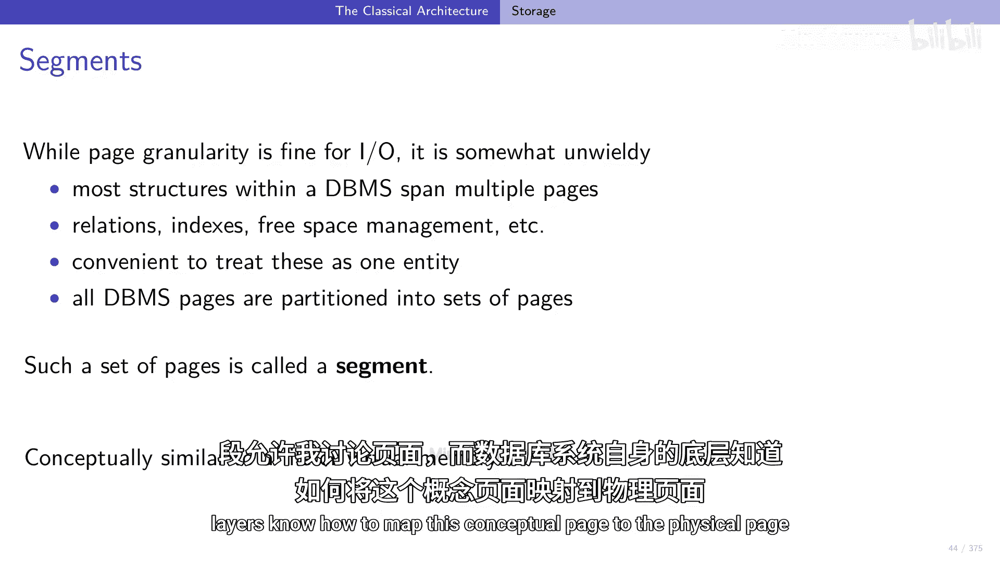

Now what is the interface that the segment offers to us So the most primitive interface， of course。

 is allocate and release。 or we can say if I need a new page or you can say I forget forget this page I don't need this page anymore。

 So education happens all the time， of course， if you grow that no data doesn't allocate Now release is a bit more rare。

 but this can happen for example， if you have a Bea tree and then you delete somethingsung then a Beari note is no longer needed。

 then we can tell the database。 Okay here this page is free， I don't need this。

 you can use it for something else As the basic experiment is allocate in release。

Then theres some other operations that we can do we can iterate over all pages so we can read from the beingthusiats it's very convenient if you want to do a table scan for example。

 so if you want to read everything that is stored in a relation then we iterate over all the pages of the relation so that's the example already gave we can drop the whole segment if somebody does drop table statement so it says please release all data。

 and then this happens。Now， this is something that I mentioned before here。

 if we say optionally offers a linear address base， or perhaps I should say by default。

 we do not get a linear address base。 Now what what does this mean So first lets let's make an an。

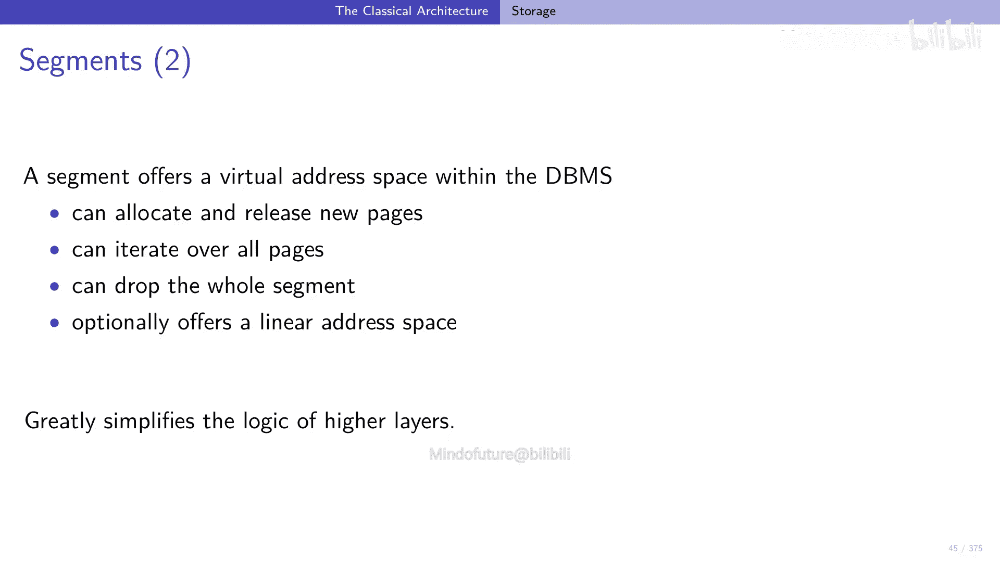

Exle of this。 So let's say this is my database system。 then I here relation 1 this store some data。

 then we restore something in relation 1， Okay， then afterwards。

 somebody else creates some relation data and systems relation 2 okay。

Then again some more data insert in relation1。No problem。 So as mean if we just grow over time。

 you see that the segment here has not continuous so that we have here a number of pages in the first in the segment and the relationship and here's another number of pages and not text each other but this doesn't matter。

 Okay， so we can handle this。 Now what happens is is it somebody does does secret statement We say。

Drop table。2。Okay， and then suddenly we have a hole。

So now what the variable system will do is if you know R1 will allocate new pay。

 we could grow at the end of course but we don't do this because at least potentially we don't do this because we might recognize yes a hole between these two parts that can close and so if you could say in of growing at the end you grow here。

😊，Yeah， so then he makes a hole smaller。Even more fancy， the allocation。

 if you look at this page here， we just say we can allocate and release new pages。

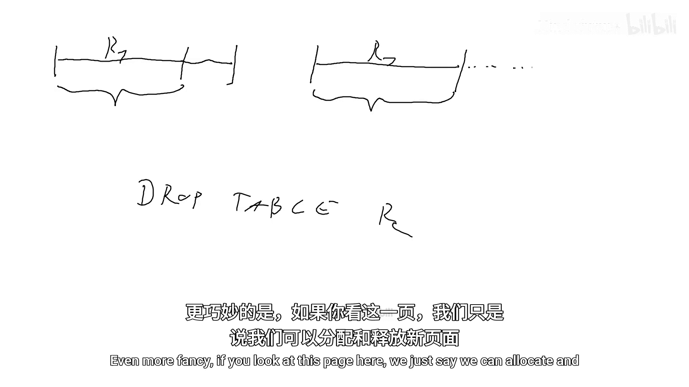

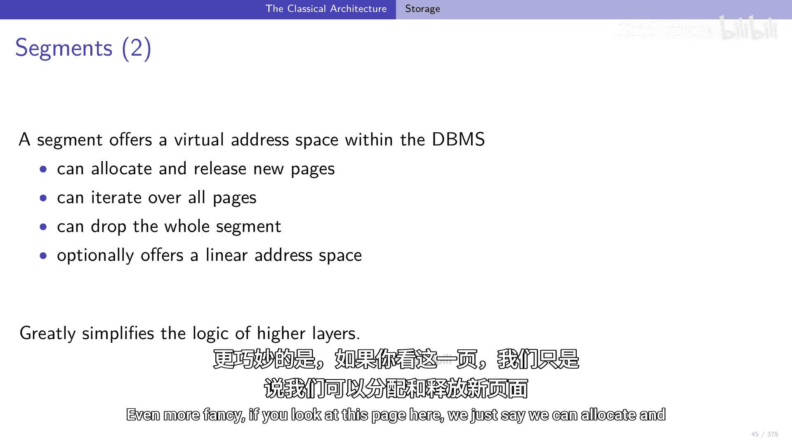

Uually what the systems do is something that is even more strange。

 perhaps at least if you are only familiar with simple melo free locations。

 so you could you you can tell the segment here segment。😊，And。Tot aoc。

So traditionally we say I need one page now you could say， for example。😊。

In of the same one page I know so much data is coming you say okay I would like to have five pages now because I see more pages then what can happen here is the system looks at this and says oh you know here's a very convenient space available for you then it says okay you get this page here and you asked me for five pages but I gave you8。

😊，And so you get more pages than you asked for。Now， and this is， of course。

 a bit surprising perhaps but so now everything is a1。

 And this closing this hole is a very good idea because then we from from an Io perspective。

 then we have everything again next to each other so we can nicely sequentially scans。

 So it's very good to reconstruct this。 So you get as answer here。 you ask for five。

 but you get for example，7。 So that's the whole is gone。😊。

And so the interface here is even more complex。 so I set here allocate 5 and reality for fuel。😊。

You can tell it again give you two numbers。 For example， you could say I need at least。En pages。

 so I could say， for example，1， I need at least one page。 but I if you have more。

 I think I can make use of5， for example。 And so this is。It basically， a minimum。

And this is a preferred size。Yeah but nevertheless。

 the system can decide to give even more because if it would just give you five。

 then there's a small gap here remaining so if you would use five then you would have here two pages left and whom can you give two pages and now two pages very little so we don't like to have small small fragments of pages sitting around therefore we give you more than you asked for and now the database system as zero the segment must make use of this but usually there's not a problem mean we talk about freespace management later but just saying this is not a problem because then the relation we just have more space。

Quly empty but when new tablets are insert in the future as then the space will be fit we can make use of the space at least in the long run。

 immediately perhaps not but in the long run we can and therefore we take this and it's a great benefit of doing so is that we greatly reduce the fragmentation problem so if you ever have implemented the memory allator yourself say if you look at how memory allocators work so often you have a problem that if if you have patterns of allocation and release so you allocate some things and allocate some things and you allocate something else。

😊，And then some more locations， then you release something。And then you do more allocation。

 And then what happens often happens is you have。You have fragmentation。

 which means you have small space left。 the small space。 Yeah。

 nobody can make use of the space because it's too small to put anything useful and it just sits there between two blocks。

 and it's very difficult to make use of this。And here in the segment world we avoids this problem。

 namely， in the moment instance see this plus guy would ask for the space， you would tell him， okay。

 you wanted only so much but you get more and namely to fill this gap completely。

 please make good use of this。😊，So this is how the allocation in a segment world works。😊。

Great for physical layout to be greatly reduces allocation so everything is good。 Of course。

 this has some perhaps surprising consequences， namely what happens is if you insert data in your database system。

 Yes you insert and you can write the first double， second type， third double first double and so on。

 Yeah many of these then over at some point and you do select you most of the time will get them back in the same order that you insert it So you get them back one to three4 and so on。

 but。😊，Over time， because of this filling whole behavior。

 it could be that the tu number 2000 and 2001 happened to be ordered between these two because there was a convenient free space available between them and if we just fit them。

😊，Also which means that insertion order does not necessarily correspond to the result of a query。😊。

First time you see this you might be surprised， but this is the technically reason for this。

 Yes was because as I said， a segment is not really a file。

 so a segment has no inherent order so be are allowed to insert data in the middle。

 So basically if this is my first data chunk， this is my second data chunk is's perfectly fine to insert my third data chunk in the middle。

 has to we accept this。😊，So then we have a nonlinear order。

 so the insert order does not correspond to result order。

And that we do this is a good idea actually and this also matches the semantic of relations because if you think about this。

😊，The relation has no inherent order。 As if you do a select star from relation。So if you do this。

Then you have no idea in which order you will get to So type package is not defined。

 If you want an order， then you could have to do an order by if you don't do an order by。

Then we it's undefined what you get。 Now therefore we are free to do exactly this。😊。

Now there are a few cases although I must say in the lecture I think we will not talk about any of them。

 but there are a few data structures that want to have socal linear address base so which means that segment that absolutely once that if the iteration order corresponds to insertion order so it you insert first block then the second block that's the third block must come afterwards now so they are basically two ways to guarantees is either you really put the swept block behind this the last block。

 but then you have potentially problems with how it's or you do insert it in the middle but you remember what original order was and then if somebody else iteration you first read one and then two and then three so if if you have to guarantee linearity so linear address base。

 then this cost you something there's some over it for providing this so this is basically like a file so this is approximately。

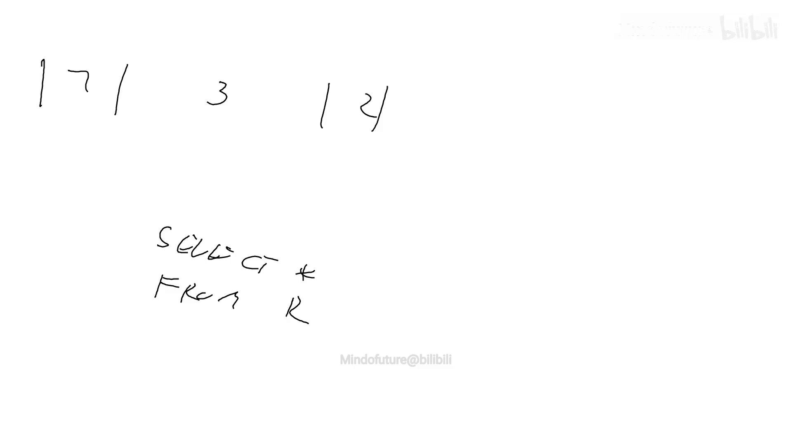

Like a fire。By default， we do not do this for good reasons。If you have to provide this。

 then this costs are something because you must remember the order。Okay， so but in general。

 segment a very convenient interface。 So this is this allows us to easily think about sets of the tapts sorry sorry set of pages and to manipulate them quite conveniently。

 so a segment is basically the。😊，So the logical collection of data we have in our data system in organizing pages。

😊。

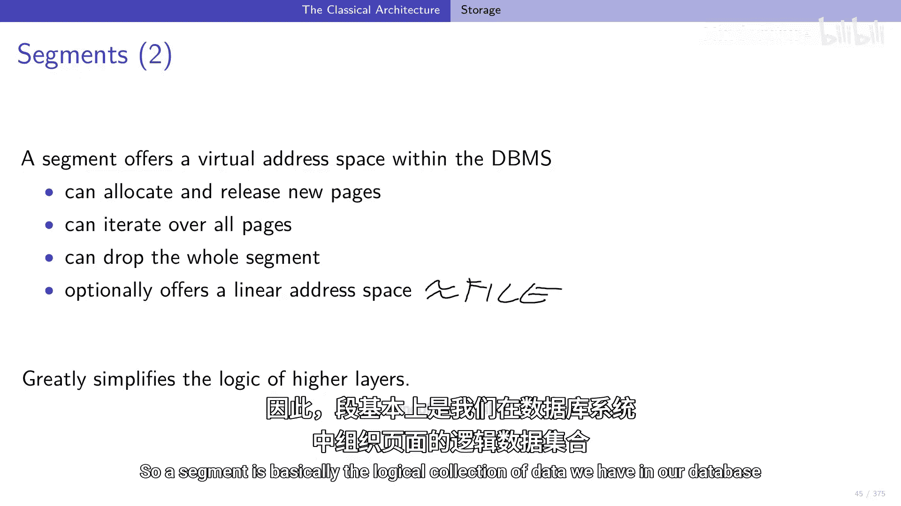

Now， one question is， how do we organize pages in segments when basically the same problem happens if you want to decide how to organize blocks on disk to the same problems。

 organize blocks on disk to your database system here the same problem So how do they。

Physical storage units， pages or blocks to a logical container and basically there are three kinds of approaches that we want to look at。

The left and right are the most extreme the one in the middle is is a middle ground a compromise between the two。

 So the most extreme was left static five mapping this just says in the catalog I remember that for example。

 the segment starts on this page page 11 then is so large yeah that's it。😊，Two numbers， first page。

 number of pages， very easy。And I cross me very little no space overhead or the performance is good。

 but of course， it's not very flexible。 now because I can do this once and then that's it。

 So who called static prim mapping。So the other extreme is the one of the right inside dynamic block mapping where in the catalog you have basically a list of all pages and then you say okay the first page is this one the second page is that one the third page is that one that on yeah so you perhaps I shouldn't put the number differently So I say here the number one23 here and then this corresponds to physical page number 111520 or something like this so this is a dynamic block mapping you have a dynamic list and each points to a single page this of course gives you the maximum flexibility but it's also quite expensive and you see。

😊，This box here says that list can become quite large because for every page you need entry。

 so this is autopomatic。😊，SoThe middle ground between this is a so called dynamic extent mapping which says you have a catalogue。

 this contains a list， but this list does not turnne to single pages and sets to point to extents。

 which means two sequences of pages for example here you could say a at page number 4711 at this point here we have 20 pages。

😊，So then we have one entry as points to a block， then we have another entry here points to another block so this gives you flexibility to essence the dynamic block mapping。

 but it's not as large as the dynamic block mapping so we have a more compact representation。😊。

And so basically is a mix between static file and dynamic block。

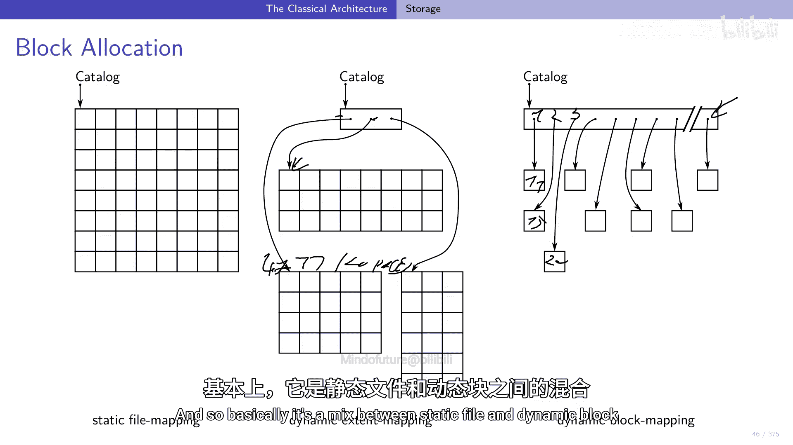

So the different pros and cons I think I've already mapped elsewhere I have already said。😊。

Static file mapping is very simple to implement as very little， very low overhead。

 but resizing is difficult or impossible depends on how you implement it。

 but is very problematic to resize。 First case， you might have to copy all the data， which。

 of course， you don't want to do。 So this resizing is difficult。

Dynamic block mapping this is the most flexible because we can map each entry here to a block but problem is we have high administrative overhead we have an additional interactions is also what we don't want to do so the dynamic extent mapping can grow but has less overs than the dynamic block mapping so in most cases we will prefer the extent based mapping so the dynamic is the middle one。

 this is what we will prefer。😊。

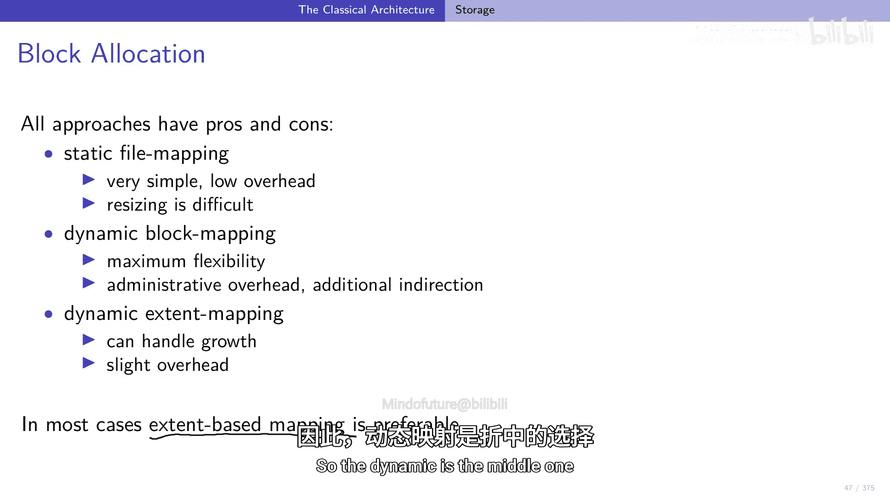

And I will see we say a bit about implementation。😊。

So as the dynamic that being gross by adding a new extent。

 so basically I have my mapping here in the beginning then I need a little data to allocate allocate a bit of space and so then when when my relation。

 for example grows and just say okay here you have another segment that here you have another segment and so on。

😊，And。The trick here is what you should do when you implement this。

 you should grow this year exponentially， which means that the second block is a certain factor larger than the first block and on for example。

For example， factor 1。25 as as of course design choice for factor use but there should be an exponential factor between them now why do we want to use an exponential factor between block sizes the great advantage of doing this is that this bounce the number of extents。

Yeah I hope this is easy to see now to illustrate this。

 let's assume we will use not factor 1 or 25 because there's a masses。

 so difficult to do without a calculator let's do assume we would use a factor of2 which by the way usually we do not do so two is a bit aggressive。

😊，For example， if you in of two。Then， of course， the first block here has size。

 let's say one we will not start with one， usually by something larger。

 but let's assume the first one is one。 then of course we have twos then we have four and so on。

 Yeah， so then after 10 steps， we have 1 thousand24。And after。

After 32 steps we have something like 4 gigyte and so on we grow and what we know is thats a total number of extents that we have will be less or equal to 64 why because our address be run out of a address base after 64 we cannot address them at least on a 64 bit architecture we cannot address them so we know is that we will never have more than 64 extents and this is of course a very good thing because this means that if you look back at this picture。

 we can limit the size of this year1 so this box the size of this box。

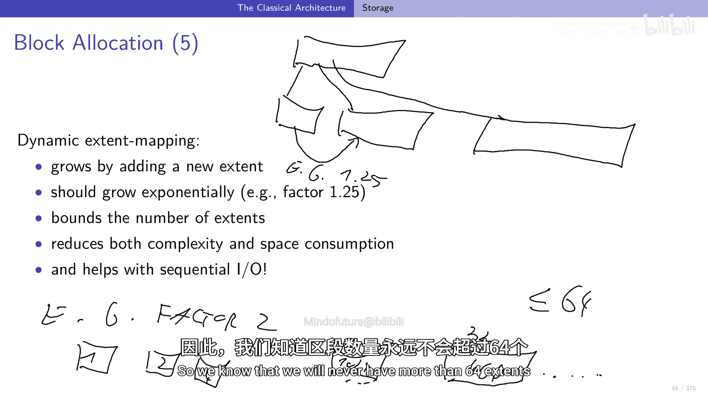

Has a limited size。Which is a very good， good thing。 While in the dynamic of block mapping。

 this year has unlimited size， unlimited size。😊，A limited size。

 So if we implement exponential growths， then the dynamic extent mapping has a limited size。

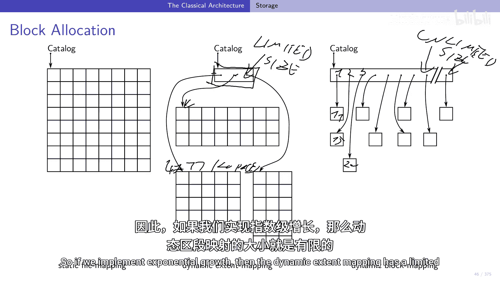

And the limit via it depends on effectively we choose we can bounce it or less but usually this will be a few hundred at most。

 so we have a few hundred entries and this makes our life much easier because then we can store this interaction。

 which we automatically must store somebody for example we can guarantee that this interactiondirect always fits on a single page and just because it cannot grow beyond us。

😊。

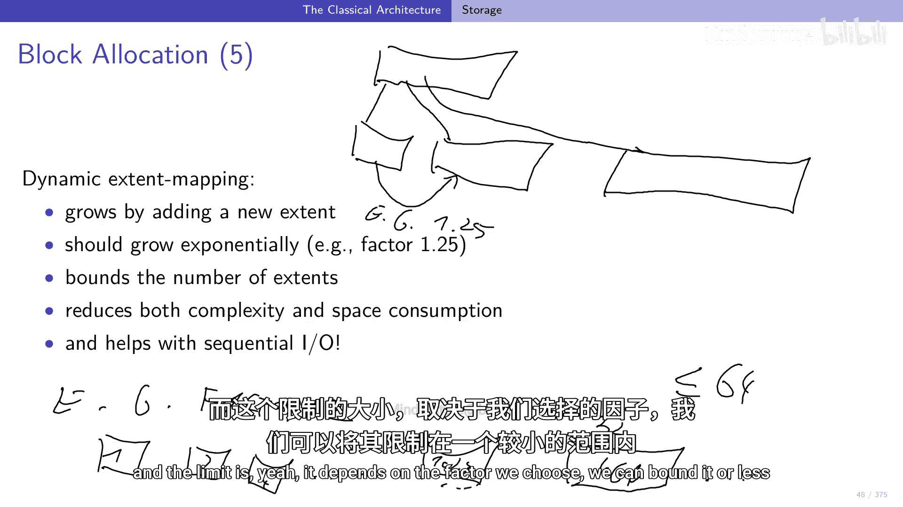

Okay therefore this point here this greatly reduces complexity with implementation and also improves IO because when I have more and more consecutive pieces of pages。

 this means I will do more and more sequentially IO and this is a very good thing because a sequentialO is faster than random IO therefore we greatly prefer that we have large sequential spans and we get this here by using this trick of exponentially growing each entry in my extend mapping。

😊。

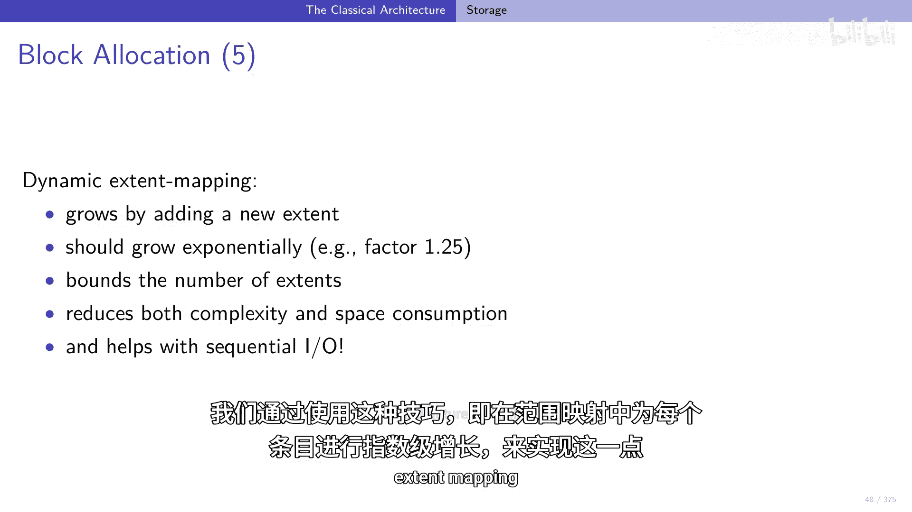

Now I said in the beginning we have different kinds of segments for ex relations in existence one we with many。

 many different types of segments that we store and here we want to briefly classify them。😊。

Using different dimensions so our first dimension here we have private versus public segments。

 Now what does this mean private segment is something that is internal to the database systems。

 the user does not see the you usually shouldn't care so this is for example we need some space to store which segments we have and this is most likely a private segment so this is something that the user does not see while a public segment is an example a relation a relation of course it something that the user sees and we want to show it to a user and say hey this is so large if you ever use an administrative tool and database system you might have seen this like it tells you which kind of data occupies which space so if have public and private segments。

Now， a second image here is permanent versus temporary relation， of course。

 is permanent here because we we don't want to lose our data。 So this is。

That we store is a permanent segment。 Now temporary segments we might have， for example。

 if you have a query that produces intermediate results， so you perform a complex sort or group by。😊。

And this intermediate result is so large that it does not fit a memory and then the delivery system must stored somewhere and for this it can use a temporary segment。

 so of data piece of data gets allocated for the query， but when the query is gone。

 we can throw it away。😊，Now， so if we don't keep it because I do you store it as long as my cure running？

And by the way for the system it's important to know if the segment is permanent versus temporary because for a temporary segment we don't really care so much。

 if my system crashes then the temporary data is lost anyway so we don't care so we don't have to spend a lot of effort but a permanent segments。

 of course we must keep alive therefore we must be more conservative in what we do with our data。

OkaySo to mention is largely historically if you ask me because means they exist in commercial lit systems。

 but few people ever see them。 So we have automatic versus manual segments。

 most of the segments nowadays are automatic now what is the difference here the question is can you automatically access the data or do you have to do anything So menu make sense if for example。

 your data is stored on nearline storage so it's not online but the user has to do something for example install an external disk usually we dont want to do this。

 but you have to install some physical medium until you access the data。

 So this is an example of manual segments users to accesses I think this is meant largely out of fashion most segments nowadays are automatic we don't want to manually do something but of course this system do supports us So support segments that are not always available。

And the last dimension here is this recovery or without recovery。

 so this is related to what I said before， so an example of intermediate results in my relation to my real data。

 of course， I need recovery， which means if I crash and I reconstruct all the data so that nothing is lost。

😊，But if I have suggested immediate results， then I don't need to recovery。

 I can just throw them away。Another example of something where you might not need recovery。

 but is potentially not。Is。Or I said it might not in the sense that most people recover this regardless。

 but I know a few people who don't， so the example I say now is an exception if you wish。

 and mostly system will recover this， but there are some people who do not recover as their index structures。

 like pe trees。😊，Now why don't say recovery the index structures as the argument is first crashes are rare yes for most of the time system doesn't crash so the system works all the time and then if we shut it down then we shut it down in a clean fashion so nothing bad happens a real crash like a power failure so a real hard crash is rare and in the example of this index structures you could say in the unlikely event that my system goes down in a hard crash。

😊，Then of course my index structure on disk might be corrupted I could be its in state。

 but I can always throw away my infrastructure and rebuild it because the index points to the original data。

 therefore I can forget all my next structures。😊，And I can just rebate them if needed now is it worthwhile to do this and it depends on how likely they set you crash and how fast your index reconstruction is。

 but let's say I know a few people who have implemented this who say I don't recover my index advantage of courses and indexes faster so you pay less of it for updating your index you speed up your index you willingly accepts that your index might be corrupted。

😊，And but if this is really rare， then you say， okay， we accept this。 and if this happens。

 and just throw it away and rebuild mes。Yeah， so this the four main dimension with which we can differentiate different types of segments and of course。

 depending on which which combination you choose this differs in how complicated this segment is and how much effort or how much costs this segment costs when you for example。

 update。Recovery， for example， cost you something or permanent salt。

 of course positive use cost you something。Extro this。NowMaybe we talk。

 of course we come to this when we talk about recovery in the lecture。

 but I'm just saying writing something permanent to disk is surprisingly difficult。Yeah。

 so it's much more difficult than you might think perhaps at glance。 Now。

 why is it difficult just as it teaser to what we will look at later。Yeah， I said a page is。

 for example。Tingte in size。Now， you say I changed something about idea by page。

 so I want to write it to this。 So how you do how do you do this？

How do you write the 16 kilobyte of data to disk？Now there different interfaces which you could use。

 for example， the most primitive one， perhaps is a Pve， right。

 So this is the most simple interface where you just give it here， give it a file handler。Handry。And。

Then you give it a point I here to my buffer。Pointer。And you give it a size for in this case， a 16 k。

And then the operating system do write for you。 Okay， this is most simple to play to to write。Now。

 what is better about this interfacephas。You don't know what a operating system will do。

In particular， I sorry I sphand。In particular， mean， it could be that during this period right。

 if you are really unlucky if you get a power failure。 Yeah Now。

 which of what part of the 6 inbyte has been written to disk。Everything， nothing。

 only the first half。 Yeah you have no idea。 This also depends on the hardware。 Yeah， for example。

 there are some battery buffer disc graphs， which by the way， are great idea。

A battery buffer describes where you can put your right in a buffer and then the drive guarantees you that it will write at everything because if your power failure happens it you use a battery and then to write on whatever in the buffer。

 So this is greatly simplifies your life。 But if you don't have a battery buffer describe then you might get a partial right。

 which means， for example， that everything up until here has been written and the rest has not。

 This is an absolutely nightmare。 it has a very difficult to prevent， very expensive。

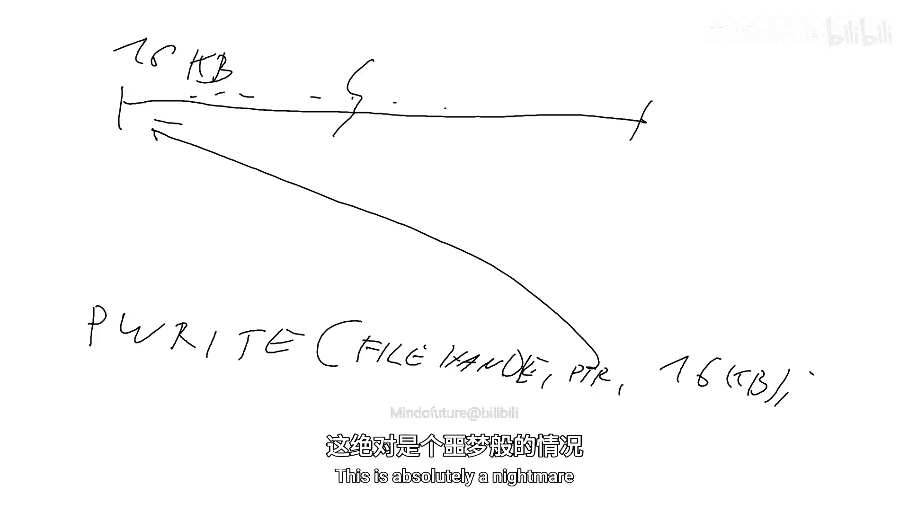

Yeah， so these are things that you have to care about。When you have want to have permanent storage。

 if you have temporary storage then you say， hell， who cares。

 if I have a partial right and so only the first half of my page is written， then I crash。

I don't care at all， because the moment I come back， I would throw away the temporary data anyway。

 As you can use a cheaper right mechanism that by if you want to do this permanently。

 usually you will write twice。 So this is a standard technique to guarantee persistency here。

 you write everything two times。 And if you want， don't want to do this。

Then do you know this data is temporary。 Then you say， okay， I don't care。 I just write as it is。

 So this just shows you that the knowledge about the segment has quite some effect on how you can operate with your hardware and with your operating system。

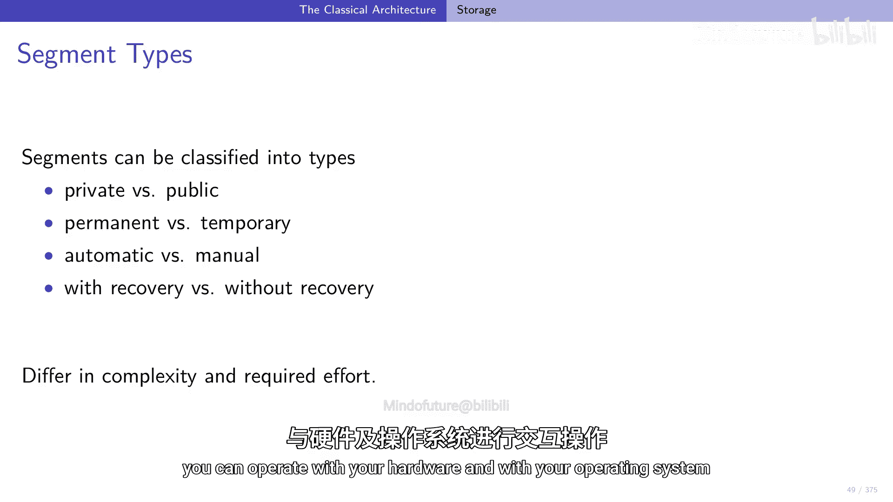

Okay， I'm sorry now。Which kind of segments do we have in our system。

 usually general system we have at least two lowle segments。 So in the senses， you don't see them。

 mean， of course， in lecture， we talk about them。 But as a user you。

 you have no idea what is about this are。 So the first segment that you will have is so called segment inventory。

 which basically keeps track of all pages that are allocated to segments。

 Now this is perhaps to come back to the file system analog is， this is like a directory of segments。

 I your files。So we need a way to remember which So if you have segment number1 to 3 consists of no。

 whatever， for example， page number 11，10 pages and so on。

 And so this this kind of information must be stored somewhere。

 And this somewhere and so called segment inventory。

 So this must organizeseducating pages to segments。

And for this we we can implement this extend list or page table on different many different ways we can implement this。

 So this is the most low level primitive basically if we need。😊。

And the second low level segment we usually will have is this so called free space inventory。

 so this keeps track of free pages so we must know which pages are free。😊，So first。

 of course we have actually two kinds of free space inventory。

 one as it really knows which page is unused so this allows me to grow a segment so that if I need pages for a segment I must be able to find this for this we need the free space inventory and we have alternate a second mechanism that depends on how you to measure this might be inside actually is the first one or might be a separate data structure different ways to build this we need a second mechanism that says okay I I want to insert a table of size 200 bytes where do I have enough space for this table so this is also what we call a free space inventory Now these two aspects free page versus free space on a page might be the same data structure or might not so it depends on human implementation。

And we can implement this also differently for example。

 we can use a simple bitmap if you just want to figure out which page completely free。

 we use one bit per page and this tells me then okay this page is free you can put a segment of this or this page occupied and then we we might then for example remember how much is occupied or just say it's occupied yes but this is not only way to implement this we can also use three extent so we basically list of three pages so this just like so basically you can for example implement this by saying all three pages are allocate to certain special segments that owns all the free space there's also one way to implement this。

NowSo these are the internal segments that not user facing。 They are of course。

 also user facing segments that people really care about。 for example， the schema。

 so the database schema must be stored somewhere so that we know which relations exist and all this kind of stuff。

 And so the database schema must exist somewhere， then we need segments for relations。

 each relations most like the segments so that we can store or the template in relations somewhere。

 we might have temp segments like if we need intermediate results for queries So if we want to store this somewhere then this is called an temp segment。

 we might also have， for example， index structures。And so on， index structures and many other things。

So these are the classical things that we store in a database system features we will most likely have a different segment I believe。

😊。

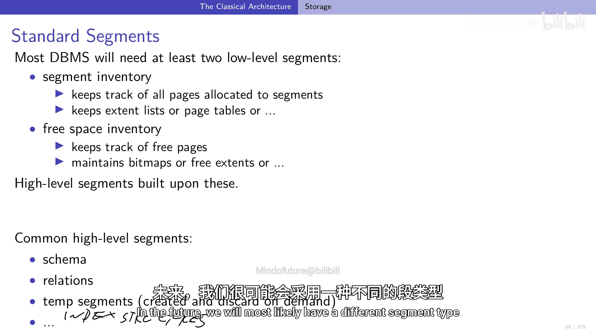

Thank。Okay， now when we， when we talk about how data system works internally。

 So in particular concerning storage， there are two dimensions that we are particularly interested in。

 namely。How do you。First， how do you perform。Paid replacement concerning updates and both dimensions effect updates as the first。

 how you perform page replacement。 and second how do you cope with bra out when you are done with transactions。

 So these two dimensions here are called force and steel。Okay， now what does this mean。 So if。

 if my system runs a steel strategy， this means I can take away a page。

 even though the page contains an uncommitted change。 Yeah， So let's say this is a page。

So let's say if this is page number by 11。So as long as this， this page is unmodified。

 I can clearly throw it away all the time。 because if I run out of memory。

 I just throw away this page no problem because I can just read the back from disk。 Okay。

 this is the easy case。😊，So now not two easy cases。

 somebody here has performed an update now that the data is modified。😊，So be just dirty you。Again。

 I run out of my。 Now what I do I do。Am I allowed to to remove page 11 from memory。

 so can I steal page number 11。And clearly， if I can do this。

 then I have more flexibility because I can reuse memory as I need doesn't matter if it's modified or not as down is if I do this。

 then suddenly I must keep I must remember that my page 11 contains dirty data because this updated here this update here was not committed yet so nobody can must see this also if for example I crash so I assume I steal the page write it to disk then I crash then I can back up again then this update here must be gone and because it was not committed therefore this update here must be removed from the page so still gives me flexibility but also cost me something。

😊，Second dimension is force。😊，Now， as the question that forces， again。

 I have a page with a change here。 Yeah a page about 17 contains auto some kind of update。

 Now the transactions that performss update commits。Yeah， and。Now， what do we do about this？

So what do you do about this page here。Do we write to disk in this moment。 It's a commit comes。

 So this is quite a false strategy。 So false means if it commit comes。

 I write all pages that are affected by this transition to disk。yeah， and of course， advantages。😊。

If I crash afterwards， everything is on disk。 and so I know that if I crash every single disk。

 disadvantage is I right to disk more often than I have to because every time somebody commits a write to do disk if I write a no four strategy。

 then I can keep it in memory。😊，Of course， this means now that potentially a page is never written to disk。

 if a page is frequented， I'm sorry， if a page is updated all the time。

 So a frequent update to this page， then this page will always be hot and always be modified。

 and potentially nobody write to disk could be that you have days or months of a dirty page is not going to disk if you are really unucking。

So this is also not too good， so you don't like this。

So if you want to avoid this then of course we also must build some complicated mechanism So now which credit do we want to live So the easiest box of course this is this one here。

 so this is the easy box but unfortunately we want to be opposite here。

 we prefer usually this one here。😊，And lastly， we want to be still no force。

 which means we can evict a。A page from memory， even though it's  dirty0。

 and if you don't write it to this， even though its transaction is committed。

 So this is what we want to do。 we want to be still no force。But this is the most complicated one。

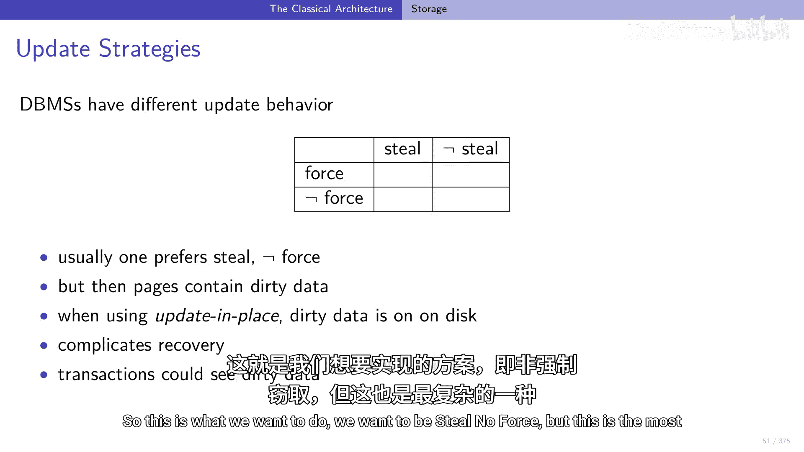

Okay， and we will come later I'd like to come to recovery and have a look at exactly these problems again。

😊，Now， one problem with dirty changes is。We are not the only one who uses a database system so there's one transaction that uses a database system there this can of course modify or has once until the submit comes。

But what about the other users， and the other users are not allowed to see my changes until I a commit。

Yeah， and how do we make make， how do we and this， Of course， one approach is to say。

 so if this is my page。

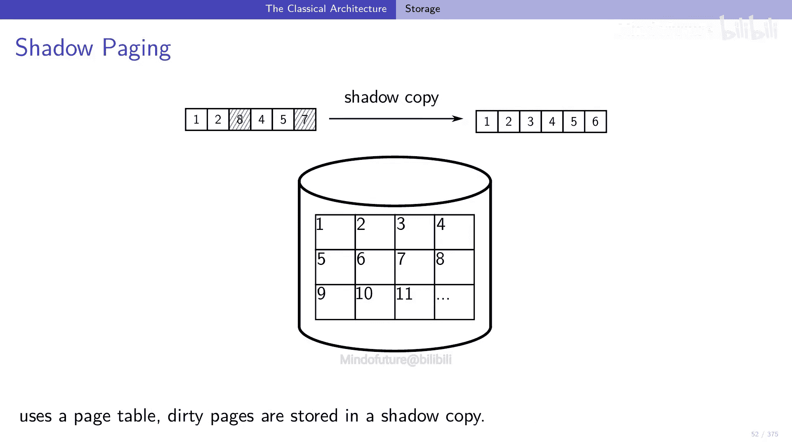

So this is page 11 and then then I've modified the something here。

 I could just say as long as this year has not committed， nobody else is allowed to read this page。

Now， is your a is your relative easy to implement。 So we just lock the page。

 sayy nobody else can you read it。But it's undesirable to do this because you get a poor cocurency from this because nobody else can read this page I already blocks on this。

 So this is not so nice。 Also we have this recovery problem。

 Remember when when we set here on this side， when we run a steel strategy。

 it could be that a modified data goes to disk。😊。

And if we interview we crash， we must somehow get back to the original data。

 how do we do this on that certificate sorry， not too easy。

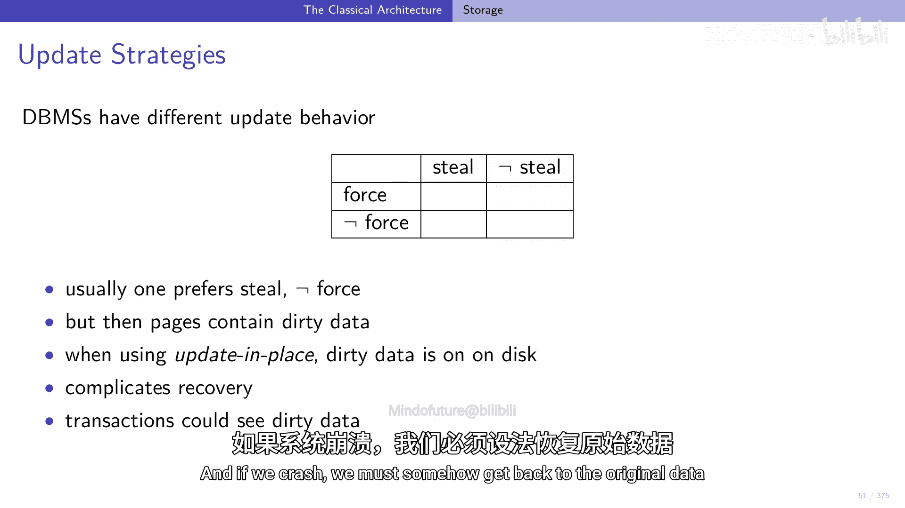

Now， one particular elegant or nice way to cope with this problem is this so called shadow paging。

 Now what is the idea of shadow paging。😊，The idea is that you have。 your， So let's start。

 let's say I start with the database system just filled 7 pages。 So this is sorry，6 pages。

 So this is my original original data set is this one。 here has，6 pages。So first six。Pages now。

 if somebody modifies page 6， if you take this page here and the modifys。

What we do is we create a copy of6。 now let's call it this7。 So we have a copy of6。

 This is your page 7。 and then we have a page table that says which page is current， as we say。😊。

Page 7 is the current page Okay now if the transaction who brought modified page 6 to 7 crashes。

 then we can just undo these updates in this director here because we still have to page 6 also we still have to page 6。

😊，So we can just undo this change here and then then we are back to where we come from。

 Also if a con transaction comes。Then it can just read to page6 and not the page7。

 it it still gets a correct version same here later， we update page number three。

 then we end up to page number eight， and we' wantify page number eight。😊。

And everybody else can stay reads the3。 Now， if now the transaction that multiplies5 6 and 8 did commit。

 So then this becomes official page。 And then now， of course， internally pages。

 original pages where 6 and 3。 these become free。 So then we can reuse them put as a data on this。

 This is so calledled shadow paging。 Basically， we have logical pages。

 So here you see in this example here， we have six logical pages。😊，Sorry， this is6 of course， to4。

6 logical pages。And these are somehow mapped to physical pages I have a user page table。

And the 3 page of pages is not committed yet and modified and not committed yet is stored in a shadow copy and we have both copies available with both the original one as a shadow and then at some point of course you make it official again so the copy has a6 to6 we will change this6 here to 7 and then its official page and then that's did。

And as a relativeshift simple mechanism to implement and provides both recovery and transaction isolation。

 great so as the advantage of shadow paging we have the clean data is always available on disk。😊。

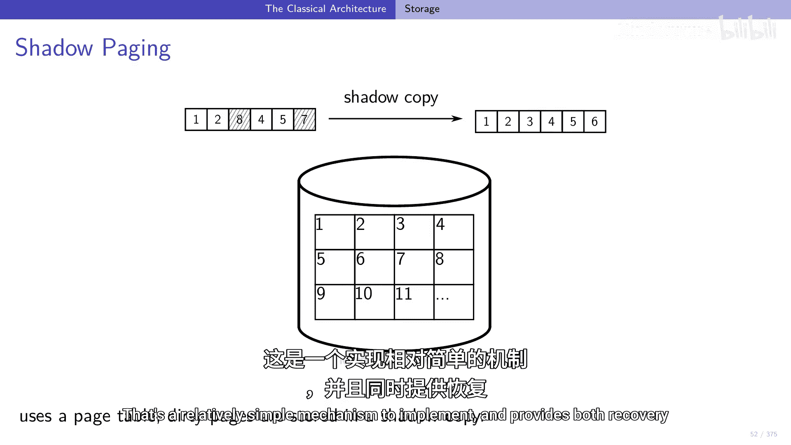

Easy to recovery。 And if you can use transaction isolation。 Now downside is。Two downsides。 First。

 my page access logic is more complicated because I must always look into this page table interaction here to check can I。

 which page should I read and what what does the current version of data that have to look at。

 This already not so nice， But this is not what really stop people from doing this。

 the more unpleasant part is this one here。Dre data locality。 And this is really。

 really an unpleasant behavior。 because if you think about this original data here。

 all pages were next to each other。 here，1，2，3，4，5，6。 So therefore if I want to read them。

 I just start with one， then you can read them from thises， of course， as first I can be。

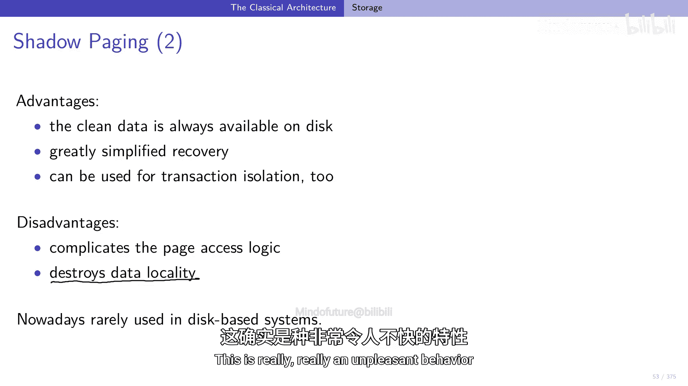

Now if I have a shadow page table like this， then I have no longer have a signal I no I shouldn't say this。

 so I have here a sequential run， I have sent here a sequential run then I have here sequential run and I here a sequential runs。

 basically I have four runs instead of one so in first case I do three six Now if you include the first thing and even four So here we have a seek here we have a seek here we have a seek here we have a seek。

😊，And so we no longer have nice sequential access patterns。

 so I have random IO and remember random IO is slow， therefore people don't like this。😊。

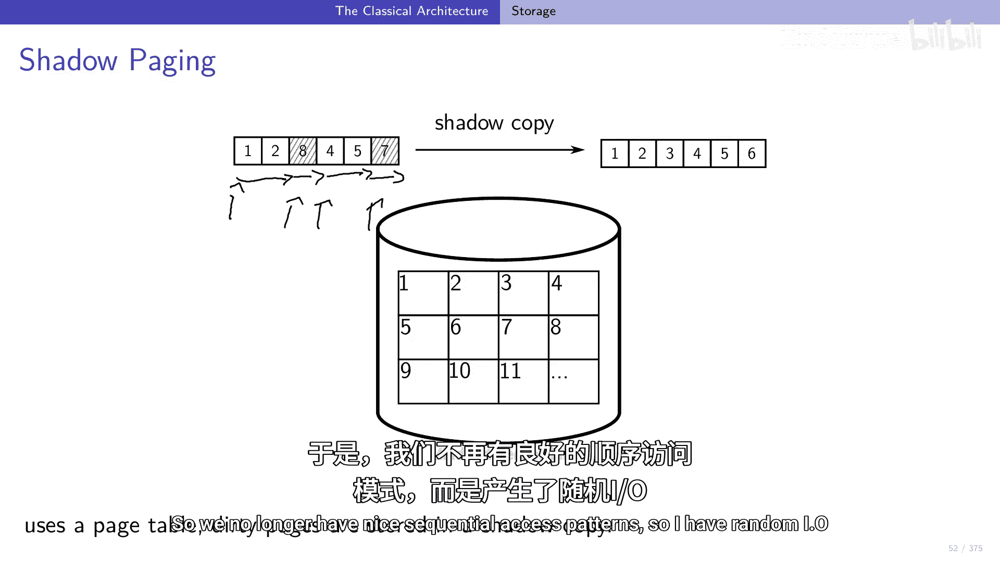

Nowadays， very few people use this on disk based system， because on a disk based system。

 it's so terrible to do seek and also extremely expensive。Therefore， you don't want uses。

On the other hand， as I mentioned last time， hardware is changing too。 and on an SSD， for example。

 it might be less disastrous signal rotating this。 Even on SSD， there are problems with this。

 but it's， let's say it's not as bad。 or even more extreme example in memory memory。

 you can do this because memory memory has little effects with random。 mean it it's not true。

 There also some random effects， but。But this only occur within a page。

 If you jump for one page to other， doesn't matter because it'ss the same if it's physically next to you or not。

 So within memory， you can implement something like shadow paging to isolate transactions。

 And there it's actually affordable to lose。 So shadow paging is still interesting to use。

 but not under this basis system， only for other applications。

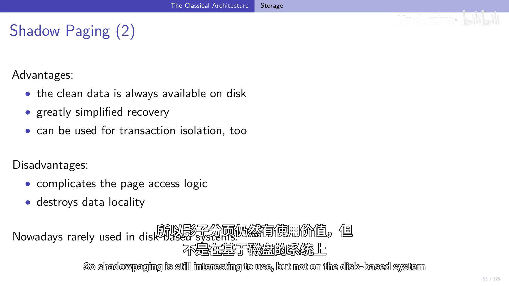

Now instead of shadow paging， you can also implement a different strategy it looks a bit different。

 but is conceptually quite similar， so it has a simple idea。

 namely we also have an original we have original data and we have a copy but this year is now then called a Dlta file so now。

😊，So how does this， this work。 So this is， this is more original data。 So let's say here。

 again takes pages。Absur。1，2，3，4，5，6。 Now， I assume I want to update page number 6。

 Then what I do is I copy 6 to my delta。 So this is my delta here。 I copy 6 to my delta。

 Then I have it here。And change to T to6 prime。Okay， so after making a copy。

 I can change it in place now when I commit so if somebody。

 my transactions that manipulated C2 C prime just commit。

 then I just throw basics because I no longer need it has been committed。😊，If my transaction as。

 then I still here have the6， then I forget the content of6 prime and I set I copy my6 back into onboard。

 I copy my6 into6 prime。So I use the delta for recovery。

 of course I can also use it for transaction action isolation because I still have to copy available but the thing is the copies vanish over time。

 so if a transaction ends either with commit or board afterwards the copy is gone so conceptually I update in place I just delays it in place updating or let's say I have have the original data still in a Dlta file。

😊，Now， of course， we can implement a data file in two flavors named the question is where do you put the original data and where do you put the data Del dirty data。

 so what I drawn first was I had the original data so the unmodified data and the delta and then the modifiedified data and the main file。

😊，Yeah both have pros and cardss if you do this， then of course a commit is cheap because an committer just throw away the data。

 but anboard is expensive because the mass copy backs the day as a page， if it do as way around。

 if I store the dirty data and the delta and the clean data is original。

 then the commit is expensive and board is cheap and because anboarder don't do anything。😊。

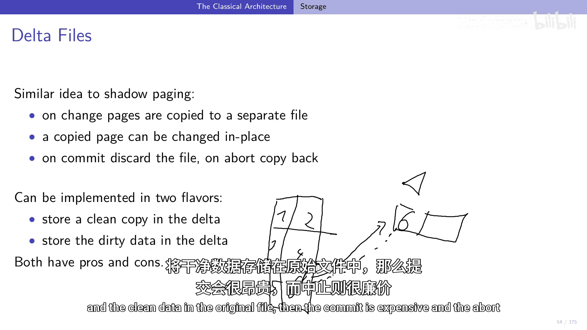

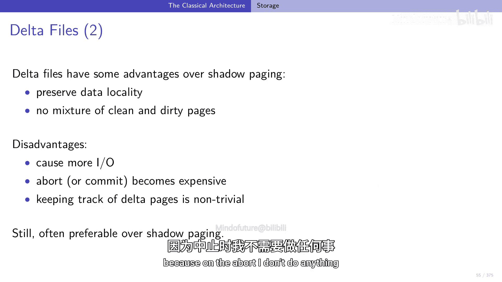

Yeah。AndNow which first we come next step， which of the one should we prefer depends on what you optimize for commit or board。

 I would say usually you optimize for commit because you assume that most your transactions will commit So board should be the exception therefore makes the commit cheap So we put the original data in the data and the modified data in the main file and then the commit is cheap and the rowback is expensive。

 This is usually what we won't prefer， but you could implement of course both。😊。

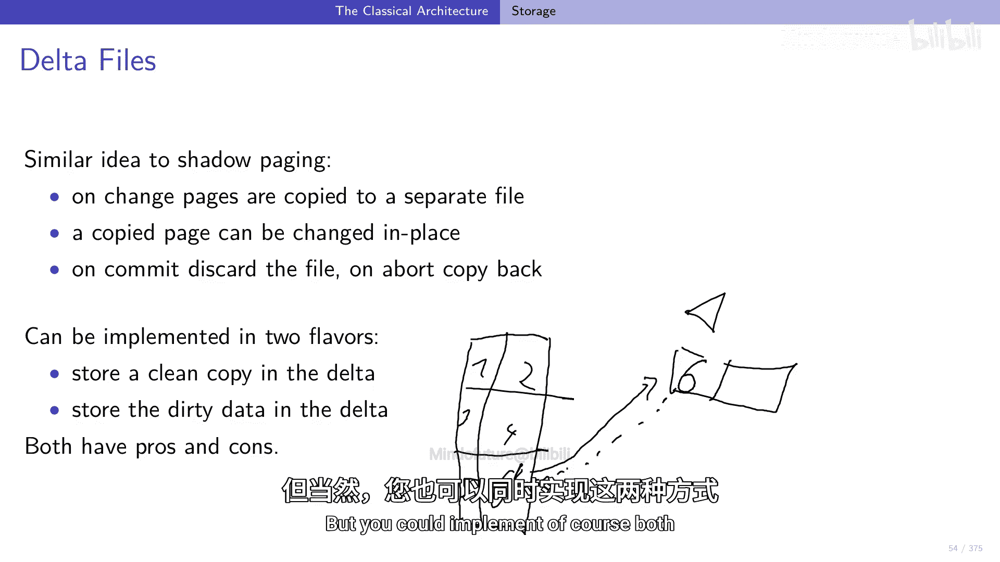

Now data files have some advantages over channel painting。

 first the best advantage if you ask me is we preserve data locality because so afterwards after everything is committed by data is again nicely consecutive and we get nice read performance So this is what we want so we don't mess up locality Also we don't mix up clean dirty pages that different files this is also makes your recovery easier。

 it's easier to recover from this， but for me locality is the most advantageous thing Now of course。

 it offers some disadvantages。😊，First， we do more I O and because in the moment you do a copy here。

 if you look at thing about this example originally had one page before I modify。

 let's say this is page6 before I modify page6， I must make a copy and write it to disk That so I have a copy on disk So this of course cost me O that so I' write Now the second right is free Now if if I do see a6 prime or6 prime prime doesn't matter because I still have my original6。

😊。

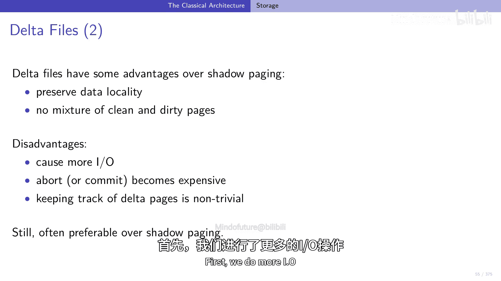

As long as nobody commits。 as if you commit， of course， I copy it back。 and then I write again， but。

So I must do for every update。 I must do one additional bright。 So this is a disadvantage。

 I do more I O。 And second advantage disadvantage， of course。

 is that either the commit or the bolt becomes more expensive。

 And it depends on how you implement it。 So as the way I said we store the original data and extra file。

 Then the bolt becomes more expensive。 The commit is cheap。

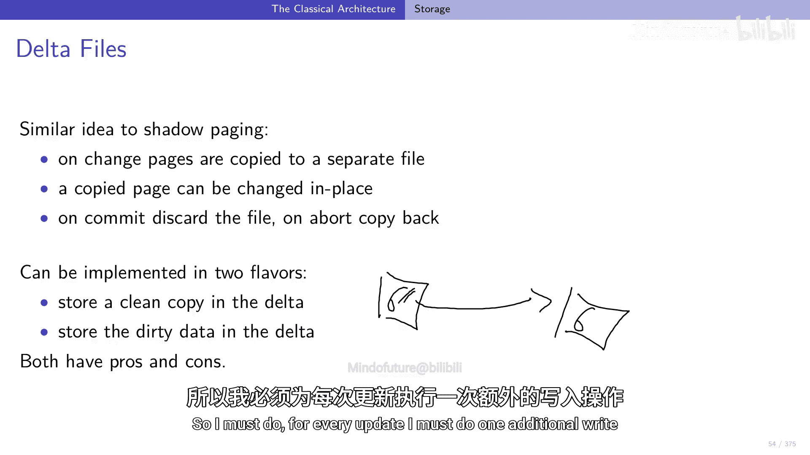

You can choose switch on your want to make cheap。 And of course。

 you always have to keep check on the data pages， but it also not so super trivial。

 remember we have multiple threats。 We have to conclude the updates。

 but we can definitely implement this。Regardless of statistical disadvantages。

 the data files are usually preferably over shadowd paging。 So if， if I would implement a system。

 I would rather prefer data files at shadow paging because of this problem。 Yeah。

 preserve data local， this is a really great property because in the long run。

 if you get better performance， then if my data is nicely consecutive。

 the data file is actually quite a good idea。Okay， so this brings me to the end of my of the storage part。

Now， next， we want to at least start which we're looking at excess pass。I said access pass。

 this is kind of a generalization of index structures and relations here the data that you store in your database system and so we to orchestrate the access to the data。

 we need some different data structures and that we will look at， of course。

 in this order that we were idea yeah so first we need some kind of free space management So as I mentioned this before so we need some mechanism to figure out。

😊，Where is free space where I can put more data。 Yeah， and this has to happen reasonably fast。

 We need a mechanism of this。 Then we need data structures for the data itself。Yeah。

 so so first approval。 So this is internal， if you wish。 So this is here internal。

To to know where to potato this is。Let's say is relations， for example。

Then we need some data sources for unusually large data。For example， extreme example， of course。

 are blos， binary large objects or or even more harmless large strings。Yeah。

 so if the user store gives me that string， I might have to do something that strings。

 You you need for this。And finally， of course， we need index structures to speed up access because if I have many million tablets in my database。

 I usually don't want to look at all of them just if I search was a specific one I need some way to speed up to search okay so these are the four parts and we now want to look at them in sequence today I will not be able to look at all of them but at least I will start looking at。

😊，It's the first two words I think。

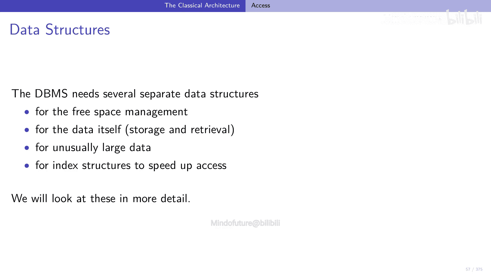

So free space inventory。 So the first question is。The user doesn't insert。And gives me a tupper。

 I might know， for example， my tu has the size of， I don't know， it's a tupper。

Stper might have a size of， for example，200 p。Where do I put it Yeah。

 in particularly if you see not all tablets are the same size。

 could be that the next table or or the previous table is is a table of short strings。 therefore。

 this previous table might just have， for example， 50 bytes。Yeah， it。

I might have to put them in different places because I organize my data in pages。

 that's what my page for certain field degree。 So this is the page page one and this is here page2 and then this here might be full up to here this here might be full up to here and then clearly a small squeeze is in here。

 but larger table might only fit in here by the way if I do this in different order。

 So if I do the second table after the this let's call this T2 and T1 could be that T1 ends up appear because there's enough space T1 while T2 has to go here or it can go here。

 T1 cannot go here T2 can go here because there's enough free space。😊。

AndThis is also of course for when selection order or the results order when you select does not correspond to insert order just because of the free space at the end of a page could be that something is small it does still fit and something in large doesn't。

Okay， but now we need a way to figure out where should we put this？😊，And yeah， so。

We need a way to quickly find out what is page that can still hold 200 bys or some other amount of space。

 Now， the traditional way to do this is to use a so called free space bitm。

But it basically means that for each page in your segment， you have a large array。😊。

No sorry you have that area that for each page on in your segment contains an entry and usually not if you1 byte to adjust half a byte per page。

 of course you can be more generous and give it one byte per page and you can be more accurate。

 but a traditional implementation looks something that exist。

 So you just give four bits which means half a byte So one half a byte half a byte per page。

 So4 bits describes the first page the next four bits describes the second page and so on。

 Now So here describes a field degree for each page。And we maintain this for each page。

 And now if an insert comes and want to insert new data。

 then we look at this array and then we figure out， okay。

 what is a page that contains enough free space。For my table and the first page that doesn't account contain free space I insert to。

 and then of course I update this field degree if it has changed。😊，Okay， so this is a high level。

 here。 we have a bitmap。And for， for every page we reserve， for example， for bit， Then we store the。

3 degree。 and now one question， of course， is do you store how much data do you store。

 how do you store how much free space do you have， It doesn't really matter。 Yes。

 because if one is just so so we know that free is equal to。Free is equal to page size。

Mans minus used。 so it does not really matter if you store used or free。Yeah bothes。Both is free。

 both is basically the same as you can compute one from the other。😊，Usually。

 I would say you will store used。 So how much pay you have used。

Just because then we have conveniently can interpret all zeros here as page is empty。

 but this is really up to you。 So this doesn't really matter both is fine。 Yeah。

 just one of the two you reduce。

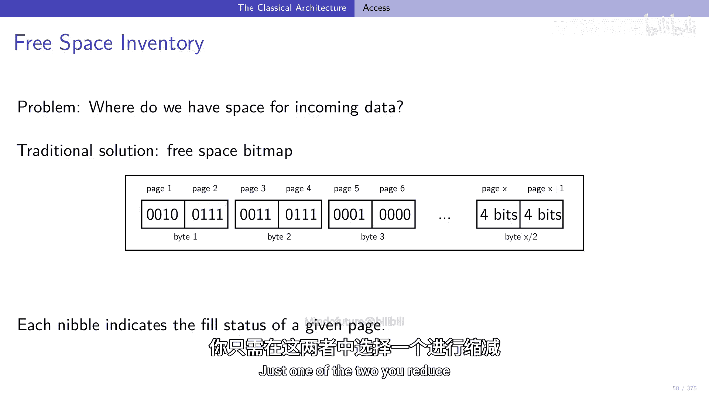

Okay so you now we must encode a few degree of a page and four bits and of course four bits is not a lot。

 some systems are even more crazy and use only two bit or even one bit per page I think this is not good one bit is really too little2 bits is a bit better but also not very accurate with four bits we can already write a bit more accurate information Now4 bits at least you have 6 different states that we can have now of course the more bits you have to more accurate you are the problem is some more bits you use your larger your free space inventory becomes and now you could say hey this is free or this get cheap I don't care about space utilization。

 let's use8 bit but the problem is also if we make a larger scanning it becomes slower now so you have a certain incentive of making it small but nevertheless I think four bit is the minimum that you want to use。

Okay， so let's assume we use four bits。So now how can we encode my my use specialization is just four bits Yeah one way to do this is to say I just do linear interpolation basically I encode there in this four bits size of my data divided by page size divided by2 to the power of number of bits for example。

 if I use four bits and by 16， so I say here。Data size divided by 116th of the page size and then round it up。

Yeah， if I round this up， uses this as few degree， then I can from the from the four bits decide。

 do I have enough space for my incoming table。 Of course， there are some inaccury。

 because I always round up which means that my accuracy accuracy is only page size divided by 16。

 for example， if I have 16 kilobyte page and then I have。16 states。

 So then my my blocking factor here is 1 kB。 So basically the last kiloB I cannot fill easily。

And because the moment that I cross into the last kilobte by page looks full。

 my my my field degree will be maximum。 The moment that I come within the last1 kilobte of the page。

 that means it's a bit difficult to make the page completely full。😊，And so。😊，This is a bit a problem。

 so have a problem of loss of a accuracy therefore I can can say instead of having linearar scale logarithmic scale。

 So instead of doing linearar apppoulation I say I do stores logarism then I can describe the extremes very well this assembly now we use log of text size So this here means one2。

4，3 is48 16 and so on we exponential growths and this of course allows me to describe the small valuess very precisely in linearar artpoulation loses a accuracyy or you if you do this by the way。

 you probably don't want to do this with text size， you want to do this with。😊，Free size。Yeah。

Because we prefer the case when we run nearly run out of space， we want to know this。

 then we want to make it completely full。Or of course。

 you could do even a combination of two you could say Im linear so F 16 plus values let's say I use8 of the values with a linear scale and then sorry here's a linear one8 for linear and then8 for logarithmic scale as thiss probably even better because with the logarithm problem that at some point the values become too large and we could not care about them anymore so it when use might use a combinations is also you mean I my example I said。

😊，Smallest value is  one。 And we have so we have 1，2，4，8 and so on。

 This is we probably do not care about 1 and 2 because no tappper will have only  one byte or2 bytes。

 Yeah， so on we might have a line and so on。 So we might might be that my taps are multiple or4。

 for example， anyway。So therefore， I know my more possible video is4。

 and then I go only exponential afterwards。 So you might have a carefully hand constructed table that says。

 for example， value。😊，Theyio。啊。15 means4。Well you 14 means4 by left or we little  four bys built perhaps too small Well let's say 8 by left。

 then 15 means 16 left，60 so sorry， go the rug right。13， of course。13 means 16 left。12 means 32 left。

11 means 64，10 means128 and。To more。 and then 11 means。And then。Then afterwards， we go to linearar。

So then V so how was going to run off。そつ。Frogger was never yet。9，8。 And afterwards， you do Lena。

For example。Yeah， so this is， this is linearna scale。Then this allows me to make my pages fairly。

And I， I still can describe the， the， the rest of the page using your last nicely linear。

 That was this kind of some kind of encoding you will choose。 Then this。

 then these four bits are actually sufficient to describe your free degree of your page quite accurately。

 So you can find for every table an appropriate place where you can answer this。

And we use this to encode the free space， already said。

 it doesn't really matter if you encode the free space or the use space。😊。

Both because one is just page as minus as as， so it doesn't matter what you use。

 but with a few bits we describe which state we are。

 then we choose whatever we need for our internetn to find an appropriate page。

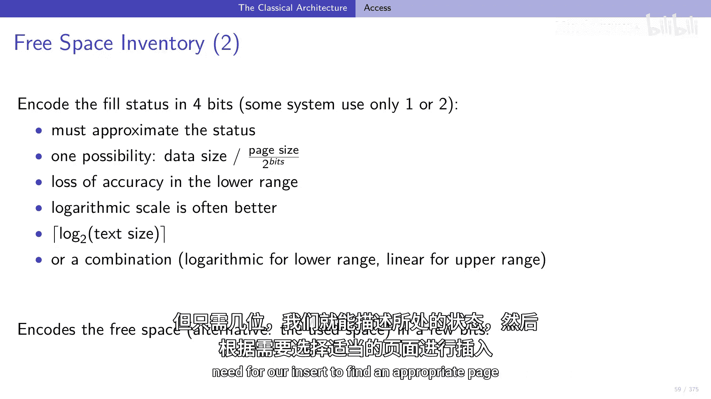

Okay， therefore when so how do you use this。 So when we insert data the computer required free to inventory entry。

 for example， I might require that if I now describe used instead of free。

 I might require that my page has an entry of at most 7 because I know that if it is 7 or less my data fits。

So then I scan the free space inventory for matching entry and then I insert the data on this page and of course I update the entry if I go to a next if my internet was large enough to cross them to the next free space inventory category and of course we update the entry that's what this is the idea we scan insert。

😊，Now， so this is a pretty simple to implement， only the problem is this going be surprisingly expensive。

😊，The problem is， if a scans inventory， then I have a linear effort。Yes。😊。

IStart with the first page and then I check， of course if you linear effort。

 Now the threespace inventory， it save is not so super large。 Yes， it's pretty small。

 If you have 16 kilobd pages， then one page of three space inventory is enough to cover half of a gigabyte of data。

 so you don't have a lot of pages。 but nevertheless， it cost you something。

 Yeah and I can tell you from personal experience。 the first time I implemented this。

 I implemented is if it also buys the book， and run some experiments and everything work great。😊。

Yeah， and then I started inserting 10 gigyte of data。And suddenly。

 the system became slower and slower。Yeah， and now， right as a7， of course。

 if you have 10 gigys of data， we have 20 pages with free specimeter。

 each of them contains a few thousand entries。 as we are。

 we are checking thousands and thousands of entries。 And this cost at something else。

 So suddenly my performance was dominated by scanning the free specimeter。

 So this was was cost costing performance。 This of course， is a better idea。😊。

So now how can we make this scan cheaper pretty easily， actually。

 because we know that there are only 16 free specsservatory valuess anyway， we know this。

 and therefore， we can catch the next matching page or perhaps the next set of pages。

 a range of pages Yeah and so we just remember what is the next page that has this entry。😊。

And this cache works very well because most pages are static。

 which means that you insert it into the database and then most of the time you don't do anything with them。

 They just sit there and you read them perhaps later。

 but you don't modify most of the time cause could be that you do in bulk operation that you delete all entries or so that's okay that from time to time the cache has to be invalidd but most of the time the cache will be correct。

 So if you remember if you just remember the first page the first with the certain fi value then and never have to check before just check after So if this is my inventory I might remember。

 for example， the first page with an entry of7 is here。So if somebody ask me for seven。

 I go here and I start checking。😊，Now， this group is the correct page。 if not。

 if it's not the correct page， let continue to the right until I finds it first。Correct。

 matching page。 And then， of course， I update my cache。 Yeah。

 So I never never again search for the page with with a value of 7 less than this cache value here。

 So this is my cache。😊，Yeah and so I only scan the end of my space inventory and never checked before and now it could be as I said that somebody deletes something in the middle here then of course I have to perform to delete then of course I must update my cache but this happens rarely most of the time we don't do this and then okay then I read the rest again but then after the first scan again I cache this and I will never look at this again okay。

😊，And this works quite well because segments tend to grow at the end so that we most of the time we only happen at the end。

 then we don't have this expensive checking here。

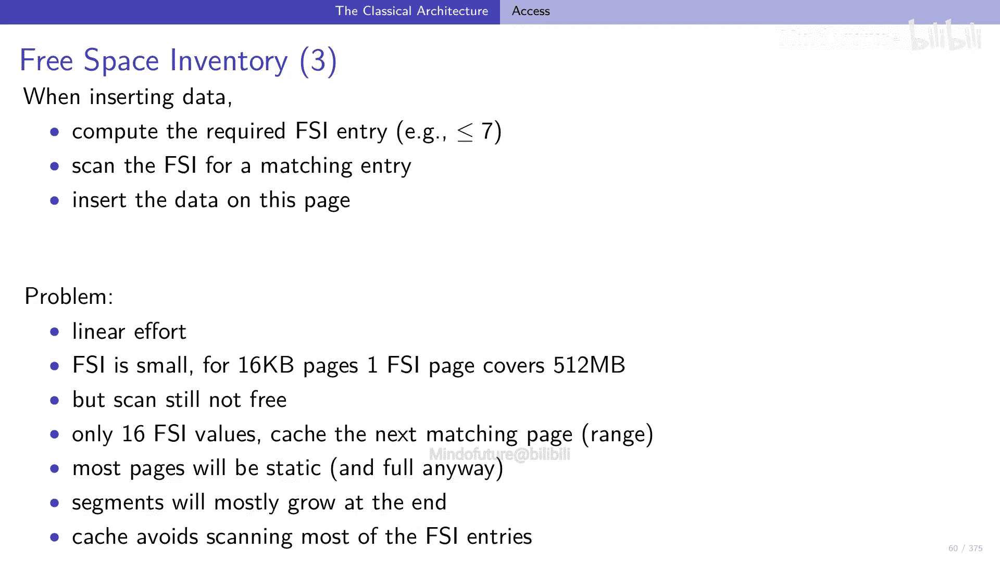

Okay， so and。When we perform allocations， then we benefit from the knowledge application knowledge that we have。

 Yeah， so this by the way， true both for pages we have made the example previously when we talked about segments and all about templatets like for example。

 you could say hey so either you allocate a page of data or you insert for example。

 a number of tablets。 here somebody has an insert statement so here you have an for example。

 have a statement looks like this insert。😊，Into R right。 then here we do select。

So then of course we have a single template that's currently coming if we need a space for a single template。

 but we already know or we could know that there be more templates coming so we know because we select produce of templates。

 we might know this and we can make use of this knowledge。😊。

Another example here is that we might understand where we need allocation is very large data items we talk about in not today。

 but in the next section， but it's not saying theres also something where we need allocations。😊。

And so what we want， of course， is that allocations are close to each other and what we can do when allocating as we can gives us system hints。

 basically we say，😊，In terms of， a single tapt therefore say allocate a need， for example， 200 bytes。

😊，Yes， I same minimum was 200 because I must put the next table in there。20 bytes。

But I could know already that there are more tables coming。 therefore， I said 200 bys is minimum。

 but if you have， for example， space for donor20 kiloBte， that is good。😊，sorry， kilobitt。

Yeah so therefore the system can make use of this information， say okay 20 or 200s of minimum。

 but if I have a better spot fit the 20， I will do this and it will give the call at 20 kilobyte and of course that the have 20 kiloby and then it can place the next temperature auto next to the first one so this way we reduce fragmentation so we tend to be prefer to to data next to each other。

😊，And we might be even more crazy for topics we will not do this because we have nothing we can put there。

 but for segments I made the example already we might do over allocation here so whereas theres the segment the user of the segments says I need five pages now I said I prefer two pages but I't know how to make use of five pages and the system is regardless as you asked me for most five but you know I had seven please takes the seven because it fits better my allocation in my memory layout if you take seven and therefore gives you more than you asked for。

 so it's called overlocation。😊，And by doing so we reduce fragmentation and this is a really nice thing and I would say perhaps a bit unfortunately。

 regular programming languages do not support this even though I think more people could benefit from this so this is actually a very good interface and for an example of phase make sense even relieving the world of database systems。

😊。

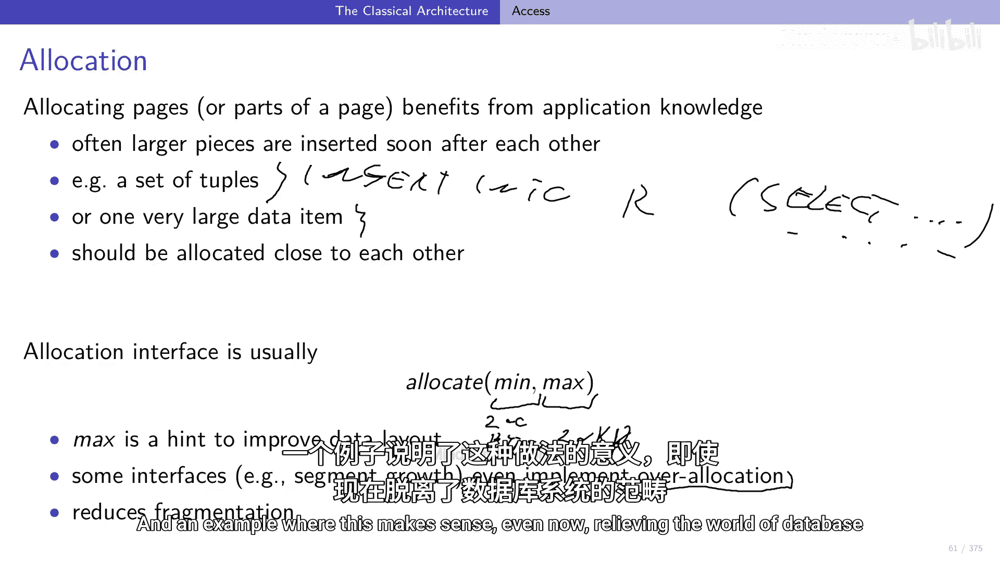

If you think about something like vector。Its in a programming language。

 So let's say you need memory for， for example， vector。And then here here， we have dollar。 Now。

 as end the insert here， we do be that pushback as we grow。Yes， if we grow over time。 and of course。

 at some point， the physical memory must be increased。 So the first， it's small。 then if we grow。

 we make it larger and larger。 Yeah， and the funny thing is。😊，So for example。

 the vector itself might say， okay， now I please I need space for 2020 entries。Now， internally。

 this memory is allocated either from for example the C library or from the operating system and this underlying layer will have a kind of blocking factor too that is just something that is invisible to you so basically what you ask for amount of memory。

 for example， now so this year if it's C+ plus that will perform a call to new， for example。

 and this call of new might internally for example， call MelO。😊。

So this is a low level allocation primitive from C。 we could say， for example， Meoc I don't know。

 I need for 20 entries I need to。With overhead， let's say and it's 88 bys， for example。

 And of course， you you get back a pointer here and then， you know， for sure at this pointer here。

Has enough space for 88 bytes。Yeah， but it could be。 So you asked 88。But it could be that in reality。

 this has enough space for， for example， 96。😊，Because of how the allocation etly works。

 the melo cannot give you arbitrarily small pieces of data。 depends on implementation。

 but most melo implementation cannot give you arbitrary small pieces of implementation。

 So say you asked 288， but you got 96， but you don't know this。😊。

And so you got more than you asked for， but you have no way to know this。 Now。

 if you could know that you got more， then the vector could be smarter and could realize， oh。

 I wanted to grow to 20， but the rate here I grew to have enough space now for， for example， 20。

 but it I say 21， at least。AndSo you can make use of this extra space。😊，Would be great。

 Unfortunately， there is no portable way to do this。 In fact， there is a way to do this。

 so if I I don't remember this a name but then I have look it up in a moment if if I get I I am。

 So theres there's a function here。😊，That is called。嗯。It has a function。Theres called。Melo。

Uusable size。This is not， unfortunately， not super portable。 as as in Linux， you can do this。

 Im saying it's not a positiveing function。 even。 Let me briefly check。No。

 it's not a project function， so this is a glue extension here， it's not standardized。😊。

Unfortunately， there's no standard way to do this extension。

So then you can ask medical exactly is this。 So how much space do have。And。

So you could exactly do this trick use the extra space that you got。

 and it would be a good idea to do this。 Only problem is if we make other tools like address。

 So we'd be unhappy if you do this So actually in this case。

 address will just tell you exactly how much you allocate it。

 you will not give you useful answer back So melo user size is a bit fishy。

 but mean principle this idea of using over location is a very good idea。

 Data do this routinely pro your languages do not， but perhaps I should because if if you do over location。

 it helps you to fight fragmentation。😊。

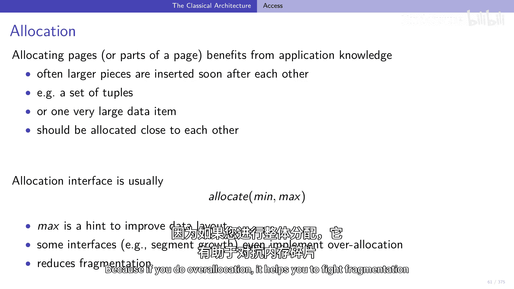

Okay， now。So much for the allocation。 So up to now we talked about figuring out where do we find enough space to store my data。

 Now， we have to think about what do I really put in my So how do I put my records in a page I realize this page should have enough space and how must somehow physically do this and the traditional way to do this is to use a software sloted page Although I must say。

 oh， I just。Check my time。 So I have only quoted on our left。I think I will stop here。

 I will not do start basis。 I mean， perhaps you remember started pages from the introduction to databases。

 then great， please。Please look at this again， because this is what database is really internally used。

 but I will need more than 50 minutes to talk about started pages and I don't want to cut the explanation in the middle。

 Therefore I stop here so I'm just saying。Ts are internally stored in pages。

 started pages that we look at in the next lecture and we use the free space and majority figure out which space has enough which page has enough free space to fit a then on top of this within the next lecture we will build pages with template which can be used to handle it extends if will look at the record layout。

 So does I mean here we just draw a box what is stored inside this box。

 So this will look at next lecture then what we do if my record is too large for pages or to what we cover next。

 so I will stop here today and then hope you to don unfortunately cannot attend。

 but at least listen to my lecture next week。

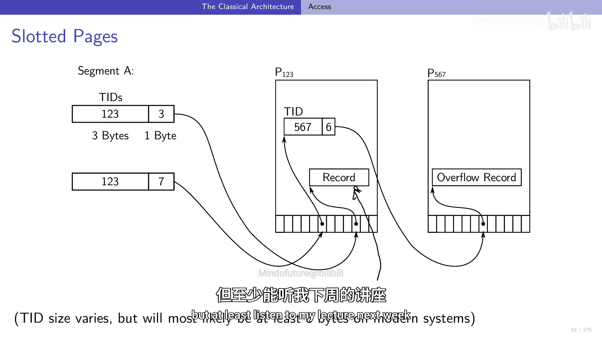