# 【慕尼黑理工大学】现代CPU架构上的数据库系统实现-｜-Database-Systems-On-Modern-Cpu-Architectures-2021-p04-P04_04_访问元组--BV1asiJBeE6j_p4-

Welcome to the lecture on data of implementation。 So in the last detector we have looked at the storage part until we came to this part here slot pages。

So basically the problem that we have to address is how do we map database data in particular records。

 which means template basically to fixed size data structures or fixed size pages that's one of the most well known concept physicists so called sloaughtered pages concept。

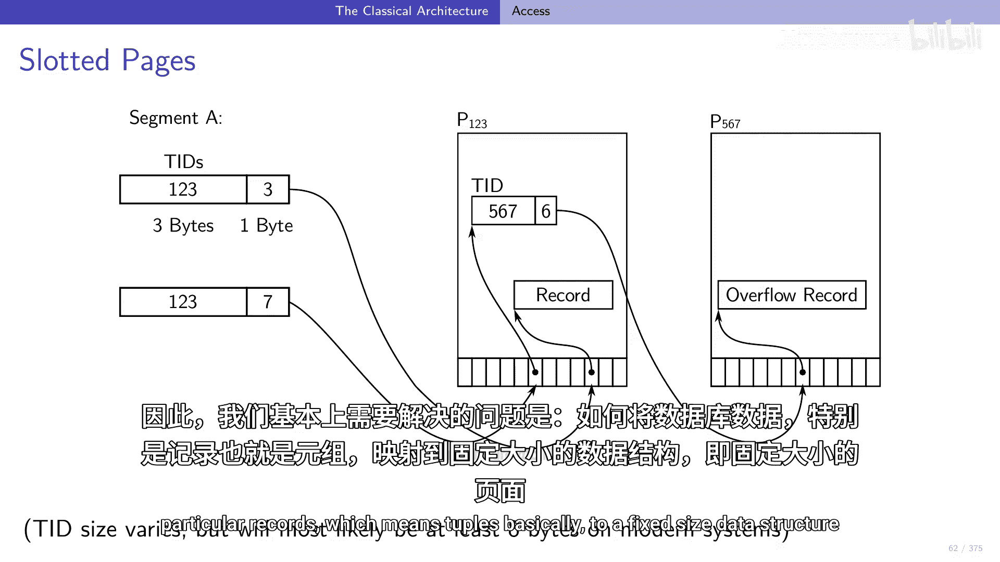

And so the plus page looks like this， we have this page of a certain size in this case if we say a page 123。

 and this has a certain size， for example， we could say 16 kilobyte or perhapsps more than this。

However something like this or2 kiloyte or so a certain size。

And then we put the record on there now so this is a record we just write all the data that we have here。

 if we aBC1，2，3， and so everything is written as a by range on the page and now where does the name k page come from the slot that references this record so this for example this slot here could point to that record and then we would address this record by the combination of。

Page number。So in this case， we could say page number 1，2，3， slot， sorry it's supposed to be 3。

123 is slot 0。 and that's this is and record no tricky speaking。 this is not。Yeah。As I messed up the。

The number。 So this is， in fact， the record 1，2，3，4，5，6，7，8，9，111。 Oh did start from 0。0，1，2，0，3，4。

So this is， in fact， was snaba。11， neither miscounted。So。This here is the number。And。

So this then allows you to reference a certain record。Now。

you see in this page you see some more entries here so this is the regular records that we just saw here Now here you see a special case。

 namely a record that was moved to another page so this can happen for example if you if you insert records that your page is full at some point and then you want to update the record to major larger for example。

 you want to change the string。AB and we want to transform it into a new string X Y z and this of course makes this string larger。

 now it could be that there simply is not enough space for this record for this longer string because my page is full So what I do then is moves a new record on a separate page so here we call this overflow record we move it to a separate page and on the original page you just remember that this record existed and now what is this new number so here we store that the record has number 1237 is now stored as a position 5676 so this is what we store here this is a forward。

And we reference the new position。 Now， as the good thing about this forward mechanism is。

That we can now keep the original idea。 so we moved to a separate page because we didn't even have space。

 but nobody knows this。 Now this idea here keeps stable。 So this record always keeps this number。

 It doesn't matter if it was moved to a separate page or not。

 So we always keeps this number and this is important because it could be this this number is stored somewhere。

 for example， in an index。 So we might have an index on this table and this index references is tupper Now if we move this tu to another page I don't want to go through all the indexes and update them instead I keeps the I stable and。

In the forward。 Now， of course， there's a certain cost involved to us。 So because if you do this。

 So if you， if you have this。And。So if you have to photo this chain here。

 then if we jump from one page to another page so it gives me another page for it is cost performance。

 but I hope that this is the exception， so most tables will not be moved to another pages and this is absolutely true first。

 because most tablets are never updated a majority of the data items are inserted and then perhaps deleted at somewhat but they are never updated most of the time as so frequent updates are rare and therefore we can expect。

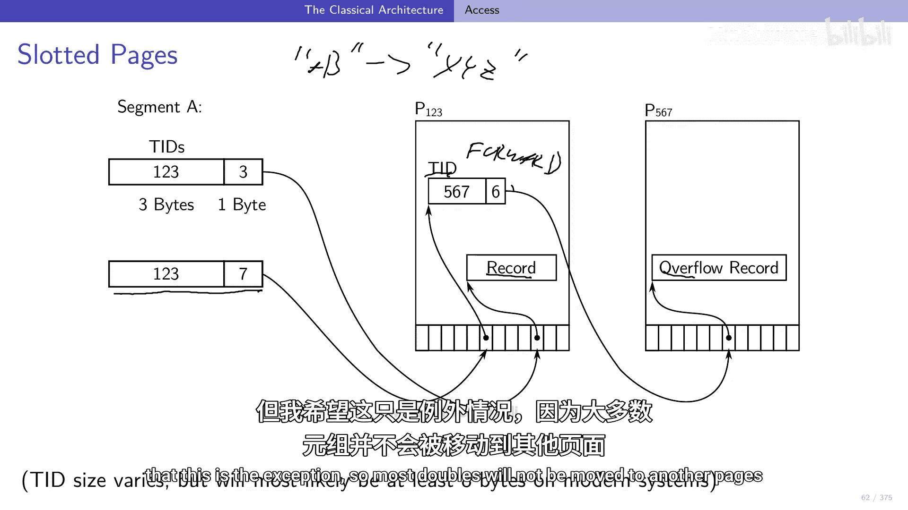

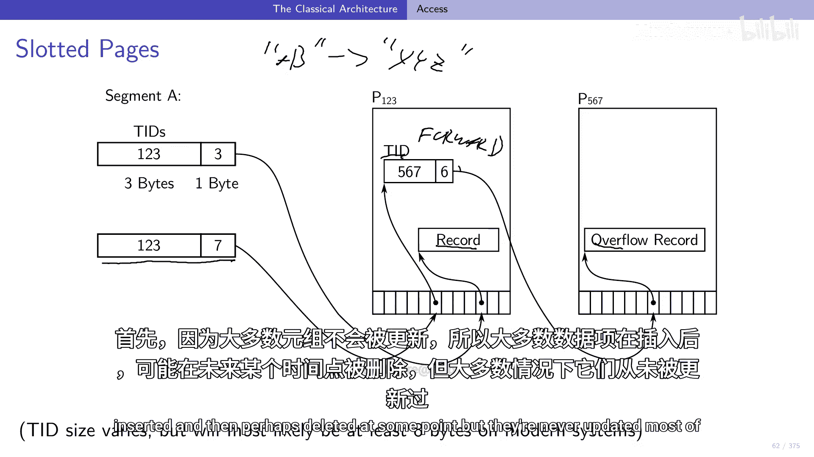

Most of the data， I can just keep it as it is。 and the second thing is。

This in in first case we have to touch two pages instead of one。

 but we will do two things to mitigate this。 First， this chain will never get longer than two。

 That why with perhaps it's not obvious wise it's the case because it could be， of course。

 that this page as full too。 Now if somebody wants to update this overflow record and make it even larger so it doesn't fit here so if we want to make this here increase is iss no space but what we do not do。

 I draw this here of dot pages。 so what we do not do immediately put it on another page of course。

As don now we have a really large record。 Now， what we do not do is it makes the chain longer because this would give me out very bad performance。

 Of course， what we do instead is。So don't do this instead we update the link so we let this here want to point this new position and then clear this so clear because the over doesn't exist so we throw away this。

And so my chain at most contains one ho。And also it might have to access two pages。

 but never more than two。 So this is one thing。 and the second trick that we will see in a moment and we talk about the implementation of the storage layout。

😊，This chain we only follow if we come from an index so if somebody says read， give me record 1237。

 so this means we directly jump we explicitly so we come from index。😊。

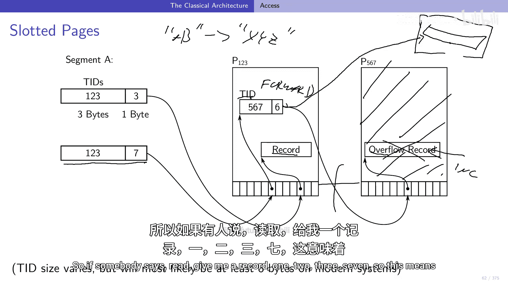

Index， then we to takes these ideas， then we jump to this page here， we find this record。

 we see oh there and forward， then we go to another page and so this you indexes can happen。

On the other hand， if we come from an index， we did random access anyway because we moved through B3。

 and so therefore we only do this build only do this rarely because we use an index only if there are a few entries。

And so in this case you'd have another page if we instead scan the page， so if you do a table scan。

 then we do not follow this link so the performance penalty is only for point access so jumping into a specific record scanning the whole every page does not cost me anything even if I move to a record and we would see in a moment how to implement this。

😊，Okay， so this is a pretty nice concept。😊，Very practically flexible。And quite popular。

 so many systems， I would perhaps even say most database systems implement some very of this。

 at least historically they' have done this。 So this is a very popular way to store data。

 Now we here we look a bit more closely how we implement this。 this is now a zoomed in version。

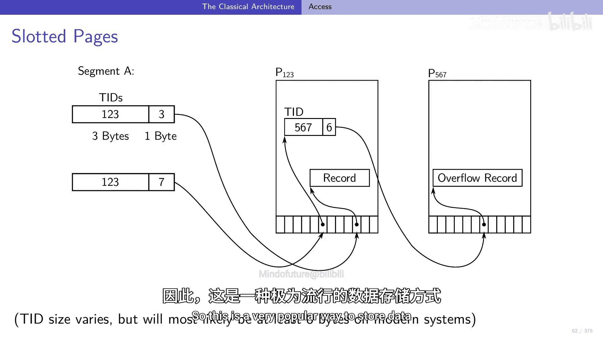

And so we， if you stop an restart page， we will usually implement it like this。 So in the page。

 we will have a fixed size header。😊，As there fix as set in the front。

And then we will have slots and tablets and now you see on this this slide here as said we put a slot on the front as the previous slide here。

 we said we put the slots at the end Now what should we do should we put it at the front at the end and this doesn't really matter。

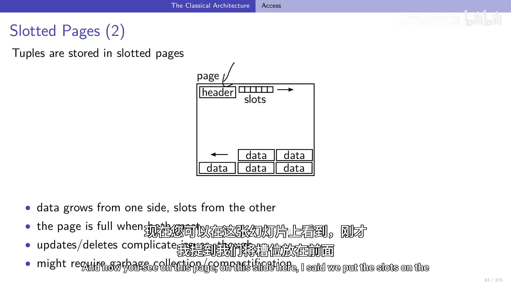

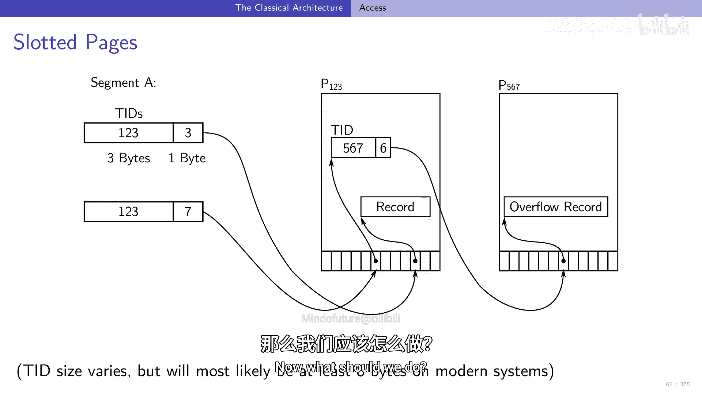

So。Depends on small implementation details。 sometimes it's a bit easier to put the slot at the front at the end。

 but the reality is as this doesn't really matter if you want to put it at the front or at the end both as so both things exist。

 there are systems that put a slot in the front and put them at the end here I will now assume that I put the slot at the front but as I said。

 the differencess a minor now what is more important is。

That the slots and the data items themselves grow against each other so this means if I insert a new chael I will create a new slot here and I will put a new data item here then if a new new tut comes I put a new slot here and put a new data item here so they grow against each other so data grows in this direction chapts grows in in the other direction and the page is full of course when both meet so when the slots and the data items hit each other up so then the page is full。

😊，Now why do we why do we do this or why do we have these complicated growing against it instead of just statically allocating end slots and that is the answer of course。

 is that we don't know how large the data item is。 So here we it looks like oh with nice fixed size box。

 but this is just a picture。 And reality is this data item can have variable size。😊，Varable size。

 therefore I don't know how many slots there are。 so if my data itemss are very large。

 then I will have only few slots。If have very small data items and have very very many slots I cannot know this before and in particular I mean this probably mostly if you think about this。

 this could be a string。 Now assume the date item is a single strings。

 We have a tablets that consists of a single string column and therefore you can never know how large the thing will be because if the user inserts a lot of short strings。

 then we can fit many tablets on the page if the user inserts many long strings。

 then we can fit only a few tablets on the page and we cannot know this beforehand and therefore we cannot know how many slots to allocate。

😊，Therefore the number of slots and the number of data items is dynamic。Okay。

 now we have so this is as long as you only insert everything is nice so of course。

 everything gets more bit more ugly the moment you do update and delete。😊，And so because。

Me I grow and then heres this another data item， then I have another data item。

 and now somebody wants to mean easy case is somebody just wants to lead this。Okay。

 there's not too bad。 We can。 Yeah。 So if we see what we do in practice is。We will do nothing。

 We will just remember that it's deleted and。Because what we would have to do is we would have to do basically garbage collection。

 which means we move all data items of we can auto perhaps also delete this。

 we delete multiple items。 Now what we would want to do at some point is we want to move everything。

 So we want to move， for example this here and then we would move that data item basiss most before and so on we compactify them。

 move them next to each other。But of course this cost me something therefore I only do this if I have to so the first instance if I deletelet in data item I do nothing now if my page is full so data items and slots cross but I know that I would have enough space I just didn't reclaim the space then I do compactification which means I just move everything compact again so that all the holds are gone and then I can reuse the space that so I delay the computerification until I have to amortize the cost。

😊，Okay， so this is the physics for reasons for updates， of course， it's the same。

 So if if I update and the size does not change and or it shrinks or it the same。

 then I can just update in place。 of course I can just do data prime and have an update if the size does increase then I treat this internally as a delete followed by an insert on the same page so then I do an insert on the same。

😊，Again， we have X difficulties if it doesn't fit because it's too large。

 then we must insert a redirection insert another page。

 but if this is not the case then we just put it somewhere and treats S deletete plus insert and use compactification to reclaim space。

So this is a basic strategy here。

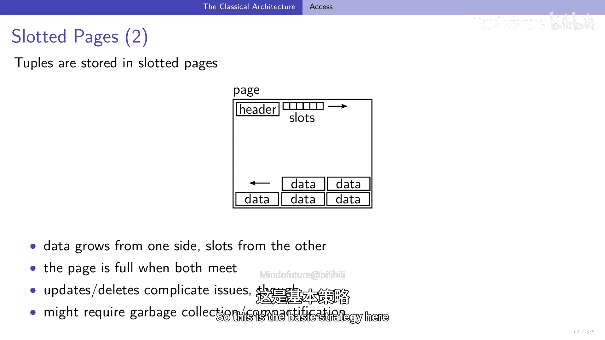

Now if we zoom into the header of the selected page so this is basically the fields that we will need as so first one here log sequence number we will talk about this later at the lecture when we talk about recovery this basically means we remember the last change on every page and we do this to cope with crashes so if we crash we must know what which operation we performed on the page if we remember the last change on each page this is just a number so this is a number。

And then next one here as we store how many slots we have and this number of course。

 grows dynamically if somebody inserts。😊，Then we store what is the first free slot。

 I will say more buttons in a moment， then we store two pointers basically one is data starts so where's my data here。

So。TheDa start points here， If this is double， then data starts point here。 And if I insert now。

 if I insert new items， then。I update my pointer to always point to the first step。

As was the first block yeah， so if I point to the beginning of the data。

 so this grows basically in this direction。And now the last one here free space。

 this is the space that would be available after collectification。

 so because this is what just what I said。😊，If you delete something， then so for example。

 if I delete this here， then I do decrease the free space， so if I delete。

 then I do increase my free space， but I do not update the data start now because there's a table in front mean if I delete the very first table I cant update data start and move the data start to back but if I delete something in the middle I do nothing I just increase the free space and say there isn' enough free space。

😊，Now we see that in principle， so we say we have two things， let's call this effective。😊。

thick stiff。So long a long word。 Let's write it differently。 We say effective free space。

 E F S has made up this acronym effective free space。 This is page size。Minus headda size。

Minus slot count。Slot counts。😔，Times slot size。Okay， so this is the space of this page。

Except they hadam。That is supposed to be the header size。

Except the space for the slots and of course， accept the space of the data and let's write the minus bit。

😊，So minus， minus， and this is the success of the data and size of the data is。Page size。😔。

Minus datat。Okay， so this is the effective free space and we realize of course。

 that effective free space is less or equal to free space。And the interesting case， of course。

 is if they are not equal because if they， if they are equal， then then I have no wasted space。

 if they are not equal。 So if effective free space is is less than free space。

 then I can regain space。🤧うん。Sorry， then I can regain space by running computerification。

 That if it's less， if it's less if E F S。It's less than free space then we can do compification。

But we only do this if we have to， because computerification costs are something。 So we can。

 we can have many items in there， so we don't want to do this every time we do't update。

 but only if the other would otherwise we be full。 here you see a note on this slide。

So page can you contain hundreds of entries， this is something you should absolutely keep in mind if you have to make an extreme case。

 you have a 16 kilobyte page and VMI top perhaps has only let's say eight by tuts。😊，So then。

Just say  eight bytes， Tuu and 8 byte header，8 bys slot。It could prove that I have such a case。

 and then I can of course 5024 entries a bit less because in spite of the data， by let's say。😊，Sa。

Roughly 1 thousand00 entries on a page。And。Okay， so this is a clearly 10 number。

 and this means we must be a bit careful， for example， if we want to insert something。😊。

What you should not do is check for what is the first free slot and because if you do this for 10 entries。

 remember if it do this n if you do n do n insert， so this is O of n square。

And because first entry of course only is to check one second entry is to check two so entry is check3 and so。

 so after the ends entry we have to check in entries as entries and as entries。

 therefore in we have the order of n square runtime。 Yeah this is problematic。

 so we do not want to do this。 so n square is bad。😊。

So you should not scan your stocks to find a file was as free， its too expensive。

Therefore we use this in here， as we remember what is the first free slot。Therefore。

 if you insert something you want to check it a free slot。

 you look at this entry if theres no free slot free stop immediately。

 otherwise we take a free slot and then continue scanning to the next free slot just usually means only a light linear scan over the data so this supposed basically a cache for or free slot。

😊，And this number of course only is only updated if you do deletes and we usually have far more inserts and deletes and therefore this you don't have a lot of these so performance is pretty critical for this largeraught pages。

😊，Mean you could say his are only 160 gytes or 32gys not that bad， but it's not true。

 that when reality performance is quite crucial if you do an E implementation。

 your start page will be slow。

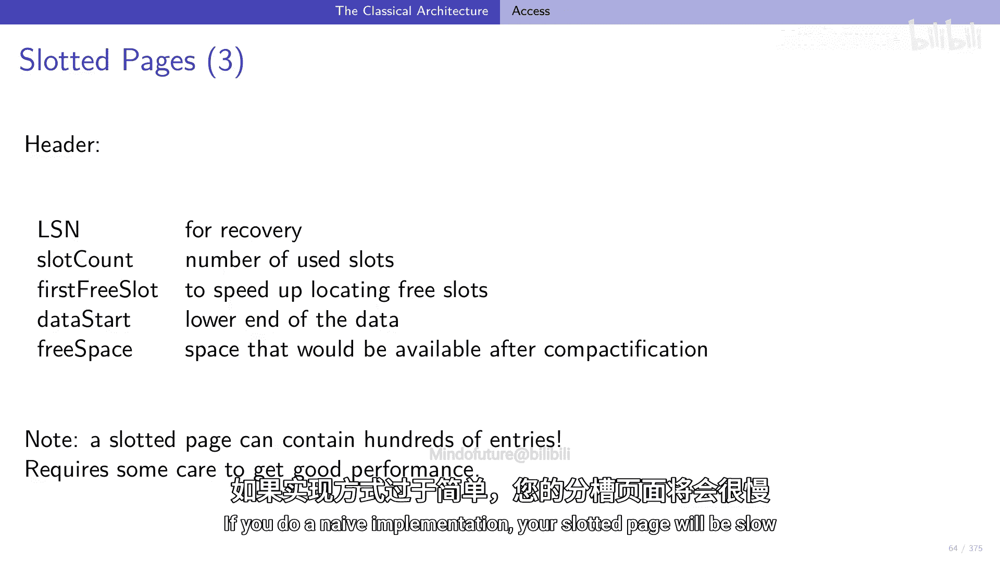

。Okay， now next question is what is in the slot？AndSo I just said we need8 bytes for slot for example。

 but what we really store there and so basically we need two kinds of information first we need the offset of the temporary within the page so we must know where it is so if for example。

 if this is my page here。So and this here has now bar position  zero。

 this is by position here2 triple of 16-1， as is the last if I to accept them is。

 of course without-1。 So this is beginning at the end of the page Now if my table is for example here。

Then I could say was in this it might be at offset I just made it up roughly， let's say2500。

 So this by position therefore here would have a header。 then I would write here。 Okay。

 my first up is at position 2500， and I must also know how large does it have。 So if this here is。

 for example，30 byte， then I right here。呃。30 now so I store so offset in the page and the length of the data item。

 and this allows me to reference the data item itself。Okay。

 so conceptual quite simple positional length now I said conceptual quite simple and reality can be slightly more complicated than you might think because there can be in rare circumstances be cases where you want to store empty tuts you could say why do you ever want to store empty tuts trust me there are cases where you want to do this most obvious example if you just store a single string and the string cannot be nu and nothing else So just a single string then you might wish to just store the string as it is in the tut and then the length of the tut is the length of the string。

😊，YeahAnd then because somebody can insert an empty string， of course。

 we can have empty tapts Now if you say offset length no problems just put in the length0 but now we have a problem that we must distinguish in empty tuple from a tapt that boss delete it now from a free slot basically then if we do this like this we say if slot is free so the no tap exists then we drive right here00 this means free slots no space you can just reuse it if you want to store an empty tap so tapt that does exist。

 but just as the length0， then if store it with offset larger than0 for example10 then we can distinguish these two cases okay so this one here exists is empty as one does not exist and is empty2 of course。

 but it doesn't exist。😊，Okay， so then we otherwise this is align line coding。

 we just offset length in the。

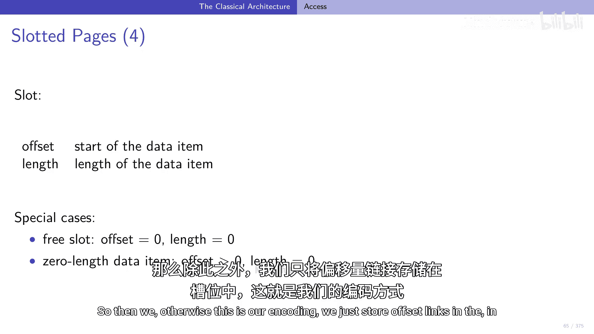

Inerve st。Now， so far， everything looked great in the page。 So we say we just saw the data。

 And if we don't fit， we put it on a different page。

 So a conceptually simple thing problem is there can be very ugly things happening in combination with transactions。

 So here's an example， transaction load that。😊，Creates difficulties。 so first。

 assume that so have a page。This was my original page Now on this page I hit a data item let's call it this I1。

 and this was， for example， very large。Now transaction1 comes and deletes this data item and of course I will have I didn't draw this very nice。

 of course I also have a header in the slot。So now transaction one comes and deletes this data item1 is there's is no problem。

 of course we can do this because now we have just free space okay so this is easy。

 we can just do this。😊，Okay， now Trans 2 enter the new data item I2 and after this my page is full。😊。

And really full。Mean here you see some free space because I didn't drew to better inputs I assume this is really。

 really full。Nurse Trans1 commits。😊，Okay， and sorry transaction 2 commits Okay so at this point this page is fixed short ons page and this is added Ss and now transaction 1 comes in the bolts。

😊，Now we have a problem because we must put item 1 back so here we must put item 1。

 but I remember pages fully， I cannot put item 1。Okay， now the theory says no problem。

 we just create in direction。 we put I1 on a different page as we have a new page。

 we just put I1 here。 and then I put a forward from from this page to that page。

 So this is the theory problem is the forward auto cost space。

 That's because if we think about this picture here we saw this nice looking forward record here。

 this takes up probably at least 8 bytes perhaps more。 So this this cost me space too。

 And where do I put it because if a page is full， then it's full So I cannot put。😊。

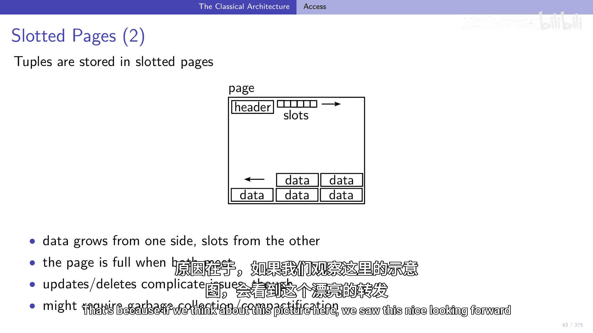

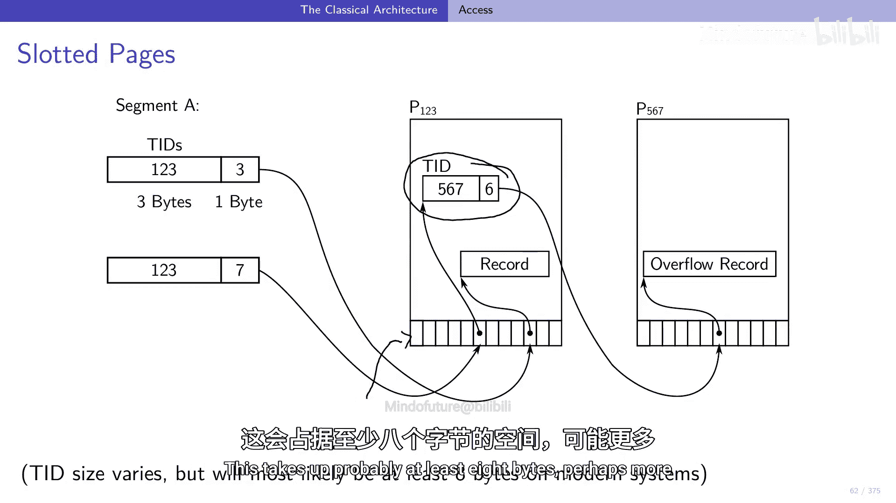

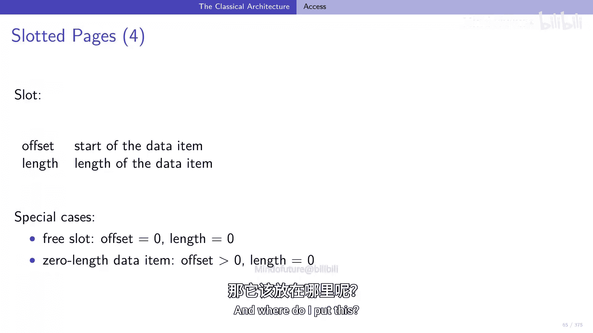

So one option of course， would be to move both i1 and I2 So this would work because then just move I2 to another page2 then have an indirect for i2 But now I have space on the original page for both entries So this box which is ugly to implement very tricky to implement because now suddenly we have to look at three pages and so yeah so a difficult implement and we we don't want to do this。

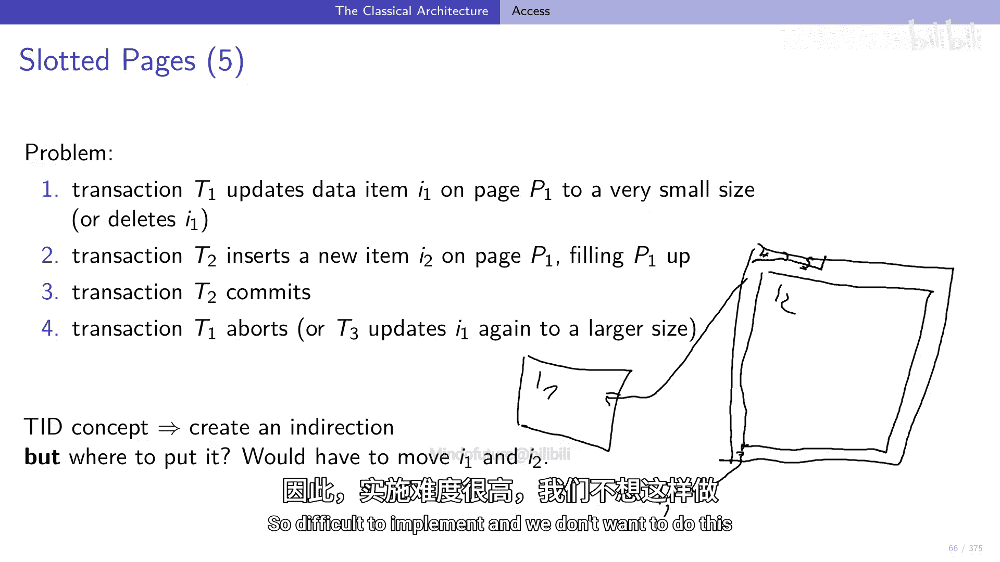

AndSo we dev the extra complexity， therefore， your life is much， much， much。

 much easier if you implement it differently， namely。

 implement if you store the tabity of a forwarded record inside the slot。😊，Now yes。

 which means you take the slot that you have on the page and inside this。

 you store the new table ID if it was forwarded and if it was not forwarded。

 of course then we points original space。😊，And you can do this if we can borrow one bit from the top ID。

 which we often can or view have some other way to detect some invalid T ID and for example。

 if we could say my T ID is let's say8 bytes in size and I promise my topmost byte of 8 bytes will never be or 1 so will never be hex FF as will never be the case for T ID。

And therefore， if a Cs and an always is not ability。

 as I can distinguish my entry between a right v ID D and an invalid one in I have such a mechanism。

😊，Then I can store both a regular slot and table ID in the same space。Now a disadvantage， of course。

 is this waste a bit space because now my slots must be as large as my tablet IDs and my tablet IDs remember here when we set is probably 8 bytes at least8 bys while here we just need offset and length and if my page size is at most 16 kilowaby so I could do this with two by。

😊。

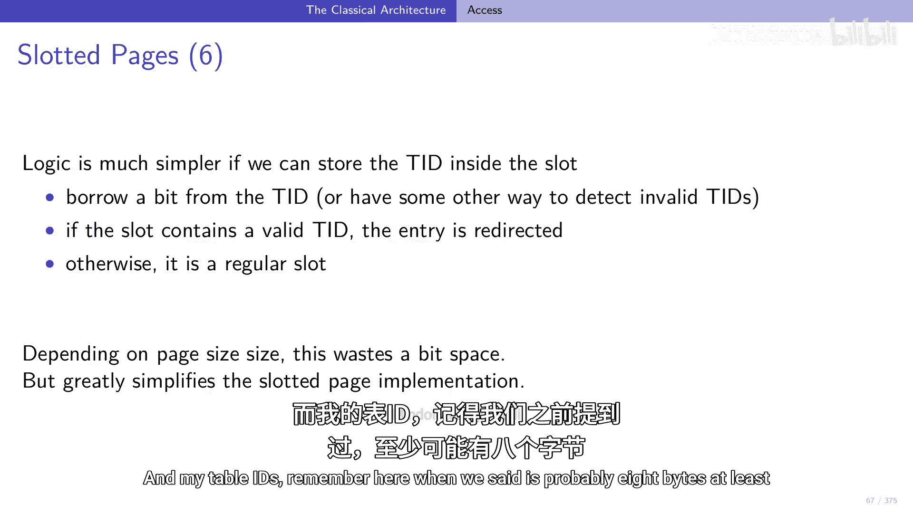

And 2 bys mean4 by would be enough if。My space is 6 kilowat， oh sorry， not 64。

If my page is at most 64 kilob。Then I could do this with。2 by and 2 by。 If K。

 it's larger than a need 4 byte anyway。 So that's no not a problem。

 If it's larger than 65te than we need larger entries anyway。 But if it at most 65 gb， I could。

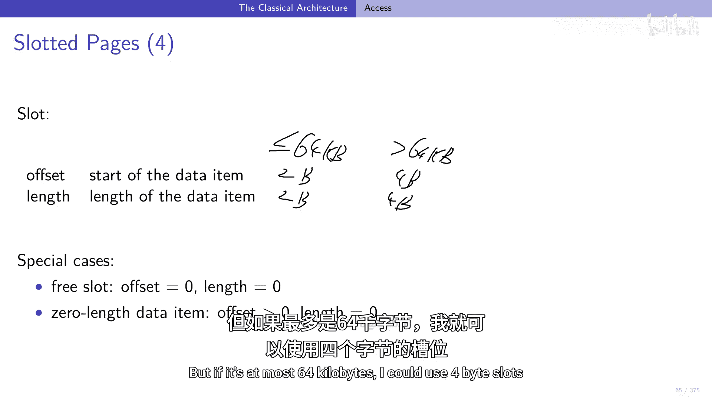

Use four byte slots， two byte and2 byte， but trust me you don't want to do this。

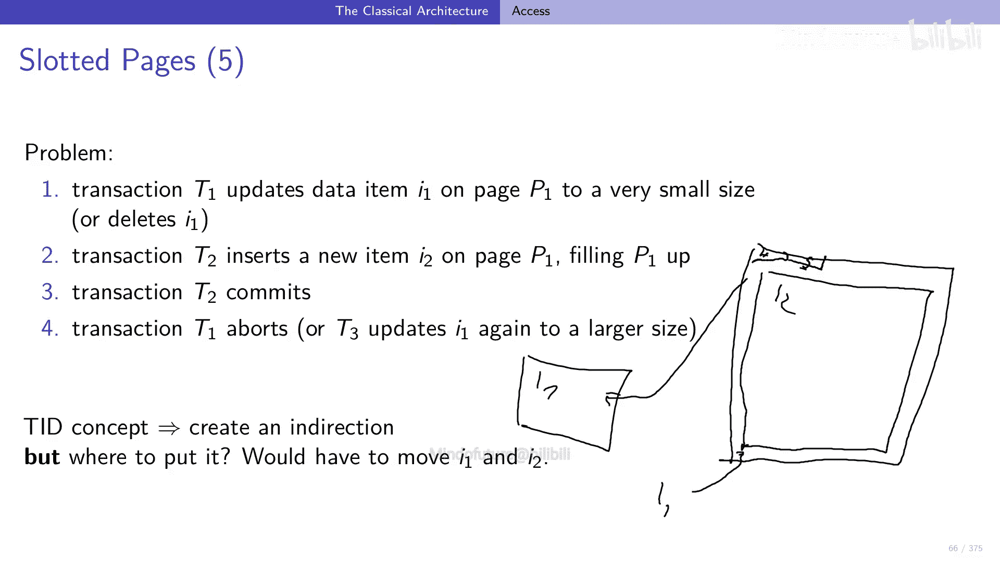

What you want to fast， what I want to do is you want to use8 bytes for the slot。

And use this8 bytes to encode both。Offet length encoding and the table I D。 your life is much。

 much easier if you do this， because this terrible problem here that we don't have enough space for the underdo never happens。

 because if we， if you undo， we always have space in the slot itself safe。

 as we can always forward a table no problem because it slot itself safe。

 gives me space to store the forward。 Another this is much easier to implement。

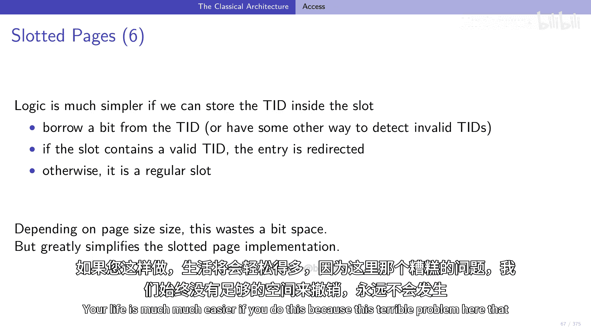

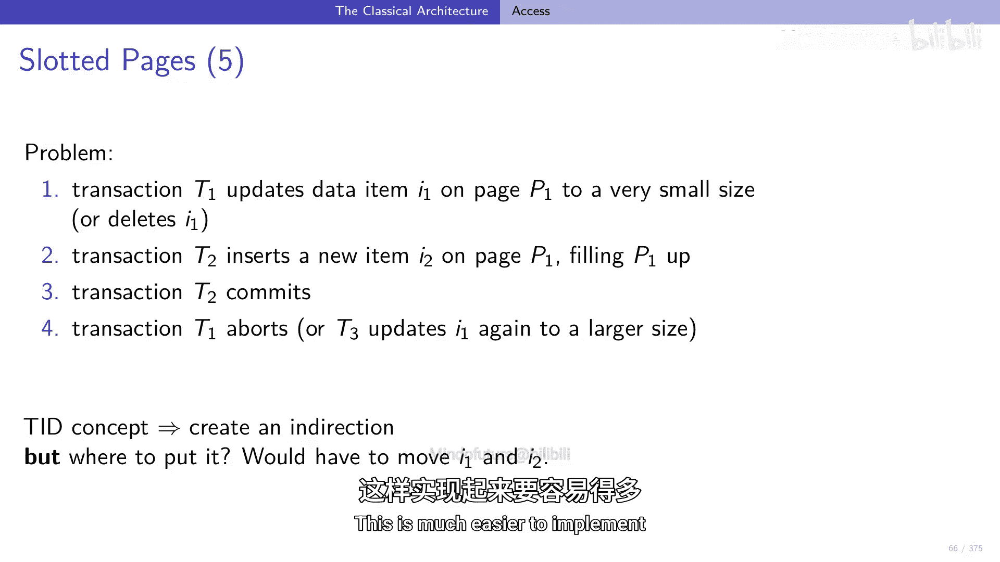

And therefore I warmly recommend you to do this also your and I think it exercise you will implement this。

 therefore this is not only a theoretical argument。

 but you will probably become familiar with the implementation of a sloted page and therefore you want to do this towards the table ID of a forwarded table in the slot itself much easier。

😊。

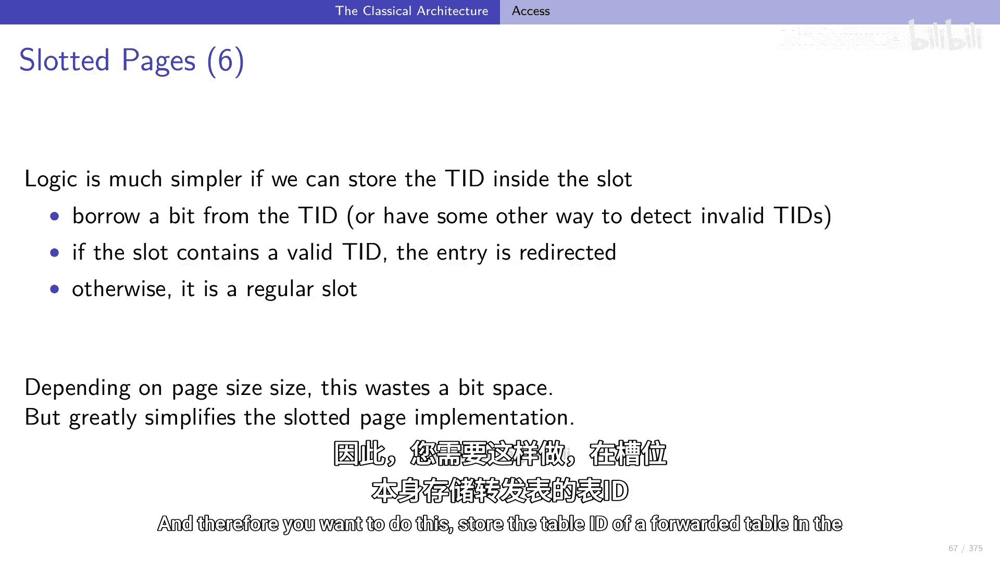

Okay， so in the end end， this is one way being can be implemented。

 so one possible slot implementation looks like this。😊，So on total here。

 we have  eight bytes in my slot。Yeah， so as this is in total is each box is 1 by。

 so these are 8 bytes。Yeah。So and then we say we look at the first bite if the first bite is is not。

Or or another set X in beginning is not O X F F。 So it's not or bit set。

 Then the whole 8 bytes are top D。 So then this here can be。This is a。😔，Tt I。😔，If。😔。

T is not equal to O x FF。😔，So then this is the W D。 then this slot points to another record。

 So they point to the original record。 Okay， otherwise， if t is not this， then we。

And if if T is equal to O X FF then it's a regular slot。

 then if we at look at the next by and then we say if this here is' an indicator to tell me what's this record move from somewhere else yes or no So I want to move this sorry I want to know this if my record was moved from somewhere else so if this is0 here。

 then it was not moved from somewhere to standard case So then O and l just point to offset and length So we use8 byte for offset and 8 byte for length then we can encode V can00 megabyte pages for this we just encode everything with offset and length if S is not equal to0 Z。

😊，Priin is the same。 Again， we have。Tle at offset and length。

 But the first8 by of the tu now contains the original tableple idea。 Now， why do we do this。

The this has a trick to speed up scanning。As was this we。Weuse this。Speed up scanning。

This is important to get good scan performance while if you ever have to move tablets。 Now。

 why do we do this。

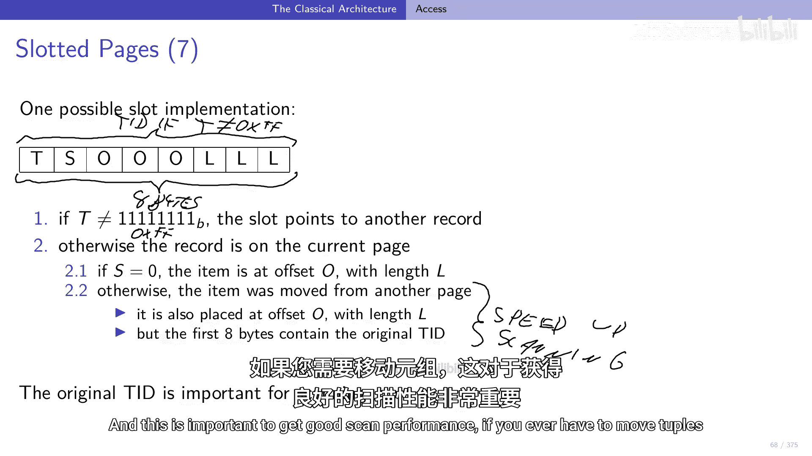

Remember when we come a look at this page here。😊，When we read， I mean。

 if you could use an index for the change edit， but if you do a table scan。

 table scan means you look at every topict in my relation as well look at everything。

 If you do a table scan and I come to this page here。😊。

And then encounter this record whether it was moved， we do nothing。

 Yes we just ignore it because we know that we will see the pointer at some later point in time。

 and so we do nothing。 We do not follow the chain you read this record because it it's correct in place。

 but we ignore this record Okay， then at some later point in time。😊。

The encounter as the second page and now we see the original records that we had seen before。

 so at this point now I do read this。😊，Okay now we do it to reades。😊。

But what I have to do now is I have to record the original table ID。 I mean。

 most of the times the table ID is invisible to the user。

 even though some database assistant have functioned to ask what is the table ID but we need the table ID for example to do update or deletes also also delete on update first runs a query to figure out which tablets are affected and then performs update and for these cases we need the table ID internally to perform the change therefore we must produce a correct table ID So in the moment that we read this we report the table ID need not as so but we could report as 5。

6，7 and then0 or0。05， then we don't do this。So don't report this Instead we report 1，2，3 do 7。

 So we report the original table I so that if somebody updates and all the correct things happen but of course we must know that this is the case。

 we must distinguish a tablet that is correctly placed on this page and the tablet that was moved from somewhere else。

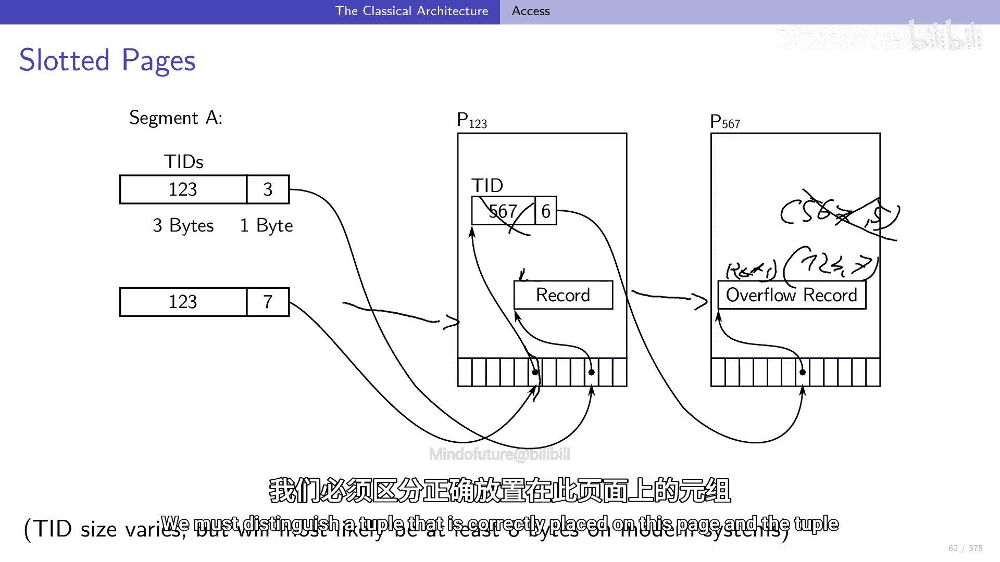

And this is what we do here so we use this O by sorry this S by to indicate that the tablet was moved and it was moved then we store the original table in front of the tablet so that we can report it so then when we scan it we report the original table D instead of its current physical position。

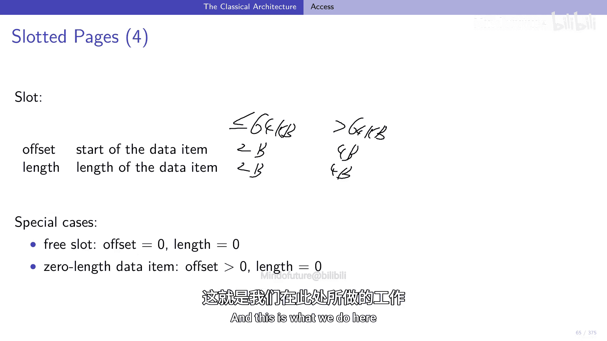

Okay， and resist trick。Scans are very fast， as with moving topic question nothing in scan performance just in politicsd。

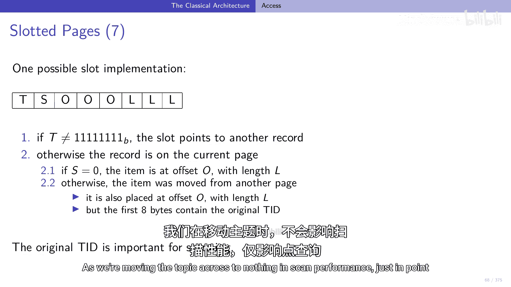

Okay， so so much about loaded pages， I hope that you had already learned at least the basic in an introduction to the database class。

 probably not as detailed as we do it here and he will also do an implementation yourself because then you understand much better how everything works but now we assume we have a slot page mechanism so we can store basically my start page it looks like this I can store so here we say I have few slots slot slot and then I yeah tapu。

Now the next question is what is in this box so how do we materialize the table？😊，And of course。

 what we could do is we could just take all its attributes in my in my relation that write them as A R in this right range。

 Yeah so here if we have， for example， we in few， we just write the number4。

56 and then we have strings。 and you can say for example， things3， then we have aBcs。

 then we have another integer2，2，2， and then we have length 5， A A A A。

 So there's it our civilization works。😊，But this is not a good idea。😊。

Me civilization gives me to great content。 I can store everything。 I can read everything。

 butqueer performance is bad。 Hi loud， let's give gives this field a name。

 Let's say somebody says let's call this A B。This here now is a few see。😔，The enthia of you I。Yeah。

So assume somebody says。Select。Some d。M from R。So how how do we do this。

 we go to a page we find the Tupper then also says says I want to find D okay how do I find the position of D。

 first read the length of C and then I add the length of C to this position basically that's what I take this position here and do a plus。

😊，And then I find the the position of D。 Okay， so I I have to do arithmetic to read a field。 Now。

 we say this D is perhaps not that bad。 If assume we have even more。

 they say we have another field F。So if I don't say s I'm some D， but I do some F。

Then it's even more complicated。 I reach C。 Then I find the position of I。Let's clear this carefully。

So I read the length of C with the length of C， I find the position of E。

 Then I read the length of E and with the length of E I find F。

So clearly the excess cost for an attribute is linear。

 at least in worst case is linear as the number of attributes that I have。

 because if have many string columns and swing columns are variable lengths。

 I have to read all of same swing columns in front of the columns that I am interested in。😊。

I think I can compute the position of the attributes that I want to have this is bad mean in this case I have only five attributes。

 there are people who have hundreds， thousands of columns in a table okay if you ask me this is a bit crazy。

 but I happen to know people who have database systems with many hundreds fields of fields in a single relation。

😊，And then all of an excess cost is highly unattractive and it's super expensive to access it attribute at the end。

 civilizationization is not a good idea。😊。

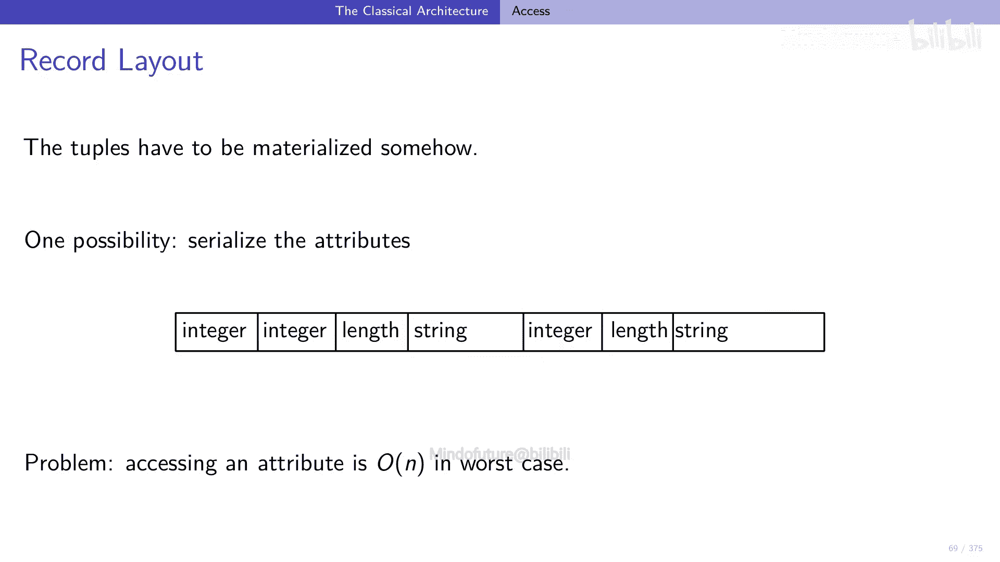

Now what we should be do instead。So what we do instead is。😊，We first we do two things。

 we split my table into two parts， namely the fixed part and the variable size part。

 so this is a fixed part。😊，And end this here is a very length part。Okay。

 and now the entries in the fixed part， I can access in constant time。 obviously。

 So this where my fields， Oh I forgot the names that I gave them ABC， D， Okay， so this is a field A。

 this is a field B。 This is the field D。 And this is oh no， correct Yes。 So and then this here is。😊。

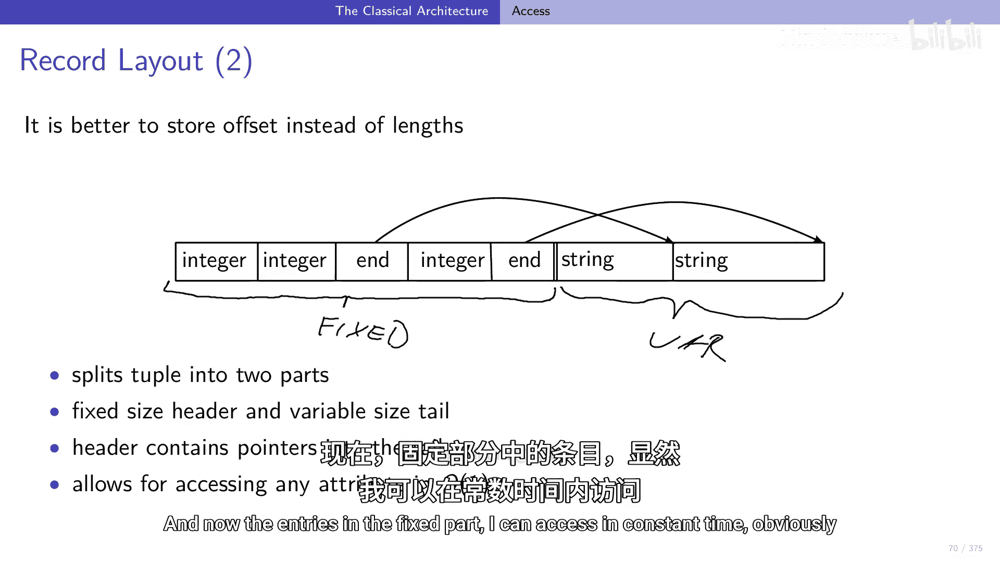

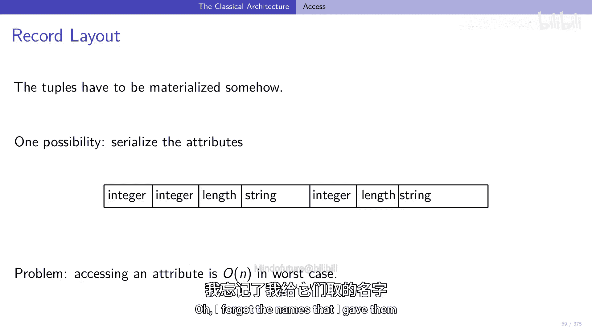

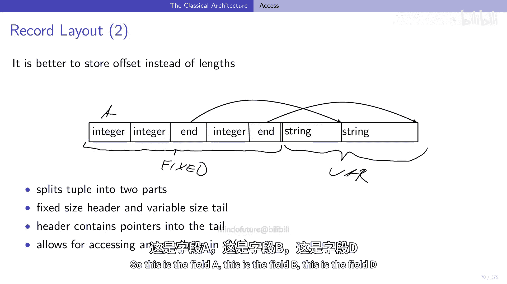

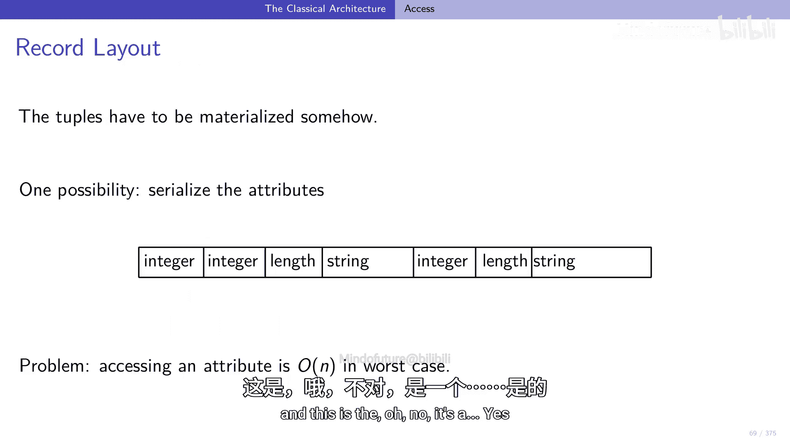

It a string C， as this here is a string E。😊，Okay， so Im going have moved the strings to the end。😊。

And what I also did is inside the fix part， I don't store the length as I did previously so on the previous slide I said I saw the length as a string I don't do this instead I store the end of the string and so I remember here see this pointer drawn if we store the end of the string Now why is the end not the beginning because first the beginning of C would be pointless I can just computes the position of C and by first you can ask why not the length because the length itself does not help me to find an entry。

😊，Because if。If I have many string columns and just all the length。

 then the offset of string I is then the size of the fixed part。😊，Fixed。😔，Plus， sum of the length of。

S J where J is between1 and I-1。And so this is how I don't want to do this。

 so I don't want to update all the length of this bad Don't do this。

 but just to instead instead of sting these length is。😊，You to the end。

 and then the length can be computed easily because the length of a string now。

 so the length of a string I。😊，String eye is， is the end of。The end of I minus the end of I minus-1。

Okay， except for the first string， of course， for the first string。Otherwise， it's。诶。

And I minus size are fixed。Fixed。😔，If。I equal0 of course for the first string is different。

 first string is the end of the first string minus the fixed part。

 but for all other strings is my end minus the end of the previous string okay。😊。

And this means that I can access any attribute in constant time。

 The fixed fixed size attributes I can access in the constant time anyway。

 because means they are in the fixed size parts。 So they have obviously the same position。

 and the variable length elements。 I can use this simple computation here。

 And then I can get the position and the the length of every string。😊，In constant time。

So this is a pretty useful way to store variableng records。 Now so to get even better performance。

 we start to reorder the attributes。 we don't mean in this case， you said as towards them ABC。

 even though I splits and fix and variableng are as towards them as declare。

 So ABC in the same orders in the table in reality you do not want to do this So what you do instead。

😊。

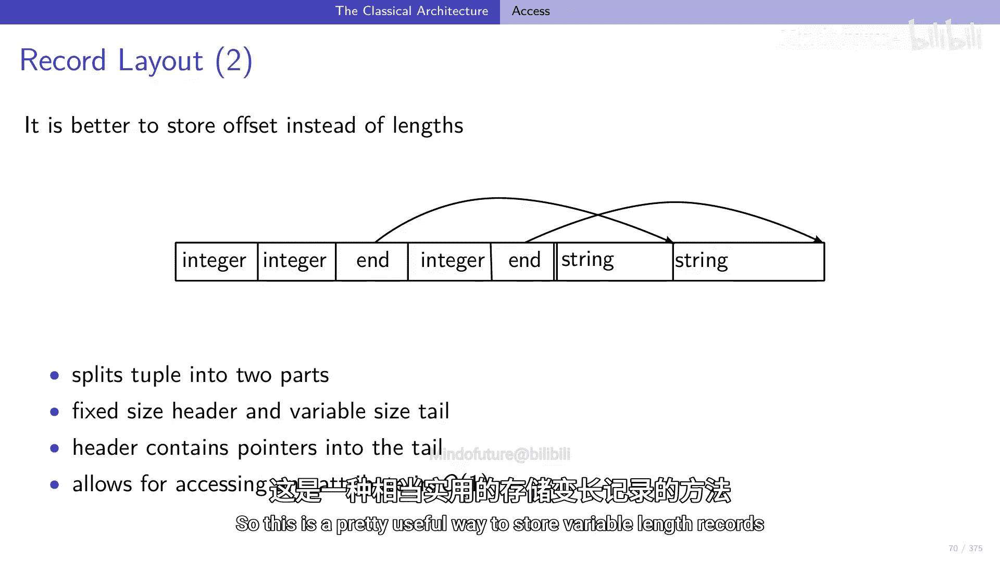

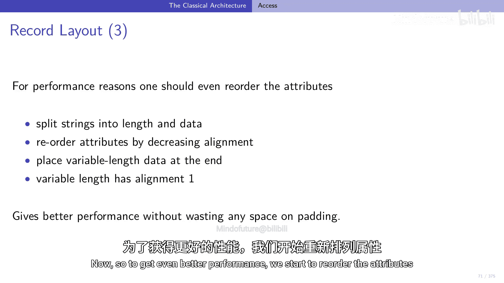

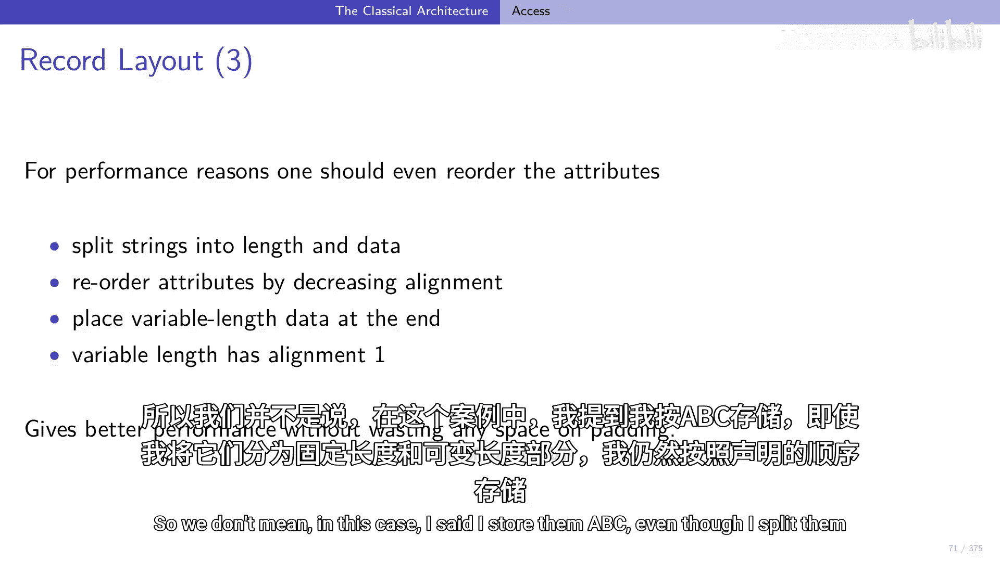

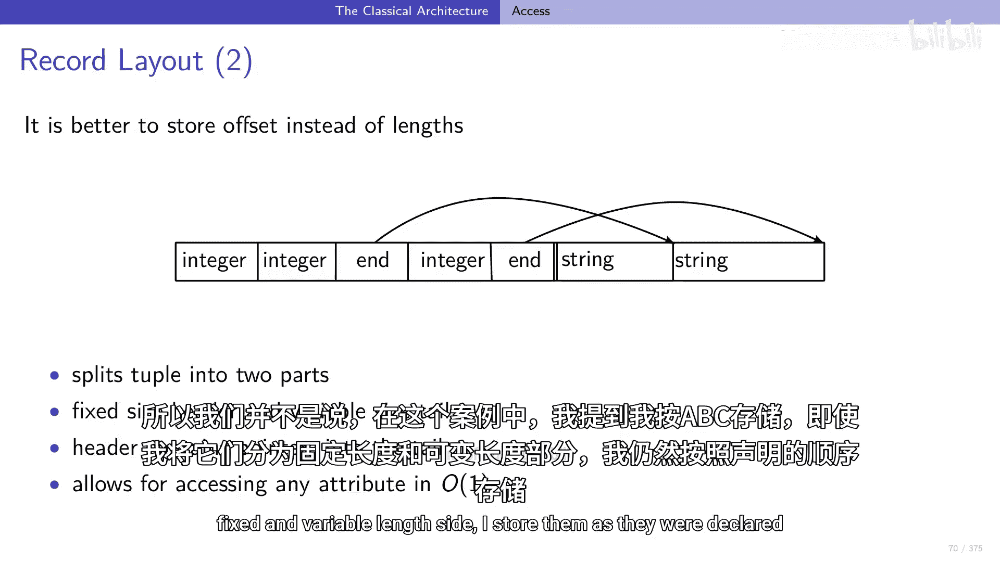

You you separate and fixed and variable part， of course， and in for the fixed size part。

 you treat a string basically as two elements。 So as as a string is a length sphere as a fixed size and the data。

 this is variable size， of course， this this is fixed。 this is variable part。

 and we really treat them as is for the length we have we treat them as a separate attribute。😊。

Now we we take all attributes that we have and we s them by decreasing alignment Okay。

 now does mean what does alignment mean now I'm not sure how familiar you are with hardware in particular if you're only used to inter architectures you probably are not used to problems with alignment because it processor is nice to you。

 Basically alignment means。😊。

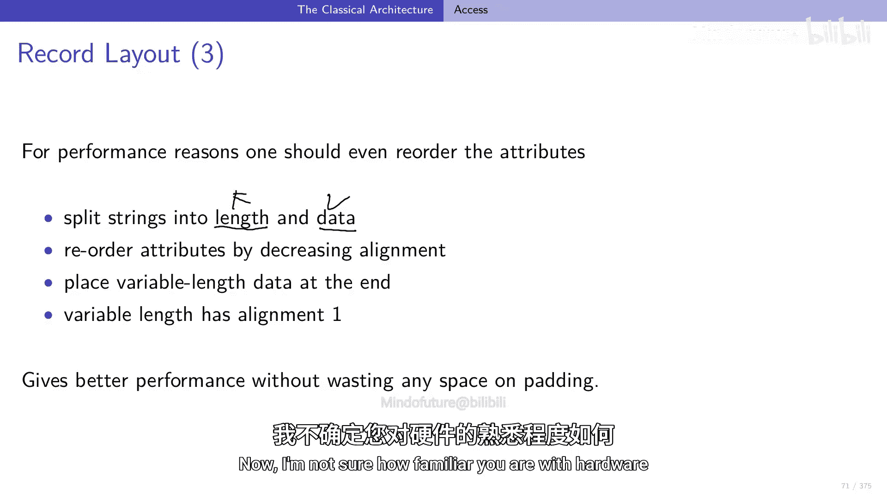

So if I have an aligned。Alliance。IHow to call this a light variable。 Yeah how how you write this。

 So aied X means that if he takes the address of X。The interpret is here as a number。So。

 this is an yeah。This is the number。 the， we take the address of x。 we interpret the as a number。

 Then we， we compute the reminder of dividing this here by。A linement of x。And then。

 this year must be。Equal to 0。 so basically， the address often of a variable must be a multiple of the alignment of the variable。

 Okay， this is then we consider this aligned。 Now it didn't explain what alignment is in first approximation。

 this is not exactly true。 but in first approximation， this here is the size。It is for basic types。

 size of x has， which means an integer。This is four whites in size。And therefore。

 has an alignment of。A line， line so much just too bright here。 as has an alignment。

 Let's just write a。 Its an alignment of。4 okay， long。8ight bys。Therefore， alignment。Is 8 okay。

 size equal to alignment， at least for base types。 Now， if you have compound types。

 is's no longer true because then the if your compound type like， you have a pair， for example。

 you have a pair of integer integer。So then this is2 times 4 equals 8 bytes， but alignment is only 4。

But alignment is4 because we only have to align each individual entry。

 limit individual entry has  four bytes。 Therefore， we don't need an alignment than4。 Okay。

 but this is just。So especially， so as long if we look only at individual fields。

 then we don't have compounds if we just have senior values。😊，Integers or whatever time。

 time for types or。 And this in all these cases for simple data types align with equal size Now we want that the address of a value is a multiple of the size of the value for simple types。

😊，And now why do you want to do this？😊，the the answer as depends on your processor。

 if you do a misaligned read。 So now first makes it a bit more clear let's assume this here has my memory buffer。

😊，This is my memory profile， this goes from 0 to to large number。

 and then if I store an integer here， let's say f an inch， that's cause a。

 then I have a byte that's causes B。😊，Oh， sorry， B。 and then there this is， of course， at position 4。

 and then at position 5， we have another integer。And let's cause this see。Now。

 if you want to read this year's aligned。This year is misaligned。Okay。😊，Misaligned。

 because it' is misaligned because its offset is not a multiple of4， and offset is 5。

5 is not a multiple of4， therefore it's misaligned。

Okay and now if you want to read A no problem you can do this， if you want to read C。

 what happens depends on your process or if you do this on， for example。

 a spark process or your program crashes。😊，Now because the processor says you are not allowed to read a values that is misaligned if you use this on an intel processor or In is nice to you it can do the read only thing is the read might be a bit slower the misaligned reads can be slower as I should say in the past they used to be slower nowadays or already since quite a few years In processors have spent a lot of optimization on this so an in processors misaligned reads are just as fast as aligneded reads except for the case that as the read crosses the cacheline boundary which can happen Now the course could be because you misaligned。

😊，Your value crosses to another cache line then it can be slower but so intel is not that bad。

 but in for other processes it's really bad， either it's not supported or it's really slow therefore you want that all your values are aligned Okay how can we make how can we make sure that everything aligned we sort them by decreasing alignment So this works because alignment here that my alignment is always a power of two Now so all my alignment are power of of two and therefore it's easy to see that if you take powers of two and you sort them by decreasing value。

😊。

And you sum them up， rather than the current sum that you have is always a multiple of the values that you have。

So for example， if you have some numbers， let's say if my first attribute is 8 byte，4 4 byte。

 let's call this A B is 4。 C is 8。 D is 1 E is 4。For example like this， okay， then we sort them。😊。

And then we get the the number the s order。 we get8， A，8， C。For being。For E。 And then it lasts。1 D。

 so if we and now if you compute to offsets， this here would start offset 0。

 this here would call it offset a。 This would call it offset 16。 This would start offset 20。

 This would start offset 24。 and you see every offset that we get is a multiple offset alignment。

 Yeah this is because by construction。 and because we we made it like this by supportinging them in decreasing alignments Al it was properly laid out and。

We get on Italy， we get better performance than other processors we prevent to crash so this is what we want to do。

We want to have some aligned and the variable parts of the strings。

 we consider them to have the alignment ones。 if we just put them at the end。

 and also at the end well put the strings because for strings， alignment is not a problem strings。😊。

He reads them character wise anyway， not string you put at the end。Okay， so this is what we do。

 we rearrange them so then it no longer corresponds to the order that it was declared in the table。

 but this doesn't matter because we of course we remember the mapping。

 we can still retrieve every attribute in constant time。😊，And by doing so， you get better。

 better performance without wasting any space on patting。

 So because this is the alternative basically， the alternative would be to use patting and we do not want to do this。

 Yeah， so to illustrate us to illustrate what would happen here。

 if we would mean there are basically two ways to avoid mis La。 One is reordering。

 this is what we do here。 Second one is patting。 This we don't want to do。 Now。

 But we just want to show you how it would work here。

 we could lay out a 8 bytes and we would be a position A， then we would lay out B。

And this is4 bytes afterwards we add 12 now I'm not allowed to place C next because if it would put C here and so draws is a dotted box we don't do this if it would put C here。

 then my C would be misaligned because alignment is 812 is not a multiple of 8 so what we could do is then is we we waste space if basically we have。

4 bys here。Ptting。Rate its space if we don't use up to 16。

 and then we can of course put the sea again。Yes then up to 24。

We don't want to do this because it write space it's a bad idea， but this is what what for example。

 a C compiler would do or a C+ first compiler they would do this。😊，They would enter heading。

When suppose would add space until everything is aligned。

 So your compiler also cares about alignment for you but the does it by adding padding。

 What we prefer instead is we reorder the the attribute such that no padding occurs。

 This is much better。

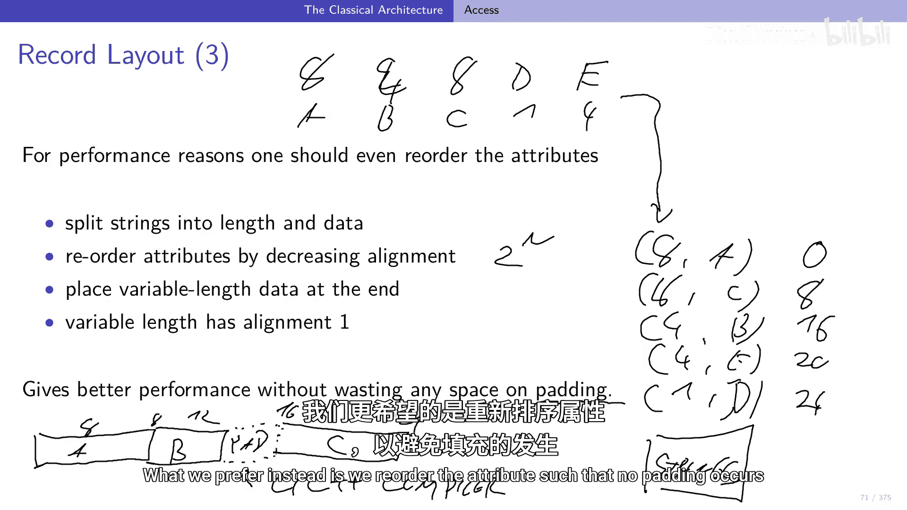

In the C the programming specification does not allow us。

 so compiler is not allowed to reorder attributes， otherwise it would be a good idea to do this in C2 so but in databases we can do this because nobody except us will look at the data。

So this is a basic layout for for a tableu。 Now so far I just said we just store all the value as they are。

 Now there's a certain very undesirable values that unfortunately occurs in the delivery system。

 this is now。😊。

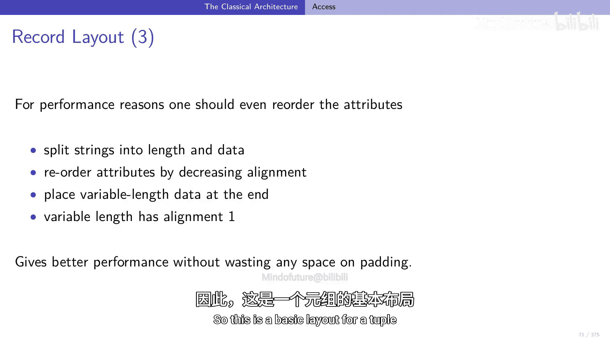

And as you know that by default， every column is nillable so you can insert any value or Nile and Nile represents an unknown or unspecified value。

 and this is a special value that is distinct from every other value Now of course。

 if you want to do your database system in favor， you declare a column to be as not Nile So if you do a create table。

😊，Create table。 then you say x inte。Not now。So the end system knows always this can be vinyile and it can start much more efficiently。

 so declaring a table a column as notal is a good idea。😊。

Unless of course you really need NL mean sometimes you want to store a Nile because you want to cope with the fact that some values are missing and then by all means please use Nile dont don't implement it yourself with some crazy special values use Ns if you have to now so that's okay if you need them but if you do not need them then please declare the column as not Nile So if you do like this here it's integer we declare x is nullable sorry x is not nullable。

 so cannot be nuile but y is nullable。😊，Now how do we do this So if we do a record layout like this。

 if we， we just store x and y。For x is， everything is fine， but for y。

 so if you just use four bytes here。4 bytes。What do rules nu？

Yeah Nll is separate from every other value， so now there are different two basically two different schools to implement this。

 one is to say I just pick one value that is invalid and that we we use to represent Nll。😊，Yeah。

But this is usually not possible， mean， in some special cases it is。

 for example if you look about the Irope representation of doubles you realize that some values are impossible and therefore you can use one of these values to represent a nu。

 but this is a special case if you just think about integers mean every value can in this four byte range can occur and can be stored in the database so therefore the pichanno stores Now this doesn't stop people from trying。

😊，Even though it's impossible， it doesn't stop people from trying。

 but they usually do is for integers。

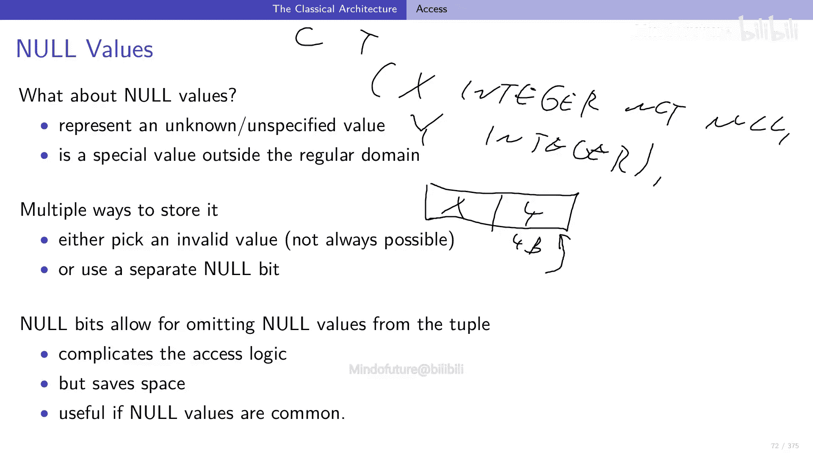

They take in min。And say it mean here is null， as is is what some people do。Now in min is a very。

 very special value。 I'm not sure if you're aware of this mean integer has gives me so large numbers。

 let's look here at a special case because it's easier to think about this。 Let's think about int8。

 Heres an8 bit integer。😊，Here are the8 bit inger。😔。

I I only use this because it gives me nice small numbers that I can draw on a slide And ready if the same is true for for larger integer。

 but I only use 8 bits here。 If you look about this， this is a range from there of course。

 a0 involved。 then at the largest possible8 bit integer is 127。😊。

And the smallest possible integer is minus 128。😊，Yeah， this here is inmin。

And you see that the domin is asymmetric。So there exists a value， namely this one here。

 the experience causes in min。😊，For this domain， in min。

 they exist the value for which no positive number exists。Yes， if you take this now。

 I try to compute the this as x and then we compute minus x。Yeah， we can represents is， in fact。

 what happens is if you take1 minus128 and you do minuss， you end up again with  minus128。

Wwhichch is of course， a bit odd so but the reason is the integer cannot represent this number。

 the positive number is unrepresentable because the negative number is smaller。

 but absolute value of the negative number is higher than the largest possible positive number。😊。

So this one here is especially and this by the way creates all kinds of problems for example。

 if you want to crash your program hard so you take a program language of your choice。😊，Mean， no。

 not your choice because the the really high level ones they they check against this。 Take a nice。

 simple low level language like C。Yeah， and then you take。😊，In min now was the real inmin。

 I was real indmin， of course， is。Is its 232 is minus this one， yeah。Oh， sorry。Not2， one。So。

 this here is the。Is inmin。Yeah， and if you take this one here， let's call this x。

 and then if you compute x divided by minus1。Here your juice is in your coat。

You say that equals x to y minus1， but do you think what will happen yeah。

I can tell you what will happened in your problem with crash。

Your program will crash and you get a signal and you will die So this is what happens and this is what most people don't expect I think most people are aware as that this year is a better idea so x y per0 is clearly a better idea so this will also crash and people are aware of this but people are not so aware of that this year will crash too。

😊，If x is equal to admitmin， only in this case here every other value is okay， but in min。

 if you divide in twin win by -1， your problem will crash。

Yeah and so this means that in min is a very unpleasant value and some people say， hey。

 you know what this is an ugly value anyway， just remove inmin from my domain and if therefore we use in min to represent null because I say this is a forbidden number nobody is allowed to use this and as now I have gained a number that nobody is allowed to use and therefore I can just use this。

😊，Okay， this looks reasonable until you realize that bes mean you first approximationclamation is okay。

 but then you realize other bad things here can happen， like say say this funny， for example。

 x is two is power of 30， not 31，30 okay， no problem then you say y is minus x no problem either and then you say。

😊，Z is equal to y plus y， and now we have a problem。Because this year。

This new that value that I just got is equal to in min。

 which means you performed a computation on nonnvalue means this is clearly not nu2 is above 30s regular number。

 minus 2 above 30 auto regular number and now you take two regular numbers you do a plus and the result is9。

😊，Yeah， and this is something that you don't want to do because it is setally wrong。

 Now there two things you can do this either you ignore the problem and if the user happen to computerize and okay well this is of course don't do this。

 Yeah， this is bad because then you suddenly have out database outputs now even though it's wrong。

 don't do this。😊，Alternative is， after every computation。

 you must check if the result happens to be in min。 And if yes， you produce an  error。 Okay。

 this is also possible， by it is cost to performance。

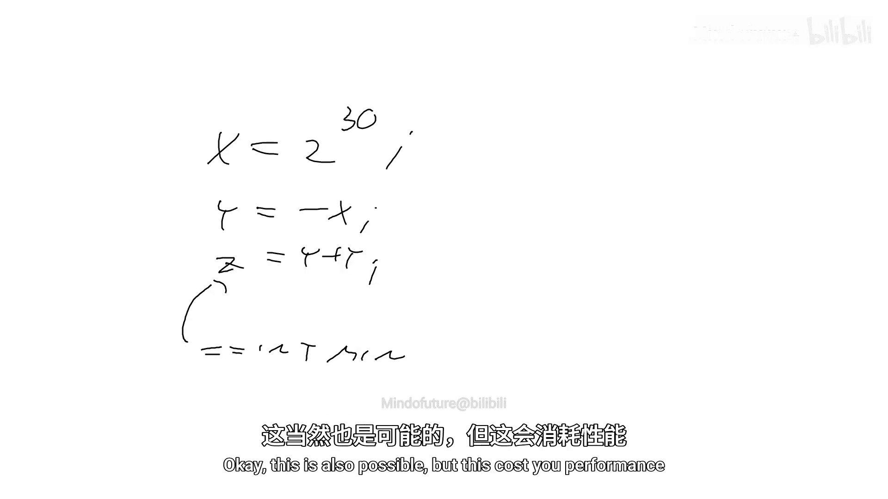

Yeah， so you don't want to do this also actually to implement So so therefore。

 I would say don't do this if you can avoid this。Especially values from the domain is difficult surprisingly difficult to implement。

 I mean， it looks attractive at first couldance because you can say I can steer stores as this regular integer。

 need nothing special， but this is just。😊，Just misleading because you get a lot of complexity by treating this special value special so therefore a nicer thing is to say I just use one separate bit null indicator that says I have an x value X and I have a separate bit here that says X nu。

😊，Now a separate bit and then I can store every possible value in x no problem I just check is my nu bit set if yes。

 I ignores x value because it's not otherwise I use the value okay。😊。

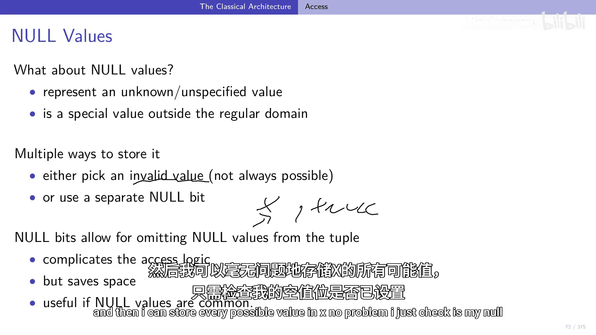

So using a nu bit allows me to emit the value from storing as means when I stores the value， I mean。

 the disadvantage of course is must stores nu bit clearly I must store one bit more on the plus side if I have a nu value I can at least sometimes to the representation that just stores the nu bit and then treat this x as variable size and kicks out the x so we't we don't store the x。

😊。

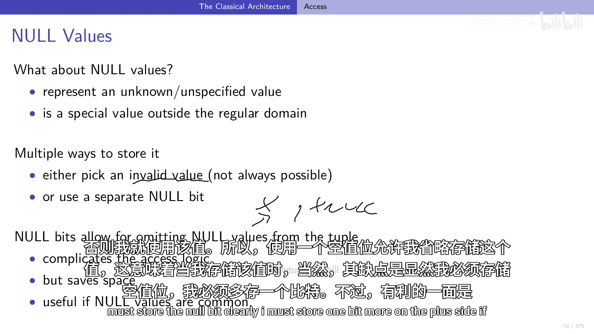

And so now this of course， as a trade off if I do this。

 access to my values become more complicated because of verbalb size things until on the plus side。

 I save space because I use only one bit。😊，So this is also called Nile compression and this is useful if you have not of a lot of Nile values and so if many of your values are Ns and this is good techniques down of course is complexity and excess cost。

😊。

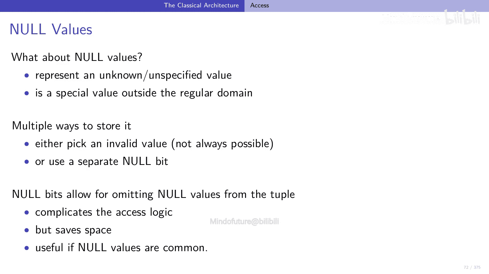

Okay， but this already brings me to the next part of how do we store topics namely what about compression so some database systems want to store the data in a compressed form and there there are actually good reason to do this but first you should realize most of the time we do not compress data to save space means it's not always do some people really care about space but most people do not care about space so much。

 but we usually care about is performance so we compress data to get better performance Now why is this so I mean just think just do the the mass So assume hypotically I have my data here is 200 megabytes。

Of data， if I querys this， then I need I have to read this from， for example。

 from a disk that I can read 20 megam per second then I need for this one second okay。😊。

Then after that so this yes， I O。Input outputs from disk one second。Now。

 if instead of having 200 megabyte， I can compress this。2， if it instead compresses。

Compress is 200 megabyte。Then I only need half a segment of IO I gained effect tube and performance because my data size was reduced by f 2。

😊，And this is what I'm interested in so we reduce the space to reduce bandwidth consumption bandwidth is limited。

😊，Often not always， but often is limited and therefore I compress mass data to use less bandwidth and therefore improve performance。

NowSo this is my the main idea behind compression because the argument here is disk is cheap。

 I can buy a very large disk for a little money so who cares about space but I mean just to be totally honest with you learned this is not always basic case I know at least one company that cares about space because of customer experience。

😊，YeahSo you could say who cares about it you just buy a larger disk and this is absolutely true disk are cheap and so who cares about this。

 But if you ship your product to a customer and the customer experiences a full disk。

 the customer is unhappy therefore you try to avoid this you try to compress the data even though it might have been a wiser choice you just buy a larger disk。

 but nevertheless some people care about disk but this is an exception most people primarily care about performance and therefore we compress data to improve performance so the bottom of the light you see some people do care about space mostly embedded database systems so theyre really space is limited for classical server database systems compression is space consumption is not that critical usually。

😊，Of course you don't want to waste space， but it's not as urgent。

 but for performance reasons you always want to be interested in compression。

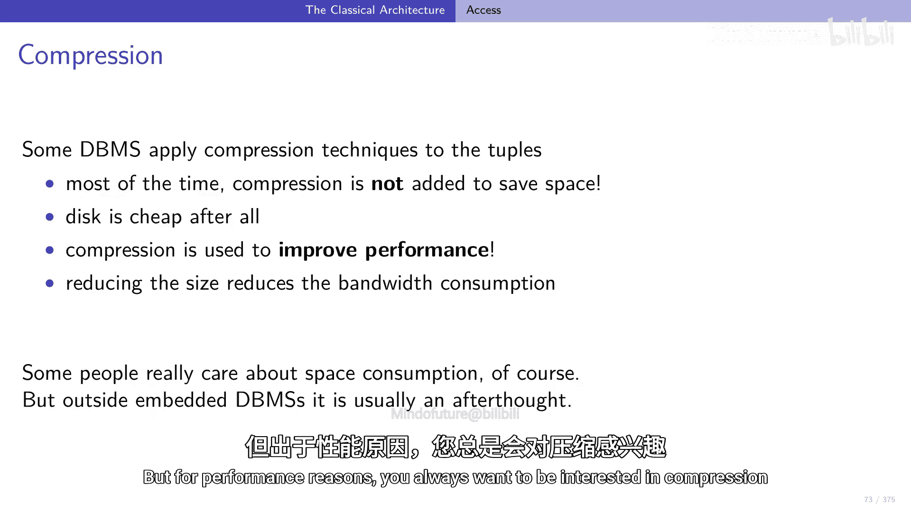

Okay， now how do you compress？😊，So if you look at general purpose compression schemes。

 I hope you are familiar with with at least some of these。

 if you look at general purpose compression schemes。

 you see the larger data that you comp the better networks works。 Now for example。

 if you think about the classical comparison at A at 77 now this is one of the most mainstream comparison schemes。

 you take a large buffer。😊。

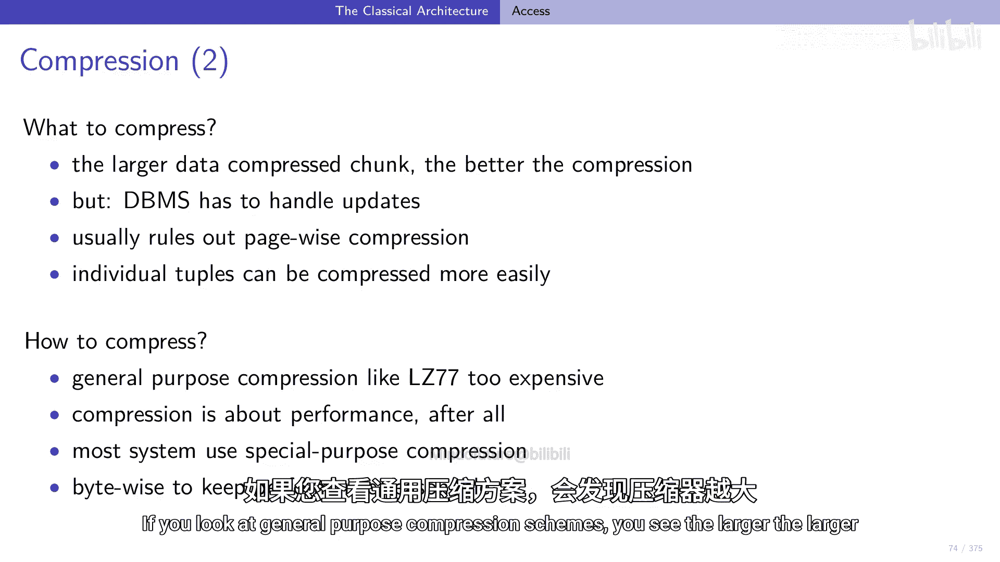

Then you write in here some for example， ABC D， and so on then you say， oh， you know what。

 take this sequence again and repeat it five times。As as the back pointer followed by frequency。

 you see takes this five times and then Eg and then perhaps just takes the G and then put it 10 times and so on。

 this is and so on this is how classical S 77 works。

 the reference to data that if we have output it before we do a backpointer and and a repeat count and then we reference this and this works the better as the larger the buffer is clearly if you have a tiny buffer so if my buffer contains just three values have no redundancy at all。

 so I cannot compress anything And so if if my data is very small， I cannot compress it。

 it has to be large enough so that a C enough repetitions so to compress my data。😊。

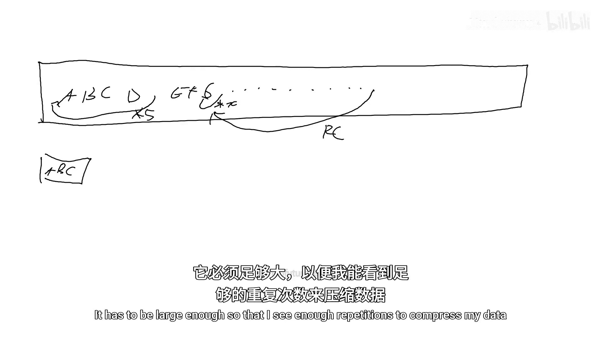

So this is classical。Run of similar compression schemes and they want to have large compressed chunks to improve performance。

 But the problem to improve compression problem is we don't want to have large compression scan chunks because otherwise you cannot update very well if I have compressed5 mebits of data and I want to update something in the middle how should I do this mean I could decompress everything do update and recompress everything but this is not so super attractive is quite expensive so other problems what about page size for example so it could be that somebody performs an update and after this update compression rate is much worse mean not super likely but can happen and then suddenly it no longer fits on the page where it was before everything is ugly so compressing large chunks is good for compression but be for the database system what would be work much better say I compress each individual tablet I compress one table and a compress next table。

😊，Comm a table by tablet， this is both good for updates because I can then update a single tablet as I want。

😊，And also for handling because in the lower layers， so there's start page。

 So if you think about this layer here。😊。

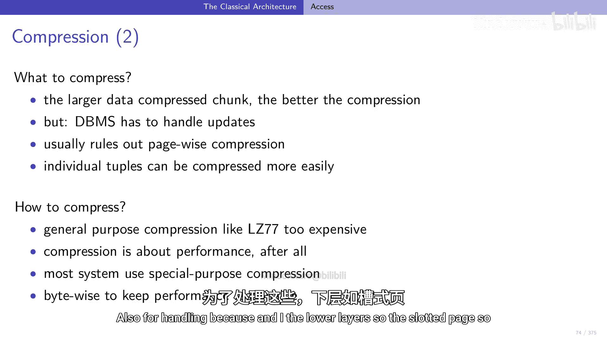

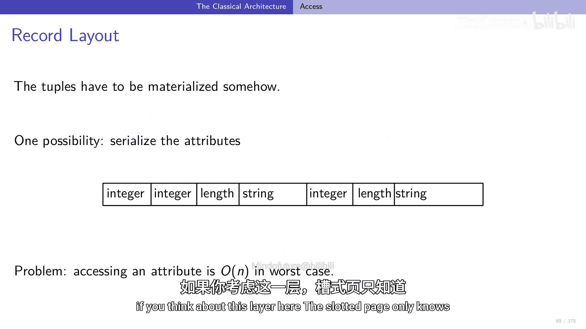

The slotaughter page only knows has a byte range， so my record here has a secret of binds。

 I don't care what the content is its easy see compressed uncompressed doesn't matter。

 Also the sloter page sloter page only has to know how large as the record we have a range of bytes and this is what to store compression are not totally unimportant for the saughter page So therefore it's from the layering perspective it is attractive if the compression is implemented on top。

😊。

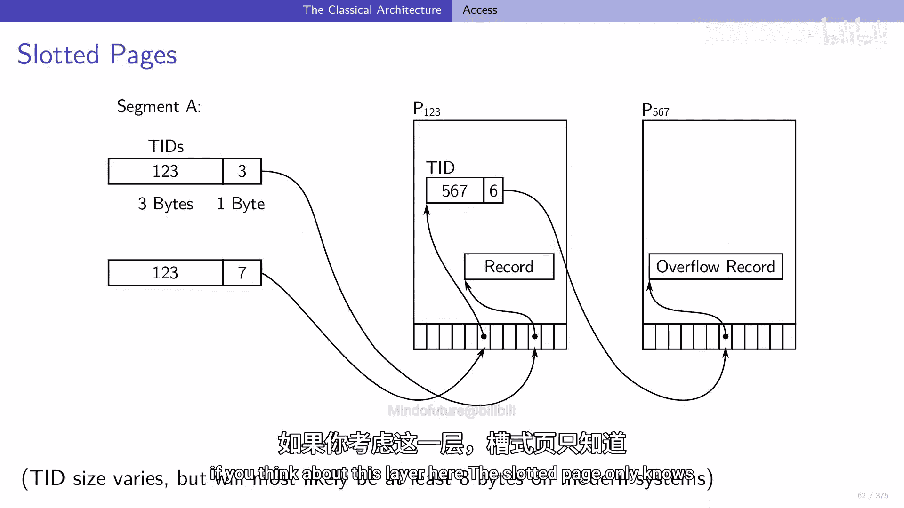

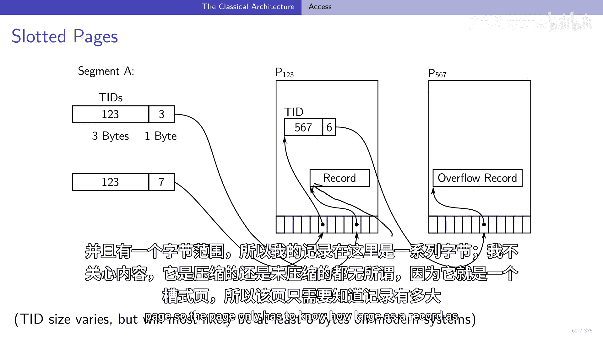

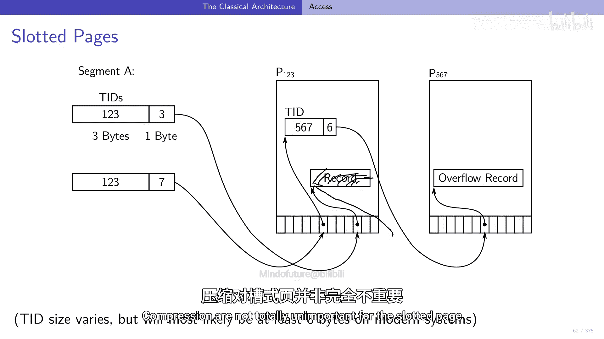

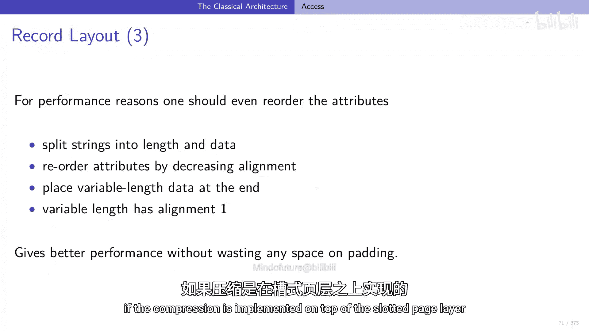

Of the slugg page layer。 so the sluaught page layer doesn't care。 We just say it's okay， a2 tappper。

 and then I compress each tap。And but still doesn't tell me how should I compress it mean using a general purpose scheme like S 77 is too expensive。

 And if we don't want to do this first， it has pretty significant cost for compression and also for decompress and second。

 if you just compress a single tappo then it doesn't compress very well because probably we don't have a lot of freedom India。

😊，So this is too expensive or if you look I mean red if you look at something like zip it's just even worse。

 it's not only L77， but per example you ought to add another halfuffman ending or arithmetic encoding or something so we have to type some bit encoding on top of the S 77 and this is all super expensive and we don't want to do this because otherwise all your performance will be burnt in decompression。

😊，Okay， and after all we we compress for performance reasons。 Yeah。

 we compress to improve performance。 Therefore， if if my compression。Is expensive。

We lose and my data gets smaller， but I get slower because all my time is burnt in decom and therefore we don't want to do this。

By the way， this brings me to a set tale of my younger days So when I was a。

My thing might even have been a real student like you or PhD student。

 but at least I was still perhaps was I was a PhD student， but shortly after my studies。

I encountered a very beautiful compression scheme that I thought would be very nice to implement in a database system and you know。

 on P part it looks very， very well and reality is not that super great。

 And this is something that's called adaptive Huffman。 Now。

 you are probably familiar with Huffman encoding。😊，And so I have an encoding。

Thus basically that the following， you take your symbols and in your in your dictionary and then assume assign them weights and forms the weights compute decision trees。

 for example， you say if I say a0， then I get a symbol A， if I say1。

 then I have another decision point here， then I get if I get a1 a0 then I get a symbol B。

 and otherwise if I get another one， then I say， okay if I get a0 then I have another decision point。

😊，0。😔，1。1。0， sorry，0。One， so then you you get here A B， C， D。E and F。 So this is。

 for an example for a halfman tree。 Now， if you， if you encodes data that contains a lot of A's or perhaps a lot and also a lot of bs。

 then I get very small encoding。 for example， because if my input here is A， A， B， D。A。

 then this year is encoded as。0，0。Oh， this is supposed to be B a B， right。😔，Be。My B is encoded as 1。

0。 My D is encoded as 1，1，0，1， and my a again encoded as 0。As then for to encode this here， we have。

 we have five parts of input。 but as output。 we just need for 9 by 9 Bs as output。

 And we compressed 8 by。Into 9 bits。So this of course is great， much smaller。

 so this workss beautifully。😊，Except， so this is comparison scheme here。

Except for the unpleasant problem， how do I know that my tree is like this？

Because to decompress the data， I must know this tree， and I must know this happen tree。😊。

And so if I would， of course， I could serialorize this tree， I could store the tree。

 but this would also cost me quite a bit of space。 so if if I writes a tree out first。

 then I my encoder scheme is larger than input。As it does only make sense if I compress a reasonably large input because otherwise my serialized happen tree is larger than data so what's a point and so happen coding does not work if you have to ship the tree mean if if the tree is known if you can always use the same trees it's okay。

 but if you have to ship the tree， then happen coding doesn't work because the tree save too large。😊。

Okay， now comes adaptive happening coding， this is a really brilliant idea。😊，Again。

 choose my input A was input A， A， B。AAAB。😔，D A， I think， was made with。

So and how does sub definition have coding work， it says in the beginning if I know nothing。

 I assume everything has the same probability， therefore I say my origin tree， for example。

 looks like this。😊，0，1。あ。0。嗯。Ma I sorry。 I should have drawn it with There's long a more gap between this。

 So let's say， so my， this is my root。If I get a0， I go here to the left。 If I get a1， I go here，1，0。

 If I get to 0， I go here。If I get to1， echo。Here。Yeah。And sorry。

 and and if I get another0 I go here。 I should have drawn of one mode to the right。😔，wen。😔，And then。

😔，0，1。0，1， and then of course， I label this here。😔，With simple example， a。Be and。C， R 1， D and so on。

 Okay， then then， of course， a more。 Now， as if， and the first symbol comes， I just encoded as it is。

 And as this case， I say， for example，3 As。 Then I realized， oh。

 you know what the a is more frequency as symbols。 So let's change the encoing of。Then， add。

I didn't draw an ideal scheme for this， but just for example， pretends that I do the following。

 you know。To be honest， this is not what the real adaptive Fment does。

 but I cannot dynamically reorder my tree so easily。 I can， for example， say this I make the a give。

 give a a shorter code and to B， but it has not occurred yet。 I give， for example， this code here。

So it then comes another end， and I'm just give give the00。 and then again， I update this。😊。

And then I move this tree symbol its。😔，So I gives it 00 to an a。And then the the C outputs。

 for example，M。Of course， as I said， the real reordering is different。

 but I cannot dynamically build a real half tree here。 but I give it different weights。

 So I update my tree。 and then it comes my B B gets it gets a number that it has here in this case，1。

1，1。 And then if we update the B2s。 and we make B cheaper。😊，Then comes myee。And my D now gets 101。

101， and then of course， I update to D， and then I get another A and in this case， I just get to 0。😊。

Okay， and this， this means that， of course， in the beginning。

 the A was more expensive because I didn't know that A was frequent， but so this was the first A。

This was a second A。And this is the last ABC so the frequent numbers get shorter code over time and the infrequent round gets longer。

 of course so this is what happens and so and the good thing is in this scheme we do not have to transfer the tree because the tree is implicit from the observed weights so when both during compression a decompress we update the tree all the time and so the trees is passed implicitly and this allows us to run half according even for short inputs absolutely great idea so only problem works terrible because。

😊。

This does not have reasonable performance。Aaptive Hafman looks great。

 so if you just see it on the paper and says， this is really a nice idea。

 so much better encoding really good until you start to implement this。

 first is not so easy to implement。 you saw already that I could not easily update the tree I in fact cheated So my tree was no longer an adaptive halfmanry because it was too complicated to change this So updating the tree is not that easy。

's a lot of code。 and second， it's quite expensive。 Yeah therefore。

 if mean I have indeed implemented this at some point and run it in a database system and saw compression your air compression work okay。

 then you run a query。 So you want to decompress it and performance was terrible really terrible why because all the time was spent on decompression。

😊，Yeah and this means that compression was a bad idea， after all。

 we want to compress the brake cam faster and therefore we must choose encoding schemes that are cheap。

😊，And for this reason， in fact， usually we will not use a halfman recordingding because halfmon codingding is a bit level encoding。

 so we use a variable lamb of bits per level。 This is quite expensive。 We prefer need not always。

 but we will prefer to use byte by encoding， which means we give data am1，23，4。

56 as many as it needs bytes， but not individual bits why。

 because we can manipulate bytes much more cheaply than bits。

 as therefore we prefer byte level encoding over bit level encoding。 even though of course。

 bit level codingding compresses better。 Yeah no question about this by a bit level encoding gives me smaller data。

😊，But。It costs me more CPU instruction to decompress。

 and therefore we usually prefer byte level encoding。

Okay， so now this is one way to how we can implement this， for example。

 we can represent any individual like this。😊，Of course。

 because I just said we want to do everything byte level and reality。

 this will be stored on different bytes， but lets that's ignore this problem for now。

 So if we just say each in I can representing like this， we have a two bit header。

 Yes we have a two bit header here。And then we have 0 to4 bytes of data and this two bits here we can store four different values in according environment a。

 for example， is this one here。😊，So if we say if my head of here is all zeros。

 then I use one B of data。 so if most of integers are short， I just store2 zeros and then1 byte。

 so it's much smaller than 4 by that it would need for the full integer。 and if my data is too large。

 So a number thats above 256 or if it's side above127 then I store there01。

 So say I need two byte values and they can store 2 byte if it's even larger than this I store 10 that can store 3 byte values and then the maximum case。

 I write 11， then can store 4 by values and if most of the integers are short or shorter at least than the full 4 bys。

 then you save quite a bit of space。 Now this is encoding scheme that is easier to implement cheap because I just need。

To read2 bits， then do everything byte by afterwards so this is can be done cut cheaply and you can also use this to handle9 values if you want。

 And because instead of having this extra9 bit you can use this encoding scheme to represent Ns you say if my header field is all zero and I said oh。

 I have a9 value and this here therefore 9 Bs in size I have no entry if I get 01 and I have1 byte if 10 I have two Btes and I get11 I have4 bys。

 Of course I lose I cannot represent this case here anymore but on the plus side I can represent9 values and probably it's not that common that I need three but not4 bytes。

 now so I can do this and I can use use this to compress integer values quite well。 And this is。

Shepely， it can be done for each individual attribute。

Now， downside of course is， if you do this if you do integer en codingding like this my。

Originally fixed size entries my ingers become ver size because I have different lengths so this is a bit problematic。

 So locating a compressed attribute becomes more expensive because now it means I have to look at the previous entries that are compressed。

😊，Yeah， but in reality is not that bad we can implement it costs something but we can implement it。

 So at what we do is we start as usual we start the fixed part in the beginning it's a real fixed part of course。

 then we look at the length just as the length bit。

 remember said we want to store everything byte bias therefore what we do is we will take four of these two bit length indicators and store them in one byte。

 So this is one byte here。😊，We stores this in one by it。And now to access， for example。

 this attribute or any of them would require us to look at the previous length in theory。

But then principle would have to do this， but because we know that one byte can have only 256 possible values。

 we can precomp this。 so we know if you see this by in in my length indicator then my fields will be at this position it will have that length。

 So we have a lookup table that for every possible length by gives me the position of length of each field and then decompresss again pretty cheap。

😊，Mean， it costs a few instructions， but it's pretty cheap。

 much cheaper than if you would really individually decompress each individual byte。

 And so now with a lookup table， we can make it much more handable。😊。

Another popular techniques that we can use to compress data is we can use dictionary encoding and this is primarily relevant for strings people are very fond of strings people tend to have a lot of data in the database that is installed strings and this data tends to be redundant for example。

 if you address information of customers of users then you might have for example。

 a few people who live in the same city like city of Berlin might occur a few times or city of Munich might occur a few times instead of storing this string each and every time you can store only once in a dictionary then for example say string Berlin has number one my string Munich has a number two and the string pass transferer for example has a number3 and in fact it happens to be that this passtra exists in both cities so that therefore if you have a table could be。

If a tablet says I live in city1 in Street 3， another one says I live in city2 Street 3。

 of course this is a different puzzle or to in different cities。

 but you store the string only once and in the tablet itself。

 you store only nice integer at is because just an integer integers are smaller than strings and also much more efficient to hand so by doing this you save a lot of redundancy。

😊，In fact， I I jokingly heard from a database vendor who said it would be a good idea to ship the database with the name of all US states because state names very。

 very frequently in dataset probably if you store country names US cities US state names and so on and you have them preload it somewhere instead of storing it the database。

 you can compress quite a few by using this Of course this is domain specific if if you have a lot of customer from US if you have customers from Germany。

 you might be be better to store German city names of course you cannot know this beforehand。

 therefore of course do not store them in binary but we just recognize them in the so we can pull out common strings and store them only once。

😊，And really strings extremely frequent。 much more frequent than you might think。

 mean we in interaction to databases， teach everybody you should store data nicely in a normalized form and then factor out common entries then you have fields as they makes sense。

 and of course， you should do this or everything is right。 problem is people don't do this。😊。

Yeah so people very， very frequently store data redundantly as you have says here you have records that yes you have yeah AB sorry then AB again then AB again I mean AB is still short could be this can be long strings start over and over again oh it's the same string mean if you look at this you could say please store the string in a separate table and just reference for but people don't do this Yeah and fact then there are product like SAP at least historically stored everything as a string really everything even numbers everything will stored as a string and mean you mean you could say why do this historic reasons because when this for first develop。

😊，Data systems differed in how they handled data types。

 and the only data type was really robust across database systems。

 Every database assistant treated more or less the same was a string。 therefore I said， okay。

 we just store everything as a string。 and then we can control everything。

 And then we have no problems。 Of course， they don't do this。 very bad idea to do this。

 at least nowadays， performance will be terrible。 You will do everything in the application。

 Don't do this。 But nevertheless， if you look at data sets。😊。

People have a lot of strengths。And making your string smaller is a good idea。

Dicctionary compression is one technique。 yeah to other techniques。

 like you can try to compress within a string because here with dictionary compression。

 you only store the string the same string once。 But if the strings differ。

 you store them multiple times。 you can try to be even more aggressive。 For example。

 if you realize that you have a lot of strings that looks like this。 HP do s less then。😊。

D up Google or something。All you all you have HB。H T TP dot dot s less W w w dot TM。Yeah。

 so and so on， as you can realize， mean， of course， these individual strings will be sold only once。

 but we can also realize that， oh this prefix here occurs quite frequently。😊，Let's pull it out。

Yes if we can use prefix compression in my dictionary so that start only once。

 then reuse the prefix in neighboring entries， or you can be even more aggressive。

 but I don't want to spend a lot of time on compression I'm just saying trying to compress your data is a good idea only balance you have to find here is don't waste too much space don't waste too much CPU time on compression because otherwise your decompress is too expensive so there's a certain balance here that we have to choose between how aggressivelycom but in general compression is good for performance reasons。

Okay， so I think if I look at the time， I'm about the end。Let me briefly look。 Yeah。 So I'm at。

 about at the end of what I want to talk about today。

 one problem is that we did not cover yet is what to do if my， if my record is too large。

 because if we， if we think about the started pages， you always said， okay， my record here。

 I have a fixed size page， for example，16 kilobte。

Could be large， of course， but it will be fixed size and then my tablet is installed here。But I do。

 if a user inserts a string it databases with a string that is larger than 16 kilobys。Yeah。

 and now what happens difference on between the database systems if you do this in or。

 you just simply get an error message， OrK says now you're not allowed to do this。

 Yeah Tpper must put it on the page if you tap its larger on the page and I don't accept it。😊，Yeah。

 but this makes unhappy users because users want to store long strings。

 And so we need a mechanism for this。 And second， even in systems who do not support us for up records。

 nearly everybody has a you can declare a few to be large that you can say I have a blo blob means binary large object。

 which means this is not large and I want to store this， please store a large binary data for you。

 or if you want to have a large string， you can call this character a large object。

Use test the database system， this is long， please pause for me。

 and therefore we need a mechanism to handle this even if it's largerer than a page okay and this is what we will do look at next。

😊。

Okay， thank you。