# 【慕尼黑理工大学】现代CPU架构上的数据库系统实现-｜-Database-Systems-On-Modern-Cpu-Architectures-2021-p05-P05_05_访问B树--BV1asiJBeE6j_p5-

Welcome to this lecture on database implementation。

 so in the last lecture we have looked at how records are stored in the database system we say we store records basically as byte streams。

 but anyway such that we can access every attribute preferably in constant in time like we split it into if we were to see in this example of fixed sized parts and a variable size part。

And then， this ver size。And then we store this on a page so each start page contains multiplets。

 we just store them and the slots allow us to find it。

 so this is a standard layout that many database use to store their data。

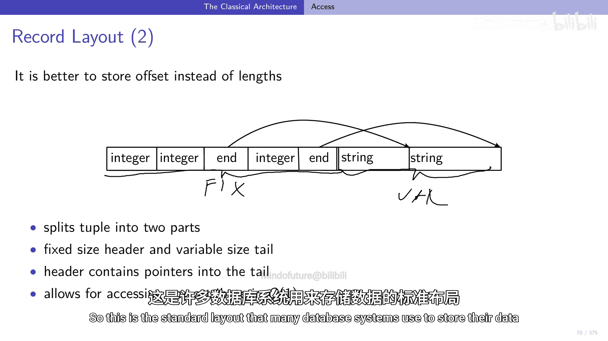

And so as this works our way， we can make it even better by using compression and so on if you want the trade of。

 of course， CPU time versus space consumption， but we can do this。

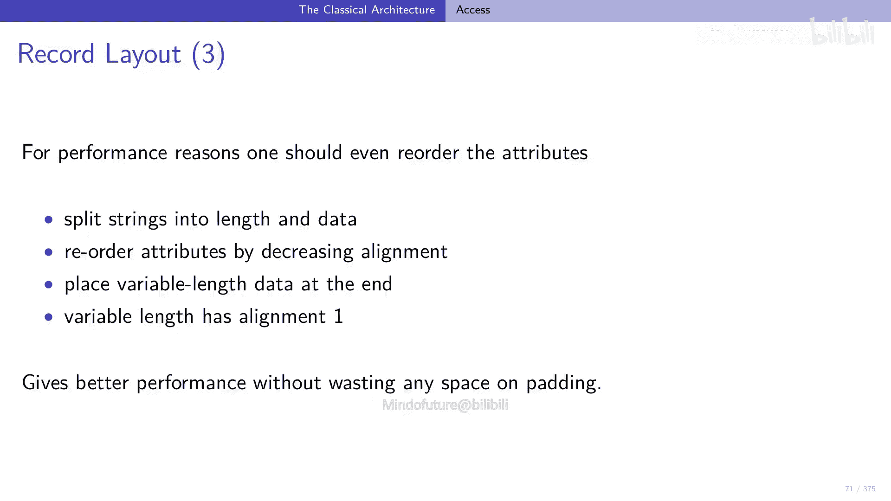

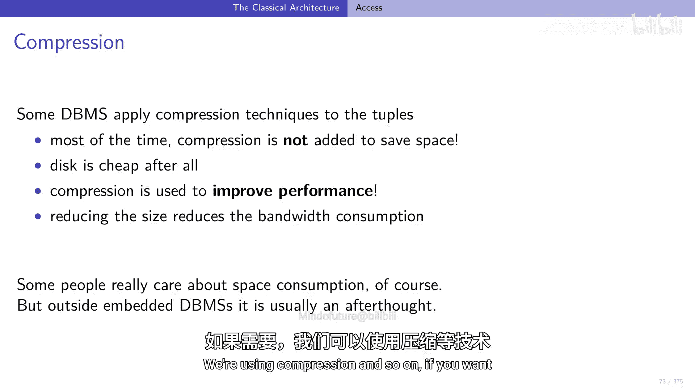

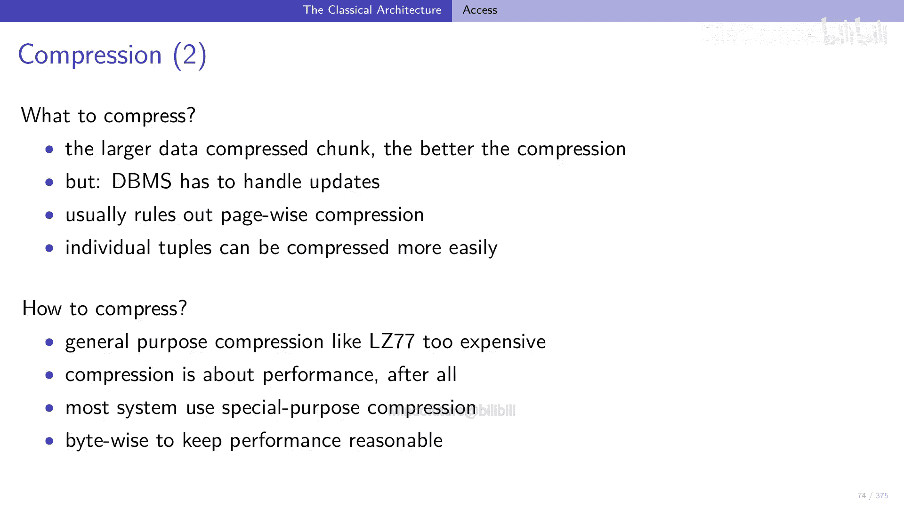

And so now the interesting question is。What do we do if we cannot do this so now why should we ever not be able to do this？

Remember when we talk about started pages， we talk about in most systems in 99 or 9% of the systems we talk about。

Systems is a fixed size database page， for example of 16 kilobytes or 32 kilobytes。

 something like this。And systems will want to use fixed size pages for a number of reasons。 Now。

 for example， if you know that all your physical pages are， let's say 16 kiloby。

 then buffer management is easy because you know that you have over this size units that we can swap it out。

 recovery is easier because you know that we can this is the small units that we can recover and so on。

So your life is much easier if everything is squeezed into pages The problem of course。

 is that if you do this， then a Tupper must fit in a single page and so like if you have 16 for example。

 so if my whole page is this is my page if my page is 16 gigabytes。

 obviously then I of course lose a bit because of header and slots and so on。

 then slot then here I have data。😊，And clearly， my data D has to be less than 6 inb because I have some other ads。

 So I kind of make a page complete。 It's nearly 6 inbte， but it's a bit smaller。

And so the interesting question is now what do we do if my data is larger and by the way what systems do if the data is larger at default so the easiest thing is you give an error message this is what for example。

 oracle does or at least does in the default auto oracK can handle this but but default you get an error message so you just store something that larger than a page the system says no I cannot do this but sometimes user absolutely wants to do this and it tells the database systems that he wants to do this For example he wants to embed a document somewhere in the database system so something is large and SQL has explicit support for this。

😊，Using two data types here。Brop and crop。 So bb means binary large objects。

 So this is basically yeah like a file。 so this is a binary sequence thats stored as it is and this can be large as you hear this you can use for example。

 to store an embedded document in your database or basically you can store movies of course you should not do this Yeah so the system can handle large bs buts if it's really large you should not store as a b but stored in a file system but so if you talk about multiple gigabytes you don't want to do this as a b。

 But in principle you could now so you can use a b attribute boot and store very large data elements in there and crop is a character large objects this is。

Like a block basically also very large differences。

If a drop it' really a byte range so the system does not interprets us at all。

 It just stores it as it is with a crop range you say， oh， this is a string。

 a very long string and then some systems support some at least some limited functionality ID you can look into the crop a bit into the drop usually cannot look at all in the crop you sometimes can perform some operations on them if you want so by this user asks for it so says okay if like you could have for example making a more realistic example here we have a table that's called user and then of course we have a name。

And this year might be， for example。😔，We have a name it's what 60 or so。 then we have another feed。

 and then at the end here we have a photo。And this you don't want to store us a string。 Yes。

 so therefore you say they have a blop。 Okay， this is a typical usage of a propp feed。

And now inside this photo attribute， you can restore a picture of your user if you want to Okay。

 this picture can be larger than a page so larger than， for example， 6  kytes。

And how the system must be able to handle this Now note that in this use case here。

 this photo might be in the boilpar of if we don't know a few100 kiloby， I mean。

 it could be or or a few the very high resolution， perhaps a few megabytes。

You probably do not want to store gigabytes， although you can。

So if if mean if you declare feed as a b， you can store really large stuff in there。

 but I'm just telling you beforehand systems are not optimized for storing really large bbs。

 they support， but performance might not be optimal so but definitely many kytes megabytes。

 this is definitely supportable props potentially up to gigabytes。😊，Okay， so nevertheless。

 much of this is whatever we put there is much larger than the page and now we need array two corses。

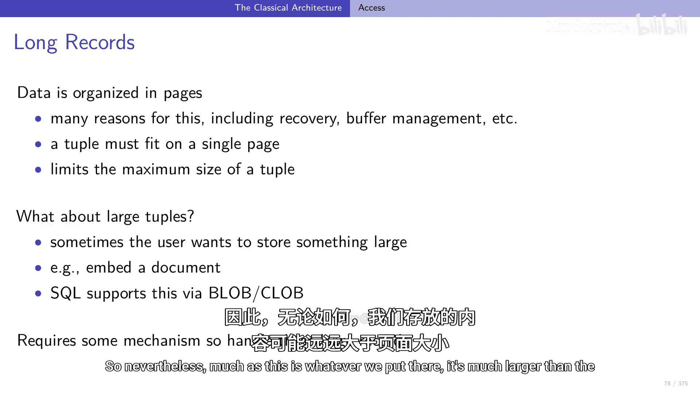

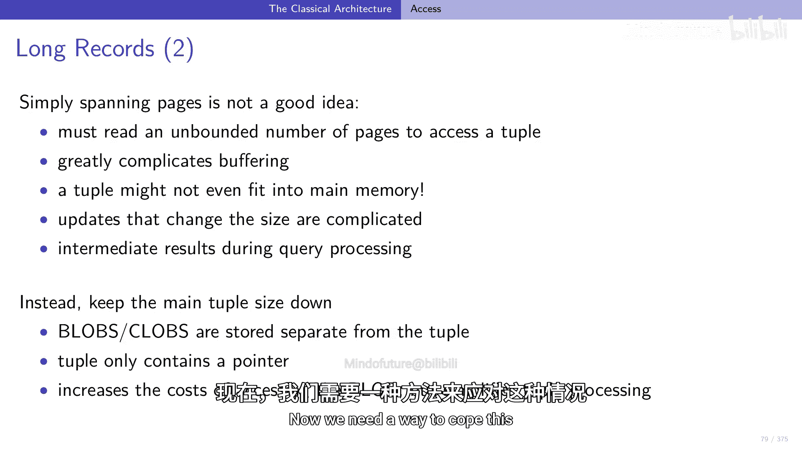

Now what we could naively do is the following。 So I take my I see this is my page for my user。

 here' is my user page。So then I have here my user record。 and so initially we here we have。

You have the name， of course。Then some other stuff and so on and up to here now comes at some point here。

 my photo starts。And the photo so large that it doesn't fit on a page so what we could。

 but you don't want to do what we could do is， of course， the following。

So if we take for my photo here， I point to another record。And this then， again， his。Photo。

 and actually， I didn't draw it correct， because。It's not done yet， as。

So the attribute continues and continues continues as or it doesn't fit it on a page。

So then we get another pointer here。So we get like a long chain。😔。

Other then we continue here with a photo and so on。Photo and on so we use as many pages as we need。

 and you always point to the next page uses the next step as it contains the next piece of data。

 we could implement it like this， but we don't want to implement it like this。

 So this is not a good design purely from storage perspective。

 of course it works because you just see as my very long attribute out over my pages So this works but this is this is very problematic for a number of reasons first it is means that if you access this attribute again。

 So if if you touch it then you can at least potentially read an unbounded number of pages。 Yeah。

 because we don't know how large my voltage is So because it could be very large at least in theory going to drop。

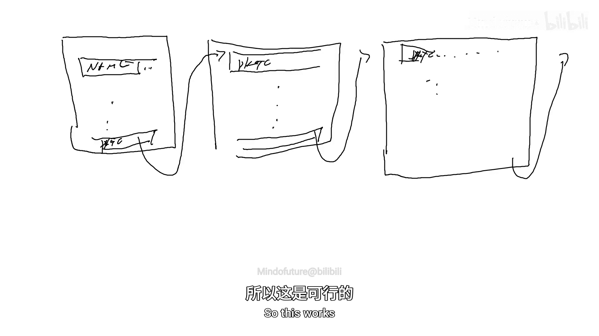

Has nearly no space limit so if you want to reconstruct my top I need to have an unbounded number of pages this is a nightmare for buffering if because it could be that your buffer manager doesn't have enough pages for example or you get a locking issue or all kinds of problems so you do not want to read an unbounded number of pages Now if you know I read at most two pages or three pages that's okay but if if you say I won have to read after many pages。

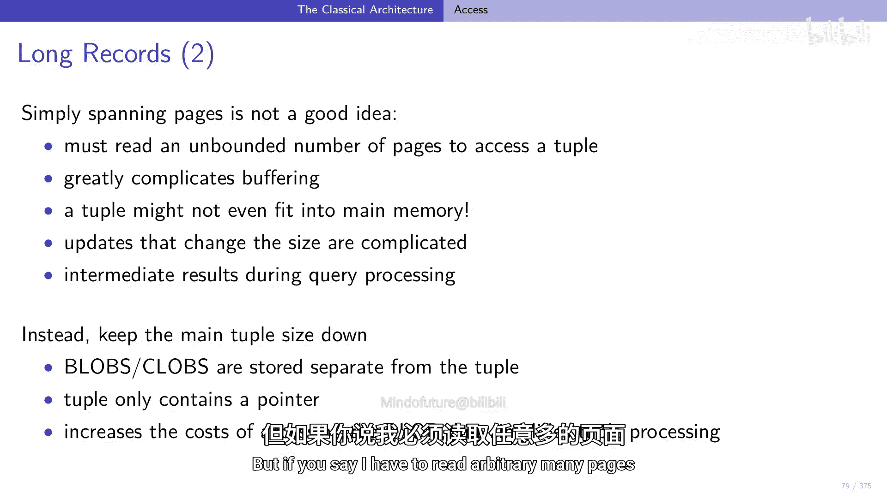

And you of course， you need them because your tablet is really split me。

 mean mean reading just this page is not enough or this and that page is not enough。

 This also not enough。 you must have all of them in memory contact at the same time to be able to process this photo。

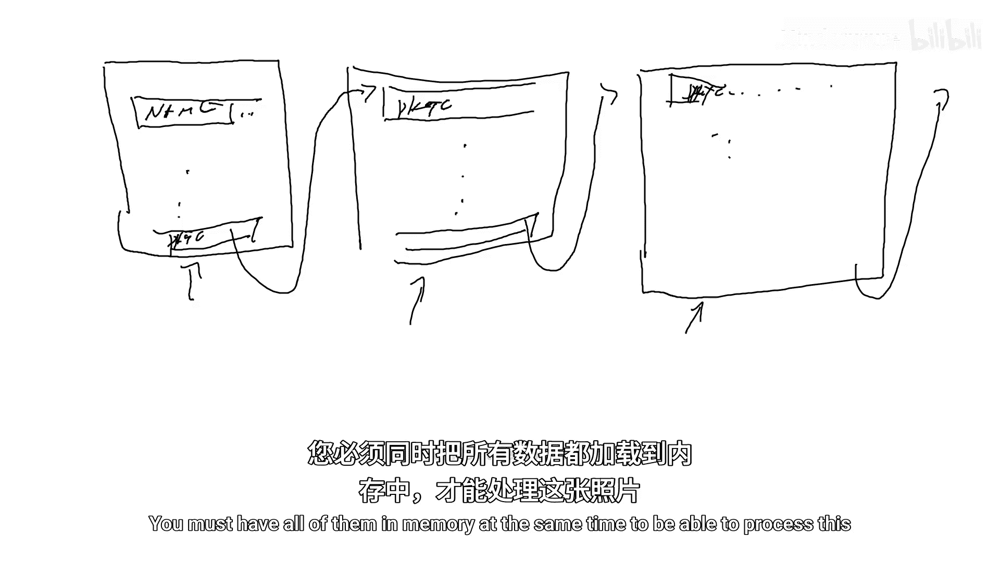

That's very， very better buffering。 Yes， you don't want this。 mean， in worst case， of course。

 your tap So yourre single that good might be larger than your my memory。

 like if somebody hast property good stores 4 GB blo。

 but you have only 2 GB memory memories and your problem。 so。

This is clearly problematic other things that are very unpleasant is what happens if somebody doesn't update so you have a proper and somebody doesn't update。

😊，And the same size changes。 if the size remains the same， I can just copy data in。

 if the size changes。 So suddenly I have to allocate new pages or release pages。Very complicated。

 Also this is also are not not very attractive。 and also mean if you're running query now。

 how do you pass this this because after all， somebody can query for this for attribute。

How you pass it through your cure processing is also very complicated。

 Now therefore we don't want this。What we do instead is we and stores the block wages separately。

 and so this is what most systems do。😊，And so it's like， say， here， this is my user now。😊。

So this is my user to in the user， of course， has a name and on。

And then we have all other attribute that we have。 and then we have。Strictly speaking。

 just to be pantic。 of course， the name is not written like this。

 I do it because it's easier to write。 Strly speaking。

 we have only a fixed part of the name yet the ver part of the name comes at the end here just two。

Write it correctly。 Now， So name ver part， but I don't want to make it so complicated。 Okay。

 so I have my my here and in my somewhere there's my photo。And this photo now points to number8。

 which has the advantage that the user tablet itself save is reasonably small。And for the block。

 we just store a pointer。 So add an I D basically。 So we could， for example。

 store a table ID or something like this， which is more or less a pointer So top ID or or pointer or something else some some mechanism。

At this point to to the real b。And then during field processing we just pass along this table ID we don't do anything and only in the moment that we give it to the user when the last possible moment somebody retrieves a photo then we retrieves the associated data loads a photo and or and they give it to the user or perhapsim don't even do this because depends on which API you use or which program interface it could be that you really get the ID and then you have a special co that says okay I have this B ID now please give me the content of the B only in this moment and it's retrieved as the B stored really separately。

😊，Good thing about the separation is that now the complexity of this large object is hidden only in one place。

 namely the one that is responsible for storing it retrieving the b。

 everybody else just pass handle around So this is good bad thing is you mean by design you cannot do a lot with your blo you can pass it wrong you can give it to user but for example。

 in most systems， you cannot perform operations like you cannot look at the content of the blo。

 at least not easily same with crops or perhaps with crops。

 they have some limited support what you can do you can for example probably compare crops This is then implement but in the moment that you do this then they must look at the real content of this elements which is slower so bs and crops are slower than regular variables because this data stored somewhere else。

But at least the complexity of the immensely large values is removed from the tablet。

 So the tut itself now is again small。 So because a large part starts and waves。 Okay。

 so this is design perspective makes sense unless I said many systems do this。

 but this does not answer the question is okay， what about here， I said my b is here。

 and this can be now large like megabytes。Okay， how do I store this And because this has also to stitch somewhere and usually we assume everything is。

Start in a page in database systems so the page is the smallest unit we can have。

 so we must somehow now map this megabyte range of data to pages。

We don't have to worry about those for doing tu processing。

 but nevertheless at some point you must do this mapping。

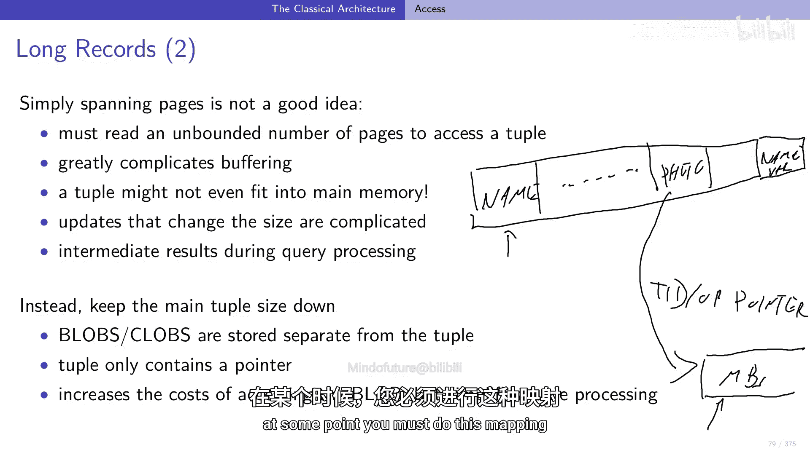

Okay now here's a particularly elegant way to implement this。

 namely you take a large binary object through your blop and then store it in a B tree like fashion Lexus。

😊，Okay， now just need some explanation。So。Perhaps we start bottom up and so we look at the leaf element。

 so this as the leaves， so this contains the real data here。As。Should be a D， sorry for this。

So should be these， so this is my rear data。😊，And then here comes the first part of my b。

 for example， the first 40，000 elements here。4000。 and then comes the next 60000。

 and each of them fit on a page。 if in this case， as you may have 64 kilob pages。 Okay。

 so then each of them fits。 this the first page is not full completely。

 There's some empty space for some reason， but second next is page is full and then comes T as the next。

 then comes the next 50。K， and then comes to next 60 K。And then comes the next 40 K， for example。

 And So I have split my， So my total block here has the size of total is。Total is 250 k。

If you compute the sumia this tropy， I believe it's right。 Yes， so as thesmbia 250。

350 k is my block on total。And this is split over。Split over。Of5。Leaf pages。Okay。

 so this is my storage Yeah。 Now you could ask if what is any better than the chain that we had mentioned before。

 Yes， it is because we here in this case， we don't do chain。 It said we we index the content。 Yeah。

 so like here we do this in the beat like fashion now you should realize， of course。

 that this as an illustrative sketch in reality if you have only five pages。

 you need one only one B tree nodes and can heavily handle5 who can handle thousands of pages at least definitely more than five here we pretend as if you would need more inner nodes just because yeah you know。

 to makes a picture more meaningful so therefore， on the inner nodes， we reference the。😊。

The the leaf node and we reference them by file offset so like this page says， okay。

 everything in the file offset from 0 to 40，000 goes here。😊，And then everything between 40。

000 and 100，000 goes here。Okay。So this is the index offset that。Okay， same in the root node here。

 the first 100，000 entries are here。The next 150，000 entries are here。Okay。

 so so much should be intuitive because now， this indexing allows you to find an up position in your b in logarithmic time because we can just switch for offset settings then I find the page that contains it and I can also do rangequeries if you don't want to read the whole block but just care for the header。

 for example， you can go to the beginning of the page where can you read any sequence。 Yeah。

 any part of the data that you want because we can just go down in the beatre for whatever data range we need that we get all content。

 And so this we can use to retrieve out parts of data。 Now if you look closely at this node here。😊。

You see that we do not just index the offsets， but we index。

 So here we say index by here have written index by offset， but if you are。More precise。

 we say we don't inact offset and set here we do here， the index by relative offset。Okay。

 now a relative is important Now for the first in node makes no difference because my relative offset here is 0 elsewhere Sta this is an implicit0 its beginning and of course the 0 is not taier。

 but this is an implicit offset of 0 therefore in the first page makes no difference。

 but in the second page。😊，Here we say we see that this here and this， this。

 the sweat packet here contains the next 50000 entries between as a position  hundred0000150000 in the in the entry here the in our note on the right this this。

 let's give you the number。 Let's call this here page 0，1。😊，2。3，4，5，6，7。

 So in the index in the page 2。We now say everything less than my own base offset plus 50000 a year。

 And so here we write 50000 and not。 So we do not write here， not  hundred50000。

 even though a traditional beat would do this。 So we don't do this instead we say0 instead we say 50000 plus。

Plus this one。 So plasma Pri separator。 So this as a plus basically。

 therefore you also see that the next boundary right here is。🤧。Yeah， sorry。

As next boundary here in the in and old， we write 110，000 but of course， the real value is 210，000。😊。

Now， why do we do this， so why do we use relative。Offset and send upload offsets。

 as this has a great advantage。 I， for example， that we would hypotically go here and then we would delete let's say 20000 So we say here we say delete。

😊，Deelete 20 k。 Yeah so we want to remove 20 K from element from a file。

 So I cut a piece from a file。 So this then here， what we would have to do is。We of course。

 we clear this data because it's gone。 not this is gone。

 and then we update this value here to from 100，000 to 80000。And we update this year from to 80，000。

And you must also update this year to 230000。And it's it。As that's it。

 the rest of the5 we do not have to touch particularly the right most entry is so this one heres the page2。

 we do not have to touch because my offset is relative to my separate above me Yeah so separate to the 80000 same for insert。

 So if you would， for example， insert here 20 so if you would then insert。Insert 20 K in here。

And then my page is full。Also insert 20k then I would update this yet from 40 to 60 I would update this here to 120 and would update this to 120 and this here to 270 and that did again the right part is not affected So which means using this relative addressing we can insert and delete arbitrary ranges of data in my b and if you only have to touch a logwarithmic number of entries。

 and this is a pretty cool feature now so we can now manipulate very large data structures without rewriting everything because if you would have used absolute offsets instead of variety of offsets we would have to touch all this so we would have I just you know use perhaps I can do this with。

😊，With a different colour Yeah。 So we we if we would have done this。

 we would have updated this year to 70000 this year to 130 and so on。

 So we would have updated everything， but we don't want to do this。

 Yes we we want that we don't have to attach all my data。

And also by relative addressing oh by the way， of course。

The number was wrong if I use absolute addressing， then of course， I would not have to do an 70。

 I would have to do hundred70 just to make it precise，230。 and then here we would have to do。

270 but we don't want to do this。😊，Because this means whenever we entered delete we must rewrite all the offsets。

 we don't want this， they have used relative offsets and then we can only touch a logormic number of entries。

So this is a very nice and elegantgan way to cope with large data。He has very powerful it。 again。

 we can read everything， we can update everything。Only downside is perhaps if you， if you're honest。

This， this very beautiful Bea like structure might be a bit oversophistic。

 So it might be more powerful than what you interface offers because at least in SQL it's not not true for all database systems。

 but at least in SQL， you can only read and write write a blob as it is。 yes you can rewrite a blo。

 so you can delete a b。 you can write a new bb， but you cannot grow a blob or shrink a b at least not not with simple statements。

 Now this is not true for all database systems， some data systems， for example。

 are optimized for multimedia users and they support more powerful interfaces。

 But if you have to have a simple SQl interface。😊，This using such a between thing here might be too complicated。

 No， it's very beautiful， but nevertheless， might be too complicated。

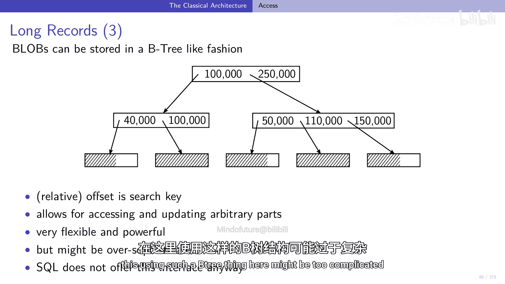

So if you have only a simple interface， then you could perhaps live with something like this also we use an extend list。

 so instead of having this B tree， we just have one node here。😊。

That contains the that describes the elements here。 For example， we say， okay。

 this is my blo bb record here。Pro records。And then this says， okay， my block consists of。

3 pages starting at position 13 so then comes here as the data data data。

 then we say two pages starting at page 19 data data then the block is done now if we just write it hours and in the block bracket itself we have the he number of pages and so the start positions number of pages and then the total lengths and bytes and to have a hash value hash value is useful so then we can speed up comparisons。

Okay and now in the first case， of course， we could be that my extend list itself is so large。

 it doesn't fit on a page。 then we would have to resolve to chain。

 this is unlikely this this happens in particular if you do our standard trick of increasing the number of pages that restore store an extent。

 So if here at some point dont two pages but we try to get larger see runss of pages。

 remember when we talked about the allocation interface。 we ask data system。

 okay I need two pages or at least at least one page。

 but I could have make use of five then the system will give you more pages as it has space。

 this we do here， then we at some point we start asking for more pages Okay then if if you do this then you can bounce the number of entry extend。

 So then you don't have the problem。Said we don't fit on a page。Okay， so。😊，Not as elegant。 Yeah。

 Also the problem is now we can only manipulate the b in one piece so we can delete all pages so we can delete the b or we can reach the b。

 but we cannot easily， for example， if you want to delete something in here in the middle iss not possible because you would have to touch all the other pages。

 other we cannot manipulate the b easily on the other hand。

 if you are curer interface and so simple that you don't offer this functionality anyway。

 then such an easier， so simpler block list except list here its probably good enough。 Okay。

 so this is a simpler alternative。To the sophisticated。Blolock tree。Okay。

 so much for storing large record now。

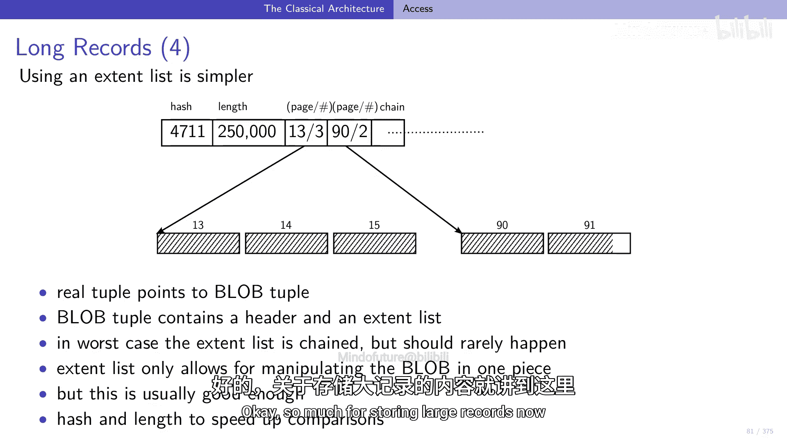

IfIf you look at how people use this， you quickly realize that bbs are not always bs because when we say Blob。

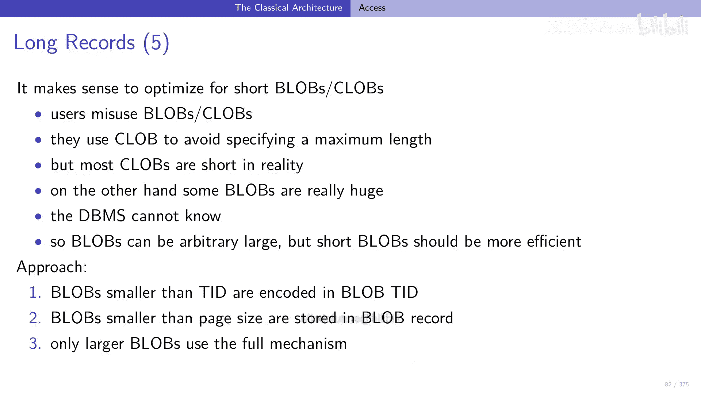

Then we we then we think like so what when we say blo， then we think perhaps a picture therefore。

For picture。A photo or something this。 or when we think about crop， then we。

 when we perhaps think like a document。 now so text large tech document。

So if you want to have books then you can store it as a club。

 now so this this is what we think how about this is what we think， but this is not necessarily true。

 Okay， so why isn't it true Because users hate a particular feature of SQ。😊，Namely。

 you think about the example that in the beginning， I said we have a user。

So let's do it in fruit tea group。So we do a great table。Yeah。Craate table。😔，Use them。

 then we give it， for example。😔，A name。And then perhaps we also give it。

 let's give you some other stuff here， like phone number。😔，And so I had many other attributes。

 So an interesting question is which data type do we give it。 Yeah。

 So if you remember your introduction to the databases。

 we probably told you you should use for the name， something like。Vcha。😔，Yeah， and know what。

Let's for the moment， let's write here 20。 but then we come back to this in a moment。 Okay。

 so we write about something。 So this is usually what we tell our students to use。

And users don't like this for number of reasons。 At first， just to just to one step back。

If you use such a notation here， please do not so I write this in small print and I will remove it in a moment。

 please do not use the data type。Chaharge 20 yeah don't， don't do this。 Yeah in first approximation。

 you should never ever use a data type character。So character 20 looks like a string of length 20。

 but has super odd behavior， Don't use this data type。

 except perhaps potentially for the single special case。 but even then you should think about this。

 but is one case that might make sense， you could use character one。

 if you want to store one letter something， character one might be okay。

 But if you store more than one， please don't use the character data type。 Yeah。

 character data is a totally crazy data type that makes no sense in in modern life。 just to。

To Que backc what this means character 20 is a string of lengths 20 that is space padded。

 so if you insert a string that is shorter than 20。

 the system pets at spaces until the length of 20 and at this point you can say okay without but why not here but trust me this says super odd behavior as the moment you start to compare strings of different lengths because then suddenly the system starts to patch an unforeseenable ways don't do this Yeah character data type is evil don't use this。

😊，It might have made sense when people have used punch cards。

 you might have seen a punch card in a museum。 You probably never saw one in your real life。

 At least I didn't ever saw a punch card outside of the museum， I think。

 and I'm quite a bit older than you。 Yeah， so don't， don't use punch cards。 Don't use character。

 Okay， so use。Cect a varying， So a variable length string。So character writing 20。

 so this is sign length like that we could teach you。

 this is why we can use the user problem is what do we put here？😊，So why 20？😊，I said 20 is okay。

 but I would guess that even in the audience of this lecture。

 there is somebody where 20 is not long enough， I'm not absolutely sure， of course。

 but there are some people who have very long names。😊，Surprisingly long names Yeah。

 in particularly if you come from from other countries。

 some countries sometimes have the the customs that， for example。

 you include your name of your mother and your your father and your own name。

 you also inherit them a combination of both and this invariably leads to the case of having pretty long names。

 so 20 is probably not good enough。 Okay， so then we say。Okay。

 let's not use 20 let's use 40 40 is probably good enough for most use cases yeah。

 but then again you have some hotpo user who has for some reason has a name that that is really really long for whatever reasons and then you say okay you know what two copiess I don't use 40 I use 200。

 200 really is good enough for everybody。And perhaps this is right。 Yeah。

 I think 200 is probably indeed long enough for everybody。

 but the same similar problems with this phone。 How long do you make your phone number， Yeah Okay。

 you don't have to go to 200， but also phone numbers probably also vary and can can be longer than you might think。

😊，Okay so so what happens is people enter very long numbers here to be sure that they never encounter strings that is larger than what they need。

😊，Looks good until you hit another problem， namely， what systems require you is that the sum。😊，Sorry。

 this is supposed to be in U。😔，The sum。off。All the v length。Yeah this year unfortunately。

 must be less equal to the page size。Because otherwise we come back to the original problem by the way this or the reason why the system asks you for the length because you could say wider the system you have to nowhere just say string here So why does the data system wants to know how long my string can be and the answer is might be reasons first wants to make sure that your string fits on a page and it can do this if you can know how long it will be at most so if you look at the maximum length of each strings。

 we can check if some of all maximum lengths plus plus of course plus other attributes of course not only plus other attributes plus other attributes。

😊，Must fit on a page。YeahSo and if if if you make all your string fields very long。

 So if you give them very long upper bounds， then the sum of all your upper bounds might be beyond the page size and then the system will complain like as I mentioned before if you do this in oracle Oracle says don't do I cannot do this please you have to make sure that you have type fit on the page Now you get an error message。

😊，And other systems are a bit bit more generous for in declarationlar， but nevertheless。

 they have to squeeze the table on the page somehow。

 Also some some people use this information for index management， for example。

 so they want to long know how long your data is。 if you put their very long upper bounds。

 then your this doesn't work。 Okay， so declare your voucher attribute is unpleasant。😊。

Either it's too short， very bad and you can enter insert the data or if it's too long。

 then you get error messages from the system as therefore people hate this and then some brilliant people came up with of course。

 it's not so really brilliant by the way。Don't do this at home， but nevertheless I just mention it。

 what some people do is and say he you know what， forget all these length restrictions。

 I just declare my name here is C。😊，Yeah。Sorry we know。 So I declare everything yes。

 I declare my name as a club character a large object。

 and now I can have a name that is multiple megabytes。 So no no problems。

 this lengthy is good enough And of course this name you could say it is ridiculous。

 but if you look at other examples， for example URL then then this is indeed the thing because most U are short but you know the long tail of your length is very。

 very long So there some U are very long。 But then people say you know what I just use a clock。😊。

And this works of course yeah so because remember as a mechanism we just look at in this lecture。

 this works， we now have a mechanism that can store multiple megabytes。

 but this has terrible performance， terrible performance because the moment you start operating on your clock。

 you must look up this long string is then do something about this by the way。

 some really once search us in a talk by some Microsoft people they said they had to support the following which is really insane by the way。

 but they do support us， you say a name club and then you say primary key。😊，So this is really。

 if you think about what's happening here。😊，Pm key。

This is if you think about the implementation of what's going on now。

 you've now built an index on a very long object that is stored separately using another lookup data structure this is all super。

 super expensive。 know I mean this works but works super expensive。😊，And this is not good。😊，Yeah。

 we don't want this and mean， of course， the real reason why this whole disaster has happened is because users don't like to specify string lengths and they won't have the flexibility of having long strings。

😊，And of course， people realize that this is a problem， and therefore they say， you know。

 the solution is differently。Namely， we give the user a mechanism。

That unfortunately is not standardized， this is bad， unfortunately it system't does it differently。

 but for example Postgres callss a data type that you can use until your probably should use text。

And also URL text。Now， what's happened is。If the system encounters text or if it doesn't encounter a text。

 but it's smart and to encounter its club， you could do the same as C。

The user has declared the name asC just be on the safe side， but in reality most names are short。

You could have an oddpo user that has a kilobyte name。

 but most users will have a name that is 20 characterss or less。 Nowll say they are not clos。

 They are short。 same as text So a text is a mechanism that it user I want text the system I want to store a very length strings I don't know how long it will be most of the time the string will be short。

 but if if it's long， please make it happen。 the words the system will do it。

 it will optimize for the short case and if the text here as long and reality and of course it sees it then it maps it silently without telling you to a so as the text is stored out of band out the page if it's long if the text is short then sort inside the page but when it postcard quote as your toast。

and this is is not not the standard name。 Traboska uses。 I actually forgot what so stands for。

 toast the beginning says totally automatic， but I just want to look it up to give you the correct acronym。

And， yeah， yeah。Oh no I must correct myself so the name that Postscuss uses toast as the oversized attribute storage technique so this means that if your text is short。

 then it's stored nicely in the tablet as usual and if the text is long then it is sort somewhere it's like like what we saw in the previous slides。

😊。

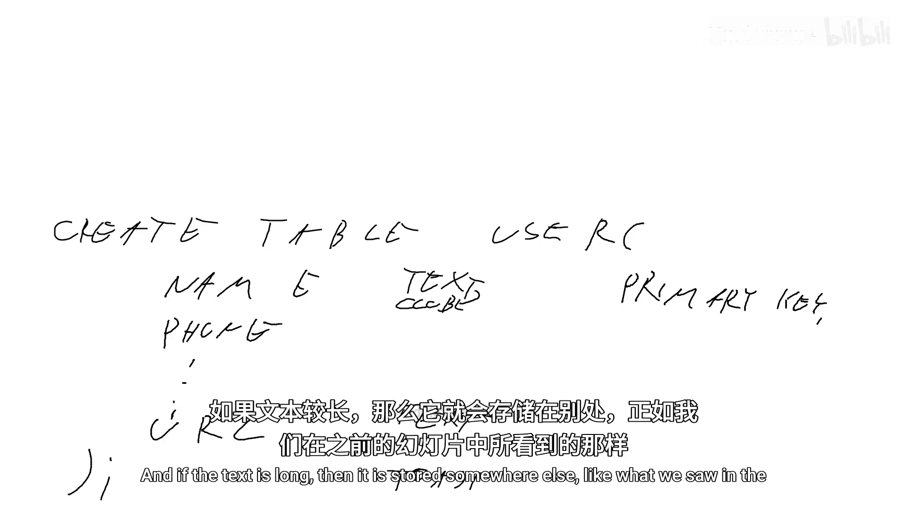

Okay，And such a mechanism makes sense。 you should absolutely do this because as we write here。

 users misuse crops and crops。 they use a crop to avoid specifying a maxim lengths because they hate maximumim lengths and but nevertheless。

 these crops these are not really large objects。 they are declared as crops。

 but they are not really large。😊，And so we have to handle them on the other hand。

 we cannot know this for sure mean for a name probably yes in relative short but if the field is not called name but it's called like photo or even worse movie okay nobody would be so crazy then stores movies in a database hopefully but you never know movie file So if you declare it as a b then this will be indeed large。

😊，And we cannot， we cannot know beforehand。 Now we only see events users done it。And therefore。

 what your system should do is it should implement this whole mechanism anyway by the way and and and every count text is the same。

😊，A text is basically a declarationation of a string that silent me。 Maps to a crop。

 As So text is a So text is a better string If your system supports it。

 unfortunately not standardized， but if your system supports it。

 text is probably what you want to use。 Okay， now what the system should do is it should optimizeise for the common case of being short。

Yeah， and we can we can use the following three steps here if my b is really really short yeah and for example。

 my bb is shorter than a table ID then we'd just encode the text in in the table ID also remember that if we store a blob so。

😊，My original picture said， this is my tapro。Then here comes my block field somewhere。

And this is reality its top D。At this point to somebody。 Okay， this is one way to implement this。

 Now， if my string string is short。 So， for example， if it's less than 8 characters。

 I just put a string here。Now I'll just put it in here now if it's larger than then it don't cost me anything now if my string is larger than a W IDD but smaller than a page。

 then I take a page and then store my blob here。😊，And only if so this is case 1， case1 squeeze it in。

Kase 2， put it on a separate page by just point here， and only K3 is really large。

 so then we do the full blown mechanism then we have for example。

 a tree or some other but these will be rare， so most people will be in category of one or two。

By the way， there are even some mixed forms mentioned possible。

 for example this is what Postgres does， if you declare a string as a text。

 then it refer first stored like a regular string， so like like this here so like we have a fixed size and then comes my string field here。

😊，Even for longer strings。Yeah。So this put it at the end and only if this party goes beyond a page。

 then we put in the the idea here at that point some ways Okay， if it's short。

 we put in the put it in the page of the long put on a several page So at different ways to implement this。

 but you definitely want to optimize for short bs and crops because in writing mosts b are short but。

Upper size， unfortunately， is very large， so we need a full mechanism。

But we optimize for the shortwa。

Okay， so is this much for tut storage。 So it's after this slide yeah。

 you hopefully hope know how to store templatets。 Yeah。

 so if you have many attributes and fixed size， ver size， how to do is what to do with compression。

 if you want to do this and what to do is long attributes。 So this is what we covered。

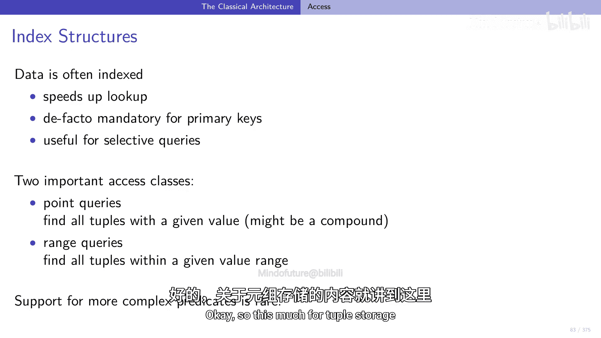

Now what we would learn to look up next index structures。

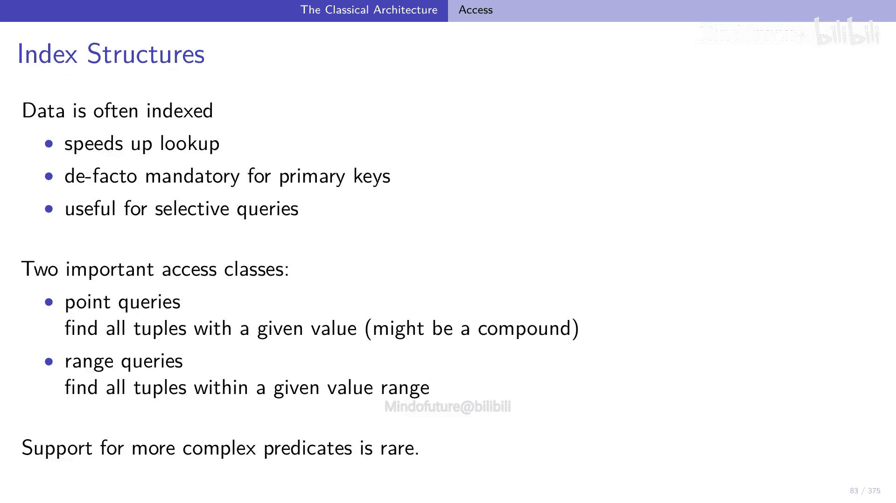

Yeah， because what we can do so far in the lectures only。

 So we have a information relation here is mapped to a segment。 so I have a segment。A draw like this。

 have segments。And then in in the segment， I have a page， and then I have another page and so on。

 So this is my own own holding install So far， page N。

 and if I want to read something if I do something if I do a select。E star from our。😔，Where。

Where x equals 7， then the only thing option I have so far is I read the first page。

 Look at all the type checks the condition。 If it's true somewhere I output it。

 read the next page and so on。 So this means my my queer time here has linear and the database size。

 Not so， but this is this is what we call a full table scan。 we read everything。 full table scan。😊。

And of course， there the be pull table scan。Read all the pages in my relation。

 look at all the tablets in my pages， check the condition if it's true I'll put it to the user。

 no full table scan。

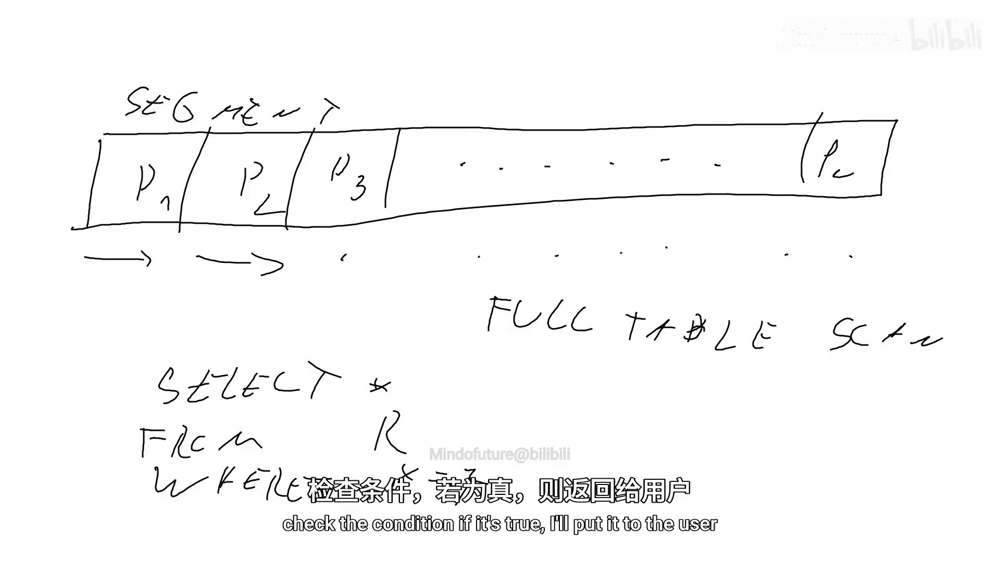

This works but it's not so super attractive if my dataset is very large。

 in particular there's one case where we frequently have to check if the tablet exists and these are primary keys。

😊，So if somebody says I have an attribute and I declare x integer parameter key。

 then I must make sure。Then I must make sure that no other x value exists so I must check my incoms against all existing valuess。

😊，And for this full tablet scan is not really an option。 I mean。

 I know a few specialized database systems that do check primary keys with full tablet scans。

 but these are really specialized systems that are pretty sure that they will have a low number of inserts because what happens and mean just just do the math mean for the first tablet okay。

 no other table exists for the second table I have to check against one other table for the third table I have to check against two previous tablets and so on。

 Yeah， so which means for the the ends insert。Inserts。It looks compare with， compares with。呃。嬉れす。

N minus-1 top， so Ill prove and top here。And this clearly has a very bad asymptotic here。

 because if you think about the number of comparisons that we perform， this means that we perform。诶。

嗯。A half。诶。N times n-1 comparisons。And this is all of n square。

So this is tablet scans are not an option for primary keys in practice yeah because if my n here just think about what happens if my n is 10 that's okay。

 but if my n is a million here so we do 1 million square comparisons this is not a good number so you cannot insert1 million elements and do full tablet scans for each primary key this is just not feasible。

😊，Okay so for primary case， we need a way to find a tu quickly and in general。

 not only for primary case for all kinds of selective queries。

 so if somebody says give me a student with trigger numbers12，3， so then we have to do this quickly。

 we don't want to look at all students。😊，And for this use index structures now。😊。

That we can use in exclusions in two ways basically。

 so the first case here has a so called point query， for example， x equals 7。

 so this is just what I said。😊，Or another， another point query would be to say because it can be a compound doesn't have to be one where。

 We can also say a equals 5 and。B equalates 10。 So this is also a point query because we take mys and say this has to be have Z value。

 So this is a point excess。Second kind of query here is a range query， where we say， for example。

 x between。Between。10 and。20， or you could say another kind of for query is x less so equal to20 or small x。

 so this is now half open interval so they different kinds。

 So the second category here our range queries because we have not the specific values that we are looking for。

 but a range of possible values， the second category here is point access which we know the value we just want to find the attributes that have this particular value。

😊，Okay these are typically the two kinds of queries that we support with index structures。

 Now there exist some index structures that can do more complicated complex predcateates and we will talk briefly about some odd in the lecture。

 but this is more rare so the bread and butter point of queries that we want to support is a point query in age query and of course a primary key lookup corresponds to a point query because we must check does this particular primary key already exist in my database system。

 If yes， you must output an error message we're searching for one specific value。😊。

And we have to find the value quickly。And ideally， not only and ideally necessarily in a sublinear runtimes if we want to be faster than a Pter scan。

😊，<|OTHER|>And we want to retrieve this quickly。

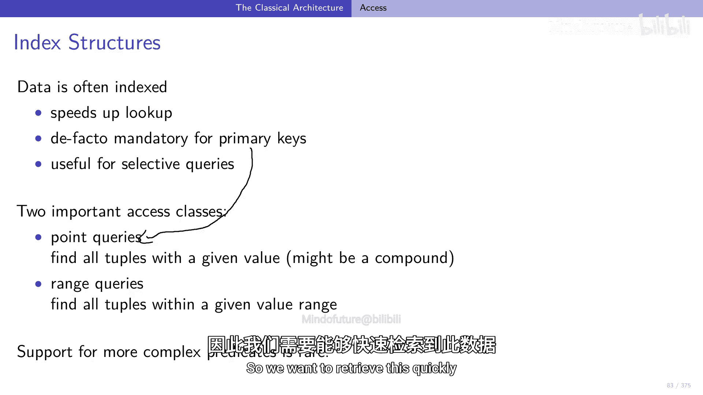

Now the most commonly used data structure to do this is of course a Bre and I'm pretty confident that all of you have looked already at Bre in the introduction to databases because it is such an important data structure and really everybody uses so this is the dominate data structure In fact not only database systems use it file systems everybody so everybody has to store persistent data Bre are extremely extremely popular they are not the only data structures alternatives but we could use for some cases but Bre are very。

 very popular they are the most value data structures for external memory for good reasons by the way so these have many good properties。

😊，And also note that here we a variety of be trees and variants because very few people implemented it as a classical B tree because people realize that it's better to implement some variants of this and we come to this in a moment。

 but the nevertheless， so these are all variations of the same theme。

 these are all multi way in extractors with with these properties we see here。

 So the classical definition says。😊，Aitary has a degree of K。

And now my conditions are each node except the route has at least k entries。

Each note has at least at most2 k entries or another way of formulas is So instead of having explicit degree K。

 we say this here corresponds to。Each node， except the root， each node。Is， at least。Half full。

So this is what we want here。Not the root， but everybody else is at least half full the first condition。

 second condition all as suppose this is basically one here。

 second condition is all leaf nodes at the same depth。😊，And interestingly。

 if you have these two properties， at least half all and everybody is the same depth。

 what happens is。You can bounce the depths of the tree because you know that my my is the depths of the tree。

Tepth of the tree。 I'm sorry for my handwriting is not。

Ass not perfect even without an drawing tablet that I use here。And withdraw drawing tablet。

 is' even worse。 Okay， so' the depth of the tree。Its now。A less or equal to。

The logarism of the number of entries。Yeah。To the to the depth to the base K。Okay， so this is。

What we get here。 So we are at most logarithmic in the and， of course， the。

 the fun thing is that K here tends to be large， like K can be， for example。

They are depends it on your data types are not easy to say， but not say not say approximately。

 let's say， for example。Because it depends on what you store， but can be， for example。

10 this means your tree is logmic to depth thousands is very shallow because if you have 1000 entries。

 I need only one node if have a billion entries So I can my tree has depths2 if you have a billion entries。

 tree has depth 3 which means that for all practical purposes B have depth of less or equal to4 most likely probably only three3 at most4 this will be depth of B3 if you compare those to traditional data structure like what you learn in your direction to algorithms data structures is probably something like replect3 don't use that's not true there are some cases where you want to do this but let's say definitely not for databases and probably not even for most。

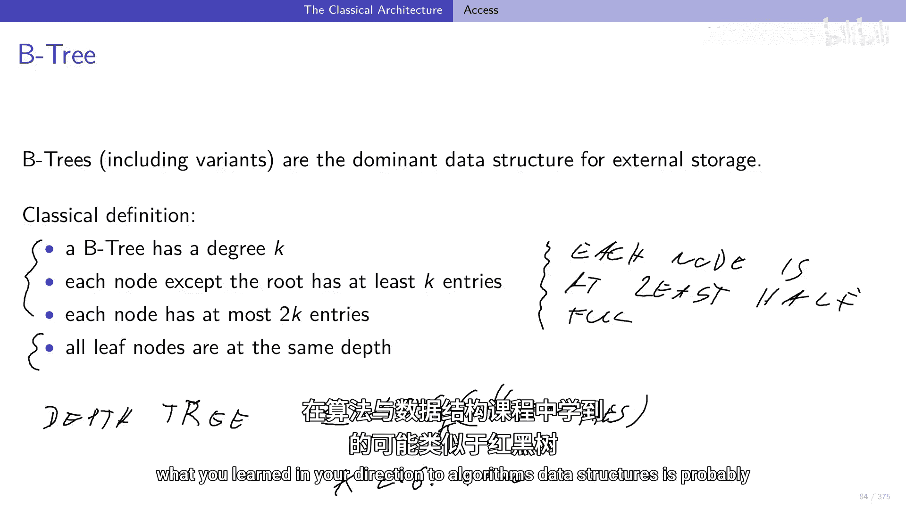

， they have some good properties， but。In first approximation， you don't want to use repries。

Even though it a log remic， of course， so look up in a redory is in O of log n。😊。

And look up in a be tree。Its also an ologan。So why do I say repies are bad and beies are good？

The problem is that we hide all the constants here。 so we see the。

 the depth of obary here is the depths is log K。Of end。And this is， for example， then， for example。

lock，1000。Of N， then this is typically， typically， typically。呃。2 to absolute at most4。

 so this is let's， let's make perhaps a more， more concrete example。Let's assume not typically。

 let's assume we inside1 billion entries here。Mon million entries， the depths of this year will be 2。

For1 million entries and each two levels， because if each leaf node contains at least 1000 entries which means I have at most 1000 leaf nodes and this means my inner node can hold this because yeah my node can hold between 100 and 2000 elements if my case 1000 so then need two levels of my tree1 million entries well if you look at the depth of the red black tree here。

😊，The depth of the red lecture relates to the ses。The depth of the reory。B。As you hopefully all know。

Lock 2 just by his n， and effect is even worse。 It's two times。Lock2 to base in inverse case。No。

 so this not does not have to be the case， but let makes the depth more precise。 in first case。

 it's two to log N and in best case。 So， and in best case。It's。Look 2 to the base end。😔。

Now best case is log 2 to base n， verse case is2 times log 2 to base n。

Okay this is of course all lag grouponic in the complexity， but an absolute numbers。

 So if we say this means 1 million entries， well have the depths。😊，Yeah， between。20 and 40。

And this is pretty deep， I mean going 20 steps in a tree or even verse 40 steps in a tree is very different from going two steps in a tree。

Okay， now to be I this is all hand waving， if you are honest a step in a refleory is cheaper than a step in a B tree so therefore you cannot compare this number directly。

 but trust me the look up in a B tree will be much faster than a look up in a refory in practice。😊。

Sobities are nearly always preferable over red reies。 there are a few special circumstances。

 That's not true。 but in first approximation， you prefer a bit over a red re and you definitely prefer a few stores on external medium。

 So even even in my memory， Bea trees are usually better but on an external medium。

 they are always better because if you would do this on an external medium and we would do here 20 or 406 on a disk。

 remember C cost me something like3 or 4 milliseconds you would die Yeah so we would spend 80 milliseconds for a lookup up a disaster。

 if we do this in a bitry here， then we spend perhaps 8 milliseconds， also not not for free。

 but we can perhaps spend 8 milliseconds。😊，Now so in particular。

 since the root of the B tree will virtually always be your buffer manager。

 So you have only one page for it and if you have steps2。

 you will have only one page for because the route will be cached so leaf node might not be so then one page for So this while the rep trees would be a terrible performance Okay。

 so B trees are good。😊。

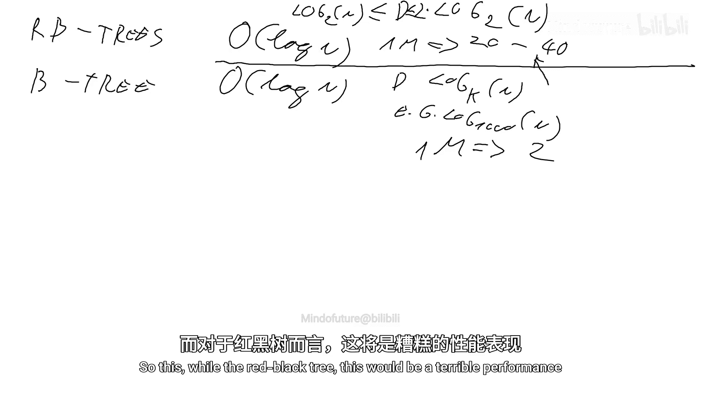

Of course， you can always make things better and we will see look at ways to improve pe trees。

 but read peies have very nice properties， they are shallow trees。

So not very deep and is a guarantee me logarmic lookup and another plus part by the way。

 they are reasonably easy to implement so if you wake me up in the middle of tonight。

 I'm able to implement a beat tree for you， at least it B plusy I can implement by heart so I don't have to look at any book I can implement this for you。

😊，would not be able to implement a red black tree without looking at a book and probably the same is true for you I don't know if you have ever implemented red black tree Yeah so you have this balancing criterion like how many reds and how many blacks can follow each other this you might perhaps remember but probably you already get this blank criterion wrong and then the second thing is if you violate it you have to start with tree rotation and I think it unlikely is that you can put the correct tree rotation next to the correct balancing criterion without looking it up somewhere so red black trees have complicated P trees are pretty elegant structure which means you can implement it by heart so you don't have to look it up。

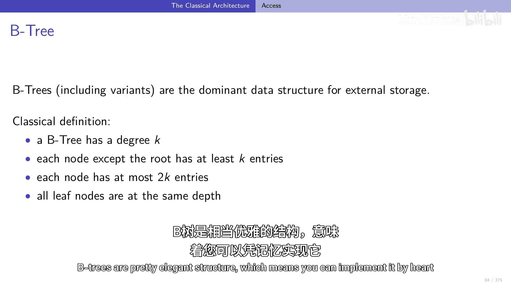

At least if you look at B plus3。 Now， from just for at least once here。

 we look at the real B tree that you all hopefully remember from your introduction to databases。

 So this looks like this。 So here， we have my keys and my values。 So this is a keys that we store。

 So this here is a key。😊，And the value will always be in Swia as the top ID D。

 because remember we use an index to find a topoid。

 which means if an index attribute good likes the primary key or whatever we have so have a key attribute。

Or the name doesn't have to be real key。 And then the we associate this key value with the table I of the corresponding tablet。

 So if you want to find the other outputs。 So if so for example，s somebody says select。nameame。😔。

From。Students。Where。😔，I D equals 16。 What happens is we start and this we assume this is not search tree for this I D。

 So if we start here on the root， we see I searching for 16，16 is less than 47。

 Therefore I go to my left sub3。😊，SoThen we go here， I look at the next node。

 I say 16 is less than 22， so I follow this edge。Then I go to this node and then I look at the elements here and see oh here's 16。

 then I find it now somebody the cur didn't ask me the tab ID but ask me for the name。

 therefore what I do is I track the tab ID and I follow it to the page。😊。

Follow to the page and then here I will find my student。

 and this now will have the name and everything。Okay so this is how how an index looks index lookup works and we use this value here to separate space here as we see the value 47 is stored here。

 everything less than 47 a year， everything larger than 47 a year and then if you go for example for this node here here we have an N88 everything larger than 88 is in this sub。

 everything between 88 and the previous value name 67， everything between 88 and 67 a year。😊。

So let's put correct boundaries here， this year is larger than 88。

This here is larger than 67 and less than 88， this is here and so on。

 now so here this is everything less than 67 so this is how the separation works now so the values here splits this as this has many nice properties。

😊。

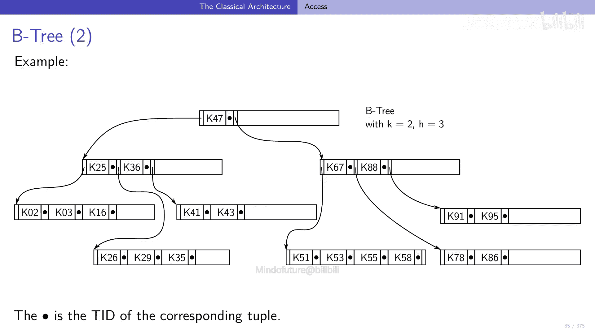

Okay， now measures already before most people don't implement a classic B3。

 but they implement a B plus tree， which as the first glance looks like just a small change that looks very similar to what we saw before。

 but in reality， B plus3 are so much better than B3 and particularly as they are so much easier to implement there all have other properties as advantages。

 but main， if you asked me is the main advantage of a B plus3 is that is super easy to implement value B3 is not so super easy。

 there are some complicated things that can happen。 Okay， so now how does a B plus3 work。

First glance， it looks just like a B tree differences。😊。

The key value pairs are only in the leaf nodes here we see two as the value2 and the table ID so is one one entry。

 one entry， one entry here only in the leaf nodes。😊。

And the inner pages only contains the separator values。 As with the key table D I only is here。

 So here we say。Everything less than 49 is in this left sub。

 this looks like before but noted that the value that we had before name heavier to the value of 47 which was stored in itself。

 So previously my root entry contained 47 a topmost entry and it was in the node。😊。

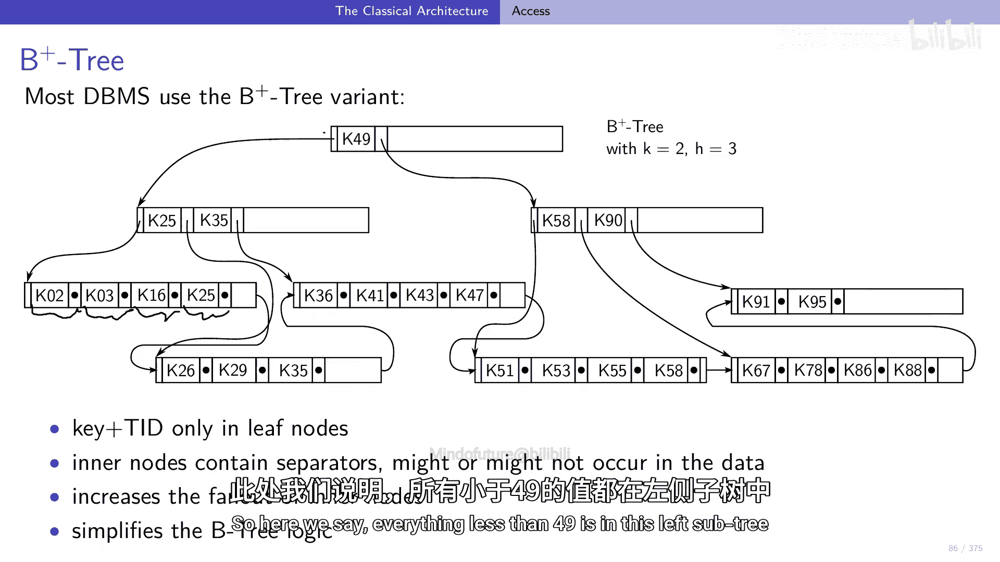

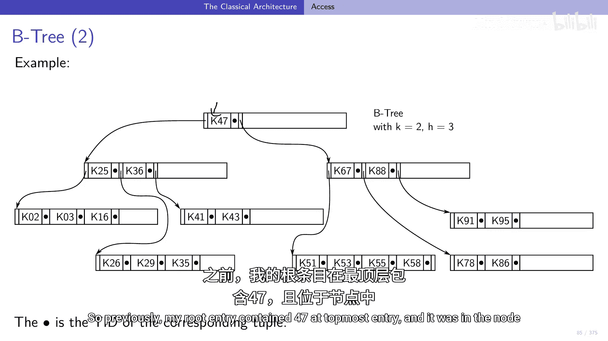

Yeah， now。m sorry direction。 Now my 47 sits here in a leaf page instead on the inner page does have some separator value that does not have to be in the in the values。

 So here we say everything up to 49 is here in my left part。

 everything larger than 49 on my right part。 then I go go here then everything larger than 37 is here and then its on now so inner values contains separators that might or might not occur in the data also note that now I write the balancinging conditions here。

 everything up to 49 it notes that this here is a less or equal in the previous example or if deleted already previously said here said everything less than 47 is here here I say less or equal to 49 here so this is more but important difference less or equal to 49 is here larger than 49 is here。

😊。

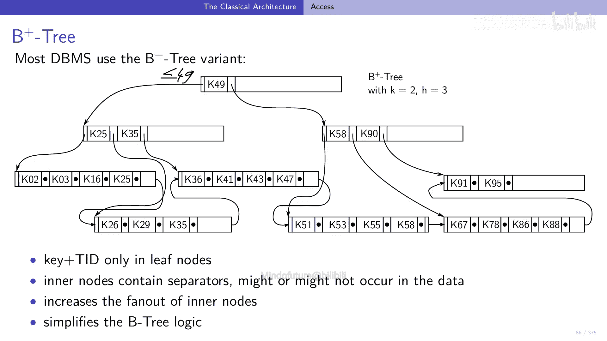

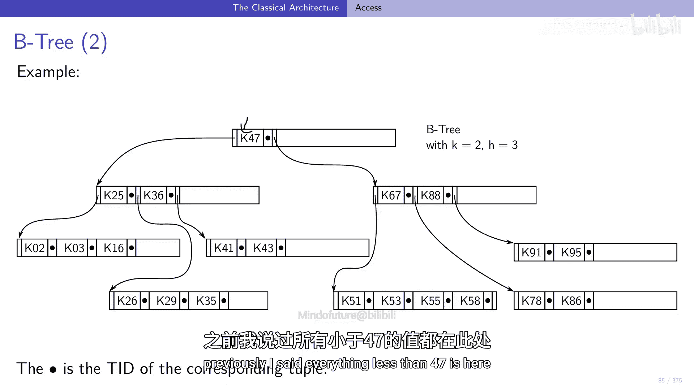

Now here， let's not equal to 25 is here。Above 25。25 and less or equal to 35 here above 35 here and so on。

 And you see the 25 it does occur here and this this here the 25 does occur by the 49 does not occur。

 so the largest value F is 47， so the in or out can contain values that do not occur in the data。

Okay， now but by do we do we prefer B plusy over B3 mean the first glance。

 I have to store the value twice。 Yeah， so if you look at the 40s 25 stored both here and here。

 So isn't it bed。 I mean， storing everything twice， it doesn't sound so attractive。Yeah。

 but the advantages。 there are two advantages。 First。

 the inner node now only contains the key value and not the table ID value。

 And so only the  keywi saves the space for the table I， which means that my。

 my entries on the inner node are smaller， and this means I can fit more entries on the page and this means my fan node is higher。

 And higher fan out is a super great thing because remember our formula set my depth here is。😊。

Is log K。 And if my elements are smaller， my K is higher。 and because my K is as much I guess。

 I can fit on a half a page。 If my elements are smaller， ever a higher fan out。😊。

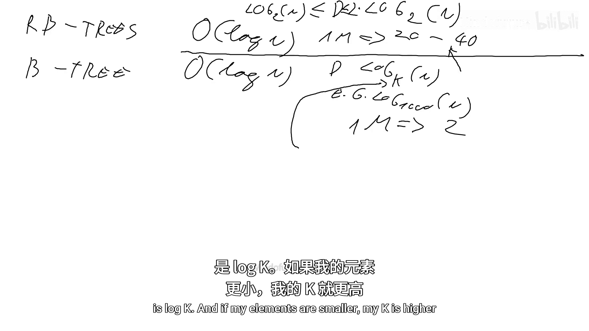

And therefore my tree will be less deep and therefore look up will be faster。😊。

So this is the one advantage of the B3， a B plus3。Hier fairard。 Second advantage。

 if you ask me this isn't read even more important， namely， its much easier to implement。In a B tree。

 pretty nasty things can happen。 for example， assume here， we would look at this example here。

 We would want to delete the value。

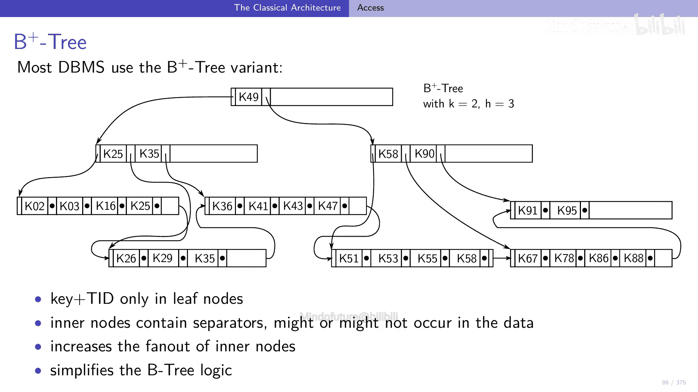

Let's say37， sorry， the want to delete the value43。 Okay。

 then by page would be less than half full because I have only one element here。 Now。

 what we would have to do is we would have to text the next element。 in this case。

47 and move it here and then， but then we need a new element for the route。 And then we could。

 for example， pull up the 55 here and。You know， this is super。

 super complicated to implement because now suddenly we must touch quite a few pages just because we want deleted one element。

 also because we must update and separate them， separate them must move down super difficult operations。

😊，While in B plus3， we't have mean in a b plus3， we don't have to move a value 47。

 if you want to do something because 47， we must physically move it in a B plus3。

 we can just store a value in the in the node that does not necessarily have to occur like for example。

 if somebody inserts a 48 I just entered here， do nothing or or if somebody deletes 25 as we delete 25。

😊。

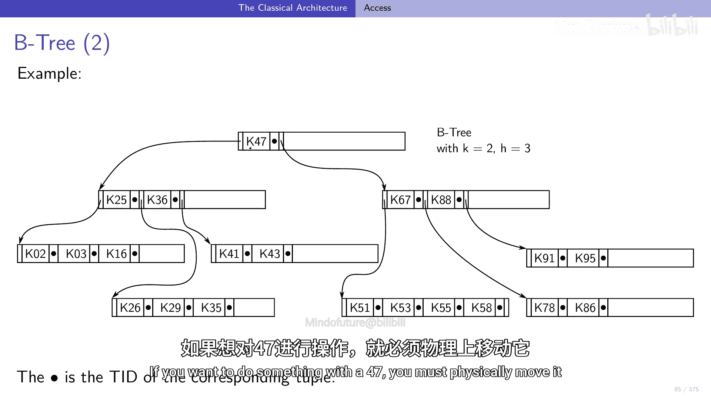

We do nothing。 The separator says everything up to 25 a year。 It's true。 There's no 25。

 but this doest matter。 so as this is still true while in in a B tree。

 we could not do this so easily。 so a B plus tree we can do most operations， I say most not all。

 but we can do most operations on the leaf nodes and we much more rarely have to touch the inner nodes while in a classical B tree。

 we would have to update the inner nodes much more frequently。 Now therefore。😊。

Don't use B trees use B plus3。They are both faster and much easier to implement as B plusster trees are what we usually want to do。

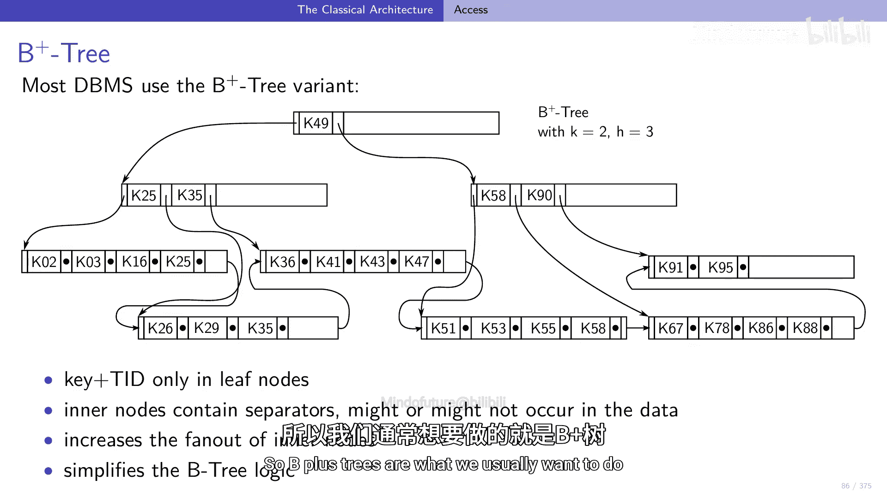

And。So now how does this， if you zoom into the mean this is just a picture。

 how does this physically look like？😊，So the。See in and out， probably it looks something like this。😊。

So we we have so this is this page of an inner node。

 we start with a log sequence number as usual so this is for recovery just a last change on this page this is just a number so then we store the so-called upper pointer here so remember that we have one so we have a lot of let's say look at this example so we have a lot of key pointer pay us。

😊。

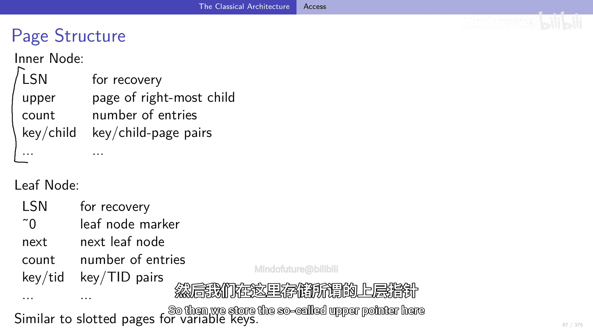

Here so perhaps I should say pointer key pairs because I say this page。 So this。

 let's give you a number。 this page 7 is responsible for everything up to 558。

 Then this page 20 here is responsible everything for up to 90。 So we have pairs of page number key。

 page number key page number keys。 We have many of these。And we have one a page more。

 and this is what we call here。 This is what we call upper in this slide。

Because this is everything that is larger than the largest key Ive in a page， the same here。

 my largest key is 49， everything larger than 49 comes to this upper pointer。😊。

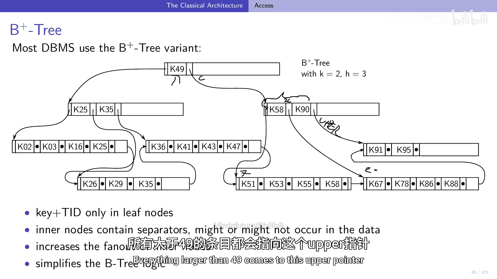

And as we see in this page structure here， the upper is the page of the rightmost child so because this rightmost child is different。

And then we store how many entries do we have。 and then we have， of course， many key child pairs。

 So key charge key as X more precisely。Key child page Now this is the page number of the child page Also key child key child key child。

 This is inner node。On the leaf node， principle we do the same。

 let's ignore this thing here for a moment。😊，If you also have so sorry， didn't see this。

 let's ignore this for a moment。 We come to this name back， so。IfWe start the same。

 we have the log sequence number， then we have the number of elements that we that we want to store and then we have key table D pays。

 This is not a child page， of course， but this is not table D， though we have many key table D pairs。

😊，And now we have two it entries more that it didn't explain yet。 First one。

 we see this next pointer here。 So why do we have this。

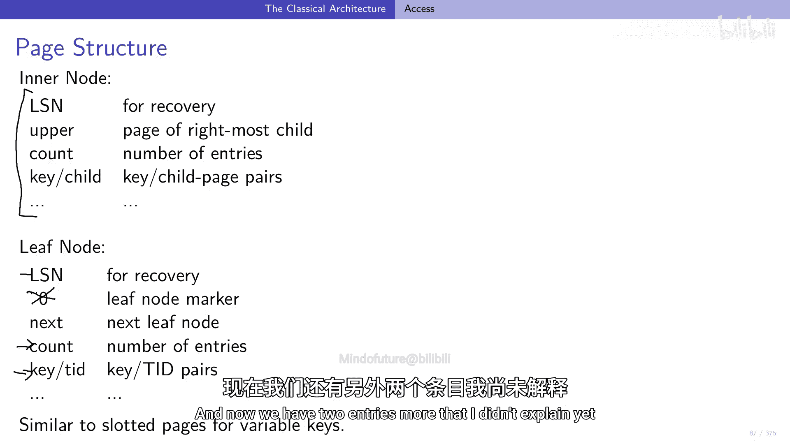

So you saw those also in this picture。In the B plus3 when we look at this is a leaf page。

 let's call this leaf page 1， this is leaf page2， and then the leaf page1 has a pointer here to the leaf page2 this is here the next point as this is what I mark here and we have right to it next。

😊，Same here we have an next pointer。Here we have an next pointer。

As if we always store next leaf page next。Okay， why do we need this？😊，Stretly speaking。

 we do not need it in a strong sense， but it's very useful to have because it allows us to run curious more quickly。

For example， if somebody wants to run a theory， I want to say x between。Let's say，27， and。

54 what happens is I go into my search for 27 in my B3 so I go go say 27 and less than 49 I go down here 27 is between 25 and 35 so I go here So then on the page because on the page the elements are sorted2 also I store them sorted on the page therefore I find the first elements I have to retrieve as 29 because this is between 27 and 59 so 29 I found as first element and then I just go to the right as to 29 qualifies 35 qualifies then I reach the end of the page I follows the next point I read 36 qualifies 41 qualifies4347 I follows next point I go to the next page51 qualifies 53 qualifies and then here count the first image that does not qualify and then I cant stop because I no everything further to the right will be larger。

😊，Therefore， I can now stop processing。Okay， and so I I use this next pointer here to simplify my search。

 So basically I only navigate down the three1 since the beginning。

 and then I run to the right on the page and then I hits the end of the page。 I follows next pointer。

 this gives me pretty good performance when running a range query。 Okay。

 so this is what we need use an next pointer4。 Now what about this omins number here。

 So I said here it writes this here is still is 0。 and this means this means1，1，1。

1 and so on1 in binary So this is a value that just consists the1 or another another notation here would be of course。

 just one-1。

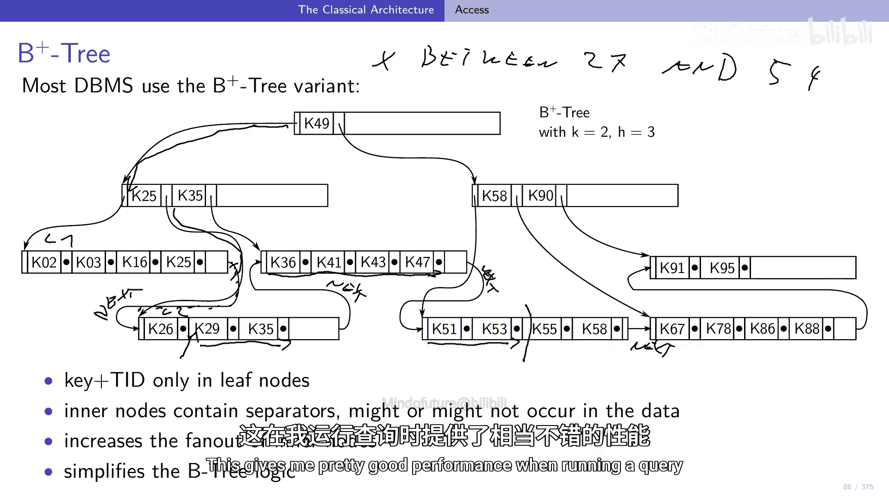

Okay。😊，Now why do we use this as the problem is when we navigate down the tree。

 how do we know when because in the picture here I said we start with a leaf node。

 we start with a root node here。😊。

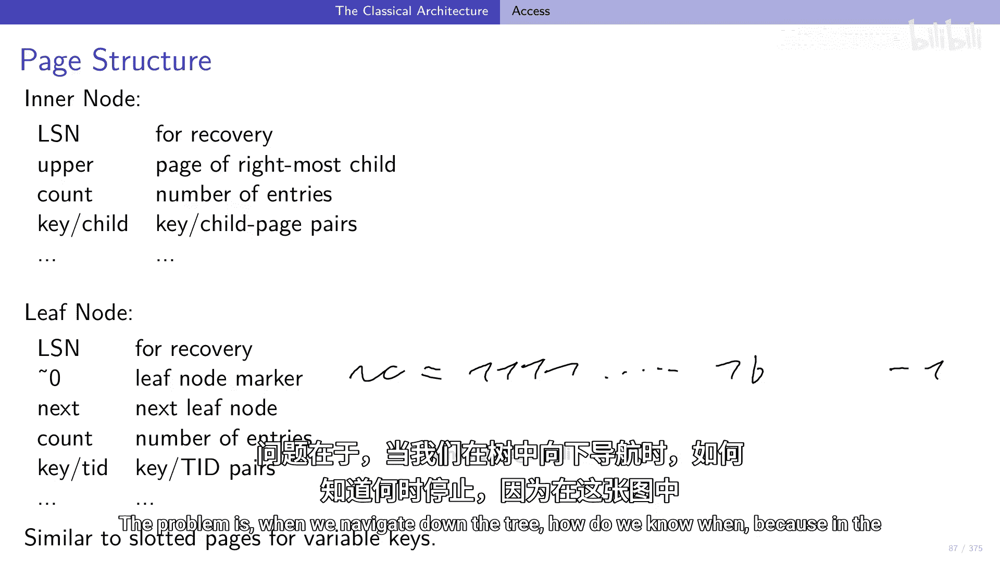

And then I go down， for example， to this node and then at this point I have found a leaf node and then I can start retrieving values。

 How do I know that I found a leaf node。this is an inner node。😊，Isn't it a node？

And this is a leaf note。But how do I nose this？Yeah。

 because in the database system I just say here this might be here page number this something things And I say this here is page number120。

 this is page number 40。 How should I note that page number 40 is a leaf node by page number120 is inner a node。

😊，Yeah， I don't know this， at least not in advance。

 so I just know that my next level is on page 120 if it's a lever on in and out， I don't know。

And one， one way to tackle this problem is to distinguish them。

 So basically I write in the in the header of the page values that cannot occur in the inner node。

 like here， for example， on the live node， we write this value here。

And this value， because this is -1。 this cannot be the page number of the right most child。

And thats for at least I must make sure that is can be the case。 So this this year。

 it's the same memory location as this one here。😊，As when I fetch the page， I look at this field。

 the second field， I check if the second field on my page is minus-1。

 if yes I encounter a relief node， if not I an inner node。😊，Okay， and of course。

 in my inner nodes then I process differently than if I encounter a leaf node， so leaf node。

 of course， I do the look up differently。😊，And so some mechanism like this you need Mo are different ways to implement this。

 but you have to realize。I mean， this is surprisingly difficult because you are not the only one who navigates the data structure。

 like you you start from the root and then you move down， but while you move on。

 somebody else might change the tree。 in particular， it could be that the depths of the tree grows。

 other your tree might become deeper and somebody might split nodes。

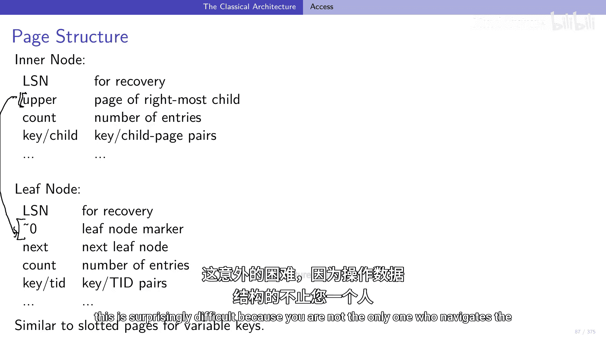

AndTherefore it's not totally obvious at least in advance。

 it's not totally obvious if an next page is a leaf node or an inner a node so you have to have some kind of mechanism to analysis。

 either use a marker that we did here alternative technique would be to use counting so if you remember how deep your tree is then you can count on which level you are and of course if somebody splits the grosser tree。

 the depth can increase but you can know season when we come to the insert logic you can know that you only grow as a root。

 therefore the depths of a node relative to the leaves so if you must not count from the root you must count from the leaves so depths0 depths1 depth2 if you count't like this。

 you can be sure that your depth of an individual tree of an individual node will not change and therefore you can use this also to recognize if you have a leaf on inner a node so you can use some mechanism to。

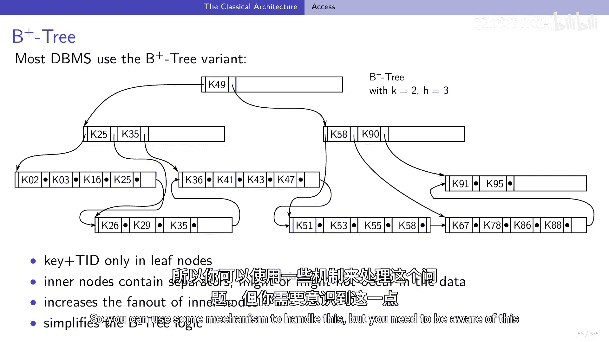

But you need to be aware of this。 Disuing in inner the notes from leaf nodes is not as easy as you might wish。

 It is， of course， the danger of doing what we do here because here we draw a small draw your picture and say。

 hey， obviously this is a leaf node。

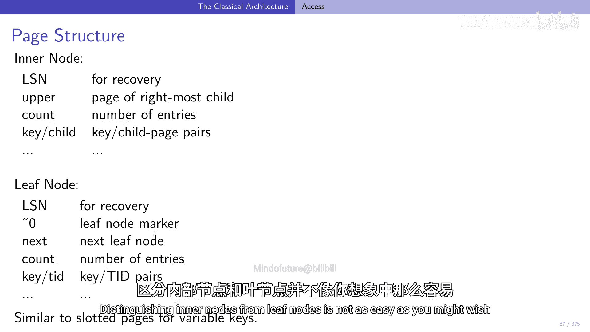

But if you implement it yourself and I think you will do this in your exercises。

 I hope you do this in exercises， if you implement it yourself。

 you will realize it's not so totally obvious and if in your lookup you are now at an innerner node or at leaf node。

😊。

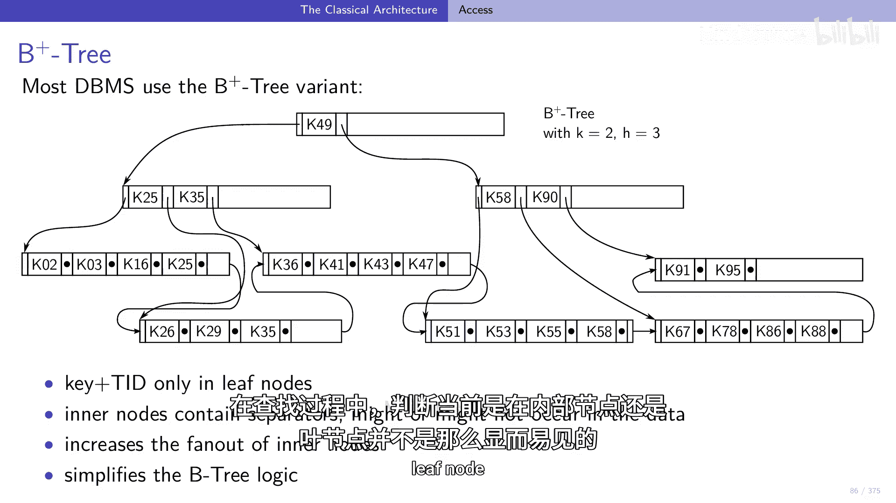

Okay and now so this is a highle operation now how do how do we perform a lookup so when we search an element in my Bre and we do with the following first we start with a root node。

 so this is my current node， so then we say is my current load in leaf node if yes。

 then we return the current page or if somebody really wanted to find the entries then we return the entry on the page here so then we look at the entries on the page and return the entry。

Now， if it's not。A leave node。 Then we find the first entry in my inner inner node that is greater equal to the search key。

 And we do this， of course， with the binary search。 And now， this is important to do because。

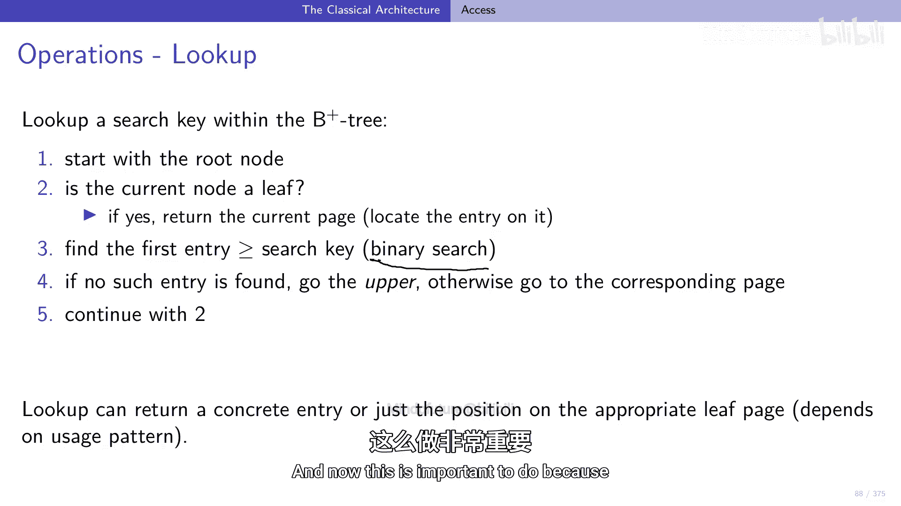

Me， my picture here looks small。 Like if you say short for the value 2028， you could say。

 I just look at the two elements and I find it。 But in reality， this here can be。

Thousand0 or multiple thousand0 pe， Yeah，10，2000。 And then you don't want to look at all the entries。

 Yeah， if you want to compare your search key with with0 entries on a page， this is slow。

 you don't want to do this。 What we do instead is we keep all entries sorted。

 then we can do binary research。 So we we jump to the middle and then always come then always come jump to the smaller page。

Okay， and so until we find the first entries， this greater equal to the search key。

 And if we do not find such an entry， then we follow the upper edge。 So which means。

Because if you don't find this it means my search key is larger than every entry that we have。

 if this is the case then we go to the rightmost chart so we follow the upper entry。

 otherwise we go down to the corresponding page to my to my value here so if we come to this look at this picture here。

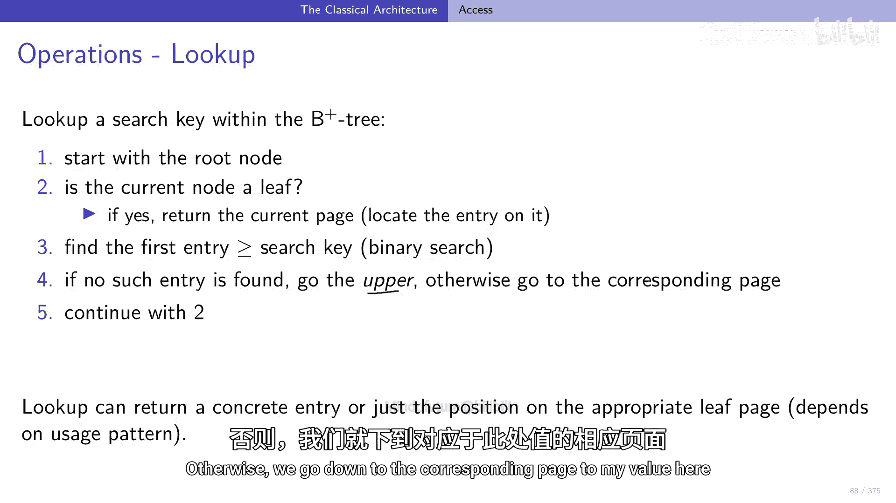

Let's poetly say I'm searching for let's say 448 So then I start here。 This is an inner node。

 I check what is the first entry that is greater or equal to 48 this is 49 follows this pointer then here another inner node what is the first values that is greater equal to 48 there is no such value。

 therefore I follow the uppermost pointer than I'm here then here I would say or let's say if search for 47 that neither let's say it for 47 then I come to the leaf node and on the leaf node。

 of course， I do the same。 Find the first element that is a greater equal to 47 in this case。

 it is 47 So we have found the place and also on the leaf node we do the span search because of the same argument namely that。

😊，We can， we can add thousands of elements， and then we。

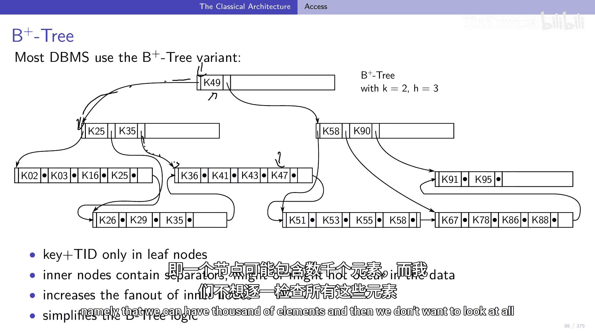

Thent want to look at all of them。 Okay， so this is how the basic lookup works。😊。

So and or looking at my time， I have only 10 minutes left。 Yeah。

 so but then before doing first operation on the B tree。

 perhaps one inserts we can cover because insert is pretty simple too。 but first continuous lookup。

 So so once we found your correct point to follow， of course， then we continue here。

 then we check again， I do have a inner note if yes do it again。

 if node leaf note we we search for this。 Okay， so this is basic basic lookup those。

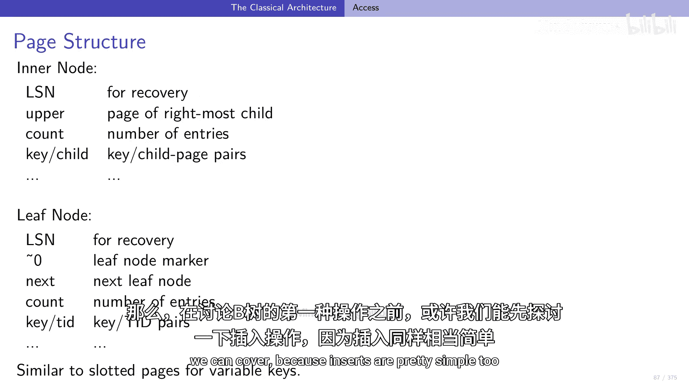

Now interesting question is， can you do better than this？😊，And answer is， yes。

 at least sometimes mean it's not always possible， depends on your data what you have。

 but you can do this a bit better the perhaps。😊。

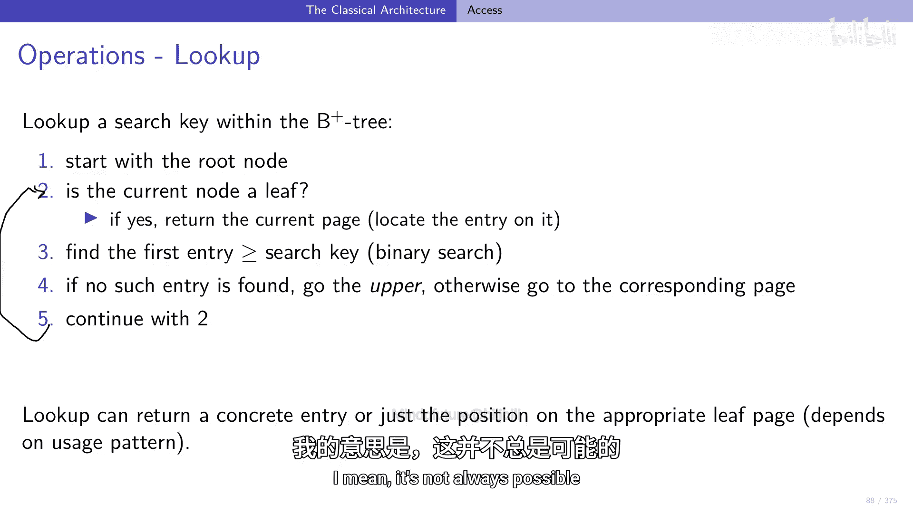

Because what we set。We we go to a page， then we do binary research。So mean。

 my pages are too so small to see it very impressively because I I go here and then I have 1 thousand0 elements and z do band binary research。

 Of course， if you have 1 thousand0 elements， then you will do with band research roughly。

Look at 10 elements on your page。 Que is， can you look at less than 10 elements on your page in particular。

 you notice that you look at this 10 element page 10 elements at random。

 which means that you will most likely or at least often you will get cache misses and or your branch predictor will be unhappy about you。

Yeah， because。So you realize I mean binary research works like this， so let's draw a picture here。

 So if this is my my 1000 elements that I have。

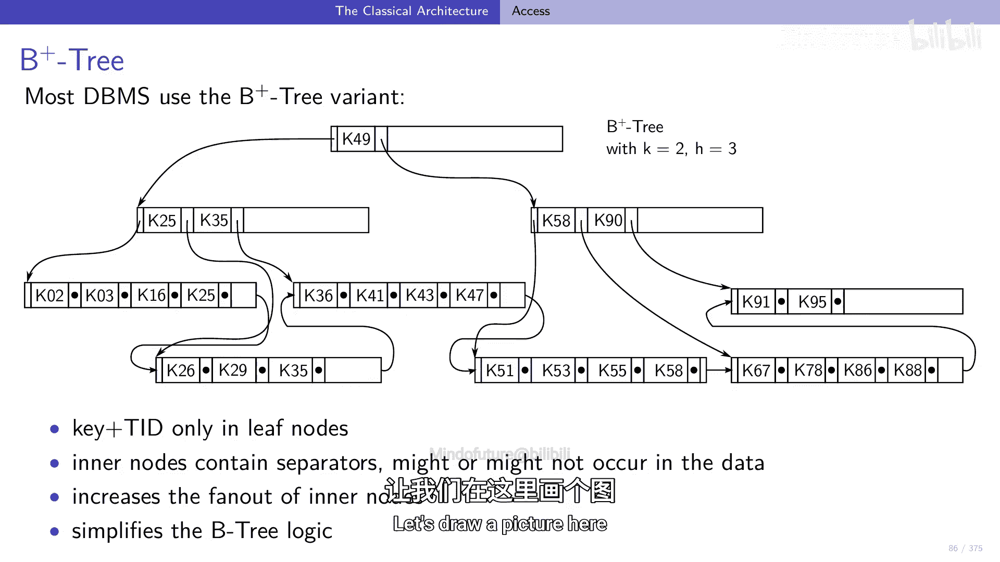

So a binary search I takes this a jump in the middle。And then if then I compare。

And then if it's less than afterwards a jump here， if it if it's more than a jump here。

 now if if you search valuess at random， if mean if you always search for the same values， okay。

 but if you search for values at random。Then the probability that you go jump to the left on the right is roughly 50%。

And this is bad because this means that your CPU cannot predict reliable if you go to the left position or if you go to the right position。

 and this will make your CPU a bit unhappy and this will unfortunately means that you will get suboptimal performance。

And so because the the mean if you think about classical binary research implementation。

 like this here。 So we have we have a lower upper bound。Yeah。Upper bound and we have， of course。

 the value x。 And so the the classical implementation lu like this。 So while。While lower is。

Is not upper。😔，Then we say middle is equal to lower plus。😔，Upon minus lower half。

 So this is my middle here。 So then we say。嗯。If。😔，Data is position M。Is less than x。😔，Then we say。

 a bonds。U bond equal to M。Es。If。Data。😔，嗯。Is larger than x then lower bond is m plus1。It's。

Returned them。Oops。And also do some other way to single。 Okay。

 so this is a classical way to implement a binary search。😊，Now， good。

 good news is we only do this log Google great make number of times。

 So if500 elements if we do this only 10 times， bad news is。😊，This is not so super cheap。

 particularly these course， if you cannot predict reliability if this if here will be true or false。

So this， this could be true of what it's at yeah，50% chance， because if you as you jump through this。

 then you sometimes will be true， sometimes will be forward。

 And this is bad for your for your performance because CPU wants to predict what you want to take because you all have most likely you all of you have CPU auto of or you。

And therefore， the CPU runs multiple instructions in parallel and it can only do this if it can predict what you are doing。

So can we speed this up， Yes， yeah are two two very two speeds up by the way， just the Casis code。

 know that you should not do the following。Yeah， so throughout this year so they can remove it later do not do this year。

😔，Don't do this You could think reason isn't this is the same as easier to write in a problem you can get overflows as so if El you up on Lobar at large you get numerical overflows。

 don't do this dangerous but lose you writele so questions can we do better and answer is yes。😊。

In two ways， first， we can make this here。Branch free。So we can make it all that the the。😊。

That this we， we don't have an if in the inner loopbe as we do the result if。 okay。

 and you could say how， how can we ever do this。Although Im should I really explain this？Might。

 might go beyond。Why not。 Oh lets do this。 Okay， so you now see some a bit more advanced。

Computation yeah。 So how do we do this， we say we sub the same upon lower bound。 Let's say n is。

Uppon mine lower arm。So， then， why。While。N is larger than one。 so if more than one element。We say。

M is equal to L plus。And。Or let's， let's， let's。Now， let's formulate it like this。M is equal to。

And half。Okay， and now what happens is。うん。And of course， and we overtrain it。At the end of s。

 we say N is equal to。AA。Developer2， so my， my bound always always half。 So only question is。

 do we have to go to the left half or to the right half， Basically， what we would have to do。

 I have first write it with N， but then I replace it with Nf。 So basically， what we would do is。If。

Data。Helpleless M。😔，Is larger than x。Then we say L is equal to L plus M。Okay。😊，And。So if it。

 if we have to go to the right right half， then we must increase my lower bound。

 if we go to the left the left half， then we don't do anything with the lower bound。 Okay。

 so at this point， we have only one if and the really funny thing is we can really remove this if2 now。

 because what we can do is。One way， for example， to implement there are multiple be ways to implement this。

 one one way to implement this is we say。Is increased by。M times。Data。Data， L plus M。Lger than x。

Okay。Now what happens here is so here we compare this value if this is larger than this value here has  one。

😊，If it is less， it's a less equal than a 0。 and therefore we might apply m versus1 or with1 or2。

 So if it's larger than we have m， if it's less than n we have 0， we increase a by this。

 and then that's it so now this new loop contains no if So of course we do a multiplication or in fact this you might wish to you might wish to use other ways to you might want to turn this here into a c of condition move。

 but don't want to go into a similar at this point So I'm just saying so you can then it will even faster。

 So if you do sum of will be even faster。 but I don't want to make it too complicated。

 just saying if you formulateted like this， we can do binary research。

 that does not have an if and inside at this means therefore of course if cannot be misprodiced。

 So this will be faster at least if mean extensive performance test of this this will be faster。😊。

If the range theyre searching for is not too large and if it's very large then it is faster to do the multiple lifts instead of using condition move so instead of using branch free binary research but just so this is a branch binary research for smaller ranges and smaller means a few thousand of perhaps a few 100 this here is faster and typically a B tree page is in this ballpar so branch free binary search is a good idea。

Now question is can we eat does this will be a bit faster than the other binary search question is can we do even better and the answer says yes。

 yes， we can at least I mean so this branch binary surgery can always do。😊。

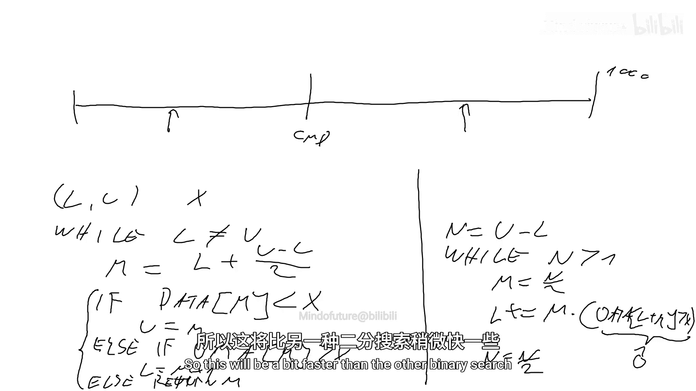

The next trick I want to show you key you can only do sometimes notice is because it depends on the data types that you have。

So if you have strengths， then we cannot do much。😊，But what if we have numbers， for example， Yeah。

 so assume So here we are。 and we are， we want to search， for example， for the value， let's say。

For the value。😔，嗯。55。And so we are searching for 55。So here。

 of course in the root node we have only one entry element anyway we can do much so we just go the right here we have two elements we might do burn research or we just compared and then we go here but now what what about this this next node so in my picture of course it only contains four nodes but in reality this could be10 let's pretend here that we have not four nodes but we have10。

Okay， oops here100100。😊，So and of course we can do binary research。

 but can we do better and that says yes， so why？😊，While traversing。

 we have seen that we are in a range that is larger than 49。

 so I know that the smallest possible values I have in my page is 49 and I know this because I walked to the right here so 49 is lower bound。

😊，And up about， obviously， is 58。Because this is separated that we went down。 and so therefore。

 my page must contain values between 49 and 58。Okay。

 and now what I could do is instead of doing a trivial boundary search， I could try to interpolate。

 Basically， assay say my value here I searching for 58，55。

 So as then I say 55 is6 steps away from the lower bond of 49。 and in total， I have。😊。

58 minus49 values。 so therefore I believe my position on the this page will be this fraction。

 and this will be then the approximate position on the page。Appximate。Position。

YeahAnd this is what we call interpolation search and so therefore so if this is my page instead of starting like a binary search in the middle I take my keys that I have so then of course I traverse down a tree and I have seen values that are larger and smaller than me so I would traverse down the tree this gave me up on lower bounds。

 then I take my value and they interpolate and I kind of could for example say if my distribution on a page is uniform then I would expect my value to be here。

😊。

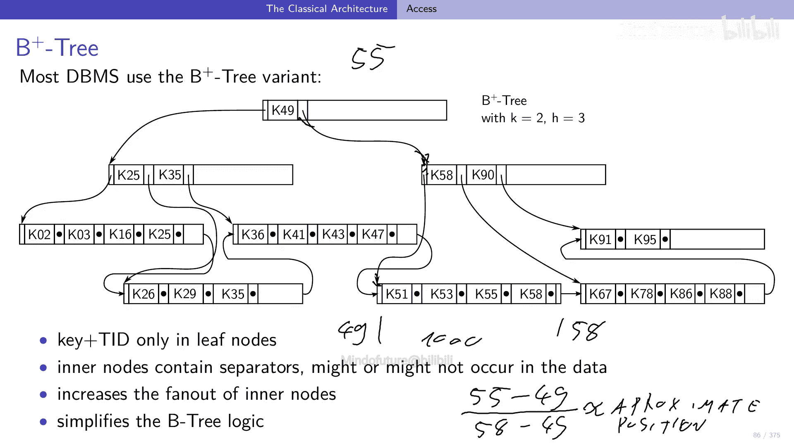

So for example， here。So I go to this position Now if I'm lucky， it's right， of course。😊。

Could be that most likely it will not be right at least not exactly right。

 B roughly is the right boypar but not exactly right。 So what I can do then so I start here。😊。

So what I do then is I check am too small Im too large。

 so let's assume that my the values that I currently found is to make some concrete example let's say if we're searching for150 and the value here that I found is thousands 120 so it's not totally wrong but it's too small so what I do then is I go one step to the right I go look at the next element。

😊，And this could be in this case B， for example。Sohou125。 Also then I go is still too small。

 then I go two elements to the right。 This could be for example。

1140 then I go four elements to the right you know that I exponentially increase the step so and then this could be then say let's say 10010070 this is too large in with incident by now I do binary research So then I do binary research in this small interval binary research so if we guess the first position by interpolation by the boundaries that we saw So this will bring me to roughly the correct position not exactly the correct position by roughly the correct position then I do something that if you look at Wikipedia then people call this exponential search So I do exponentially increasing steps in the right direction until I find a range that my you must contain。

😊，And then do binary search and of course this range is most likely much smaller than the full page I mean for definitely will be much smaller than the full page and therefore I will in many cases be faster than binary research。

Okay， so and I I because my if my the better my initial guess is。

 so the closer my initial position is， so my reposition， the faster the whole mechanism is。

 So if I've， if I'm only one or two steps away， then it's perfect。 So I'm very， very fast。😊。

If my interpolation doesn't work very well， if my data iskewe， then it bad it doesn't work as good。

 but it doesn't matter that much because we are still looking at making look upcast so this is okay。

😊。

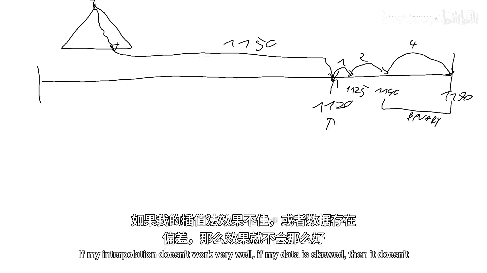

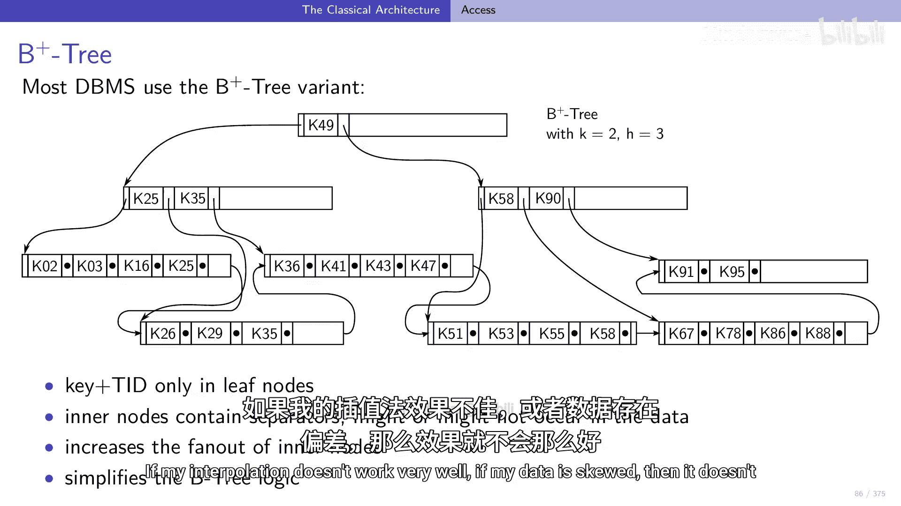

Okay， so this is see I'm running out of time for thes running out of time for for the insert。

 for the Bri， but so therefore we stop here as looking at the lookup。

 but I just want to drive this point home， lookup performance is super important。For two reasons。

 of course first， you do much more lookups than anything else second all the other operations insert update and so on。

 they will always first do a lookup and so therefore you want to spend effort in making your lookup fast and second you must keep in mind your pages are large as we can store thousands of entries on a page and therefore also the search within a page must be fast so the Bre by its algorithmmic structure allows you to look at only few pages or two or three pages but nevertheless the page itself is a non-tvi data structure。

😊，Yeah so we must manipulate the page save quickly and so this is what you look at today so look up and and the next section then we will continue and look at of course our operations insert deletion and so okay so thank you I will stop here for now。

😊。

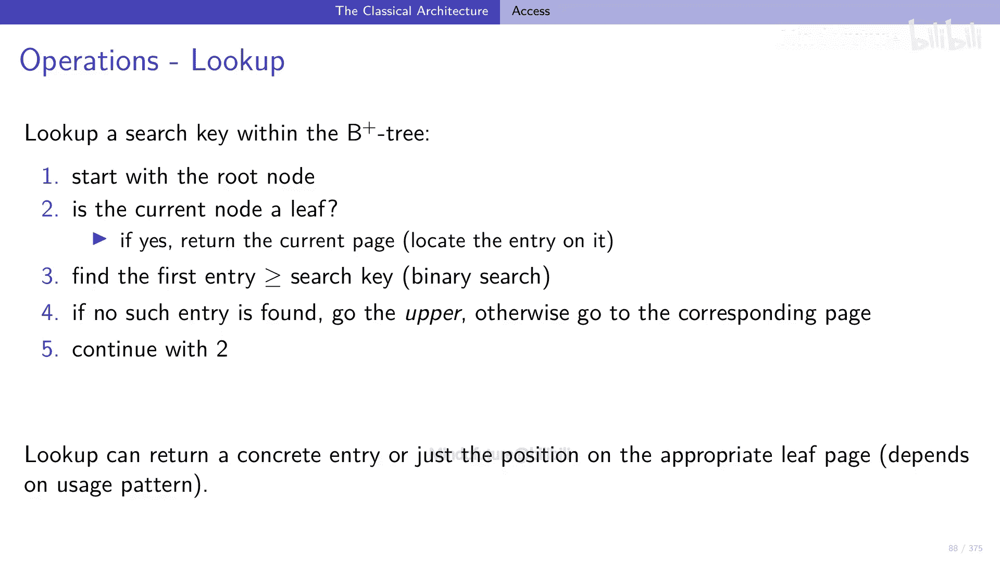