# 【慕尼黑理工大学】现代CPU架构上的数据库系统实现-｜-Database-Systems-On-Modern-Cpu-Architectures-2021-p06-P06_06_访问B树--BV1asiJBeE6j_p6-

Welcome to the lecture on database implementation so in the last lecture we have started looking at bee trees meaning you are hopefully all familiar with how a bee tree roughly it looks like as we know from introduction to databases。

 so here' is a picture of a B plus tree so a multiweight tree where oil leaves is the same distance to the road and every notice at least half will。

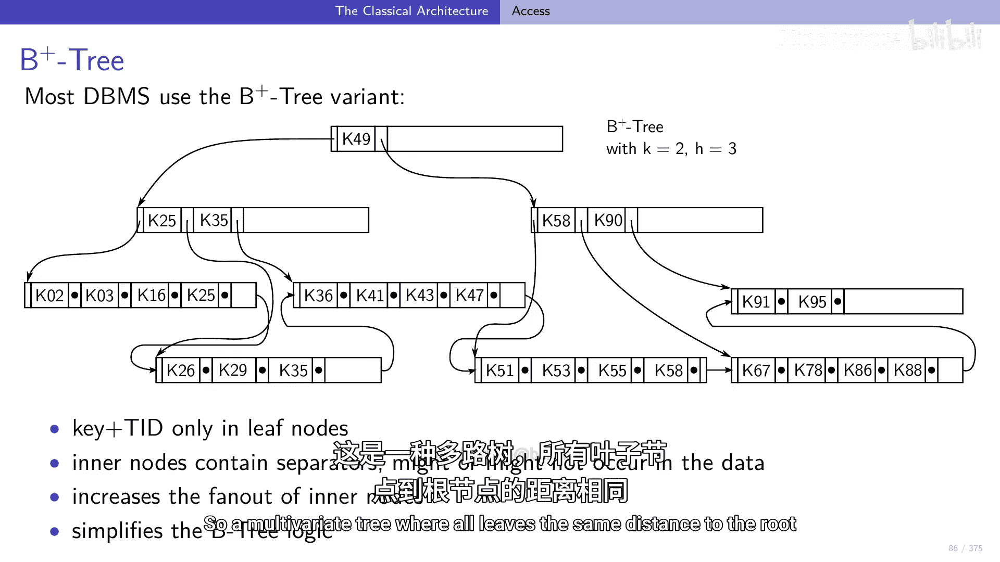

And we have seen how it lookup works。 So we start with the route。

 then go down until we find the entry。 And because our nodes are pretty white so they can have hundreds or even thousands of entries。

 we use binary research within the leap to speeds this up。

 And we we have seen a might of ways to make even better band research like branch binary research or try to interpolate those these kind of tricks。

 So but this is roughly how a bit looks like。Now this is a logic for lookups now what about inserts so how do we insert and the good thing about Bearies is that insert logic is so simple you can implement it by heart so you don't have to look up in a book so while a redle you most likely cannot implement by heart Bea you can so Beatriice inserts pretty easy。

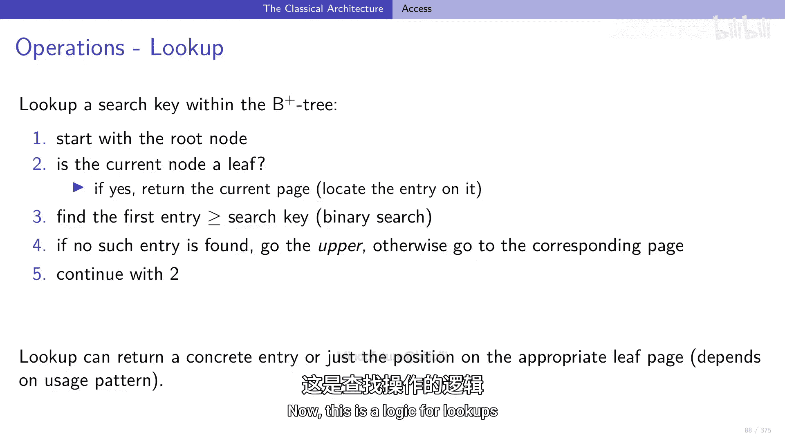

So you first we perform a lookup because we must find the appropriate leave node so just like for searching。

 we'll go down to the leave page where the entry should have been。Now。

Then next step so step2 which is there enough free space for the new entry if yes easy。

 So we just adds a new entry And so the only difficulty here is that so B keeps the leaf node shorter so which means that if this my entries here and now my new entry would belong here in the middle then of course I must move everything to the right then move myself into the middle here is the only challenge otherwise。

It's easy。 Now， of course， a a tricky problem happens。 what happens if the node is full。

 so we don't have enough space in the node。Okay， what we do then is we split the page into two。

 and then we enter the entry on the on the proper side。 Now， what does this mean precisely。

 So if this is my。Page here。There's many， many entries。I remember that has thoughted。

So I cut them in two think This is roughly half。 So now after after the split。

 I have two pages that are not full。 My also first page。Up to here， let's call this element here。M。

 for example， so the last limit M。 then of course， here we also have M。Then this is m plus 1。

 then the new note。Gets everything here also half full everything from M plus one and so on。 Okay。

 so M for the media。 thus the middle element。And now， of course， because my now two half field pages。

 I have enough space for my new elements so I insert it wherever it belongs。

 Now I I cannot know be if it is the first page or the second page after split。

 because if a values are as smaller as an M， of course， it ends up in the first page。

 if it's larger than M， it ends up in the second page。 Yeah， so we insertted wherever it is。

So but now we have two pages， but our parent node， remember that above us， there sits a parent node。

As， the parent。Had many children just pointing away， and of course。

 one of the pointers he appointed to us。😔，But now we must at this head， let's call this as。

 the last element here was the。Separator。For our page。 so now we have split our page into two。

 So what happens now， what must happen now is if we insert the new value here into our parent。

And this now is the value L and the old entry。No longer has L。

 but instead has M as separator was the largest value do on our current page。

 as to this is how it works after split。So when my new page is pulled be split it into two inserts my element appropriate and the maximum the list page is a new separate of the parent page so the M basically logically inserts M at with by old page and then the old separate is updated to point to the new page。

Okay， now so this is easy about what happens if a parent page is full too because it could happen。

 then we do the same recursively。 So if if the inner page is full， we do exactly the same。

 So if this is my page， everything full， I split it into two pages。😊，Now， half fo。😔。

Should be half you know， and then here another page half for So these are the two hals that we that we had and then we insert a separ of the appropriate page and we insert a new separator between these two in my parent page。

And if I have no parent page， because I am the route。

 then I create a new route and lets the new route point to myself。 Okay， so this is in pretty simple。

And so you can remember if the page not fully we insert， if it is fo。

 we split to under2 and insert to separate them parent and this we do recurively until everything is done so the inserting is easy。

😊。

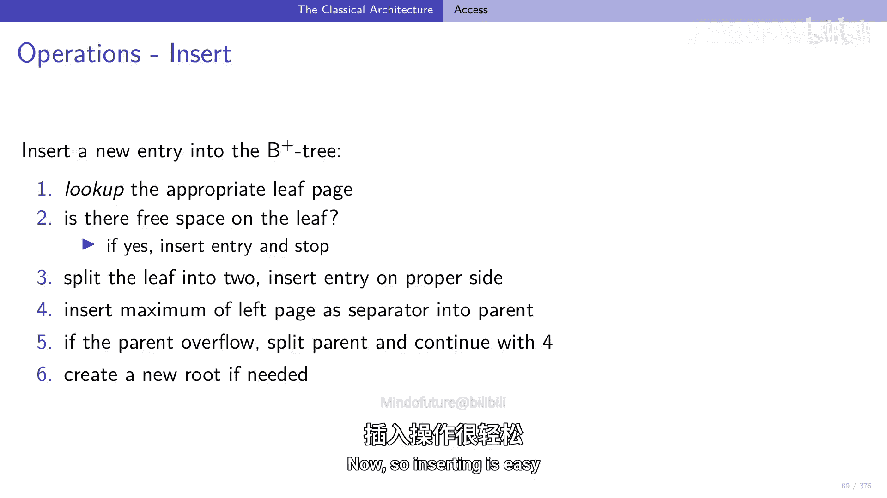

Now， what is unfortunately not easy is deletion。 Yeah， so an insertion is easy。

 deletion is not easy at all because there are so many things that can happen。 Remember。

 the the cr that we had for B tree was。So the guarantees logo at make lookup first every leaf node is the same distance to the root and every page except the root is at least half full。

😊，With our insertion logics， this happens automatically because if it's full， we break it into tool。

 which means we get two half full pages and then we can insert Now with this deletion。

 we can violate this half fullness criterion So how do we do this？😊，So first。

 we started performing alopa as usual， and so we find the leaf entries we move down the tree so it is my tree here。

I moved down the tree following pointers until I come to the leaf node， for example， this one。

And of course， I have more entries here。And then so this is a leaf page that contains my entry。

 Now is my leaf page at least half full you。Now， we sorry。 first we remove the entry。

 Now we search the entry。 we remove the entry。 Now I check afterwards is my leaf page at least half full。

 If yes， I'm done because my balancing in container is not violated。 so that's good。😊。

Now what happens if my leafage is not half full， so it's less than half full now so now I have a problem because I must make it at least half full to guarantee logarmic cost。

 So what happens now is I look at my neighbouring nodes。Yeah， so in this case。

 my neighbor is this one here， so I look at my neighboring note。

And then I check if I can take away elements from my neighboring node Now basically there are two cases either my neighboring node is more than half full。

 then I can just take elements from my neighboring node to make myself half full or if my neighboring neighbor is also just half full。

 not over half wheel then I cannot take element elements away because otherwise the other node would be under full。

 but if this happens， then I just merge much the neighboring so if that happens so my neighbor is only half full I merge with my neighbor this must work because I am less than half full the other one is half wheel so I can merge them into one big node and one full node and then of course I remove the separator from my parent and then requires if it' the same so it could be that my parent is less than half full and one。

😊，So and we do this until until everybody is at least half so this is idea。😊。

Now one pretty important trick to realize here is that first。

 how do I fight my neighbor because in the general case。

 this is a very difficult problem so there was a paper long term ago from someone from MIT， I think。

 who studied all the problems so all the cases that could occur in B merge delusions and these were。

Ts of them Yeah， so incredibly many things can happen because soally we have another neighbor too yeah。

 So this is because course this here is also a neighbor from us。

 at least from a logical perspective because this leaf node here so this one here oh it's the next largest value after myself So theory I could balance with my the visit node So this node here could balance with that node but transmit don't do this so it would work from a logical perspective but finding this other element can be surprisingly difficult because it can be very far away from you in the tree。

😊，As what don't do this。What you can do instead you know is that you must have at least one entry that has have at least one node other node that has the same parent as you so this must be the case because otherwise if we have only one entry then we would have eliminated my parent node so because my parent node is also at least halfway I must have at least one neighboring node so what we do is we go to my parent and then check my neighbor I don't know if it's a neighbor to the left or to the right but one of these two must exist so I must exist a node has the same parent and you take that node and then you can balance with that node so this means you can you must only go one step up and one step down and not further in the tree。

Okay。And then you can find your body to merge with， and then everything works fine。Now， nevertheless。

 delusion is pretty complicated。😊，Inerion is easy to implement deletion。

 at least if you want to do this properly。😊，Very difficult in many cases。

 even more so because you have realized that there are many systems that many users that operate in the same tree。

 so theres multi user aspect which we didn't cover yet， but trust me。

 multi user access with delets is particularly difficult。No， because of this problem， to many system。

 just say。I don't implement it。 Yeah so if they accept under full pages。

 they don't implement the proper deletion logic。😊，The only thing that they do is if a page is really empty so if there' is no element left。

 then they remove the whole page， so the trivial empty notes are removed otherwise and full pages are accepted。

😊，And this， of course， much easier to implement。 and the argument in favor of this approach is。

They say， you know， but in the long run the system has more insertions than des。

 because if this would not be the case， then your database would be empty。😊。

And because if if you have more deletions and insertions here database is empty after some point and empty databases are uninteresting。

 Yeah， therefore， we assume that we have more insertions and deletions。

 therefore it's okay to just ignore the problem so because the empty pages will be filled again。

And it affirms glance this is a plausible argument。At a second glance， unfortunately。

 you can construct sequences of inserts and deletions where this argument does not save you。😊。

Because this argument is only valid if your insertions and deletions are uniform over the whole domain。

 but if for example you insert consecutive increasing numbers and then you from time to time delete all numbers that are not multiple of 10 for example。

 so then you get a lot of free space because most of your values are deleted and these free space is never used because your new values are larger than the largest value you have ever inserted so you can construct degenerate examples where the simple deletion strategy is not good enough。

😊，Because of this， you should implement the full。Deletion even though it's complicated。

 So I know it's pretty hard to implement but nevertheless。

 you should implement full deleion logic just to cover all the corner cases correctly。

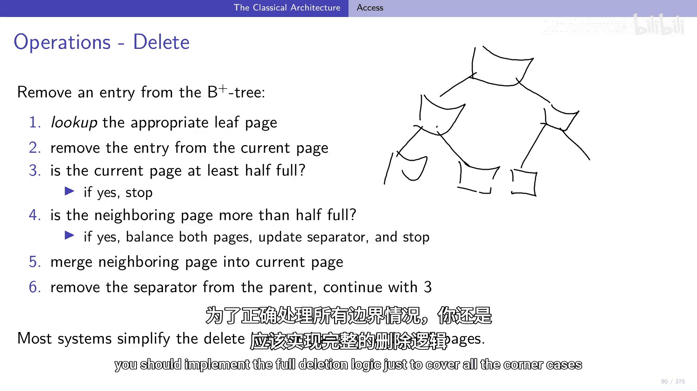

Okay， so now we have seen insert deletion and lookup。

 Now there are some other operations that we need C obvious one is a range scan。

 So because remember we wanted to use an index post for point lookup and for range queries and therefore we must support range scans。

And range can is pretty simple， basically what we do is we search do a regular lookup so point query for the start conditions we go down so this is my tree。

 I go down my tree until I find the leaf node where my start condition is。Could it could be。

 of course， at start doesn't exist。 So then it takes the next largest value。 So for example， here。

 So this is my start， let's say。And then I continue reading everything on this page because everything on the page here to the right is larger than the start and when I hit the end of the page。

 then I follow the next point I remember that B plus trees have typically next point that we can next entry and you know everything is also larger than the start and so on else we do this until at some point we hit a value that is larger than a top condition。

😊，Then I'll stop， of course， because I know everything further to the right also larger than my stop。

And this is pretty efficient because mean we'd go one traverse and then we go from。

 from leaf node to leaf node， and this is particular efficient if the leaf node that we point here agree our numbers that it causes a 1。

 a2，83。So if 1，8283 are next to each other on disk here we a con disk then this here is brutally efficient because me if we go to one position then we just read linear from disk this is as fast as we can be mean。

 of course if you en cache the memory then it's when it's always pretty fast also but but even on disk case。

 this range can are very fast once you have started。😊，By the way， if you have such a B tree。

 so a B tree where node are physically next to you as on disk then because a cluster blue cluster and a clustering is very good for performance of course。

 if you have updates in between your clustering by degenerate over time because you write them nicely at one point and risk everything is good。

 then somebody insert something in the middle So then of course you can no longer have everything consecutive on disk。

 but conceptualually so this works pretty well。😊，Now what do we do if you have more than one attribute Yeah so so far we just said we have one value or examples always just use simple integers。

 but in SQL you can generate indexes not on on one attribute on many so the easiest way to achieve this of course is to say create table。

And then you blala attributes， and then we say primary key。Primary key。A comma B。

 So this is the easiest way to construct in multi attributes index。

 so now we must check if the combination of A and B is unique， so we index both attributes。

And so how do we do this， Yeah， so the for the index， it doesn't really matter。

 the index treats a B as one compound value。 so mean， of course。

 it's a bit larger than a single number， but for the index， it doesn't really matter。

 So we store in post as values。And then we compare them lexiographically now what does this mean。

 So so if if two pairs here and I want to compare them， then we say the first pair， A 1。

 A2 is less than second pair B1， B2 if and only if A is less than B Okay。

 obvious thing all A is equal to and sorry A1 is less than B1 or a1 is equal to B1 and a2 is less than B2。

So this is called laxographic ordering。 this is just like a telephone book。

 so if you think of telephone， usually they are sorted primarily by last name。

 but if people have the same last name， they are sorted by first name so this is just the same。 Yes。

 we sort them on the first attribute and is the first attribute it the same we sort on the same。😊。

Otherwise， so combat peace。😊，But have more or less like atomic key of key which just a single value。

 So if you do a point query， if we just search for one value， exact value。

Then the difference between a compound key and atomic key is pretty trivial but the interesting thing is if you have a compound key and you bind only a prefix。

 which means in our case here we might search for all values where a1 is5 and so this is so we bind only one part my total key is a1 a2。

😊，This is my total key。 But now as I only say something about a1。 it say a1 is is 5。

And this is then internally transformed into a range query because this says okay this means that a 1 a2 is between 5 and minus infinitives this means basically the smallest possible value of the domain depends on which data type a2 has but this is the smallest possible value or let's call this here would don't want call it in let's say what the mean mean value and this here is maximum maximum value so we say so this gives me implicitly range query。

😊，And then we， of course the execute this as a range query。😊，Okay， so this works nice。

 Now trick question。 What happens if the user says a2 equals with 5。So if that happens。

 then we have tough luck。Then we cannot use an index。

 So you have to remember if you have an index in a compound attribute。

 you can search for a prefiix of attributes， but not for suffix or in any other combination。Yeah， so。

Just to keep a telephone book example， if you have a telephone book and you know there's the first name as the last name of somebody it's easy to find。

 If you just only know the last names also pretty easy to find， of course。

 you get more candidatess because they get everybody who's the same last name， but this also works。

 But if you have only the first name， then you have no chance。

 because then you would have to look at every entry in the telephone book which of course。

 you don't want to do。And so。In an index you can search only on the pre so if my index attributes。

 for example， are ABCDs and I can search for ABCD， of course I can only search for ABC works。

 I can search for AB works， I can search for A's this also works。

 but if I search for anything else like only for C or for BCC or so this doesn't work I cannot search for this。

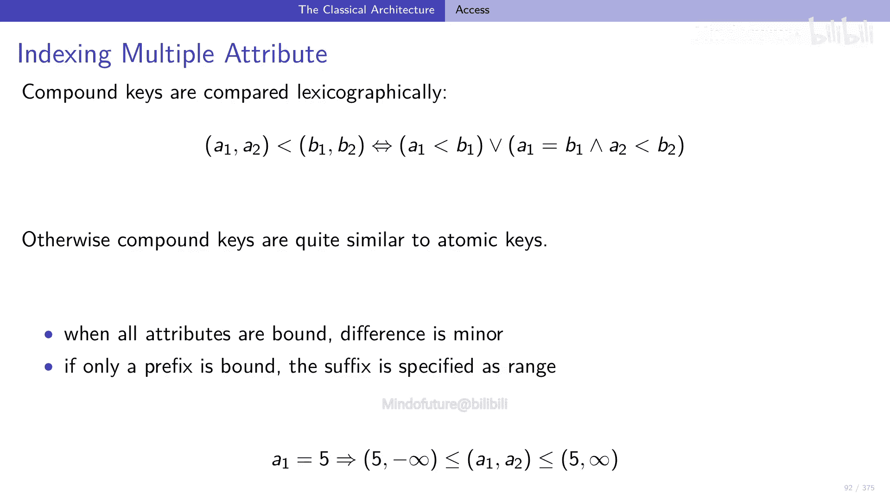

Okay， another tricky problem is。😊，This doesn't occur with proper keys， but this occurs with。

Explicit inex。 so if somebody says create index。As you say creates index。😔，Now。

 the interesting question is， what do we do if my index values are not unique？😊，Now。

 so mean if I doing create index， I can say I want to index for example， all students by let's say。

 so create index。I can use a proctor syntax Let's call this create index student name。 by the way。

 this name has absolutely no meaning， you only use it to remove the index later。

 And so your name you give it is as well doest matter。 So on students。nameame。Okay。

 so now we create an index on our students， I want to index the students by name and of course I can do this。

😊，But so what do I do if I my multiple students with the same name。

 which is actually quite likely Yeah， so for example。

 my last name is not particularly unique So there are multiple people with a name so therefore I will have duplicates or can have duplicates。

In I mean， with name， you will won't have two main duplicates。

 but let's assume some not so smart user decides to create an index not on the name。

 but on something that is totally non selected， for example， on。

On let's say country where they're born。Country， of course， we have many different values。

 here we have people from all over world， but nevertheless。

Many of our students come from Germany which means that if if you index students by a country。

Then pan that were born and then a large fraction of your templates will have the same value。

 potentially thousands or even millions of ages will have the same value。This of course， is bad。😊，No。

Because so this means that we can no longer easily identify a single tappper just because of value Now as particular。

 I mean， if as long as you only insert and look up you might not notice is that much。

 but what what if somebody does a delete or on an update now so somebody says I want to delete a certain tap as say I want to see delete delete So somebody says delete。

😊，To read from students。So price next of TV from。😔，Students。We are。😔，Student at the。Es1 to3。 Okay。

 so if you do this。First， you ask US index on student ID please find minutes student point three then you find it so you use the first index。

 you use index。On student， so this this gives you the table ID。

Now I can physically delete the template， but of course。

 I must also remove it from our other inex where as the template as part of yeah。😊。

And so how how do we do this， So we now we can of course。

 retrieve the country so we can retrieve a country So fetch。😊，Fch country。And now。

 but what now so because if you have just have the country and if we try to locate the table within the relations。

 this doesn't help us because there can be thousands or millions of presume of course not millions。

 but in general， there can be millions of entries with the same value。😊，And therefore。

 searching for this value is not good with a regular scan is not a good idea。 so instead。

 what we do is to fix this problem is if we make sure we never have a nonun value。

 So all values that we store on the index have to be unique。 So this primary cases happens naturally。

 of course， because we know it's a unique。 But what if you don't an inex non unique value。😊。

So then we use a trick because remember， so what we said， you can search for every prefi of a value。

 So basically what we do， then if we index the key as provided by the user。😊。

We can be multiple attributes， of course， but we enjoy a key and we append the T ID。😊。

So the tableid D box as a tiewriter as we meet if the key is identical。

 the table ID D nevertheless will be different and therefore we can distinguish these cases and so we can distinguish entries with the same value by T ID okay。

😊，And with this， we can now locate an uper element again a loggarithmic time so if you'd want to delete a certain element。

 the first size finds element takes the table ID and then we takes the key N ID we know this is unique we this an e logarithmic time。

😊，downownside of course， is that we have a higher space consumption because we must store the table ID。

 but this this is the price you have to pay when the table ID must be stored。😊。

But this reality this space consumptionion is not that high because in the leaf nodes we would store the table ID anyway and remember that in ob we store key comm tableid D values so we have the table IDD so the only space course that we have is in the inner nodes we must now store table ID2 which usually we would not do so with space consumptionion increases a bit but really increases minor because we have far more leaf nodes than inner nodes space consumption as minor。

😊，And therefore， this we can just afford to do this and doing this is essential to get log atmic access cost。

😊。

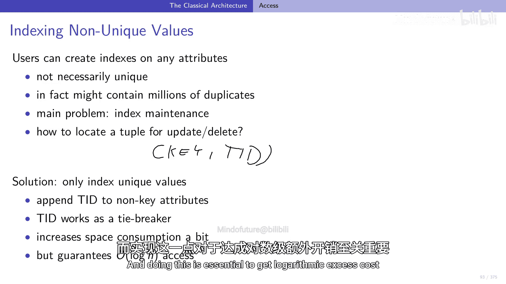

Okay。Now so。If you implement all this， you get the be that allows you in de and lookup。

 But what what do we do if you have more than one user accesses a page， yeah so。

We must somehow protect our sense against concurrent threats， which run otherur simultaneously。

Now in the buffer method that they have used so far， we always locked a single page。

 but this is clearly not enough and so just locking one page and working one page is necessary。

 of course， but not sufficient。😊，Now so to illustrate this so if you have a leaf node and I find I move somewhere here。

 then a lock is the leaf node， this is okay because at this moment in time I have to leave and then I can read it as long as I want if somebody else wants to update the leaf while I hold the locks then the other one has to wait until I'm done then I'm finished yeah。

😊，Okay， for live nodes is good enough， but for inner nodes。

 that's not good enough because what can happen is。😊，So。I have an I go here。 I have an in an note I。

A lock ortch latch is a database slang for this if it latching if we mean short term locking is like a muex Mu is a classic le so we lettch the the inner node and then after we have node we find out okay what is a child node that I want to go to for example I want to here I want to go to this then I would at least in an E limitation I would release the lock on the inner node then I would go down here well go to z node then it try to punch value。

This is not safe because in the meantime between my un here and the lock here。

 So there are some time spent between this small period of time， but this time。

 and if I'm really unlucky。Somebody else takes overtakes me in the meantime and also locks the leaf node which means I now wait and then for example。

 this splits the leaf node into2 and then my values I am searching for ends up being that new leaf node。

😊，But when I finally manage to log the page， I only find the old entries。

So I miss my video because Id go to the wrong page locking a single page is not good or good enough。

 So as a traditional solution to this problem is called lock coupling。😊。

So which means whenever you access a page， you access both the page and its parent page so which means when we start。

 so if this is my tree。😊，Yeah。So I start and I locks the route， of course I have locks the root。

 and then I find out， for example I have to go to the left。

 then I also locks the left node and I still hold the lock on the root。

As which means that nobody else in the meantime can mess up the meaning of my page so I hold both logs。

Okay， then I have the child I have the child page， then I can release my parent page。

 Now I find out what is my new child that I'm interested in， for example， is the right child here。

 then I go here acquire lock for more short moment of time I hold both locks then I can release my parent and so on。

 So this is called lock coupling Also there's a children's toy that you might no potentially So this is I believe the brand name for this is called a Plinky or something like this。

 So this is basically metal coil that can walk down the stairs there is a fun toy to play with by the way there also other windows make advertisement for them but this looks like this you have your coil here and then the coil goes down here and then it puts it ends up and then moves it away from the。

From the。Parent stare what to say and then folds down on the next page， then again， pulls itself up。

 takes away from here and then moves it down one step further。

 And this is exactly like lock coupling works。 Last we for a short permit in time。

 we are over we hold two locks， but then we always flip down。

To the next level So then we we no longer。We no longer have to hold all the locks。

 we just holds two locks for a short period of time， and then we continue。

So the nice thing about lock coupling is that not only preventsed problems with concurrent access。

 but it also has no deadlocks。 so classical locking obviously has a certain risk that if multiple people lock the same page as the same things in the wrong order。

 then we get a deadlock here， this cannot happen。 And because you always lock from root down to the leaf。

 So there's an order in my locking， it therefore no dead log is possible。 As it is very nice。

And so block coupling solves our correctionance problems。

 Now already we want you is it solves our correct problems。

 but it does not necessarily solve a performance problem， but we'll come back to that in a moment。

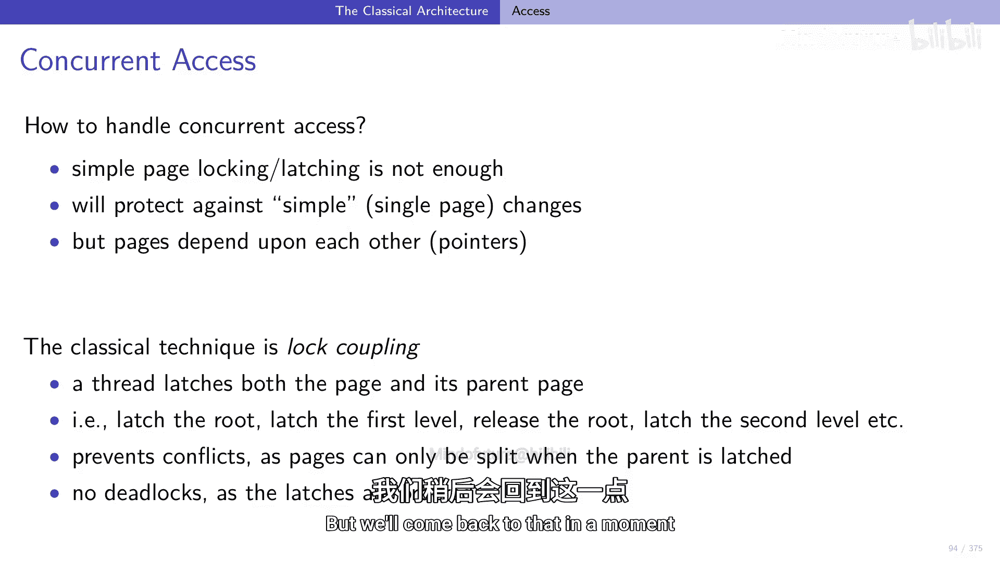

Okay， so。First， this this lookups everything is easy because I just go down from the roots down to the leaf。

 But what about inserts Now the problem is if I'm insert my split if my page is full propagates up so you know so start here by going down。

 everything is good。 So I look everything at one order。 But now if my page is not full。

 everything is okay you can just insert now but if my page is full then I want to split this into two and then I insert a new separator in my appearance So suddenly and of course this can happen again if I'm unlucky So it means that now suddenly I go from leaf down to the root。

清。Sorry， yeah， leave up to the root。😊，And so this is a problem because even so if you do traditional loabling。

 we we might have have locked our parent because at least for one short period in time。

 we had to so remember when we went down here。😊，Let's clear it back arrows。 So when we went down。

 we the。 we the first level， we released the roads。Now we lock the leaf and you know。

 you see this short period of time， we hold both in a node and the leaf node。

 Now what you can do in this moment is we check if we have enough space。If yes。

 we can release inner node because we know that we we don't have to split。

 So in this then we can release in a node。 if we don't have enough space。

 then we hold the lock on the inner node if we don't release it。

And then if my if my inner node has to be splits is where I can update my sorry if my lymph node has to be split。

 then I can update my inner node because I still hold a lock to it So that's okay。

 we can we can do this。 Yeah， but what happens if my inner node is full too。😊，Yeah。

 so then I would have to go one step further So this， of course。

 we cannot do because if you start doing log coupling in the wrong directions， then we catalogs。

Now the multiple ways to do this one way to solve this problem is so called safe inner pages。

 which means basically when we go down， we check if my inner page is fully。😊，And if yes， we split it。

 even though in this moment， we don't need this order the space。 Yeah。

 so we see my interface for it and then I split it。And because I did the same with my parent page。

 of course， this means I never have to propagate further on one level。

 and I already hold the level one level。 So when we go down， we go to the route。

If my route is page as full， thenvy split the route page， created new route otherwise。

I go to this page， a check if the page is full。 If yes。

 in this moment in time I still hold lock to my parent， which means I can spit myself safe。

 updates the parent and I'm done。 otherwise I will release lock to my parent。 I go down to the leaf。

😊，And again， it's the same。 that's where we， we check inner pages in the moment they are fooled。

 even though。We don't need it， but not strictly need it。

 but this guarantees are that split never propagates higher up than one level and this is the safest low coupling。

😊，Now， downside of course， is we waste one element on the inner page because we could have waited one insert longer so we do it one insert too early。

 Well that's okay because I mean if I can fit 1000 elements on the inner page if I do this one step too early means this is not a critical issue so wasting one premier of my space it's okay a very small overhead and logic is pretty simple so can don't have all this nasty complicated going up logic this is good。

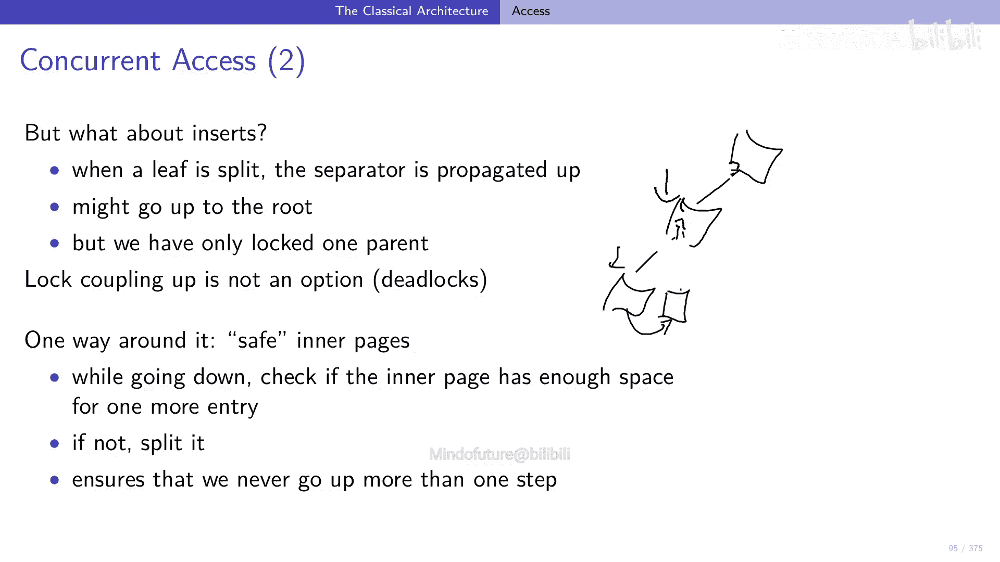

And now。The the。Main problem with save pages mean why why don't we always use save pages。

 main problem with save pages are strings。Because if you have string values。

 it's not so easy to decide if your page is full。 So how do I know if you have enough space for for one more element so for inter values now it's not a problem because I know I can just and need 4 bytes or 8 bytes it depends on my data type。

 I know when I can pieces in， but if I have string columns， I don't know this okay。😊，And。

This makes safe pages。Unsuited for variable size records and so I cannot really decide should use if I should display split this page page or not。

So what we can do as alternative is what's shown here。 This is a so called restore strategy。

 So basically what we do is we first try using simple log coupling so we just go down and then then So if if we do not have to split in and nodes。

 everything is okay now we can split the believe node but we we don't split in a node So otherwise if we do have to split in a page then we release all the lettersges and now start again but but during the second walk down we keep all the letterss up to the root that means that we keep we don't release them we keep them。

😊，And now we know that all operations can be executed safely because I have all the letterss up to the route。

😊，Good thing is this pretty easy to implement， so simple to implement。😊，Downtown。

 of course this if this happens mean yeah， keep all these latches up to the route。

 this is expensive because it really looks Ma whole person。 it is a pretty invasive operation。

 On the other hand， this happens rarely So how do you know this mean if you can fit about 1000 elements on a page this means we split a page in inner page roughly every 1000 inserts that a little bit how you implemented it perhaps 500 but roughly at 1000 and we also split we split inner page after we have 1000 insert in a leaf page So it meets every 1 million elements we have to do this this is really rare So this restart here happens extremely rarely。

😊，And therefore we can afford to do this， so should be really rare and then we can now we can handle both fixed size and verized records fine so this covers this case。

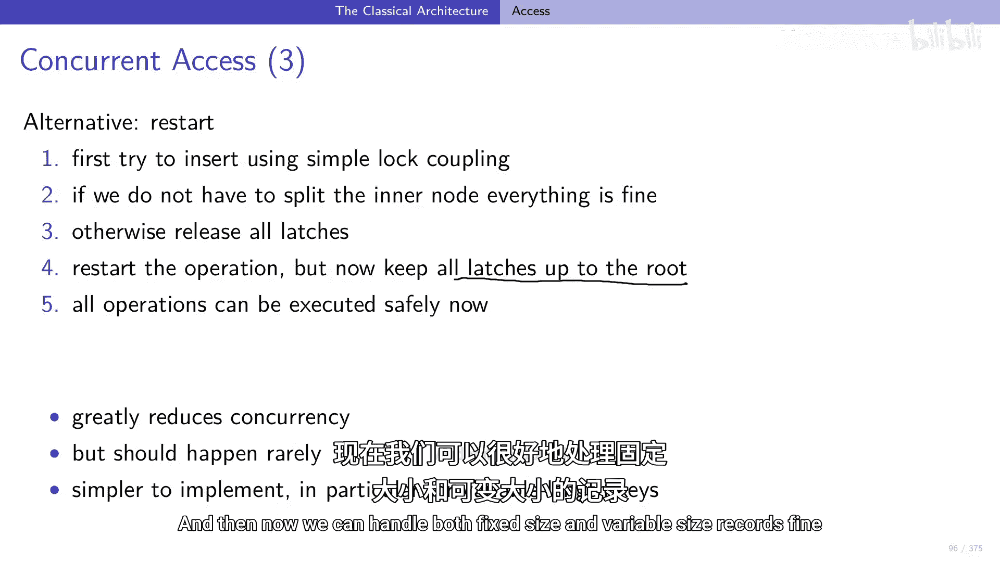

Now there are some more strategies mean mean even with log coupling if you do this and log coupling works。

 the problem with log coupling is log coupling is more expensive than you think at the first glance。

 I mean because what does this mean， let's do this this small picture here。😊。

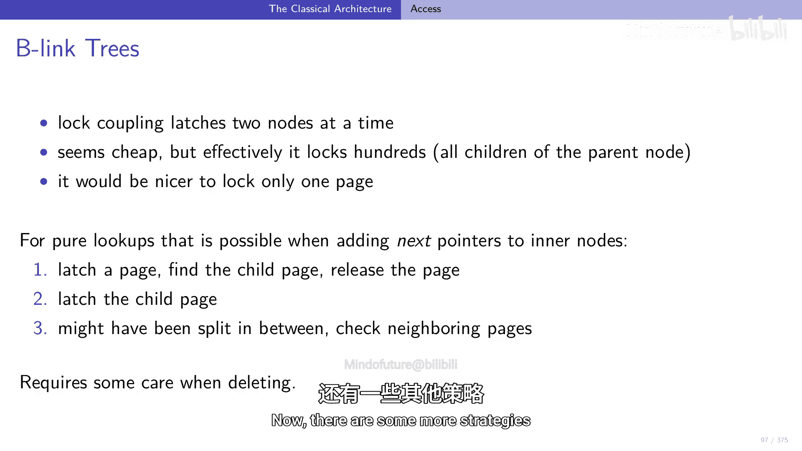

So if you look at this。We know every node here contains， for example。

 1000 elements to keep it simple。😊，That admit that if I lock this node here。

 then I have locked 1000 elements okay。If I have locked that node。

 then I have locked myself and implicitly because nobody can come by me。

 I' have implicitly looked at least container concurrent traverses。😊，My descendence too。

 which means that I have locked implicitly 1 million elements because I have 1000 shared notes。

 each was 1000 entries， which means by locking this in a note at least for a short period of time。

1 million elements。😊，Yeah so and this is pretty expensive。 so mean， you have to I mean in worst case。

 this page that I want to access to the sleep page here that' causes a1。 In first case。

 the1 page is not in memory so I have to load it from disk which means I let's causes I1。

 So I accesses I want。 I have not locked this one yet I try to lock this。

 So I have locked the inner page I want。😊，So I want to access leaf page L1 and wait for this leaf page to come and during this time nobody else can access。

 for example， L2 because they cannot pass by me so1 so nobody can access L2 and so I'm blocking implicitly 1000 pages。

😊，Meaning 1 million elements， just because I wait from my page I want and have looked to inner page。

 suppose this is not so I mean it it's correct， but it's not so super great from a performance perspective。

That so。Performance could be better and therefore people said hey。

 wouldn't it be great if we don't do this， so wouldn't it be great if you only link at most one node also one node we can we can log but we never lock more than one node so this means we lock a lock a1 then I figure out okay I want to go to a1 so I know the node then I release my lock here and then acquire that lock here instead。

😊，Which means I still have to wait until I1 comes from risks。 That's true。 but in the meantime。

 everybody else can go to I1 if they want to。 That's why I don't。

Prevent this get much better concurrency。So so this is the idea of B link trees。

 so so that's the whole idea。 So this is the motivation of B link trees。 Yeah。

 so this is what do they want。😊，The problem is if you do this。嗯。

What happens if somebody splits a page behind myself in the meantime so I want to get to I1 but I cannot and for because I'm scheduled away I don't get to lock whatever and could be that the moment I came I1 my data element so let's say is I'm searching for this element Xia。

😊，Until the appointed in times that I have finally managed to get to a1。

 X has moved somewhere where X can happen because I'm going split the page。

 Yeah so as it means I jump here and my X is gone。😊，And then the idea of buildinging trees is to say。

 okay， I do this， I willingly accept that my element might be gone。😊。

But because I always have this next pointer here。😊。

So if I'm searching for a value and I see the values that I'm searching for as larger than the largest values that is on my current page。

 I just go to the next page so I proactively go to the next page even though I would not go naturally I go to the next page and then if X was moved there I find it course could be that it was split again so Ive go to the next page again so I follow the point as here until I either find x or I find elements values that are larger than x and then I know for sure that X cannot exist then I can stop So this is the so called B link idea。

😊。

Now so we we we follow the the we go to the neighbouring pages and to go there。

 by the way you have to do this not only in the leaf pages。

 but also also on the inner nodes because inner nodes， the same can happen so I go to an inner node。

Until I arrives there somebody else splits a page， therefore I have to introduce a next pointers on inner nodes too。

 so if somebody goes yes， doesn't find its value， can go to the next pointer and then answer on。😊。

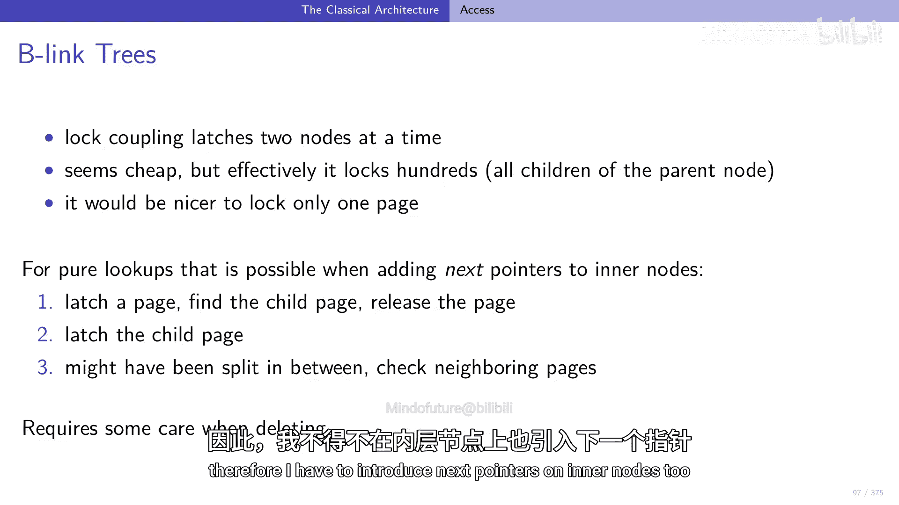

So this is already pretty complicated。😊，But this is can be implemented reasonably well as long as we have only look up an insert Yeah。

 well it's a total nightmare in the speeding tree is deletion。😊。

Because with deletion suddenly values cannot only move to the right。

 but in least in Brunswicke can also move to the left also because if I if I merge them。

 then they they can be be with neighboring node So meet my values that I'm looking for goes to the left and not only to the right and therefore following the next point is not good enough Now as there are solutions for this basically boils down to you can only merge a tree or delete a node if you are sure that is this point in time。

 nobody is currently。😊，Going down to this。 yeah， there's gonna some special programming mechanisms like an epoch mechanism or something like this。

YeahPre difficult to implement， and。Yeah， but as I said。

 many people just don't bother with this deletion problem here so they don't implement this correctly。

 and of course， it's easy， but if you want to do proper diletions in billing trees。

 this is possible but quite challenging okay。

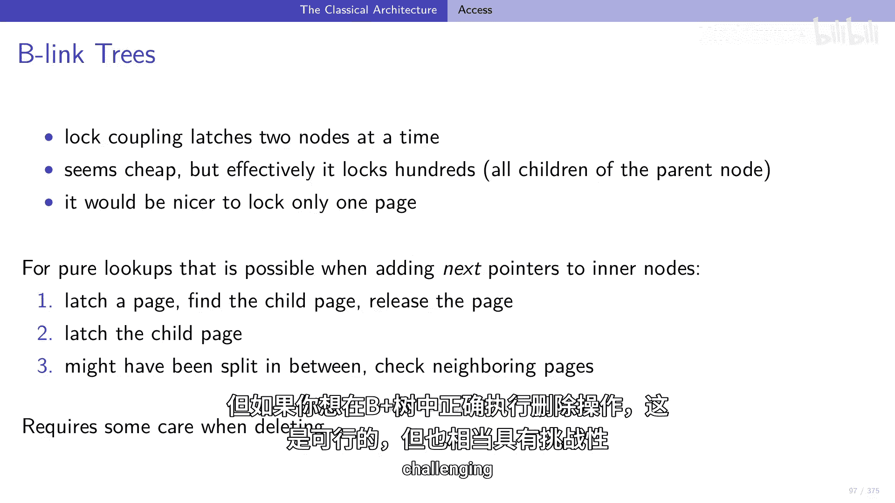

Now， just for completeness， I want to cover one technique more。

That is strictly speaking not on the slide， but nevertheless， is pretty interesting。

The problem we have here with synchronization is with log coupling is basically a problem that we have an all kinds of hierarchical data structures。

 as the problem is that the root here is a bottle and neck。So or in general。

 the higher up nodes will be visited much more frequently than the lower nodes。

 And so it means with many， many blockss here so mag dots here， many dos here。

 a few bit less here and then even less here。 And is this。

It will be extremely hard because everybody goes through the road。😊。

This is of course badfoot concurrency。Interestingly。

 it's even bad if you have no cognitive problem at all。

So just assume everybody is reading so reading is not a problem so you can everybody can get a readlock on everything because I mean readers don't conflict with themselves so you can have one million people reading the same notes no problem conceptually but reality this is a problem so if you acquire many readlocks here。

Yeah， so if you do， if you get a， if you do glass versuss log reading， log reading， log reading。

 and so on many of these， this will be a。Problem in practice。

 even though semantically it iss not a problem， and practice is a problem， why。Yeah。

 because this log must be implemented somehow and the classical way to implement this is to use a read writer log。

 which in first approximation ready is a bit more complicated but in first approximation and read writer log log like this。

😊，A revital lock。 it means you have two cut of feet。Have here， you have an exclusive bit here。

Exclusive bit。 And then you have a counter that tells you how many readers we have。read。

 you need probably at least one bit more。 But so， but this is where how a rare simple read writer log could work work like。

Yeah so you could say， okay when you try to get lock something in exclusive mode。

 you check if this bit here is clear if yes use so lot of is clear you check if everything is clear so if there's no reader and not an exclusive bit and if yes。

 you set the exclusive bit to one and of course you do this using atomics or some other mechanism that is spreadsafe as you set us to one and of course if you cannot set this in2 bit and this changes and if if you read this the end you increase the read counter so this you increase the reader here do basically plus plus on the reader and then nobody will regret an exclusive loop as long as there are readers。

So this is carefully implemented readwriter log and this is of course a medically correct。

 but in practice it has a very poor performance for this because this lock that we have here at the root of this node is changed all the time as is always changing and then many threats try to change the same memory location this is slow because practically leverage the cache lines that holds this readwriter log will bounce between the different course because everybody will try to update this counter all the time this is very slow。

😊，And so this is a performance problem even without contention。

So therefore theres an alternative approach that allows you that solve both this contention problem in the lock and the concur problem in concerning other readers give as lock coupling and this is something thing that is called optimistic lock coupling。

And so and how does this work？Optimistic。😔，Lookup link。Okay。

 and basically the key idea is that we assume that if a system is fast， conflicts are unlikely。

 of course conflicts can happen Yeah but most of the time we will have no conflict。

 therefore we optimize for the claims that we have no conflict and we do it as follows so we don't if wes replace my read lock with an optimistic log。

😊，And we still have an exclusive bit。But we don't have a read counter。Instead， what we have here。

His aversion。So now and how can we how do we do this if you do exclusive access。

 So if you do write logs， you do traditional loging。

 Yeah so you you would get a lock here and a log here。

 And so as you do everything traditionally but most of the time we don't write even when you insert you have to less most of the time we don't write because the inner notes。

 So for example， it' this one here， then that one here。 and then we probably will only read。

 So then say we read this we read this then we write this most of the time if the notes foolish is not true。

 of course， but again， we optimize for the read case and when with a beat insert。😊。

999 ins will only write a leaf。 One will ought to write in a notes。

 So let's first assume we only write a leaf node。 So if we read in node， we read in node。

 we try to write in a node。If this is not possible， so if you realize oh no F to splititzs。

 then we again we start again from the root， and then we say read the root node。

 but now at the second level I acquire a right lock。😊，Now。

 because I saw that I had to split the leaf node。 Now， of course， this is ra。

 it could be that the second time with my restart， somebody else has already splits loop。

 So I no longer have to split the leaf， but this is okay I mean you have found rightlock too much but it's okay And so now at this point in time I I can split the leaf node because I have a right lock in a note Now could be that I would have to split in an note。

 but then again I give up start again and do now restart and now acquire right locks from here all right logs but this。

 of course becomes more and more rare so that you have to do this extremely unlikely So therefore we now ignore the right I only look at the reader。

😊，So how does the reader operate So if you have a read on the leaf node。

 then in first imagine we do nothing so we just read。😊，As I go to the node here and I read。Yeah。

 but then you ask yourself， okay， what what about concur rights。

 I somebody can write this while I'm reading Yeah， for this。

 we do two things first before so this is what what we call verify here basically So here this lock this we look at let's gives system name that causes this a0 let log0。

 So first we when we try to read a leaf node。😊，Then。V say。😔，We make a local copy。

So let's bluele this， so let's call this your start。Then， we say。Cify 0 is。E reads。L 0。

 so we read a look。 Now， if somebody is in this moment in time modifying this page。

 then we we have to So if see1 do exclusives， this means we have to somebody else this modifying this page in this moment while I am coming。

 then we go restart This is unlikely because this is rude after all go to start。Then we restart。

So and then try to find to do one research on the page whatever we have to do。So。B research。😔。

And going search on the page。Okay。Now we did the binary research。

 but remembers if we don't hold a visible lock because nobody else knows that we are reading。

 so we are reading the page， but nobody knows this because we don't increase the page point So as a the reference counter this means some ads can modify the page why why we do the binary research so and we don't know this。

 therefore what we do at the end before we go to the the child note。😊，Yes。Vally if so if say。

 if not validate。Validate。See 0， go2。Go to start。So we restart。 So now how the validation work。

 So validation says。Validate。😔，See。Means。First of all， the crudelock。

It's equal to my to my certifier。 so I remember I stored the lock in the beginning。

 so I check if the lock is the same after I'm done。And， and。Not。See not exclusive。

 It's not in exclusive。 And so basically， a validated log it if currently not held in exclusive mode and it was the same as it was as got it before。

 So now perhaps I not sure if I explain this before。 So when I when I do a write。

 let's say I do a write here。ButWhen it begins the ride， I sets the exclusive bit。

 And as I said here so。LLW dot exclusive is one。Then I do my stuffia。 Then when I'm done， then I say。

The version。I's increased。And then I release it a exclusive bit。As for these sound update words。

 which means that a reader can check if somebody has modified the page while he was reading and by Jacks looking at a version。

So after his read， he checked if somebody changed the page in the meantime， if not。

 then the read was safe so I can I didn dialogue， I just validate at the end if my read was okay。😊。

And if yes， I can， if not， I try again because means very unlikely that somebody modifies it while I'm reading。

 And so if it happens I just restart。 and I mean， you could even rate limits like you try a few times。

 and if it doesn't work if we get a reloc or something like this。

 But in practice you don't need this you can just restart。

 So this means you have read the root node without doing anything。 Now let's go to this one Yeah a1。

😊，Because I figured out that I need a one。 Yeah， So then let's say here。

It takes the the credential here for the cifier for the next log。Then I read once。

 so I get to the next log just like a lock coupling， only things I don't write is us read。

 So now at this point in time after I read this。If。I must validate， so if not。

 I must validate both the parent and the child。Or not validate。Validate C1， then go to restart。

Go to start。 So and after this point， I cant forget a1。 So this works just like log coupling。

 I look at the root。 I all reads are inherently unsafe because let's modified。 therefore。

 before I do anything based upon the value that I get from there。

 I must validate so after I have validate it， I can go to this node here。

 after I have accessed this node。 Ive accessed a1， I must validate if my reference to this page was still okay。

 And if yes， afterwards， I can forget this。 So I have an optimistic log here。

 I have no optimistic log here。 And after I got the second optimistic log。

 I can't forget the first optimistic log just like in log coupling。

 so you log couple down optimistically。😊，Until at some point， you come to a leaf now。

 if you only read， you can probably stop here if you want to insert at some point。

 you get a real real lock on the leaf and technically speaking even if you do a query so arrange query on the leaf level probably you want to get a read by log now because you this page for some time because you are run a query can take a while then you don't want to be optimistic because let's be honest the longer query runs more likely is that optimistic assumptions for somebody else will modify the page in the meantime therefore if you do something for a serious amount of time。

 then get a real lock。 but this is okay because if you do something for a serious amount of time then the time for acquiring the lock doesn't matter maybe we can get the lock and also we will do this only on the leaf levels and we don't have high contention on the leaf levels。

 the inner nodes where we do have high contention because everybody goes for example to root。

 you don't want to acquire a log unless。Have to rather so we don't acquire log。

And so we only log optimistically with inner node on the leaf nodes， we mean mean for point queries。

 we could choose this optimistic too for other queers。

 we do a real log or even exclusive log if you want to insert Okay， and if you do this approach。

 then you don't have this problem with neither is a problem with B linked nor with。😊。

Loock coupling with traditional lock coupling because somebody else can bypass me but I don't hold relock on the inner node。

 So somebody else can bypass me。 I only have to check afterwards if inner node is still valid Okay now this is a pretty neat technique to get high high concurrency on a B3 data structure。

 But this is a newer techniques， therefore it's not on the slide So you will not find it traditional books and database systems。

 but if you search for optimistic lock coupling， for example， you find a paper where viize。

And one of my former some of my former Ph students know he's a professor in Yenna。

 and he described how to do this and this gives very good performance if you do locking in tree structures like Black be trees。

😊。

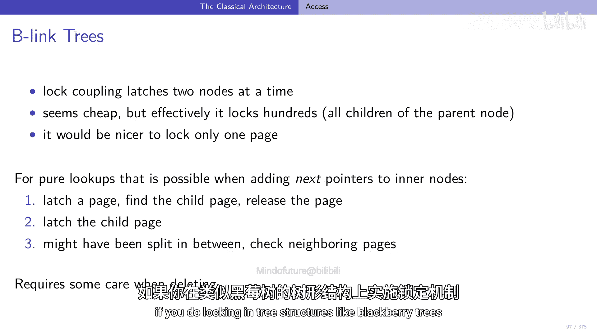

Okay， so we have seen now。In certain。Dillusionion lookup range queries and con for traditional batterieseries。

 What we have not seen yet are bike operations。 So now when are bike operations assume you have your database and then you want to import a large amount of data。

 For example， you want to do the initial database import。 And so far， you have audio files。

 you have audio data and files。 a few million records。 now you want to loaded to the database。

Now what you could do of course is you could just just do 1 billion inserts so it would besymmetrictically correct so you do insert by tap but in practice is slow。

😊，Yeah so 1 million inserts is probably slow I mean if you think about a poor B3 mean if your data comes in a funny order you do random all over the place。

 we touch the same data multiple per times so this is all very slow and so therefore we don't want to do this and by the way this is true for virtually oil systems inserting millions of tuids are slow so therefore yes millions of inserts。

Of ins slow。So what you do instead is。You use something that， for example， postcards called copy。

Unfortunately， this is not standardized。 Each database of a system does it differently。 O。

 for example， it doesn't have a copy statement， I think perhaps it does。

 but I think it doesn't but they have a dedicated program instead So a bike loader by postcast from SQL bike loader。

😊，Or some other mechanism， yeah， so each system does a differently copy as postgres。😊。

And so what the copy statement does basically is a tellsta system， here's a five input data。

 please load the whole file and if this is a million entries that's okay Yeah and the same with by loading tools we give them files as input and say please load load load all the records。

😊，And this is typically vastly more efficient than thousands or millions of inserts， much。

 much much more efficient。 here you can load large amounts of data quickly。

So but now how does this work internally Yeah， so now how can we bring data into our quickly。

 so we know that it's coming because the user does a copy or backlog statement so we know that it's coming。

 but how do we do this。😊，Okay， so the first thing we could do is we could sort the data before we insert it。

 unless if we sort the data by the index key。😊，And this already has good。

 good properties because now we know that we will show the data。

We will always everything write everything here， then we write everything here its on there because we are salted so my getma data in increasing order。

 so therefore I fill my page from by P from left to right。😊，Okay。

 so therefore this has locality better， much better。 I hope we have have good locality。😊，Yeah。

 but even though this is the case in practice this is not ideal。

 it means it's better than a random order， much better than a random order， but it's not not ideal。

 In fact， anyway way， it even triggers a worst case not concerning performance performance might be okay。

 it's not might need better be but concerning space here or utilization it will triggers the worst case。

 Now why is this a case。 mean just think about this we have the first leaf page。😊。

Then we write blank right right and somehow is full。 Okay， So then we split the page。😊，Now。

 I have two pages。Even in a note， of course， and have two page first see， this one is half fully。

The second page is also helpful。Yeah， and because my data is sorted， I insert。

 of course in the second page to the right， so I'm continue group until the page is full。😊。

Then this phase is full， I split it again Yeah， and I end up with you you know it two half full pages。

😊，And then I continue enteringing here。😊，And then split it again。

 it's one and so if you insert data in increasing order in a B tree。😊，Performance will be okay。

 but space utilization will be bad because all your pages will be helpful。

Now because we over split the rightmost page， therefore all your pages are half full。😊。

This is of course， a bit unfortunate。Now， there are multiple ways to take this。

 One way is to realize if you are the rightmost page and this is happening to you you are split。

 you can look at if its my left neighbor only a half full。 if yes。

 I put my left half to my left neighbor just because I know that monotrononic increasing inserts are frequent。

 also some some trick like this you can do。😊，So then you will get nicely full pages but this requires effort。

 extra coding effort and it's not so totally simple to implement。😊。

If if we know that we are bycloing， so if we don't have regular inserts， then we can do better。

 even easier so we don't have this magic recognition that I'm the rightmost one。

 you can do this always right。😊。

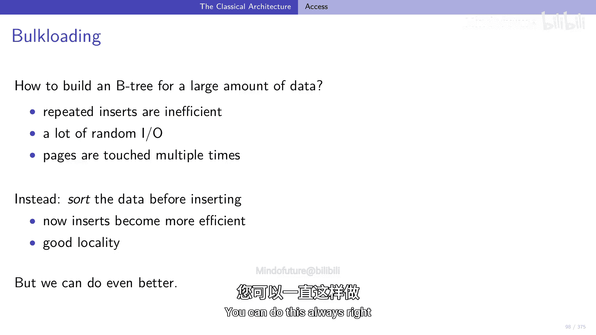

Okay so and this is how we build an initial B plus3 so it initially means my my relation is empty。

 so no there's no data inside so far and then I buyload large amount of data insert so how do I do this So first I sort the data on the on the index key。

😊，Okay。And as you， of course to get locality and we know that in the B3 we have the data installed all so we sort my data。

Then I've sped my data into leaf pages and I don't use the regular split logics。

 you which if the page was full I split it instead I just make the leaf page full completely so I have the first leaf page and I fill it up to the rim so I make it completely for you。

😊，And then when this happens my page is full， then I go to the next page。😊。

The only thing I do is if it happened， Ill remember the largest value add here and we write this so the largest。

 let's call the separators。And I've write the largest value here at1 so the largest value of this page。

Then a fade displayed completely。😊，L2 is largest value here I writes the largest value in the next a separate file。

 I fill the next leaf page completely。At3 and again。😔，Forite the largest value and one。

 yeah until the largest value of the last page LN。Okay so this of course is probably not full because its the last page now what happens is in this step I will get o data into leave pages and all live pages will be full unless except for the last page。

😊，Okay， so now this gives me the lowest level of my B3。 Now I forms the next higher level。

 What I do is I take the separators from the file and now I pull them into enough enough notes。

 so I do the same trick Yeah so let's I fill this until it's completely。😊。

And then the largest value on the first node， let's call this I1 and again I write I1 in a separate file。

And then I fill the next the next largest value is here and until I get i2。

Right I two in separate and so on so which meet a text separators here and Ipopo them into an array of inner pages。

😊，Under IK。Okay， now I do this again， when I I text these values and pull them into inner pages。😊。

Until so until everything fits on an inner page。 so basically I create one level， next level。

 next level， next level ands on5p3 So each pass here， So this is， of course the lowest level。

 then comes intermediate level so I take my separators put them into inner pages and remember's largest value and repeats this here until have only one inner page this is then a new route it of course depends on how many values you have but could be that you have only one inner page or could be there only one level of inner pages page meet one inner page or it could be two level or three levels depends on how many values you have only but we split them in there。

😊，Until everything fits into the root page and the beauty of this approach is that first we only do sequential Io because we only write data sequentially also this separate values in the temp that written sequentially everything is done sequentially and we get a perfect compact class P+3 perfect means all pages are full except for the rightmost page and it's class do because each page that is next to as logically is next to you as on disk so it means if you do a range query we do a beautiful sequential read on disk so perfect performance so this is and it fast the whole thing here fast and gives you a perfect P3 Now this is called back loading so it works very。

 very well。😊。

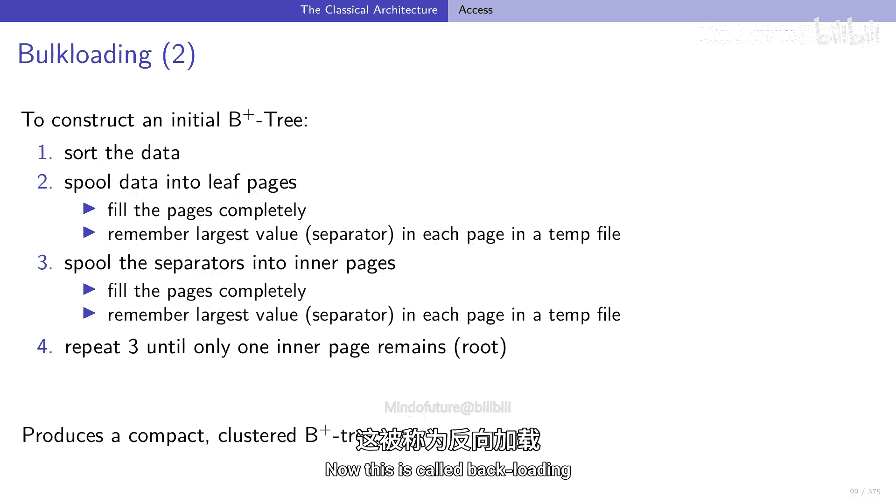

Now， this is easy if we do。And the initial B tree load。

 But what happens if you insert data into an existing B tree that's more， so we start the same。

 so we start the data and then what we do is we merge the data during an existing tree which means we read both the input the new input adds existing tree simultaneously and we merge them。

😊，So and so basically we use the same strategy as we form new pages。

 remember the separator and so on as just as we did before， the only tricky thing here is step 4。

 namely we start a new chunk once a page would contain only entry from the original tree So what do you mean with this So to illustrate this assume we have only two pages in each loop both。

Or perhaps some more pages met， I could be some more pages。

 So now a new entry comes that many multiple entries， but one is good enough。

 a new one entry that you want to merge or a few entries that we want to merge into this。

 So now we would start this as the new entries。 I could draw them like this。😊。

So if you would merge them， let's assume by the way， this is not that large， a small amount of data。

😊，If you merge them， what would happen is I start writing here。😊，I form a new page。

 new leaf page and start with the content that I had。

 then comes my new content so Ive write in merge in there。

 then I continue with the content that I had。 and of course the original page doesn't fit because so I've so been up to here but let's say I can fit it here and then I form a new page。

😊，And it takes the content from here， So the remaining part。

And now if you would implement it naively， what would happen is you would take this page and start filling it in here and yeah but then thing of course what happened is you rewrite all your list pages and because clearly you would start because everything is shifted heres the same problem you cannot form cannot fit everything on a page so everything would switch you to a new page so if you have 1 million further pages coming here you would rewrite all the 1 million entries of course you don't want to do this。

What you do instead is you try to stop this merge by accepting under full pages and so if you realize that you have a page that contains only node values that already existed because this here is old。

 this is old and this is old so everything is old its just shifted if this happens you try to stop this by accepting under full page now like here if you just take the tail this might not be good enough because then you are less than half full so let's take a bit from this page too。

😊，So then it's at least half full， then we have the remaining part fits on a page and then we stop we have one page more and then we stop So remaining 1 million entries。

 we do not have to we do not have to move because we manage to to create a new run that is identical to existing pages and we want to do this of course so one once we notice that only old pages are relevant。

We we don't do this and then of course you do the same on on the next tile level because weve got new separator from this so this has to be merged into existing separators and so on so then we merge this。

And of course this is not so easy to implement。 you see already what we have to do here this step here this step is not so easy to implement。

Good thing is we minimize Ios because we still do sequential access。

 disadvantage is we destroy clustering。 we can no longer guarantee that neighbouring pages are next to just on disk clearly because not all pages we updated but nevertheless。

 this is usually a decent compromise。 Now I should mention that some systems support the initially byload but do not support incremental byload like this。

 so they can do initially but if you do this incrementally if you load data into existing trees。

 they will just do individual inserts As they will sort the data and do individual inserts but we not do this fancy remerging here because not so easy to implement。

😊，But sort and inserting at least is already better。

 but now if you look at the documentation of Postgres， for example。

 what the Postgres says if you want to do this here。

 so if you want to back data into an existing B tree and you insert a nontrivi amount of data I mean if you insert only 10 tablets or 100 tablets it doesn't matter just to insert。

 but if you want to insert thousands or millions of entries。

 what Postgres suggests you first throw away the existing index so 20 pages here is to say。

Drop index。Drop index， then you do copy。Copy， so you insert all your data and then you do create index。

So this is what Postgre because they don't report this is of course not implementation is an alternative。

 so the alternative to do this this incremental backloading is to say forget the index。

 copy everything into the database and recreate the index because this is of course the initial backload this year it corresponds to initial backload。

AndBecause then we throw away the index， we create the index from scratch。

 which means if you read odds we have and the treats is like an initial loader okay。😊。

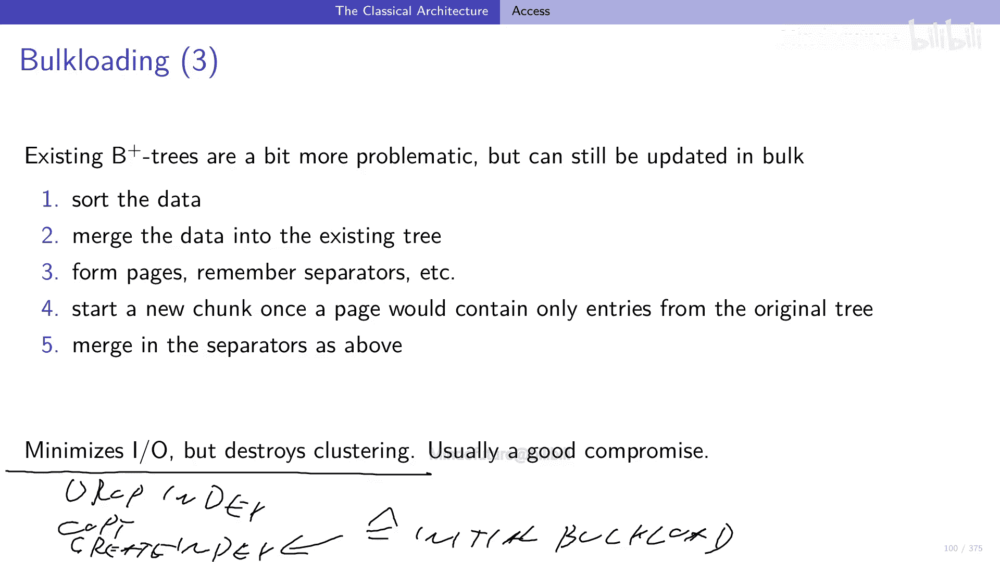

This will be faster than than this Now， if you are really fancy， I mean。

 fancy in the sense that you have a big commercial enterprise system and and you have a lot of users all over the world。

 then you might have a problem with bikeloads because bikeloads are fast So there good performance as one。

 but they are disruptive because while the bikeload is running So mean think about this what we're doing here。

 So we are building the B layer by layer。 So low layer next layer and so on So by while the bikeload is running。

 we cannot use the index so text offline。😊。

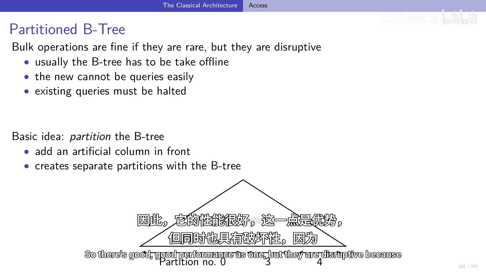

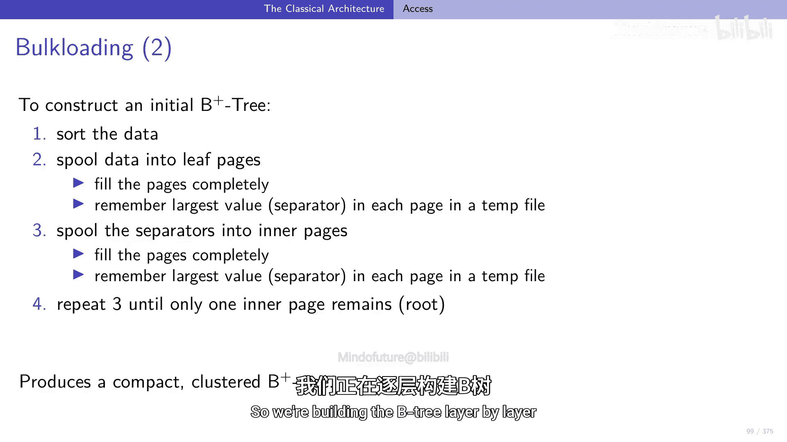

Bt the index， update the index， and then we can take it online， then we can run curves again。

 which meansqueers must be halted during me means they are not strictly halted means they can run but they cannot use the index not they have to use tablet scans they can read everything。

And some people， at least some enterprise customers say that this is unacceptable。

 taking the index offline for a significant one of time minutes or so。

 is unacceptable because M curiouss will be terribly slow during this time。😊。

So the alternative is an idea here that is called a partition B tree。

 So basically what you do is you create an artificial column in front of your key。

 So usually we have we have something like key1， key2， and so these are all my keys。😊。

And now the part Bea says in front of all this you put an artificial number， for example 0。

 This is position 0 Okay， now all your data have an additional part key in front。😊。

And we mean we didn't talk about storage of batteriesies yet。

 but mean if you have a battery tree that supports prex compressions， then this is0 is only implicit。

 it's not really stored so you know that's a zero， but it doesn't cost you space so it's more or less for free this prex yeah。

So and if so this is your initial import now if you do another import， so if you byload more data。

 then you create a new position just by adding a new key。

 so you say here the next byload here take one in front， then you have here key3。😊。

Then another one keep full。And what happens because of this artificial column key here， of course。

 is that the new values will all be larger than existing values， so it will be appended at the right。

 basically if you draw a picture here by partition by Part 0 might be the left part。

 this picture here， Partition 3 might be that part and Partition 4 as that part。😊。

And because of this construction mechanism， we know that new parts are always constructed on the right。

 Yeah， this means that we don't have this complicated merger logic because a something on the right is easy and we can do this without taking the B2 offline。

 Depend on the right is easy。 Just appear in the middle it's not so easy。 Okay。

 so we partition the B3。Within in a visual column and then then we create data。

 we create a new position if on the right。

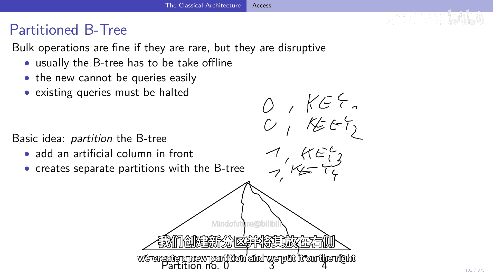

。As。Benefit is the petitions are largely independent which at least logically we canend to the right most part with the highest position the right hand side。

 So index is always online and now make no it't here So we want to get rid of those part because when you see is in the moment when we come back to the drawbacks The petition also have disadvantages and we are searching because we must look in all partitions。

 therefore we don't want to have that many partition mean one2 is okay。

 one is best two is okay but much more than two we don't want don't like to have or threes We don't want to have more than this。

And but but what we can do is we merge the partitions and we do merge them lazily so which means that we don't take the index offline a create the index as it is。

 and then we take a few triples here in the background we have background drop It takes a bit of data from here add merges it into this part we 3 became a bit smaller then we that slice merge it we that slice merge it and we can do this as a background drop without taking the B offline if we always rewrite more parts of B3 and if you wait long enough。

 then part 3 is vanished and everything is moved intoition0 we part4 but this will also vanish over time So over time we do this and in fact we can even do this only beneficial which means we can do this for example。

 only when they queries if nobody queries， then we can just add partition and if nobody cares we just leave it as but in the moment that somebody does run a query then we。

😊。

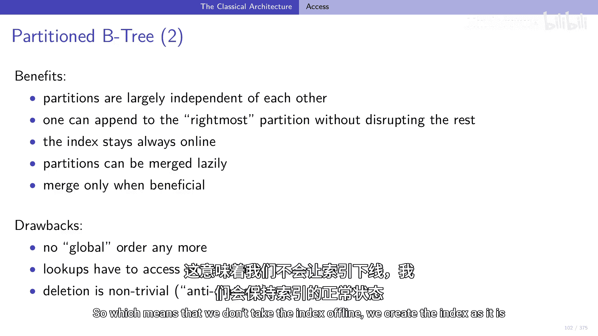

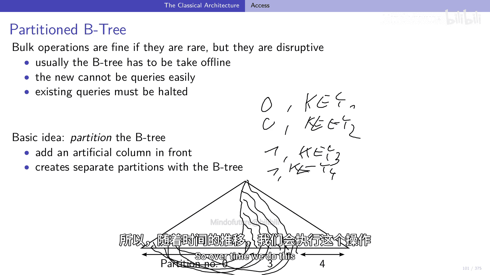

ging or these trigger background objectives emerge。Now。Mean there are also some drawbacks， of course。

 if you have my partitions， there's no global order anymore。

 which basically means we have to look in oil partitions。 So if you search for value x。

 we don't know which partition x is。 therefore， we must query oil parts。

 And this only makes sense if the number of partitions is not that high。 this is what I said。

 we at some point， we must start merging parts。 and another。

Draawbacks mean so far everything looked easy。What about deletion now because means when we say bike update。

 usually we mean inserts so copy is an insert statement。

 but we can also do have bike deleions or bank back updates and this means we must remove data。😊。

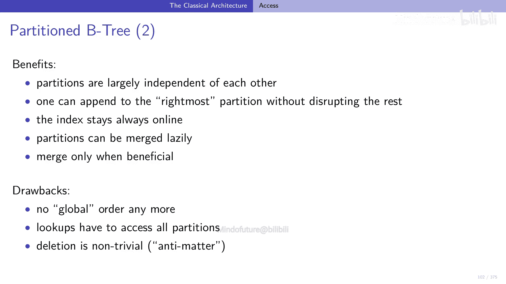

And， of course， we don't， again， we don't want to take the index offline。 So which means we must。

Stores updated or the deletion information somewhere the new part like if you do a bike delete。

 we might in partition3， say I want to delete all these records here and they are still inet 0。

 which means that inetition 3 we store something that the literature really quotes antimatter because during a query we merge so if we search for x search for x we search for x in this part and we search for x in that part and we merge these two results because it could be the part 3 contains an update for x or contains a deletion flag for x and therefore the name antimatter because if we get an x from here and if we get an x deleted from here。

 then they innihiulate each other like antimatter so then in the results there's no x。Yeah。

 so we we must merge this update information across positions。

 and this is not trivial to implement pretty tricky to implement it also cost you a bit of performance in the queries。

 Yeah， so this is the downside。

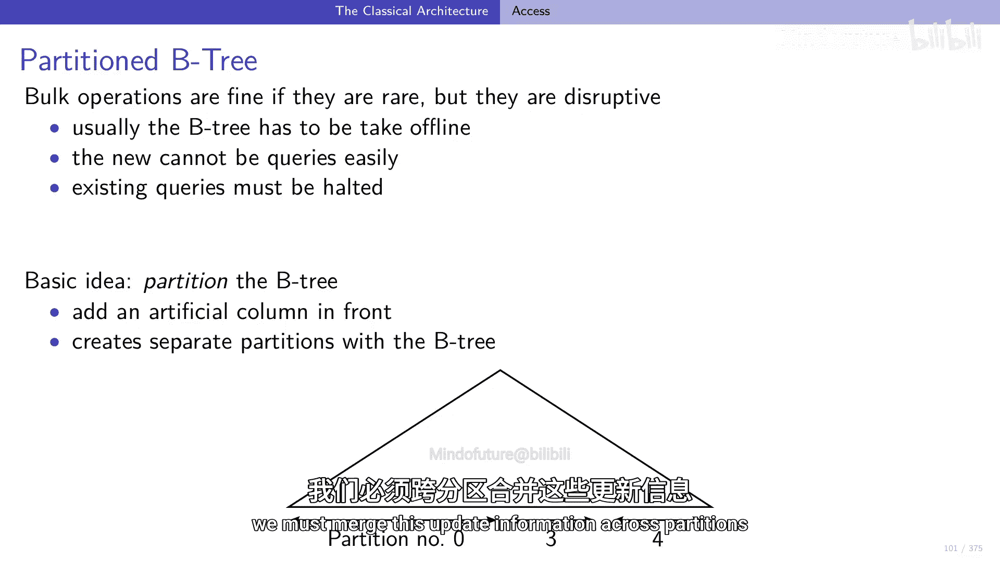

Great advantage is yet you can do bike operation of this tree here without taking it offline。

 this is a great benefit。 and I think there are I'm not 10% sure of secret server I really did implement this。

 at least Ive wrote papers about this how to do page Beaes。

 I'm not sure if it' commercial product perhaps this。

 but at least big commercial vendors have looked at this architecture to offer Bearies that don't have to be taken offline during bike operations。

😊。

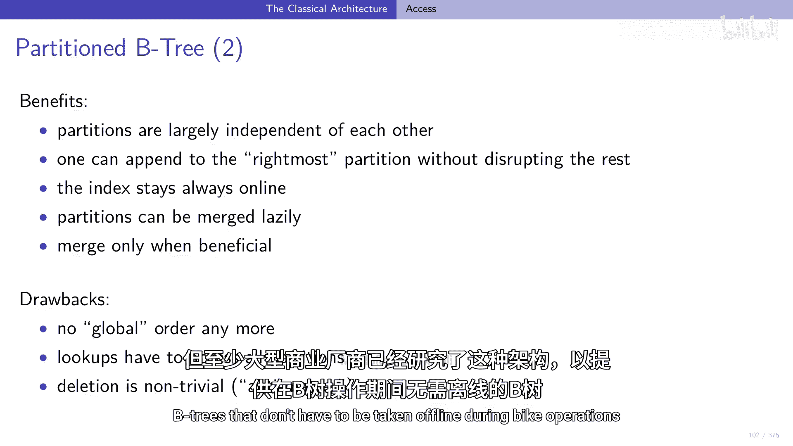

Okay， so far so we have seen all kind of fine things about Bearies。

 Now there's one dark secret that we didn't talk so much about。

 namely that beat trees are much more complicated than you think in the moment that you have variable size keys。

If you have fixed size keys， like only intra dress then life is easy。

 maybe because the definition says each between node except the root contains between k and 2k entries。

😊，Which meanss every node exactly least successful。 And this makes your life easy。 Yeah。

 So we know when an node is full， we can merge node easy and so on。 Yeah， because we。

 we can just count and then decide if emerging is possible。😊，But in reality。

 many elements are not fixed size， but their ver size， meaning the obvious example are strings。

 means strings can be longer or short， but there are also other reasons why templatets might be ver size。

 like you have verbal links encoding， you might have ni compression or other kind of things or combination of c。

 you have compounds。😊，And then we no longer know in advance how large a key will be。

 and therefore we can for example， not easily decide if an inner page is full just because we don't know how long the next separator will be and another assumption that we make in my Beary is usually that the keys or pack which means that the Beary does not understand the content of the key。

😊，Now there are special beat trees that work particularly well if we know that we have exactly one string because if we have one string via some games we can play。

 but in the general case V my key is a byte prop so we have so this is my key so I have a prop of certain lengths and this is the key that don't know what the content is so is my key and the B we must do this of course as a comparison functions so we can compare two keys which as depend on the setic of this but otherwise you have a byte range and a variable size we must store it we must do this properly so this is the problem that we have。

😊，Of course， what you can do is you can ignore this problem just say so what I just use slot pages for my leaf node and my inner notess because slot pages can store just this kind of data just fine so no issue here。

😊，Yeah， but if mean this will be correct by this will run into problems and this is what we see here。

 So this is， of course， a constructed example to illustrate this。😊。

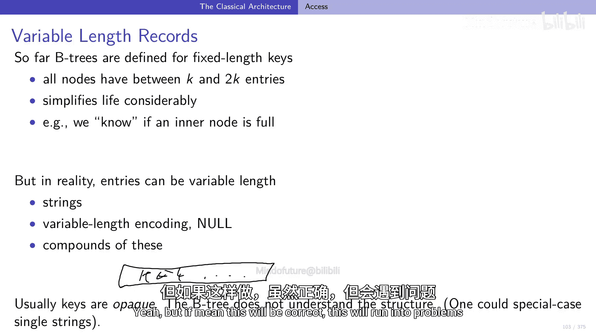

Assume that we want to store the following entries。So we have keys。

 a short A strings and a long B string， a sh C string， a along D string et once。

 so we alternating along atro strings。And so each entry here has either length  one or the length 8。

 this by construction。

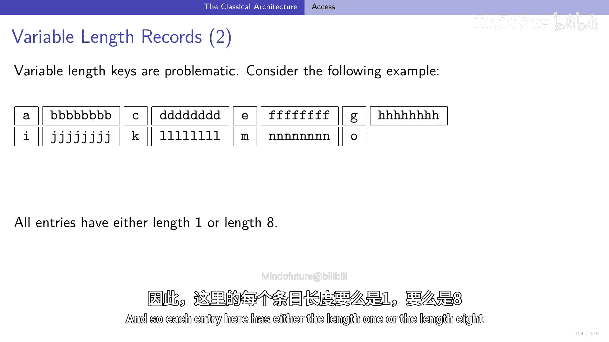

Okay， and now assume that my。Keep my notes here。 I can hold only， for example。

10 or so also a bit higher， which means we can oh no， sorry to make it correctly， it must hold9。

You can hold 9 a node， I can hold 9， which means if I if I construct my P tree with back loading algorithms metal all。

 I put a and P on a node then the node is full， then I put C and D and a node and a node is full then put E and F on a node and the node is full and so on do this for the nodes and this is the leaf node that I get Okay so this is the leaf layer then it always takes the largest vette on each on each page and this case B。

😊，And then we forms in a node。 then it can screw a B in a node。 then I take， then I take the。

 the the。The highest level the highest value here is the D and this would be。

 meaning if it really builds this page this would be a separate and the next high level and so then if the D is then it have the fs and so on。

 so it takes always the largest value on each in live node a separator and move this high up。😊。

And this means， of course， that because unfortunately the long keys are my separators。

 I can only fit one key on inner node， which means I have a very deep tree。

 as this tree here has depths 1，2，3，4 depths 4。😊，As a which is pretty deep for a Bearie。

 and it hasop very poor fan out in the inner notess。

Because this inner node only has two child pointers。 Now， if hypothetically。

 I would have constructed the leaf node slightly differently， namely like this。

 I would put an a on the first leaf node okay it is not very full。

 but I do this regardless and then I put the B at C on the second node and then D and E is a third node f and G on the next node and so on。

 So if I do this very small change Yeah， then suddenly my B3 has only depth 2 instead of depth 4 of course this ignores a bit that we need space four pointers but this to just to illustrates this this huge difference yeah。

😊。

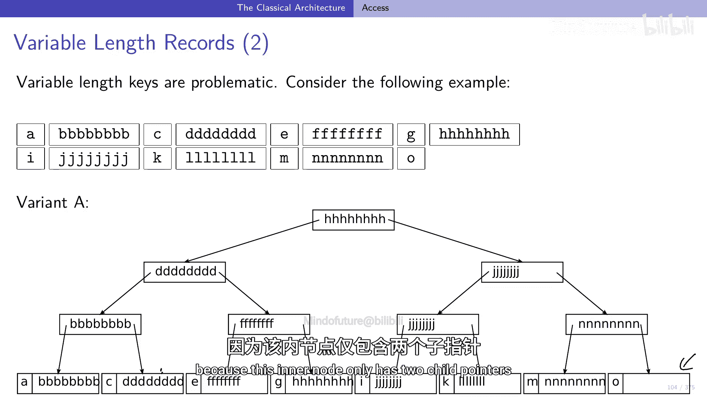

By using using a different separator value， we could shrink B re depths dramatically from 4 to2。

 This is much， much much better。 Okay， and this happens because。😊，Lngs have different size。

 So we want to have separators that are short because then I can fit more on them on a page。Okay。

 so this is basically the observation now how do we get there。

 so first of what we see here se choice is crucial。😊。

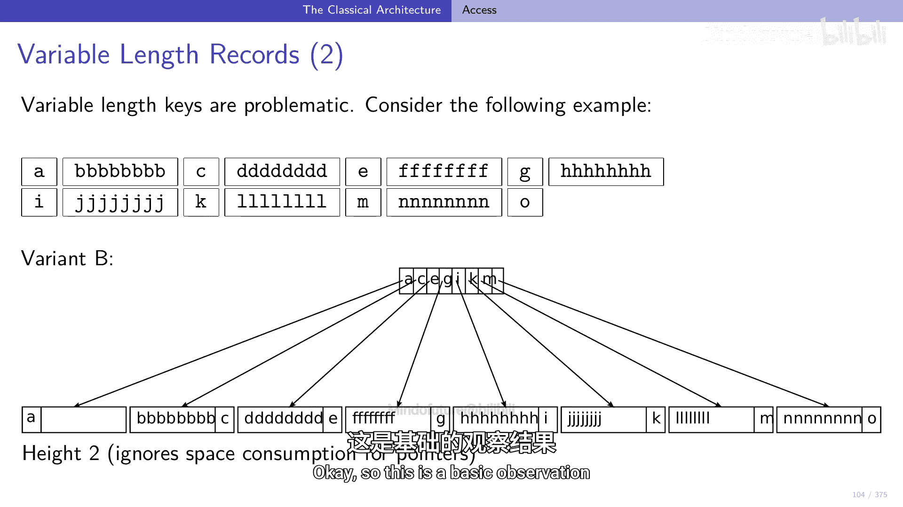

Because this affects the standard space consumption。

 And if we just use the standard B tree algorithm。Yeah。

 that we had and use it with verbaling keys and just do it best effort。

 So at the moment at the be is4 we just split it， then we can all the traditional guarantees of in particular we lose the logarithmic depth guarantee。

 we can no longer guarantee that be a logarithmic， at least not with a reasonable base if we if we implement P3 naively yeah。

😊，And solving this is a non-trivial problem so I mean for the byloading case there do exist algorithms that solves even greedy algorithms so the idea is that if you do bikeloading and you want to form a separator so you want to stop a page at some point。

 then you pick the smallest value a separator such that a relating group size very within a cutor which means we don't make the page totally full but we say we make it between 90 and 100% full for example。

 so if we give some leway and then we pick the shortest separator such that we achieve this we can do this in a in greedy manner。

😊，Now there'ss pretty interesting parts paper that talks about this problem that shows that you can even do this in the dynamic case so not only backloading but in the when dynamic inserts but this is totally nontravival and in worst case even forces us to rebuild part of the index neuro processing So this is highly unattractive means gets good theoretical bounds we get good amateurt bounds。

 but nevertheless less very difficult to implement and also can have spiky expensive performances because it could be that we have to rebuild something therefore this is also not so super attractive therefore now show you the pragmatic solution if you talk to somebody a more format theoretical computer scientists theoretical computer science of course it will be unhappy because strictly speaking。

 this is only auristics not energy solution but the advantages。

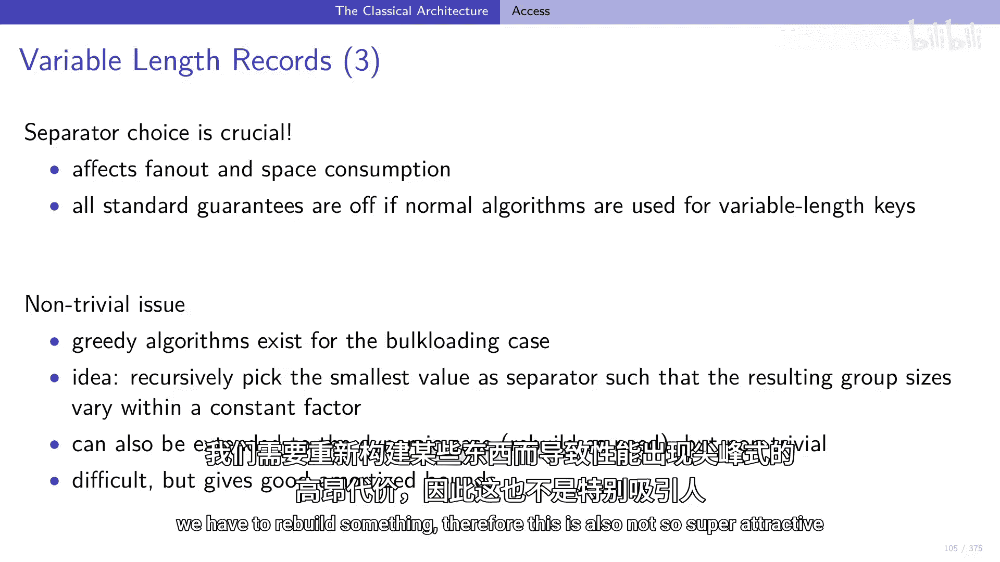

This is pretty easy to implement and gives you a 90% solution。 So most problems have。

So fixed if you do this。 So basically what we do is the minimum what we have to do is to handle variable such records well is we modify the split logic。

 so what we do is when a page overflows。😊，So we we look at all my values and of course。

 a traditional solution would say is all my values in sorted order。

 traditionally a solution would say you pick the media and a separator media。Now。

 for fixed size records， that's fine。If you have very with us records and we don't do this instead。

 we look at， for example， 20% around the media。 and so we go to the left and the right and within this range。

 we pick the smallest in the sense of the shortest， so not smallest in the short order。

 but the shortest value， we pick the shortest value in this range and yet we propagate a separator。😊。

Now if you have ties， so if there are multiple values that are s short。

 then of course we prefer the value that is closest to the media。😊。

Okay so this is a pramatic solution pretty easy to implement。 Now strictly speaking is not optimal。

 You can construct inputs where this still behaves poorly。

 but it's unlikely that you encounters this so the first terrible things that can happen can be technical business this you can do something similar for bikeloading So when you byloading you ought to look at if you would take one one value more a few more or less do a get better separators and if yes。

 pixel you prefer the shorter separated you can get but it's still keeping your page to the full degree of a page within a certain percentage。

And by doing this， you get much better operators than before。 Okay， now I see that I'm。

 if I check the clock， I'm running out of time now。 Yeah， so let's stop here and we look at。

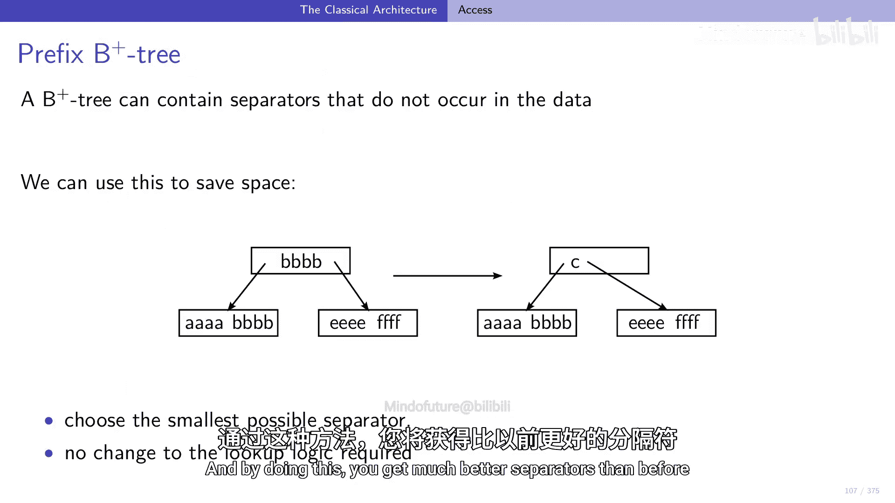

Last few more B tricks in the next lecture。 and then we will look at other in structures too， okay。

