# 【慕尼黑理工大学】现代CPU架构上的数据库系统实现-｜-Database-Systems-On-Modern-Cpu-Architectures-2021-p07-P07_07_访问扩展哈希--BV1asiJBeE6j_p7-

Welcome to this lecture on database implementation so in the last week we have looked at Bre we saw all kinds of problems that we had。

 for example if we have variable length keys， so if we do this naively bad things can happen so then we talked about okay what can we do with how how should we choose separators and so so to improve the fan out so that we get a high fan out because high fanout means low depths so this is highly desirable？

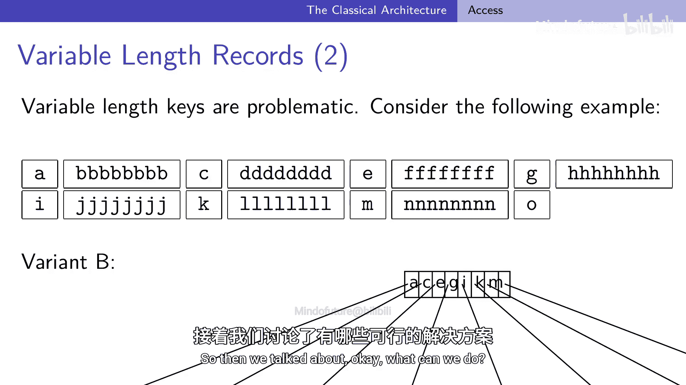

So now to finally conclude this Beare chapter， we look at one more trick or two small tricks that we can do to improve beatries again to improve the fan。

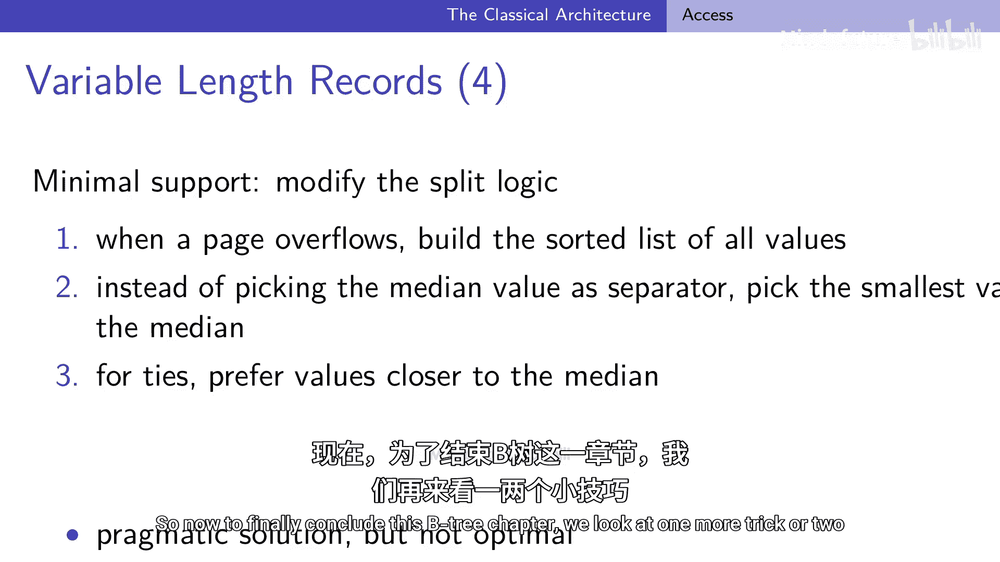

And these are so called prefix p plussteries note that there are two different techniques that people historically call prefix p plusries so not exactly the same no they simple ideas。

 but the technology are different。 So the first thing this is pre。😊。

Easy trick basically is what you see on this page here， you can say， you know in a prefix lasttry。

 it's not necessary that a separator does occur on the data。

 it can occur on the data but it doesn't have to we can choose anything a separator as long as it separates my left and my right side So here we see if we have one node here contains AA A BB so two pretty long strings。

Then another bucket here， so virtually I choose a separateparator all strings are along。

 but we can see if you look at them now between B and E there are other letters so I could for example。

 choose C as separate or of course just as could have chosen D doesn't matter it matters a bit because considering future inputs but concerning the pure lookup both who C and D would have been fine。

So we could have chosen anything。And because we can choose anything as long as we can separate left and right。

What we will do is we will choose the smallest possible separator such that left and right separated。

 again this is a pretty small idea。ABeau property of this approach is that we don't have to change anything now so of course the moment it shows the separator have to run a bit of logic。

 but otherwise lookup works the same so no changer or as necessary only as a lookup the choice separate as the modified。

😊，Okay， now。😊，Looks good。Now， in practice， there are two two problems。Or perhaps one problem。

 namely how do how do I do this， So I said we look at B and we look here， we look at this string。

 if we look at that string， then we say okay， C is between this。

Yeah but how do I do this for arbitrary data types so what I mean basically said in the last lecture that we usually assume that B2 stores drops so if we don't understand the content and therefore it's pretty hard to choose this if we don't understand the data type I cannot choose this between if I know that these two are strings I can choose the number between them。

And strictly speaking， even if I know that this is strings。

 choosing a separator is not that easy now we could say yeahh。😊。

PCl if how to usersrs just use a short string between them Yeah。

 but what happens if we start having for example， a localale information like you know this German Uglas。

 for example， yes or for example， if you have something like this。So this is an o。

 how do I choose separ for this？So this is potentially sorted like like this。

 and how do choose a separateparator tool that separate these So suddenly。This becomes complicated。

 So I wouldn't need routes per。P language， perhaps or in in general case。

 it is not even possible because if you think about implementation meaning to be domains。

 This is implementation lecture。 I can talk about this a bit。

 So if you want to store locate in independent and sorry。

 not locate dependent ordering like if you want to sort string language dependent。

 Yes because you will sort them in English and in Germany。

 you might sort them differently or mean English and German not too differently。 Yeah pretty similar。

 but the other languages that sort really funny， like if you remember correctly if in Danish。

 if you have a string within double a。🤧K。This is suddenly treated。

 especially this is faulted differently from everything else。 And also this this kind of roots。

 if you want to do this properly for each language now there's a mechanism here that so a so called unicode colate algorithm that basically takes your string here and then maps your string into a sequence of weights also you have a unicode weight。

And so and we can compare this way。 So this works problem with if this， this mapping is not badive。

As therefore， we cannot reverse it。Therefore it's pretty difficult to find a string that is between these two two a strings。

 So if forget it for you two a strings and say give me a string that is in between them。

 if you're just an SQ string that is reasonably easy， but if this is an uniccode string。

 it's not easy at all or and depends on the language that you have but even independence of this problem pretty difficult。

😊，Okay， so these kind of perfect industriesies are nice but not as universal as you might think。😊。

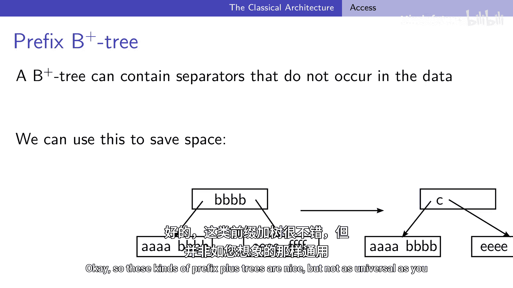

And now then he has a second kind of approach of PV split plus trees。😊。

And this now really assumes nearly nothing about this works also for prop so we don't pretend to understand the content。

His observation is if you have， I mean whatever B3 does it。

 it sorts its input leographically by definition because all my input is is increasing order。

 so all my input is sorted Now if you think about a telephone book for example。

 which is like a B3 in flat so if you think this you notice that neighboring entries tend to be very similar because telephone book everything is sorted by last name then first name。

 therefore neighboring entries tend to have the same last name or if it's not the same then at least very similar。

And this is also an trick that we can use， so here we have an example we have assumed we draw two URLs on my page。

 so it might have an URL for Google and Sig mode， for example。😊。

And we realize this for the fullview LV and fullgri would have two guide。

 both of them start with HGDP s。Then Google dot com， then。And then the same here。Same sigm。Do or， Mc。

 I sorry， O。So this we two times in fact not only two times but 100 times。

 but so neighboring entries here， all of them on a page on a single page。

 all of them might begin with this sequence and therefore instead of storing the stick sequence every time what we can do is we factor out the prefix that is the same for all keys on a current page notice so this here as the prefix for the page。

Oops。Pfix。And we store the preface only once， and we implicitly know that all other entries on my page。

Must be prepened with this prefix？And this saves a lot of space， of course。

 if the neighbouring entries are similar here， so if by example we we save don't know5，6，7，8，9。

1 even11 bytes per entry， so if we have many of them。

 then we have quite a bit and have a much higher fanout。😊。

Good thing is so the change into the look up logic is minor。 So if I go to a page。

 the only thing I have to do I have to compare my my search key with the prefix because I know that all entries on my page。

 it have the same prefix。 so if I'm larger than this I can immediately go to the next entry。

 if if I have the same prex is a prex on the page and strips is from a search key then that' search for the rest And also if you know if somebody would automatically search for。

Slash let step step up dot BLDB dot org or something like this。 So by searching， I would realize， oh。

 this is my common pre。 so I it strips this away。And then I would just search for V or on the page because I know that all entries on the page have the same pre and cancel has pretty small change That's good。

Now mean for a look at it's fine， if you want to scan， so if you want to produce outputs to the user。

 this is a bit more complicated because if you want to report it to users then we must reconstruct this and so then we must concatenate this and this and we must concatenate this and this because this is a foot string as a foot string because consists of two parts I must reconstruct this。

😊，And therefore， if you want to avoid this cost of reconstruction。

 I might only do this prefix compression in the inner nodes because the inner nodes has no disadvantage。

 And as inner node， I always just go down and do a search。 So inner nodes， I can alwaysdo this。

On the leaf pages where I can at least potentially do a range  query so I want to output everything in a certain range there I might care about these reconstruction questions and I don't stores this on the other hand。

 I mean it's true that some people do index only queries which means queries that just reads index and then this perfect factoruring hurts you but I think in most cases even on the leaf pages this is a win so pre big clusterries are a pretty good idea So usually you will want to do this again。

 you save a lot of space and by saving a lot of space you get a higher fan out so this is quite good。

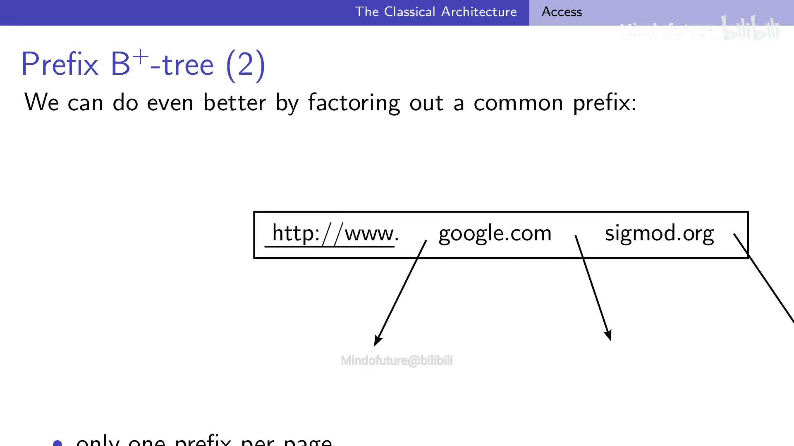

In particular， if you have long strings on your in your index。Okay， so and Susan。

 I think I already said this already。 So next we graph， we sort automatic makes attractive。

 and we have that tend to have the same key for neighbouring entries。And yeah of course。

 two things so this not only works for strings is example little， but also for compound keys。

 So if for index lands like a B neighboring entries tend to have the same values for a factoruring out this a is important quite useful in particular。

 I think if you think about partition B trees where we talked about it prepent and artificial value to every and a partition B tree basically requires you to implement a prefix b plus3 because if you do this prefix compression。

 you on a partition B tree the part costs you nothing because you don't really store a partition when the partition is taught only once per page and you have 100 entries on a page So this space consumption doesn't really matter。

And we stored only once and then we can figure it out。

 So this is this partition beat is a very natural combination with previous industries。

 And now we for strings everything works as it is for numerical numerical values。

 you might wish to store your values in big Indian order， not in little Indian order。 so I hope it's。

 it's clear why because if you think。

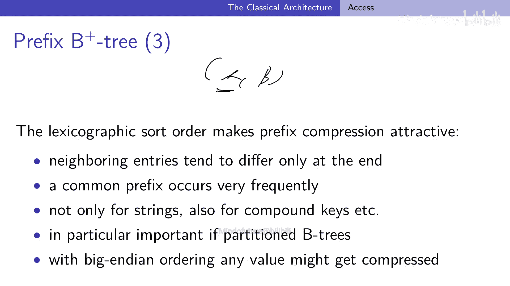

Let's say I want to store the value。I must use small numbers so that can everything works out。

 so let's say I want to store the value258。And also as in 16。So this is my value 258。 Now。

 if your stores this in a big engine order， which means most significant by it first。

 So then this boundary representation here is。1，2， not big Indian， because this is， of course。

1 times250 sort of256。256。Plus2 so therefore big engine coding is 1，2。

 And if I would have certain value。it would9 on 259s and as next values then， of course。

 the banner the pick engine codingding would be 1，3。 Okay。

 and we see what happens First batch thats the same second batch is increasing。

 therefore we can factor out to common pre。 if instead which stores this as little engine。

 which means I store a least significant by first。Then this here would be encoded as2，1 and。3。

1 this is， of course， not good for prefi compression because now neighbouring entries don't have the same prefix。

 And so if you， if you want to store numerical values， you want to store them in big engine order。

 not in little engine order。 notes that your machine that you are using most likely is a little engine machine because little engine has one。

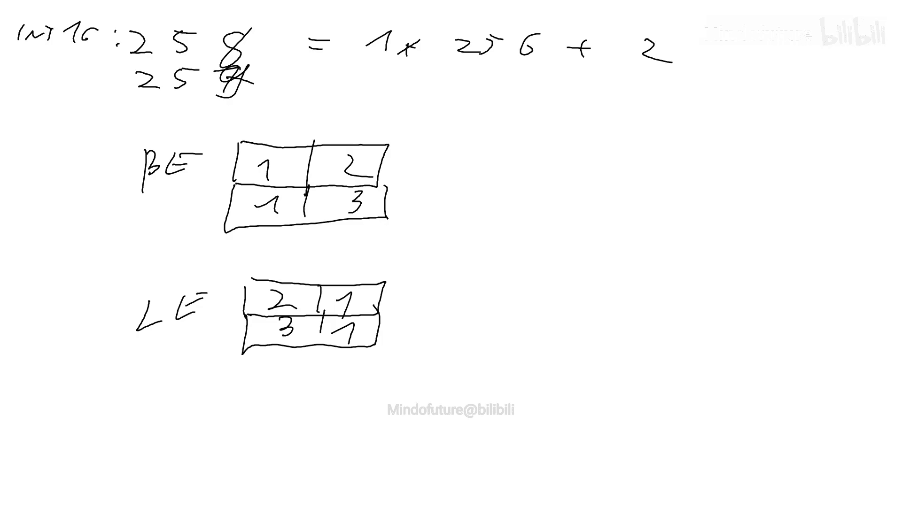

And alsohu， historically， they have been big Indian and little indie machines。

But inter machines are little Indian。 and most of you are probably using inter machines or AMD machines。

 but they' are the same as well doesn have to be int， you know， X 86 machines。

And these little Indian and the little Indians have won the fight encoings have pros and cons。

 so it doesn't really matter what you do also I mean the advantage of little Indian by the way is you can store the values of this different bit with on the same address without changing the pointer。

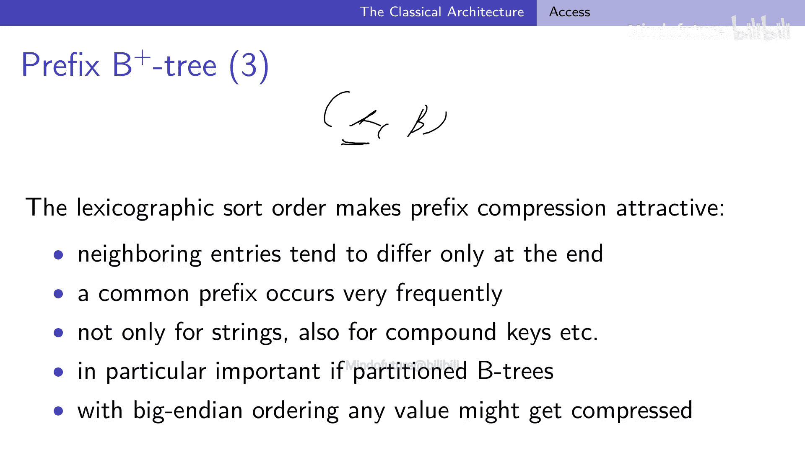

Yeah， so like if you want to load 16 byte values and install a 32 byte value。

 I can just do it in the same address。 And this big engine。 I have to update my my pointer。

 But this is really not a big， not a big tea It's not so frequent yet to do this。

 And in principle it wouldn't matter what you wouldn't do。

 but it nevertheless less little end machines I won。 So most people use nowadays， little N machines。

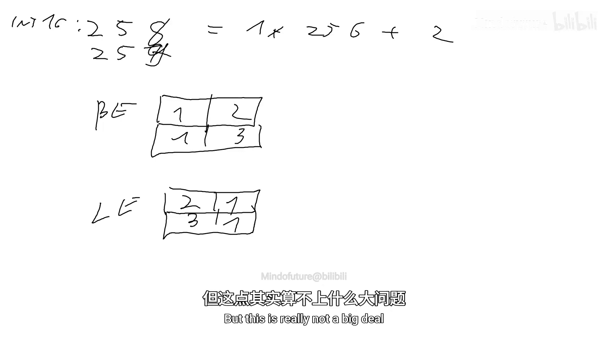

And， but。And for this particular use case here， you want to store your values big engine even if that is not your native encoding by the way if you want to do this in code spotping swapping between too and just cost you one assembly instruction that is very cheap here there is piece swap instruction so that you can use and then this converts little to a big engine and that very around。

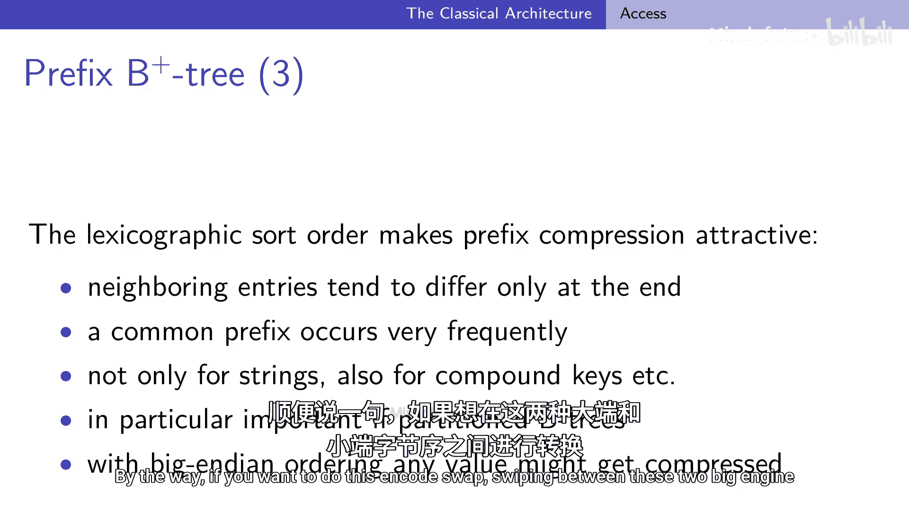

As long as you don't have to care about PDDP encoding， then everything's fine。

 So big Indian and little Indian is these are all same encodings。

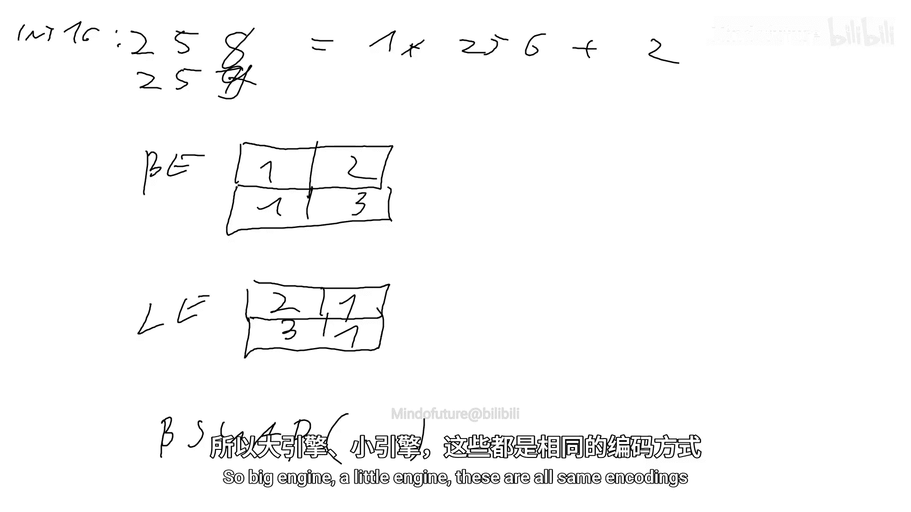

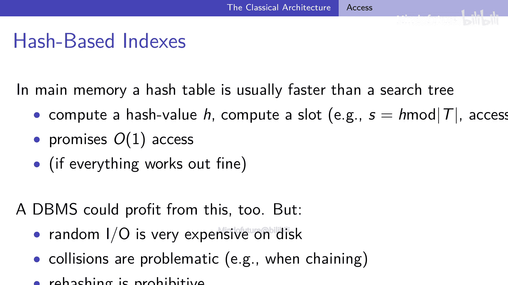

Okay， and so so much for Beare we talked about already more than one lecture。

1 and a half lecture so about Bre and of course Bre are the most important data structure for external memory and also Bre as the universal data structure for external memory。

 they work well for all kinds of use cases， they are pretty useful。😊，But nevertheless。

 even though they are the most important ones， they are not the only one。

 unless there are also other alternatives that we can use。

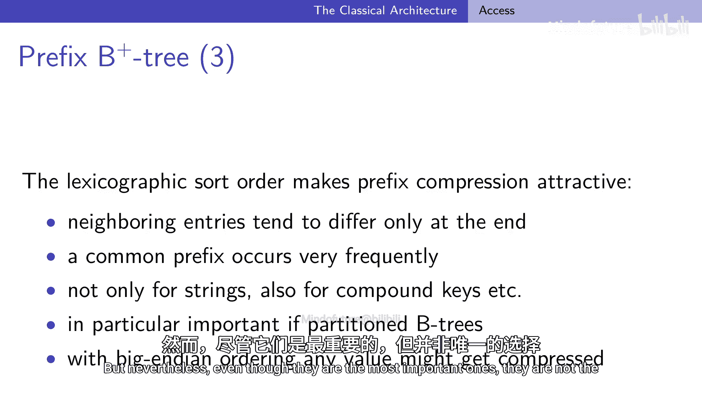

。And one important family of approaches， of course， are hash base approaches。Yeah so。

I hope you all know that from regular programming， if you have installed one to source something in memory and you just want to retrieve an element and a element and retrieve it。

 then you can use the hash table。And the big hash table the big advantage of hash table， of course。

 is that we can con access an element in constant time。 While with a surgery tree。

 we have logarithmic time。m。Of course， this is more or less a promise I will come back to this in a moment but just to repeat this。

 So if I want to store 1 million entries。

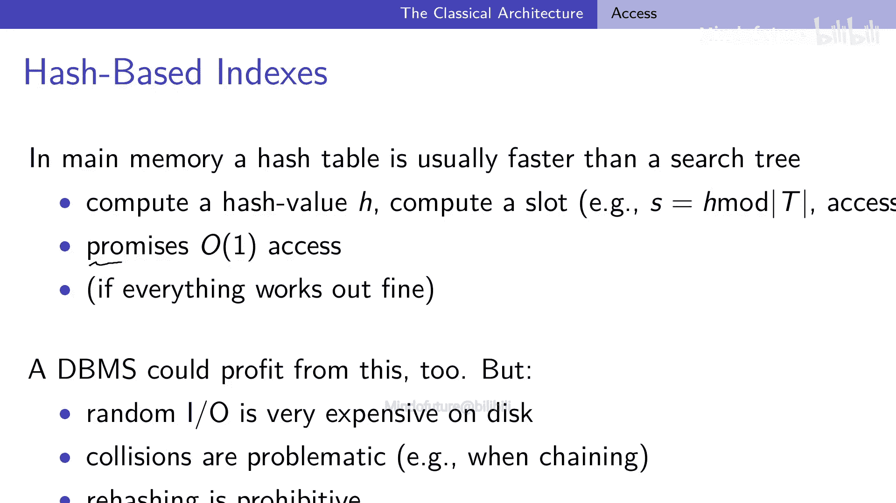

M entries。😔，So then if if I if I do this in a repory。

Then until I find my one if I do search something here， look up。

Look up if I would do the black reason I now I have to look at between 20 to 40 elements。

Is that I must consider。And because I of course that's my root I walk down here somewhere to my elements。

 and I usually to have to go do my depths here。In all of。dangerous。嗯。

It's difficult to do this in a very， really precise way。 Okay。

 we know that it it shouldn't say elements I depth。

So the depth of my red director is between 20 and 40 elements。Yeah。

So how deep it is depends on your insert order your variation and so on it's not so easy to say。

 but these depth of my rep is between 20 and 40。 Therefore， if I have to go to something on average。

 I have to go to something like 30 elements or so So in thisback30 elements。

 I say on average because it could be that of course search for that's currently root could be that one element I'm done but the vast majority of the elements of course。

 is further down the tree。😊，And therefore， on average， I'd access something like 30。

 as there just to say， approximately 30 elements elements exist。Pay I look up。So add this， of course。

 not very cheap。 Now， if I do this， of course， red black tree， we already learned red black bad。 Now。

 So if I do this instead in an A B tree。There's probably better。 Yeah。

 so let's say I have a fan out of of I can fit a thousand elements on the on the tree。

 So then by depth here I will be between2 and 3 again depends a bit on how my insert works so between。

 So this is the depths。And now highlight how many elements will I access？😊，Yeah。So， this is。

Good question。Interestingly， similar。😊，Yeah， but there's better locality。😊。

So also roughing elements elements。P lookup。Now， you could cu a Co around by 30， didn't I say 2 to 3。

 Yeah， this is true。 and and by the way mean， I didn't talk about the constants Yeah。

 So these30 will be much cheaper than these 30。 not just just saying， but nevertheless。

 when the absolute number of elements that you consider。

 Bea and right vectories do more or less the same。So now perhaps it's a bit better perhaps it's not 30 peps its。

Probably it's more like。Wentteish。没呀。啊嗯。Canopy 30，32 high。 Let's say 2121。

21 is probably a reasonable。21 is probably a reasonable number。 Okay， now how do I come up with 21。

 Nevertheless， 21 even it would have been 30， So 30 would have been much cheaper on the be trees and a bad break tree。

 Now， how can come up with this number。 Remember， a bee tree looks like this。

So this is my root and now assuming I have depth two and and this means of course that my root and my leaf page are all full so then I have 1 thousand00 elements here and 1000 elements here。

😊，So now when I traverse down， I do a binary research on each level。

 which means I do a binary research on 1000 elements。

 and this cost me10 look at 10 elements because we know that so lock。Lock 22 of11 k is 10。and。

I should say， of course， approximately because you know， no one case。 okay， if it's 20024。

 so this is 10。 therefore I look at 10 element on the on the road， I look at 10 elements of the leaf。

 and then therefore I'll come to 20 Now while by say 21 Yeah because if you' are unlucky with insert order。

 you need one level more。 but your be tree is your root will in this case only contain two pointers So therefore something like 21 or so And so you look outside quite a few elements。

😊，But of course you have better locality than in a red， so you will be faster and practice。

 but nevertheless you will look at a quite similar number of elements。

 even though your depth is much better， much much better。😊，Okay。

 so now is the promise of a has table is as follows。😊，Hey table。

 I hope you all work how history works。😊，Heshts。😊，A look at one element。

 while let's say two elements， I one two elements。And then I'm done。Okay， this of course， yes。

 this much， much， much much less than the others， and therefore has tables are has table。😊，Therefore。

 hash tables are much faster than either Pries or repies， hash tables are in a way the best。

I say anyway， because I meaning there's a lot of fine print here。😊，First， of course。

 obvious problems in a B tree， you can do a range query， give everything between 20 and 30。

 you cannot do this an h table the h table you can only search for one precise value and that's it And As this of course。

 is a great limitation。Second limitation is here， I mean I gave you absolute numbers on what we expect and so but we know in absolute terms。

 we know that in the lookup cost for a Beari is all of lock n where I have n entries and unknown this。

😊，Okay， with a hash table。 we now what is the lookup cost here。 So we say expected。Expected。

Is constant excess， now access is one or two limits that it。Unfortunately。First case。过分。

As inverse case， hastyd is much worse than either of the trees。

 Hetyvis can have a decent theory terrible performance。

Now and practice doesn't really happen usually yeah so but this is， of course a dark art。

 it means Turkish pink is not on the side， but nevertheless。

 I want to spend a few minutes on this because this is a pretty important thing in my opinion。😊。

Hshtbits are super useful， have great performance and so and has surprisingly nasty to do right。

 yeah so that it really works reliably in all cases and so。😊。

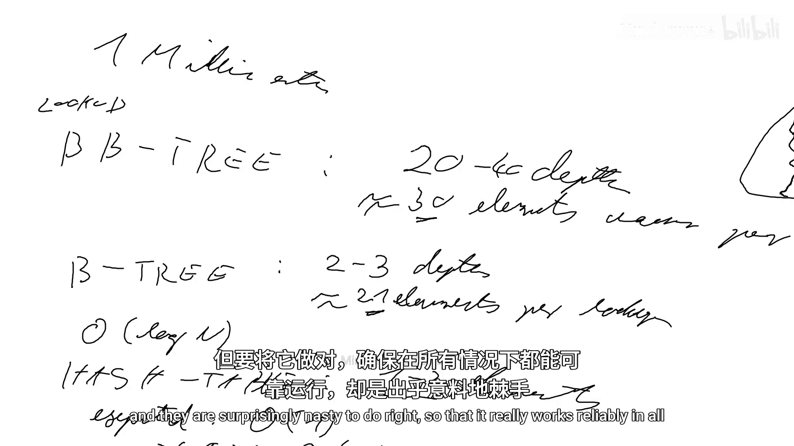

Or if I can， yeah， therefore， this is the reason why I brought this here。

 we promise constant time access。 Yeah， yeah but here， you also see if everything works out fine。

 So if everything does not work out fine， then bad things happen。 Yeah， so hash tables are good。

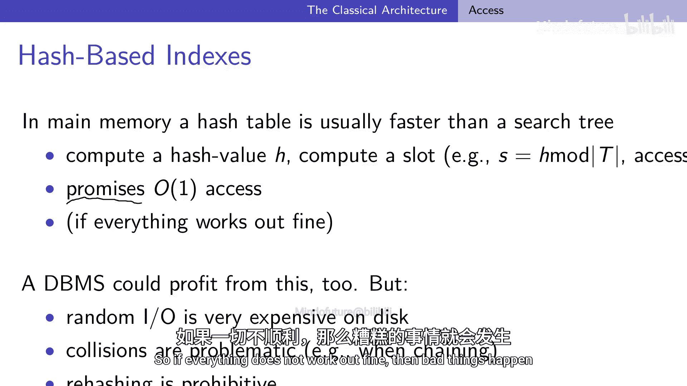

Usually， but usually as not always， or to quote Donald Kz。

 he saidh tablets are great for people who have a lot of faith in statistics and this is absolutely true so if you look at this statistics it says on a expect value H tablets I have far superior performance everything else。

😊，First case， oh not so good Now the worst case is really， really bad in a Ht。😊，But of course。

 it's extremely unlikely that this worst case ever happens and we now we see how to make this worst case unlikely。

😊，So first， let's briefly repeat how to implement S table。Now of course。

 there are two schools of implementing each table，200 probably but let's say two important schools of implementing each table one is chaining and one is open addressing。

So let's start perhaps with a simple chain edge table。Just to make this this example here clear。

 so this is has table， by the way， I hope that everybody of you could implement this hash table himself at home without my help now because you I'm pretty sure that you did this introduction to algorithm data structures。

So therefore I hope you all know this Now unfortunately I'm pretty sure I hope this I'm pretty sure it's not true Yeah so at least some of you might have got the idea how h works but there from experience I knows it's a great difference between understanding the idea and really grasping the details and therefore I strongly recommend you to implement H actually I think you will do this exercise。

😊，And so implement Ht because after you have implemented it。

 you realize much better how everything works。 that's because if if you I mean I can draw a picture here and this looks super convincing to you。

 Yeah， but the picture is not code because the picture is very generous in how everything works。

 So I strongly recommend you to implement Ht and implement a good hast。😊。

So then you get much much nicer in have everything books。 Okay， no but let's know start。

Let's say this is my。 say my H table has the size。😊，So here is position 0 and up to yeah。

 how large should we make it a good good question。 Let's say we give you a size here， this is n -1。

 so beside size n。Okay。So I have a lot of entries here。Now。

 if I want to insert certain an elements here， so let say insert it。

 So this is a table here and in my hash table is perhaps make it even more concrete。😊。

I say I have have an entry struck entry。Yeah。And my entry here contains a key for simplicity I ever just use an integer because could be could be anything here。

 Let's use an integer and then。Entry。Start next， so SS said wed implement a chain has table。

So this is my as my entry here on matchsh table now。I。😔，Entry star has table of size n。😔，Okay。😊。

So bioh basically is a big array of pointers， initially oil everything zero here。And now let's。

 let's look at the look up here。 when we say look up。Look up key。

So how do we do this if we say the slot where my key belongs。Slot is eager to。

Haash of keys with my hash function here maps。My key to to。Yeah。

 to the integer domain basically so I will talk more about the hash function in a moment。

 but basically my hash function does it takes a key in this case integer of course。

 but could be a string could be anything so I take my my search value and transform it into an integer here so basically a hash function let's put it here this maps my key to an inch。

😊，So this is what the edge function does。 and so end then we say， for example。

 period the classical implementation says。😊，Has。Mos end。

So we just take match volumes and Mo in and then we say okay。For。I equals hash table slots。

So as long as my eye is not。This is not nigh。Then， I said。If。I K key equals key。very backwards。

 I'm sorry。😔，As equals que and say return found。So， this is。Bay very simples in here。

 then return notva return。嗯。I'm sorry， so we say return。😔，Not found Okay。

 so this is the most primitive implementation you can think of and then of course here we say if P I equates I to next。

Okay， now in reality you might wish to store not only a key but also a payload。

 like something like a dictionary， so once you associate something with the key so then you put in here a payload and then of course you say in this case payload if you want。

And then of course， here we would say return payload and return for。

 So if this is what we would do if we have if we have a more complex estimate， and nevertheless。

 so this is a very， very simple edge chain。And good thing is that this is only little code。

 bad thing is this is， even though it looks so simple。

 it's surprisingly difficult to implement at least difficult in ways that it works well。😊，That up。

Even though this is。Very simple， conceptually simple thing。 by the way， I mean， as I said。

 please implement it at some point because if mean， if I draw your a picture here and here， okay。

 so this is my entry that contains a form。 And because I have a H collision perhaps。 I I here and 20。

 and then here I store the5。😊，Yeah so this is how a hasht looks in practice so we we have elements and then we takes away the keys element we actually it find a slot and then we have a chain of entries therefore the name chain that then contains element and if I show you this picture everyone says I know if search search 20 just goes there because you as a human of course sees the whole hasht but the computer doesn't see the whole hash table it to look at one element after the other so this is therefore more subtler than anybody think。

😊，Okay， now what's problematic about this current code？

There are three things that a bit now where should Ill start perhaps。😊，I am。

Ex perhaps I start with this。Now。So let's， let's look at this point。 here we say in this point。

 we say I take my hash value which is an arbitrary integer。

And then I take mod my ht size and this gives me the slot I have to go to。😊。

Now if we don't like model law so perhaps even stepping one step back before we come to the model problem The next question of course。

 is how large should N be and also how large should I make my table？

And in practice what you want is that your hash table is as large as your number of elements that you have plus a bit more。

 And now how much is a bit more is not too easy to say， but let's just say you want mean。

 if you don't you don't want to make it much larger than the number of elements that you have because otherwise you raise a lot of space the hast will be empty so we be nothing in there you don't want this。

So you want your f table to be similar as to the number of elements。 In reality。

 you want to make it a bit larger because the full your has table is the more likely it is that two elements end ups in the same bucket here。

 therefore you have a longer chain then your performance degrades I said initially we say we expect constant time which means we expect to look at only one element here or on average perhaps at1。

6 elements or so。 So the the average length of a chain chain and a chain h table。

 the one do something elements at one or two。😊，This is what we expect。

 but if you make my hasht very full， So it it's not large enough for of limits。

 then my chain will get longer， then the performanceancy will be worse because this fall loop here will get slower。

 the longer my So the longer my chain is to slower more fourrups。

 therefore you want to have to change table reasonably large So and for example。

 rule of thumb is you want hasht。😊，Is at most。At most， let's say，70% full。For example。

And if it's more than you choose it so that's almost 90% or perhaps you go a bit higher to 75% or so。

 but something like this。And the hasht size that you choose n here probably should be a prime number。

 so this is what we teach in introductory courses。Shoots。Be prime。Okay， so this is what we teach。😊。

No， his interesting question is。Why should N be a prime number？And by the way。

 it's true in first approximation， choosing any sub prime number is a good idea。

 so I don't want to say this is wrong。 So choosing S sub prime is a good idea。

 but interesting question is why。Because， I mean， if you think just about about what Molo does。

 Molo does basically wrap around。 And so if if let's say if let's we know5 is a prime number。

 So if if I take my values1，2，3，2，3，4，5，6，7 and I do this Mo loop 5。

 then of course I get nicely spread around Co here this m to0，1，2，3，4，0，1，2。😊。

Then we would continue 34， so 8，9。If you take my parameters numbers。

 then everything is spread out evenly in views of course because we want it all packets are filled uniformly。

😊，And they say for prime number works， yeah， but if I would choose non prime number like if number4。

 which is definitely not a prime number， as which is not prime， but if I take my input here。

 then what would happens is I'd take0，1，2，3，0，1，2，3，0，1， and so on it wraps around just as nice。😊，So。

Therefore， why should I use a primeable？And because if you just look at the wrapping behavior。

 have prime and old prime but doesn't matter at all。😊。

The reason why you in reality want to use a prime number is as follows。Here， your hash function。

 we didn't say anything about hash function yet。Here my hash function must map my key to an in domain。

 but we did not explain yet how to do this。😊，And in reality， this is a black art。

 I will come back to this in a moment， but this is a black art so this is。

Pretty difficult to do in a reasonable way。And。Assume that your hash function is not perfect。

 which means that you， for example， your hash function tends to have a linear factor in it。

 like you could say the hash values that you construct。

Are more likely to be multiple of two for example。 so if there are some linear factor in your hash function and trust me。

 most simple hash functions tend to have a linear factor so linear factor are frequent It's not an exception its frequent。

 So if your has function has linear factor and you are size of hash table So the thing that you do a model of has this linear factor as there can be divided by this linear factor then terrible things happen assume assume for example。

 that your hash function here tends to be produce values that are even。 that are multiple of two。😊。

And then if you then then choose4 as hash area， then you can only construct the elements 0 and2。

 Yes element1 and3 can never happen because you know， my input if my hash function is even yeah。

 then as I can never trigger the hit to the point0 and sorry， the point1 and3。😊。

It this is clearly bad， yes because its end is me leads to a very uneven distribution in yesterday performance is terrible。

Now， if your hash table is a prime number， then this only happens if the linear factor happens to be your prime number so if your linear factor is not the prime number。

 then this does not happen because by definition prime number can only be divided by itself so therefore prime numbers are safer to choose than nonpri numbers Okay。

 so this is the reason why we teach our in our actually class we teach that you choose a prime number nevertheless。

 even if you did choose a prime number， we had this had to clear this because I need space。

 but we had to this code here the said slot hash of hash of x mod n。😊。

And so assume n is prime so then some problems are solved， what's still super。

 super unpleasant here is modlo is an extremely expensive operation。

 this costs performing a modlo costs you something like approximately 100 circuits。😊。

dependep on your process unfortunately is to say， but in the power pack of 100 cycles and 100 cycle is an insane high amount of time and so doing somethings mod law is super super expensive and so you basically you don't want to do this。

😊，Yeah。Don't't implement if you can avoid this don't implement a mod parameter by area it is too expensive。

Yeah， I mean， at least I mean if you are on this doesn't matter that much because this is so slow。

 but in memory， these hundred cycles here have you really hurt your performance。Okay。Okay， but。

What should you do instead？嗯。Basically， there are three options。

 all of them involved to different degrees。Okay， now first trick， option8。Make。A modeltal and sheep。

A。And。How do we do this yeah you？What you mean， if you ever looked unfortunately。

 as this is a recording now， they kind do this shows this to your life。

 So what I would now show you life， if you ever go to to this， to this great website here。

What's your URL if you go to this greatest website。Oops， sorry， I messed up my presentation here。

Gopoch dot org。😔，And there， what you can do there is you enter some code。

 and then it shows you to generate it as similar code。 Then if you do something like this， you say。

Int or let's say for， for a detectic reason， let's not use an int because the code is simpler if you don't。

Say。It's an。 It's an anti into death。Unsigned。Fu。uns。X， then we say。Return。X。诶。March 7。Yeah。

 so if you do this。😊，Then what will happen is I least I hope I will try I will check as this myself have in a moment。

 but I'm pretty sure that this happens。Just didn't check the similar code before。

 but I'm pretty sure that's it's fine。 So I have to try try this one second。

So then what happens is if you look at it generated a similar code。

Or it's still not as easy as I would have hoped it to be or is the interior case in this case easier。

 Let me check。Yeah。No， not easier， easier。😔，Do explain dividend。Let's， let's to。嗯。Well， slightly。

 but it's okay。 it just， you can use record that short here。 So but nevertheless， if you。

 if you run this if you do this in in gotboard and you look at the general code。

 you would see that your general code does not contain a division。😊。

And because the compiler knows that the division is terribly expensive and model is mod is basic easy division。

 Yeah so it does not do the division because it's super super expensive。 Instead what it will do。

 it will precompute some magic numbers。😊，And then these， by the way， are really called this。

 as we can Google for this。 you say a search for magic numbers division so and。😊。

Yeah and then instead of doing a division you can you do a sequence of multiplication and shift as you do multiply and shift。

 and then you get the result of the division without doing the division。😊。

Yeah by precomputing these magic numbers here of course precomputing the magic numbers cost you something not totally for free on the other hand you can。

 as this is what I did at some point you can have for example a precomputed list of prime numbers so between0 and2 to the above of 64 So if if you precompute all prime numbers in this range and do this such that there are 10% apart so not really oil prime numbers because there of course are many oil prime numbers that are at least 10% apart in this range and yet you can precompute this magic numbers and then you can make this you can make this model cheap Nevertheless this is a pretty involved step here so this year is computing magic number is you can look at up how to do this but nevertheless is difficult。

As what you probably。😔，Don't want either you want to take the precomputer list from somewhere or perhaps look up the code for the probably you don't want to look up the code。

 Let's say this is impossible but involved。 Yeah， so making Mo cheap not easy。Okay， option B。

Don't use or let's say yeah， Yeah， perhaps do use make sure that but don't use a prime number。

 but make sure。Sure that。N is。A power of two。Because if you do this， so if n is a power of two。

 then model computation is super cheap because model loop we because if it's a power of two。

 So then we say so then we know that x mod。😊，N is the same as x binary， and。N minus1。Yes。

 so this computation of course， takes you two circuits also a super cheap well it doesn't want takes you 100 circuits。

😊，Mo of a power of two is super， super cheap。 so great performance。So plusing performancence。

Negative。Mean， I'm no longer very flexible at how my head patch table looks like。

 because the only thing I can do is I can increase match table by factor 2。

 because if I always have to choose a port of2， I don't have many choices with hash table sizes。

 Yeah， hash table size limited hash table。😊，Table room。Table size is limited。Okay。

 I must always choose a above2， so this means I probably waste quite a bit of space because I cannot make a H is just slightly larger than my number of elements I make it quite a bit larger Yeah and second disadvantage here。

😊，S resist requires a good has function。has a good hash function。

 But this is probably true for that or these as don't know， don't don't know this。

 So as option A is more forgiving。 So if you have a terrible hash function。

 A will be slightly better。 Yeah， B will be requires a good hash function。 Yeah。

 so B will be terrible if you has functions poor a good hash function。

And then we'll come back to this in a moment what this means。 Okay， but these set， for example。

 if your input is has a linear factor and your linear factor happens to be2 or contain two。 Yeah。

 then， of course， choosing a part of two hash table is not good because then very bad things happens。

 Yeah， so you will only fill a very small part of hash table。 So therefore this。😊。

Having good hash type hash function is crucial for the option B， option C， by the way。

 So this is another nasty another nasty another neat tricks that we can we can do as we say the following we do。

😊，I say， slot is equals stool。嗯。Hsh X。😔，Times n。Rightide shift if they use72 bit numbers。Sa2 on this。

 but this multiplication here must be a 64 bit multiplication。64 bit。Multtiplication。

So and first glance you might be surprised that this works at all so basically what we do is we take my hash value and then I attack my hasht size and multiply this I shifts this to the right procedure tool and that's it。

😊，And。Perhaps somewhat surprisingly this indeed works。

 so now why does this working because I mean your hash function here is so this value here is put in between in the range 0 to2 to per of 32。

😊，-1。Yeah， well good this is a range。 then apply multipl it has to be size。

 So as meet my result here that also after this result， I get a value between0 and。

Two is above 32 perhaps I should do this not with minus on， but I should just say。Without -1。

 but say an exclusive bond。So and thens the result is in between 0 and 2 to above of 32 times n exclusive。

And therefore， if after the shift here。Then the result， of course， is in the range0 and n exclusive。

 and this is just what we want。Yeah， so this beautiful thing is we just need one modification and。

 and shift。 we do not。 we are not limited in has table size。

 We can also choose G arbitrary has table sizes。 Yes if we all want。😊。

Like auto prime number for anything we want。 And so。Good thing here is。Cheap。

Ogo arbitrary says sizes。Arbitrary sizes， arbitrarybitary。SSizes。Betting。This only works。

 which means this always works， but this only works reasonably well if your hash function is very good。

 requires。Very good He function。 Very good H function。Again。

 I will come back to this in a moment when we talk about hash functions。

 but basically this reasoning here assumes that your hash function is distributed uniformly across the whole domain。

 it has a whole integer domain and be spread out and there must be no correlation between input and hash function at all。

😊，With a very stronger requirement。 But basically you this。

 this must be very neatly distributed because。Mean I will talk about has functions in a moment if you choose a bad has function Yeah。

 what will happen is that you will always end up in the same slot。

 Now so performance it will be terrible if you choose a bad has function。

 So this this C option C is the most flexible and also pretty cheap， but this requires a very， very。

 very good has function。😊，Okay， so this is and this brings me to the last problem of temperature the last。

😊，Actually there's one more but okay， but let's say perhaps the most critical problem of hash tablebits。

 how do we implement this hash function here and we said I need a hash function X that maps my X here to the integer domain。

😊，As this is what I need。And now what are the requirements？😊，First so this here should of course。

 be subjective so that every possible in reality can be can be reachd， but this is not good enough。

 Second requirement is we want that every element has the same probability。Yeah。

 and even more we want yeah this is hard to quantify in in a mathematically sound term。

 But basically what we want is that there's no correlation between input and output。 Yeah。

 for example， if I increase my input by linear factor。

 like if I say text two times x3 times x4 times x。 So if I linear factor in my input。

 then there should not be linear factor in my output。 Now， so then。These two should be independent。

 so this should be uniform and independent in the result。 and now as the really。

 really betting is in a general sense， is is impossible okay。

This is just if you look at the theoretical problems but in the general case this is not feasible to do this why is it not feasible to do this because of the pigeonhole principle so if my X here has a domain that is larger than the in domain then I can always construct an input sequence doesn't matter have a cache function you choose I can always construct an input sequence such that all my inputs will end up having the same hash value。

😊，It must be possible to do this because mean if one domain is larger than the others then of course can always construct it like this so we should make this as unlikely that this happens as possible so this is therefore the of canoes hashing is great for people with a lot of face and statistics so we should make it shows that it doesn't happen。

😊，Okay， now， but。What do we now what do we what do we choose as has functions。

 So what is a good hash function？And so first， let's talk about perhaps what we what we say in introductory lectures。

 And by the way， these are bad functionss。 Don't don't do this。 Yeah， so don't So do be。

 let's write it here say bad examples。Don't， don't use them。Excepts。Identity， for example。 Yeah。

 so we say， hey， if my key is neutral， So why not just say's say okay。Hach of X。F x is the end。Is it。

2 x。Because this maps my inputs to this inte domain， every possible integer can be achieved。

 so why not？Don't do this。 Terrible， really terrible， Terrible things happen if you do this。

 Don't do this。 I mean， just think about this example that we had before。 when we said my。

 my function here was slot is equal to hash of x。Times and shift right city2。 yeah。

 if you use this here as function and you use that identity as as has function and the input is。

 for example， which is not not very unlikely that somebody inserts as values here，1，2，3，4。

 Yeah if you use this， then all of them will end up in slot 0， of course。

So this is really a badbed better function。Because we see my input values that are close by， so 1，2。

3，4 they are close by the hash values are also close by and this is a highly undisable property so we don't want this so we want that the hash values that we get spread out all over the space and so distributed far away。

😊，So now what should we do instead Yeah， so this is really bad identity， don't do this。😊，诶。Better。

 but too bad。嗯。嗯。Stupid。we say， for example。MyMy use so called Fibonacci hasing。

I say my value of x is。The secret。

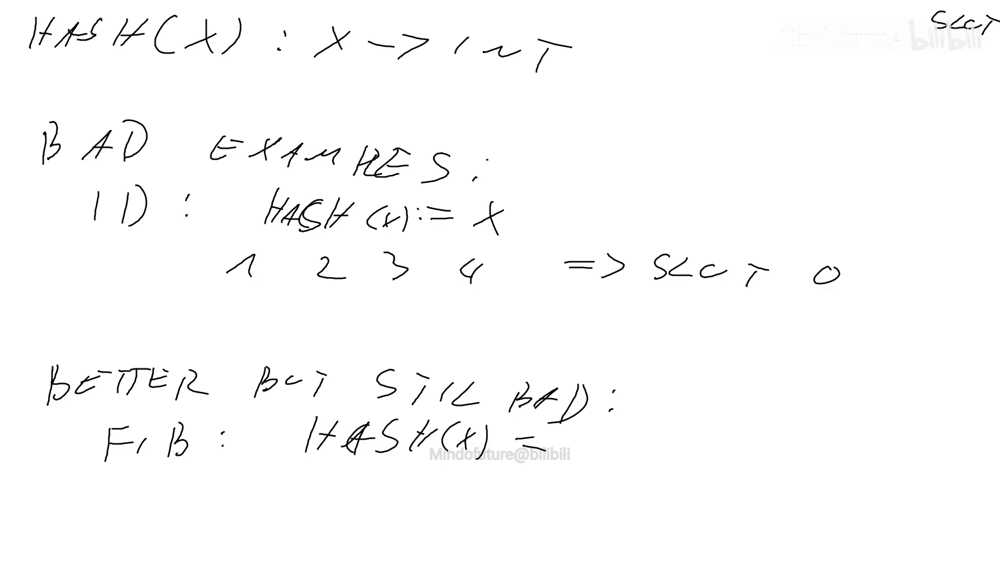

To。So this is a number that I do not know by heart， unfortunately。But， basically。Yeah， and。And。

You still blah， blah， life， yeah。So。So this is a number。 that is。呃。This is a pretty long number。

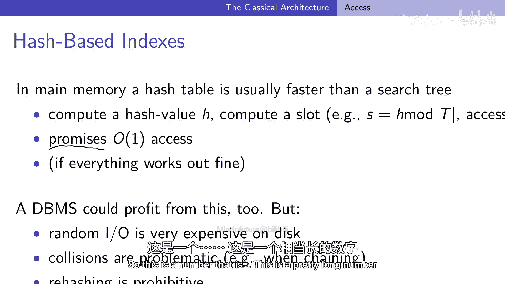

So， this is a。Numbers， it is roughly。So let's say we take a constant here C times x。

 and the C here is roughly。诶。2 to above 63 times。 I sorry。 we we did2。

 already have 64 bit test radiodius。 If you do 32 bit test raius， and， of course。

 you take two to above 31 times here then there's a factor your1 dot1， something。

 Yes there's a long constants that you choose。Okay， so you can look up this number by the way。

 if you search for few not heing again and you find this constant you choose。

 so you're very busy here， you choose a pretty large constant here。😊，Then you get a hash value。And。😊。

嗯。And this hash really is not totally terrible。 The problem is。

 if you look at the distribution mean is better than an identity。

 but the problem of this fibonacci hashing here is that the high bits of so hassh values are reasonably distributed。

 but the low bids are not so yes，A lot of entrepreneur hybrids， so hybrids good， low bit bad， yeah。

 hybrids good。Bs so basically therefore what you have to do afterwards。

 you have to shift this sum so that you can only use this hybrid。

 but how many you shift depends of course your has table size so I cannot write this close formula easily and also if we were not heing here。

 you might apply and then you shift into your user hybrid bits。And so， this is。Better than identity。

 but still not very good。 you know， because you're even with Fiber arch。

 you can construct input sequences that give you pretty bad input。Now， so what？Reasonably good。 Now。

 first， let's， let's， let's， let's say reasonable。And before we come to reason very then， of course。

 there are the hash functions that are really good， but don't use them。 You also good。

But too expensive。You can of your course used as a hash function here this one here， like you say。

 a hash of x。Is for example， you uses cryptographic hash something like this。Now don't do this。

 I mean this gives you very good has values。But this computing is secure has here so expensive。

 This dominates everything。 Yeah。 So don't， don't do this。 Okay， this is too expensive。

 So basically we have seen there are some things that are cheap。

 like identities are cheap as you can do。 rat is a bit more expensive， but it's also not very good。

 cryptographic hasss， These are really good， but these are part too expensive。

 So we have to find something in the middle。 Yeah， and reasonably reasonable compromises between those two are for example。

CSE is 32。Now strictly speaking， here， we we say basically hash if x is。CS C。

32 x comm seat So we need some C value and。Stringly speaking， of course。

 this was meant as a check some for error detections。 It was not met as a hash function。 Yeah。

 but you know， this can be implemented and it can be run in hardware。 So your CPU。

 most likely So this is supported by hardware So therefore， this computation is super cheap。

 So running C32 instructions you something like four cycles。 So this is super cheap。

 and the values you get out of this are pretty good。

 unless you get good hash values out of this cheap。 And therefore people do this。

 even though it was not never met as hash function But this works very well。 alternative is。😊，呃。

Aquahesh， for example。😊，Aquihensh， but what they you do is。So take your x value。

 and then they run AS。On X AS auto。Also is a crypto primmeter。

 but they don't do a full AS you do as a come limited to I think they do three rounds or something like this。

 limited to three rounds。And so you run a cryptographic encryption scheme a few times on on your x value and you do this because again this is also supported by hardware so if you have a reasonably new CPU your CPU most likely can do AAS and hardware and if you do a few rounds of AAS this is not very expensive and therefore we can do this and then we get get also pretty good has sort of this。

😊，Yeah， and perhaps， I can do one more here just for completeness。

 I cannot write it differently because too much code。 Yeah， so now we come to longer co code。

 One good good code also is， for example， more， more。Hsh。2， for example， this is a software solution。

This also gives you reasonable no let's say， but let's let's say this is already put it into。

I was out a bit a， a bit bit expensive。So also does here hash here say a lot of code。

there's no easy interface this。😊，So this is the longer sequence of code that they run。

Gives you good has functions， but this Mo hassh does quite a bit of computation。

 so this takes some code。And so therefore， this will be much slower than CSSE or the A S solution because A usually require just 2。

30 instructions。 So these are very cheap。 Mo requires you requires more of this。

 So this is a bit more expensive。 And as had advantage of more morehe is。

 this is pure software solution。 This works on every processor。

 While not every processor has CSE support or A S support。

 So this is portable but slower than the other one。

But then less so you should choose one of these here。😊。

So this is a reasonable range that you can use。 Don't use it。 never use identity is super terrible。

 If you were not changing your control or do you only use with scale， better don't use it。

 Yeah I mean you can we can't fix it And so but not easy to you you can improve this here。

 if you were not changing by using some or trickx， but。

Probably don't want to use this Use one of these threelashes here。 Now this give you a good good。

Good resides at reasonable performance。And by the way。

 I said from a theoretical perspective it's impossible to defend about hash collisions because mean if my key domain is larger than my in domain as it's fundamentally impossible to alwaysP collision free so there must be values that have the same edgeh value and therefore if some malicious user comes to you and gives you all values that have the same edgeh value everything we will collide brutally in your table therefore your performance will degrade and not a lot we can do bad things on the other hand。

 there are a few things we can do it's not like if we are totally helpless so there are a few things we can do and one thing to better in this problem is I said both and AS need a seat doesn't really matter what you choose you can use any value here and when you choose a different seat you get a different hash value but a seat you can choose whatever you wish and of course one attractive approach here is to say。

😊，A tru must cheese at random。Yeah so when my program starts。

 I random die I look at a referendum or something and so I choose a random seat and of course I have to keep it the same over a random program because I otherwise don't find anything in table so I always must use the same seat but the seat itself is choosing at random and therefore in a attacker cannot knows the seat。

😊，Now this has an advantage that it's now very， very difficult to an attacker to choose an input that collides because if。

 if the seat is known and theer knows about how your has function works。

 it can construct input so that collides。 if you are see as a random value， then we cannot do this。

 know So this is this we we could do。 Okay， this was already quite a bit of。

Talking about hashts this we are only talking about the first half of this slide because we are only talking about the in memorymory case。

😊，But nevertheless， I think it's important to talk about this because probably quite a few of the students who attend this lecture have never implemented a H table a safe。

 at least not a real production one therefore we we must talk how to do this well or strictly speaking。

 I forgot even half of the tricks you can do So because just two minutes more I don't want to spend too much time on because I want to go to external memory。

 but just two things。

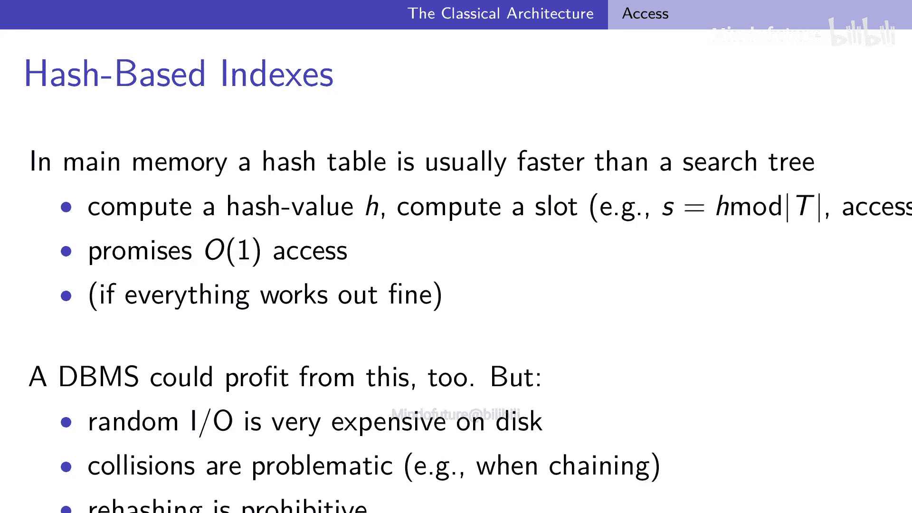

IMe， there's another problem here that H has even if you all do all this。😊。

Yes suppose in my hash table here， of course， as a chain。

And of course if you choose good function and this chain will be short so most likely just one element or perhaps two elements。

 and so it will be short。 but nevertheless， so if I if I access an element and this element is there what I do is I jump to the stable element here I look it up。

 I find the pointer and then I jump to this and this means I access two memory locations so first this and then that two memory locations I are really unlucky even three afterwards this year if I'm really unlucky。

 but if I'm lucky only nevertheless I do do two memory accesses and if my hast is really large So it's larger than my see blue cache。

 this means I have two cache misses Now have one cache misss here， one cachems here。😊。

And k misses are expensive so therefore shiny has tables。

 some people claim that are expensive and you should not use them。

I would say well implementing training a table is most likely faster than what you can do as alternative mean。

 there are alternatives that are pretty high performance。

 but they are not that easy to implement in a reasonable manner。😊。

Chaining HW pick a pretty sweet spot between ease of implementation and good performance。

 You can build good performing training H it reasonably easy。 The non chaining H too。

 if you want to make a good performance is possible， but this is not too easy。 Okay。

 so but nevertheless， what can we do to improve the performance。 Just two。

2 tall smart tweaks you can do。😊，One is。And this is of course。

 now we come to the nasty world of real implementation。You know， if you look at the Ht。

 what is in the written is the HW we see that here this here， of course， is a pointer。😊。

So now what is a pointer， a pointer is a 64 bit element here。😊，64 bits， and this is of course。

 some value pointing somewhere in the memory。Now if you look at the real hardware that we're using。

 we realize quickly that this pointer only uses 48 bits and the upper bits are all 0 and this is by design because your hardware cannot address more than 48 bits so the upper bits of all0 therefore what you want to improve your performance your ash table what you can do is you can make use of this remaining 16 bits。

😊，And store something useful in there， for example。

What you can do is you can we have a few values stored here。 Yeah。

 so then we can take the element that we have in by chain。😊。

And look at the hash values that we did not use。 like if you use a power of two hash table。

 this means so this is my total hash value， because my hash function always gives me， for example。

3432b or 64 bit。 So this is my total hash value。😊，Ha value。

And so this is now the part that I used for my table。

So this is used how much this is used and then I most likely have remaining bits said I computed anyway because mysh function did computer but it did make use of this because mysh table is not large enough as so I have unused bits So what you can now use do is you take four bits from your unused bits says here4 bits。

😊，Unus to。And then you store these bits in these four bits in this remaining 16 bits here because you know these four bits have 16 possible values。

 therefore I look at the value that I get and then I change this this0 here to a1 so I use basically as a very small bitmap and I set a1 into my bitmap。

For my unused hash bits。 and as0 now， if you do a look up， you read the pointer。

AndThen before following the pointer， you check this upper 16 bits if the bits that is relevant for your hashvalue is data searching is this bit is set。

 If not you stop immediately if yes of course you continue but if not you stop immediately this means that if you have a miss So if if your element is not in the chain not always of course because you could have a collisionlusion in this four bit of course。

 but if you don't have a collision these four bits then if you have a miss。

 you only access one memory location instead of two Now so you get only one cacheme instead of two cache methods Now this improved performance quite a bit。

 if you have a miss if you have a hit of course you have to go to two post locations so this is a knee trick you can implement called pointer tagging。

The second thing you can do you can say， okay， don't implement a chain has table instead implement an open addressing has table。

😊，Then you say my in my search table， I don't store the pointer to the element。

 but explore the element itself。 So then here we say， let's say。Hsh number one。

 then the key number one。 So then then here somebody we have hash number two key to。 So my list now。

 my table now consists of the elements instead of pointers to the limits。

 Ha the advantage is that if I want to find something。

 I immediately goes there and then I have it just memory one memory occurs since that's it。 Now。

 this advantage is， okay， what do you do with collisions。 So if I want to enter something。

 but this is already somebody in there。😊，Okay， now there are a number of approaches to， to fixes one。

 the best the best That's a reasonable approach， for example， is this so called robot and hoodhshing。

Robin， who his。So this means basically。诶。So if this is taken， I go to the next location。

 so I go to this next element。 If this is free， I just put myself in there。 If this is taken。

 I perhaps go to the next element and so on。 So I first the first first free element。

 Now at least you do this in the first approximation， a second approximation。

 you quickly realize that if you do this your original element can be quite far away from your start position。

 And this means if you do a look up， then you must also look at quite a few elements and find it so。

😊，Therefore， to make this traverseal shorter， when you go to a new position。

 you check if you distance from your optimal so this would be an optimal I want to be here。

So this is an optimum position。 And then if I go here， my distance is one。 if I go to the next image。

 the distance is2 then three and1。 So you go farther away and now you check if your distance from optimum is higher。

 then the distance of the element that is currently in there from its optimum。 And if yes。

 you replace the current element and move the other element away。 And by doing this trick。

 you limit the maximum distance from from the source。

 And so you now no longer have to traverse an unbounded number of elements but just a bounded number of elements。

 this therefore your look up is much cheaper。 Okay so this is open addressing with Rob hood。😊。

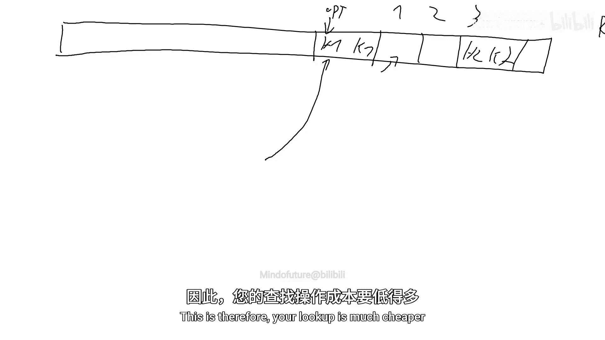

Is reasonable K。 down is first， quite a bit more difficult to implement and chaining。

 It quite a bit of code。 And second mean we didn't talk about parallelism at all。

 but a chaining hast you can build in parallel， reasonably easy and with as many threats。

 A Rob Ho hast is not easy at all to build it with and parallel with multiple threats。 so therefore。

In if in doubt， very implemented chain has table is a good first approximation。Okay。

 so see now I spent already nearly an hour talking about in memory H tables。

 I wanted to talk about auto memory H tables， but yeah so this is what we want to look at next。

 but first of course before we can look at the auto memory case we have to understand the in memory case。

😊，Now in principle， we would want to do this on external memory2， so on disk。

But so the basic approach that we used we cannot really use for for disk as it' just too expensive because random I and disk is super super expensive。

 At least if you have a rotating disk。 but even if we don't have a rotating disk SSD reading up block from SSD is quite a bit more expensive than accessing a memory location。

 And so random I O is very， very problematic。 So if you would， for example。

 do a chain hash table this would not be good。 So we go for the first element here。

 one access to disk， at least if you' are unlucky。 So then you follow the chain another access to disk。

 So we follow the chain further， another access to disk So this is very， very expensive。

 this is not not good even worse is this one Yeah。 So we with collisions。

 you could say case access to memory locations that can do this。InV case， this one here。

 because this happens。If your hash table grows mean I said， choose your hash table。

 such that is a bit larger than the number of elements。

 but how should you do this if you don't know how many elements you will get Because initially if somebody has a gray table。

 then your hash table is empty so you don't know how many elements you will get So how do you size your hash table you only observe over time how many elements you have。

 therefore this is very， very difficult。 and the usual solution， of course， is rehashing。

 which means I fill my hash table until it's reasonably full and then decide oh， it's too small。

 then I built a larger hash table and copy everything from a current hash table to a new hash table。

 So this is a rehashing。This is already expensive in memory， but on external memories。

 this is prohibitive。 It is super super expensive。 In particular。

 if you use something like a prime number hash table because then the new hash table has nothing to do。

 So like say you have a has table of size 11， then say， oh， it was too small。

 So you make a large arm changer to a has table of size 19。😊。

And for this process were both prime numbers， the location of the inputs here will have nothing to do with the location of the inputs here and totally spread out。

Therefore， this is super super expensive。So therefore for external storage， we need something else。

 we need something that avoids this terribly rehashing performance and hopefully also does something a bit about this chaining problem if we can Okay。

 and this is what we want to look up now。😊。

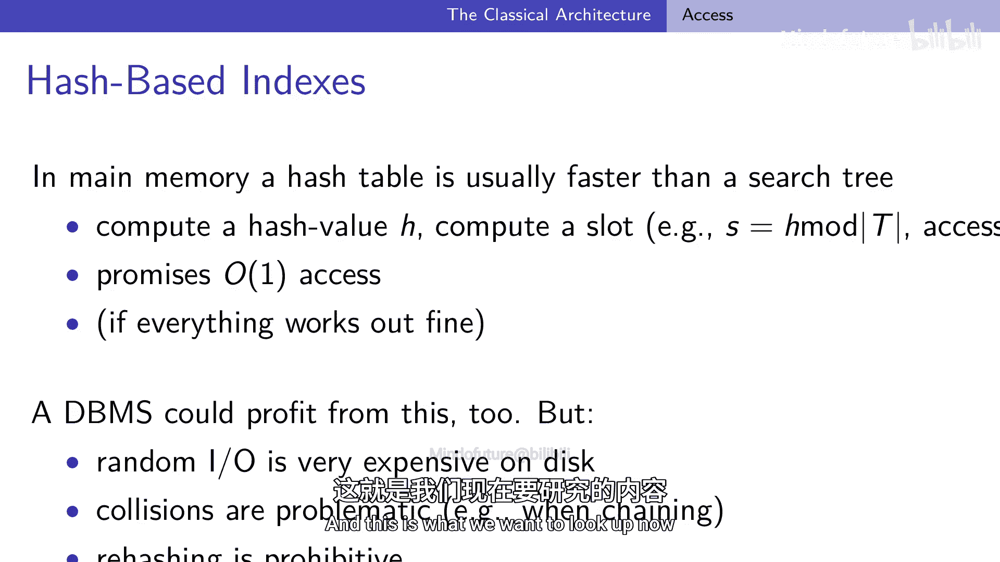

And。Before we look at implementations， just two notes。

Hash tables are not as useful in general as tree index because in tree indexex。

 if we can do range ques and point ques with has indexes。

 we can usually only do point ques so there are hashing schemes that claim to do also support range ques like order preserving hashing for example yeah。

 but trust me this doesn't really work Okay here the site is more polite sets this is questionable Yeah in in the general case。

😊，If you don't know anything about the distribution of input。

Ader preserving hesching doesn't work and you can even prove this and also because you can prove that you can construct inputs where our order preserving hesing must break so therefore in reality we cannot really do range curves。

😊，We cannot do little pointques。 Yeah， but these are some consequences， of course， namely。

InP means we can only use hash tables for primary keys。😊。

Mean primary keys work because every primary key is unique。 every iPhone and we have。

They have a quite reasonable chance。To to get collision free inputs or have few collisions。

 a few collision we might have， but not too many excuse me。😊，Okay。If it's primary key， that's okay。

 because then if my has function is good， then I most likely have no collisions or few collisions。

 then I can leave。😊，But what about a nonprier case like in index and a attribute AB so then could be here what we already talked about when we talked about indexes in general。

 how do I delete a tablet where one million other tablet have the same value so with B trees we do the trick of apps the table ID so my trickchea was I use key table ID to make it unique because these combination is unique So then I can find everything but I cannot do this。

😊，Yeah，Because this if I want just wanted to find the keys。

 then this would require a range query and a has index doesn't support a range query so therefore I cannot do this。

😊，Now， so therefore， in reality， hash tablets can only be used for power keys for elements that are unique。

😊，Now， the last element here says we could。😊，We could fix this by having a separate index for duplicate values so like what you could do is you have a a table。

😊，So then you have here an elementium， So key key went on。Andnitiallyally you implement， for example。

 classical chain or whatever。 And then if if at some point you realize that your chain becomes very long because you have a lot of collisions because because every value 10 steps the same so every interest is the same value here what you then do is you switch your whole chain。

😊，Sa we risk。Keeps the first input。 but then I switch my whole chain to a tree as we can build。

 at least in principle， build a hybrid of a hash table and a tree。

 So we start a hash table And if my if too many identical values。

 then switch to a tree structure and then we can guarantee。

 of course that we can get logarithmic access cost even in this combination。 Yeah。

 but this is super complicated to implement。 I know a few implementations of this， but this is super。

 super difficult。😊，Most likely you don't want to do this it's so easy I want to use a h areaio when you know everything is unique or use a B tree if if not。

 but this hybrid of bows can be paid but it is very， very difficult。

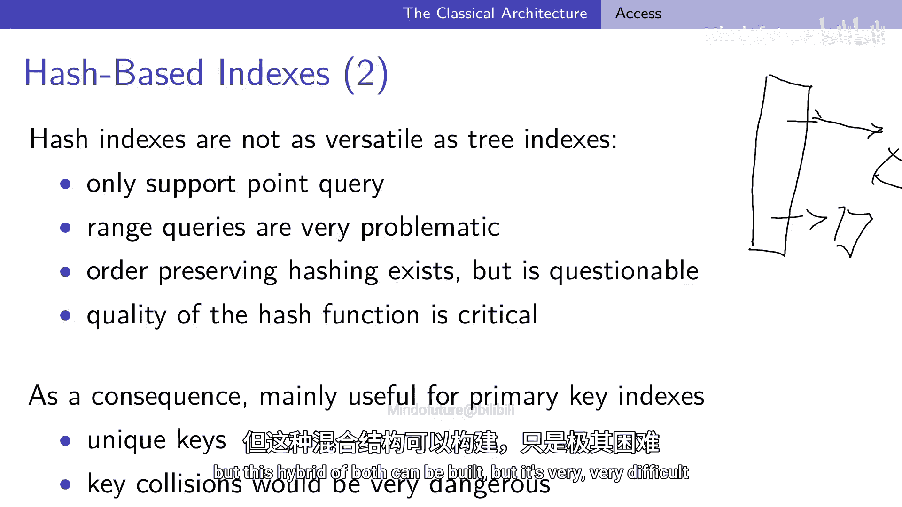

Okay， and I've seen already that I have only 12 minutes left。 well， I don't 12 minutes。

 We can do this So so。Therefore now we now want to look at a hash table that works on disk and avoids these terrible problems so to to make it work easily we would have to know has table size if we cannot know it。

 if we make it too small， we have too many collisions if we make it too large we waste a lot of space and also performance as poor because heching doesn't work。

Now all chain is doesn't really work on disk because jumping from one bucket to the other is not good。

You we set a traditional solution to unknown table science as rehashing。

 so we' can build a new table and update everything。

 but we touch everything then it's super super expensive。😊。

So therefore the idea of extendable hashing now is we built a hash table that can be grown without rehashing and we do this by sharing hash table entries as if we're just reusing what we already have so now how does this work。

😊。

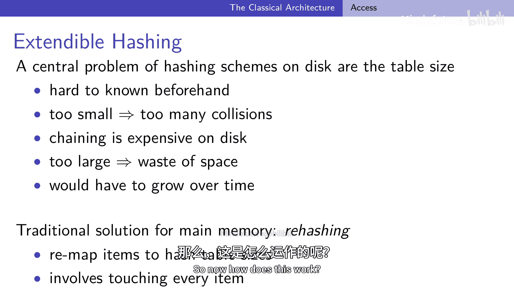

So first my has table size is always a power of2 and I have size 2，4，8，16， and so on。

 so always a power of2。😊，And the hash table now points to a bucket into each bucket， of course。

 as a page and now multiple entries can point to the same bucket。

 but the the pointing of entries to the same bucket is always symmetrical。

 which means we have a buddy scheme， I'm not sure if you are familiar with the term bodydy scheme but the bud systems you might have flt about in operating systems because there's a popular strategy basically。

A set of。Values are bodies。If。So when is a ven number of various bodies。

 so body set is a body system。sorry， I cannot write on my this pen here is a。嗯。Buddy system。

Assistant if。First， size of S is above 2。So can be two points on and entries second。Elements。Man's。

In S。Are neighboring， so this is a1 spend， basically。Neighboing。Like， for example。

 the values can be 2，3，4，5 and so。 by the way， this is not a bud system because 2，3，45。 Oh no。

 it was was in nevertheless it is not a bud system。

 but at least I currently there is no contradiction yet because it is above to end neighbouring as the third conditioner says。

嗯。Last。Last。Lock two sides of S pits。Must be identical。Yeah。Okay， so basically。

 so if you look at the values here。For example，0，1，2，3。 So these two are bodies。

 these two are bodies， these four are bodies。 but two and one and two for example。

 these are not bodies。 Yeah， because yeah must be a power of  two and the last bit must be the same。

 and they must be neighboring so。The basically takes a whole range and always break it down into into halves。

 and then we end up with a body that we have okay。And so。

But this is the structure that we want to have and now the depths of buckets varies is one of what depth means depth means how many bits did I use for my hash function as from the input So in this case here we have now a small hash table the containerer contains only two elements and so basically use one bit for my input here。

😊，Because and and if my input， if my input hash speed is 0。

 I go to that packet and if my input a bit from a hash speed is one， I would to go to that packet。

 which means， of course， my Dps is0。 I use no bit。 Now， it doesn't matter what you do。 Des is。depth。

Is 0。 because I no no bit is required。 So and my bucket here and have two values in my bucket A and B。

 Now， if you insert something in my bucket， let's say insert the bucket value C， then， of course。

 it's full。 Of course， I don't have space for C my page full。 So I want to insert C。

 What I do now is I split my bucket。 So I I take those this one bucket with A and B and transform it first first。

 for the first moment， ignores the C。 So I take my one bucket that contained A and B。 So I take A B。

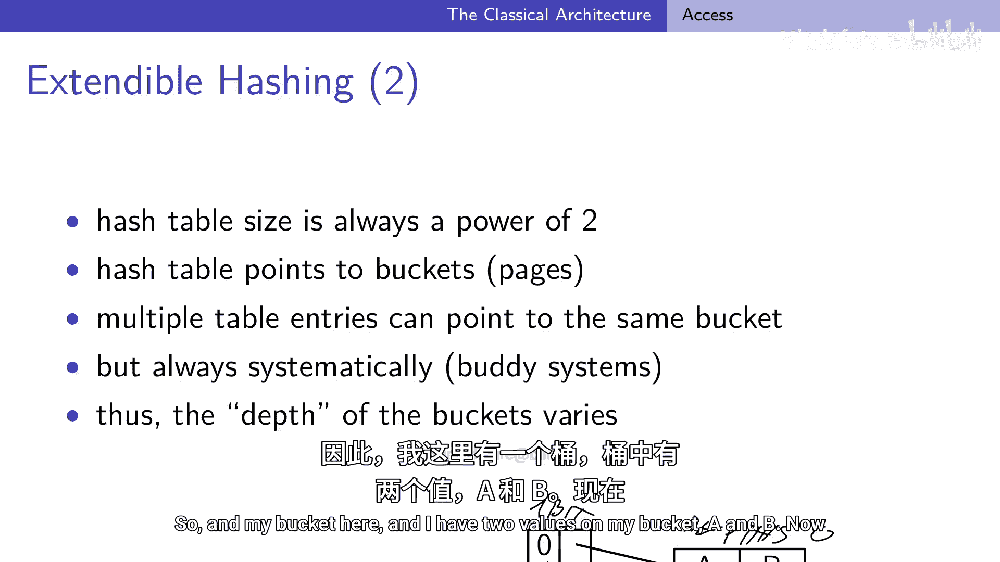

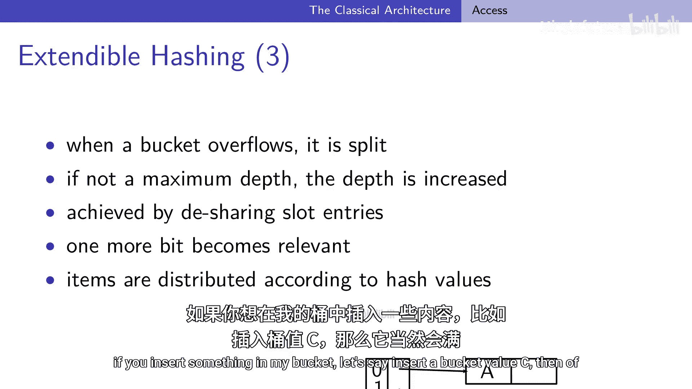

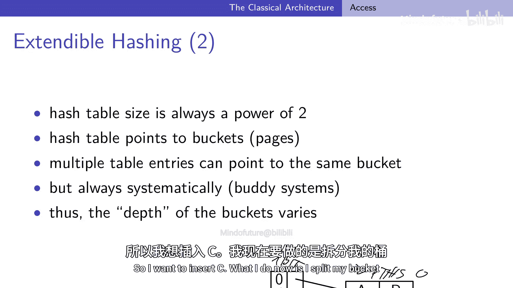

And I transform it into two buckets。 when containing a and one containing B。 Now， how did I do this。

 I used now1 bit more initially I used0 bit from hash value because knows matter what you do now I decided to use one bits。

 I took this bucket， I took all elements from a bucket A and B。

 I look at the hash value and I saw okay if I look again1 bit here。

 if I look at the last bit of my hash value then I see if I if I take a。

 I get a 0 of take B I get a1， therefore I end up in two different buckets and I have two buckets。

And now I can I have free space and now I can insert my see。 So Ive I have depth here。 Okay。

 so now in this case， my so I could just do this because I could unshare a pointer。 Yeah。

 so initially here this pointer was shared， both pointers were pointing to the same bucket。

 I could unshare this。 and therefore my increase my depths in if if this is not possible so。

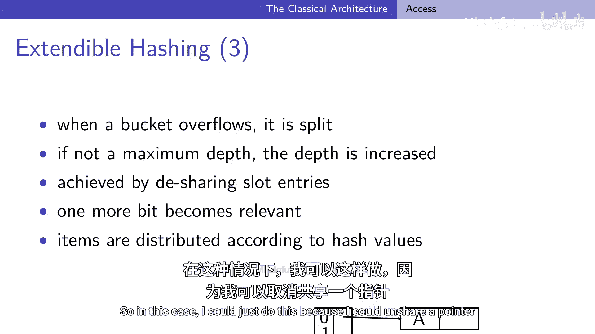

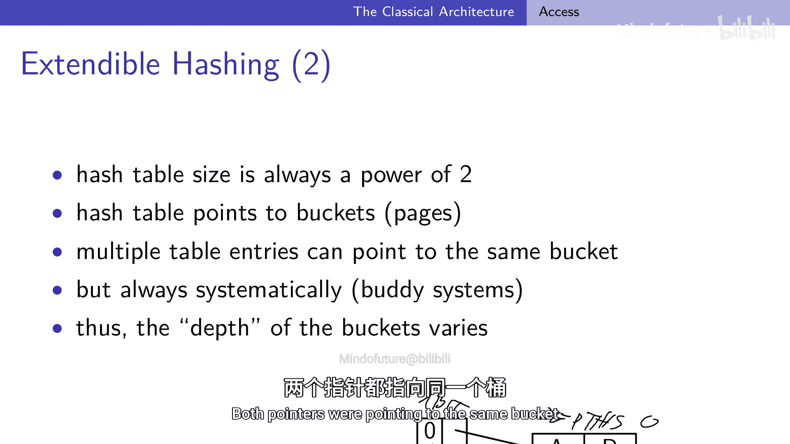

Then I must increase the global depths and then must increase the total dictionary。 Okay。

 I see this in a moment， but before we do this let's make a small slightly larger example。

 so let's assume my input here was the bare table of size with two bits。😊，Initially again I use0 bit。

 so everything points to AB。So I will now want to insert the C that at all， so this is of course。

 bad。So then we split this in and now we。Instead of one bucket now， we have two buckets。We had。😔，A。😔。

And B。Now in my example here， we did say that let's say this point here and this point here。

 and now I could insert the C。 Now， if I want to insert the D again。

 for example and this hands hands ends up to happen in this bucket here， bucket is full。

 but now it happens as I split this bucket again。And then I can， for example， end up with。是。😔。

B and then could be that my D end B and then everything's fine。 And then nothing happens with a。

 And so you see if a bucket overflows， I split this single bucket and of course。

 I updates a pointers to that bucket。 But all other buckets that I have in a has table are unaffected。

 So this is the local change。 so this is of course good because I don't have to rewrite my my hash table I just have have to update if few pointers in my single bucket and this is ideally what I want。

😊，Okay， and now if this is not possible。 so in this example here。

 if has this table to forget this Excel example， if this table here Im ABC。

 now I want to insert something and B is full， I cannot I cannot get unshare because there is no sharing in that case。

 I double my table。 So now from two entries I go to four entries。😊。

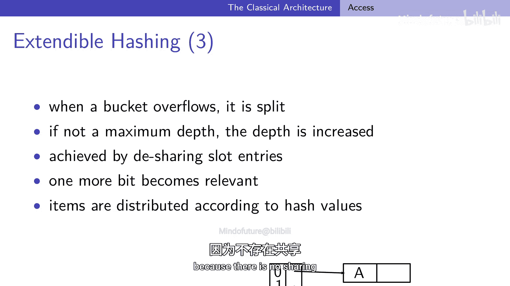

And now because I used one bit more， I now say that okay。

 the originally adjusted you to this was my my original one， the first one original。 this is new。

 so original bit was 0 and then new bit the new bit。

 So we say original bit 0 doesn't matter if the new bit is 1 or 0， everything points to a。

 then if the original bit is1 and the new bit is 0。

 I go to B as about1 I go to c and D and this means we have split we have rewritten the table。

 but the bucket bucket with a was unaffected。 We didn't do anything with the bucket。

 and the new bucket is then linked in as user。Okay， and so。

Is more invasive because I had to re rewrite dictionary， but I did not have to rewrite the buckets。

 And， of course， the buckets are much larger than the dictionary because if you I think about this。

 we have here， this is a database page。So this is a page and on a page with a dictionary。

 we can probably point to100 entries or so， so the table will probably be smaller than by data by a factor 1 thousand00 smaller。

Smalder than the data。Those in pockets。Buckets。Perfecto。depends it on your size。

 So by this this point。 So therefore， if you rewrite my date。

 my table this is far less bad than having to rewrite order the buckets。 No is expensive。

 but it's not super expensive。 Okay， and then I can， I can just increase the number of bits。Now。

 the only problem is。I， I cannot grow there the table is an unbounded size because， you know。

 if always double double double， you all know about exponential functions。 Yeah， so at some point。

 you cannot do this anymore。 So your， exponential growth must stop at some point。 Yeah。

 and so therefore。

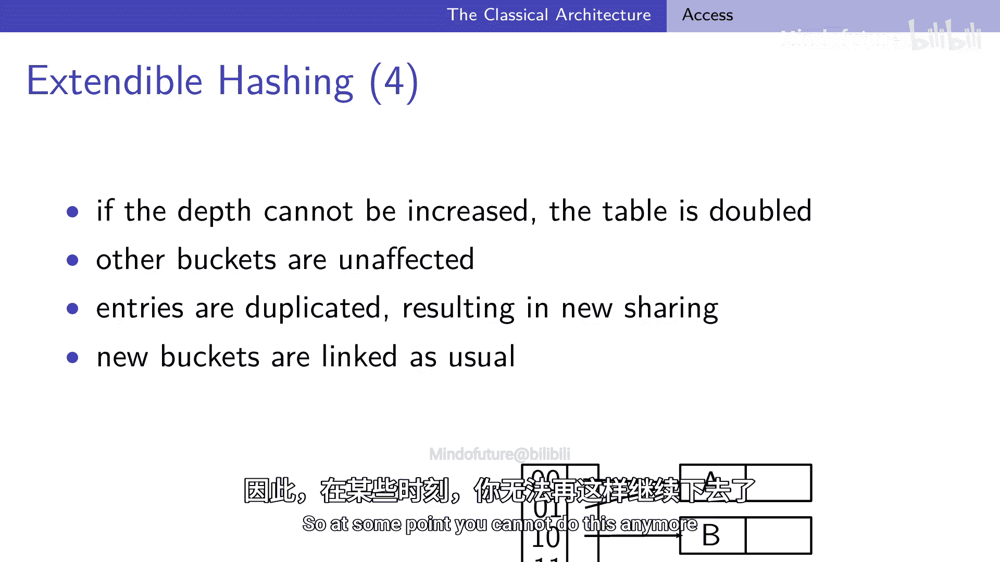

At some point you probably have to fall back to chain even in extensible hashing so we don't want this in an ideal where this never happens now because if hash functions are good then this simply never happens it you reach a maximum table size but you know remember hash function could be bad or you have some delicious user that gives you a lot of values versus the same hash value and then of course you have a problem because if you have really really conditions collisions on your values or at least in the bits that you use so then increasing hash table size doesn't help you much but the really collision doesn't help you at all because mean if you identical it after increasing has still identical so therefore we need some strategy to hand users。

Yeah， but nevertheless。We hope that this never happens。

And then we we can we can cope with this and we can we can process this Okay。

 now the advantages of extend graing are ideally we need exactly two page excesses per lookup because we look at the dictionary once and then we look at the bucket and that's it and this which is less than a B tree wasn't a B tree we expect have something like like two or three elements excesses perhaps even four if it inputs really large。

 So therefore extended graing is expected to be faster than a B tree。

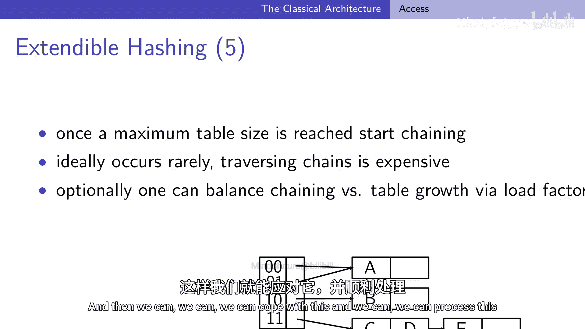

And what' a good thing here is we can grow the table independent of the existing bucket and we don't have to do rehashing。

Okay， so these are all advantages。 Now disadvantages， table grows is a very invasive operation。

 We have to copy the table and the table can be large smaller than the data but nevertheless is large And this also leads to very large steps in space consumption。

 because initially my table is small of course， you small table then time passes then double the size。

 Okay， still okay and then double the size still okay and then double the size then still okay。

 then you know out of screen。 And we have we have extreme steep steps in space consumption every time when the bucket when the table double then this next problem we is what do we do with he collisions Yes if we have real has collisions。

 then we have serious problems。And yeah， so of course， we hope this doest happen， but nevertheless。

 we need to do something in the case that this happens and this all makes sustainable heging quite complicated。

😊，Okay but I'm out of time now， so therefore I will stop here and now we will look at other techniques to bring hash table to disk in the next lecture okay thank you。

😊。

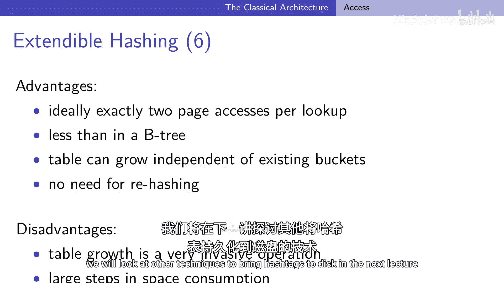