# 【慕尼黑理工大学】现代CPU架构上的数据库系统实现-｜-Database-Systems-On-Modern-Cpu-Architectures-2021-p08-P08_08_事务--BV1asiJBeE6j_p8-

Welcome to the lecture on database implementation So in the last lecture we have looked at hesing in general and then particularly an extendable hesing。

 so where we have to store a hash table on disk and of course the fundamental problem here that we have is how to grow the hash table as we saw as the classical in memorym solution we just rehash everything a highly unattractive because we touch every data item that we have is of course very。

 very expensive if you do this in a random fashion on disk and then the idea of extend hesing is。

That you have a dictionary organizedised by hash bits and we use more and more bits as which they grow and initially in this example we just use one bit。

 then when we need more space so we we have to distinguish more buckets。

 say we double diary so by using two bits and then we can only update the directory without updating the buckets so we rewrite the director entry but we can just have two pointers pointing to the same entry here。

 therefore we don't to rewrite all the buckets only the buckets that is overflowing。

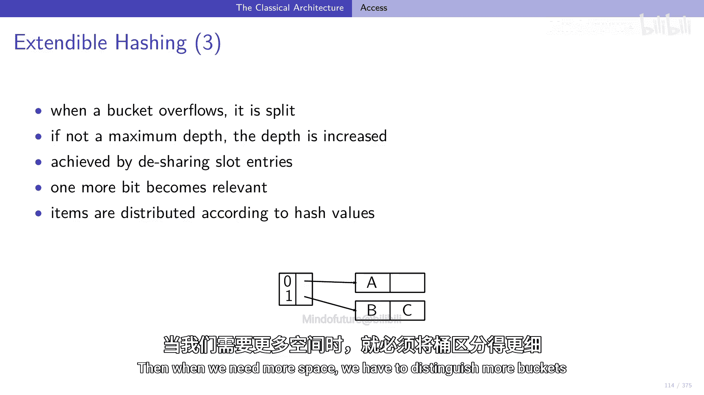

So these all quite good， and so this is a scheme that indeed can be implemented on external storage and this works reasonably okay。

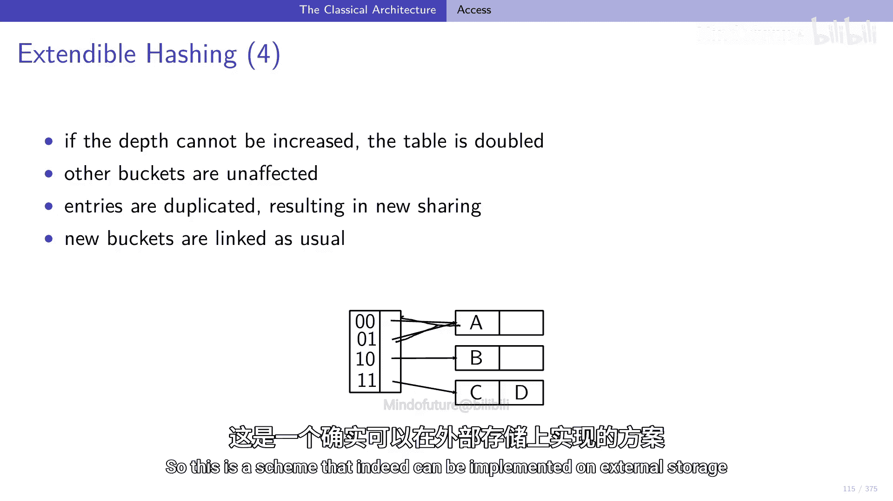

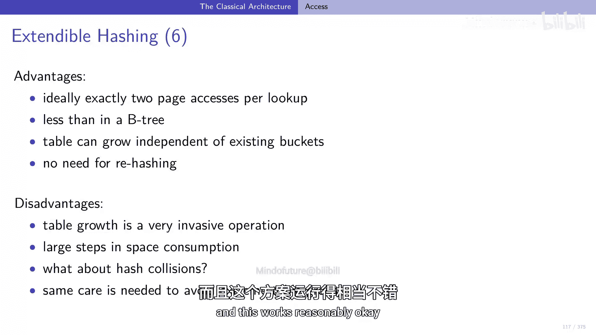

Now嗯。One unfortunate thing about extend batchshing that we also mentioned in the lecture last time was said we have a very stepwise growth。

 So if this is matchable size， initially I attach to it small， then if it's full。

 then of course we double answer if this is a space。

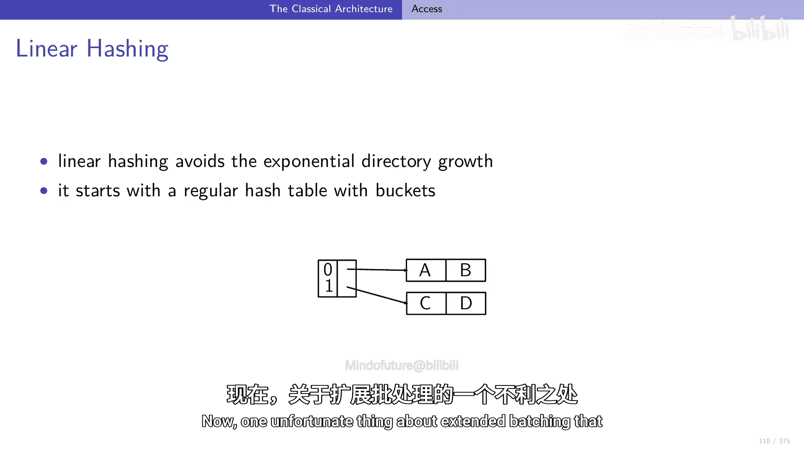

I try to do it like our。 So when we double， then for a long time， we don't do anything。

 and then we double again。😔，Then for an even longer time， we don't do anything。

Then we double it again there like this。😔，And then we yeah， it can doesn't fit anymore。

 and you see what's happening here， so we have some extreme steps in growth because of the exponential growth of s table。

And now amortize， this is okay， of course， also if he amortize over everything。

 then the cost is not too bad because we don't do this doubleling very frequently laser becomes more and more rare the larger than table is。

So am it's okay， but nevertheless， it's very unfortunate if such a step happens。

 so if you have to increase the size of a table from 10 million entries to 20 million entries。

 so this is a quite expensive step because you must write everything it can of course can be can be even higher so it could be that for many seconds or first case even a minute or so you wait until the is growing so it have a very nonlinearar progress in size。

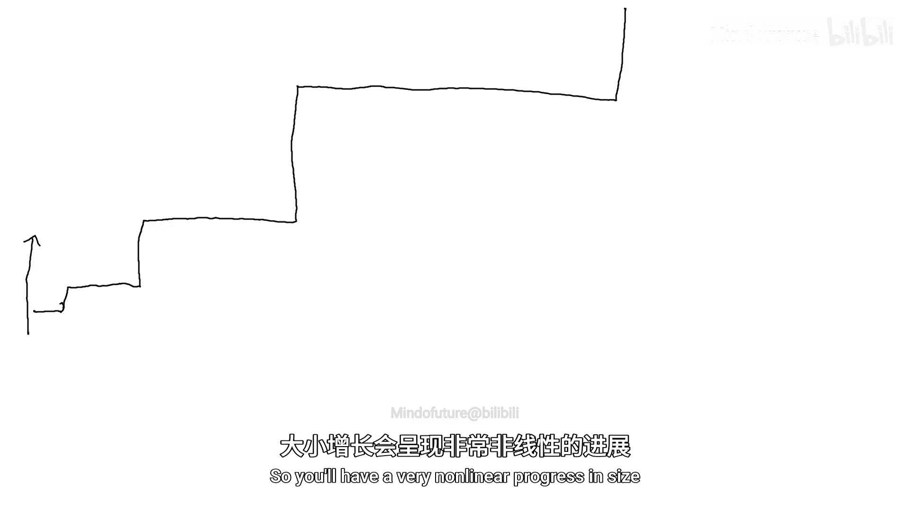

And this makes some people unhappy because if you stop your system for many seconds。

 it is not good for a user experience because user has to wait。

And therefore people have invented or people' not precisely Paul Lason， or I should say。

 pair Ocker Lazen， which is his correct name from he was later at Microsoft but I think he was still in Waterloo and invented this。

 so he invented Lina Hesing。And so this is an external storage scheme that allows you to exponential just like extend gra。

 you grow the directory independent from the buckets。But we do this in a more graceful manner。

 so we don't do this exponential growth step Okay so how how does this look like So first we start with just like extend ratioing rules like this since this directory here could also be from extend ratioing also we just have a directory and points to buckets Okay now this interesting question is what happens if we have to grow。

😊，So then extend linear heching does not double the directory instead。

 they double only some of the entries， which is a bit surprising that in fact， is really possible。

 and so the first I should say perhaps first when when we bucket is full。

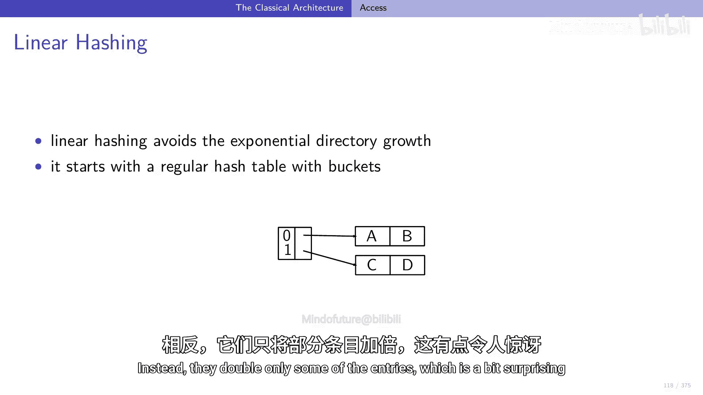

We do chain And so when buckets will we do chain and we say this is okay if the chain short so the chain bonds。

 we say perhaps it's okay。Now， but if my chain gets too long or too many buckets have changed both the possible grauterium。

 so then as I no I must really increase my directory so now I must do something。Okay。

 and then so at a certain point here either triggered by a low tractor or by chain length or something。

 So if we we give ourselves a boundary， then we start。bucket split。 And Now。

 what we do is we add the bucket。The the new bucket to the directory at the end。 by using more bits。

 suppose this this looks a bit funny。 if you look at this。

 So you here you see a hash table that says， okay I use if if my2 hash bits are 00， I go to B。

 if my last hash bit is a 1 doesn't matter what it comes before I go to C D。

 And if if my two has bit are1 and 0， I go to AE。And so here implicitly here is a star。Yeah， Z and。

As I said， this looks a bit funny， but what happens here is， so if this was my starting interview。😊。

Just 01。 So then I have a split marker here that that the position K and this K tells me that what has been split already。

 So initially nothing has been split。 of course， as we say I don't know my case here So I have nothing split。

 So then if I new space and I decide a splits the beginning。 So in splitting of course。

 always means I use one bit more So I beans me now I splits this。😊。

Me I use one bit more and they say here okay， I use one bit more and what what with other case because they now they。

 of course there two cases， then it's the second case at the end。Next what we have two。

 two boundaries here here this is the width force has been split already。

 and this is the old table size Okay now if at some point so we here and the start you see we say the range from12 k has been split range from k to n this un split and the the range from n to 2 k minus at n plus 2 k minus 2 these are the second half of the split values this grow at the end okay。

And so so we be have split this one entry。 Now， if you have to split the。

 the bucket with a one again。 So in if you have to split again。

 then remove the split mark of one step。Down。And then I say， okay。

 now I use one bit more for this package too， so now I have 01 here and one one here。

Now so right now at this point， again， I have a regular table。 So what I would。

 if I would do then is I would start again。 so would my split marker at the beginning。

 nothing is split。 So if I need more space， then I move my split marker here。 I split the。

Let me clear this。 Yeah。 So I split the。0，0 into 0，0，0。 And then。

 of course it gets the partner value here。 and this is 1，0，0。 So now I have split up to here。

 So others use 1 bit less。 the first packet uses  three bits。 Last packet uses 3 bits。

 other buckets use only 2 bits。Okay， then if again， if I need more space。

 I've move further down so I transform。01 into 0，01 and then Ive I put a corresponding entry here so then I I've split up to here and I can neither go split to here。

 so I do it like this， 11，0， I need I go to here then I have 1，1。

1 and then have a regular table again。Okay， so you always split one entry more And so this causes the total table of course。

 as the director to grow in a linear fashion。 so we get one entry more instead of doubling all the time。

 we only add one more entry。Yes of you。

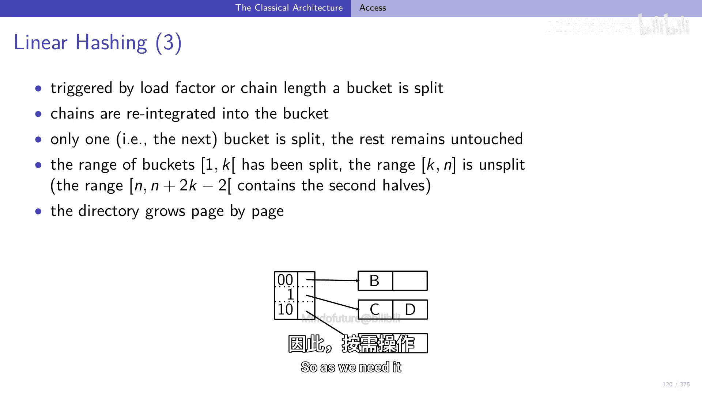

As as we needed Okay and yeah， so we be split on demand and at some point， of course。

 everything is been split and then we start use。 This is what I have shown you。

 Then we have a regular entry。😊，So and interestingly。

 lookup in such a has table is actually quite easy now because what you do is you know what is the maximum number of bits that you have then you could compute your hash value for the maximum number of bits and if you happen to end up in this shadow range here that has not been split yet then you just folded here and edits it because you want infant of one subtraction it's pretty cheap。

😊。

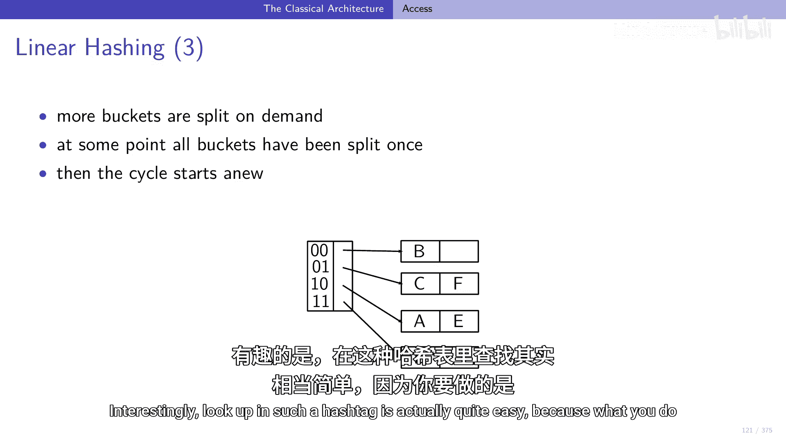

So the mapping a hash value choose this linear hedging is easy。 We just have to compare with with n。

And then if it's larger than and we must subtract。嗯。Don over node you have to。 Yeah。

 we dress subtract n。 this box。 So and so this。Is actually not certificate？

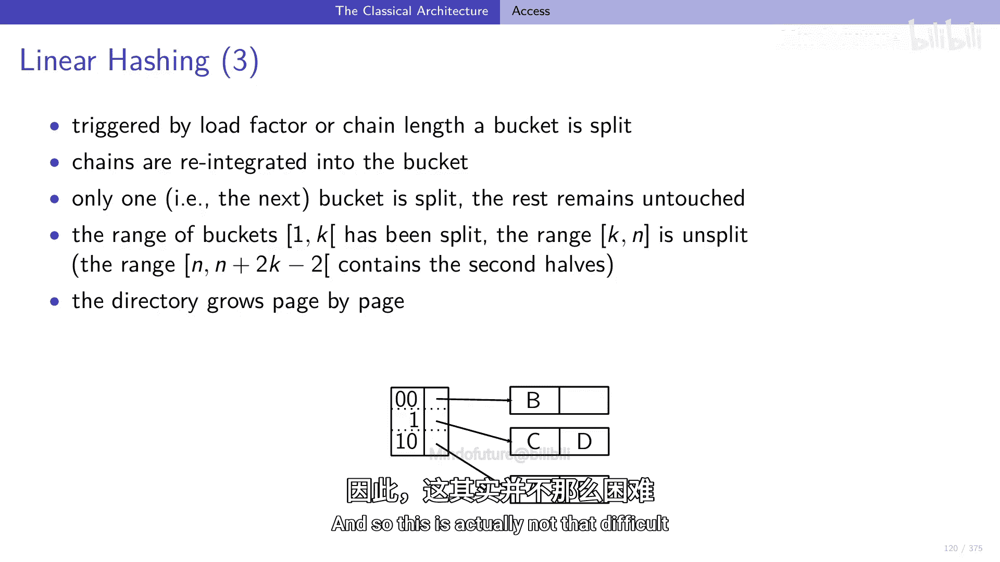

Okay， so so the nice thing about linearna hasshing is now we avoid this disruptive trajectory grow。

 So ex ratioing。 So extends reing has these huge steps here， so we small and large。

 larger and so on with Lina hashing we grow of course as the M says in a linearar fashioning because we add one entry after the other in the end。

 we have the same size， of course this is not drawn to scale here Now so linena hasing in the end is just as large as。

😊，Extends version。As， what it should look like。E。Proly I didnt didn't draw perfectly now but you know what I mean so in the end extending greenshing has the same size。

😊，But in in intermediate steps， lineating is much smaller because we don't。

We don have don't have to do double， we can grow on demand and so index grossly and if we therefore look at the amortized behavior of index structure this is very nice。

 size is good and everything is good。Okay， so these are the good， good stories。

 Now what is better about lineing as the first chaining is not so fortunate。 Yeah。

 so we don't like to chain。And because the longer my chains have course averse to performances。

 this is true even in memory， but on disk gets's even worse also chains are not so nice。

And now why I change the problem Now the problem is I cannot say if you look at this picture here。

 I cannot say or perhaps on this I cannot say I want to split this bucket。

 it's not possible in the linear hedging scheme I can only say I want to split the first bucket name is this one this one I can split but this doesn't help me at all because the first bucket is not full。

😊。

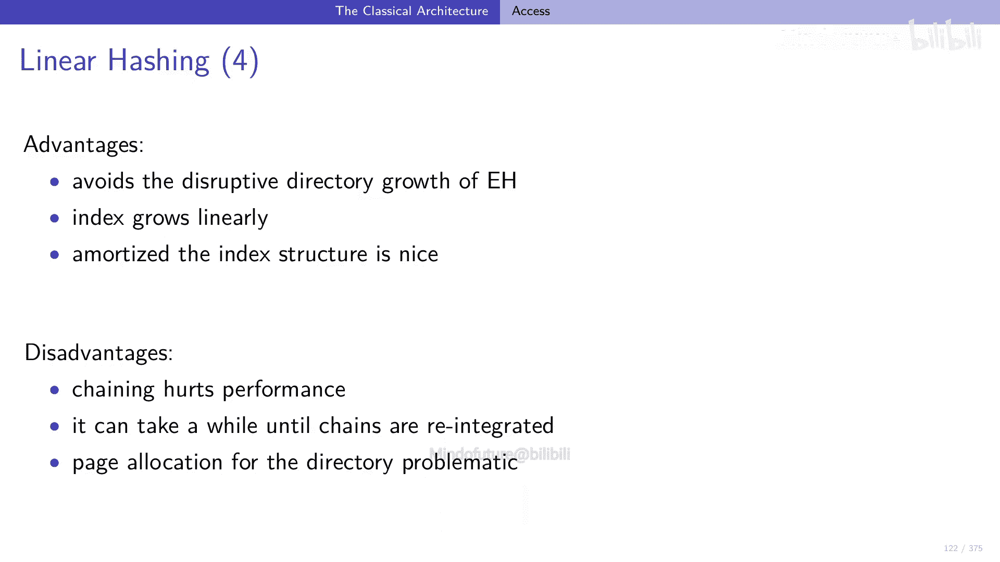

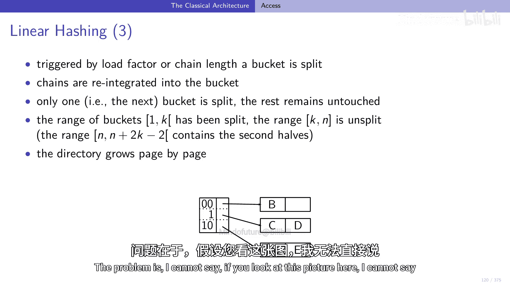

And so I split the first bucket， so my director growsy now to。1，0，0。 Yeah。

 but didn't help me with a full bucket。 Okay， then I can go step one step further。

 I again split in the bucket， but doesn't help me。 So I get 1，0，1。

 and only then is a full bucket here split。Okay， so which means the probability of having a chain is actually quite high。

 this is also the reason why they implement chain。😊，And because your sample overall rows。

 but its not necessarily the next one to split。Of course。

 if we wait long enough so at some point in time the split position will come to this chain bucket also we reach this point and then of course everything will be good again。

 but it can take a while so therefore the performance can be degrade at least for a moment until we wait for the split process to reach the bucket that has chaining。

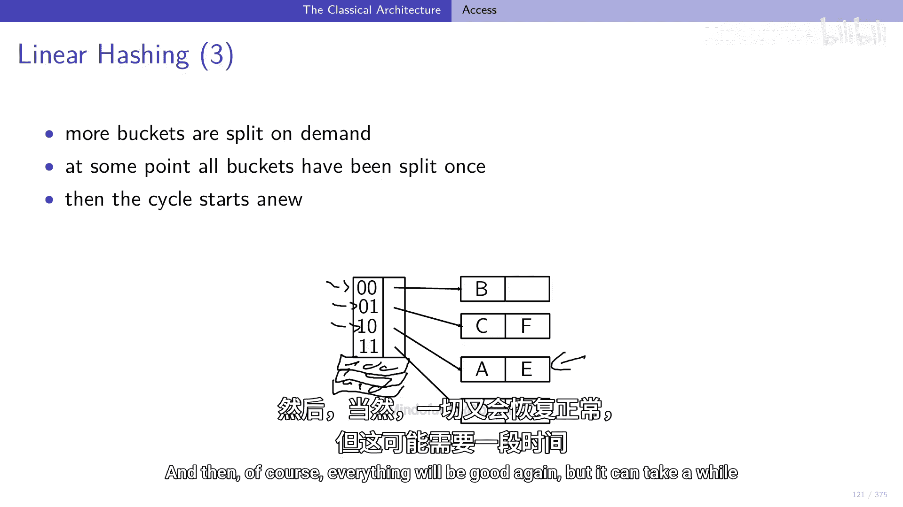

Okay， this is one problem。To performance。

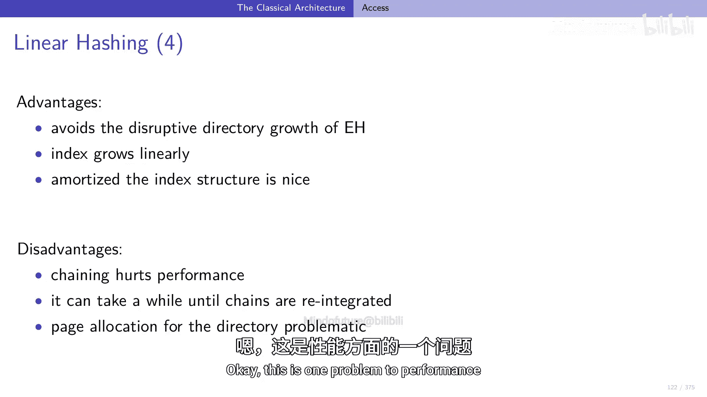

The second problem here is mean I have said so nicely so we start with size 2。

 so we just have a short draw a bit wider。😊，So let's make the picture a bit wider。😔。

So I start with just one bit here， that's good。 So then when we need more space。

 I have no problem I add a bucket at the end and then I get a 10 and there's of course a 0。

0 if I need more space here then again I get the 1，1，11， okay， if I now if I need more space。

 then I get here a0，1，0，0 and then I get here。😊，0。Oh sorry， this was one，0。1，0，1。

 and so on so this gets another0 here。 then if you need more space is like this。

And then I need more space， waste taxes。 Okay， so this is。And mess up once。So， and yeah。

 so this is all this。 Okay， so now on， you know， on a piece of paper， I can do easily do this。

 so I draw in nice picture。 everybody says， yeah， this is nice。 So the table grows linearly。

 This is good。😊，How do you influence this？😊，AndSo how do you implement the data structure that you can grow linear in size so that you can just grow at the end？

😊，If you don't know beforehand how large it will be， of course， mean。

 if you know how large it can be， it's easy， but if you don't know how large it can be。

Of course the size of this data structure depends on what data the user inserts on how much datas user inserts and therefore it's totally not obvious how to do this here so you cannot allocate the space easily now because it could be pretty large and remember this table here this has to be fit on disk somewhere which means this is this year my disk file as there will be range in my disk is my director say from year to year but there can be other data before and other data after。

😊，And at some point this this thing it will be full。😊，And what do I do then？

And asked this Paul lesson invent of the linear editing so I spoke to him and said linearaging is nice。

 but how do we implement this he said yeah the trick is to forget this picture so the picture says you do linear array here because we say we do a table at the end what you do in practice is we do adjust the tricks that we did with this dynamic snappiping So we chunk the array in relative so we have a beginning array and then we preserve more space and more space and so on so so you have to exponential growing things。

😊，And you see them from the beginning， and。And so then we go to a new chunk here。 this is， of course。

 larger。Oops this here should be ladder。 but I'm running out of bits。 so this should be a 0，0。

 then the and and and so on。And so we do it like this。

When nothing thing I mess up the numbers no is not right， it must be four entries you。

For entries here。 Yeah， and then the next， the next element goes to the next chunk on 1，0 and so on。

 as we exponential to growing chunks。And so then we don't have this allocation problem because we can dynamically allocate as many chunks as we need and we see how large the data structure becomes。

Yeah， but， you know， this now costs you one indirect because this means the beauty of hash table is that we take a hash value。

 We take the beginning of the pointer and then we just we add these two。

 So if we add the hash table the hash slot。 we add to the pointer jump somewhere。

 So this is what you usually do in a hash table if you do such a chunking mechanism here。

 we don't have the allocation problem， but we can no longer directly jump to to an entry and what we do is we take the has value。

 you figure out which which of these chunk it belong to then we go to chunk we do subtraction at one。

 It's not super expensive because you can decide about which chunk you take。

By using this one here account leading zeros because we know that the first entries will all have leading zero so we can play some games to figure out where everything should go。

 Actually， this would suggest that I should not implement it like this。

 but that I should implement it。Should implement it。I should have chunk them slightly differently。

 I should have chunk them。😔，Oh， no， no， no， no， no， it's not。 it's not right。 I no。

 it's okay that it did this。 I no， I it is okay。 I should just have。I get subopim specization。

 but that's okay。 So basically， what I do is I put everybody who has the same number of leading。

Zeros in the same bucket。As saw these， these people here now have。Okay。

 and then so this has of course this has two， this has two and then this has four。

 the next that says eight and so。 so yeah so if you do it like this。

 then we can use a number of the count leading0 function to figure out which bucket we have to go So we take mysh value take count leading zero so I count the number of zero in the beginning decide on which bucket I take takes the point to the bucket I takes the bucket number shift value to the left by the bucket number and then subtract this from theh value and then I know the local offset to which so it possible but cost you something like8 instructions also。

😊，And as you make that you exist all the interaction is in memory。

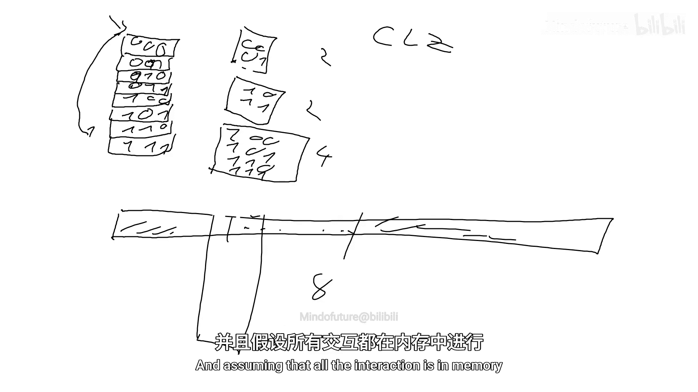

So this means that mean of course， if you go to disk， that's okay。

 so because got disk is so low who cares about eight extra interactions。

 but in memory this is quite expensive。 and so youre very visible if you do this in memory。

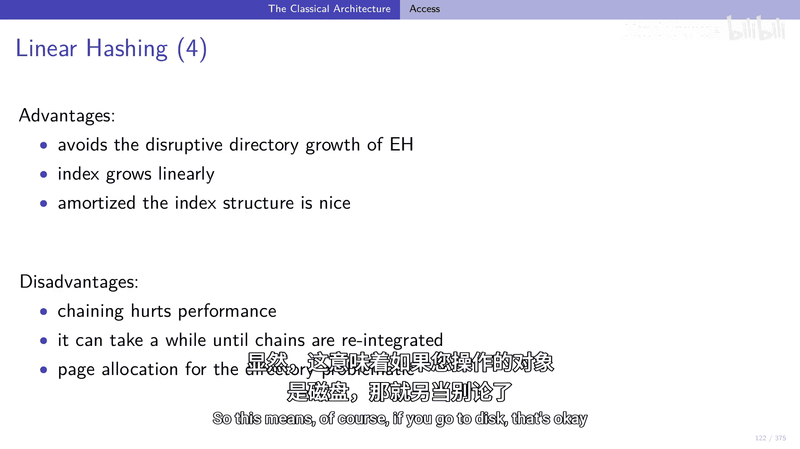

Foras， if you really go to this might be acceptable。 but I just saying， yeah。

 it's not impossible to do this， but。Pater location for direct is problematic。

 it's not totally obvious how to do this。Yeah， and whatever choice you do cost you something either a space or performance or both that this is。

On， on a piece of paper lineation is's easier to implement than in reality。 Yeah so， but now that is。

 it， is's a viable surgery and。I think I'm not 20% you。

 but I think Se Ser actually implements early now Hesing。

I'm not another 10% sure I spoke to people from Microsoft aboutlinating but I I forgot to ask if it's in the product。

 so I'm not 100% sure if they do， but potentially Stova has implemented this。

 there's definitely a viable strategy for external memory hesing。Okay。

 so but today I also want to look at a third alternative。

 what we can do to bring hesing to external memory， and this is multitatively extended hasing。

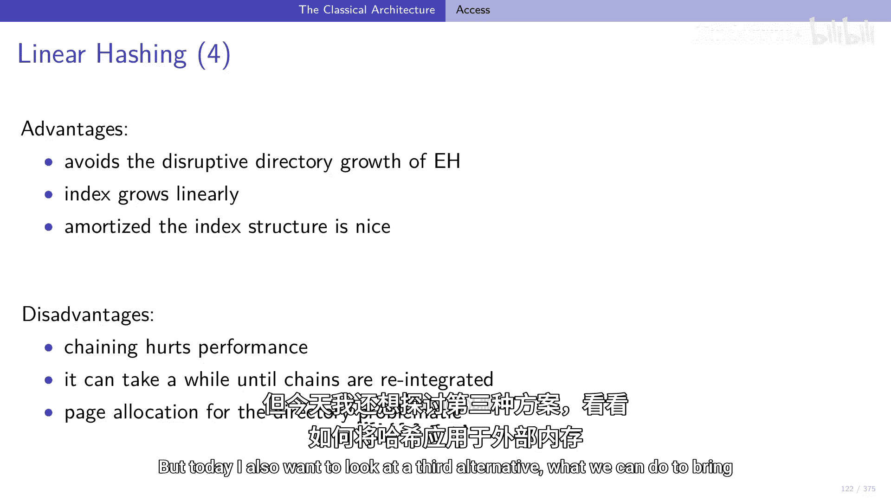

So now， why are we interested in this mean， one observation is that。Unfortunately。

 at least sometimes our hash values are not as nicely distributed as as we might have it And in an ideal word if really everything is nicely uniformly distributed then our extent hehing directory is quite fine。

 so here if see a picture we use four bits so we have 16 buckets there are 16 slot each slot points to a bucket and each entry there are entry so it's fine but so this is the ideal word。

😊，Now， unfortunately it can be that some hash radio are more frequent than others either because our has radio is poor so then we can say okay use a better hash radio so if you use a stupid has radio。

 like I mean， if you look at for example， the Java hash function for strings that is absolutely terrible to offer the has function。

😊，Yeah， so don't use this so if you use such a hash function。

 then it's quite likely that you get skus so that some hash wavess are more probably than others then we have problems。

😊，And now unfortunately， this can happen even if you have a great hash function。

 namely if you have duplicates。😊，AndSo poor has functions clearly is a cause of problems。

 but even good hash functions have problems， if you have real duplicates in the input because if you if two valuess are the same。

 nothing in the word can produce two different hash values from them so therefore fundamentally some valuess can be more frequent than others this leads to very unfortunate problems namely if you then look at extensivetenation。

 what happens is that here in our example we assume that these buckets here are frequent So if we have many many inserts here。

😊，In this range， as a small hashs are frequent， therefore， you increase your director all the time。

 but in reality， all the action happens in this range and the other ranges are always just shared。

 So this means we have totally have only four sorry5 it we have five packets here so there's not too much five packet but our directory is much larger because many entries point to the same packet。

😊，And if your directory is much larger than your number of pockets。

 this indicates that you have a problem in your hash distribution so it could be that your space of the index is dominated by the directory。

But I mean， this should never happen， but should not happen。 It's not the same as does not happen。

 so it should not happen， but it can happen。 And this is a problem。 Yeah。

 and here that says the director size explodes and of course if if we always insert values that tend to have hash values of so if hash value hash value is approximately all zeros mean it can be a few bits but approximately all zeros then you all end up here。

 and then of course， when your packet is full， you split directory so you double the number of entries。

 but this doesn't really help you because all the other values still have zeros So you still over overflow in the left packet while other buckets are very poorly utilized。

And here the that says Q is unfortunately reality。 This is unfortunately true。

 at least if you lose a lousy hash function and even with a good hash function。

Dlicates are a problem Okay， so now what can we do about this。 Now one idea， of course。

 is to say I just give up the idea of using a flat hash table instead I construct a tree of hash tables。

 Now so you see the first level I used four bits and then go somewhere now if I realized that my leftmost pocket here originally had one we go back to this picture here。

 we had this bucket and everybody here wanted to insert into this bucket。😊。

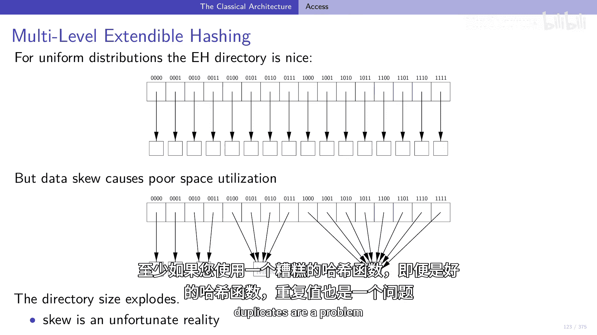

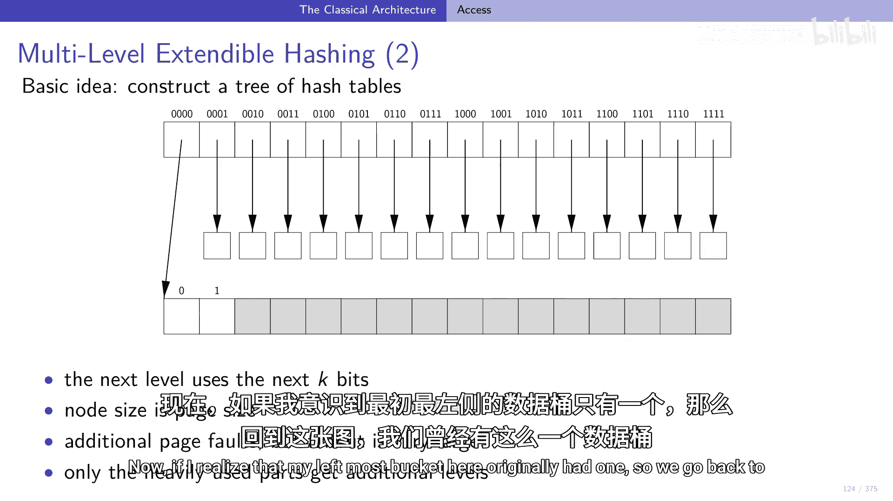

And then I realize， okay， let's just need more bits for this one bucket here because so far we have only used four bits here for but if this overflows I just start using more bits for this bucket。

 so I split the bucket and now in this case here I use five bits。 and I use one bit more。

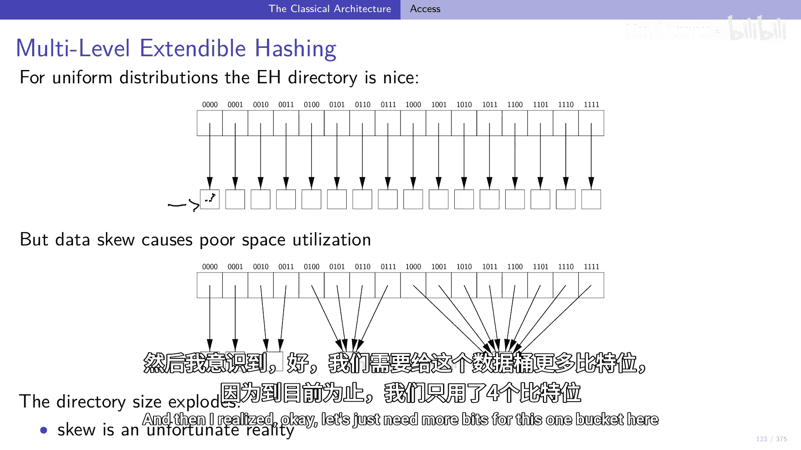

And so I have used now a part of my page here again if this is too small。

 then I can increase as here to within the page， I can increase as to 0，0，10。

11 and then I use now two four entries and so on and so I can use more and more bits and of course if at some point my pages is4 but then I just do another level and so the size of my my node here as my page size I just make it as large as pages now。

Clearly， building a tree of hash nodes has a disadvantage compared to a classic edge table in that the depth is no longer a constant。

 so traditional h table promises us constant times not reality might not always happen。

 but it promises us constant time。 And while if you build a tree of hash table。 and of course。

 time grows。 But on the other hand。mean if I if I encoded like this。

 then I just store a pointer on each entry here， so it means I have an extremely high fan out and have a fan out of 2000 or even more so 4000 depends on how larger pages so if you have an extremely high fan out and therefore my depths will be very low usually so usually I don't have to go very deep and everything fits。

 And therefore an additional number of pages that you get should be small。And in addition。

 we only do this for the heavily parts of use parts of the index。

 which means some parts where we use more bits is deeper down while the parts where we use less tape closer to the route。

 so wed only pay the price if there' is indeed s in the data。 Not so this is quite okay。

So tree officially is okay， but now we get another problem， namely space utilization。😊。

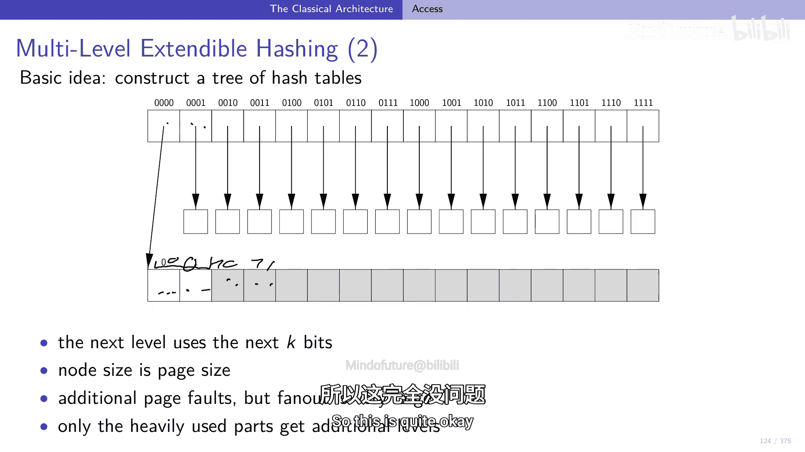

With extended hehing， uniform distribution was the best case for multilevel hasing so we just add a he level now uniform distribution is the worst case Now wise is the worst case if you have a uniform distribution over all packets then all packets will overflow at the same time roughly not really it's the same time of course but closely after each other all packets will overflow which means that at this point in time and all packets have overflowed you have seen something like this so you have a directory and then each directory points to another directory where we only use one bit so you have use one bit here we use one bit here we use one bit and so on so only use1 bit。

😊，And so the second level here， willd be nearly empty。Now this is of course bad。

 we waste a lot of space and by wasing a lot of space we also do evaluate waste performance。

 and because if if we have empty pages， and many of empty pages。

 then my buffering will not work well。 also my buffer manager will will contain a lot of useless data。

😊，And says therefore， I don't like this。 I， I want that my oil pages are filled with useful information。

 So this is the problem。 Now， how can we do this。 So instead of giving everybody a new page we we share inner pages using a buddy system。

 so now perhaps first go back to this picture here that picture。 So we start from the。😊。

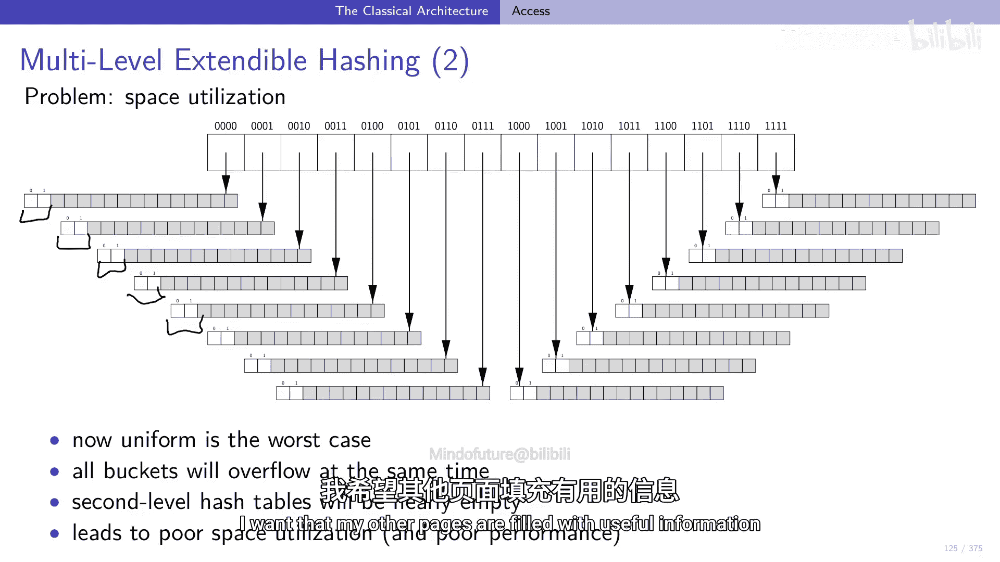

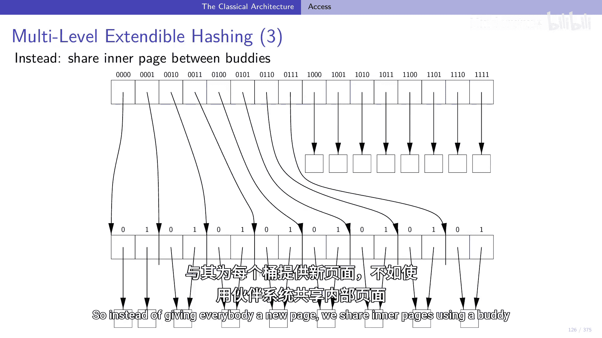

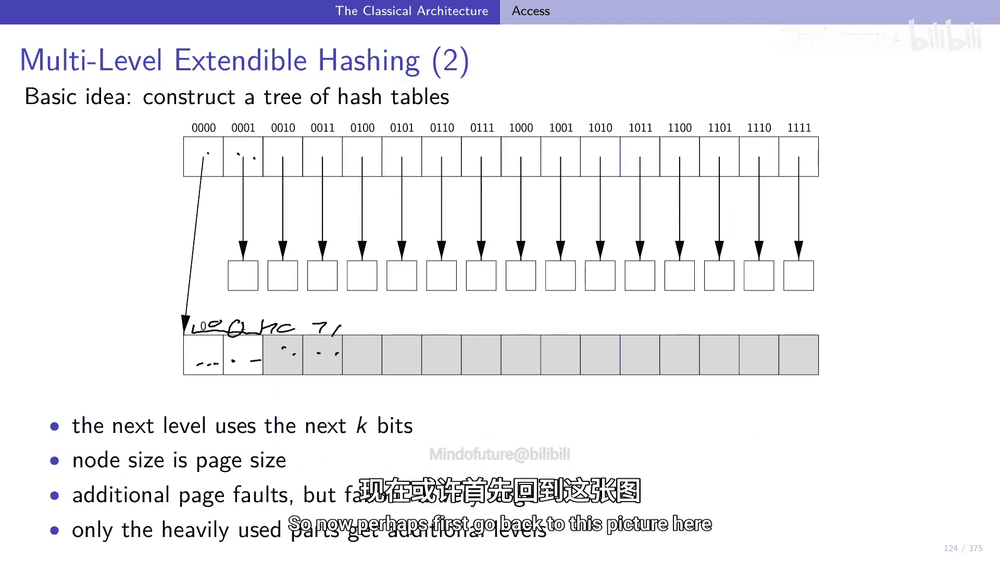

Picture in the beginning。 So this is more unusual start here。 So then we say， okay。

 I need everybody uses for bits。 Then I say I need one bit more for this bucket here for the first bucket because this bucket overflows。

 So now what this schemeche manager now does is it says okay。

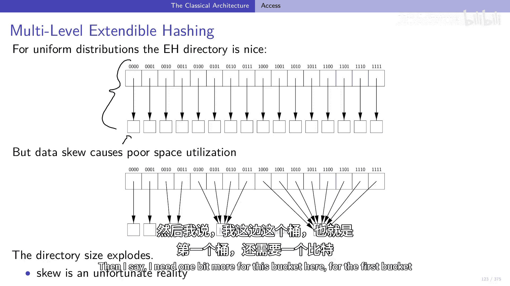

This first bucket， this was the bucket that was overflowing。 this first bucket gets one bit more。

 and this is this range here on the inner page。but because the rest of the inner page is empty so I don't use it anymore currently。

 I take all my buddies， which means remember these are this is everybody who has the same。

 in this case， the same first bit as I so everybody who also starts with a0 all my buddies here。😊。

And they are also moved to the next level， even though strictly speakings they don't needed yet。

 because they would be happy with just four bits， but they get five bits regardless and this you see that here if you look at this entry in reality this。

😊，Points all points to the same next level。 So in reality all use the same packet。

 So then they don't allocate in new buckets， just conceptually they move to the next level。

 So at what happens now， of course， I said if in the uniform case if this bucket here would overflow2。

 then we would have no problem because then we could just create a new bucket here and then move this point here same here so we now can gracefully overflow all these buckets without doing anything bad by just updating locally to pointers。

😊，Okay， so this is a nice thing。 So and of course， being if we can grow even further also if if now we really we have S here。

 so this packet is over again so far we have used five bits now so five zeros。 If now we decide。

 okay， we need six bits。😊，And we just split the page again as if if we take this in a page。

 we split it into part a half， so here is a half， or I think yeah this is half。

 we split it into a half and now the right half goes here and the left half goes here。😊。

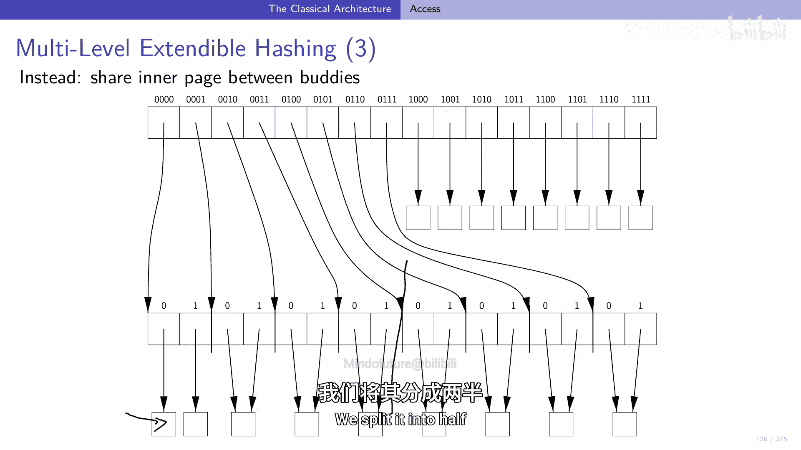

And now， of course， we can again split the first packet that we had， and then we here now use 6 bits。

 So this now uses6 bits instead set of  five。Yeah why my bud here still means I also use 6 bits。

 but reality the last two bits don't matter it's because you point here to the same bucket。😊。

And so this way we can get as many bits as we need until， of course。

 at some point we are we can continue splitttting and we can split it here then split it here。

 At some point we are V concerning the input pointer。

 So the input pointer is used all bits on the page and then of course we get another level so then we would go one level further。

 but until this happens， we can just split the page and give me locally as S many bits as I need。

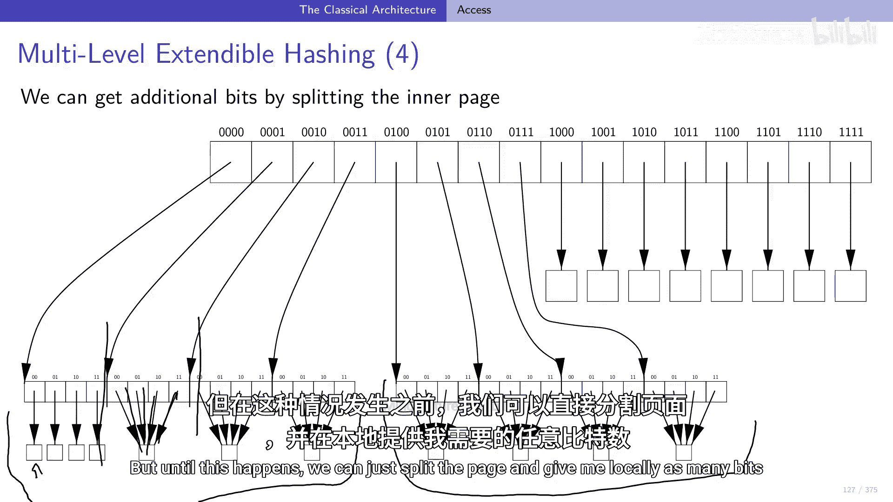

And in fact， we can do even better because what if we realize here， if we look at this picture again。

 we see that for this range of。😊。

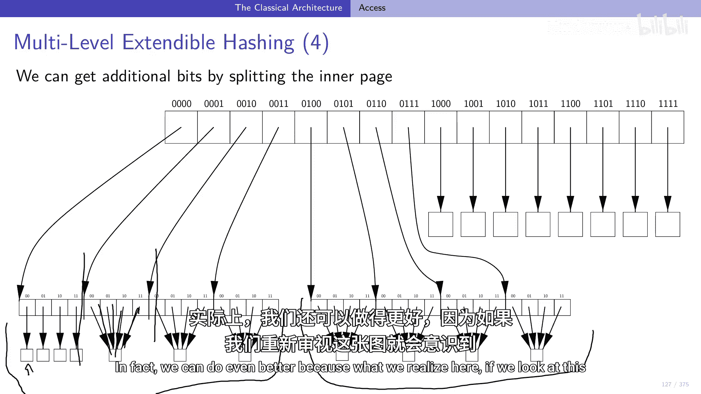

Pockets here， everybody points to a new page， but in reality， everybody uses no bits from the page。

 And because mean conceptually， this one， you has four bits。 But in reality。

 doesn't matter what value you have， you always end up the same bucket。

 So it means that you use only four bits and not 6， even though it looks like you do 6。 Now。

 if you recognize that everybody in this page does it。

 Then what you can do is you can fold it back up。 Last you remove the page。 and then you。

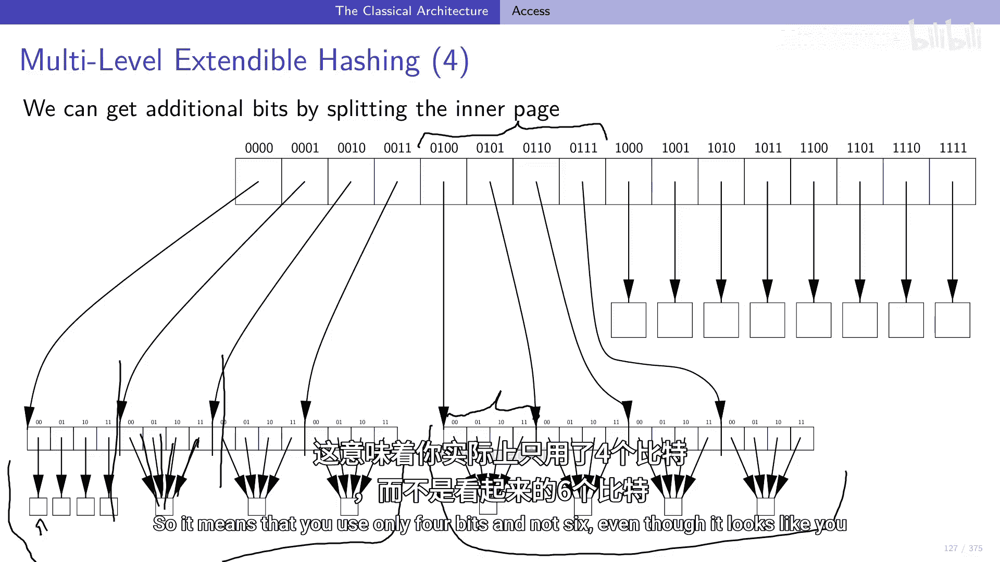

Again， come to a nice situation。 So we just need one additional page。Okay。

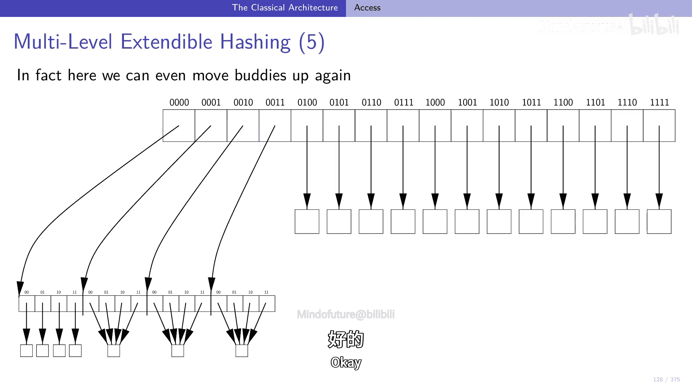

And so the good thing is， here， So this， this message here uses the body scheme so which meets the boundaries between。

Bdying entries are always power two and you can implement this using no extra information。

 So this is perhaps a bit surprising that this is possible。

 but you can implement this by using just an array of size in this case。

 total power of4 by two power of n elsewhere expenditure sized entry and then you just look at the pointers and then you see for example here we see okay I have I point to the same page as my neighboring entry。

 therefore this must be shared page and in fact I' also point to the next entry as this one here and therefore I know that this four entry share page but I do not point to the same page as。

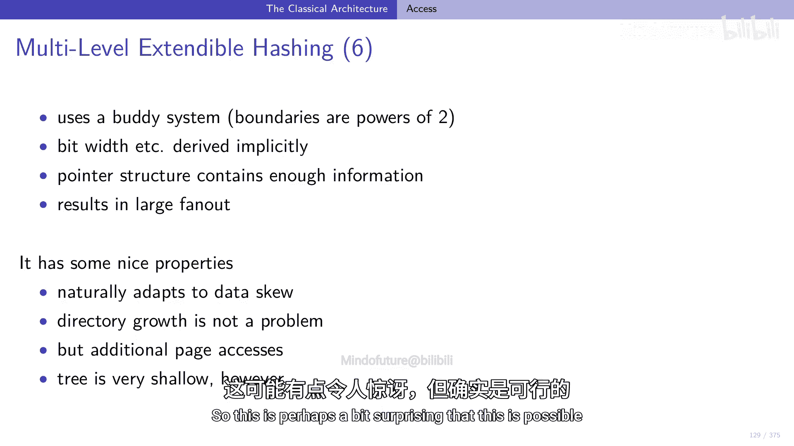

Now， let me get my bits right。😔，At this point， yes。 So this point that points to a different page。

 Therefore， I know that。4 entries are sharing a page。

 and therefore everybody here gets two bits on the next level。 Yeah。

 and I can in this by just looking at 1，2，3，4。 so Ive looked at four pointer values and afterwards。

 I know okay， who is sharing the page with me and。How many bits do I get？

And Id only have to store the point of value to my next page and nothing else。

 no extra information so I don't say how many bits do you have。

 so this is all infiat and also the good thing is the number of elements that you have to look at in this case4 is look it make as you see already that the distance between elements that I have to look at gross high and higher this is no surprise because of the buddying scheme I can compute the value of the next element that I have to consider I just have to if this point to the same page as I do so if this entry would point to the next same page as I do then I would again make a step of double size to the right in this case would bring me I think here so then I would check here then I would see I have to do the point to the same page as or no so in the first case I would have to look at five elements and my example I only have to look at four elements but never more than5 so for this page size。

😊，So never more than logarm of the page size。Okay and so this is pretty elegant because this means you get maximum space utilization here so what you can do is you can basically stop page size divided by size of a pointer here so if you do this so this is a find out that you get as this is ridiculously high and so a B tree will have clearly less than this。

😊，AndSo there is extremely high fan node because we need no extra information。

 We can just infer everything from the pointer structure Yeah this yeah this was written here。

 this gives me a large fan node。😊。

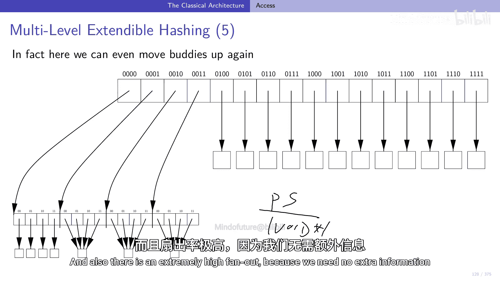

O there some other nice properties that naturally adapts to data scales so have some values more frequency than others。

 then you go further down in the tree， otherwise you don't although directory gross is not a problem here because we have no doubling or anything。

 we can just locally split a note that we need no other problems。Of course。

 the price interview page that we have to have additional page accesses so we have to access more than one page as other had this tree is very shallow usually and therefore they be in gravity we will usually not be deeper than let's say two so honestly therefore the performative will be quite good。

😊，Okay， and now。Just to mean， from extra level， this theatre structure is quite。

 quite beautiful and elegant and so。One downside is not written as that。

 but I want to mention it regardless this。This is not so easy to implement。 Yeah。

 I've on a piece of papers， this looks all beautiful and nice。 and yeah。

 but let's say I have implemented this in my younger days。😊。

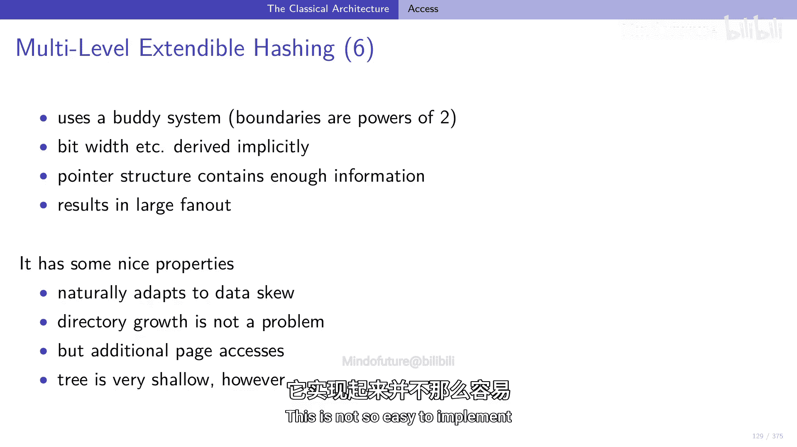

And。Yeah， it took me a while to do it correct and then had these fantastic situations where everything worked fully correct for the first two millionn inserts and so and then suddenly there's something bad happen because of some folding went wrong or something yeah this was not super fun to do back so it's definitely a bit more I mean even though it's conceptually simple coding wise is not so simple this data structure here there's not a lot of code a code is small but the code is very subtle so its easy to do or wrong。

😊，Okay， but conceptual basis is a nice solution to the heing or disk problem。

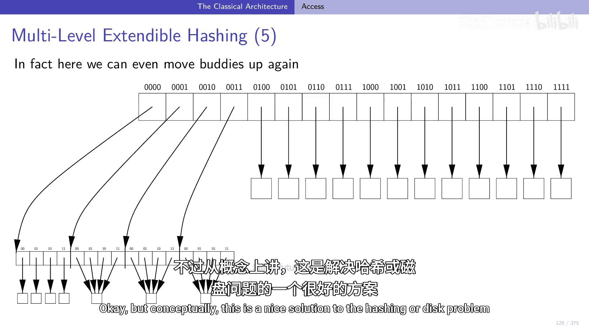

Okay， so the last index structure that I want to look at are a Bimap indexes。

And this is a very particular kind of index， namely these are indexes that are meant to be or that are useful for cases where the predicate in itself is unselective。

😊，Yeah so this is a bit unusual situation。 Now， assume you have， let's say you have two attributes。

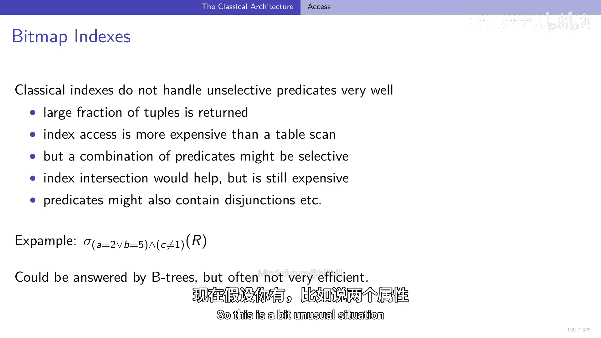

A or3 ABc。 So if you look at the domain of a。And then we just have， let's say， two values。

Now if you look at the domain of B， we have perhaps 10 values。And if you look at the domain of C。

 then we have five values。Now， you would never， ever construct an index on any of these attributes more and definitely never on a because if you have attribute will half of the top its qualifierifies。

 then index will be much slower than scanning just scannings the relation。

 So building index in a is not a good idea。Build an index on B is probably also not a good idea。

 I mean10 is better than nothing but still if 10% of your data qualifies most likely it's faster to forget the index and just read everything。

 so B tree on B is probably slower than just reading everything。 And C again， most likely。

We have only five different values。Don't， don't present index on C。 So this is usually wisdom。

 So if somebody says select。Star from， I'm sorry， I read it differently。From our， where。😔，A equals 5。

 So then clearly forget the index。 just read our filter。 That's it。

 Now it's faster than ability choosing in the index。Yeah， and the same will be true for B and C。

 but now what happens if somebody says I specify A and B。And。Yeah， so you know。

 if you have bindings for A， B and C， then suddenly you might think mean this is mean if yes it is independent。

 you expect that only 1% of the values qualify， then suddenly it might be attractive to use the index。

 so the combination here might be selective enough that using index is okay。 Yeah， but。😊，First。

 how do you know this beforehand and and second。How how do I answer this， Of course。

 I could put an index on ABCs so on all three attributes and this would work in this case。

 But now if somebody just changes slightly says， okay。

 I don't have a condition on a but instead I have a condition on let's say on someD or something So then again I cannot index every attribute accommodations So let's attribute in in themselves So single attributes are clearly unsuitable for indexing。

😊，Indexing alled combinations is not attractive because are exponential many。

 So this is mean if have inedibles， you can index two to above n combinations。

 so as therefore you don't want this。😊，So。Mean if if I would know beforehand that I will always search for ABC and only ABC con with the B32。

 But if there are output recommendationss that can occur and I don't know beforehand what I can do。

 then traditional indexes like B trees or even worse heing indexes so they are unsuitable a bit more indexes are made for this so they are made for cases where we all to have to handle unproductive indexes。

 And so this is just what set it could be that we have predicates that return large fractions of tablets。

 then index excess is more expensive than tablets can。

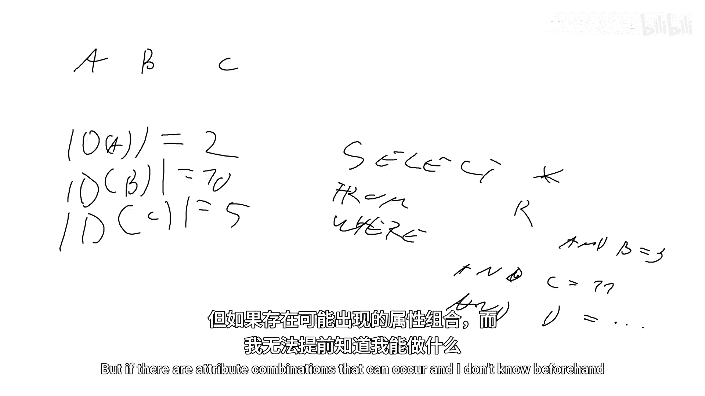

Its then we de we don't do this。😊，And now accommodation of projects might be selective。😊。

Now what you could do is in principle you could do index intersection is probably cheaper than than just look up and filter So intersection means you read one index here so this gives you lot of table you do not look up the top itself themselves。

 you just fetch the table fetch table， then we use an index on B we auto fetch and then if you do intersection。

😊，Now this we can do easiest way is you you sort them and do intersections this is then of course cheap intersection。

 but the sing is expensive or you read h from the smaller side of Yeah do you do something like this Yes you intersect with couple ideas。

And then once you once you find all tab that occur for all predicates， then you look up it's a real。

Real taps。Okay。😊，So the other situations within in exception is a vibrant strategy。

 but nevertheless it's quite expensive。 this intersection operation itself is not very cheap。😊。

Then to fetch the final tablet， you will probably have to sort the top again to avoid randomMO。

 so this is all pretty expensive。And even worse usually other nasty things you can do。

 like you can say， for example， want that A and B that's okay or or C all is an operation that database systems don't like in general all evil so is a very unfortunate operation。

😊，And so we don't like os。InMany situations or unpleasant。

 but for indexes but how should you answer an all with an index and and we can do this index。

 But all of course， we can do union what you could do is you do union at duplicate elimination but this is not very not very attractive。

 So distinctions but all other bad things mean， I get the example that a equals 5。

 What about the example B not equals 6 So not equal This is also unpleasant to do with an index。

 mean you can answer all the predates with a B3， you can but usually not very efficiently。😊，Yeah。

 even though not equal you can answer because not equal of course， means is the same and not equal6。

 of course means b is less than 6 or b is larger than 6。😊，Therefore。

 you can do this with two range queries， you read everything up to 6 and everything beyond 6 and unions this。

 then he gives the result you can answer this， but this will often be inefficient。

AndNow a bit next promise that GKZ then can do this right。😊。

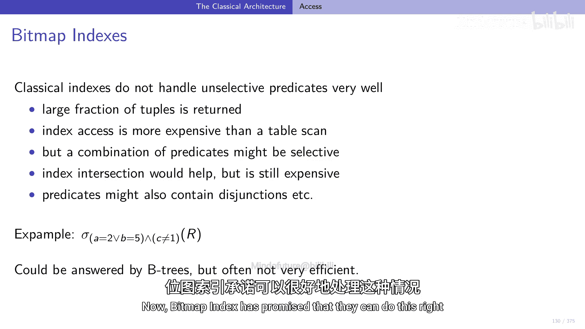

So and how does this work So first hour we usually only bit index if my domain is reasonably small。

 which means I have only few possible values I I like 10 or perhaps 20 or so。

 but not if you have 10000 here So then probably you do not want to use in bitmin Linux。

 So bit N to use with a small domain。And then what you do is you look at all possible values that you have。

 here we see， for example， this is a bitmap here for a equals 2。

 and then for every tapt that you have in my database。

 we store one in there if the pre is true and the0 of the pre gets false。

 So here we see the first for the first tap a is 2。😊，Second table A is not2。

 so table A is not true for the first table A is 2 and 1。

 so we will fill a long sequence of bonds and zeros。And this is the same for all other values。

 see like if we check for a is3 for the first chael， it's not true。

 obviously because it's a 82 for the second chapel， it is true， then it's not true。

 not true and so on。 if we be it large bit map if we paper for every possible value and now once we have this indexes the index intersection So figuring out which values qualify just become bit operations because if we of course with a doesn't make sense because it's obviously this。

 but let's assume this here some other value like B equals5 or so then if you want to check that a equals。

😊，A equals 2 and B equals 5。 This boil down to just doing a bitwise end。 Naly。

 you take the two bit maps。 you do bitwise and of both and the positions where one remains。

 then you have a match。Okay， and this you can do with outer remainingia， so you have many preates。😊。

Even though each index is unselective， you just do a linear pair of the index。

 you do bitwise and then the result tells you。Okay， here we have a hit here， we have a miss。 Now。

 if you want to do not in an and， but if you want to do an all， then， of course。

 it works just the same。 The only thing is in this case， you don't do bit empty you do bit with all。

So it works just the same。 Also if， if now we would say we want that B， we say a is 2 and。B is not 5。

So then we says opposite of course， boils down too。Pit rise end and un negate the right hand。

Now so this odds again2 bit operations。 So basically we take the index for B equal5。

 we negate a bit mapap so we flip odd bits so1 becomes 00 becomes one we flip odd bits then we do bitwises and and then this gives me again the position of what hits so this is super cheap you don't need at but you don't need to sorts nothing you just do bitwise operation and of course with one bitwise operation we can most likely process 64 entries。

 if you have a 64 bit machine。 So this intersection is very， very， very cheap。😊。

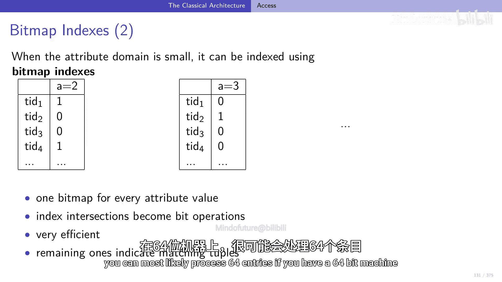

Okay。😊，And so the bitmps is quite compact。 we need one bit per table so have next by the point here says potentially we might need one entry more the table ID director because here I said first entry is table1 second D ID this only works if you have then table I if we don't and we need one extra column which lists all table id but this can be shared for all indexes it's just stored one we just store one array with all table ID if you need and so spaceization is not that bad firstmore what we see is these bitmap index tend to be sparse which means that most entries tend to be0 so there are far fewer are once than zeros in there and therefore what we can do is we can compress them so we don't store the whole vector but we compress the vector and what we can easily do is we just use run length。

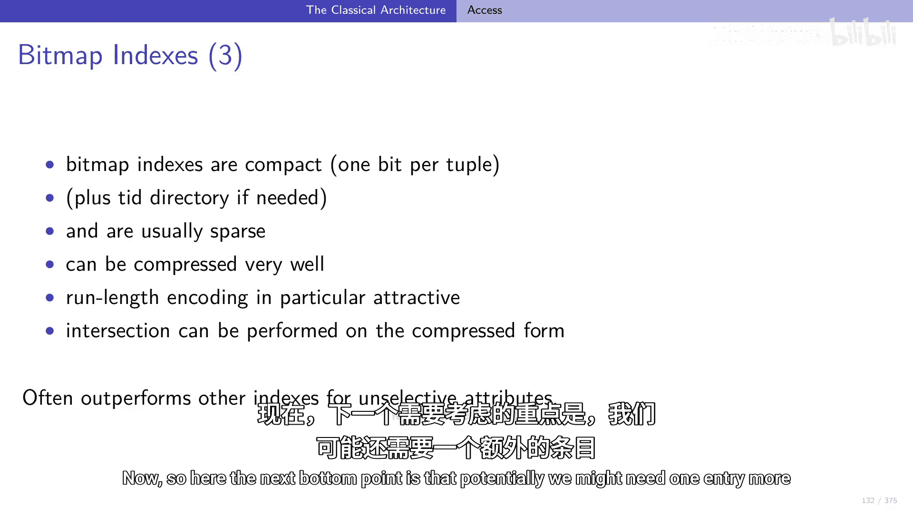

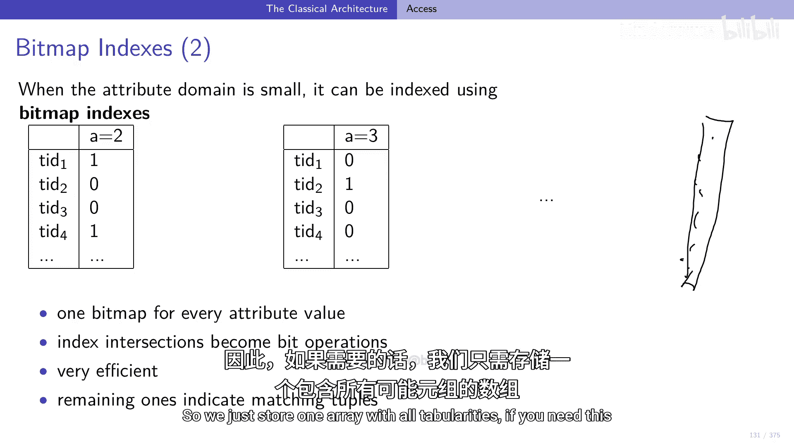

which means we say here we have a vector where we say， okay， now you have really one and zeros。 so 1。

0，1，0，1 okay， and then we say， okay now comes here 1 million zeros and then comes the next vector of hit。

And so on yeah， so we we we compress a is zeros， we say here now have long run of zeros。

And the good thing about this formula is that we can still perform intersection on the compressed form without decompressing now because if the right hand side says okay I have perhaps start similar says that that at with this one then here I do a bit wise and of course then it says I have 500 k zeros。

 then have another bit very vectoror and then I have perhaps another 490 k zeros。😊。

So then the first entry here I do a real intersection。

 then I compare this and this and I see oh no it。 so I skip over 500000 then I have used the first half million here this next half million remaining then I look at this block C cannot be a hit because otherwise side as all zeros So therefore I skip over the block twos and I advance my conceptual pointer here but then I compared with this one and so on。

 That's why I skip over both at least read both list sequentially I skip over the compressed ranges。

😊，And so this can be implemented very efficiently and people have written papers on how to do this withzi instruction and so on so we can do a very fast intersection of compressed Bips。

YeahAnd once you have this and then you see that very often this is much faster than other indexes。

 If you have unselective attributes so if you have selective attributes like a primary key。

 it doesn't make sense to use the bitm index for selective attribute attributes use a real index。

 but if you have unselective attributes where only a combination of attributes is selective then bitm indexes are quite attractive。

 so they work well well， in fact， there are a more or less the only known option in such a situation so nobody has found a better solution to this problem。

 So when we have a large number of attributes where users can query for outer combination。

 you don't know it beforehand and each attribute in itself is unselective。😊。

Then bitta Bes are usually the method of choice and commercial database systems also offer bitta B access I think all of them。

 and at least most of them， probably all of them offer Bitanamem Bex and so these are also widelyly supported just for this use case。

😊。

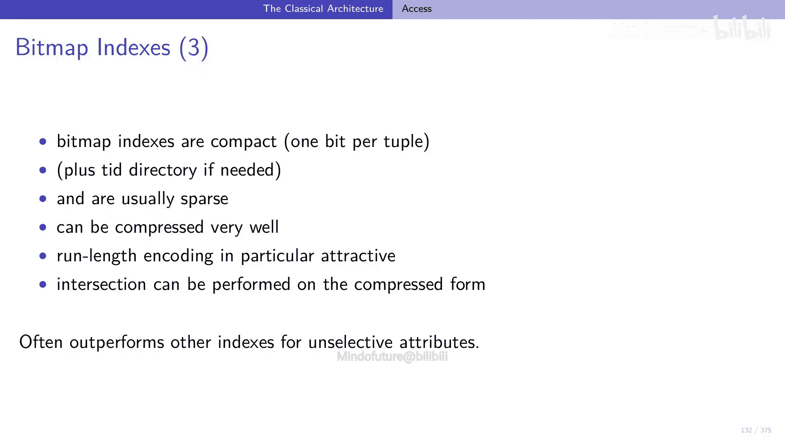

Okay， now as about the nearly is this last indexing techniques that I want to look at is a very particular kind it's not really an index。

I mean， some recall it this lightweight indexing， but anyway way it's not really an index。

This is something that the inventor， Gudomocota has called small materialized aggregates。Okay。

 now what is the idea of this， is say， I mean， very， very often you have。Chnks of vers anyway。Either。

 for example， if you have a single page， now a page might be too small for this。

 but but then perhaps you have a run of pages like you say on my physical storage I have here a number of pages that you store and。

If your page is larger than you can even do it on a single page and now what you could do is you could in the beginning of your block。

 you store something there's something that is very small。

 It doesn't take a lot of space and this is useful for processing。

 and this is what he called small material as aggregate。 Now what you could store， for example。

 if you have a relation arm， this contains edgebuts A and B。But you could store for this chunk as。

 you look at post attribute NP P and you store for each value attribute here， these values is here。

 so for me to here， so the smallest A10 the largest a20。

 the sum of audio As and the number of a values that you have。Okay。😊，And。

This works mean can be do for this for up attribute。

 but this works particular well if attributebut is like something like a date or so now and it doesn't have to be a date a date is a good value。

 but data is not necessarily the only one， another a good field for this kind of operation is。

 for example， in an idea field that is monotonically growing so like if students comes to get a student ID as a student ID grows monotonically And now what happens is there a physical storage usually mimics insert order roughly not perfectly because field space。

 And so but roughly insert order mimics a physical storage mimics insert order。

 which means if your field is mono growing like an idea field or a date field this means that here we tend to have small values。

😊，It's not perfect， but we tend to fill small babies and then they grow over time。

 and here we tend to have select large radios。YeahSo this just happens because of the nature of the data that we entered。

And now if we look at this moment material as aggregates here， if somebody says， for example。😊。

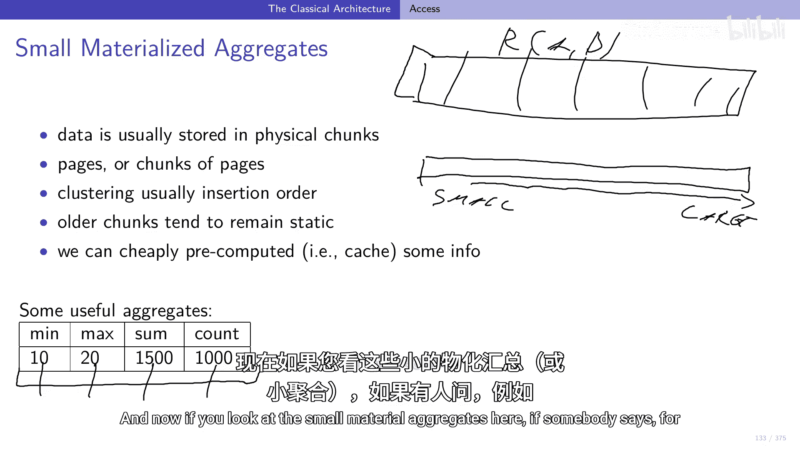

So this is a data graph and somebody says I start the for block， somebody says select。Star from R。😔。

Where。A is equal to， let's say，50。Then when we come to this block。

 we can immediately say we will have no hit in the block。

Yeah because we know that the smallest rate1s， large rate is 20，50s outside of this range。

 therefore we can just forget the block and skip a whole block and don't look at the table at all。😊。

Yeah， so be be just。Skip of everything here。😊，Now we can even do even more than this， for example。

 if somebody says。So this is a case where nothing qualifies。Second example here is。

Select star from R， where a is larger than 5。Now， we see everything qualifies。 So within the block。

 we don't even have to check as the condition， because you know， for sure。

 all it is here is will qualify。 So we don't even look at the tablets。

 and we can do even more than just return all the tablets like if somebody。

 if somebody goes even further than this， select some。😊，Some a。From R， where a equals 5。

 you can answer this question here without looking at the single value in my block。 Now。

 because I know the sum must be 500。 I have precomp this。 I' have precomp the sum。😊，Now。

 if I know that all my table qualify， I can I can answer this question at least for this block of course now remember we stores for chunks of data I have this data chunk as small stores aggregate have Z data chunks as for small aggregates as data chunk and on and what will happen is I look at all the chunks I look at my query look at small materials aggregate at the beginning and then I can for example。

 say this block will never qualify。 just skip it don't do anything this block will fully qualify。😊。

Then we can， so everything we will we match， then we can extract the sum， for example， from here。

 and we can not only answer sum。 we can also answer for example。

 average because if you also works because we know。😊，Sa my sum is00s account is 10000 average is 1。5。

 And so I know this is fully qualifies。 and then for example。

 you could say this here partially qualifies。 Then here we look at the real values in them okay。😊。

So we we we uses data and how this works for two reasons first。

 as I said insert certain order corresponds to physical storage and we tend to have trends in the data。

 I grows， dates grows So this kind of thing and therefore if a query goes on this attribute this works well and the second reason why this works well is data tends to be static once it has been inserted for a while and so when the insert data。

😊，It might change in the next few minutes or so， but once the data has been in the database system for a few days and has not been changed。

 most likely it would never changed until it will be deleted perhaps at some point but data that has been inserted into the database and is in the database for a while。

😊，It very often is never changed or is let's say is rarely changed。 Yeah， so therefore。

 my data remain tends to be static， and therefore this aggregateates。Just works fine。

 so we can precompute this aggregate and just keep it。 Now。

 if somebody really up to us doesn't update in my block。 So this is my block of tabs。

 I have now for this block computed minimum is 10 maximum is 20。 Some is this one count is this one。

 Now somebody doesn't update here。😊，嗯。Then of course， these attributes are no longer true。

 but what we just do is if we set a flag， say this is invalid。😊，Yeah。We don't do anything。

 if you just mark this with it， no more updates come， more updates come， more updates come。

 Yes no and at some point a query comes。😊，And note that this query would look at all the templates anyway。

 because my small materials is aggregates， it doesn't help me because it's invalid。

 So therefore as a query， we look at this this block of values anyway。

 therefore what we do is in the moment if we read the block。

 we recompute the small materials aggregate。 So this is just like a cache。 So when the query comes。

 we compute mean Max sum count。 and then we can refresh the small materials aggregate and then it's valid again for the next query。

😊，Okay， so this works beautiful because it's so simple and it's a very simple scheme you no fancy three structures or just a few values if these store the beginning of your block。

😊，Can be stored cheaply， can be curried easily。Of course。

 it's not as powerful as a real index because we can audit this fingers min and maxia。

 but it's very cheap and very easy to implement。😊。

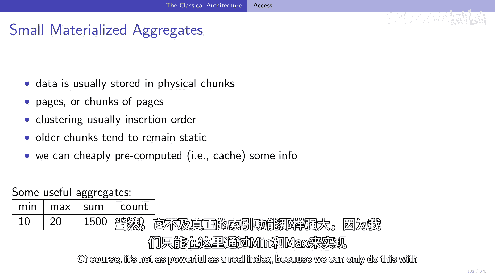

Yeah， so this is what I what I said before we scan the chunk we examine the aggregate。

 and if we can decide about the prototypedicate based upon the aggregates。

 then we can skip the chunk fully and then we never read it。 Okay， and yeah if we。

If we update and we invalid and recompute either eagerly or laly。

 look most likely you want to do it lazily so you recomput it when the first query comes because the query would have read everything anyway so we recomputed but when if you do this update we don't do anything beautifully and for this reason in fact many would perhaps even say most database systems at least the data warehouse systems So the systems that are optimized for analytical  queryries on large modes of data they probably of all or so it leads to a large extent implemented some variation of this just because it's paying for the buckets right here so it's pretty easy to implement and you can save a lot of effort very often and if you cannot save anything because could be that the audio  queryries range doesn't help at all but nevertheless it's cheap so you cost you for a large block of template is nothing so the check it is very cheap So we can just do it even if it doesn't hurt us either。

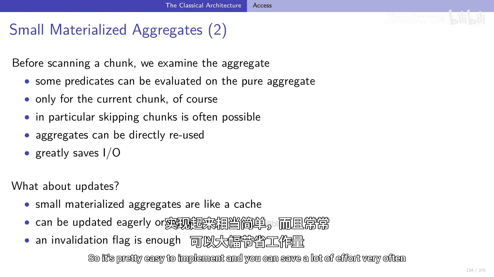

And if it does help， then we save a lot of effort。

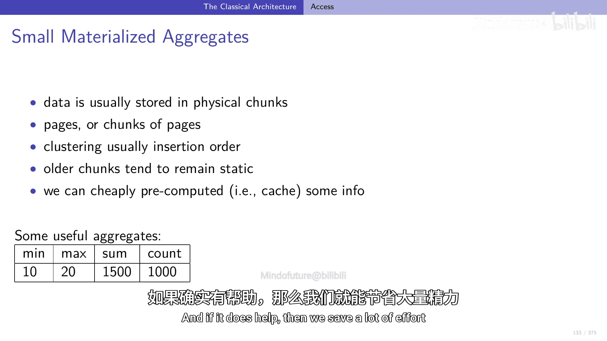

Okay， so now the very last slide here on indexing this is about multidimenal indexing。

 And I just want to spend one slide on this。 I think this is what I want to say Now you could spend a whole semester on this。

 multidi indexing is a huge field。 so there are tons of papers on different approaches that you can do And so first perhaps to just clarify what do we mean is multidial indexing。

 So far our indexing was one dimensionary because we could we have one dimension， for example。

 we have an attribute x and we could ask， of course。

 for x equals 5 we could also say x is within a range of let's say3 and 7 Okay so this is a one dimensioning query。

Now， it could be that you have two others x and y。And you want to know， is my pair X Y。In the range。

Let's say3 to 7 comma at10 to 20。 so two dimension queries。 all the other things we can ask。

 But this is the most simple two dimensioning query。 We give a range for two attributes。

 please find me all values that that follows into this range。 Now， this is a two dimension query。

 But， of course， you can again have it more as you can also have3 dimensions or even further。 Yes。

 So。The number of dimension that you can have can be quite high and people use also for all kinds of things like for example。

 if you do a multimedia retrieve， so you want to find the pictures that are similar to other pictures。

 what people do is they extract features from the picture and then they do multiimques has give me all other pictures that are close by to my。

😊，To my query point in the dimension space usually is a high dimensional query。

 so with many dimensions。And so there has an incredible high number of approaches that we can use。

 Yeah， you can， for example， just to， to give you some names if we can use an artery or we can use just to。

I didn't even put it here。 It can use a K D tree。Or we can use a grid file。

 we can use a parammed scheme， we can say forget about this might dimension indexing stuff。

 we index each Ed individually and then we just intersect this now so there are tons of approaches that we can use。

😊，But by now， just to， to give a high level idea what the things they are doing。 So basically what。

 for example， what is。Ay does is we try to construct bounding rectangles， let's say。

 okay everything here is in this rectangle， everything here is in that rectangle。

 and then we built three out of bounding rectangles。Yeah，And then， of course， could be， could be。

Could go a further down Na。 And so when we when we query， we figure out， okay。

 which rectangle does my query rectangle intersect with。

 And then we traverse down and all the rectangles。 and then we retrieve all the all the pits。

And also， there are you say hundreds of approaches， it is probably too little。

 probably there are thousands of approaches。😊，Andt inter I don't want to discuss him here。

 for two reasons first mean just the Beyonzo scope of this lecture。

 so there are a specialist lecturers said to talk about this and I think our sister university。

 the LMU has in fact lectures on had dimension indexing。😊，And we can spend ton of time on this。嗯。

The fundamental unfortunate thing about multidi indexing is it doesn't work now this might be a bit too strong a word two dimension indexing is usually fine。

 three dimension indexing is probably also okay4 Yeah perhaps and so the problem is the higher the number of dimensions that you have the the performanceant of three indexes。

 so you can index one dimensions no problem， two dimensions also reasonably okay but the more dimensions you have the worse it becomes and now what is the highest number of dimensions that you can index hard to say depends on the distribution of your values and so we cannot say it easily but less as the rough rule of thumb you can say you can index perhaps six dimensions okay。

 if you have more than six dimensions you most likely have problems and if you have more than 10 dimension you can be pretty sure that the indexing doesn't work。

😊，Now what means doesn't work，'t work means you would be better off to forget your index。

 read everything， and just filter on the value that you have。

And this is a socalled course of dimensionality and also when we have a low number of dimensions。

 everything is okay， but the highest number of dimensions that we have the worse everything becomes so scan becomes fast as an index project In fact。

 there was a pretty nice paper that not that in fact。

 prove this So that this says this is not a just a problem of implementation that people didn't find good indexes but that it is fundamentally impossible to do this。

😊，Without extra information， mean sometimes we know something about the distribution of data and the queers then we can handle even high dimensions well。

 but if you don't know anything， so if you index arbitrary data。

 then indexing for high dimensions is fundamentally impossible。😊。

And the reason is that the higher an is that you have the more similar the distance between data point becomes so as the approximation grows。

 the difference between in distance between data points shrinks Now just if you look at the formula here the formula says。

 of course we my distance function here is I takes the n square root of the sum of the。😊，Distance。

So its query I minus data I So if you have occion distance here。😔。

So this is a clear distance and as n grows， this is the values that you get。

Tend to become more and more the same And so the distance difference between distances grows down and this unfortunately means that indexing at some point just't doesn't help you。

 Yeah， so the discrimutative power of this index goes away and so the index can no longer distinguish elements that are close by that far that are far away and so we cannot do this anymore。

At least in the generic case， we cannot。 and therefore， multiim indexing is a very set topic。 mean。

 if dimensions multiim with a low amount of dimensions， okay， but high amount dimensions。It。

 doesn't work that way。Yeah， therefore， I don't want to talk about this on the lecture。

 So I I concentrate it here on oneim indexes and that's it they there work， of course。

 but higher dimensions， if you want to look at this。

 you have to look at the literature Now just one point of a clarification。

 I always had one image is okay。 Didn't we say you can't build an index on。

 let's say a comm B don't we say this Yeah， so B3 create index。And yeah。

 but this is still one dimensionary， it looks to dimension it。

 but it doesn't because we sort themographically as we treat it as one value and we define a total order of the compound here。

And so because of this， because of having the total order， this is infected one dimensional query。

 even though we give it two edges。The perhaps the obvious reason why why this is one dimension is in this such a situation。

 you can  query for A and B。 you can  query for A， but you cannot  query for B。

Now this great index you cannot clear it for B because this is one dimension index in a two dimension index。

 you could clear it for B now because then we would say we could form out a rectangle since I give me everything in this rectangle which in particular means we can shrink a to a point and then just have a B so sorry as way around so we we can expand a to from plus2 minus infinity and just have B on a specific point and then we can do search for a specific value of B now because this is one particular rectangle。

😊，So with multi indexes， we can query for outer edgebu combination between the regular indexes that we use in the database systems we cannot。

😊，So。Mdi indexes are more powerful than single dimension indexes。

 Only the problem is they don't work very well。 and so performance is la la。😊。

Depends on the use case， of course there are some use cases where they work just fine in the aeries case they don't work that great。

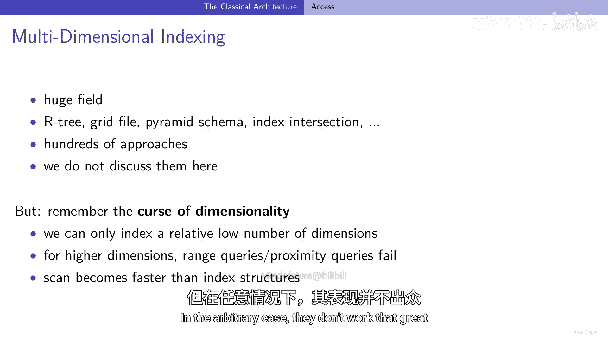

Okay， so this brings me to the end of this large part about storage and。

Indexing and so on and the next part that I want to look at is transactions and recovery Now some of you might attend my lecture on transaction systems and there some overlap here to this but it's only minor I mean there's some overlap because I want to repeat the definitions you might also know them from your introduction to databases lecture if you did this hopefully did this so I taught this also in my inory course but we only do this in the beginning to speak about what we mean with transactions in recovery and so on but of course what we are interested in later is how do how to implement this because after all this is an implementation lecture here so this is usually not covered in the other lectures so the next few slides might be a repetition for you but afterwards we talk about implementation this is most likely new。

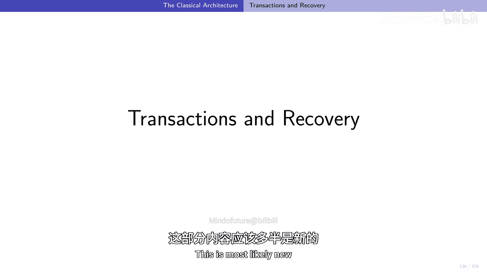

Okay so now when we look at database systems we see database systems offer two important concepts here first we have transaction support which means we can combine a sequence of operations and do compound operations we can just say okay please begin here and then do a number of steps and then we finish here and then we know that this compound thing that we have defined is executed with well defined semantic and of course we will see in a moment how how what we mean is well defined and。

But the data system also offers and this is actually closely related both conceptually and in implementation。

 it also offers you a recovery component which says if your database crashes or the machine crashes or the operating system crashes or network crashes or anything crashes so at any point in time then the system is in a verified state it means the system is in a consistent state afterwards and no committed data is lost if we brought there something the database and the database says system said yes。

 then this is never lost even though if it happens crashes a millisecond data that's okay we still have the data as the committed data is never lost。

😊，And data is always in a consistent state。😊，And now this， of course。

 is related to the transaction concept because it could be that my crash here happens in the middle of such a compound operation here。

😊，I might crash here and then I must stream make sure that even though my operation here was not finished yet。

 I did some part of what I wanted to do， but not everything。

 Now still the database must be in a consistent state afterwards and oop sorry and。

Because in reality these two concepts are closely related auto an implementation。

 so when we implement transaction support we must most likely know how recovery works ends as a way around。

 when we implement recovery most likely we must know how transaction isolation works in the system。

 therefore we consider as both of them together here in one chapter because its really closely related。

😊。

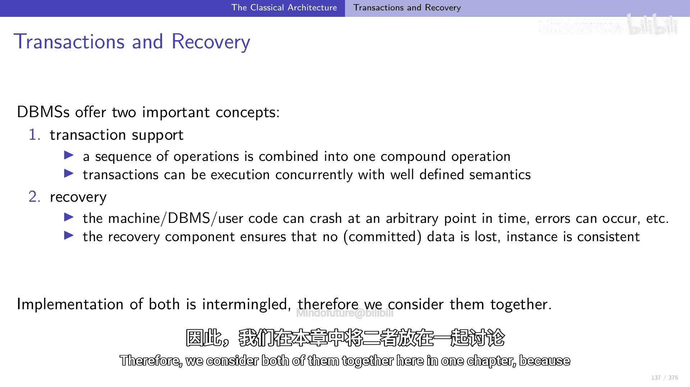

Now the obvious example here。 So why do we care for transactions。

 people understand this well when we talk about money。

 So assume we want to move money from bank account A to B。

 Now so we read the balance of a into variable So this is what we do here so we do the read then we reduce a by 50 because we want to take 50 from the bank account when we write back a so then we read the bank account B into variable we update B with 50 then we write B here and so this is a very basic transaction that we have and of course for example。

 that the money is never lost so assume hypoically that we would crash at this point in time。

 So then 50 was reduced from a but 50 was not added to B。

 this of course is the problem we want that the money is never lost the operation must be done。

Correctly， we must send it crashes。 We must handle concurrency because it could be that there's not only one user moving money around but multiple users。

 But here we have copied our a to a local variable So what does this mean So this is a problem and on and。

So crushless， correctness and concoria are all issues here and they must all be tackle and the transaction concept that we have offers us this as a database systems。

 if you offer us acid transactions， they solve all these kind of problems that we have。😊。

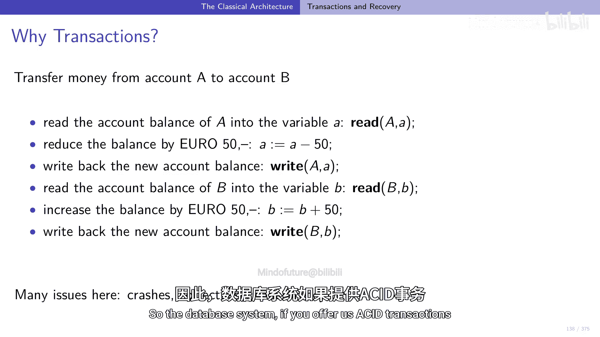

And the interface of course from the outside is so we begin the transaction at some point so these explicitly by saying in secret。

 begin transaction so then we say please start now all sometimes systems just begin a transaction implicitly like you connect to the database then immediately you have a transaction so then you have it。

😊，And then you perform number of operations and your transaction finishes either when you commit。

 so but integrally you say commit。😊，Or you aboard so then says your transaction is failed and secret you do this with a rollback statement and in the commits case you write everything that you did in transaction to this so to permanent storage and this is never lost again so if the commit comes back and says yes。

 then your changes must be stored in a persistent manner。😊，If you do a rowback。

 then all changes that you did are removed， so they are undone。

So then the system looks like if you never did anything in your transaction so this is semantic now a commit you always do yourself by sending a commit a rollback might be triggered externally for example if you lose your connection to the database for some reason then implicitly your transaction rolls back because obviously you cannot send a commit any longer then your network connection goes down therefore this is an implicit rollback。

😊，And or you might other things that an error a or somebody can to a query or something else。

 you know， so rowbacks can occur for a number of reasons。

 commits only because you send them a commit。😊，By the way。

 an interesting property in this context here is because of the property here and rowback must always succeed。

 a commit can fail for a number of reasons like the system might recognize that you do something invalid so you violate some constraints or more basic reasons like diskful you cannot write the data then a commit fails。

😊，But an a abroad must never fail。Yeah， because as I said。

 you can aort because the network connection goes down and you cannot prevent this as the database system cannot prevent the network connection all going down and therefore a rowback must always succeed you cannot you cannot refuse a rowback。

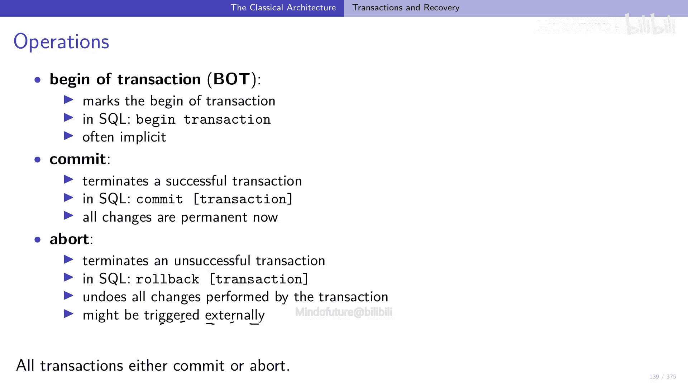

Okay， and this you hopefully all know from your introductory lecture。

 So the transaction should offer a properties， A it means atity。

 So all operations are either executed completely or not at all。 consistency。

 A transaction brings a database instance from one a consistent state into a consistent state。

I it means isolation， so the database gives us the illusion as if we are the only user of the system and this greatly simplifies our life of course because we don't have to worry about concurrent users。

 we are the only user in the system at least it looks like it's we the only user and ready we are not but it looks like if we are the only user in the system and D durability points a transaction commits successfully a change is never lost。

 does matter what happens。😊，And crashes。Dispo whatever data must never be lost once it has been committed。

 Okay， these are the so called asset properties and the asset properties make using a database system of course much。

 much easier。 because they all the difficult problems of concurrency and error handling have been solve for you via the database system。

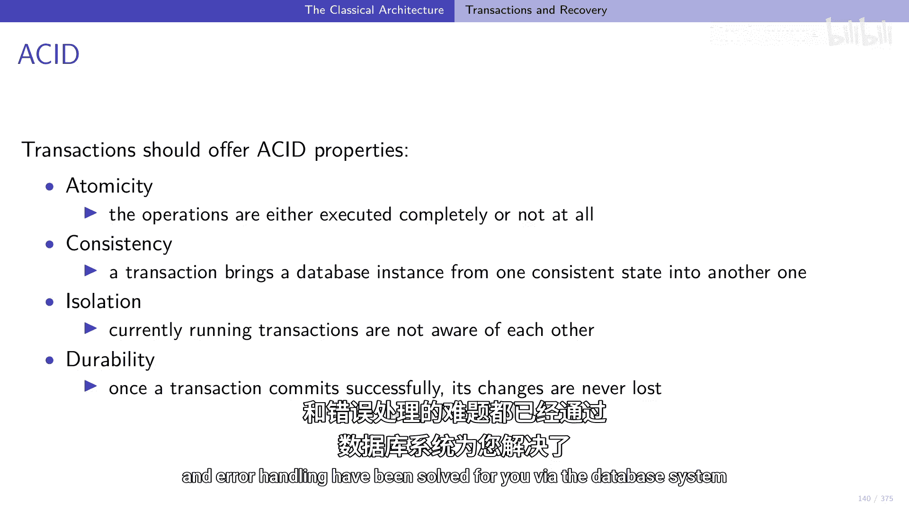

Okay and now the concept of recovery that if a database system is closely related to this transaction concept because a database system has handle a crash an arbitrary point of time So this means of course two things first the database structures itself must survive a crash like it must not be that if you crash and come back again database system says oh fire corrupt theyre too bad go away as this must not be the case so we must survive this。

😊，And second， we must still offer the transaction guarantees also for atities。

 this means that if you had an inf transaction in the moment that a crash happened。

 then we must roll back the changes that have already been performed So when the data system comes back again。

 we must remove everything that has been done by transactions that have not committed yet。😊。

For consistency， we must stay consistency again， counties must still hold even though we crash。

 we must take at a consistent databases and last year durability， once we have been committed。

 we must never lose its data。😊，Even though the data might still be in transitient memory。

 So it could be that somebody wrote something as stored something database。

 you hold it in memory correctly。 you have not written it to diskyt because it's sitting in your buffer manager。

 as buffer manager has the data， but the buffer manager has not written to disk。

 Now a crash happens and you lose audio memory like you have a power failure。

 and power failure is very unpleasant。 If a power failure， So you cannot do anything， memory is gone。

Nevertheless， you must not lose the data because the user gave us a commit。

 and we promised him durability， therefore we must preserve the data。Okay，And of course。

 we will look at techniques how to guarantee this。And for the last point。

 the depends is is mutual in fact， so for isolation， here depends is usually the other way around。

 So some database systems use the recovery components that we have anyway。

 So the recovery component we need for this reason here， particularly for A and D。

 for this this we need recovery。😊，And because you have a recovery component。

 some systems use a recovery component to implement isolation we also talk about this so therefore this is really closely interlinked concept of transactions or transactions is visible to the user recovery is not visible to the user internal in the database system but these two concepts are closely related in the implementation。

😊。

Okay， and so the the two logical concepts of transactions and recovery are on a technical level。

 usually split into two parts that again are。😊，Intellink。

 but there are nevertheless so there are different limitations for both。

 The one component is what we call a con control。 And this is mostly responsible for， for offering。

I and C， so transaction isolation and consistency， this is done by concursency control and the second component that we have is logging and this is usually mostly responsible for atity and durability I say mostly because it is not completely true Some people use the logging facility for isolation to as but roughly we can map them like this so concurency control is responsible for transaction isolation and logging is for atity and durability mostly。

😊，Okay， and so this is also now what you want to look at。

And so clearly what we want in a database system， we want that the database system is used by multiple users because if we only allow a single user in the system。

 then everything is slow because in first case， somebody does the following we we connect。😊。

Then we do select one。 okay，1 is perhaps2 to stupid select star from R。And perhaps even they begin。

6 step， then we look at the result， and then we say surprising， surprising。 Then we hear a walk away。

And fetch some copy because I have to think about this。

 So now we are spending here like we are waiting here for five minutes or 10 minutes until it comes back。

 And then after we have thought about the problem for five minutes。

 then we then we do perhaps and update statement or another select。😊。

AndSo which means a transaction can take a long time if users involved。

 mean most transactions are short， because usually a program connects to databases。

 sends us a transaction。😊，Get an add closes the connection keeps connection open but it least commits or rowbacks。

So then the connection takes a short period of time。 most of those transactions of this kind。

 but its are not the only ones。 so it could be that a transaction runs for a long time。

 because for example， we are waiting for a user input then it takes long time or it could be that the transactions are slow because we are running a big query and then we have to wait for disk so we must read it for disk therefore transaction can take seconds or even minutes and if a transaction takes minutes。

 then serial executioner So meaning running one transaction after is clearly not an option because otherwise somebody could set me one statement we wait and this statement is gone everywhere else would have to wait This is unacceptable We want that many people can use the database system at the same time。

Okay， so therefore what we want is concurrent execution。

And so we want that many people access the database simultaneously。😊。

Unfortunately， this execution is good for performance， bad for correctness。 mean be is too strong。

 but there are problems that I can arise。 Here has a classic I want here lost update。

So what we see here is transaction 1 reads x， transaction2。

 reads x transaction 1 writes x transaction 2 writes x and then both commits and what means here is that this variety is lost。

Yeah because here at this point， transaction 1 wanted to write something to x Trans 2 didn't even see this because transaction2 performed the read before the write as so the read was before the write and this write was before that write。

 therefore this right of T1 was overwritten by T2 and because T2 didn't realize that somebody else was dating the change same data and this of course is a terrible event because this now leads to inconsistent data if you think about the example of moving money from bank account A to B。

So it could be that this change here was I reduce a by a by x， let's call it x， I reduce here。

X by 10 this year reduces x by 20。 So what you want is the final result reduces x by 30 but this is not what's happening because of the overallr。

 the final result is just reduced by 20。 Now in this particular example you might be happy because if it is your bank account and you have 10 more than you expected。

 you might be glad。 but it could automatically be other way around two people try to deposit money on your bank account So instead of doing a minus you drew plus and then of course you are unhappy because now suddenly you lost 20 that you would like to see on your bank account but don't So therefore lost updates are clearly a tu problem we don't want this。

There are also other problems that are perhaps not as terrible as update by the auto still pretty terrible so this is。

 for example， the dirty read so dirty read means you read something that has never existed like transaction one starts。

 transaction two starts updates X here。😊，Then transaction 1 reads x in this point we see we sees this right。

 where we see this value then transaction1 says okay。

 if you access this and I can update y like that， then we commit So remember here at this point in time。

😊，When we commit a grid comes back， we promise durability。

 which means we write it to this and we never forget it。

But what happens later is what T1 ever sees is T2 as， which means that this right here is undone。

 therefore my read saw values that never existed in the database， at least conceptually。

 it did never exist in the database before an invalid value。

 This means now we have written an invalid value into the database。 This is of course， verybe。 Okay。

 so data read can also lead to inconsistent data and outerbettings。😊，Bet。Now。

 if you go further down in the hierarchy of bettings。This is， again。

 perhaps a bit less bad than than than a dirty read， a non repeatable read here。 So what happens is。

The transactionranaction reads data and the data is consistent， everything is right。

 but the data changes right like here T1 reads x。😊，Then sometime passes22 updates x and commits。

 T1 reads x again at this point in time， you see a different value of x。

As a you do see different values of x。And even though T1 did not update x in itself， this， of course。

 is the violation of transaction isolation。Because if transactions are isolated from each other。

 so the database system should give us the illusion that we are the only user on the system。

 this is clearly not the case because the data video changes magically beyond our back。

 this should never be possible。😊，So it's committed and perhaps it's even consistent。

It's changes and this is bad。And you know implicitly this can even reach to inconsistent data it's not only surprising that transaction can even read to inconsistent data because if you think about this T1 might be doing something large like we might do something like we aggregate1。

 then we join this with2 and then perhaps then we do perhaps another drawing here。

3 and then we join this with another aggregate of1。😊，So now you see that we read one twice。😊。

But if you have a nonreable read， it can happen that this R1 here gets a different Vc here。

 different R1 than we see here。And then of course my drone resultss don't match together so totally boguless results can happen because I I mean I expect that these base sets are the same but it could be that they arere not and then yeah the query can produce abitarily bad results。

 they can construct  cures that give you totally wrong resultss just because of this problem of unreputatable reads。

😊，And so the last obcyclastic anomaly that we want to look at is a socal phantom problem。

 so this is perhaps the most harmless of the problems that we have seen but at the same time is the most difficult to prevent which is the unfortunate combination so it's not so super pressing but it's very difficult to prevent and so the problems that we have seen as follows so you say select con star from R so you read everything from our。

😊，then somebody inserts a new chapter in my relation commits and then again I count everything from R now here I see a second different count so here see1 plus one。

😊，So I get a different number。Now you might ask what is the difference between a nonreputable read and a phantom。

 isnn't that the same， No， it's not exactly the same with nonreput read we mean we have a certain value。

 for example a top attribute value， we have a certain value in my database and if it reads this particular value twice I get a different result and this is clearly a betting。

😊，But this is not whats happening here in a phantom， we have a tap that did not exist the first time。

😊，So here could be the first time here we have just have one tableau and of course we could read the table and this table doesn't change。

 but then when the in comes in new tablet is insertted。😊，And。If I would just do a point query。

 So they， let's say if I would say select。A star from。From out where。😔，PK equals 5。

 and I did see the values the first time。 If I didn't see then even this kind I have a problem。

 but if if I did see those values the first time， then I'm not affected by a random problem here。

 because there's a value here I got it， I will always get it over elsewhere because if there's no nonreputable read。

 this value is save all the time。 But if I not do a point access。

 but if I do instead set to arrange queries like here we say give me all tablets。

 then suddenly new tablets show up。And this might make you unhappy too。

 depending on your seman so of course this is probably less bad than having a non reputable read。

 but nevertheless it's unfortunate。😊，And。On the technical side this is surprisingly difficult to prevent meaning we will talk about the implementation of this in the next lecture but just saying mean a traditional solution for example is locking like if if you read something you remember this was the table I read please don't modify it until I'm done so this way you prevent nonreputable read for example so you just remember that somebody has read the value but this locking does not type you with phantoms because the first time you perform this read here so this read the phantom type obviously did not exist and you cannot lock something that does not exist。

😊，Therefore， locking does not help you with phantoms， at least naive locking does not。

And sos are surprisingly hard problem。Okay， and so。Now， clearly。

 all the problems that we have seen on the previous slide would go away if you would execute transactions serially so we done after these others because then no publics are possible but this we don't want because of the problems if you mentioned we have poor performance we wait for users this is terrible so therefore what we want instead as we want that the transactions are executed as if they were serially yeah so they should behave as if we would execute it serially。

😊，Even though in reality we don't。 And so this concept is called Cizability。

 So we want that its the schedule with Ciz version which means it behaves as if we would have done it in a serial manner and to guarantee as we require some bookkeeping Okay。

 now I see that I'm running out of time So I will stop here now。

And I will talk about the implementation of all these mechanisms here in the next lecture。 Okay。

 thank you。

