# 【慕尼黑理工大学】现代CPU架构上的数据库系统实现-｜-Database-Systems-On-Modern-Cpu-Architectures-2021-p09-P09_09_恢复--BV1asiJBeE6j_p9-

Welcome to this lecture on database implementation。

 so in the last lecture we have looked at transaction concepts today we want to look at the second component here that we need namely it a recovery component。

So basically is the recovery component is responsible for dealing with errors or particular with crashes。

 meaning not also with most of errors， not only with crashes。

 but in particular we have to make sure that everything survives after a crash because this is the hardest case。

And for this， we basically use two kinds of mechanisms。On the one hand。

 we make snapshotts of the database， which basically meets backups。

 whereas we take the database and we make a backup from time to time。

And then we use log fights to record all changes that have occurred since a given point in time and so these are the two key components。

 we now want to look at how this can be utilized to guarantee crash recovery。

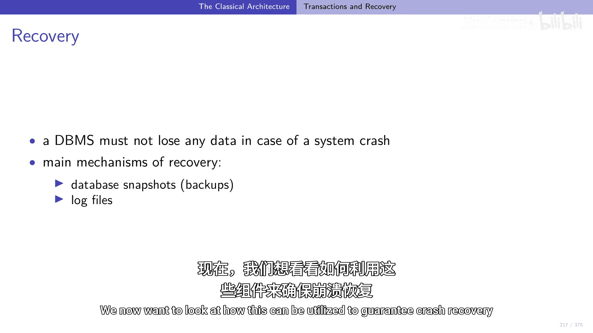

So a database snapshot is a copy of the database in certain point of time。

 so we basically just stored as it is and so the log file is a sequential list of all changes that has been performed into in the database instance and if we combine this to certain copy from a certain point of time and all changes that occurred later we can reconstruct the database as it was at a later point in time So this is one slide summary how we do recovery now as you would see in a moment the technical details are a bit more complicated than this。

 but so the very high， this is the idea。 So if we use a copy plus list of all changes and then we can reconstruct。

Is it database as it was。Now the third point is。Obviously。

 the main database is the data snapshots on the log files should not be kept on the same machine。

 Yeah， this is obviously true because if your machine dies the machine that contains your main data。

And you know that this can die in different wayss or like your hot disk might break now。

 hopefully you have a rate system or so， but nevertheless it can die too。

 or even worse you might have a fire in your server room or something else so then physically your machine is destroyed and of course you want to survive this and's a trick to survives is to store these components here on a different machine ideally。

In a different building。And that that's a apart a bit so that if a fire occurs or so not both machines are destroyed。

 also is a separate regime is the minimum different building is better。

 that's just to be more robust concerning errors and errors that can occur。

 so and and if this is the case， then we can survive even pretty drastic error situations。Okay。

 now so how do we cope with system failure So this is now a simpler case So to say as we will see this is nots not as straightforward it's right here。

 but certain in the simple case it works to exist。 So if a database is initially some state 1 then over time we apply a number of transactions。

So then this creates a state2 here and now this state 2 is lost because you know， machine breaks。

And of course we want to reconstruct this state2 Now how do we do this we use two components on the one head here we have a backup So as this means says this backup here gives me a snapshot as it was in state 1。

 so we assume we have a copy of state1。😊，Then all the transactions are stored in the log file。

And now when we want to reconstruct my database， then I first restore my snapshots this again gives me sta one。

 then I look at my log file and I do a row forward which means I execute the transactions again strictlyly speaking we only execute the rights because you know transactions could and principal not deteristic therefore it's a bit dangerous to really execute the transactions so we redo the changes of such transactions and this means that you do the same as the transactions did on the first execution。

At this then it brings me from state 1 to state 2， and then I have again my database state。

 that suppose even though my harder ski as though this the harderest scale was destroyed for by some external event or so harder failure。

😊，Nevertheless， I can bring back my all my data by using the snapshot on log file So this is a very high level overview of recovery now they asked so。

In a way， this's an idealist view because we believe that we have just some start state and then some transactions on log files that some then at some point we realize oh everything is gone and then we have to reconstruct it as we would see there can be some more complex scenarios like what we see here so we have again we have state 1。

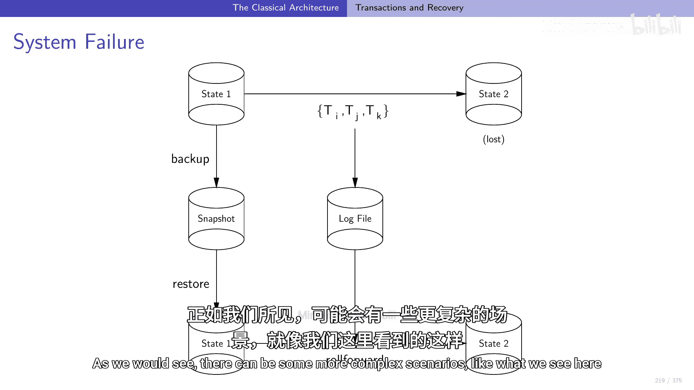

So then we so this is scenario area here we assume we have memory memory loss which means not just the system goes down in a clean way。

 but you know at some point we have a power failure so the system goes away and we have no idea。

So this is the following so we have again state one but usually state。

 then I apply a number of transactions here， this gives me state 2 and of course I access to a log five。

😊，And then I have some more transactions TJ and you know they are still running some of them might have been committed。

 some of them might be active yeah and then suddenly comes to power failure Now the unpleasant thing is that you know I don't really know what my state here on this box is yeah so what is my state on disk I don't know because it could be that some transactions have already tried to write to disk or are currently writing to disk Yeah so I said I want to change this pages these pages are now written to disk now the power failure comes。

😊，Was this page written or not。So I cannot know this because I mean。

 I might have submitted my change to to to to the diskconroller。

 but I don't know if the discontroller performed my right already。

 And also therefore for the state of my database is uncertain and this makes your recovery of course。

 much more difficult now because how should I roll forward my my log5。

Because I don't know what is my state on disk so when power comes back again。

 I restart my machine now I have a database file but I don't know at least a priori I don't know which changes are in the file in which are not so therefore so what I want to do at the end is I want to take my database I want to bring it into some clean state and then use the log file to reconstruct first state2 so that one already finished and committed and then the state2 plus and2 plus meanss I want to reconstruct oil changes by committee transactions because they should be in there and oil changes that were not committed must not be in there this is a challenge that we have so everything it was committed must be in the system again after we come back to power everything that was not committed must not be in the system even though it might be on disk already Now you know there could be a large transactions that writes a lot of records not committed。

😊，Yet we run out of memory therefore the system write it to disk just to get to free memory and then a power failure comes and then of course you must get rid of those changes that so this is of course a a more challenging case so how do we deal with restart。

When my state on disk is uncertain， so I don't know what has been written to disk and what has not been written to disk。

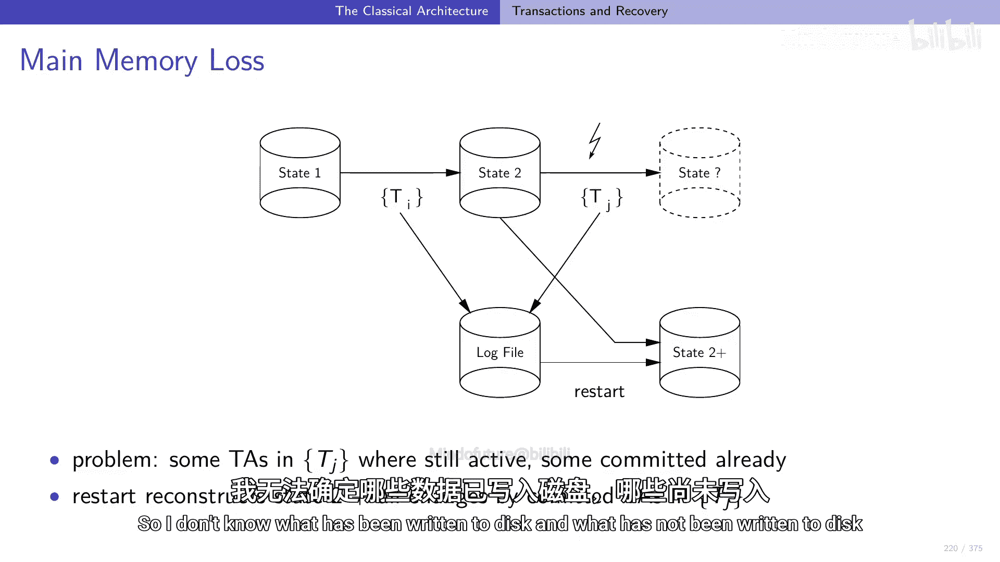

Okay。And last feature that we will also use from our transaction from our recovery log here is we want we want to use a log file to abort a transaction。

 So we do undo all the changes by a transaction。 It this。

 of course can happen even without errors So it can happen because the user， for example。

 just types in SQl So you just type rowback。Or， of course， there are many other ways to trigger this。

And so this of course， causes a transaction to a board and now we must remove or add change by transaction。

And note that we need this functionality anyway， because if your system crashes。

 we must also undo all uncommitted transactions as therefore this abo transactions is nothing really special so this functionality is needed。

😊，For for crash recovery， that we can use the same mechanism for regular Robacks too， Na， okay。

 it is just a special case。Okay， now we want to look at more closely like how can we implement this as with these we more abstract description are does the real implementation work？

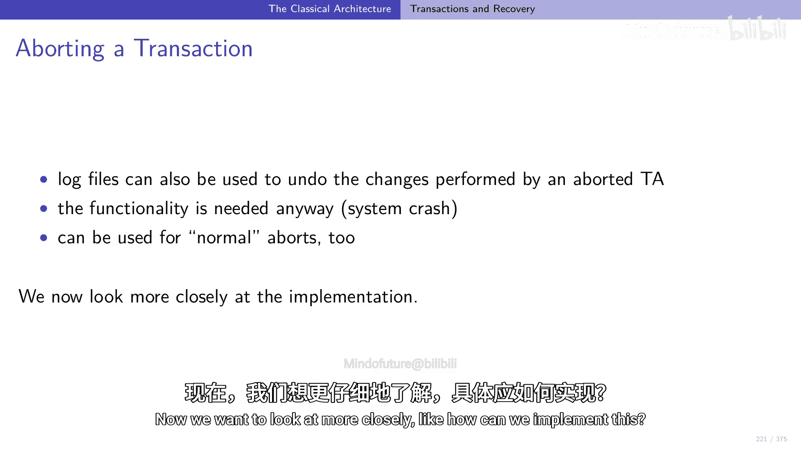

So first we can look at the different kind of failure scenarios that occur these differ in how much effort you have to spend。

 so how easy are they to fix So the first error scenario。

 this is the most simpler scenario is not really a problem So this is classified as local failure as noncommitted transaction like user issues a rowback or users does something invalid like compute 1 divided to a0 or something else So this is also a above or transaction So this emit transaction has to be undone。

And the only thing we must do here is we must undo all changes by that transaction and everything else is unaffected。

 This is called our1 recovery。 So the most simpler kind of recovery。

 We just undo what the single transaction did。😊，Now， much harder scenario is this one， yeah。

 failure is loss of memory memory， second one， so which means be crashed。

In a heart way and we lost my memory content and I don't know what is on disk so now I must do two things。

 These are quiteier r2 and r3 recovery first I must make sure that everything that has been committed is preserved this called R2 recovery and a second thing or noncommitted transactions must be rolled backed so all changes that were not committed must be removed from the database system this is called r3 recovery。

Now， depending how you implement your system， some of these steps might be a no op for example。

 R three sometimes you can go away without our3 recovery depending on how you have implemented this。

 but so these are basically the features we have to do。

 So our one local un two re or committed3 undo or uncommted and other first scenario of course。

 is this one yeah。Failure has lots of external memories。 So this is for recovery。

 This means really my server diet in a brutal way， everything is gone。

And this now is also called media recovery。 so we really must reconstruct everything。 this is。

 of course the most expensive and we hope that this never happens。 mean it can happen。 and of course。

 we should be able to to cope it， but media recovery is luckily not need it as as usually as other ones。

 And so this year， the first one， this is very frequent because all the time。

And so this occurs all the time， this year occurs from time to time， this we hope it never occurs。

 but of course it can happen。

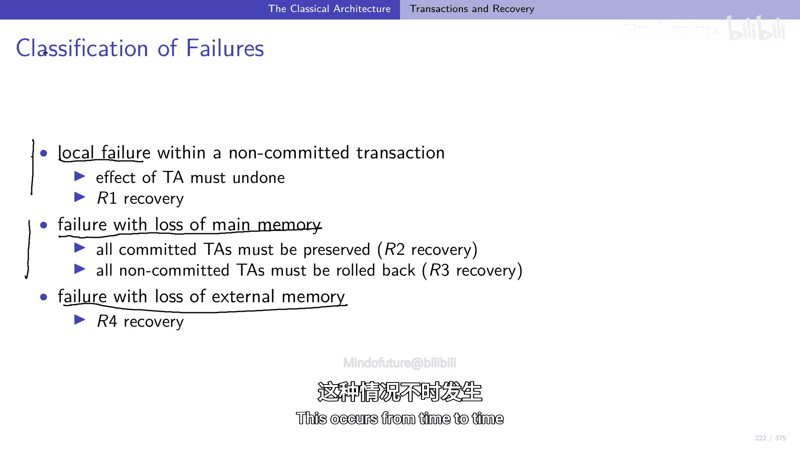

Okay now we have already talked， of course， about storage hierarchy。 so we have external memory。

 It's my database buffer。 Now the tricky thing is that we don't in particular after we have crashed we don't really know how is these two interact now because I have some changes in my buffer some changes are on disk and I don't know what what has been in my buffer and what has been written to disk already and sometimes really cannot know this because this happens uschronly like you have you have this page you have first we read of course then at some point we write back let's say here we have this page with C prime and so then we sent to the disk please write C prime so the page with C prime please write this。

😊，We sent this request to the disc controller and say please perform the right。

 then we crash and when we came back again， we cannot know at least usually we cannot know。

Has the page C already been updated to the prime yes or no。

 Not so this is something that we cannot predict。Then， we must somehow cope with this problem。

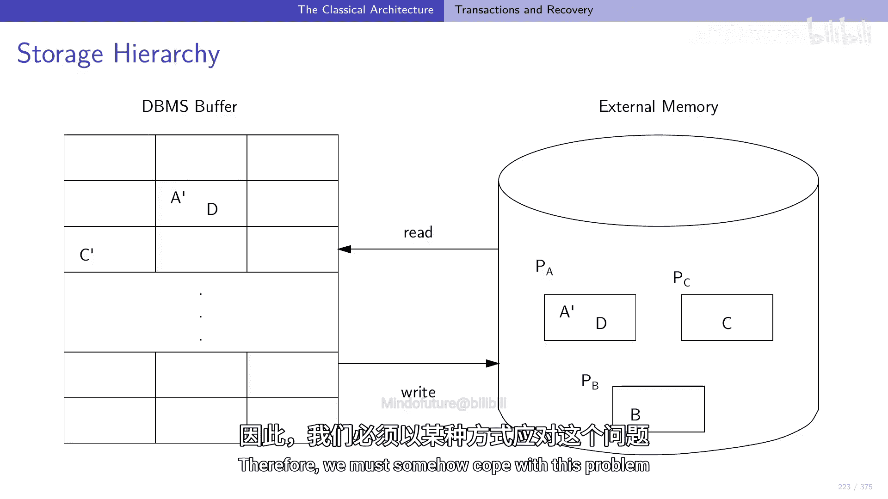

Okay， and so how difficult the problem is depends on how we implement our buffer range so we have looked at these images previously in the lecture。

 So basically we talk about steel and no steel so yeah。

 so steel and no steel and we look at force and no force。😊，So first deal anosteium。

No still means pages that modified by active transactions must not be written back to disk so we only write back pages to disk after everything has been committed on this page。

 this of course means that there are three recovery is not needed and so if I don't steal so then I know that only committed changes are written to disk therefore I don't have to worry that some parts are written even though the transaction is not being committed yet on the other hand。

 you usually want to use a ST strategy because a steel strategy allows you to modify data that is larger than your memory and so if you run no steel。

 you cannot update something that is larger as a memory because otherwise you run out of pages。😊。

That so。Therefore， usually we look at a more complex strategy here。

 the same was force versus's no force。 So force means when when we commit then we flush all changes to disk immediately。

 Of course this makes your recovery easier because you know after I have committed my changes on disk Theside is we write to disk all the time。

 this is quite expensive。 Now therefore for performance reasons we usually want to use a no force strategy。

 which means that if somebody commits we just say yes。

 it's fine and we do not write it to disk immediately。

 of course later we will write it but not immediately， but of course this means that when we crash。

 we don't know if my transaction has been written to disk already or not。

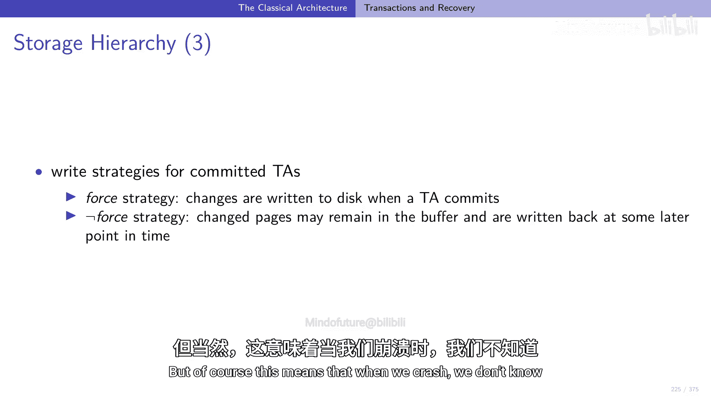

Okay， as you see here has the effect on re， so if I use the most simple variant。

 namely force no steel， so this is the most simple box is made and I have to don't have to do redo because the first strategy forced all my changes to disk so I know if it's committed on disk。

And because I don't steal it， I don't have to have to do undo。

Because I only write things to disk if they have been committed on the other extreme。

 if I look as the most generic one here， namely this one here。

 no force and steal this means I have to do redo because could be that my change has not been written to disk already。

 so I must reconstruct it and also must do undo because I might have written something to disk。

 it was not committed yet。 And this of course， requires me to undo that change。

 And now usually we want to be in this box。 for performance reasons， this is the best box。 Of course。

 also was the most difficult box but nevertheless， it's the best。Okay。

 now there are some some more variations that affect recovery。

 like first question is how do you actually implement your update strategy And also the your。

 there are multiple ways to do this the。Perhaps most straightforward strategy here has update in place。

 which means each page sits same on disk。 And when when we do a modification。

 we just override it and then provides a page back to disk later now this of course。

 the best from a space perspective because we adjust write the as it is but it has some comp this requires some complicated recovery potentially at least because this means that。

😊，I might have data on disk that is not committed yet。

Now the other two strategies that we see here avoids us the first one。

 the most simple ones the so called twin block approach twinb meets each page exists twice so we see a page of a and0 and1 page P and 0 and1 or2 so this is always a twin and now let's say this is my old database states then when you do an update you transform this into a prime now you have both and now when you commit then you just remember that you switch all the zero pages to all the one pages。

😊，Yes when then that's it and and if you crash you just use to continue using the zero pages and don't about don't worry about the one pages so we basically we always have a committed state either0 and1 we update the other one and once we commit with swap the roll of posts。

😊，Okay， so this is pretty robust concerning crashes downside is first you store everything twice also because you have double the space consumption。

😊，Also this switching yeah is not as simple as you might think， yeah。

 because they could you know you must be be sure that all your pages aren the correct state so basically because when after you use flip。

 you must be sure that both pages on the correct state because otherwise you have a problem when you continue running now so it's not super it's not so super cheap。

Easy to implement but not very cheap Now the threat variant here that we already talked about in the lecture here shadow pages。

 so we don't replicate everything as in the twin box web we only replicate that change pages gives you less redundancy but is even more complicated and you lose clustering and so is all kind of difficult thanks。

Now， by the way， theres one interesting problem here is that we don't talk a lot about in this lecture。

 I think theres no other slides that talks about this。

 but I want to mention here as part occurs in particular with update in place。😊。

And this is a problem of so called tone rights。Tll writes an absolute nightmare。

So what is the tone right， let's assume here this is page page A。

Now I want to write a new version of page A and let's call this page A prime。Now。

 what could is not very likely， of course， but what could happen is。Well， this is O e。P。

 and let's say for simplicity， the old state contained a lot of ones。Or at once。

 the new states contains a lot of tools。Yeah， and what could conceivably be happen is。

Then you start to write。Then a power failure happens in a very inconvenient moment。And then the。

Beginning of this page was updated already like you have a lot of tools here。But the end was not。

Yeah， and this is a so called torn right， a partial right， and so you try to write the whole page。

 but in reality you only wrote the half of the page。😊，And this is super。

 super difficult to prevent and to handle it。 Yeah， so this is an absolute nightmare。

 so there are basically three approaches to tackle this problem。

First approach you use battery buffer disks。 This is probably the best。

 Yeah so you have your disc that you can buy disks that have a small battery in them that guarantees that you can still flush out the right buffer therefore the disc guarantees you that if you issue a right。

 this right will be done either completely or not at or so you get a kind of atity on a per right basis。

And so this is， if you ask me the best solution because this solves this problem one that for oil cost you a fuel euro and the problem is gone。

 unfortunately thing is most people don't have battery buffer discs as you can buy them。

 but most people don't have them。So now what you do is then。

So I think IBM had a solution where say first detectors this problem and the detectives is， in a way。

 like you have have。Beginning of and end of your page。

 you have marker a bit single bit if you use like initially browse 0 and whenever you write to the page you flip this。

 So which means after the next updates both should be one。Yeah， one。And one。

And then when you do the next right， you flip it again。

 so we post through p0 and so on here you always alternate between this。

And now when you read back a page you check if these two bits are consistent so if the bit at the beginning at a bit at the end it'll have the same value if yes。

 everything is good if not have encountered a tone right which means that my Pat here is damaged and if you do this you start a full recovery so you you notify the user say oh notice that your mediater is corrupted。

Please do media recovery and then you do a full recovery。

 and this is super invasive and expensive and absolute terrible。Okay。

 so this is the second alternative to to deal with this。 The third one alternative is。

Also somewhat expensive but a bit more user friendly because for media recovery。

 this requires that the user has a backup of your database。

 Now of course we previouslyly said you should have the backup of your database and you log file you should sort in a different disk but experience status as should does not mean you have Now sometimes people simply don't have this and then of course you have a problem。

 Now if you can't write across your data really damaged。And therefore。

 what other systems do like for example， S light access by default。

 postgs I'm not sure it access by default， at least you can enable it。

 I'm not 100% sure if they do it by default， but what they do is they have write twice。😊。

Which means you have this page A that you want to write that you want to update to page a prime and therefore before you do this you store on a different place on this。

 you write you remember that I want to update page so as remember page A and I want to write a lot of tools。

Okay this you right to disk and then you force to disk。

 which means you make sure that it's really physically on disk and then you perform the update of page A okay and now if if crash happens via you update performs is right So if you get a partial right here。

 So two in the beginning was at the end。 no problem because my second place here still so this place it still tells me that I have to do this right。

 So when I come back again I see oh there was a pending right and then I redo the right so then ultimately this page will be in the correct set now it could be of course that this right here page。

 but that's okay because then we can use this marker trick from ABM So to realize if my right here was complete and if it's incomplete just discarded because I know that my original page is not modified。

😊，so with this thing you can cope with partial rights。

 but this is quite expensive because we write everything twice so complicated to implement so the absolute nightmare would be much better if the hard disk itself would guarantee aity in writing。

😊，Unfortunately the usual interfaces we have from operating systems does not offer this so there is no way to test the operating system。

 please write this here in an atomic fashion so at least regular systems like Windows and Linux don't offer this。

Okay， now。In the following we will assume the following。

 namely the most generic setup namely is that my system runs in steel nofall。

 update in place and file ground locking。This is the most difficult setup。

 but also the most performant。 so this is usually what we assume a database to have And which means you have to cope with all this problems that we have mentioned before。

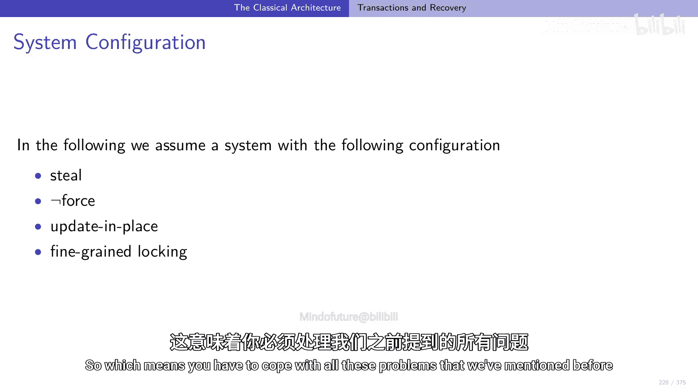

And the standards yeah， in a way， yeah， you could say was the most popular strategy to T is this it's actually quite a good one。

 Yeah， so this is a so called A protocol。 so this is a recovery protocol invented by Mohan while it was at IBM。

😊，Yeah。F coincidences， I think yesterday yesterday。

 Mohan actually had a retirement party at Sigmma to Sigmma to the largest database conferences just taking place this week。

😊，And oh， when you hear this， of course， it has already happened。

 But when I recorded it was yesterday。 So here at a retirement parties， where has been for IBM for。

 I believe 36 years or so a long time。 But as as he inventeds this protocol。

 And this became this stand for the database recovery。 So all big database companies implement this。

 And this is indeed a good protocol。 quite good strategies。😊。

And I will discuss them when we come to the technical details。

 but basically what Alice protocol does， it records all changes that you perform in in a database in a sequential file and does it in a clever way so that we can handle all these kind of problems like crushing。

 restarting and so on and in this log5 we store redo and undo information so read information means what do we have to do to do this change again and undo information says remember what do we have to do to restore the system as it was before so redo how to repeat my execution and undo how to remove the state now interestingly areas does something that's called physiological logging。

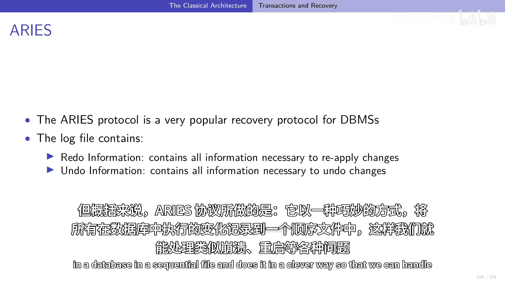

whichhich means that the redo information is physical where the undo information is logical so I will explain the exact details what this means when we come to the regional underphas but I say so this is slightly assymmetric so read undo is not stored in the same way so conceptual these are different。

😊，Okay， now。So when we run my database systems， so I have my database and I have my database。

 So here this is my database box I get from application。

 I get transactions and of course they updates my database buffer So as this all the data change and the database buffer is then synchronized with my physical medium or disk so this is my regular processing and parallel to this I have my logging here。

 So all changes that I form are written to the log buffer So lock buffer then written to a log file。

😊，And for this with this log file and my database date I can I can do a one attuned as3 recovery so if assist my transaction rows has to roll back。

 I can use my log file to undo my changes。If my system crashes， I can use。

The log the database state plus the log5 to bring the database in the state as it was in the moment of the crash。

Now you see two more outputs here named is a database archive。

 this means backups basically and the log archives。

 so this means you write your log files somewhere safe on a different machine hopefully。

So somewhere where it so the lock file itself is kept to your own machine for performance reasons。

 but for safety reasons you also want to write that somewhere else in the lock archive and this archive medium we need for our full recovery。

 So if my own machine goes down in a really bad event so I lose my medium。😊。

Then we use the log files as the database archive and the log archive to reconstruct the database state。

 even in this catastrophic event， of course this is expensive and slow。

 as therefore we hope that our whole recovery never happens。Okay。

 now what about the the lock buffer So the things that we use in memory to record all changes So basically what so this basically what this means here。

 we have a certain change。 then when the next change comes。

 you add to my buffer and add it to my buffer and add to my buffer。

 I always write your new records whenever a change occurs。And of course， at some point。

 my buffer is full。AndSo here here we see my insert so this is my current insert point and the insert point here moves to the right and of course at some point my buffer is full then this happens a bit earlier hopefully I start writing out these entries here to disk so I write them to disk and then of course I get new space so everything that has been written is free again so then I continue continue inserting so is the control ring buffer。

😊，So I insert at one end and I take out at the other end。When the two ends meet。

 then the ring buffer is full and then I'm forced to write something to a file。

 to get more free memory。😊，嗯。Now on on the slide， this looks like an easy thing。

 if you just have a ring So you you have basically here you have a read。

 so this is how far you have read。 So this is a reader box in this direction。

 the writer arm box in this direction and of course they must not meet because when they meet it's full and。

😊，Now， interesting question is how do you implement this？

I I can draw you a nice picture of such a ring， but how you implement this。😊。

Now the obvious way to implement， of course， is to just use an array so you just use this is all your content。

So and then of course you have a writer that moves to the right if you reader that follows the writer so no problem problem is what happens if my buffer is full so then could be that I want to write a lock record that starts here then it doesn't fit because my error is full so I must write the rest of my lock record here at beginning。

😊，You can do this of course and you just use one array and write the first part of the lock then the rest at the end。

 but in reality this is quite complicated to implement because your log record usually consists of multiple entries for each entry you must check oh do I still fit or as part of me fit so this meets your logic for writing is not as easy as you might think not because you have to serialize out something in an array that potentially wraps around。

Actually， a particular elegant way to implement this。😊，It's admittedly a bit sneaky。😊。

You have an array as before yeah， but now you use your virtual memory management to map this array twice。

 so this is my my physical array， let's call the physical array。😊，Physical array， this， of course。

 its same memory。And then we map this into my logical address space here。a log perform。

 and then I map the same， so this is maptm。And then I map the very same array again behind。

And you might be surprised that this is possible but it is because we have a logical address。

 we have logical memory， therefore it is possible to map the same physical address twice in the logical address space you can use this。

 for example， using M and then forcing the address Windows can also do this with thing it's called create view or file or something can you can map the same physical memory twice and you can map it so that it's immediately next to each other。

😊，And this has some very fortunate consequences namely。

 when you write something here like you think you're writing here and the second part of course。

 crosses behind the end of your lock profile here because this party is beyond your lock profile。

 but what happens is that because。😊，These two errors and real the same， physically the same。

 your right to this place in reality writes to that place。Or in a physical sense。

 these two plates are just the same。 Also we have two memory addresses that represent the same memory location。

 Therefore， we can brutally ride behind the the end of the lock buffer。😊，And so if we we then just。

After my locker record is done， I just have to make sure of course that my writer must continue here so I write over the end afterward。

 I've put my position to the correct end position This is a particular sneaky way to implement the ring buffer and I strongly encourages much easier may of course setting up this double mapping once is a bit tricky but once you did this much easier to use because you can just blindly write and pretends that this wraparound problem doesn't exist。

😊，Only when you advance your pointer， you must check once okay。

 where do you have to continue writing and also very performant and not that difficult to implement。

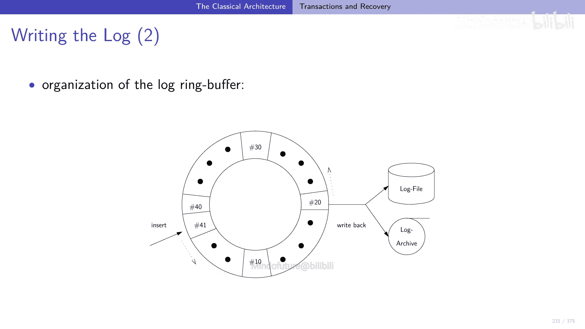

Okay， now once we have our log buffer of or changes。

 now an important concept that we have we have to follow is a so called write a headlock principle。

 although sometimes you just use acronym W AI， so write a headlock。

And the right analog principle will says。Before transactions is committed。

 all corresponding lock entries must be written to disk and the same before a modified page is written to disk。

 all lock entries that involve that particular page must be written to disk。

And this is called forcing the lock。So which means you must not update a page and you must not acknowledge a commit before the corresponding rock entries has been written to disk。

And you know that written to disk is a pretty strong requirement。

 So this does not mean you have have to issue a right call to a file。

 but you must be sure that it is really on disk and this means you issue usually this involve something like。

 for example， right。Plus， E。So which means your T operating system please write this。 and afterwards。

 you do an Eon call E Ted operating system， please make sure that my changes are really on disk。😊。

Which means that if I lose power， so if I have power failure and I come back。

 my exchange will be there for sure。 this is not the case for a regular ride。

 because if you just do over a simple right。Then the writing system says yes， I got your right。

 and usually everything works fine， but if power goes away。

 it be that the bright does not does not hit the disc as it's still in flight and you don't know when it will be done。

 but if you use bright follow button F sync。😊，🤧Excuse me。If use。Right， followed by an Ewing。

 then you can be sure that your right has hit disk。

 and therefore we can rely upon the fact that we can read it again once we come up come back again with new power。

So and this right analog principle is required for durability because this means that once we have acknowledged the commit。

 we are absolutely sure that we can we preserve this data even if my database crashes power goes away whatever and because I know that all changes by this transaction have been stored in the lock and they have been stored in a secure way so that if power goes away I will not lose my content。

😊。

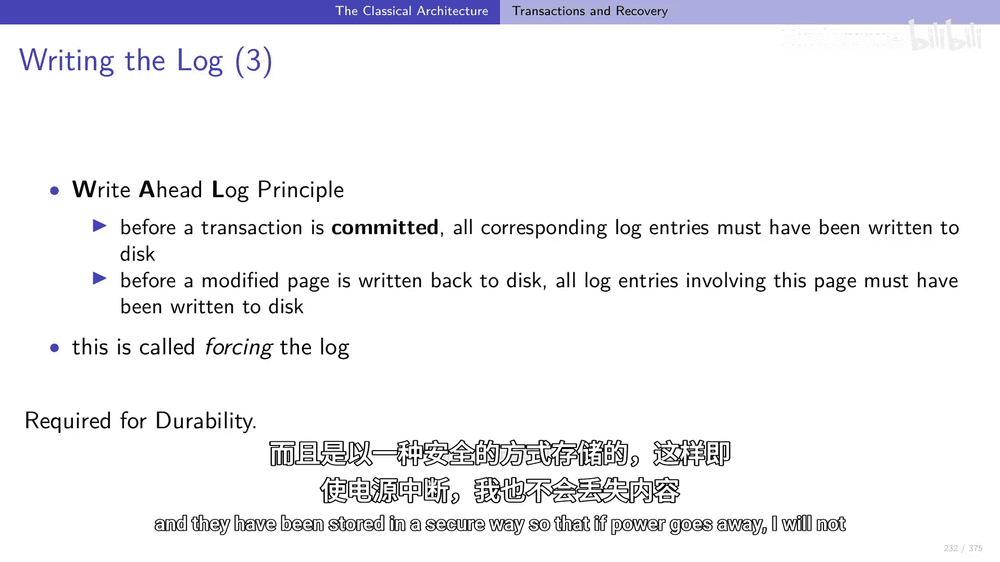

Okay， now。Even if you do this， you have to be a bit careful because when youve write the lock。

 you have to realize that discs the disc that you're using are not bitete addressable。

 which means you cannot write up small things。😊，诶。Instead， what we that we can store larger chunks。

 Unfortunately， we don't really know how large chunks are。 traditionalditionally。

 the size was 515 bys。Now nowadays you have sometimes disk have larger blocks， for example。

 I believe some of them have2 kilobys 2kb is a pretty normal block size on a modern disk so but one of these two you usually have and so what could happen is that you perform so first you cannot write something smaller than this block2 kilobyte or half a kilobs well and what happens is if you crash you might perform a partial right because look at this picture yeah assume ignore the problems if you just write a log5 so this is the end of my lock。

And by unfortunate circumstances， so this ends at position 300 or so。

 which is not a multiple of 55 and also not a multiple of 2 clide。😊。

And then you want to write a new Lu log record， so you want to write new entries here。

And so you issue a write， in reality you cannot write this new content is's impossible what you do instead you look at the beginning here。

 so you look at this block and rewrites the whole block。

Because this is the smallest thing you can write and you cannot write these few bytes instead the operating system for you will read the previous entry at your new data and write it back again and this is somewhat dangerous because it could be that your system crashes in the moment that you perform the last ride okay we know this and we usually be cop this but yeah but this means you can destroy your previous content because what some discs do is if they crash during your write they are filled your disk with zeros。

As therefore， it could be that the whole block here will be zeroed。😊，Because we did crash。

 but note that the block contained data as that was already committed， namely this one here。

So I destroy my log entry by writing something at the end。😊。

This of course very very nasty so we must not do this say for what you should do instead is then we flush the disk when we write lock record so my lock record was only to 300 by I so patting means I add data that I don't really need just to make the size right so I pe it with zeros。

😊，Yeah， and then I I'm sure that my the sat small log is always a multiple of 512 and then this problem cannot happen。

 then I'm sure that I'm always writing food blocks。

Of course you have to figure out well how large the blocks is， but if you use a power of twos。

 that is reasonably large enough like 4 kilobytes so then you are on the safe side。

Or actually you can ask your disk so you can use operating system interfaces to figure out how large the block size is of your disk and then you can make sure that you are always a multiple of your block size。

😊，So but definitely， this is something you have to take in mind。

 So because partial rights are dangerous。 Yes， the related problem partial rights of pages that we already talked about this。

 And this is also written on this page， some of these issues can be solved by hardware And this。

 of course， the best way to solve this because hardware can solve this problem easily just use a smaller battery and then you can it can guarantee you that you will never get a partial right to a block。

 Also we can， we can take it as。But unfortunately， most people don't have this kind of hardware。 Now。

 so for most people， the disk is a bit unreliable， at least if in the presence of crashes。Therefore。

 we have to think about this。Recovery is unfortunately full of nasty little details yet you have to all make right to guarantee that you survive crashes。

 And of course， another bad thing about recovery is that usually it doesn't occur。

 And so really heart crashes like you go to go down in an inconvenient moment and you have a partial right to it This is a super unlikely。

 most of the time it never happens but it can happen。

 and this also means that you you must expect this and you must also test this coat。

 even though it's unlikely to happen， you must test your ja code does the right thing in the presence of this unfortunate circumstances。

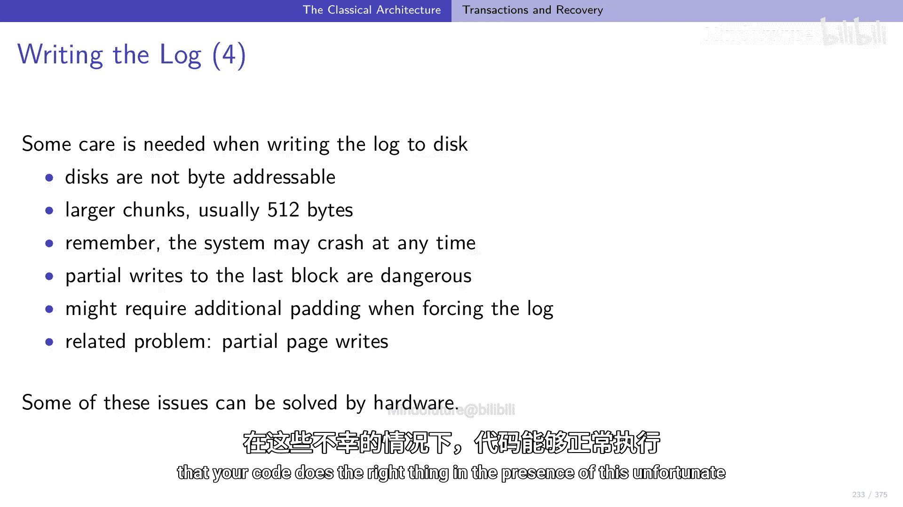

Okay and now we when such a situation occurs we must do a restart so we so we have my system here you see Xx here has time so time progresses at some point yet transaction 1 begins sometimes later transaction 2 begins even later transaction1 commits so at this point now of course the change of T1 must never be lost Now at some point T3 here we have a crash and transaction 2 was still in flight Now transaction2 did not commit yet。

Now therefore we call transactions like T1 a winner transactions so they winner because they have committed before the crash and we say transaction2 is a loser transaction。

 a loser because they did not commit yet。 and when we come back， they must be removed。

 So when we come back， we must replay the winners。😊，And we must undo the losers also that afterwards。

 the system behaves as if T1 has committed and T2 never occurred。

 So this is how the system must be after a successful restart。And because T2 didn't quit， therefore。

 it must be vanished from our system。

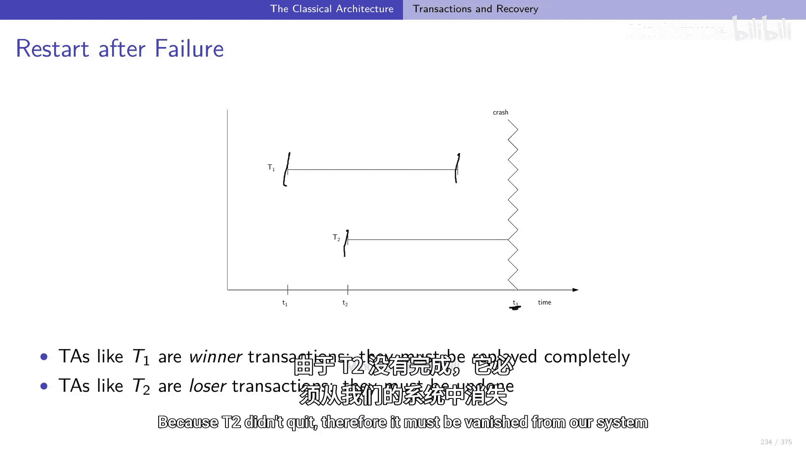

And in the artist protocol we we achieve this by using three phases。

 so your first analysis phase in the analysis phase I look at my log file。

 so this is this here is my lock。😊，This is my lock with all my changes。

 so I read the log file from front to back。And and and analyzes。Analysis。And during the analysis。

 I figured out what are the winner transactions who have committed and what are the loser transactions who have not committed。

Okay， then the second phase is so called Ri phase。Again， read my lock。Okay。And during that phase。

 I repeat all operations。Such that the database was in the same state as it was in the moment that it crashed。

 note that we all redo lose our transactions。So even though you could say who cares about the losers。

 you nevertheless have to do this and I will explain to you why when we talk about implementation of uno。

😊，But you all the losers you read a winner and loser。

And this means that you bring your database in exactly the same state as it was when the system crashed。

Now， because the losers where they they are just in flight and afterwards。

 we undo and this we by the way we do backwards。😊，We tune backwards pass over lock and will undo the losers。

Also which means we remove all the changes that were performed by loser transactions。

And now you could think， okay， why redo the losers if you undo them anyway and has the problem they can affect each other？

And perhaps the most obvious example is think about a be tree。When the B3 page is full。

 the page is splits， of course so so so it could be that yeah yeah some transaction one that performs an insert in this page page is full。

 let's say here is there was ABC there are and transaction2 wants to insert value D is full the FB splits as here and do now we have A B and now an empty space and now we have C D。

This here was uncommitted。 Now， another election comes and inserts in new value B2。

 And is can do this here and now。All perhapss。Py make make it even more drastic， let's not insert P2。

 but insert value E。Yeah， and now this one is committed the previous one is not。 Now if we。

 if we only redo the the winner So then and the split of course here was performed by a loser transaction。

 So the split of this page here into let's call it this page P1 and this is a new the split and we get a new page P1 and the new page P2 the split of P1 into P1 and P2 was performed by a loser。

😊，Therefore， if in the reader phase I would not do the re the split。

 then the library system would not know that the new value E must occur on the page2。😊，Yes。

 therefore。To correctly place all the changes by the winner transactions。

 I must also repeat the loser transactions because the losers affect the winners。Of course。

 afterwards we undo the losers afterwards we undo transaction did。

 but nevertheless you have to do it in this way because otherwise we cannot safely reapply the changes by the winners。

😊。

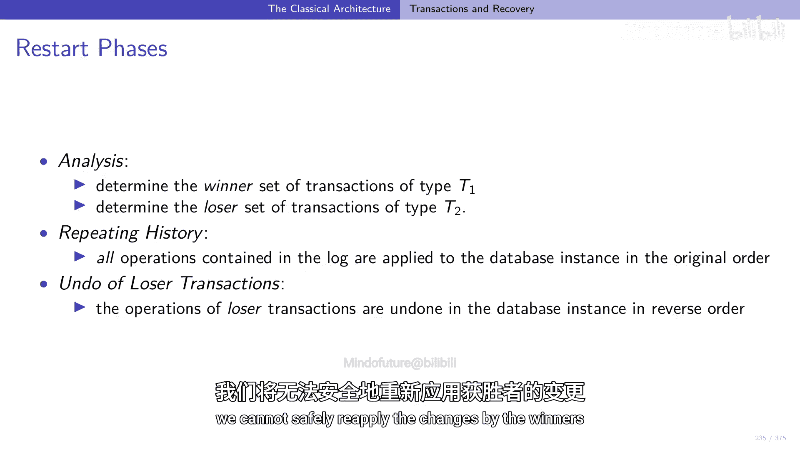

Okay， as therefore in the final set under losers。So this is just the picture that I draw first phase。

 forward pass over the lock， we figure out who was winner to loser。

 then second phase redo again forward pass over the lock， we apply all changes by winners on losers。

third phase undo， we go backwards and we undo all changes by lose。

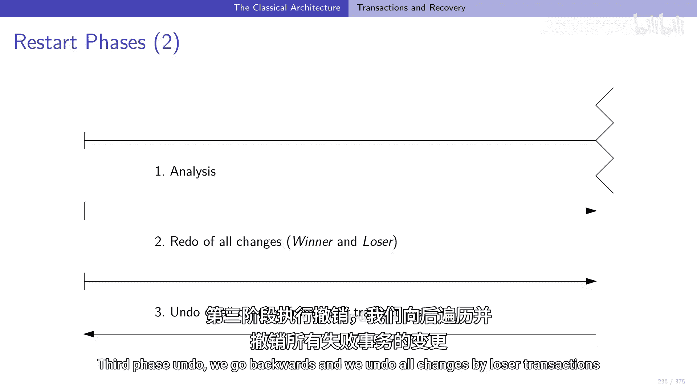

Now what do we actually write into this log record。

 say in the lock we record all the changes that are performed but what we do actually write。😊。

We we store a number of elements here， first one， log sequence number。

 this is conceptual just a monorononic increasing number of for each of those management。

 first record， second record， third record and so on， so the lock sequence number。

 monorononic increasing number。Now， in most implementations， this number does not really exist。

Conly these numbers in the log and reality what you will often use is you will use the byte offset in the log file as log sequence number because clearly the byte offset is mono growing。

 So if you， as you add new new values， say we get larger offsets， therefore we。

Use the right offset in the log file as log sequence number。

 now on the slides and also in the in most textbooks。

 we claim that we really write a number log record like  one to34。

As I said usually don't do this its an implementation， of course you can you could。

 but there's no no strong reason to do this because we can we can just figure this we can just use my position as implicit number。

Now our second entry here we record which transaction is it。

 we need this information to figure out should we repeats operation yes or no。

 and so therefore we must later figure out if it was a winner or loser so for each change we record which transaction did it。

 then which page was affected。😊，Yeah， then。How can we redo this change。

 we'll talk about this in a moment if we record what do we have to do to redo this change？

Then what you have to do is the undo is exchange， so regional undo information。And finally。

 previous loxy with number， so what was the previous change by that transaction？

that and we need this to undo the transactions because remember we at the ends if you look at the last change of a transaction。

 we undo this one and then we use this previous LSN to figure out what was the previous change of this transaction and then we also undo this one and so so we use the chaining to undo all changes by given transaction Now what about the content of this undo re entries here。

So， the。In in the read entry， the easiest case to store the reader information is so calledled physical logic。

 which means the after image， for example you could just say hey。

 this is page1 and this is the new content of page1 so this is the most invasive form of reader loging we just store the whole page。

The after image now， practice is a bit large。 Yes， you don't want to write the whole page。

 even if something small less changed。 Therefore， what you could， for example， store instead is。

You could say， okay。嗯。On this page one， go to Bte offset 50 and then write the following 20 bytes。

So this is the kind of delta that you could quote write even more complicated information like。

Intro it and shift everything to the right so yeah so this brings you then from physical logicging to logic loging。

 so logic loging says， okay， what do you have to do on this page to bring it to the same state as the after image is？

And how exactly you implement this is up to you depends on all of what kind of changes you want to do。

😊，Nevertheless， even if you do something that， we consider hereological lodging。😊。

R race requires that this change is physical in the sense that it affects only a single page。

So you can encode a change on a single page in a efficient manner so so something that is more smaller than just a copy of the whole page。

 but nevertheless it must affect the page and must allow you to reconstruct the page from its previous state。

😊，And you will see in a moment why this is so。 Then the undo information。 Now。

 the easiest implementation again is physical logic。 So the before image we just say， okay。

 what wrote before， but。This is often not enough。 Yeah。

 I'd like think back again about your B3 example。 So when record is split。

 So it could be you have a page here。And let's go this page1。

 then there's value A and somebody inserts that value B is not committed yet so when the transaction works B must be removed。

 but now somebody A splits the page for some reason so we again have A and some other stuff here and then B has been moved to another page。

 page2。But still， when the transaction rolls back， I must undo this， so I must still remove B。

So somehow must have a mechanism to find the be on the new place and remove it。

 even though although some different if it now has been moved to a different page and therefore RAs uses physiological logging。

 which means redo is physically means talks about a given page So undo is logically and would say if to undo this。

 please remove B the ever B is as soon as then we can retroverse my B3 and fat my be and it can remove it。

😊，Yeah by the re is physical。

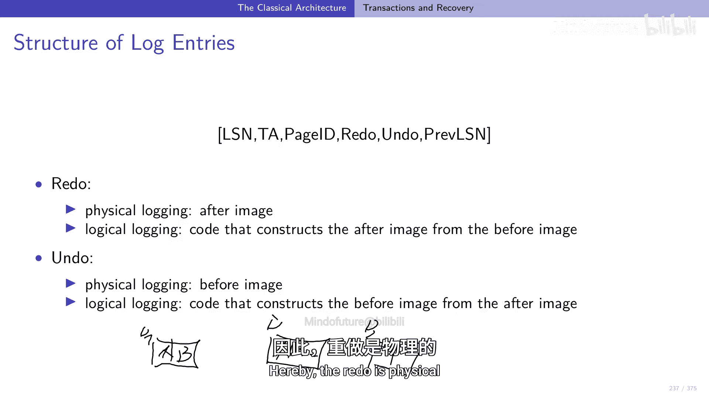

Also， theres the big difference between the reader and the interfacephas。While Im in the re phase。

 my database is inconsistence。Remember we don't know what has been written or not。

 Therefore in the reader phase， I cannot safely rely upon the effectively so， for example。

 my index pages are valid could be that my index has not been repaired yet could I could have damaged pages while after the reader interface is done my database is again in a consistent state still might have uncommitted transactions but all data structures are valid。

 so all my indexes work and everything So afterdo my physical storage structures are repaired therefore I can safely perform logical and in the during the reader phase I cannot safely perform logical operations that go beyond a single page within a single page I can do this。

But beyond the page， I cannot because I don't know if this other page has been repaired already。

 therefore， in the reader phase， you must be more conservative than we can be in the un phase。

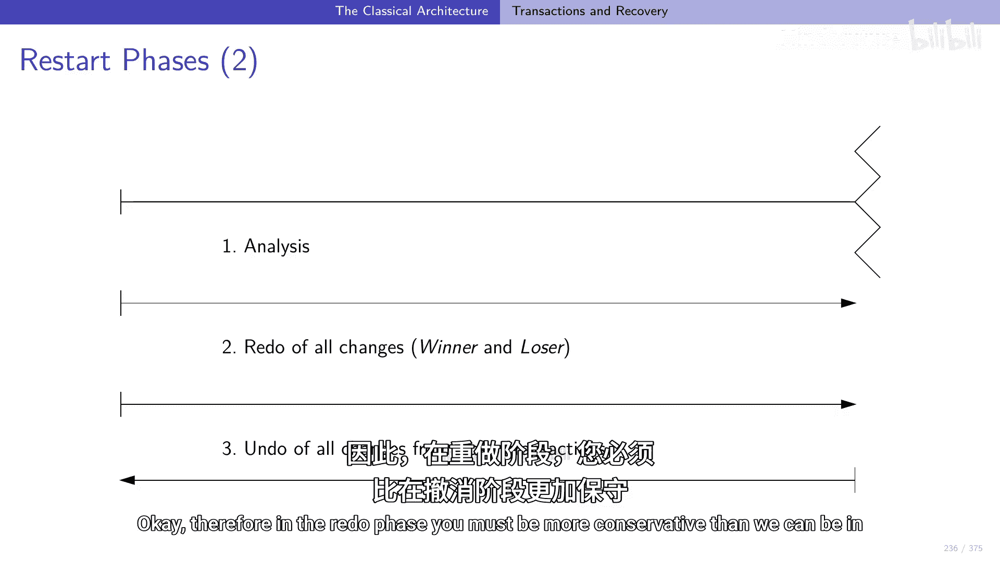

Okay， and so as this again talks about this component here。

 log sequence number I've already said monoonic number that uniquely identifies the lock record。

And typical choice is used to offset within log 5， which means the log sequence the most implicit。

And the transaction is just a transaction idea of the transaction that did perform the change。

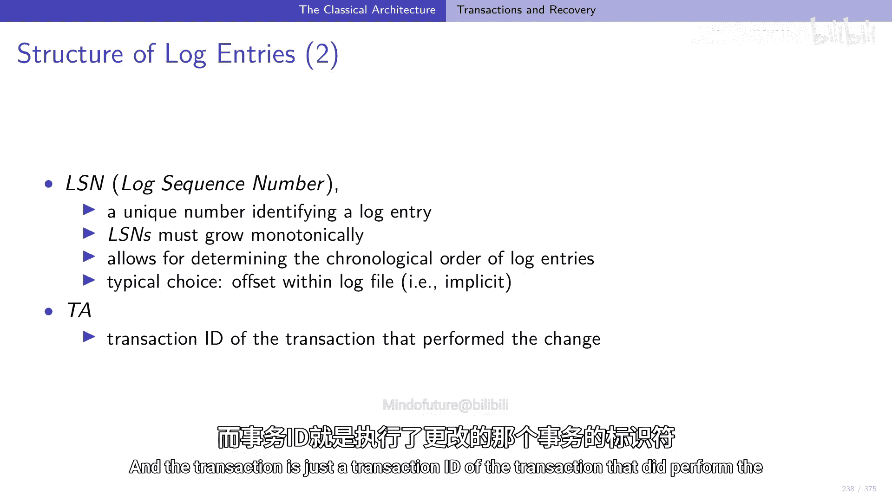

Page ID is a number of the page that was updated， note that if you have a change that affects multiple pages like split of a B3。

Between page， then we must write multiple lock records now so each lock record is only allowed to affect one page。

There one lock record per page， and previously LSN this tells me what was the last change by the same transaction。

Yeah we need this for undo and heres as we need this for performance reasons， of course。

 in an abstract sense， this is redundant because we could just scan my log file backwards so we could just move move over my log file and then fight my previous lock record at some point but it could be that this previous lock record as far away and I want that my rowbacks don't take too long。

 therefore use this extra。😊，And we had to quickly find my previous log record。Okay， yeah。

 And then here Norton theres a certain asymetry， we have physical redo。

Which means myrido affects one page and only one page and I have logical un。

 which means my un can potentially affect multiple pages。

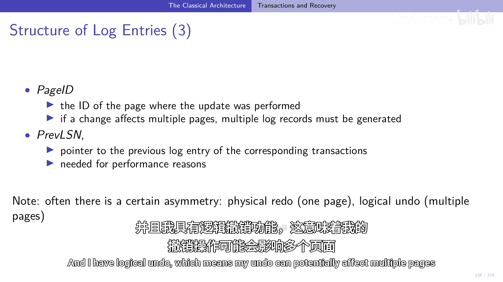

Okay now here's an example how a lock record could look like。

 so I have two transs t1 and2 and what I do here you see on the left and on the right So this so left of here you see the operations right of this line you see what is written to the lock。

First both transactions begin and I write lock record begin of transactions note that usually we don't do this。

 So usually my first lock record is implicitly this the beginning of transactions because I see this But now this yes。

 the textbook solution therefore we explicitly write a begin of transaction into my log。

 So I say here first lock record transaction one did begin and had no previous change。

 then transaction2 does begin had no previous change for the reads。

 we don't perform any logging because reads don't modify。😊，My database。So I I don't write anything。

 So then it comes the right here。 time time。6， transaction 1 writes a and the new value of a is 50 smaller than previously。

 So if I write the lock record， look at 3， says transaction 1。

Moified page A and the effect was that the value A on that page was reduced by 50。

 and if you want to undo this， you must increase a by 50 and the last change position section was record 1。

The Android X 2 performs right to C and again we write the lock record saying page C was updated we increased C by 100 if you want to undo this decrease C by 100 and the last record of this transaction was 2。

Then transaction1 does another right to B。 Again we write a lock record here。

 page B was affected We increase P by 50 last record was 30。

 then we write transaction 1 commits and last change was5 This of course。

 is important because this record here allows us to figure out that T1 is a winner And so when we restart and we see that T1 is we see this commit message we know that t1 is a winner then if we must preserve all changes by T1。

 instead we scan the file we do not find a commit entry then we know that transaction the loser its still implied then we must undo the changes Okay and last year。

Transjectction 2 continuous write page A。 And then here we see。 okay， somebody decreased a by 100。

If you want to undo this， increase bay 100 last entry was 4 and then transaction2 commits。

So this is how the lock looks like。

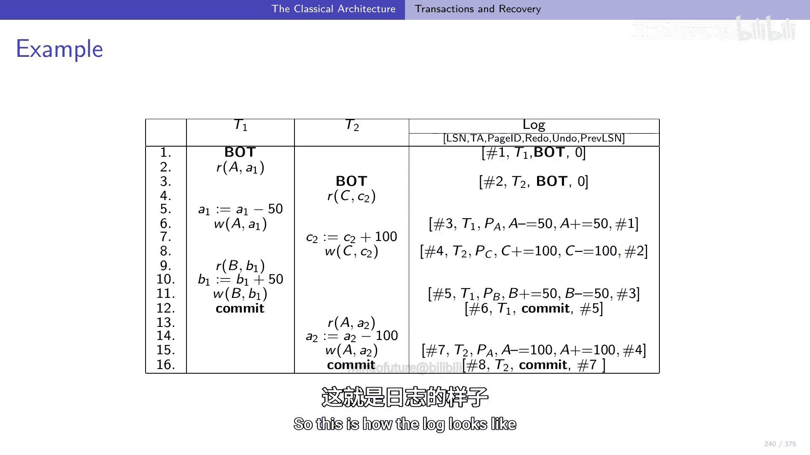

And so in the analysis phase we read the log and so the log contains beginner of transactions committed in the board entries and this allows us to figure out who is a winner and who's a lose and so I scan the log whenever I see a begin of transaction I oh oh a new transaction starts so I know this transaction exists。

😊，Then when we see a commit of that transaction， we know that as a winner。

 if we do not see a commit or if you see explicit board， then we see that transaction is loser。😊。

And if， if you see these are commit abouts and attract simplicityimplicly loser。

And the winners have to be preserved and the losers are removed from the system afterwards。

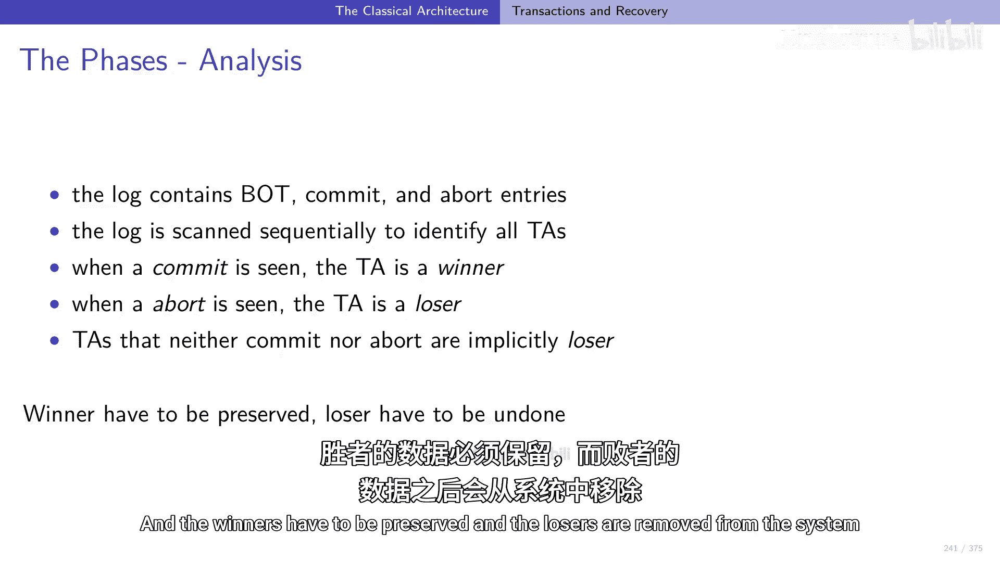

Okay， in the Re phase， we bring the database into a consistent state。😊。

Remember that we are running a no force strategies this means that some changes might have been only on in memory or not on disk and could be that some changes are incomplete。

 like a B split or only one could be that one page has been written as a one as not。

 but the lock nevertheless contains everything。And for to bring the railways in the same state fee as it was in the mount of the crash。

 we do a forward pass over the rock。😊，Remember each log entry affects a single page by design。 Yeah。

 and the page contains the log sequence number。 if you remember back when you talk about the buffer manager。

 So we have the log sequence number of the change。 So therefore what you do is we load the page from disk。

 we check if the log sequence number of the page is less than those log sequence number of the entry。

 If yes， the change in my log has not been applied yet。😊，Therefore。

 I do apply the log entry and update log sequence number so I remember what was the last change on disk。

😊，And then I continue processing my lock this mechanism here so comparing the log sequence number on disk to my log sequence number on my page allows me to figure out if a log entry has been applied already or not and this is important because otherwise I might apply the log same log entry twice and of course it's unsafe to think about this example here we said if you want to apply the change decrease a by 50 you are not allowed to do this multiple times because every time you do this a goes down therefore I must know if my page already contains this change or not and I can figure it out by comparing the log sequence number if the log sequence number is less than three then the change is not included so I must do it if it's three or more then it is included so I must not do this。

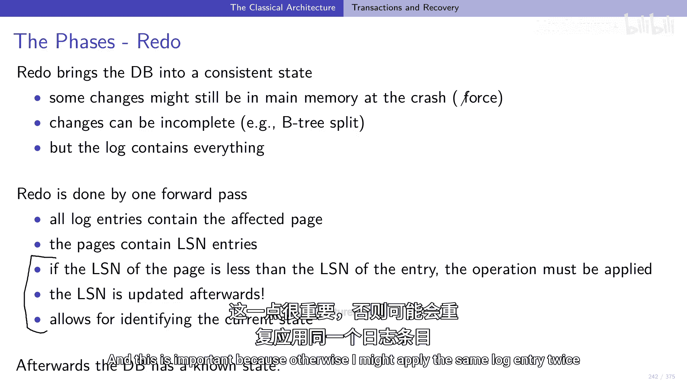

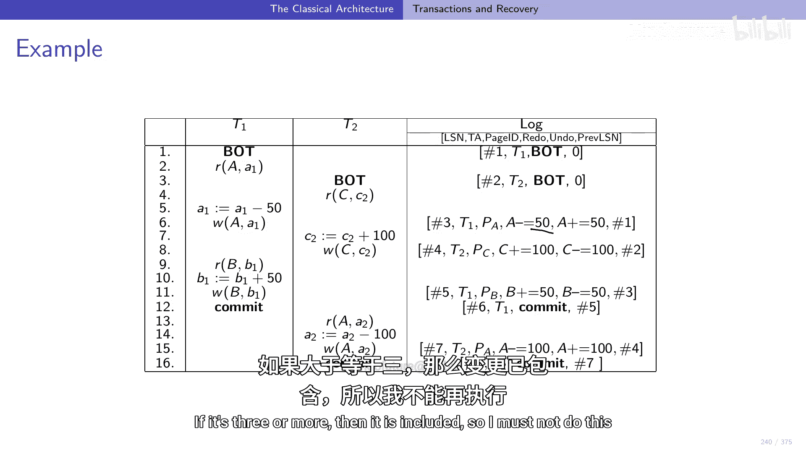

Okay， so this is a trick to to handle the state。 And you know， afterwards。

 after my re phase my database is a known state。 and I state that it was in the moment of the crash。

 Everything has been repaired。 All data structures are valid。 So now I can continue processing。

 and of course what I will do next is。😊。

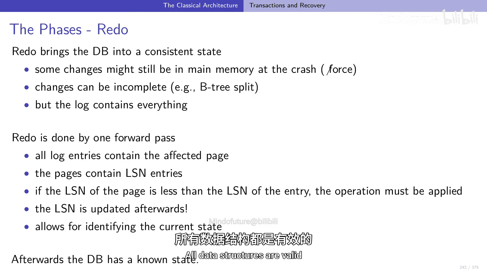

So under phase under all loser transactions， so during this analysis I remember the last sequenceism of each transaction and transactions that are aborted transactions that have already been aborted。

 they can be ignored， because they have already been removed so in fact they will have no last operation。

😊，But active transactions for general waves that have last operation that have not been removed already must be rolled back now。

 and we read this lock backwards， we always follow the last sequence number to jump from lock entry to lock entries so this was the last one then we takes this pointers to the previous ones。

 the point the previous one and so on。 we move our backwards to the lock If we under all the changes。

😊，And then the database is the transaction is gone note that this undoing means of the transaction produces new lock records because of course we must redo the undo later Now so undo means we must remove the transaction from the system and if we should crash later we then of course we must do this again Now therefore the undo of a lock record creates new lock records and we will talk about this in a moment when we talk about composition lock records。

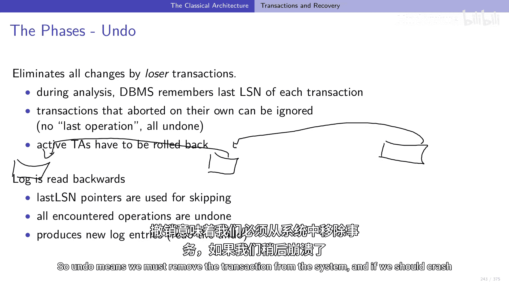

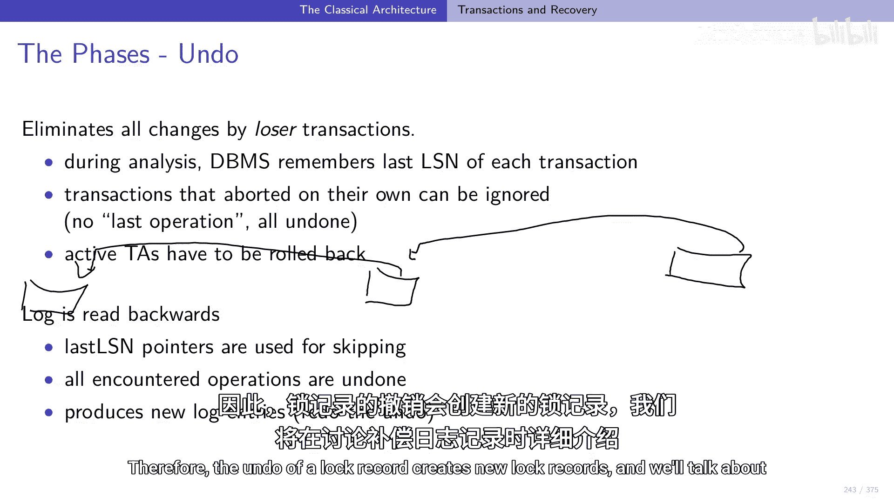

And one very important concept here for restarting is that the restart must even potent even potent means it must be possible to do this as often as you want and you still get the same database state。

So here you written here like undo un under under under of a is the same as undo A you can do the undo as often as you want the same as redo we can do the redo as often as you want。

 This is pretty important because otherwise it could be that your restart destroys your database。

It where kept me。😊，You could think， okay， why should I ever crash repeatedly。

 but I was told this is actually quite a common occurrence。Think for example， your hardware is 40。

 like your pulse supply is unreliable or so， therefore your system crashes because your pulse supply is unreliable。

Then it comes back again。😊，The database is started again and says， oh， I crashed。

 So let's do restart。 So I I again do the three phases analysis read to undo。

 And while happily doing the restarts the system crashes again because you know possible levels unreliable。

 Its still unreliable and it takes a moment until a human recognizes this problem So the system crashes and comes back again does restart and crashes and comes back again。

 And so we we can have repeated restarts。😊，And so system must cope with this。 first。

 it must be correct。 And second， another important property is that differs between areas and older systems。

But Arrgs promises I didn't explain you yet how it achieves this。

 but promises that even if you failed repeatedly， the number of lock records yet you will write are bounded。

 so that's not an unbounded， but even if you crash 10。

000 times the lock record volume that you write is bounded。And this is， again。

 important for repeated failure because otherwise you make things worse by filling up your heart disk and at some point your heart disk is full。

 and then you have a real problem。AndSo。But the others mechanism will allow us to do this safely so and here you see in example picture as you will say we have a number of operations we perform and we so 126 and this operation with double borders here so operation 1 and3 and 5 and 6 are done by transaction 1 and the other one about transaction 2 Okay so this is my model so I execute this and at some point in a time I crash。

😊。

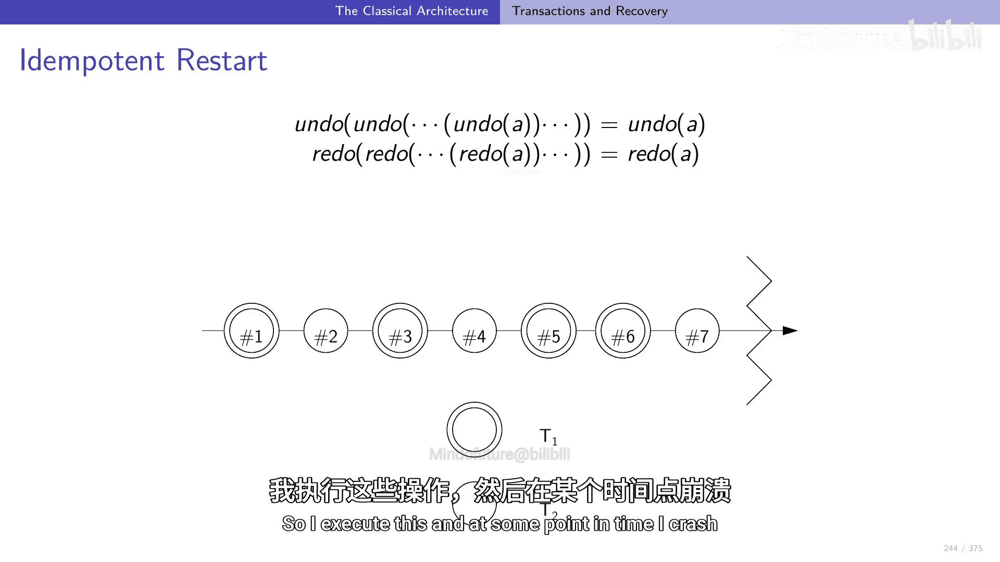

Now what I want is an in important restart and we get is by writing composition lock records。 Okay。

 so basically we remember what we have done。 So first we， of course， we when we restart。

 we do redo everything。😊，Now so we redo all like records all 7。

Then my database is in a consistent state。 Now I must undo transaction 2。

 so I must remove all changes of transaction 2， which is this one and this one and this one。

 and I do this backwards， which means first I undo change 7 and for this I write a new length record namely。

😊，At this this record test。Please undo the effect of 7 if you formulateted positively。

 so do the change that will undo 7 and now you set the undo next LN so what was the last change by this transaction and this one points now not to7 but to 4。

😊，Remember we must can crash in any point in time so it could be that after I have un 7 I crash again so then I'd restart and then in this case I would redo everything including7 prime so including the change that undo 7。

 I would re the two and then I would continue undoing and the next thing to undo is 4。😊，And again。

 I said the next thing to un is2。 and then I undo2。

 and then I say the next to undo is nothing because then I'm done。 Okay， and after this。

So I write three new entries here name it。Converation or record 7 prime。

4 prime and 2 prime after this I'm done it itll never write more than a3 doesn't matter if I crash repeatedly if a crushrooms un always writes three record and nothing more。

Okay， and this gives me an E important restart。Because can when I restart。

 I can figure out if this change was already in my database just by comparing the log sequence number with this number and if if the number on the page is higher or equally than don't do anything as I redo it again and I can do this as often as needed so the same here This also gets a new number now I know this was taken from a book and the book course is at prime in relative of course we would have to course is 8 remember we need more electronic numbers So this would be 8910 conceptually of course it's the inverse of 7。

 the inverse of4 the inverse of 2 but relative of course we give them increasing numbers So then we can figure out if my number is included on a page or not。

😊，A draft bank doing a simple integer comparison。

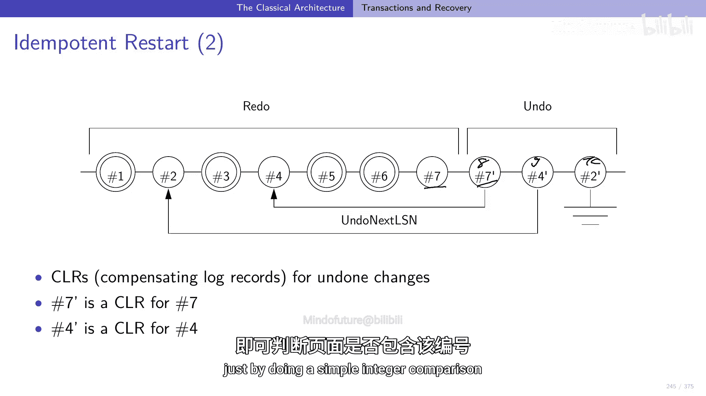

So then， yeah， this is my lock record after restart。So this was my original log。

 and I have three more entries， namely。Undo the7 you note that we only formulate this positively because we might have to redo this undo So then if we write a composition lock record that says。

 okay， compared at 7， this means transaction to modifies page a and we do increase a by 100 and note that we never undo a composition lock record。

 So composition lock record only contains redo information， No undo information Okay。

 and we say redo increase page by by a by100。😊，We remember this was my my previous entry from my page and the next entry to undo is4。

Okay， and then we write the next composition record for prime again transaction 2 qualifies page C C is decreased by 100。

 This previous entry was 7 prime and the next entry to undo is2 okay and then here we say okay2 prime transaction 2。

No pages like though pages affected because we are just done。

 It says the last entry was four prim then we are we are we， we don't have to do anything more。

 So at this when we reach this point here， transaction2 has been eliminated from our system。

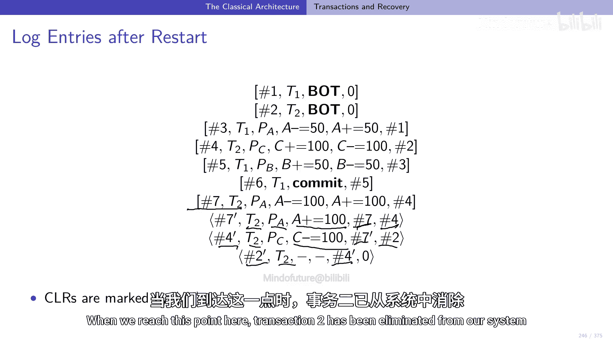

And then we are then we are done， and we can redo this if needed。Okay。

 so for computational lock record looks more or less like a regular log record with some small differences here。

 the viewing is the same。 So locky with example up transaction page and re this is the same。

 But then we this is the this is also the same。 But then we store。😊。

The undo next L end to the point of the next operation to undo。 So first we have no undo information。

 we only redo a conversation record。😊，And then we remember what is the next entry to do。 Yeah。

 so now。You could ask yourself why St is twice in red you be only interested in one point and so we could just say the previous LN is under next LN No as very right。

 So we could store under next LN in the previous LN Strly speaking is not necessary。Now。

 as the originalbleation of Arias did this mayt different values。For debugging reasons。

 because if you have it like this or with both， you can quickly figure out if your log entries are correct and you can traverse them quickly and check if everything is right。

Strictly speaking， you don't need both， it would be sufficient to store the under entry in the previous L。

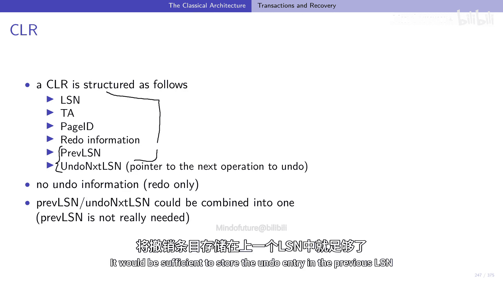

Okay， and we this is， of course， the hard case namely there when we have a full question then continue。

 we can all use this for partial rowbacks like transaction can do operation1，2，3。

4 and then says oh no no I did a mistake So I rowback part of my transaction not everything but just undo 4。

 undo 3， undo 2 and then I continue with new operation 5。

 Okay and this is supported by this mechanism here because we first start writing 1，2，3，4。

 then we realize， oh no， I want to undo something then undo 4， undo 3。😊。

And then I sorry I misinterpretted my my own  errorss I don't undo2。 I only undo three and 4。

 two keeps alive and therefore afterwards I write record 5 continuing since logically logically we only do1。

2，5。 the effect of 3 and4 is removed from a system。

And these partial rowbacks are necessary to implement safe points。

 I'm not sure if you' are familiar with this in secret secret you can define within a transaction save point and then you can say so you say okay I'm here and after some later point you can say rowback to save point and then you forget everything that happens since that save point but then you can still continue after the save point so you don't kill the whole transaction but only some part of the transaction but this doesn't require any special magic because our mechanism already exists anyway。

 we just use the regular mechanism of its compositional records to handle this。😊。

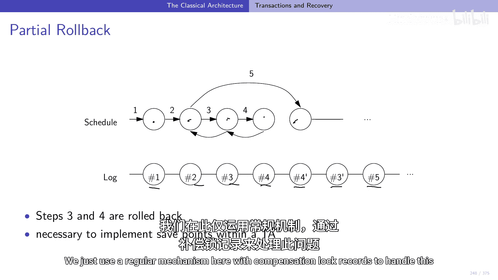

Okay， and now。One problem of course that we have in our restart mechanism is that we have to read a quite large file so first we read the log file once to figure out who is the winner of the loser。

 then we reads the log file again to figure out if a page contains a change yes or no and this of course means that not only reads the page as a log but also reads a corresponding page。

😊，Yeah and this is of course a bit expensive and I would like to not do this and the mechanism to avoid reading that the large part of the data is Fo checkpoints。

😊，Okay。😊，Basically， what you do is at some point in a time， you write in your log。 Okay， currently。

 for example， here， we could say this is my。My my point in time， and I say at this point in time。

 transaction1 was active and transaction 2 was active。

And you will see well also write something more about the pages that are modified。 but in particular。

 we can remember what was the the transaction that are running。 Now。

 you see already we have this checkpoint here twice and this doted line is endline。

Then we say checkpoint in reality this is like a checkpoint span because we need some time to write my checkpoint so as therefore we say here this is my begin of my checkpoint。

 this is the end of my checkpoint and we say as begin of course t1 and2 we active at the end T1 has committed already T2 is committed and T3 is running but nevertheless we be to take a slice of my time and then we record who was currently running and of course if I have this information this means。

😊，Everybody who comes before don't even have to I know for sure that they are committed yet everybody who comes after I know for sure that they are not committed yet。

 all these people who are within my checkpoint who active is in my checkpoint。

 then I have to see if they are still alive okay。😊。

Now how you create your checkpoint and also how complicate your handling is depends on how you build it。

 So one is transaction consistent transaction consistent checkpoint means I only do a checkpoint when there is currently no running transaction Now this is the most invasive but also the easiest to implement checkpoint so you say okay I have checkpoints a transactions beginning transaction later but this point in time no transaction was running。

😊，If you have this and this is your point in the log。

 if you have this is means analysis only has to start after this checkpoint because I know that only later entries running transactions or I only have to redo after this。

 at least if in the in the moment that I do my checkpoint。

 I flush I force all my dirty pages to disk if it do this。

 then my redo can continue with from this point in time because I know everything bother before my checkpoint。

Is already flushed to disk。 again， at the same as undo。

 my undo auto never goes beyond this checkpoint。 And also。

 transaction consistent checkpoints are nice to have make your research cheap。 Pro， of course。

 is how do I get this。😊，Because I would have to have a moment in time when there is no running transaction。

 Sometimes this is not easy to get because there are always some transactions in your system。

Now the next weaker form is an action consistent checkpoint， which it means you do have transactions。

 but you stop them for a moment， or you mean you don't aort them but you say。

 please stop processing like using a mut text or something you stop them from working。

Then you do your checkpoint， you write all your dirty pages to disk and you write to disk which transactions are running and then when you have an action vector and checkpoint。

 you have to analyze only from the latest checkpoint to the end。

 you have to do redo only from the latest checkpoint to the end。

 Of course the undo potentially has to go beyond because you still must undo all changes of running transactions So how far you have to go depends on the n So what is the minimum sequence number written by any active transactions。

So the undo goes beyond my checkpoint， but analysis and Ri goes only starts there。Down that again。

 of course， the MR must stop processing， which also might not be easy to implement。

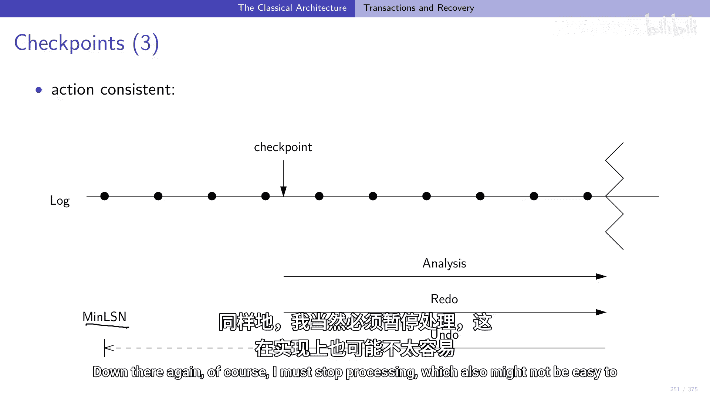

Therefore， the most generic one here is that one here。

 fuzzy checkpoint so what you see here so we at some point in time I start say okay I want to do a checkpoint and you remember who' is currently active and then you start writing out all 30 pages to disk so this point in time we have be write all there are two pages to disk and then we are done。

But of course， the system can at least potentially continue running while you're doing this。

So and therefore， my check restart here becomes more complicated。

So from my check I have to do analysis only from the checkpoint afterwards because I know my checkpoint contains the list of all active transactions so I know this。

 but there can be late more transactions later so I have to scan this now my redo can start when where I am plus the minimum dirty page LSN so what is the log sequence number the smallest log sequence number of dirty pages that still in the system after the end of my checkpoint because there could be new dirtyiness introduced in my checkpoint so this I must record I must to do some more re and of course with unN is the minimum of any active transactions So this is the most I have to do in the undo phase。

😊，Ret becomes more complicated if you use fuzzy checkpoints。

 but the big advantage of fuzzy checkpoint is you don't have to stop your system you can do a checkpoint while your system is running therefore all commercial database systems and practice use fuzzy checkpoints because these are the least invasive。

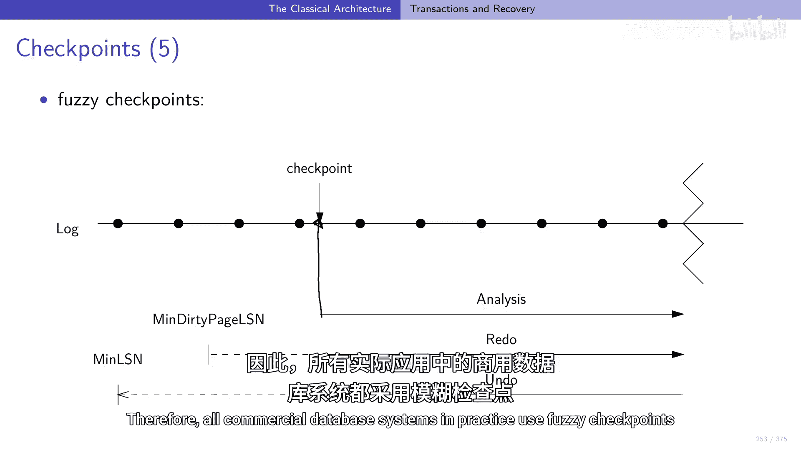

So。But in a fuzzy checkpoint， you。Don't have to force modified pages to disk I mean you can or at least some of them。

 but you don't have to， but what you definitely do is you store the pages of dirty pages and then here has a set of dirty pages is all modified pages and the mean dirty page is a minimum log single number that has not been written to disk Now said pages are not forced to disk usually what you will want to do is you look at this mean dirty pages is N and if this is a very low number then you want to force to pages on disk because it could be that you have a page that is very hot so that it is modified all the time。

And then the mined petals and a very small number will cause the all is to this page。😊。

It's not been written to this can be quite long ago。 And if you see that this is long ago。

 then you write this page disc。 and then， of course， you get a higher， much higher L on that page。

 this brings your mean page E and high。 So therefore， when we say。When we are not for。

 it might be a bit too strong and we say are not necessarily。This is serial forced to disk。

 You don't have to force them to disk， but sometimes you want， if they are very old changes on them。

 then you want to force them to disk to make your restart faster。Okay。Okay。

 but you definitely collect all 30 pages。 and what was the loxyism on this on this page。

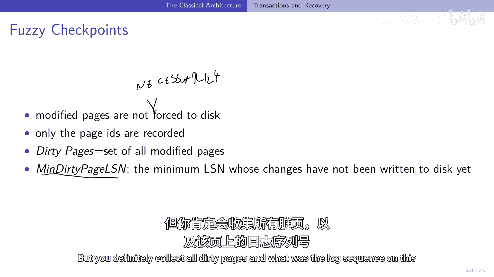

Okay， so this brings me to the end of my recovery chapter。 So let's let me briefly take my timing。

 Oh， I have 10 minutes left。 Yeah， so I can， as I can start with already with with the next big part。

 namely。So so far we talked about a lot of problems that we have in like how do we store how we are on transaction。

 how we are run concurrenency and so on， but we did not talk about yet is how do we do efficient queer processing but of course this is what we are particularly interested in most of the time is spent on running complicated queers at least in linear databases therefore we want to do this as quickly as possible。

Okay this is the next large part of the lecture and I just want to start with I will not go very far。

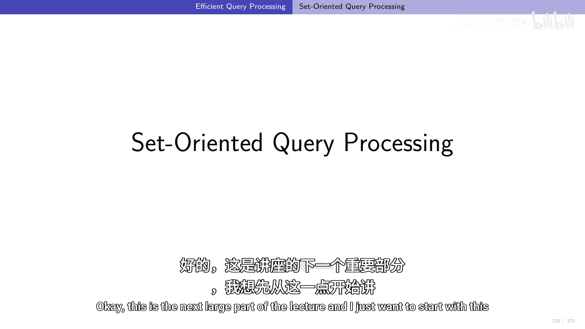

So。Buttiation is why why is this thing called set oriented processing。

So usually what the system wants to do is you want to process large parts so a large set of data instead of individual data items so this is to contrary to what you usually will do if you just write some small programs that does some operation so the most I think the most common construct as that people use to operate operate and data something like a full loop right like you take a data item you loop over a list compares this data item with all entries on a list now this is an extremely common pattern。

And so。Which means you V basically record oriented， so we take one record。

 we look at some other records and we do some operations。

I mean good thing about this kind of program is that's very easy to understand your simply code betting is it doesn't scale because this kind of operation like you look at all pairs of records or so tends to lead to n square behavior so we the example given on the slide is consider two lists now so if you want to figure out what elements occur on post lists。

😊，Of course we can implement this easily using just two four loops。

 we loop over all entries on the first list， we loop of all entries on the second list。

 we compare them， works three length of code， but is n square and runtime and because we we look at all pairs。

And usually unsquared is unacceptable and database systems tend to be in the millions or billions。

 a million squared is a really unpleasant number you don't want to do this。

Now as for n square algorithm we usually cannot do。

 the the most expensive we usually allow is n log n。

So therefore we want to have operations that do this quicker and of course， we can do this quicker。

 like if we instead of looking at individual elements， we look at the whole lists。😊。

Then we can do this if for example， in N log n because what we can do is we can sort post lists and then we do a list intersection in linear time so the expensive part is sorting。

AnIn then is cheap， sorting we can do an N log N， and therefore we can handle even very large lists efficiently。

 and we can only do this because we seize the whole list as input and therefore the name set oriented processing。

 we take the whole set and do something with the set。😊。

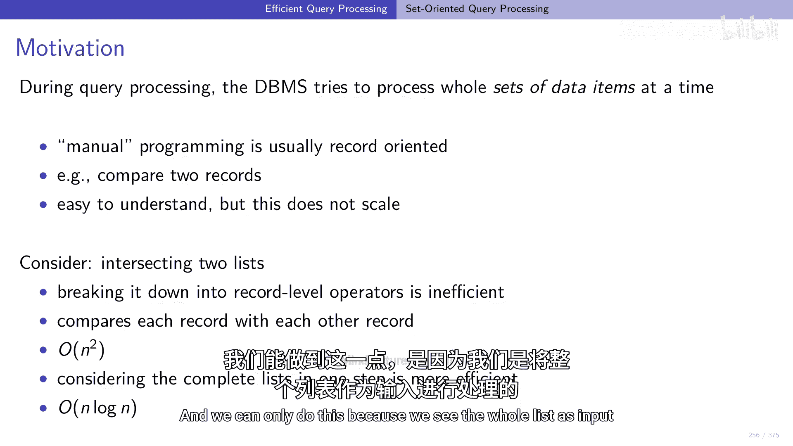

Okay， so set oriented processing has has many advantages over looking at individual records like we can preproces before we can processing。

 we can solve， we can has， we can build index structures also。😊，For individual elements。

 this would never pay off building a complicated data structure， but for a large set of elements。

 then it pays off to do this。 And so we amortize the cost over the set。

 This brings me to more efficient algorithm。Also， this allows me to cope with memory limitations that if I realize。

 oh， my set is too large， can fit it into memory， then I can handle this。Also be。

 if we have a large set， we can parallel glasses easily。 So this is or good。 So in the end。

 set range processing is much better， much more scalable。😊，Downside， of course， is more。

 more complicated。 Now， So the think about about the list intersection example。

 a trivial list intersection is three lines of code。At his stock slow。

An efficiency distance transaction is fast， but this is not three lines， but。

 depending on what kind of tooling you have， probably at least。Say6 or seven lines。

 if you have to do everything yourself， including sting。

 then's probably more than the 50 or 100 lines of code。

 also depending on what kind of tooling you have。Okay， so se is more complex but more scalable。

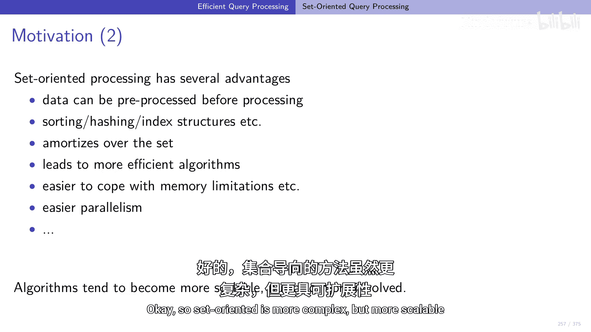

Okay， and now when we are inside and in relational database system。

 all operations that we want to perform are expressed using relational algebra。

And so therefore so everything I do here is modeled as an operator。 for example， a join or scan。

 and so we have here we have three kinds of operators。

 So this is called a scan So we just read an input input also a scan the scan here we have a filter also called select so we filter my input and here we have a join we take two inputs and we combine them and each operator take consumes zero or more input relation and produces one output relation。

 So this is a model and this operators here are inherently set oriented。

 Now if Im a pan and switch speaking they are not set oriented。 they are back oriented。

 So back means multi set because my relation of course can contain duplicates at least in the general case。

😊，If have a primary key input is duplicate free， but if I node the primary keys。

 then I can edit duplicates and therefore of course operators must cope with duplicates。Okay。

 but this is basically my model。😊。

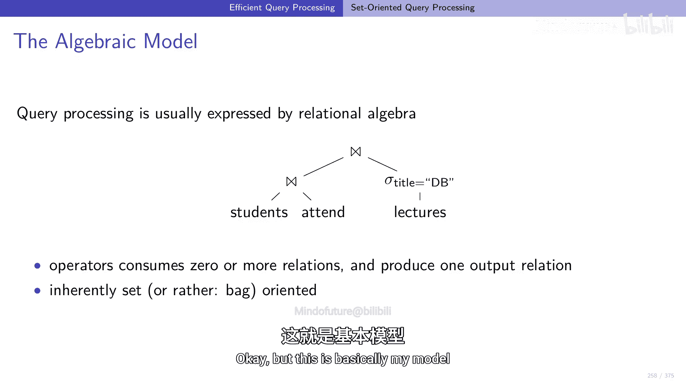

And the question is now， of course， how can I implement this efficiently？

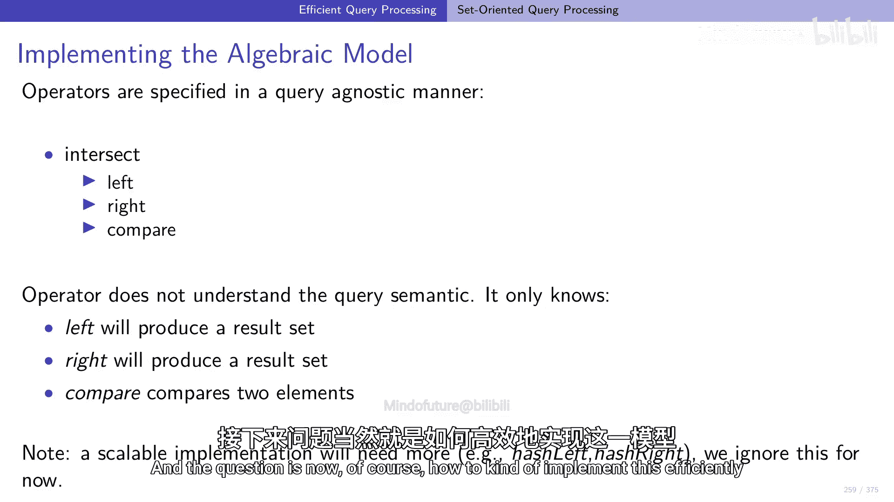

Okay， and so now just looking at my time。only five minutes left。 So I think I will stop here now。

Before the next lecture， I would recommend you please again look at the address operators because we can now come back to this and assume that you all know how this work and we will now look at how what they do and how we can implement them efficiently Okay。

 but this I will want to continue in the next lecture。

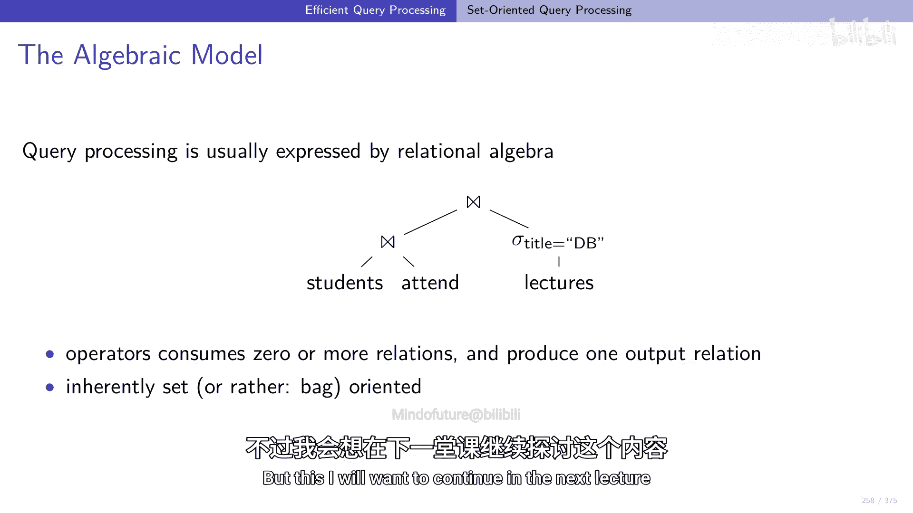

Okay， thank you。