# 【慕尼黑理工大学】现代CPU架构上的数据库系统实现-｜-Database-Systems-On-Modern-Cpu-Architectures-2021-p10-P10_10_面向集合--BV1asiJBeE6j_p10-

Welcome to this lecture on database implementation。

 So in the last lecture we started looking at set orientedque processing。

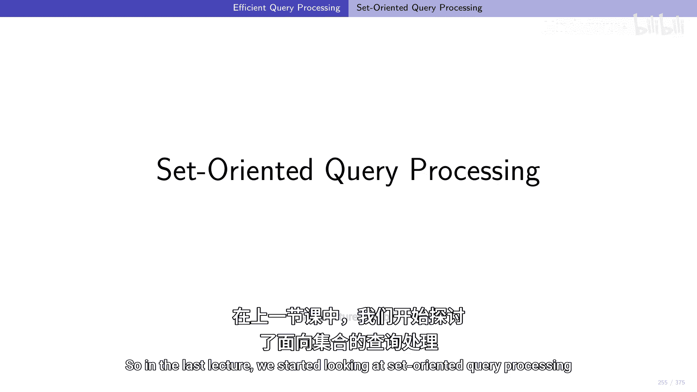

And we said that for efficiency reasons we prefer processing schemes where we don't look at individual data items。

 but instead look at large sets of items because we can process much more efficiently than if you just look at one item after the other for example。

 if we can use techniques like soging hehing index and so pay off if you have large sets but for a single table of course an index doesn't make sense。

 therefore we prefer to process large sets of data values。

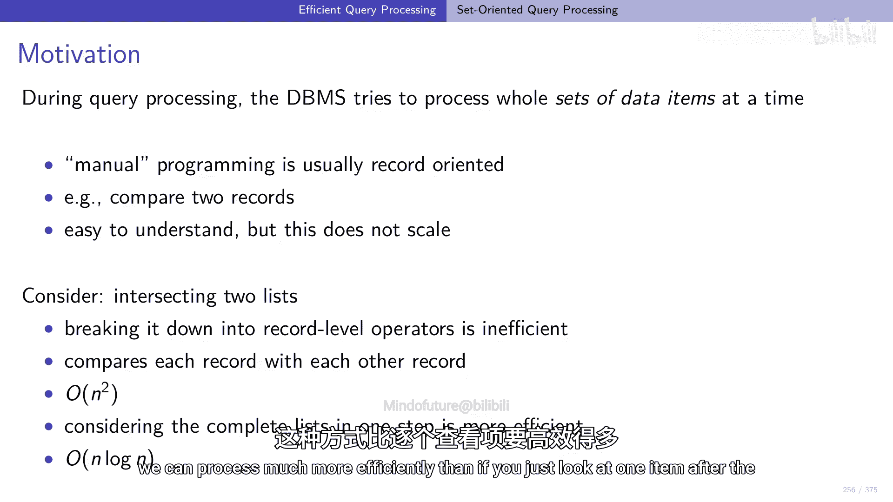

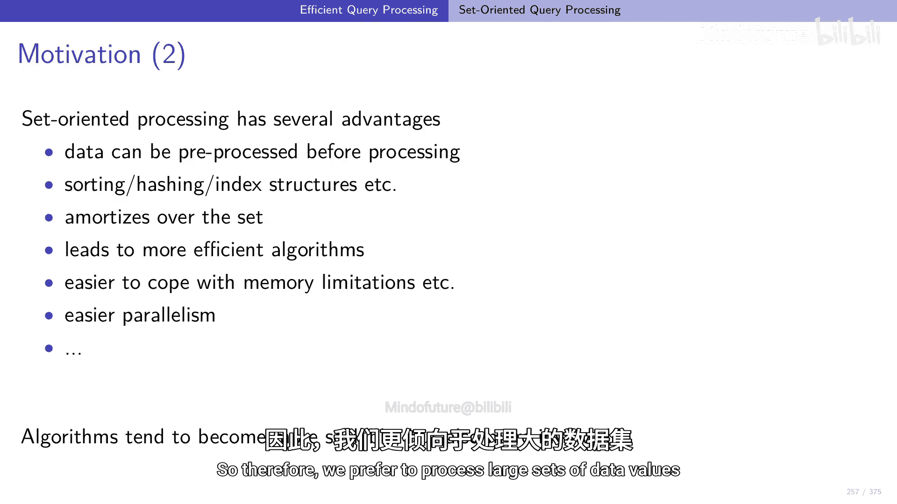

And we said usually we do this by expressing our career processing plan or strategy as relation to algebra and so here we see a typical example。

 if we would run a SQA query that says find new old students that attend lectures and databases。

This is what we get。 So we look at one set here， this set of this relation more precisely。

 this relation， this relation we join us together together。

 This gives us at least conceptually gives us a new relation。We might not start like this。

 but conceptual this gives me a new relation then I have the lectures relation again I construct a new relation by filtering on on database styleling and we join them together and then we get the answer so and our model here that the operators we have an operators are select。

Oh sorry， join， select is a select， join， select and this here you don't see it because we usually write the name of relation。

 but this is called the table scan as an operator that reads a table from disk or for memory。

As when each operator consumes zero or more relation and produces one output relation。

 So this is our model here。 and this processing model is inherently set oriented because it operates a set of data。

 Now when I say a set of data this is strictly speaking or true because SQl allows us to have duplicates and our input as if we don't have a primary keys and we can have duplicates therefore the address here has backoriented so we a mighty set oriented so we can have a multiple copies of the same data value which actually sometimes is a pain。

 some of the problems becomes more difficult because we can have duplicates if everything would be duplicate free。

 this would usually be easier now but SQ is notlex so we must cope with a fact that we might have duplicates。

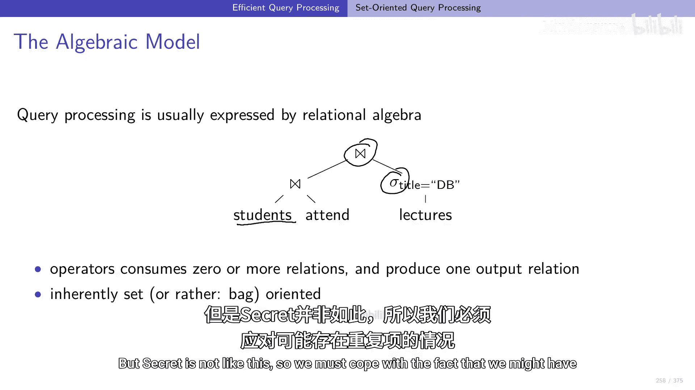

Okay now the interests in this lecture of course， is how do we implement this so how do we implement such a operators and before we look later we look at how really implement them but before we look at individual operators you must understand somewhat what other general strategies for doing so and now one thing you must keep in mind is there there are actually multiple points in time if you wish and so this year time point T1。

😊。

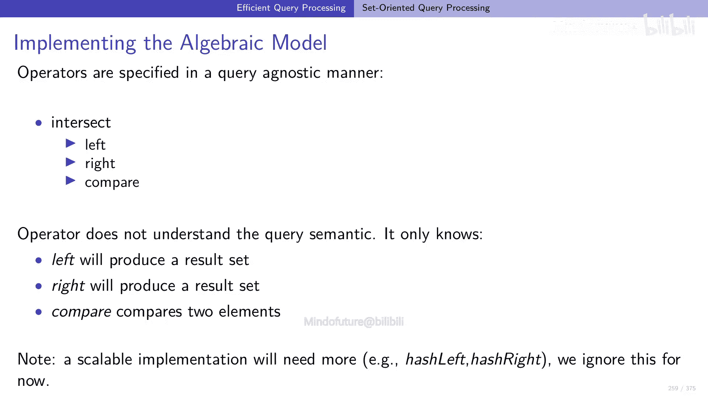

We compiled our database system。Of course， this is usually a long time ago。

 as this says speaking as be vary of like weeks， months， years ago， as a long time ago。

So then sometime later， it provides G2。We compile the query。😔，As is I a secret query。For example。

 for example， sQ。And then， of course， again， at some point later， now this is probably closer to T2。

 but can at least conceptual also be quite late the execute query。Yeah。

 so but in particular this this separation causes quite a few challenges。

 but first let's look at the one between t1 and82。One problem of course。

 is that when we built our database systems and we implemented the VMV test this。

 we have no idea which queries will be executed later on later on our system also because we built a database system。

 we often ship it to a customer or might run it on a cloud server and set but nevertheless we installed it somewhere。

😊，And then it is more or less out of our control and at some later point in time。

 a user typess in some secret and of course then expects his box。So。

And this means that you must implement your operators in a way that they can cope with arbitraryque and because we don't know the cure。

 So when we implement operators， we don't know which curs will be executed。 therefore。

 we must implement them in a way so that they can can be can learn everything and to illustrate this。

 of course， we will assume more examples later but just illustrates this。 think about we。😊。

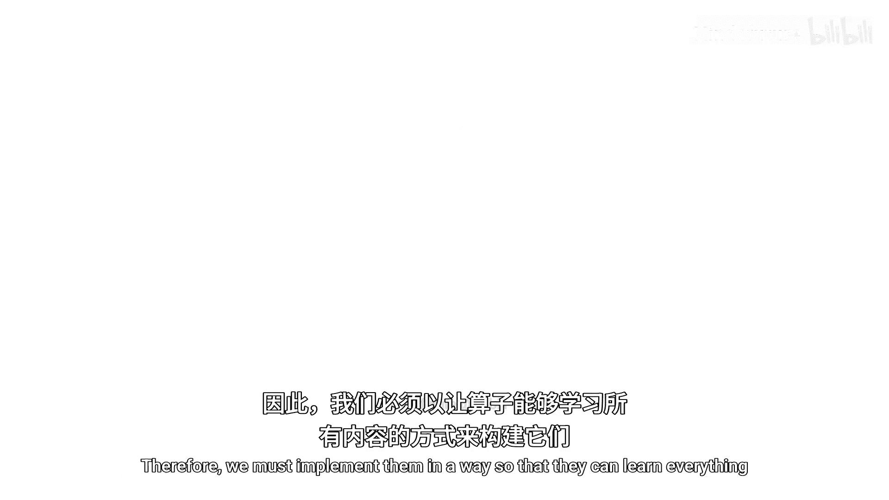

let's say we want to implement some of the likes set intersection and so we want to take two sets or two relations and now we want to find all values that occur in both both side both sets so regular set intersection。

And now what we want， and of course， we have no idea what the set will be like is it an integer column。

 is it a string column， is it two columns here we have no idea。And nevertheless。

 we must implement our intersection in a ways that always works。😊，YeahAnd one way to。

 to do this is to is assume that we have。kind of abstract helper logic。

 we will usually call them subscripts。 So because subscripts。

 because we attach them to the operator when we， when we when we write it down。

Yes so we have a sub and this contains a query specific part like so we have might have here our intersect already here on top。

 So this here might be our intersect。 I then say， okay to an input intersect I need three operations First。

 it must be possible to read my left input so I need a function that gives me in my left input。😊。

I need a function that gives me my right input。😊，And I need a function that compares two elements from both inputs。

And now in right you might need more than this， but this is about the smallest way we can inter into intersection because if you think about this what we can do is at least one way to implement this is to say。

 I read my left input and then I sort。My my my left input and I can do this because I have a comparison function。

 And so I swap my left input then I read my right input and again I solve my right input and I can do with the comparison function and then I scan post lists which are sorted and find all elements that are on both sides and again I can do this because of my comparison function。

😊，Yeah， now。Often you will not want to implement it like this。 for example。

 we might prefer hash tablebits instead of sorting， but then we need more subs。 Now for example。

 we might have what's written down here， we might need a function。

 We need a way to hash value from left or right as we need hash functions or some other stuff。

 but this， of course， depends on implementation， but this is about the minimum set。

 so with these three operators， this is three subscripts。

You can implement this and note that this implementation actually makes no assumption about the tablet at all。

😊，Now， if I say at all， it's not 100 percent true， I might have to know how large a value is because if I change the sort order。

 I might perhaps not because I can do everything with indirect so it might be okay。

 it do not even know how large the data items is because what I can always do is I have here is if these are my data items So just read no sorry So this is here or something And if you can just maintain a pointer array to all this is points the first value points the second value third value。

And then I can just sort the pointers。Using the comparison function。

 So because I look at the content， then code the comparison function。

So I might score this point of age instead and then I don't even have to know how large the values and are。

 so I can implement an intersection knowing very very little about the input data types doest matter size of the type tables are be implemented but might not matter either。

We just have to know okay， how can I get my pointers to my left side。

 how get my pointers to my right side， and how can I compare two elements。

 so this is everything that I really need to know。😊。

This is an interesting way to implement operators， of course of course it is not only interesting because for database it is basically required because of the problems that we don't know what the user will do later。

 so we must implement everything in such a way so that we assume little or nearly none about our input。

😊。

Okay， so and if you think about this， what this means is that the a operators is defined an abstract logic for processing。

 as we say， for example， sorts left side， sorts right head， so this is very abstract operations。

And everything that is specific to this data item like how do we do comparison。

 what is the attribute that I'm interested in or so this is always hidden in these subscripts So these small things that attach to operator that tell me how everything works now in particular usually we the operator does not know the data type or the bad size of the input type so we have no idea if it's a string or integer and the interesting thing is we don't really care。

😊，Yeah so we don't have to know if it's a string on integer。

 but only thing what I need is I need a way to compare to elements。

 but this I get via a sub so somebody attach attaches a sub to my operator and then so I know this is what they do So by the way via the name subscript just think about this if this here for example。

 this is a select and if I attach here this is a typical example of a subscript the predicate that we want to apply but reality many operators have a lot of subs you more than what we usually write down and we by hand draw a。

😊，But just if you're curious， you can go to。Daabase tool that shows you the subscripts。 for example。

 if you go to our our own system here so you can go to either this part a new project。

I'm ready to be。Dot com or you instead you can go to our previous one hybrid post post work dot com。

 and so there you can enter a secret query and then you can say explain as a plan there place show with the plan。

 This shows you the as a。Iba plan， but then when you go click on it with your mouse to get more information or if you want to see it in full beauty。

 So in in raw format or notes as you as human friendly， you can effect in our these two systems。

 you can also in this in the secret query in the box。 you can just say explain。Purpose。And then。

Select whatever， whatever you want to do so some some query and now this is for both setting here will means that this one not only shows you operator tree。

 but it will indeed show you all the subs so everything is attached to the operators now is shown to you as so you can see what this users。

Okay， so we don't know the data I usually don't know the size。

 we also usually do not understand the content of a tappper so am I interested in the first column and the first attribute and the second attribute doesn't really matter because everything that is done with the tupper is hidden in a subscript So operators themselves don't care for them the tap is a black box we just thought So the only things the operator really cares about is data flow and control flow。

😊，So what do I read and write when and which where and when what kind of functions。

Do I have to con which order。Okay， everything that is clearly dependent is delegated with the subscripts。

 so they hide everything here from from you that's content query And this means， of course。

 that our operating implementation are extremely generic。 Yeah。

 you can you can run everything on the our intersection if once we implemented this our intersection will work all the time。

 doesn't matter what you。😊，If you intersect one column， 20。

000 top columns doesn't matter everything we work because we implement it in a very generic fashion。

Okay here so there's a small node here at the end of the slide you see sometimes in a few cases we want to know something about a tablet because it allows us to do an easy implementation。

 for example if we would know that my tablet has a fixed size as for example because there's no string column in there the fixed size tablets。

 then we can sometimes implement this more efficiently。

 for example sorting can be done more efficiently if we know that my elements a fixed size。😊，Yeah。

 so it therefore would be might。We might give the system some information about topics。

 but this is an exception usually we don't do this and also we will always have an implementation that knows nothing because you will always need fully generic version and fully generic usually means you know nothing about your data items you might have additional implementation that use some knowledge but you are geo generic implementation here really assume very。

 very little about my data that I want to store。😊。

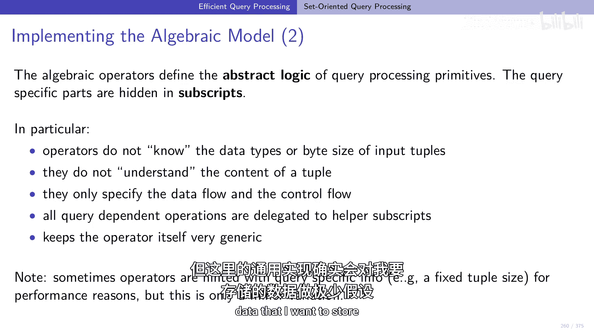

Okay now here is is an example how you can implement intersect now for simplicity assume that input is already sorted because then it's particularly easy So you see my example here is a call intersect sorted and I give it three subscripts namely left right and compare so left is canon object that gives me a subscript it gives me an next table on left right gives me the next table on the right and compare compare to values。

😊，So and now we can implement it like we say， okay first we'd say t1 is the next table from left so we read the first table from the left side and then we say。

 okay and then n you see the next so the next set that I want to read is the right hand side so I read one table from the left and to remember that the next table to be right comes from right。

😊，Okay， then now we have a big loop， this is as long as my apple is not exhausted。😊。

So as long as I'm not done。 So if n is left and I want to read from his left。 if n is left。

 then I say T1 is the next table from left L T2 is next table from the right。 Okay。

 now I have two table pointers T1 T2 then I'll call my compare function。

 And if remember this is a classic it three bare comparison。

 So where where just for if you have never seen this before。 So here we assume that。😊。

0 corresponds to equal minus-1 so we say we say compare。Compare。

A B so 0 corresponds to a is equal to B minus1 corresponds to A is less than B。

And one corresponds to a is larger than B。 Okay， so this is a classic three vacuum compri。

And so we call my conversion function。 and now there are three case yeah if C is zeros。

 and both valuess are the same。 So then we found a valuess that occurs in both lists。

 therefore we store T1 as a result， knows that we could have stored T 2 instead。

 but because T 1 is equal to32， It doesn't matter。 we can store either t1 or T2。 So in this case。

 we stay if we store T1。😊，So else if c1 is 0， so my left side is smaller than my right side。

Then N is left。So the next table it should be right from the left， it's in its right。

 so I read the next step from the right and repeat and so I do this until I run out of topicsts。Okay。

 and this of course this is simplified because I assume my input is already solveed if I would have to sort as more complicated。

 but now less so this is one way ins and note that this implementation here assumes virtually nothing about tuts So iss my tut small or large does matter how many attributes does it have does matter So what is my reason for comparisonising also doest matter my implementation here will always work as long as left right and compares provided to me and two what the name and plus。

😊。

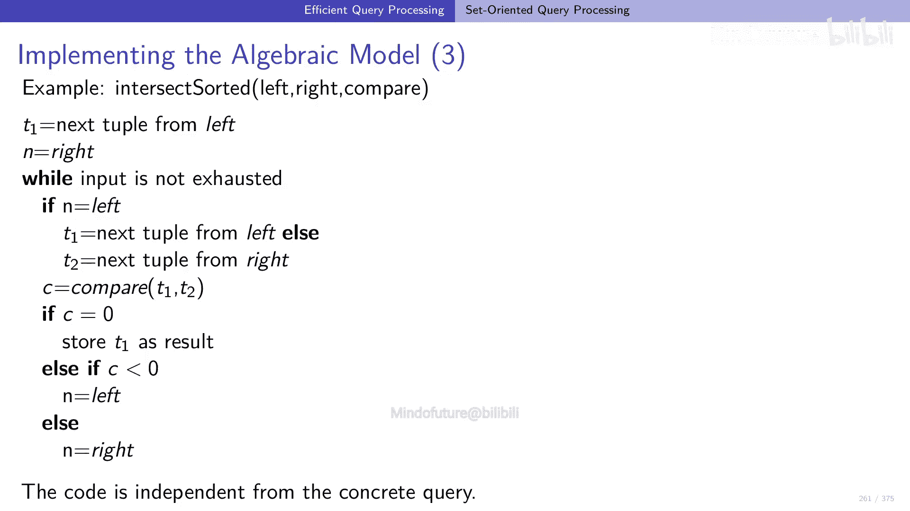

Okay。And so the model here has that each operator produces a set or more precisely a back or even more precisely a data stream of result tables。

 Now what what do mean with this distinction here， So a simple relation model is。

 of course a set mathematical set and this is true if I have a primary key and in general sense。

 of course we can have it back， which means we can have duplicates Now why do we say stream here。

usuallyually we don't， but in a few cases we care about the order of template that is produced。

Usually if the user gives me an order by statement。 as ofze says。

 select star from relation order by X。 that of course， I won't。Since my result here is order by x。

 therefore in this case here I care about the order and therefore the model is not a back but it's a stream。

 that's so Ive distinguished it first on the second limit and so on。😊，Therefore。

 the most general model yes is stream of items。And each operator here consumes zero or more input sets and usually we assume nothing about input so we can combine any so if we put anything below here So if if you put example if you have a select precate here x equals to 7。

 it doesn't matter if my input here has a base table like this or if my input is another select or if my input is groupi instead or sorry is a project group I or drawing or whatever。

 Yeah， so we assume nothing about my input， I just want that my input gives me a set or back or stream of tablets。

 that reset it doesn't matter what it is。And this this assumption is that we just read my input whatever it is。

 allows me to build nearly out terribly complex execution plans。😊。

Because I can combine them everything with everything。 So this is， of course very good。

 as is a very flexible scheme。 now down， of course， somebody has to implement this。

 So now we must make sure that this indeed works so that you can plug each operator and each other operator So assuming nothing。

😊。

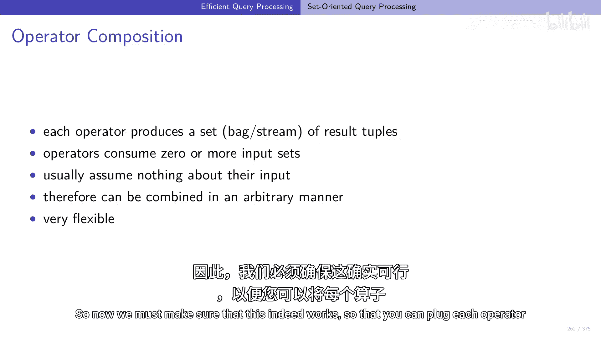

Yeah and now the interesting question is how do you do this so how should the operator interface look like such that you can combine every operator with every other operator。

😊，Okay， and now historically。😊，Several different travel ways have occurred at tourism。

 first now we look at perhaps the simplest， the simples of the I think how manyators the three or four alters that we will look at here。

So one way to implement the operator interface is what we call here full materialization。

 so the assumption basically is remember is that we said each operator reads zero or more relation as input and produces a relations output and this interface it says takes a literal sense so like we read base table as input and we write a new base table as output so I read of course my data must be physically's stored somewhere。

 but so this is my input simply scale an area or something it' an input representation this is another input representation if it didn't to join。

😊，Then I write out a new。A raise is it。 Okay， and so I。Readable completely。

 a operate completely and then the next operator starts so full materialization。

Now the advantage of this is if you do this first it's pretty easy to implement it's a very simple model because everything is always a materialized table so this is good。

 what's also good is that you are never surprised by your input。😊，Now weve after all。

 I read a materialized table input or multiple materialized table input。 So I can look at them。

 in particular， I know how large my input is。 This is also good。 now。

 because then I can react to this just to illustrate this。😊。

If you think about drawing and if you say for example。

 we want to build a hash table out of the smaller side which is usually a good idea and so if we traditionally we assume that my left input here as a build side so that I want to build a hash table from my left side so then do this iron S now if I use of fer materialization knows that this here can of course be a tree it doesn't have to be a table like yes。

 this can also be something large it can be a tree。

And then of course when I plan and then I construct this error expression I'm not really sure how large my left side will be So there are estimates like I I can say I predict then my left side contains 100 tablets and my right side contains 20。

000ts for example， then this would make sense， but this is my prediction and predictions sometimes wrong unfortunately it's quite difficult to predict the output size for some operators。

😊，Therefore sometimes I make mistakes， though I think my left con contains 10 values but might contain 50。

000 and so of course it the largearrow robots this can occur。😊。

And in the free materialization interface， this is not a problem because my set will be materialized anyway。

 so even though it's a sub electro， we will nevertheless write this down here into a table R。😊。

So we stored in of course， the temporary table， not a real tables， so not something a user can see。

 We contract the temporary tables that contains all my values。

 and then my drawing again gets two tablets of input。

 And therefore the first thing I will do is I look at the size of these two tablets。

 And if I see that， for example， that my right hand side is much smaller than my left hand side I adjust swaps left and right。

 not because I can do this。😊，I with the join here so I can swap much to never you're never surprised but your input so this is good。

😊，Also what's also good is if my input is fully materialized， some things become pretty simple。

 Like if you want to run things in parallel， for example。 let's make a very simple example here。

 we want to say for everything is5 if this is my input。 Now if my input is materialized somewhere。

 then what I can do is I can just this is， for example， mod relation。 I can just cut it into pieces。

 the first thread please makes the first filter， the first fragment。

 second thread filter the second fragment thats on， I cut it and then it runs parallel。😊。

Very easy to。Okay， not too easy as result construction because we have the adverse problem。

 But So this is pretty easy Also it's also easy is result sharing because it could be have multiple cures that produce the same intermediate result。

 at least conceptually if you run full materialization。

 you can just keep intermediate result because you have written it somewhere anyway So you can give it to somebody。

 So therefore this this as the strength of the approach。😊，Nevertheless， in practice。

 this is even though it' it's all。So it's so easy。It also has a lot of problems。Main problem。

 of course， is meization is expensive。 so if I take my operator and Ive write it somewhere。

 even if it is my memory， this writing costs me something。

 That so because I physically have to write it somewhere and then read it back again later。

 this cost me something and this can be quite expensive。😊，Yeah even worse， of course。

 if the data is larger than my memory so if might intermediate resides as larger than my memory。

 if I have to write all this， oh my God this is super expensive now so to make an example to illustrate this assume we have something like this。

😊，Cause this is a silly example， but。There was less。I can give you secret query that she guess it。

So we say。Yeah， so if we even say here true。 Okay， this is a really silly silly example。 Okay。

 it's not that silly。 That's a bit less silly example， but nonetheless。

 so we can say that's do A equals B。 And we are only a few distinct values for A and B。

 So everybody has a lot of equal values。 And then at the end， we do some like filterta here。

 C equals。😊，7even or so and note that in the way I've constructeded theries。

 you cannot merge the drawing and the filter because there's in full autoer drawing。

 you cannot merge them。Okay nevertheless， it could be that this find filter is pretty restrictive。

 so there will be only few output upward， but the food audio join can produce a very large number of combinations because there can be many。

 many combinations， but only few of them will satisfy the filter we can construct these examples。

 if you run a free meurization set up here。 we will write everything after the drawing here to discard these to memory therefore we write a lot of stuff that we discard later。

 this is of course not so attractive So free meization simple has some advantages but overall materialization is too expensive。

 are only a few systems do users most notably more native。

 So the database from our friends from CWI in Amsterdam。😊，So they use this model and。

But most other people don't and I think for good reasons， it has some strengths， but the price is。

 in my opinion too high usually or to quote Peter Boonsu is one of the main developers of moreway and he said the fullturization interface is a faster and pe also pe with devil meaning it has some attractive properties and you don't want to lose attractive properties of course and as once say now they build their system they no longer want to use the strengths of them but overall。

 is the disadvantages actually more than the advantages you probably don't want to use formaltization even though it's pretty simple。

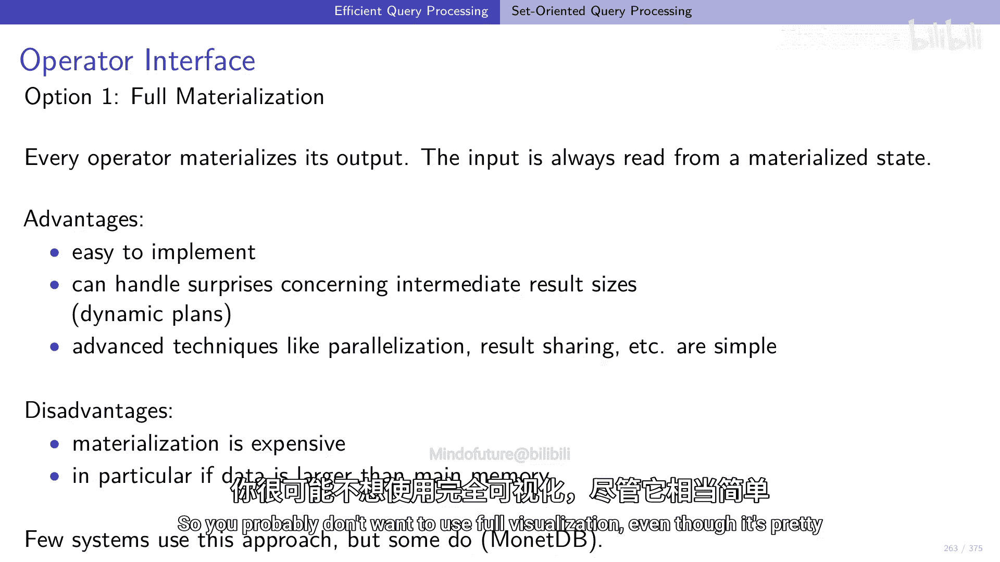

Now what else can you do So this is option2 is's the iterator model So this is the most widely model across all systems。

 So most database systems， at least the older ones and even some of the newer ones use that model here so the iterator model and the assumption is that each operator here produces a tablet stream on demand so for example wecent everybody here produces relations output and the model here is that this relation is not stored somewhere but its just you can iterate over it so you read it on demand。

And the advantage is now that data is pipeline between operators now what does this mean So we just pass one topic around from one operator to without making a copy also when we say pipelineing。

 we mean passing data around And if you ever looked at， for example。

 networking interfaces and operating systems or you know for that for performance reasons they often offer something that they called zero copy interface which means you can send something over the network without making a copy because copying is expensive as well as there is pipeing。

 we means this passing data around from one operator to user without making a copy。

And a good thing is now we avoids this unnecessary materialization that in the full materialization interface because it could be that we are only interested in one table or a few tablets So therefore we could stop early。

 we don't have to read my complete input。 I just mean the most obvious example， of course。

 is somebody in sequence says select。😊，Blah， blah， blah。Where。Where x equals of 5。Linid。One， okay。

 as full material model， at least if you implement it by the book。

 you would first print out everybody who has x equals to 5 from material assets somewhere and then you return one value from this。

😊，Well in the a item model you would say， a， I want one type where x equals 5 and then you actually can stop afterwards so that you are much more flexible in the control flow。

 as you can decide if you want to read something or not。😊，Another advantage is pretty easy。

 D a rate model is very simple。 Well we， of course， we will look later at how this is implemented。

 Now， as the disadvantage is yet usually we whenever we want to tablet from a form operator。

 remember that we iterate over my input and then a my database system。

 I have no idea what my input will be。😊，And this means that I call in unknown object and this is usually done with the virtual function call。

So I'm not sure if you if you are familiar with how most object oriented programming languages implement polymorphism。

 but what they basically do is instead of saying a core function so instead of saying core function next so they give me the next value so because this so if we would know my input is for example in selection I could say select select。

I push what next。 But because I don't know if my input is is a slack or not could be anything。

 therefore， to usually have an object。 This object contains a pointer to a table。

 and in this table here。We store all virtual function that this exposes， including for example next。

 therefore， if I want to call this function now I look at my object at retrieves appointed to the table。

 it look at the table， at retrieves are to the function and then add do the coil。

Yeah and this means I do more memory access and Ill have more interactionss and this is usually slower so quality of virtual function is a bit is not super slow。

 but it's a bit slower than a regular function call and every reduce this for every tapt that I pass between operators and this tend to be millions of tablets and therefore if you do something that' is a bit more expensive a million times this is not so super attractive so performance is not not ideal in the radar model。

😊，Related to this its iterator model has a poor locality。

 why what do we mean with poor locality is like if remember we read always one double here。

 so if you have two something like this so and then you do a join。😊。

And of course could be a larger chain but I just assume this。 So if say this drawing it says。

 okay I need to tap from my left side。 So you ask the select give me tablet and you ask the relating give me table so basically your controlflow bounces down and up and so go across a lot of operators until you get your table so and this means you have poor localities So you are looking at many parts of the code at the same time and your CPU doesn't like this so your CPU once that you look at a small tight loop so this is when performances best if your execution goes all over your place in your code then this will be slower typically because you might have get instruction case misses probably you lose register content。

 you cannot keep everything registers and so therefore this locality is important for good performance。

 You also look at this a bit later。

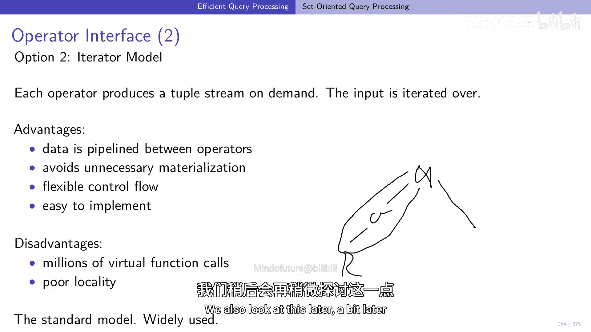

Okay， now Ive already sketched a bit how the iterator model works。

 So we say we retrieve one table at a time。 So now we look at this a bit more closely。

 So the the traditional interface for the iterator model here is like this。

 we offer each each object that we have So each operator offers three methods open next close。

And they do what the name implies。 So when we when we call open operators， it says。

Please prepare for execution。So please allocate memory， open files or whatever you have to do。

 so please prepare so that we can start executing。😊，So then afterwards。We call next。 So and if we do。

 there's not only once， but a lot of times。So next says give me。

 please give me the next tupper and maybe we will talk about implementation next a bit in in a few slides。

 but more conceptual it just says here is the tu or it says I'm out of tuts now so then you know that you're done。

So this is the iterator call here， this here iterates。Its over iterates over the output。Yeah。

Answer you always gets an next steper from my output。And so when we are done， of course。

 we can call close and this means please release memory， close filess。

 but also that you are done processing。 Again， the good thing about this operator is interface is this is very simple model。

 Now three functions。😊，Open next close and we can basically handle really。

 really complicated queries which is such a simple interface actually surprising the when you see this the first time。

😊，And now。The price you pay for this is that means the interface is the outside is simple。

 but the implementation of operators is often not that simple because you have to maintain a complex state。

 remember that next give is the next table， but it can be in the middle of some very complicated stuff。

 but I must now stop， produce one type and then continue when the next next quote comes so state maintenance is the main problem of operating interface。

 you will see this when we implement this。So the code。

 even though conceptualor the interface is very simple。

 the code you have to write is often not that simple。 this is the price you have to pay。

 this also brings poor performance because usually complex code is slow may not always but usually simpler simpler code is is better if it totally behaves the same then simpler code is usually better Okay now so this is what they meant So what concerning the interface and how do we really pass operators because here would say next give me the next topic So next says。

 okay please give me what type but how do we do this。😊。

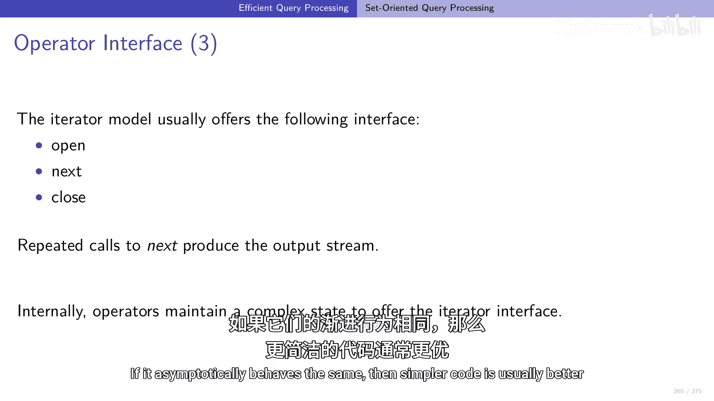

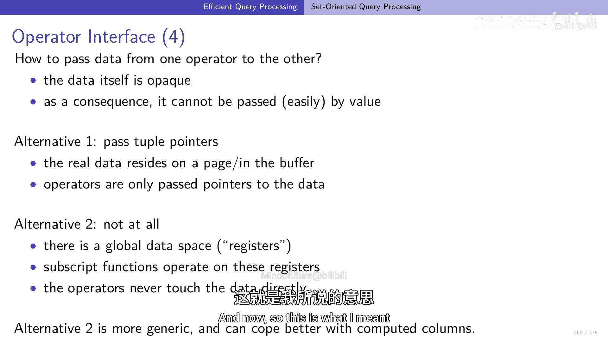

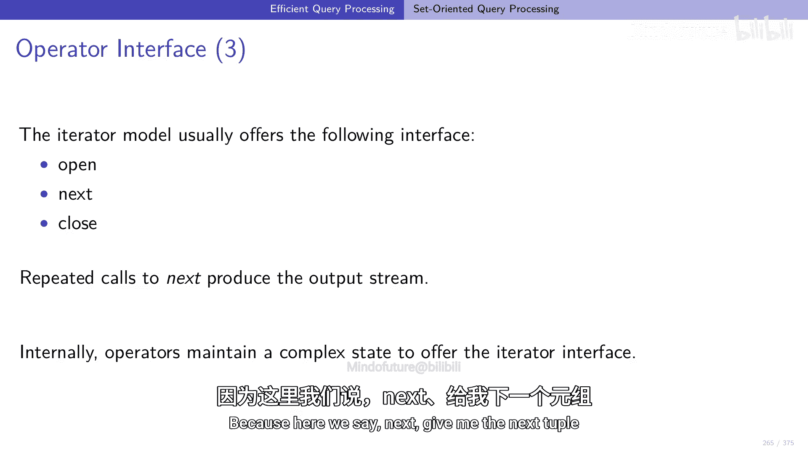

In particular since remember that we have no idea what the data is so the operator has that we don't know data types。

 we don't know how many attributes we have， therefore we cannot just pass the table it around itself。

 at least not easily strictly speaking we could but there's no obvious or easy way to pass the table it around because of these unknown properties of my cur。

😊，So therefore， they are probably more than two， but at least two common ways to do this。

First way is to say， okay， I cannot pass the table around easily。

 but what I can pass around easily is point to the table so that so if if I。😊。

Let's say if a tablebits can R。 and then we see as this is my page。

As you see all my records on my page。And then if you call next on the table scan。

 the first next call will give you a pointer to Z element。

 the next next call will give you pointer to z element， and then the next call will return here now。

 meaning where we are out of template so we have no further values now so we and the data itself is not copied。

 but instead is left on the page or in the buffer whatever wherever your data stored so we just return pointed to my data So this is。

 of course， elegant model to cheap。😊，Just computer point up it run。嗯。

The downside of this approach is what do you do if you have computed columns？

When I a computer column is user free to write， for example。😊，You can formulate in SQL， select。

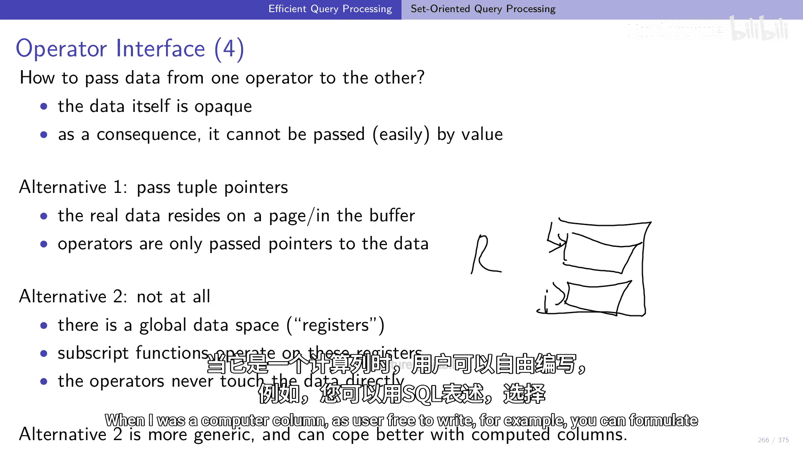

4 times x plus y or something like this or arbitrary complicated stuff。 And this here in new values。

 it does not exist in your physical table because we just computed on the fly。

 and this is what we call a computer column。 Yeah， computed。Ped column。 Now。

 if we just output this to the user， this doesn't really matter because we just print it。

 So that's okay。 but note that this here can be a sub curary somewhere deep in our cur tree So there could be something higher up again。

 select blah， blah， blah。 And that suppose this this computer column could be in the middle of a curator somewhere。

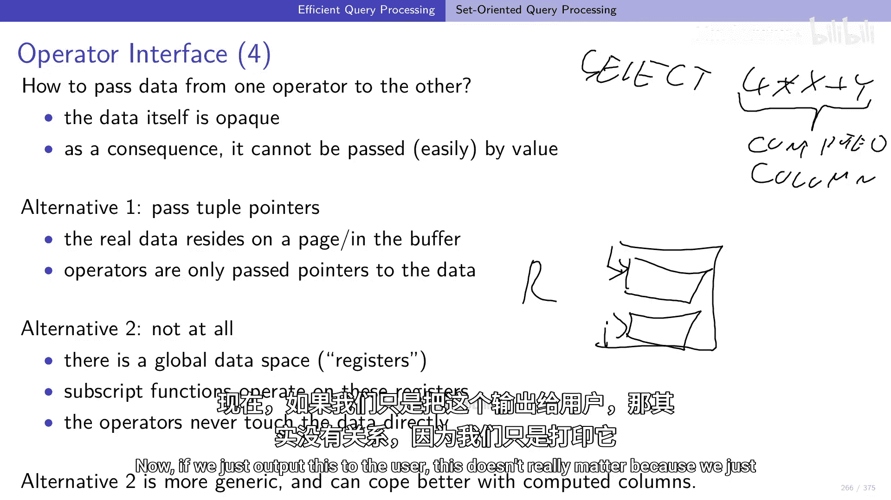

AndThen we need a way to pass this this new column up to our outer part of the query。

 And how should we do this， Because we cannot just point to the tapt because you know the the values are not stored on on a page。

 Now of course， what we could do is you could make a copy of the table and then copy out everything。

 including the new column But then it's no longer as that elegant and that cheap so this is。

Computer columns are a weakness of the first approach。 The second approach。

 the first approach is press pointer to the table。 The second approach is actually better。

 but a bit more difficult to understand。 namely， when you say how do you give me tables answer is not at all。

😊，Also now what does this mean my so in in this world here。

 the interface of my next function here is usually。Tle pointer next。

And that gives you point of the table。 So the alternative too is to say， oh no。

 I don't return anything。 I just return a bull。 Do I have a new table or not。So if I return true。

 then there is a new， if we return forward， then there's no new table okay。Okay。

 by then you can ask yourself， okay， if this is my model。😊。

How do I access my content of my tablepper because the operator。

 my child operator input operator says here's a new tupper。

 but then it doesn't give it to me so just as true here's a tabpper， but how do I find it？😊。

And the answer is as store all the values of my table in a global data space。

 Traly this is called a register。 is not now if you're honest it's not a real register。

 not like a CPU register because it' is all done in software， but nevertheless。

 so the database has a piece of memory reserved。😊，So we allocate as once。And then we say。

 for example， this part of my memory is reserved for the attribute X and this part of my memory is reserved for the attribute y。

 and then I might of course have other attributes2 A B。😊。

So this is allocated and aesthetic static and now when I say aesthetic static usually I mean it will be threat locals so each stretch will have it。

😊，Sometimes you also want to have really global values， but at least for all purposes here。

 we can say each thread has its own to usually be have such a copy。

 And now if you call from your input， if you call。Oh just let just say。

 let's ignore the thread problems。 As for a moment we are running seeing it's right。

 So not not paralleluralism。 Then we have just one， one set of registers here。

 So this rectangle is my set of registers。 And now if， for example， my this is my relation R。

 And then here comes my predicate。The that says x equals to 5。 And then here in the end。

 I want the output， for example， y。 So then I the， the the production here callss next， next。select。

 please give me a topic。Then the select says next to my input here， please give me tabu。

 then the relation looks at this content and retrieves the first tabu， for example， x 4。

 y 11 A and P， I say I just ignore them I don't write anything here。😊，So as then it says。

Raise an hour， he says， true。😔，Here's the。 Then when filter project checks the the content of the x field says。

 oh no， this is not equal to5。 so please give me a new value so that again we call next。😊。

Then R alerts a new value into the register file here。So we now override this。 So instead of a。

Writing your phone at every say。5 and 20。So then again the answer is true there's a u type。

 then the select suddenly for the me so now we run true2 and then the select looks into the y here at C to 20 now we can print at 20。

So this is how it is。 so if you look at the operator in interface itself。

 so if you just in the interface of next， then we don't really see the table because we just return true or forward the table in reality is passed as a side effect of the update to the global data space so my register file。

😊，And the beauty of this approach is that the subs all operate on the registers like this x equals 5。

 so this of course is a subscript here。😊，So this operators and the registers and looks into my registers。

 but the operator as I safe doesn't care as the operator itself itself never touches this register file because we don't need it I does know if somebody returns me true I know that the correct idea has been loaded into the registers and then I can call my subs and this will look at the register file the operator save doesn't care。

😊，Okay， and this is actually the superior interface for the operating interface。

So if you do it like this so then it can be very generic now computer columns are not a problem so if somebody computes a new value。

 we just create a new future computerd column then here insert Vi variety1 to3 or whatever is computer so we can update this over as we need it so our computer columns are no problem we can just sort them as。

😊。

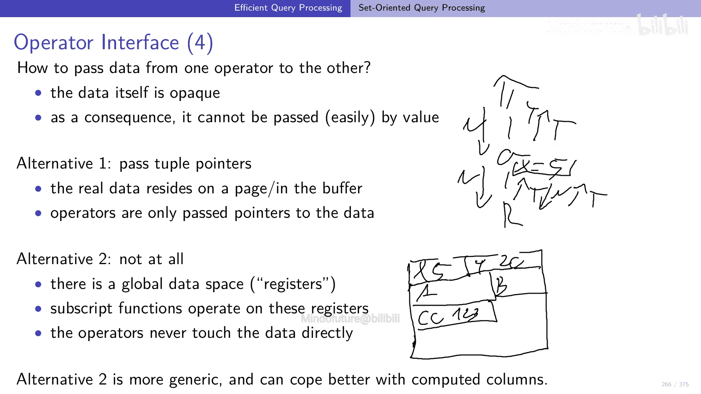

Okay， sorry， just one book comment we said we have open X close just for completeness。

 I know at least。

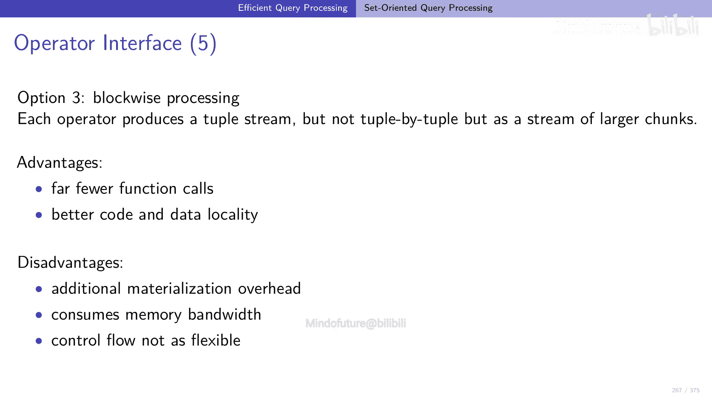

Two systems that that change the interface slightly， I've just mentioned this。

 this is not a very mainstream solution， but some people do this。

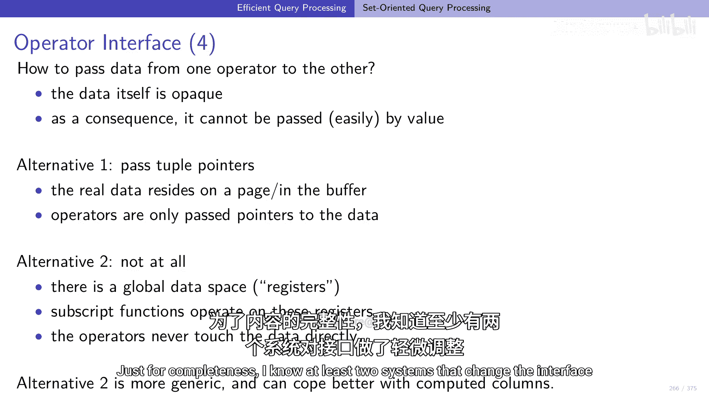

So I put the C bracket so don't don't， as I mostly belongt， but it makes sense to do this name。

 you might want to add another function namely first。

So and why would you care about it first because and you can then come to the real implementations of operators。

 you see that very often the first tapt is computed very。

 very differently from all subsequent topics why because a lot of work is probably done until the first topic it can be produced like we might build a he table or do some very complicated stuff and this only affects the very first topicpper。

😊，And therefore it makes sense to have a separate function in the first。

 of course now each is being it dont needs this because we can easily easily emulate the first with next because one way into implements is to sayops next。

😊，Sa we can， of course， implement it like this。诶。If。First chrom。😔，Then we say first goal is false。

 which visitor is initially to true。 first goal is false。

And then we do whatever we have to do and then we continue with regular processing and so therefore we don't see he's being neat first interface Yeah。

 but of course the answer is。😊，There now， we have an if。Yeah， in my hot pass。

 because you have to realize this cold tune next year， this is super hot。

We call next for every topict that we process。😊，This can be many， many millions。

 which means we introduce many million additional ifphs。 Of course now on modern machine。

 it's not that bad as it used to be because modern machines will produce branch prediction we say if well probably nearly always be So therefore on today's machines。

 it's not that bad。 but in the past， this if you became noticeable in some some cases and therefore people said。

 okay， let's do a dedicated first function so that we only do this expensive stuff in the first call and everything else is cheap indeed our sources improves performance a bit。

😊。

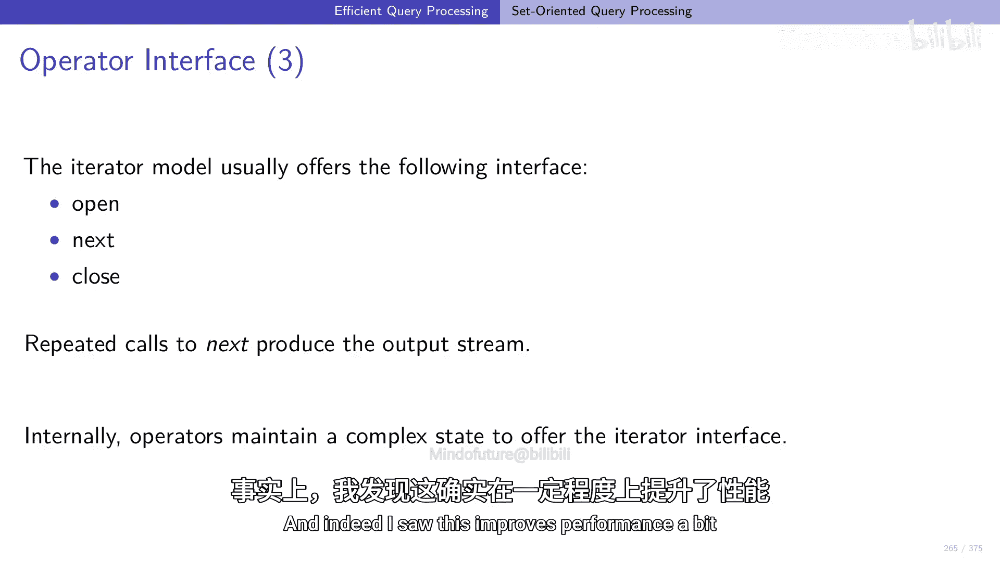

But probably today it's not that worth。Okay， so this was the first two interfaces first full materialization。

 second iteration full materialization is very expensive iteration may very flexible variable。

 but also fairly expensive because they have so many chors。

 first one is expensive because we cover everything the second one is so expensive because we have so many chords。

 Now a compromise between this two is the third one here， the blockwise processing。😊，So。

In at the first glance， it is quite similar to the iterator model like we iterate over a tablet stream as before。

😊，But the difference is。We don't do this topicpper by topic because it is so super expensive。

 But I said we do this in streams of larger chunks。

 So in so that it basically the difference between。Cailing next for each tappper。All。

Give me the next。Thousandand or so。And so。Just as in the iterator model we do function quality。

 please give me something， but instead of asking for one value we ask for many values let's for example1 thousand and then of course this call overhead is hidden because if we may adjust by this change a reducing number of quality by vector thousand and therefore now this is of course then you don't see this anymore if you for every table this actually is expensive but if you do a call for every thousand tablets this is unnoticeable so this is okay so block processing is much much cheaper。

😊，Yeah so this we have far fewer function codes。 We have also we have better code and data Loc while code and data Lo because we no longer output one tablet。

 but we output many tablets。 Just think about the example that I had drawn。 So for this one yeah。

 So for for the basic iterator model。😊，For every single tappper we jump from join to select to base tab and back select and back to join and also for each single tappper we involve three operators。

While in the block model here we would say auto start with a drawing of course。

 but then we would say， hey give me10 here and then this case would do nothing because as my input give me a000。

 now with my scan here would scan over my input and output 1000 tablets。😊，And this of course。

 in a tight loop， so because now we would do a four loop4 and so on so over 1000 values we have now a loop and CPUus like loops so a tight loop of data is good。

😊，Loop over 100 values， then we output it set by0 values here to the select。

 the select now checks 1000 filter conditions again in the loop as we do another for loop here。😊。

We the 100 conditions， and then we output the0 to the join。Now so we have much better locality。

 we don't jump from one place to the other。Now a disadvantage， of course。

 is we have additional materialization overhead it。😊。

In the simple iterator model we could often may not always but we could always pipeline values。

 which means we can just pass them around without making any copies here because we output 1000 values so we can no longer keep them for example。

 in my global register file here because I can keep one table in there。

 but I cannot keep a000 tablets in there。😊，Therefore。

 we must now make a copy of the table must store somewhere， so this cost me something。😊。

Just like the full materialurization interface now you could ask a， okay。

 isn't this just like full materialurization because free materialurization also does this we might also get good locality in auto material and also fewer chords。

😊，Now， the big advantage of this model here is that you will choose a block size that fits into your cache。

 Now， So remember your。A1 cache， the fastest cache in its CPU is usually something like 32 kilobys。

 so therefore if I ask for 1000 values and if my values are not too large。

 there is in fact decent chance that this will fit in the a1 cache， which of course would be very。

 very fast。😊，This is best。 Now， if perhaps I cannot do this this might be too small。

 might be might be larger than sorry， larger than 32 Gte。 but mail2 cache is probably。

Hi5 5 kilob or even more depend on your CPUU as a variety plus or even more。 and therefore。

 if I choose a block size such that my type values fit here。😊。

Then I can still keep it in a cache a bit slower than I want。

 but nevertheless we can keep it in cache， and I can just read it back by with full materialization。

 my data is most likely larger than my cache。 And so therefore with full materialization。

 I have to go to memory， memory is pretty slow many it's not not super slow。

 but if you compare to a CPU cache， it is slow。 your memory is much slower than your CPU cache。😊。

In this block files processing here， if you choose my block size carefully。

 then my tablets will reside in the CPU cache and therefore it will be cheap actually so meization overhead is there yes。

 but it will be lower than in the fer materialurization due to caching。😊，NowBut nevertheless。

 a disadvantage here is even if I don't have to pay the high price。

 this nevertheless consume memory bandwidth was in particular due to this writing。😊。

And the problem is I've write it in a vector and I know made my vectors in cache because I want to read it back。

😊，But what I cannot tell the CPU at least not easily is to say， okay。

 somebody wants to read it from your cache， I actually I want to read it from your cache。

 but nobody else has to see it。😊，There notes that most modernia are many core or mighty core this。

 So there' is more than one， therefore。sThe buffer here that I use to store my tuets。This， of course。

 did somebody a memory。 So this this is my total memory。😊。

I will at some way in here will be my buffer away as store my table videos here for example， 00m。😊。

And of course， I want that this buffer here is in my CPU cache， because I which if it is in cache。

 I the first， if you do something like this。😊，Then the scan here will put it into my buffer and then the filter will take it out of the buffer again and if the buffer is in cache。

 then this is reasonably cheap so this is idea。😊，Problem is the CPU does not understand this。

 this is our goal。 So our goal is just to pass data from one part of my own code to another part and other threads。

 so some different processes some different part of my program don't care about this buffer because this buffer is only from a current thread but it can trace this to my system unfortunately but therefore the system even though it keeps it in cache。

 it will at some point flashes out to memory。😊，Because we must make sure that if somebody else tries to read it and it gets the data so even though in many cases we could say you can I have read it already。

 you can discard it now but this we cannot say easily。

 the therefore is buffering at consumer memory bandwidth even though we aim to be in cache thats bad。

😊，Now the disadvantage is we are less flexible in the control row in the iterator model we could read one topic from any of our inputs here。

 we can only read large chunks of data which is problematic for some operators but usually this is a minor problem so control flow is usually good enough there are few operators that have problem with is notably a merge join for merge join this is not ideal but for all as operator doest really matter so less flexible control flow is usually okay but additionally the meization of it is a problem it's less than in the first option but nevertheless this is indeed somewhat of a problem。

😊。

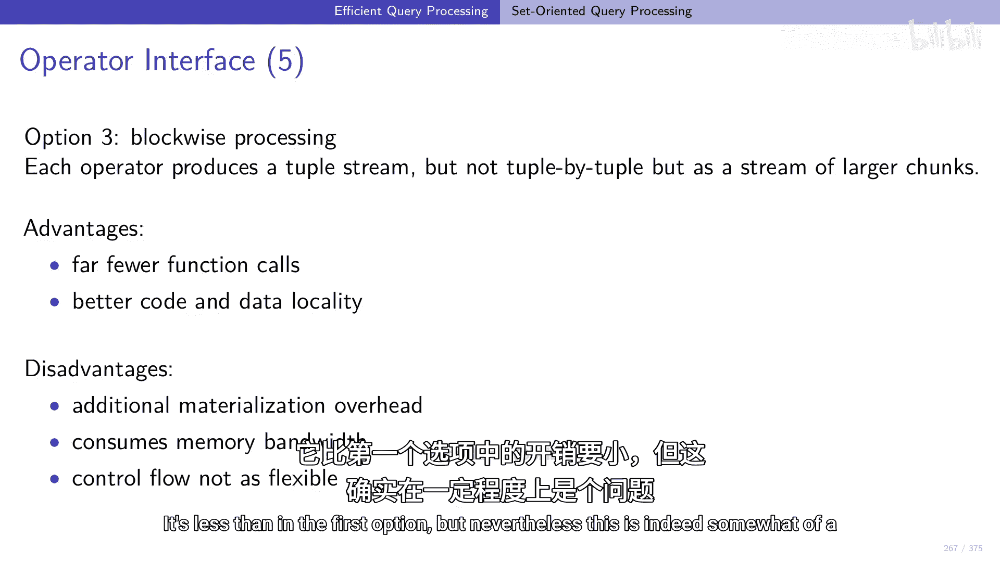

So now， therefore we now look at the fourth options and this does something quite different from the other ones。

 namely。So previously， we everybody basically pulled its input here。

 so if you think about the iterator model the most visible。 so if you say。😊。

Joins and select and then relation then we have another relation My model was here this here says please give me a template。

 please give me a template， please give me the enter here then it says here zip is a template as well And so this supposed to be pull a tu up as we say give me one topic。

😊，in this model here we reverse the direction we say， oh no。

 we don't pull tablets up instead we push tapts。We would say。はい。The the relation R starts and says。

 a here here's a table， please take this。 then this the select gets it。 that's okay。

 perhaps it's okay。 and then if you start into my drawing and then it comes the next table the next table and then next table。

 And so we instead of pulling it up， we push it from from bottom to top。😊。

Okay and now if you think about what this meanss and code。

 we see a codes examples later in the lecture， but what this means and codes that here and are we will have a loop。

 small loop， the loops loops of a bunch of data and then retrieve all tablets we have and usually most of the logic in our query plan is executed in a few loops where then the data is passed our up and loops are good as the small tide loops is something that our CPU likes。

😊，Therefore performance size is a good idea。 We also get good code on data locality because we run a lot of code on R the only point we have value you might sometimes call it a select and even more rarely call the join。

 So we have most of our execution here is spent within R and we don't go out of R we stick in there。

😊。

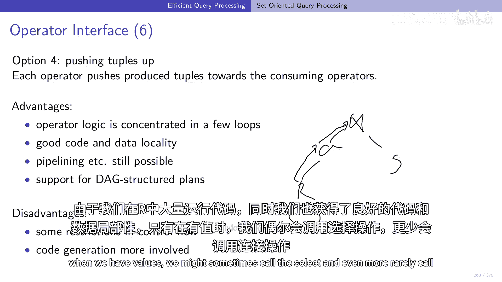

This gives me good locality。😊，Just like in the A model we can still pipeline so we don't have to make a copy because I can what if think about the register file here。

 R can load librariesius in the register file， then this here can take values out of the register file this is the same so we can just pipeline it without making a copy。

😊。

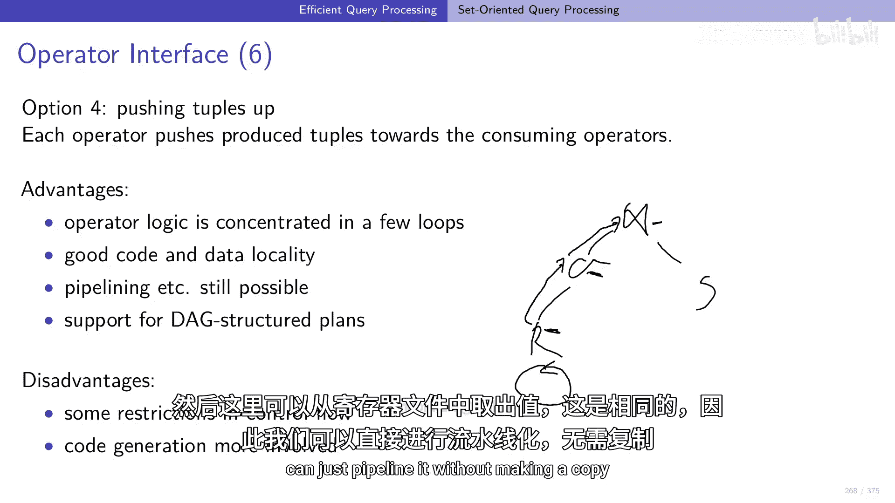

Know that emissions is。Perhaps to illustrates this。

 but what does mean is popang let's make it a a bit more silly example。 Let's， let's look at this。

 Let's assume we have a scan filter， filter， filter， filter， and on， oops and so on many filters。

Now if you want to understand pipelining， just look at the left side of this drawing and here comes to tableoo。

 just think about how many copies of these tablets do we make。

In a pipeline approach we don't make any of course if you're picky。

 we could say we make one because we load the value from our page and then we store probably in a register file which is of course is a kind of a copy if you wish so depends on how it's implemented but we might copy it somewhere once but then it doesn't matter if you have between six filters or if you have 20000 filters no further copy of the templatet is made it sits in this register file and Ken did all the time we check additional conditions until we hit a drawings then of course something we do something with the visit but the number of selects in between the scan as the drawing does not affect the number of copies this is a pipe approach but if you are a full materialrization or even in the broadcast processing we would make the scan would make a copy of all the templatets and in the full materialization then we would make sorry。

Make field tab， we make another copy， we pass it to the next field tab， makes another copy。

 and so here we would copy all the time。AndIn the blockwise， we do it in less severe form。

 but nevertheless we have deep cascade of operators， we also tend to make a lot of copies。

In the push model， we pushed it up， if we don't have to make a copy。

 And another interesting advantage is that if in this pushing here， we can， in fact。

 support a deck structured plans。 Now， what is the deck structured plan。

 assume we have something like this， if we have a complicated expression。 So some some sub。

 then we we do， for example， a groupi or some some other processing。 and then we might have。😊。

Something like this。Yeah。Okay， it's of course a constructed example， but nevertheless。

 so this is no longer a tree。Yeah because this group yeah has two parent node， this is not a tree。

 but this is a deck is directed as graph， so of course this agency have a direction and so directed as graphs this graph here has no cycle if we direct them。

 can direct them for example， do we direct them up or down doesn't really matter。

 we just have to fixate it， let's say we point down so then we point like this。😊。

And so this is my plan， this contains node cycle， which is directed as quickly graph。

 but nevertheless we have nodes with more than one incoming edge so it's not a tree。😊。

Okay and the advantage of this is if this computation in the middle here is expensive。

 if you computes once。 then when we have a tap so it's produced here。

 then it's pushed up so we take the tap push it up。

 push it through the join so as a group I and then we can pass it to both this and that operator。

 So to consumer operators can consume tap or in fact an upum of operators table this would not work in the iterator model because in the iterator model but would happen is。

😊，You would call next here， you would call next here。

 then you get the tu then you would call next here and the next value that you get when you come from the left side is now taken away such that the call from the right side will become later so of course later we will also call here so when you come from the right side the tu is gone and so both operators will take away tu from each other。

Maybe because we always iterate over the stream， therefore。

 if left fetch is the table right doesn't get it。😊，Okay。😊，So of course， it's bad。

 Now if we don't want this， therefore， in the a item model。

 we usually do not allow de structure plans。 we sometimes allowed if we are sure that that the node that contains I have multiple parents is full meization。

 so if you make a copy of my output， then I can read it multiple times because the to is not gone when I read it。

😊，So freeization allows me to share even with an iterator mode。😊。

But yeah in the push model we can share tables between subes without any restrictions so we can just I shouldn't say without there few restrictions。

 but at isn't this this scenario there are no problems。

 we can easily pass it to 10 parent operators no different than passing it to one so this is good。

Now what has a disadvantage of this model Yeah， first yeah a more restricted on a control flow because if my data comes from from my child to me。

 so I cannot easily say， oh I want to get one value from the left and then one value from the right。

 this doesn't work because as a push model， R gives you all its data and then s gives you all its data you cannot say we need one value from R one value from S and then then again1 from r then again1 from S I don between left and right which you can easily do in the it iterator model。

😊，But you cannot do this in this push model here， so the control world more restricted。

On the other hand this is nearly never a problem， so the only operated with this matters here is the sort merge so we take two sorted inputs and we want to intersect them there you want to alternate between reading left and right Yeah but this is the only one and you can work around this problem by materializing one of the sides so if you make a copy of one of the two sides。

 the smaller one of course you prefer to make a copy of a smaller one then you can handle this even in the push model here。

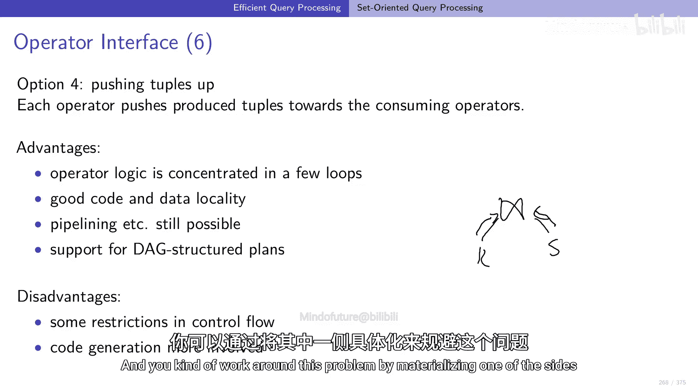

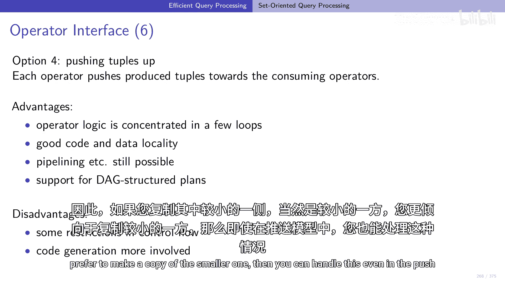

Okay。Second disadvantage is core generations more and worth， but on the as ahead。

Mean your implement is only once。 So who cares if its bit not。

 Now this this is not a real disadvantage。But the great advantage is that it gives you much better code。

 And also， if when you look in the lecture later at implementation。😊。

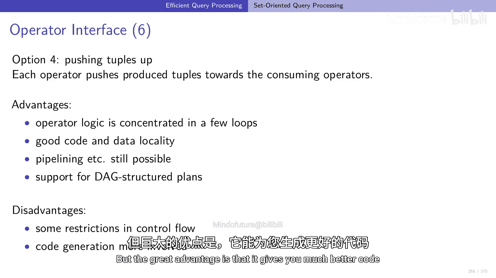

I mean， cogen might be more involved， but in general， the operators are。

 if you ask me easier to implement in this model than in the itator model， for example。😊。

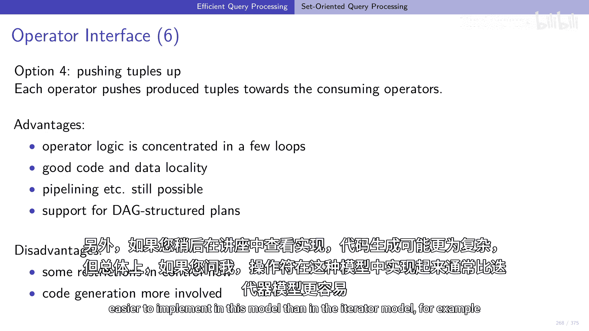

K。So now let's to illustrate this thats let's implement three very， very。

 very simple operators in all models so that you can compare them easily。

 So we just implement a scan so read a whole relation。😊，We implement selects。

 so read the relation and output all topics that satisfy a predicate and we implement cross so cross product between two relations。

Of course， reality we won't to have a join， but we just want to compare approaches here。

 we make it keep it simple。 So we just do cross product。 So's a very simple one。

 Now in the full materialization model I set advantage here that this is quite simple。

 This is what you see here。 All three operators fit on a single slide。

 This will not be the case for the other approaches。 They are not。 but this one here。

 we can we can easily implement on single sets because it's so simple。 So let's start with scan here。

 This scan actually does nothing。😊，And because we are supposed to scanning in relation R and we just say。

 hey， my data is stored an R， as I do nothing， I just return a reference to my relation because it is already materialized。

Our next operator here select so I want to read find everything from my input by a certain particle is true so about how do I do this I create a new relations so new temporary relations is not visible to the user but nevertheless we need some space where we can store stuff so we create a new relation our prime here so we can store my data then at this time here a loop of all tablets in R I check if my product is true and if yes stores the tablet in our prime。

😊，That iss what you do here。 And afterwards， I will return our prime saying， okay。

 my dad has not our prime。Although pretty simple disadvantage， of course。

 is yeah write everything to a new relation。And then the cross product I gets two relations r1 and r2 as input。

 I'm supposed to output the cross product between them how do I do this I again allocate a new relation R prime。

 then here a loop of oil values from R1， a loop of oil values from R2。

 I combine them install them in a prime。Yeah， oh sorry， I mess this up here。As to them in Aram。

Very simple implementation。And so we can， of course， we。In particular。

 the step is expensive because we now create a really large output relation， so it's expensive。

 but it's very easy。😊。

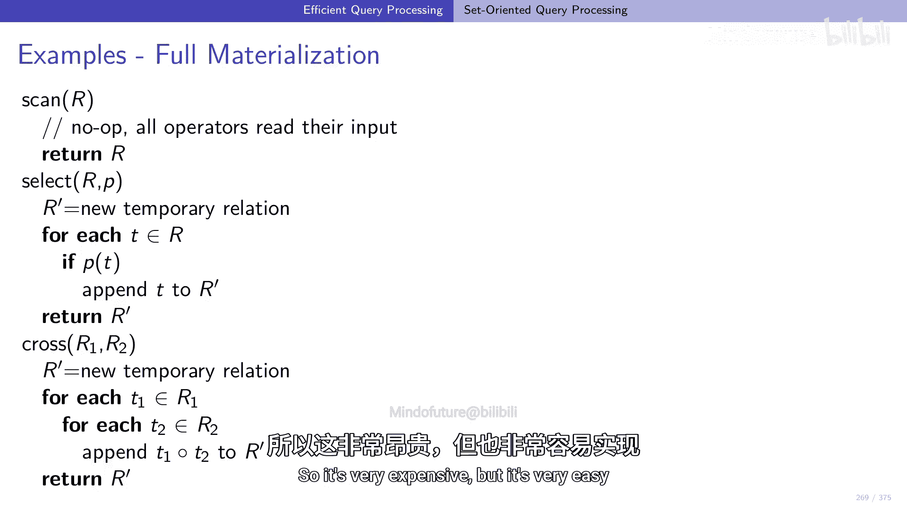

Okay， now let's look at the iterator model。 you see the iterator model is more complicated。

 We can no longer fit it on a single single slide。 now。

 So now I have to show you this piece per piece。😊，And we start with the scan。

 which is a very simple operator， of course。😊，And we look here at the two functions open next because at this in the sort of called we here the closed does nothing so close。

 we can leave out because we so be abstractive here so many details。

 but so conceptual what we do is when we call open。

The assembly codes of open and V are supposed to open relation R。 What to do is we remember that。

 okay， I want to read R probably in this point in time I'm。

Loading a page in the buffer manager but here if we don't talk about so just say remember that I want to read R。

 I say my current position here 0 and I say I want to stop when I hit the size of R and so this is my enter condition。

Okay， open still pretty easy。 Then the next coil。 And remember that you want to iterate over my output here when it we next。

 So then the next as a following data already reach the end。

 So if my current is my current tab I D create equal to the limit。 If yes， we say for。

 theres no further tap now if we just。😊，Say no there's nothing otherwise we loads the tap a T from in at position T ID。

 So this of course， and now must store somewhere in my global register file so I loads the tappper store。

Then I increase my table D by one and then Ill return true。 So I say， okay， here you。

 I have one one mod。 And of course， you can now call next repeatedly until it return forward。

 And then when when you get forward and you know， okay， I have seen all my tablets。Okay。

 so this is also pretty simple Select is all not too difficult。

 So then we can be called open on a select。 We just remember， okay。

 what is my input and what is my predicate I know here we don't do anything Of course。

 yeah depends on how you implement it， but perhaps we should at this point here call。Indo open。

Because probably if we want to recursively open my input as it of course could be depends or implemented。

 could be that you trigger the openCoil for all operators at the same time by just looping over the list of operators then of course you don't do this then this implementation okay if you want to recurs and here we would call open on my input。

Okay， so the open prepares operator execution then when we call next TA increasingly given the next tab。

😊，Then we say as long as my input here is not exhausted。

I would the best way is copy and past error here because we don't。So the selectate gets no argument。

As if we don't need any arguments， we have stored the arguments in my operator here。

 So if he records next answer should give me next tap。

 then take my input and ask me input give me a tap。 And if the input says yes。

 then I call the predicate and the pre says yes， then I will return true。

 Otherwise I continue looping here。 So I say give me the next next table next next。

 So I call next all the time。😊，And at some point， the next of course will return forwards saying。

 oh no， I have no more tablets because my input is exhausted and then I leaf the loop and also myself return forwards and say okay。

 now iss no further tablets I'm done。😊，And note that we cannot ignore this loop。So we could。

 let's say say， okay， let's comment this out。 So if we just say a or oh no。

 perhaps not comment those。 we could。That by the way， what I'm writing now is wrong。

 So so don't take notes just to illustrate this。 You quit think that you can implement it like。If。

Not。In the next return。😔，Fors。Then if we check a parcade with truly true as a resolution words。

 that you could think that you shouldn't permit this， but， of course， you must not。

 because it could be that if we get one table that doesn't satisfy the bracket。

 but the next type of would。Yeah but we are not allowed to return forward in this case because otherwise my parent will stop asking me for topicss so they only ask me as long as I return through。

Therefore， I must need a loop here， so from here to here。

 So as long as my able stick give me a table that shakes a precate， if it's true。

 I continue otherwise I stop。Okay， this is still not very complicated。

 what is complicated is this one here， across products。😊。

So if you think back in the polymertization model， this was I think three lines of code。

 here we already start writings more and it still simplified and squeezed on a slide here。

 so even a simple cross product。😊，It's quite involved in the A model and as rear joints are even worse。

😊，And the problem here is that we have to keep state because we are only out allowed to output one type。

 so therefore I must remember where I am。 and so this this yeah requires some bookkeeping。

 So therefore heavy my state here is。Here I left right and step。

 So when my V record opens so says I should open this store。 Okay， what is my left side。

 What's my right side and。As set step to true initially。

 Now we come to the core of the algorithm here， the next call。Okay， so then we again need a loop。

 so Vi， so infinite loop。So then we ask ourselves， is step true so that we did in the beginning。

 or perhaps another name for step So step means。Read from left。This is perhaps an explanation。

 So when I said step to truth is it means have to read the left side。 So step to2。

 So then I load the next type from my left side。 If there is no type from the left side， then I said。

 okay， I'm done I can of longer I find anything。 Otherwise， if is a type from the left side。

 I restart the right side。 remember that we have to read the right side repeatedly for every type from the left。

 if I call here open on my right side saying please rewind yourself。 I want to read again。

And then in the next line， I clear the step flag and say， no。

 I no longer want to lead lead read from the left。 Okay， then I have a radio from the left。

 Then I read the next value from the right。 If I get one， then Ill return through saying， okay。

 if I have a image。😊，Then， of course， it is me that we stop at this point。

 and so we we read one from the left we use from the right then we stop。Later。

 we will be called back again。 and then， of course， we must remember what we did。

 Maybe we must remember that we have already read from the left side remember this the step like here。

 step level is clear。 So then we read the next next table， next step， next type or next table and on。

 until at some point the right side says， oh， I have no further tables。

 Then we said step to true and then the loop here continues。😊，Reads the next tab left。

 if says on temporary stop otherwise， and on。Okay and this is already a bit more involved even though we just did a silly cross product I mean。

 crossb is the most primitive boundary operator that you can imagine。

 if you implement a real operator like a join， then this bookkeeping like remembering where am I would have to do next can become quite complicated。

 This is the iterator model from the outside looks simple where the implementation is not so simple。

😊。

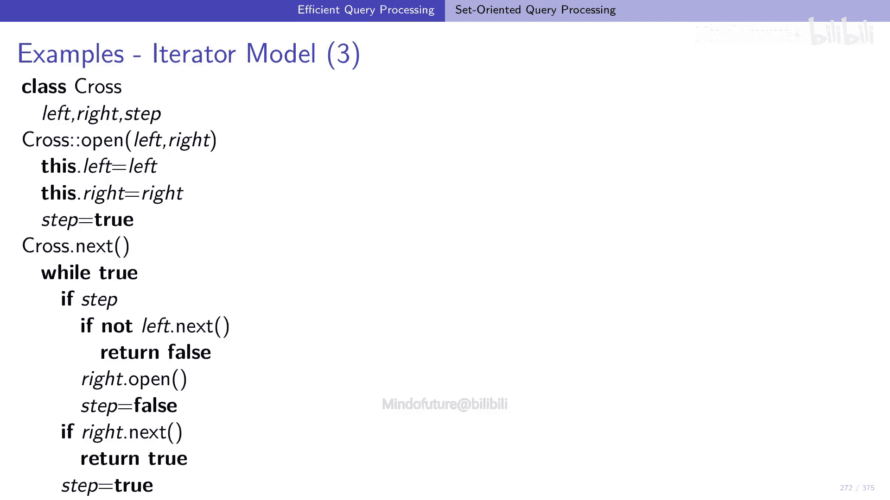

Okay now whats interesting is this one here is the block processing here I assume that I will output 100 tablets at most。

 of course could be that I have less than100ts but I want to output 1000 tablets So therefore open just looks like the iterator models here store the relation say tablet I to0 and then I limit to such relation just as before and interesting here the next call is next coin is the scan C is the size of my chunk here and I say okay how many tablets to I output I output 100 tablets or the distance between limit and my current tablet ID whatever is smaller because could be of course that I have less than 100 tablets left so I check how much tablets I have left if there are more than 1000 tablet and output a00 otherwise takes the rest。

😊，Okay then I construct an output array here our prime of size C。

 of course I mean I variety here because it' is easier to format a little like this。

 construct a temporal array in reality of course you will reuse the memory and so you will not allocate a new table all the time。

 but because our buffer size is fixed or output 00 values I will usually have a pre allocateated buffer that I use all the time。

Okay， and then I loop have you here a a small loop。 remember that for performance reasons。

 loops are good。 So this is good here。 we have a loop over from0 to c minus1。

 then load tablet from load load the tablet from in at position table I D plus I。😊，2 R prime I。

 so I take。 So as this looks now looks at the number of tablets。

 we load all the tablets and restore store them in my array。

Then I increase my table ID node by one button instead set by c is because this is the number of tables that we have processed。

 and then I return our prime。😊，Okay， so this is and this is one block of data 100 values and again the thousand here will be chosen such that this block area here can fit in cache because this is important。

Now。What about select？So， you know， the select here looks interesting you open， of course。

 is as usual， so we just when we open we just remember what's my approval to my predicate。😊。

Then when we come to the next call。😊，Don't take this on them。so when we come to the next call。

 now I' am supposed to output 100 matching values， or at most I can output less by than most 100 values。

😊，So and again I need a follow loop here to make sure that I do find because could be that I will not find any any matches in my next blocks if I must do those repeatedly so this repeat until we find a match then here I asked my inflow please give me block of tablets now could be sorry。

😊，Could be that there is no further topic because I have read my input completely。 Therefore。

 then I stop。 this is what I do here。 So I check is my input。 does my input give me an empty block。

 If yes， I just outputs empty block because you know there's nothing to be gained there via done。

 Otherwise， now I have a block of values。 I only want to keep the values where the pre true。😊。

And this is done here in a funny way， bin area in this range here。😊，So now how do we do this？😊，Now。

 first， first， let's let me write this differently just to， to make it easier to understand。

 But this is what what I write now is。Conceptually is the same， but is less efficient。 Okay。

 so if we could implement， So this block in scarce， we could implement。Here has wrongarrow here。

 this here corresponds to， of course， it a different implementation。

 but it corresponds to I set my right pointer to 0。

Then I do just the same for loop I say4 i is equal to 0 up2。Prime minus1。

 so I loop over all elements。Then I say if I check the predicate。F P of。R prime I is true。Okay。Then。

 essay。A prime。W。Is equal to our prime。i。😔，W is equal to w plus1。 Okay。

 so this is would be probably what you would have written。 Yeah， so this is more intuitive。

 I loop over all elements in my block。 I check if the product is true。 If yes。

 I copy it to the beginning of the block。 So I have a right pointer perhaps I should perhaps explained it more clearly。

 So if this is my block that I get from my input could be easy that I have a match here。

 I have a match here。 I have a match here， but I have nonmat in them in between。 So what I want。

 I want to output my parent blocks and contains only matches。

 therefore what I do is I copy this here to the beginning。 So I have a right pointer。

So bright pointers here initially under of course a variety here then I increase it to the next position。

 then I copy that value to this position again I increase the right pointer and I copy that value to this position you cannot read it anymore unfortunately but trust me the result is at the end I have all matches in the beginning and then just some garbage that I don't care for at the end。

 Okay this is the result of the loop and effect fact what will come next here and in the code is we the length of our prime to my right pointer which means I truncate my vector here So I forget everything that accept matches therefore now my block only contains matches。

😊，Okay and then just to finish the So code the very the very last check is if my block is empty because it could be that I found no match and then I'm not allowed to output this to my parent because if I output in empty blocks it means that I'm done but I only want to output non empty block so if I check if this has this larger than0 then I output the block otherwise my loop continues and I have had an Xbook。

😊，Okay by now coming back to these square parts， so as I said。

 this copies all matches to the beginning， but it does it in a very funny way Now how does this year operate？

So just again， were looking at this one so I have。vector of entries。

At my i value here scans over the whole range， so this is everything and my eye value loops from the beginning to the end。

My W values， this is the right position， so this starts in the beginning， we set it to0 initially。😊。

So now what we do here， so here we copy my read position to my right position note that initially reposition is represented as the same as so makes no difference。

 we just copy the video to the right position and the right position is where the next match should be okay。

😊，Now I want to check if my pre was true and if yes， I want to keep the value。

 otherwise I want to ignore it， I want to overwrite it and this is what this line does。😊。

So here we check the predicate。😊，And of course， this returns true if the pre true and0 sorry and for if the pre is wrong。

 Now was interesting thing is that in programming languages like C or simply pass。😊。

True corresponds to 1 and4 corresponds to 0。Therefore， if the prediccate is4。

 I do not increase the right point as the right parameter stains the same because I say right point is right point plus 0。

 the right point I keeps the same， so therefore if the value a is written here and the right powder is not not increased and afterward comes B。

 then a will be overwritten by B。😊，Now， well if the particle is true。

 so let's say we have values ABC that we want to store。 So it's here for， if this one， the P is true。

Was this one peacefulfors。therefore we first copy A。

 then we copy B and we overwrite the position because the pre was false。

 then for B the pre gets true。 Therefore the right is increased because a true corresponds to one。

 so I increase right point over1， therefore the C now is copied here and so on。

 And so whenever pre gets true， the advance the right point average means that the value will not be overwritten。

The period gets fraud， we keeps the right pointer and the predicate is is not overwritten。

 Okay now so I hope this convince you that the behavior is correct。

 So at the endvy of all the values that we want to get Now you could ask yourself why did you do this so why did So this is that some people call predicated execution because theres no if here。

 we do as good unconditionally instead we change my point is some of my values depending on the predicate。

 but not because if just with automaticme。So now why do we do this？

We do this because CPUs mean modern CPUs are out of all execution engines。

 which means that they do not execute one statement after the other。Instead。

 what they do is they execute multiple segments simultaneously。At least they tried to lose this。

 they try to ask you would multiple statements simultaneously。

But they have a problem when they come to an if， because here let's say here are statements。

 I can execute many of them， not all， but many of them simultaneously， then comes an if。So if proper。

 then I take here otherwise。So now the CPU has a problem because this if you are most likely depends on something that you have computed here and because we do execute multiple simultaneously simultaneously this computation is not done yet。

 therefore I don't know if the project gets true of it， I mean I will know it soon of course。

 but because executing segment T a moment so I currently I don't know this。😊。

Sa for what the CPU will do， it will guess it will for example say。

 you know what in the last 20 loop Yes it predicts always true。 So most likely it will be true now。

 too。 So it will guess。 So now if we're starting executing this part。

Now and if this guess was correct， then everything is fine so then everything is executed as as as it is。

 so then everything is good， everything is fast， but if the predict was false if the guess was false so I started executing this part even though I should not have because in I should have executed a different branch but I didn't know this so this is called a branch mis prediction。

 so I predicted I takes a true branch but reality should have taken the fourth branch。😊。

And what happens there now is I must undo everything that my tentative operationss are doing。

And I must stop the in flight pipeline here that is of instruction data in this part so I must basically cancel everything from this block here。

 and this is quite expensive so a branch miss so then this CPU is forced to undo its guesses is an expensive operation very expensive and this means that if means some people did plots saying here so how long does a predicate take so a slack predicate。

😊，So how long does it take depending on the selectivity。

 although depending on the probability that p is true， so this is 0 means p' is always forwards。

 this is 1 means p' is always true this year the second axis here is time。Okay。😊。

And this yes probability。Probability of P。 sorry of P。 So what you observe is。

If P is always false it， then if is fast。Yeah， but the more likely it is that P is true。

 the more expensive operation becomes， so then here has 50%。And then this is the worst。

 and then it becomes， oht know。I should draw it carefully。So this is roughly how it looks like。

 So if my predicate nearly always faults。Then Z is okay。

 So CPU will predict correctly that's not taken that that's okay。

 but it's more likely it becomes that if it will be taken。

 so more often the CPU has flash pipeline line and un odd changes， the expensive first case。

 if if it's always a 5050 chance， basically because then you have no idea you can just guess。

 So if there's a 5050 chance of a branch being taken， this is the most expensive case。

If it's always taken， it's also okay。 so if the P is always true or always false。

 it's okay because then we can can predict it， which we should do is then it becomes cheaper。 Now。

 if we instead do this one here there we don't need any branch prediction because you know theres no if here。

Do some automaticme but there's no if， and this means for that variance usually the execution now looks like this。

😊，As as a flat line， now I didn't draw those to scale admittedly， so what usually happens is。

Pdicated execution is small small bits tiny， more more expensive than a branch。

 If the branch is nearly never or nearly always taken。

 then predicators will be slightly more expensive， usually。

But a moment that we leaves the extremes and that sometimes it' true or sometimes falses then it's much cheaper to use precate execution because there no branches so we don't mispredict the branch。

Because there is no branch。This， of course， is a bit advanced way to implement a precate。

 but this is a very good idea。 the precate execution will very often be much more efficient than if you would have done an if。

😊。

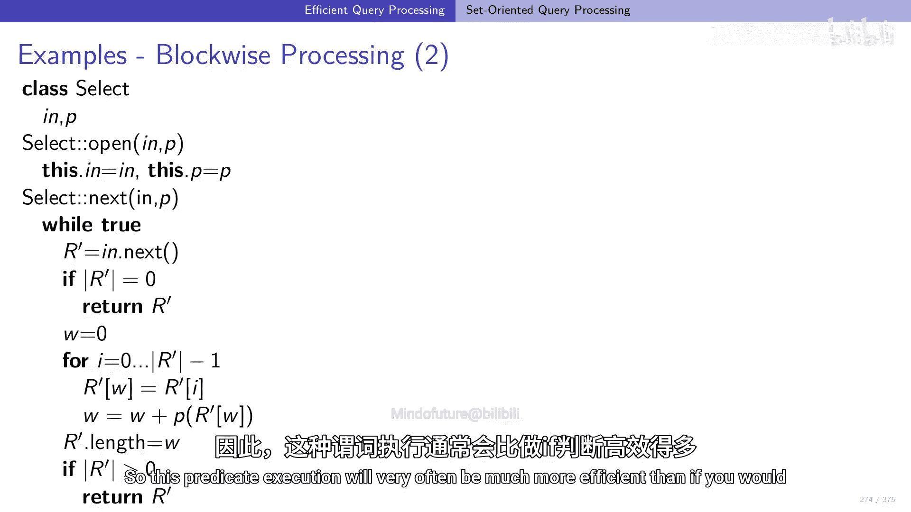

Okay and now for completeness we ought to do a crossb you see already that the crosspar does not even fit on a single page。

 so now we must single slides and now we need two slides it's not too easy to do and in the block processing we also see that we have a lot of variables here we have a lot of states that we must store。

😊，So this is， of course， our input left and right， but then we have a lot of variables that explain a moment for to do。

 Okay， so when we， when we call open， So we say， please prepare for execution。😊。

We again of course store my left and right side and I say okay I have to read from the left。

 remember step meets I will need from the left and then I must remember where so where am I currently on the left on the right side。

😊，Okay， then if somebody calls N S， please give me the next 1000 values。😊，Then of course。

 I allocate an area of size 1000。And at a right point I here this means how many how much of this area have already written。

 initially nothing， of course。😊。

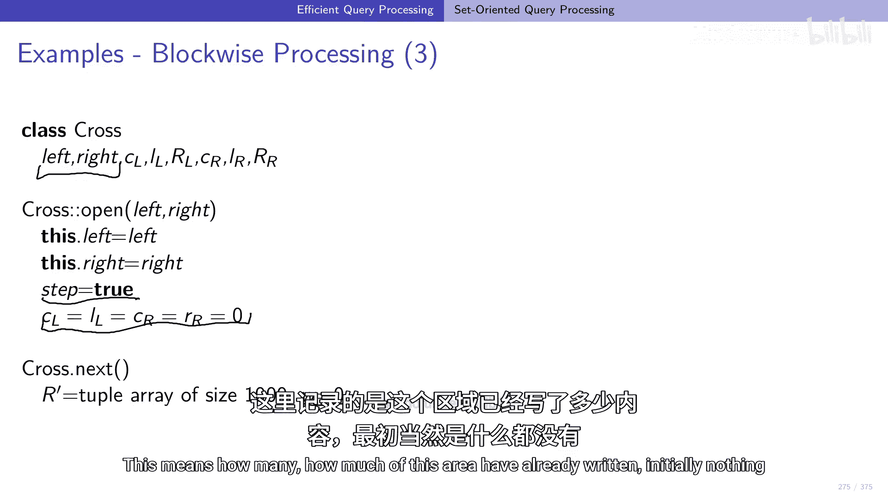

Okay， now here comes the real work。 and you barely can squeeze it on a single slides。

 it's actually got a lot of stuff here。 so we have an infinite loop。😊。

And then I check if my current position so CR if my current position on the right hand side。

 if my current position on the right hand side is equal to the limit of the right hand。

 this means that I hit the end of my current block from the right。😊。

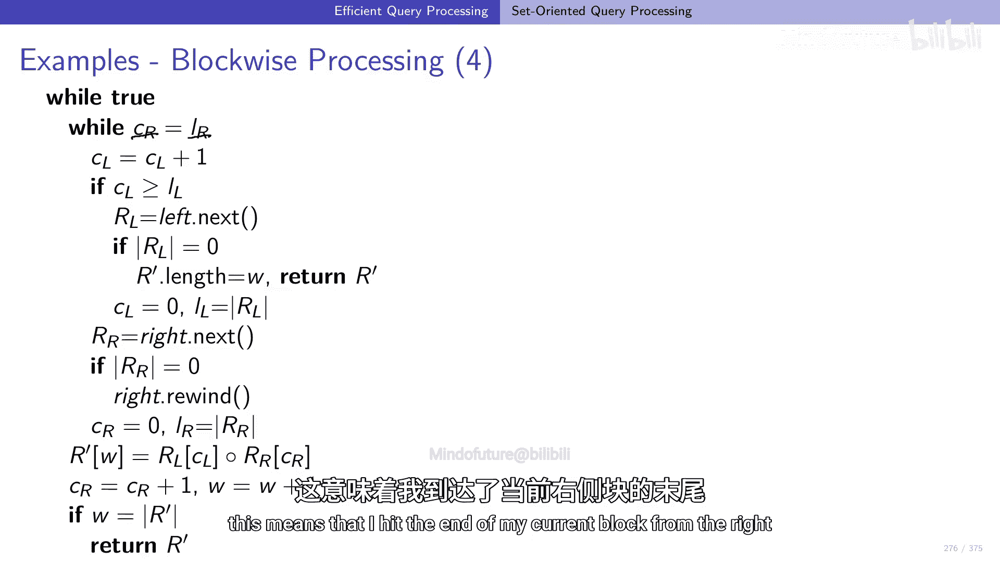

And remember that we set all these values to0 initially so this and the first call this happens already because I said my right end block is is processed。

 meaning I have no right end block so then I advance my current position on the left hand side and here and then it like add one then I is my current position beyond the limit of my left hand side will always be true in the first call。

😊。

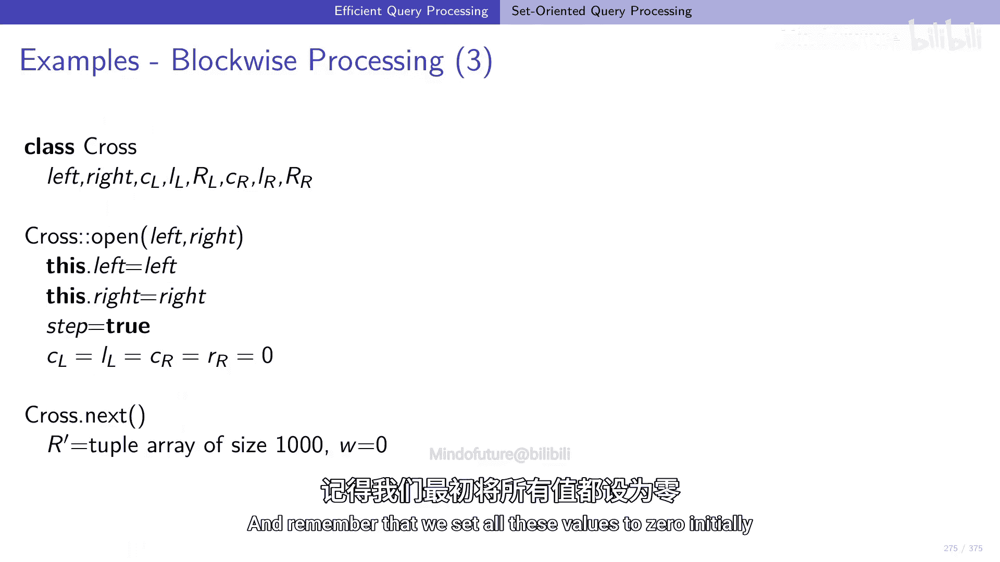

Then I， as I。Ftch the next block from the left hand side。

So this gives me tables on the left and then I check is my left side done so if my left block empty if yes。

😊，The left box empty， if yes， I set the length of our prime here to my writer because I might have improved previous looperations already up。

😊，Produce stored output tablets on my buffer if I kind of just said I'm done you you must keep what you already have。

 so if you take the right position， you adjust your length of R， then return up prime。

 then you return a prime saying this is what I got。Otherwise。

 if there are more troubles from the left， what they do here is。

 I remember my core position from left to0 limit the size of one block that I get from the left。

 of course。😊，Okay， then I've had the next block from the right。😊。

I do the same check is my is my right hand side done。 If yes， here， we need a new function。

 I did namely rewind， but I must stay my right hand side。

 you know what I I have to read you again because。For the next block。

From the left I again must process all table on the right。

 therefore I rewrite my right hand side mean this。😊，Depends on how yourble this roughly corresponds。

To just calling open。I usually will implement it slightly differently。

 by this means you tell your right hand side， Ill have to read you again as this is roughly like open。

 even though implementation will probably be slightly slightly different。

 So this is what we want does。 So remember my bright composition limit and then comes So this is if you once the exception case。

 So this is the exception case namely when you run out of work。

 most of the work is spent on Z part here。😊，So I take my right position W and then I store at my right position the combination of C of here。

 so the combination of the current tablet on the left and the current table on the right so I remember we do a cross product we combine every table with every episode table so I combine left and right and then I advance the pointer here to my my current position on the right because I。

😊，Combdes this already and then I also advanced my right pointer and if the right point hits my limit so I see I've written my block as full then I output the block otherwise know the loop continues I check。

😊，Tta hits the end of the right hand side， if not I do continue the processing if yes。

 I get wrote to the next block and so on。So this is the processing and you see already this is quite involved so it's not so easy and this if for a block sorry cross drawing its a super simple operator but even here it's not so simple because the block processing just like iterator model has to keep a complicated state so we must remember where are we and this where are we are basically this flexia。

😊，So these are the flag that we have to store。And we have to mean for cross products， not too bad。

 but for justing as things like wild outer joins also。

 then it's quite complicated where you have to store to remember where you are in processing and tape can be quite involved。

Okay， and I see now checking the time already over time。

 so I will stop here for now and we will do the the the example in the push model in the next lecture。

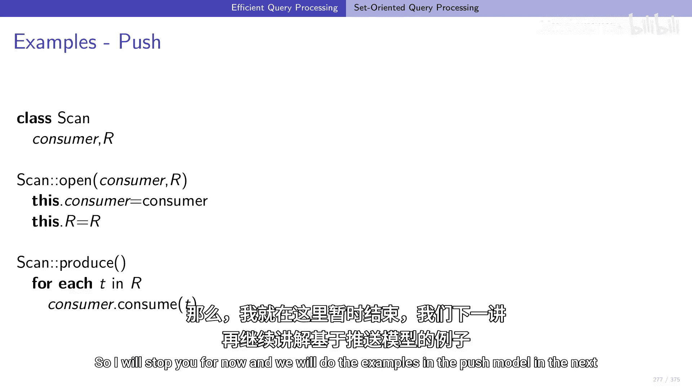

Okay， thank you。