# 现代CPU架构上的数据库系统实现：P10：面向集合处理

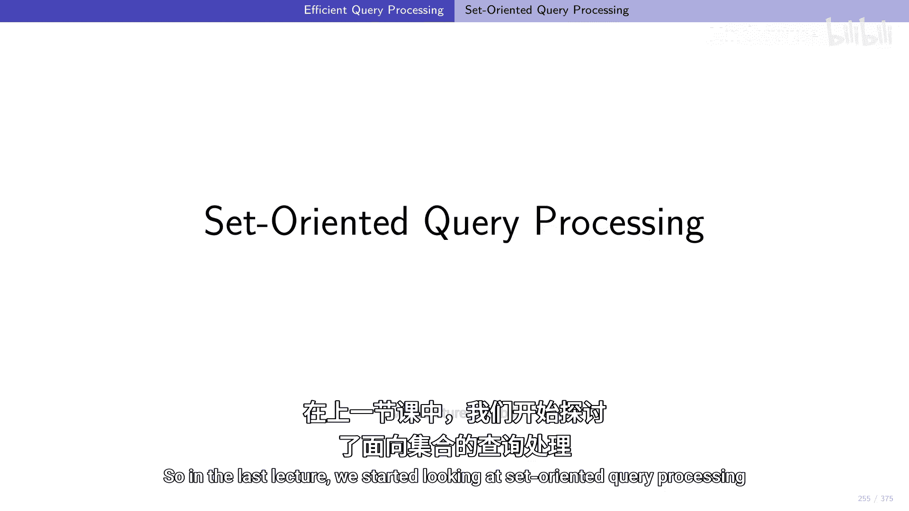

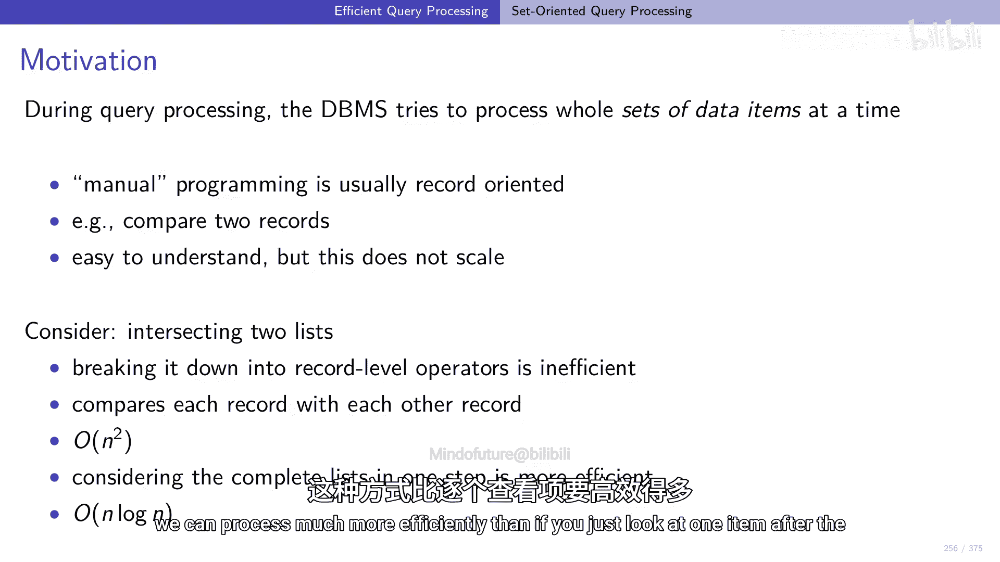

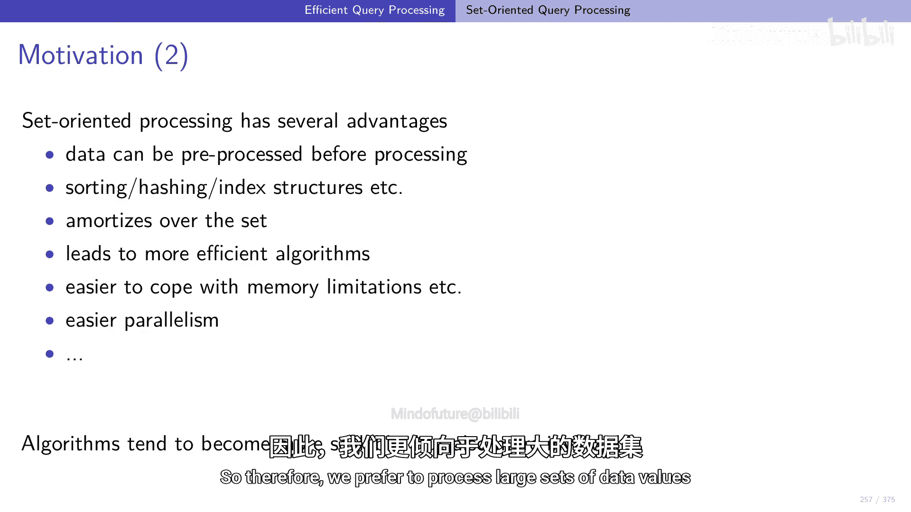

## 概述

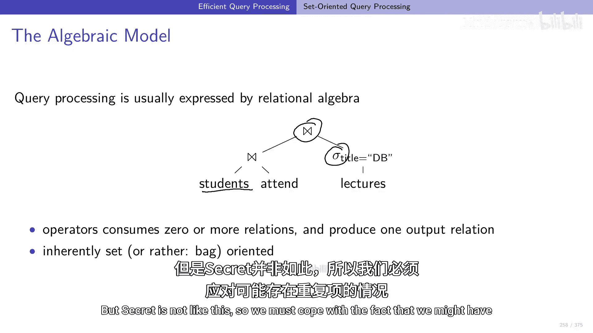

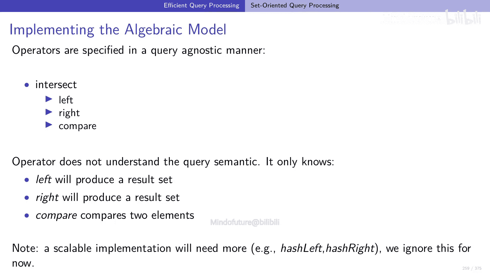

在本节课中，我们将要学习数据库系统中面向集合查询处理的实现策略。我们将探讨不同的操作符执行模型，理解它们如何消费和产生数据集合，并分析各自的优缺点。

上一节我们介绍了面向集合处理的概念，本节中我们来看看如何具体实现这些操作符。

## 面向集合处理模型

在上一讲中，我们开始研究面向集合的查询处理。我们提到，出于效率原因，我们更倾向于处理大型数据集合的方案，而不是逐个处理数据项。例如，如果我们能使用排序、哈希、索引等技术，在处理大型集合时效果显著，但对于单个表，索引则没有意义。因此，我们更倾向于处理大型数据集合。

我们通常通过将查询处理计划或策略表达为关系代数来实现这一点。以下是一个典型示例：如果我们运行一个SQL查询，查找参加数据库讲座的新生，我们会得到这样的关系代数表达式。

我们查看一个集合，更准确地说，是一个关系。我们将这些关系连接在一起，至少在概念上会产生一个新的关系。然后我们再次使用讲座关系，通过筛选数据库讲座来构造一个新关系，再将它们连接起来得到答案。我们的模型是，操作符（如选择、连接、表扫描）消费零个或多个关系，并产生一个输出关系。

这个处理模型本质上是面向集合的，因为它操作的是数据集合。严格来说，SQL允许重复项，因此我们处理的是多重集（bag），而不是集合。这有时会增加问题的复杂性，因为我们必须处理可能存在重复项的情况。

## 操作符实现策略

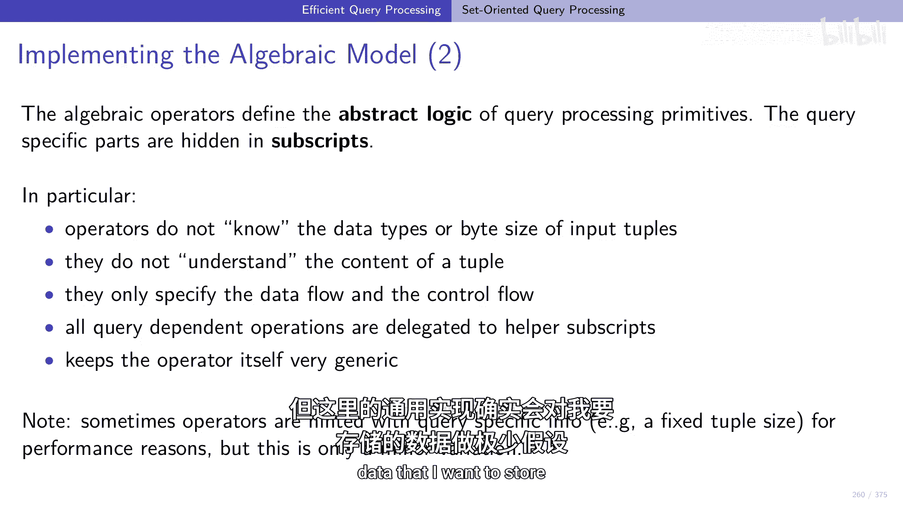

本讲的重点是如何实现这些操作符。在深入探讨单个操作符的实现之前，我们必须理解实现它们的一般策略。需要记住的是，实际上存在多个时间点。

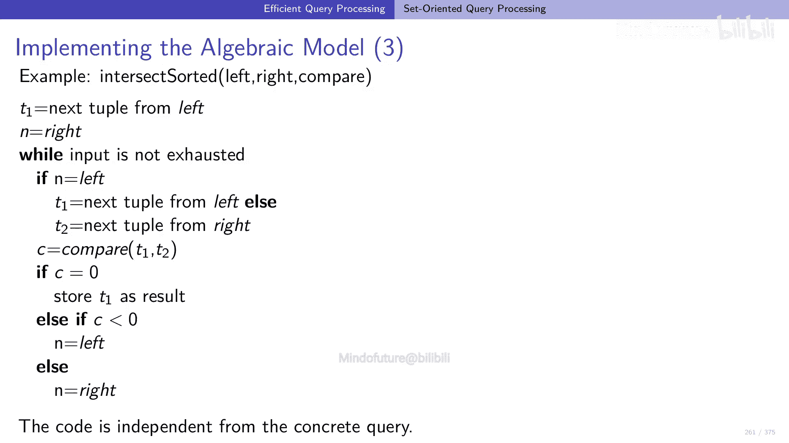

时间点T1，我们编译数据库系统。这通常是很久以前完成的。之后的时间点T2，我们编译查询，例如一个SQL查询。然后在更晚的时间点，我们执行查询。特别是T1和T2之间的分离带来了不少挑战。

一个问题是，当我们构建数据库系统并实现操作符时，我们不知道以后会执行哪些查询。因此，我们必须以能够处理任意查询的方式来实现操作符。

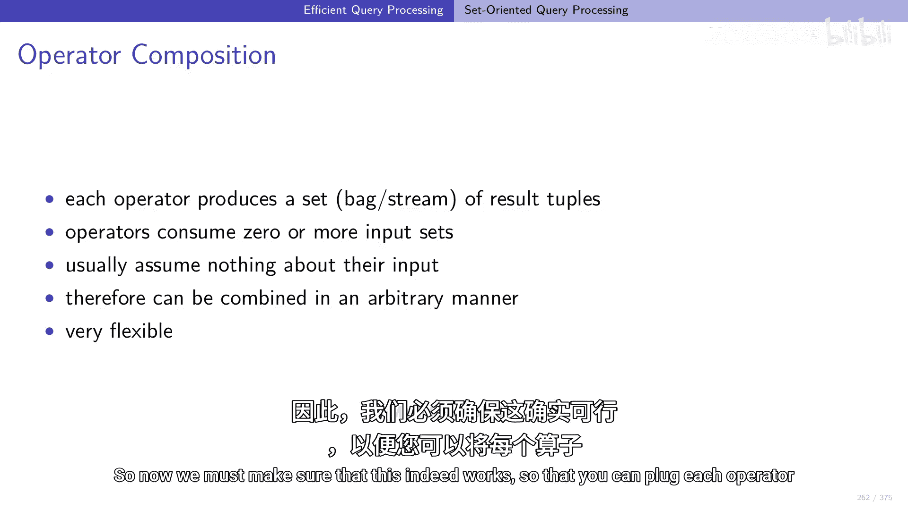

为了说明这一点，假设我们想实现集合交集操作。我们接收两个关系，找出同时出现在两个集合中的所有值。我们不知道集合会是什么样：是整数列、字符串列，还是多列？我们对此一无所知。然而，我们必须以始终有效的方式实现交集。

一种方法是假设我们有抽象的辅助逻辑，通常称为**子例程**。我们将它们附加到操作符上。例如，对于交集操作，我们可能需要三个子例程：一个用于读取左输入，一个用于读取右输入，一个用于比较两个元素。

有了这三个子例程，我们至少可以实现交集的一种方式：对左输入排序，对右输入排序，然后扫描两个已排序的列表，找出两边都有的元素。我们之所以能这样做，是因为我们有比较函数。

我们可能更倾向于使用哈希表而不是排序，但那样就需要更多的子例程，比如哈希函数。但这是最基本的需求。有了这三个子例程，我们就可以实现交集，并且这个实现几乎不对输入数据做任何假设。

这种实现方式非常通用，因为操作符本身不知道数据类型或元组大小。它只需要知道如何获取指向左右数据的指针，以及如何比较两个元素。这对于数据库来说是必需的，因为我们不知道用户以后会做什么。

## 数据流模型

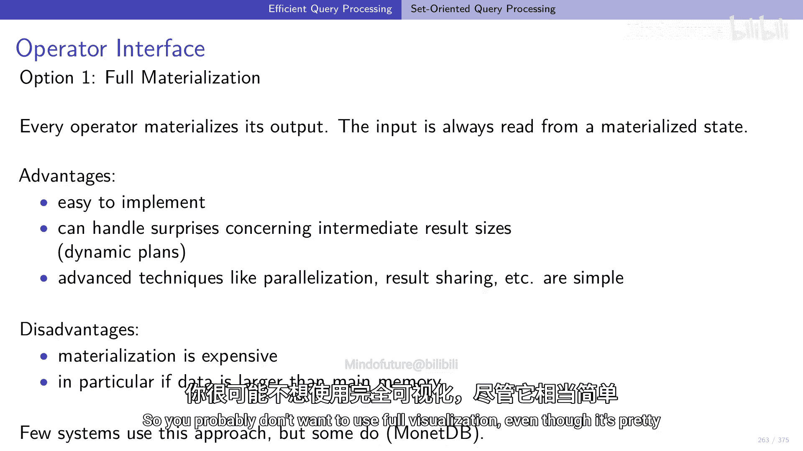

每个操作符产生一个集合，更准确地说是一个多重集，或者更精确地说是一个结果元组的数据流。简单的关系模型是数学上的集合（如果存在主键）。但通常我们处理的是多重集，这意味着可以有重复项。有时我们关心元组产生的顺序，例如用户指定了`ORDER BY`子句。因此，最通用的模型是数据项流。

每个操作符消费零个或多个输入集，并且我们通常不对输入做任何假设。我们可以将任何操作符组合在一起。这种假设允许我们构建极其复杂的执行计划，因为它非常灵活。当然，必须有人来实现这一点，确保任何操作符都可以与其他操作符组合。

## 操作符接口设计

一个关键问题是如何设计操作符接口，使得每个操作符都能与其他操作符组合。

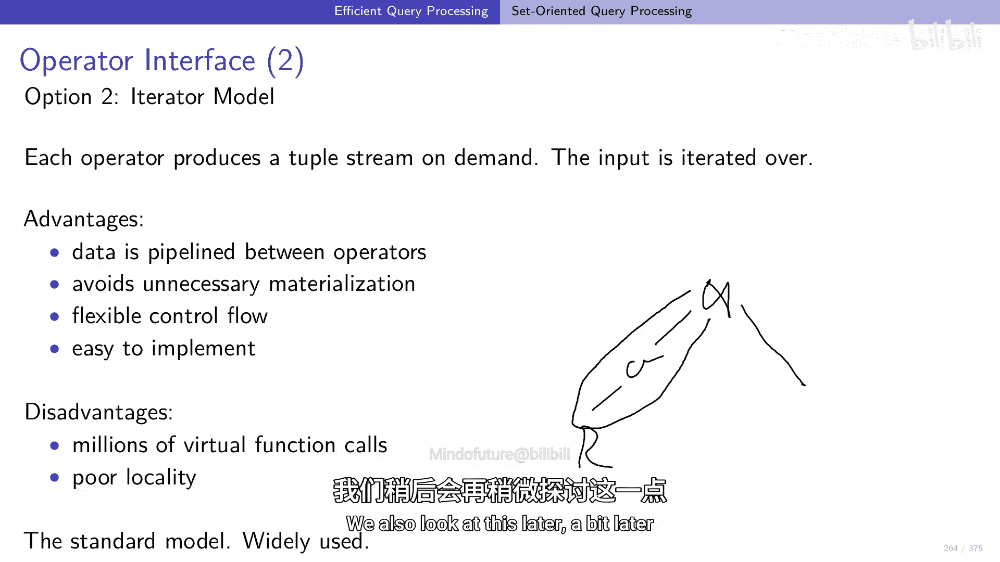

历史上出现了几种不同的方法。首先，我们来看最简单的一种：**完全物化**。

### 完全物化接口

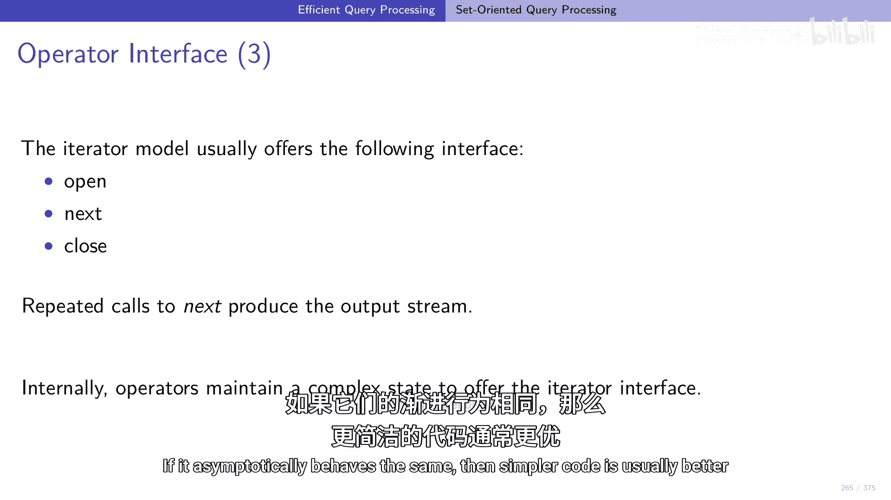

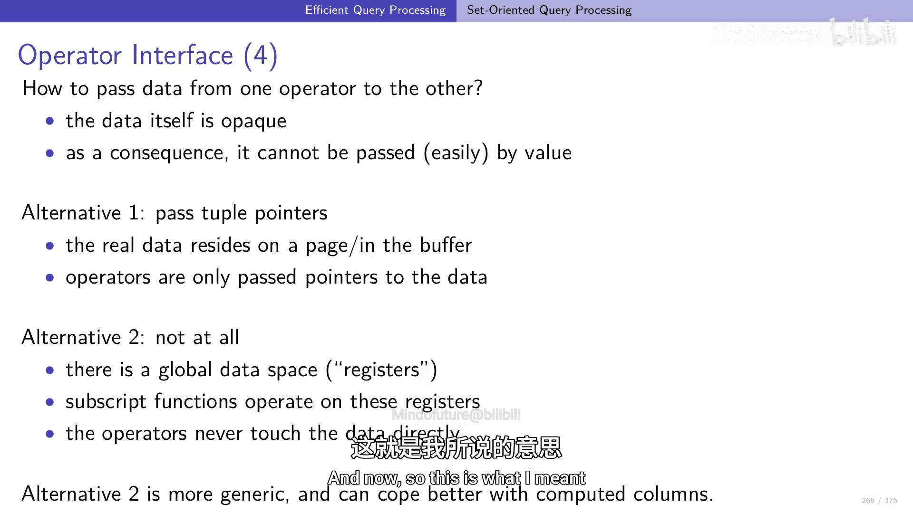

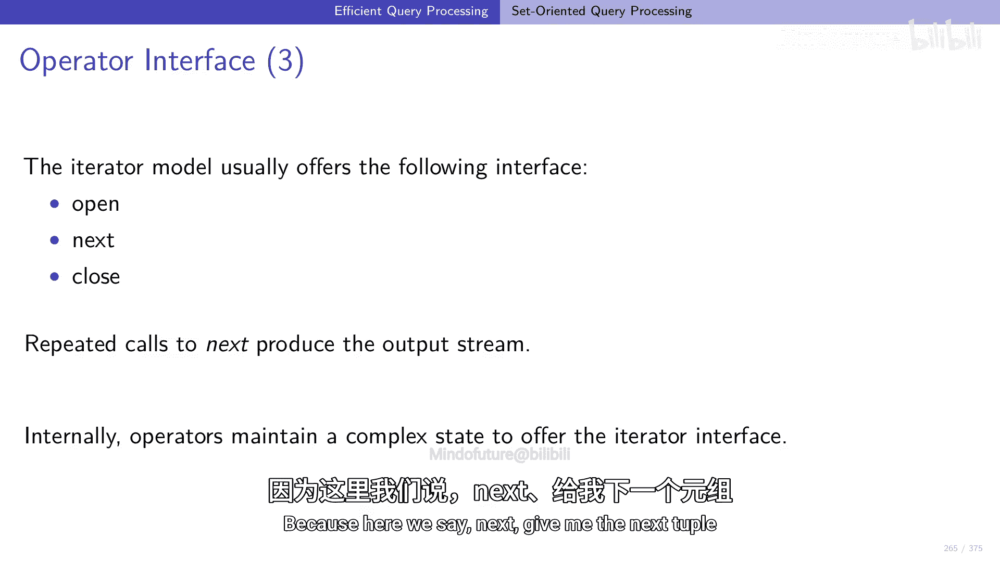

这种接口的基本假设是，每个操作符读取一个或多个物化的关系作为输入，并产生一个新的物化关系作为输出。操作符完全读取输入，处理它，然后写出一个新的数组或表。

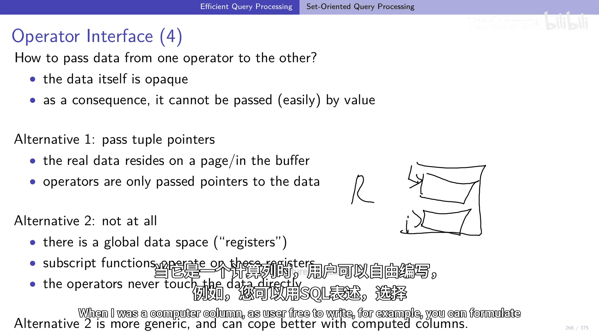

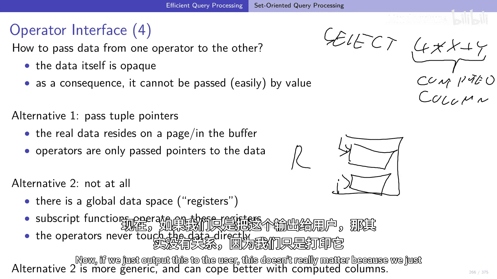

这种方法的优点是实现简单，因为所有东西都是物化的表。另一个优点是，你永远不会对输入感到意外，因为你读取的是物化表，特别是你知道输入的大小。这很好，因为你可以据此做出反应。例如，在哈希连接中，如果你想在较小的一侧构建哈希表，如果你知道两侧的大小，就可以做出明智的决定。

此外，如果输入是完全物化的，并行处理会变得简单。例如，你可以将关系切成片段，让不同的线程处理不同的片段。结果共享也很容易，因为中间结果已经写在了某个地方，可以提供给其他查询使用。

然而，在实践中，完全物化存在很大问题。主要问题是物化成本高昂。即使是在内存中，写入数据也需要成本，之后再次读取又需要成本。如果中间结果大于内存，成本会非常高。

为了说明这一点，假设有一个查询，连接后跟一个高度选择性的过滤。完全物化模型会在连接后写入所有结果（可能非常庞大），然后过滤掉大部分，这是非常低效的。只有少数系统（如MonetDB）使用这种模型，但大多数系统不使用，因为其缺点通常大于优点。

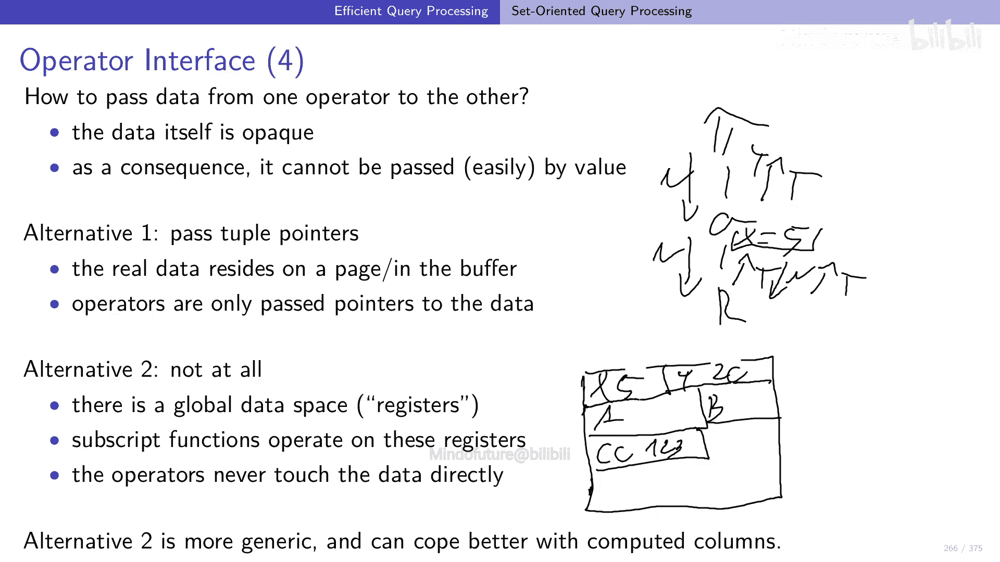

### 迭代器模型

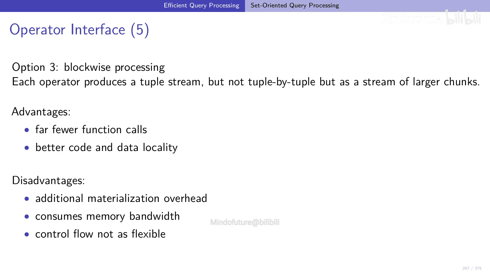

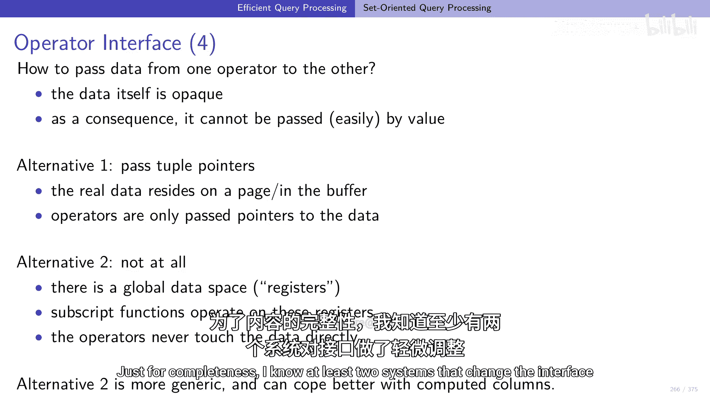

第二种方法是**迭代器模型**，这是最广泛使用的模型。大多数数据库系统，尤其是较旧的系统，都使用这种模型。

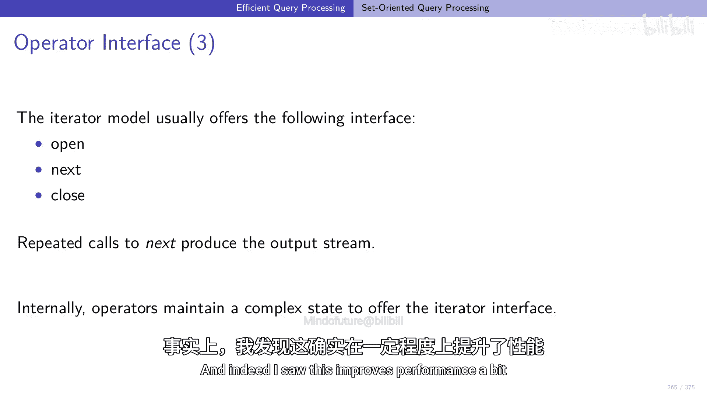

迭代器模型的假设是，每个操作符按需产生一个元组流。关系不是存储在某个地方，而是可以按需迭代读取。

优点是数据可以在操作符之间**流水线**传递，这意味着无需复制即可传递数据。这避免了不必要的物化。例如，如果查询包含`LIMIT 1`，迭代器模型可以在找到第一个匹配元组后立即停止，而完全物化模型则需要先物化所有匹配元组。

迭代器模型也非常简单。然而，缺点是性能不理想。每当我们需要一个元组时，我们调用一个虚拟函数（`next`）。对于处理的数百万个元组，这会产生大量开销。此外，迭代器模型具有较差的**局部性**。控制流在操作符树中上下跳动，导致CPU缓存效率低下，因为代码和数据访问模式不连续。

### 迭代器模型接口

迭代器模型通常提供三个方法：`open`、`next`、`close`。
*   `open`：准备执行，分配内存，打开文件等。
*   `next`：返回下一个元组，或者指示没有更多元组。
*   `close`：释放资源。

接口虽然简单，但操作符的实现往往不简单，因为需要维护复杂的执行状态。`next`方法必须在产生一个元组后暂停，并在下次调用时从正确的位置继续。

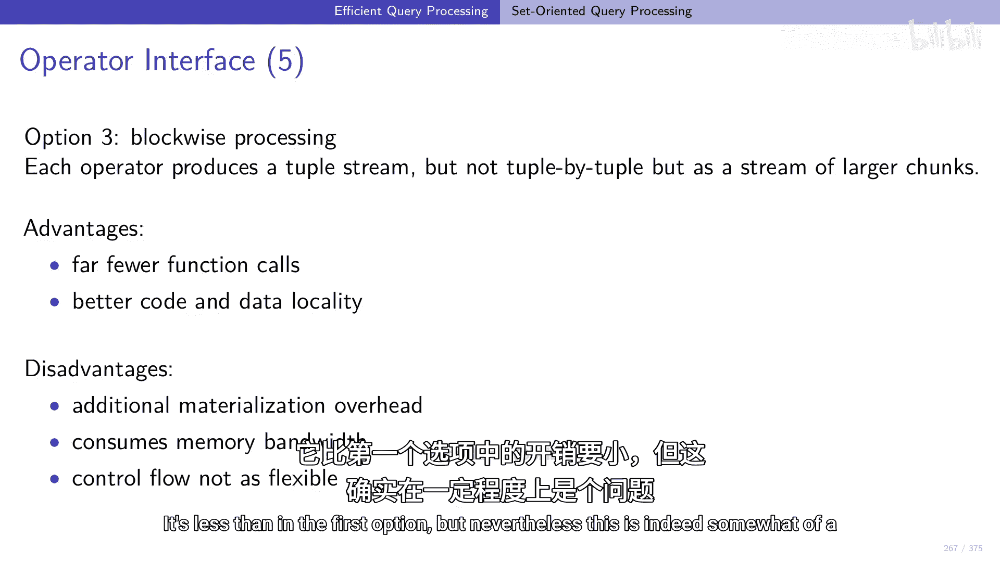

关于如何传递元组，有两种常见方式：
1.  **传递指针**：操作符返回一个指向存储在某处（例如缓冲池页面中）的元组的指针。这很廉价，但难以处理计算列，因为计算列的值并不物理存储。
2.  **使用寄存器文件**：操作符不返回元组本身，而是返回一个布尔值（`true`表示有新元组）。元组数据通过更新一个全局的（通常是线程局部的）寄存器文件来传递。子例程（如谓词）操作这个寄存器文件。这种方法可以优雅地处理计算列。

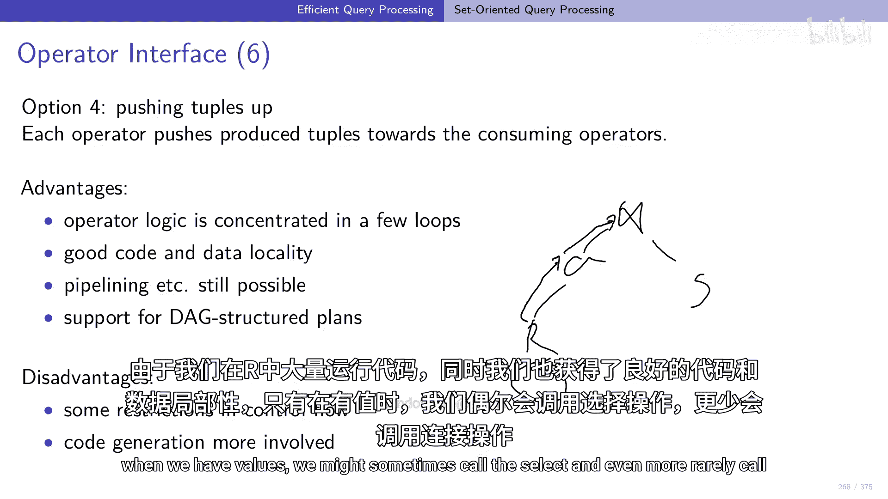

第二种方法是迭代器模型中更优的接口。

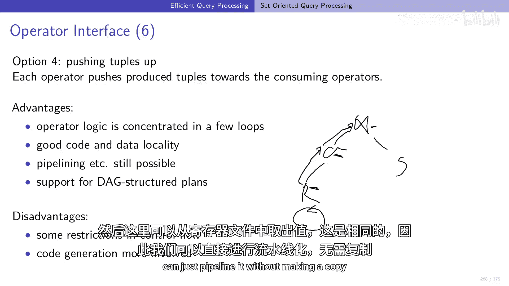

### 分块处理模型

第三种方法是**分块处理模型**，它是迭代器模型的一种折衷。

与迭代器模型类似，它迭代处理元组流，但不同之处在于，它不是一次请求一个元组，而是请求更大的数据块（例如1000个元组）。这大大减少了函数调用开销。由于在一个循环中处理大量数据，代码和数据局部性也更好。

缺点是引入了额外的物化开销。输出块必须存储在某个地方（例如一个向量中），这需要内存带宽。然而，如果块大小选择得当，使其能放入CPU缓存，这个开销会比完全物化小得多。控制流灵活性稍差，因为只能读取大块数据，但对于大多数操作符来说这没问题。

### 推送模型

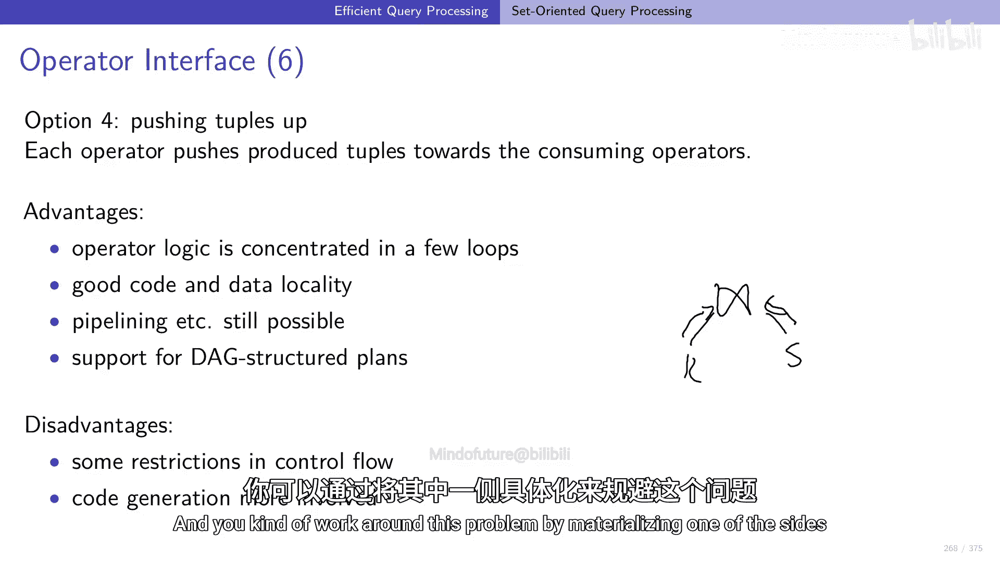

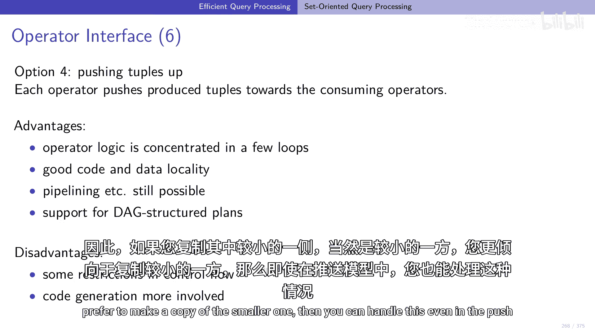

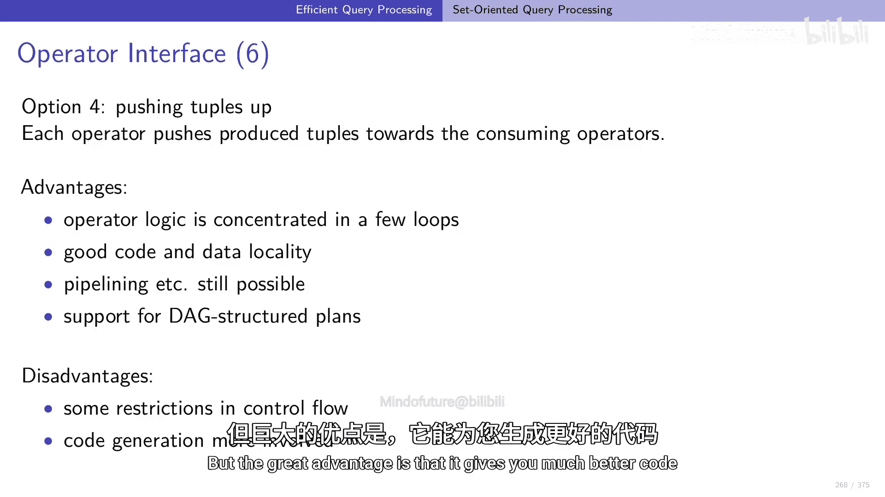

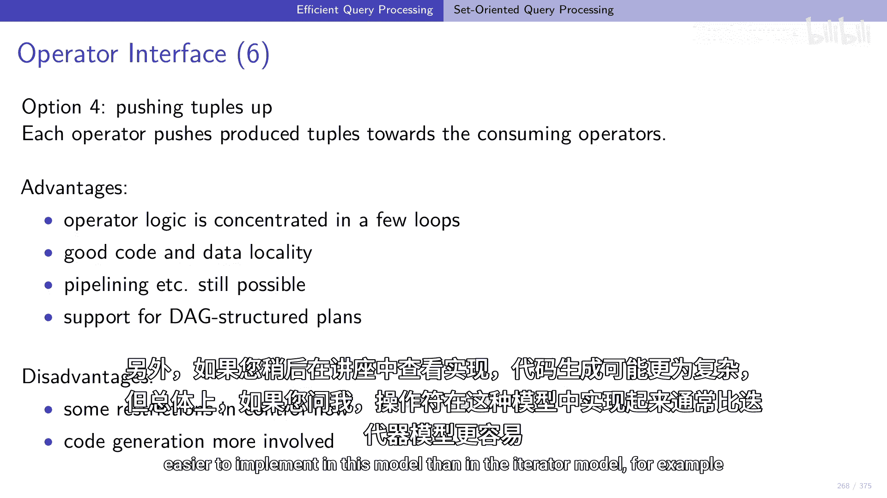

第四种方法是**推送模型**，它与前几种方法截然不同。

在前几种模型中，数据是**拉取**的：父操作符通过调用`next`向子操作符请求数据。在推送模型中，方向反转：数据从数据源（如表扫描）开始，被**推送**向上通过操作符树。

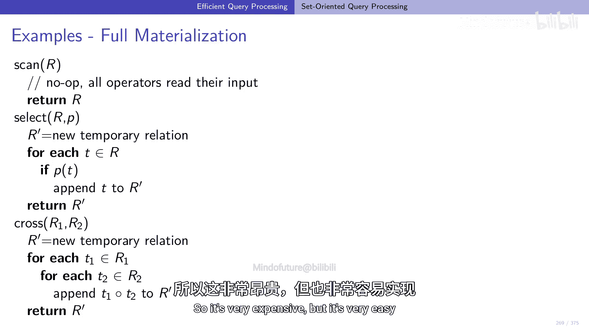

在代码中，这意味着大部分执行发生在一个紧密的循环中。例如，表扫描循环读取数据，并直接调用其父操作符（如选择）的函数来处理每个元组。这产生了极好的代码和数据局部性，因为执行大部分时间停留在扫描循环内。

推送模型也支持流水线，无需复制数据（可以使用寄存器文件）。另一个有趣的优点是它支持**有向无环图**结构的执行计划，而不仅仅是树。在迭代器模型中，如果一个操作符有多个父操作符（共享子表达式），处理起来会很麻烦，通常需要物化。在推送模型中，可以轻松地将一个元组推送给多个消费者。

缺点是控制流更受限制。例如，合并连接需要交替从左、右输入读取数据，这在推送模型中不容易实现。但通常可以通过物化一侧来解决。另一个缺点是代码生成可能更复杂，但操作符的实现本身可能比迭代器模型更简单。

## 实现示例比较

为了比较这些模型，让我们用三种模型实现三个非常简单的操作符：扫描（读取整个关系）、选择（过滤）和叉积。

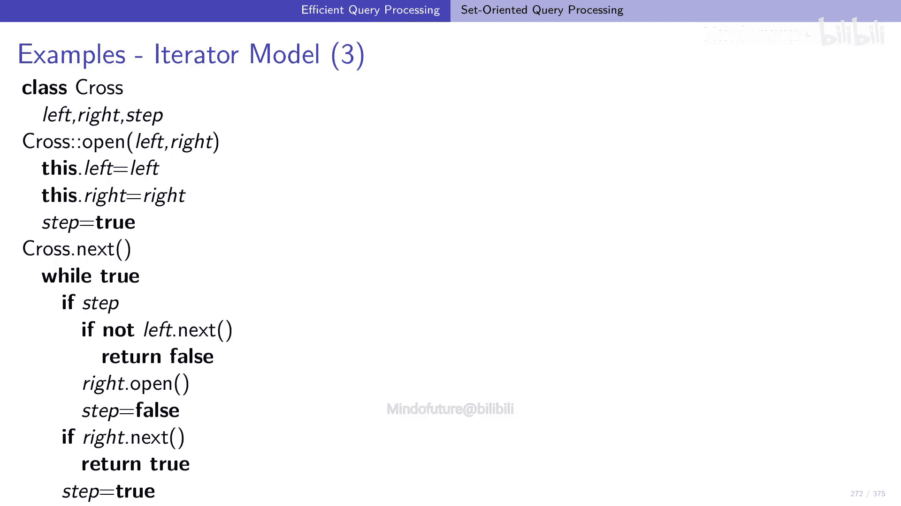

### 完全物化实现

在完全物化模型中，实现非常简单。

*   **扫描**：几乎什么都不做，只是返回对已物化关系的引用。
*   **选择**：创建一个新的临时关系，遍历输入关系，将满足谓词的元组复制到新关系中，然后返回新关系。
*   **叉积**：创建一个新的临时关系，嵌套循环遍历两个输入关系的所有元组，将组合结果存入新关系。

优点是极其简单。缺点是物化成本高，尤其是叉积会产生巨大的输出关系。

### 迭代器模型实现

在迭代器模型中，实现变得复杂。

*   **扫描**：在`open`中初始化位置指针。在`next`中，检查是否到达末尾，如果没有，则加载当前元组（到寄存器文件），移动指针，返回`true`。
*   **选择**：在`next`中，循环调用子操作符的`next`，直到找到一个满足谓词的元组，然后返回`true`。如果子操作符耗尽，则返回`false`。
*   **叉积**：需要维护复杂的状态（`step`标志，当前位置）。在`next`中，需要根据状态决定是从左输入读取新元组，还是从右输入读取下一个元组，并处理右输入耗尽的情况。即使对于简单的叉积，簿记工作也很繁琐。

迭代器模型从外部看接口简单，但内部实现状态管理复杂，尤其是对于连接等操作符。

### 分块处理实现

在分块处理模型中，我们一次处理一个数据块（例如1000个元组）。

*   **扫描**：`open`类似迭代器模型。`next`返回一个包含最多1000个元组的数组。通过循环填充数组。
*   **选择**：`next`循环直到找到足够多（或一些）的匹配元组。它从子操作符获取一个块，然后使用**谓词执行**技术过滤块。谓词执行不使用`if`语句，而是通过条件性地增加写入指针来避免分支预测错误，从而提高性能。
*   **叉积**：实现非常复杂，需要维护多个状态变量（左/右当前块、块内位置、输出缓冲区写入位置等）。代码冗长，需要仔细管理何时从左侧读取新块，何时从右侧读取，以及何时重绕右侧输入。

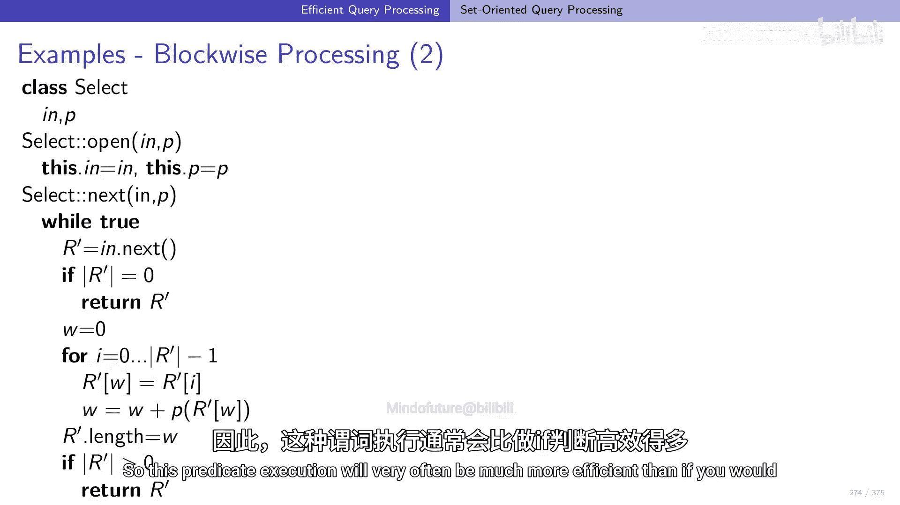

分块处理减少了调用开销，提高了局部性，但操作符实现中的状态管理仍然复杂。

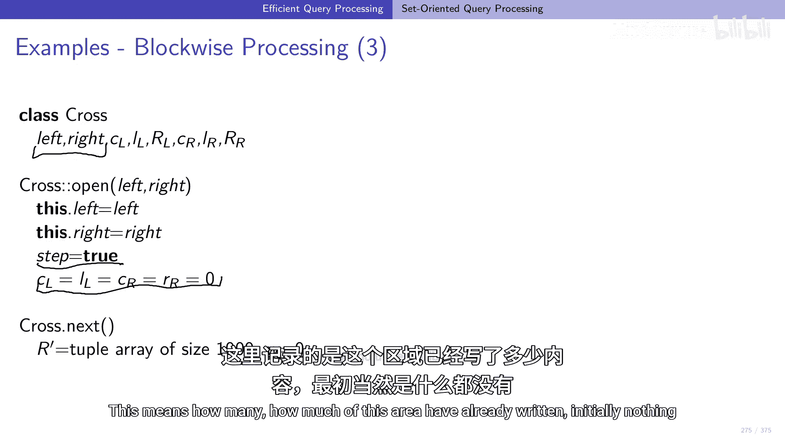

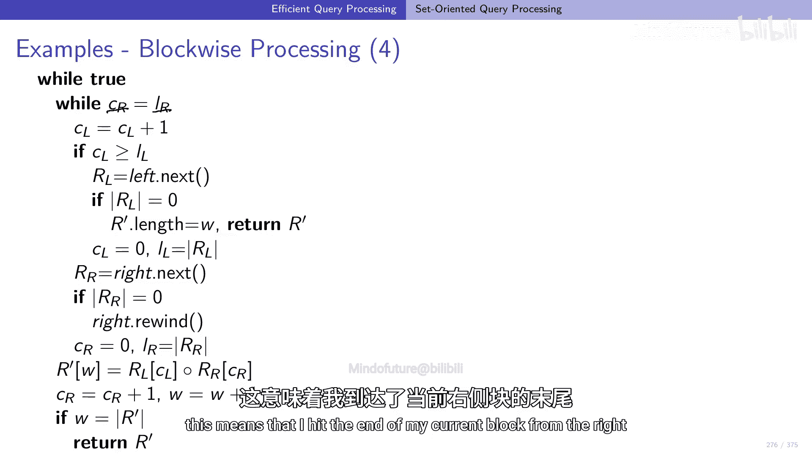

## 总结

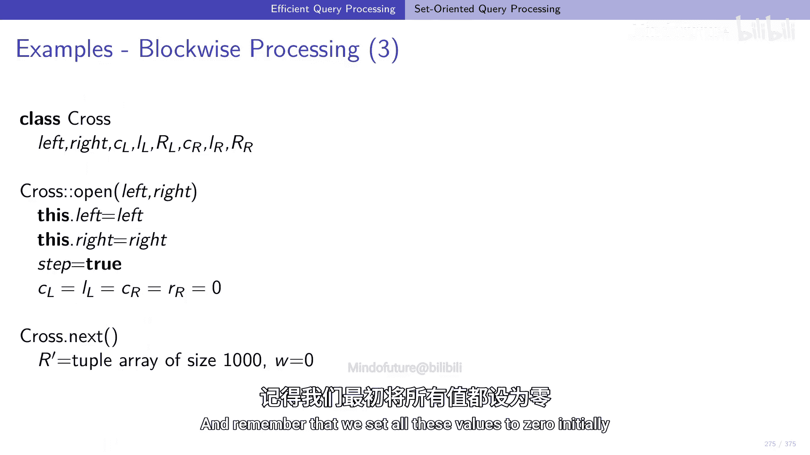

本节课中，我们一起学习了数据库系统中面向集合查询处理的四种主要执行模型：

1.  **完全物化**：简单但物化成本高，灵活性差。
2.  **迭代器模型**：灵活且广泛使用，但函数调用开销大，局部性差，操作符状态管理复杂。
3.  **分块处理**：减少了迭代器模型的开销，提高了局部性，但仍有一定物化开销，状态管理复杂。
4.  **推送模型**：提供了最佳的局部性和性能，支持更灵活的计划形状（DAG），但控制流受限，代码生成可能更复杂。

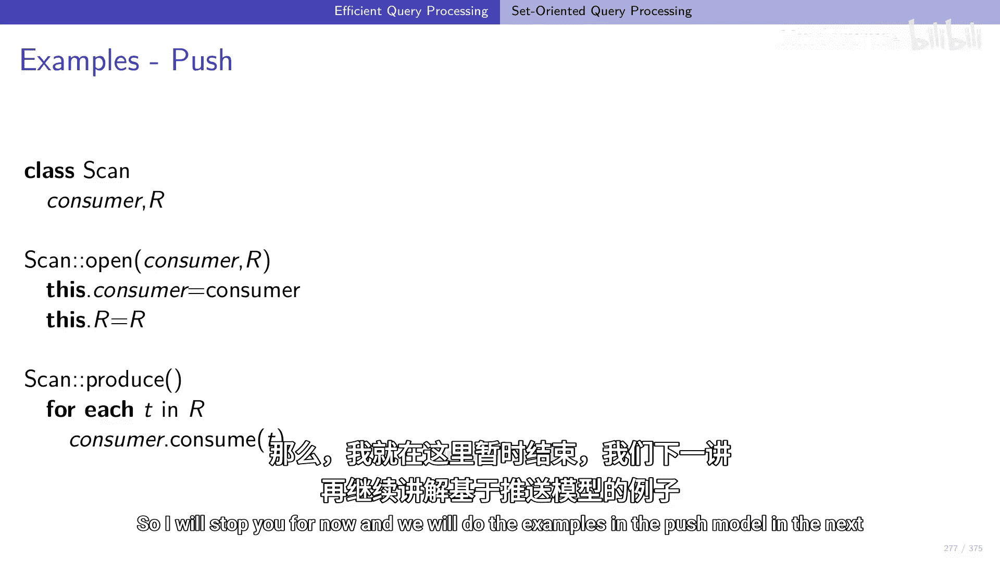

每种模型都有其权衡。现代高性能数据库系统越来越倾向于使用分块处理或推送模型，以充分利用现代CPU架构的特性。在下一讲中，我们将继续探讨推送模型的具体实现示例。