# 【慕尼黑理工大学】现代CPU架构上的数据库系统实现-｜-Database-Systems-On-Modern-Cpu-Architectures-2021-p11-P11_11_操作符--BV1asiJBeE6j_p11-

Welcome to this lecture on database implementation So in the last lecture we have looked at different ways to compose operators I'll show how to implement。

 operate interface so that we can compose them and we first look at full materialization where we say okay there's of course the simplest model we read all the input that we write back all intermediate results into a new relation very easy there's not so great performance iterator model where we produce each table on demand very flexible but quite expensive。

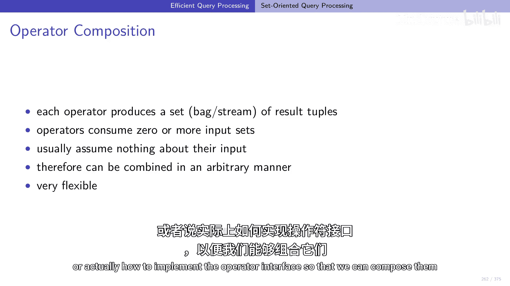

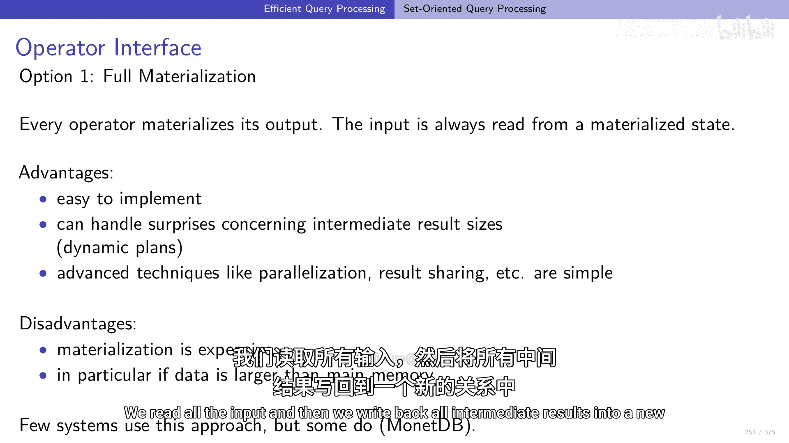

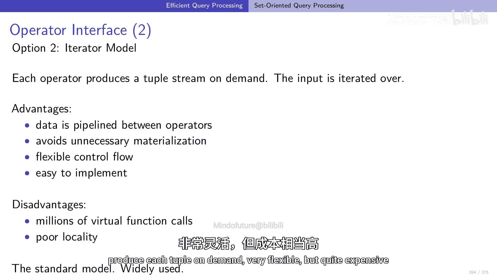

So then we had looked at the as as a block model where we pass not a single tapt。

 but blocks of tapts with emotizers the whole overhead。

 which is much more efficient than the iterator model。

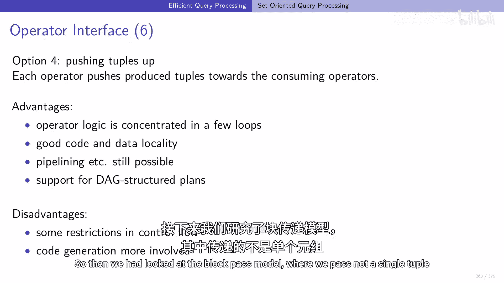

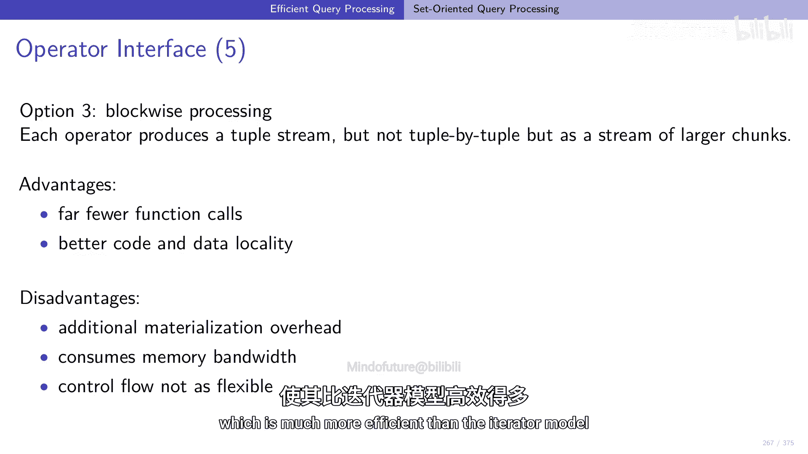

But there's a problem that we write quite a few data and then the push model so where the data is not pulled up then set from the leaves of of the exclusion that push up to the parent and we also started looking at example code was this sort functionization iterator。

 this is what I did and then block processing this is what we also did and we stopped about here so we stopped here so in the push model。

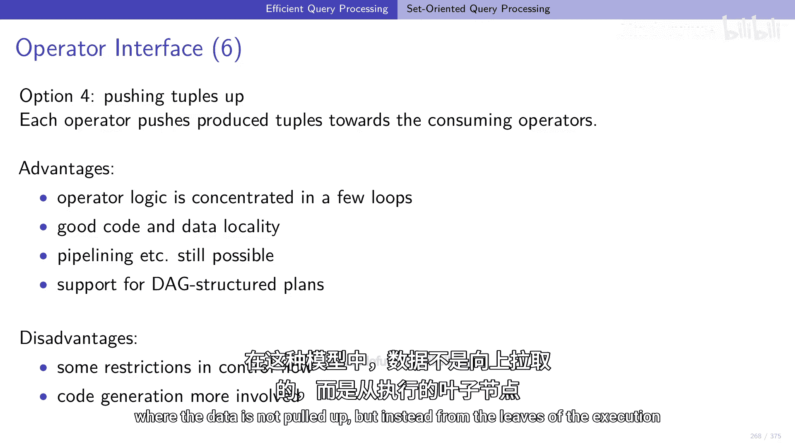

Then okay， how can we look at implement the three most primitive operators can select and cross product using the push model？

So the code is actually quite simple as you would see here so in this scan code we say， okay。

 we want to scan a relation R and when we call it open。

 we just remember what what's the relation R that I want to scan and also I remember who wants to read it so consumer here this is an object or some kind of COV。

Then and when we want to produce data， then we literally do it。

 so we loop over all the tuts in R and then we just pass each tupper to R honestly the here's the tu here the table here's the tut so its very simple now note that in the consumer it scan of course has no consume because scan is a leaf so scan can only produce we never have an input。

Now， when we come to select， select does have an input and produces output Rads。

So and when we call produce on the select， we just record produce on the input here。

 we just say please give me all the double now in the consume callback so when we get a tappper。

 we check the condition if it's true， we pass it along to our consumer here。

 if not if we throw it away okay。And cross product。

 So when we want to build a cross between tool inputs。 So in the open core。

 we just remember what the left right was my consumer now when we call crosspro this means we ask our left side。

 please produce tablets Now when we get a tablet from the left node that in ready mean I didn't show the full interface but it's a consumer interface you might also know from where the tablet comes so we here we say the table comes from my left input then we stores the tablet here and then we call produce on my right side。

Okay， and then if any copy again the tap from my right。

 then we combine it with my with my store typeper here and then we output to our consumer Okay。

 so actually this quote here is very， very simpler。Of course for more complex operators。

 it is not that simple， but nevertheless， it does not have the complexity of it a model that has to remember where you are so such that you can stop at any point in time。

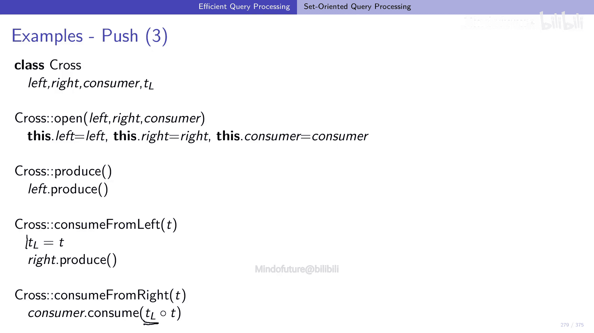

And now so far we have only looked at open and yeah。

 whatever we need to produce tablets next or produce or so， Of course。

 there are also other functions that we have to implement。

Yeah one is close as this is usually a pretty boring function。

 we just release allocated resources like the free memory， be closeify， whatever our operator did。

 So this is pretty simple。 And there are some other functionalities that we might need it a bit more advanced。

 like the first one here is rewind rebind。Now， what is these are two functions that look very similar。

 but behaves slightly different。Rewind means if somebody calls rewines this says please prepare for re executionution。

 so I want to read you again， please prepare for read a execution but you can reuse what you have already have So this is probably basic what rewind is。

Rebind means I pre prepare for re execution， but you must recompute what you already have。 Now。

 why do we need this to function ideas， So the easiest case is we have just some this。 so we have。

Oh Lukejo。So then R S， so then we need revd because we take it up from R。

 we read S and now mean the next type from R comes， we tell S， please， I want to read you again。

 note， of course it is the best table of course， it is pretty boring。

 but this could be something complex。Without plan。And if the next step comes。

 we want to read it again， if we do not necessarily have to recompute it now because， for example。

 if the top points operator is a groupi also it can as reuse what you already have my groupI table so we don't have to recompute it if we just read it again。

By the red case we need for another operator， namely for the dependent join。

 so where when for example， we have something like this here。

So if we have something this node as the right- hand side of the join depends on the left hand side here because we're on the right hand side we use attributeput from R of course this happens rarely but this can happen and if this happens now we now we get a new from R we must throw away the group by results we cannot reuse it。

 therefore we must go reb so then now in the real implementation we might even track which attribute to change because sometimes we can reuse some part of the plan some others we don't but nevertheless with this functionality we auto need。

😊，We often also need functionality for memory management because operators tend to allocate memory。

 we want to freeze them properly or we want to freeze them under memory pressure so there might be operators for that and you might need more functions for sppoing so if you run out of memory we want to have a functionality to write more reside to disk might image to disk and then read it back that or skip all this。

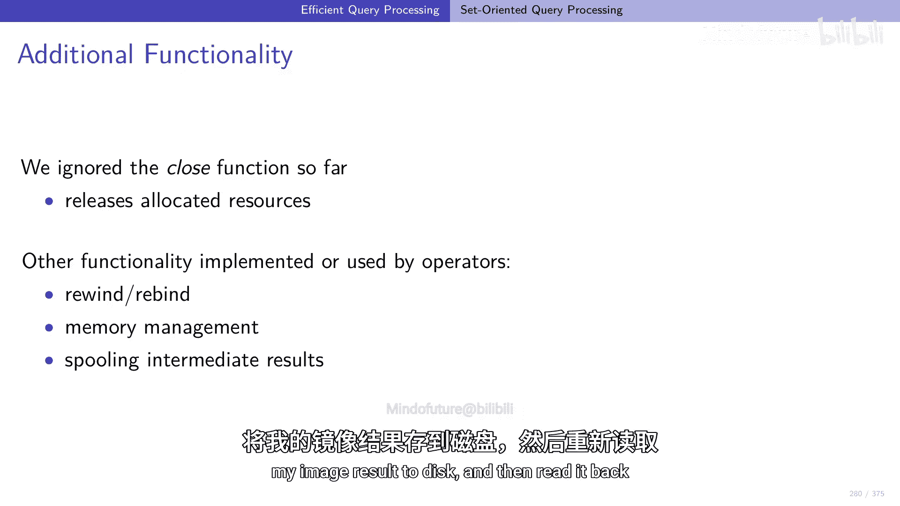

Another interesting problem here is what do we actually do with the subscripts。

 that's what I use already in the example here so that when we say。I say a includess B。

So this is of course a subscript here， but mean a equal Vi is remember。

 but there can be anything in there Yeah， so we can for example。

 write two times a plus B should be less than C or whatever Yeah so this can in out complex of expression。

😊，And of course， we need some mechanism to evaluate this expression。 Now at this this subscript here。

They are the query specific part of the query。 So for the other operators we have seen join。

 select within didnt look at join， but select crossb and so on。

The implementations we have seen don't really care about the query。

 they only talk about control flow， everything that is clearly specific is handled by Subscript。

As this can be something simple like just Excel and attribute。

 So someone says Excel A give me an attribute value or we can have a productcate or a equals B。

 or we can have some computation or really can be anything and of course now we must somehow implement this。

😊，Sa that when a user gives me a query， Im able to evaluate whatever expression is included in the query。

😊，And first， of course， the spheres always look different。 so the subscripts always look different。

 but on the plus side， these are usually pretty simple。 A equals B is a very simple expression。

 Now you can write something complex， but this happens much more rarely。

 And even if you write a complex expressions。 The operation itself is easy。 a comparison。

 a plus a minus multiplication。 These are all very simple operations。

 nothing compared to a drawing or So it means you have to implement all these functions somehow。😊。

Is a large number， but。

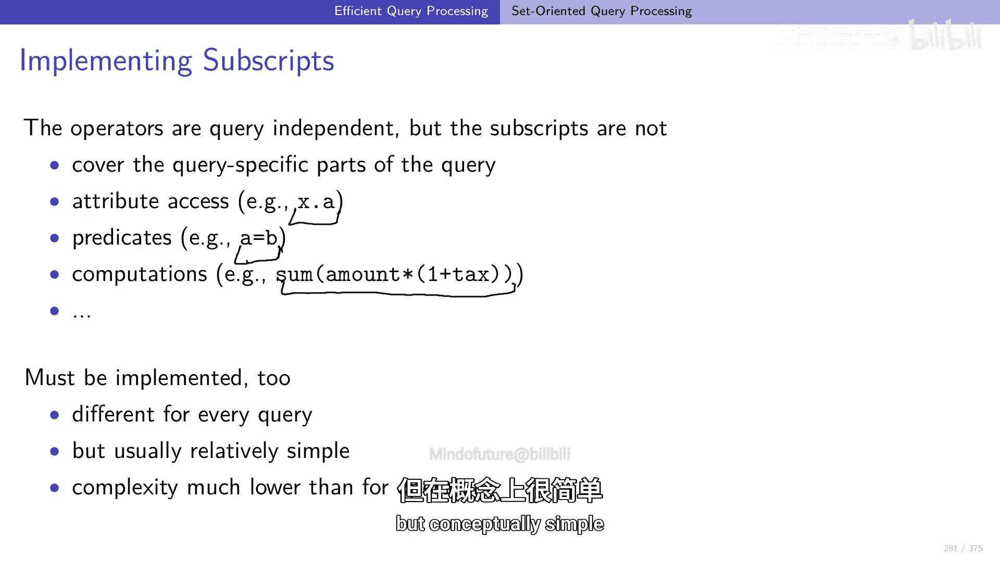

Conceptually simple。Also here we have different ways like we implement this。

 so the first choices is something for example， that Db2 does。😊，Or at least did。

 I'm not sure if they still do this， but as it is at some point。

They use interpreter objects so which basically means you built a small tree like a tree looks like this here。

 you say oh no my exempier doesn't do plus plus could was be plus or let's say equality gets two inputs here and my input here in this case could be for example excess。

End。😔，Excess。So this is how we can we can check condition A equals B。

And so we say we express this as a tree comparison as the topmost element and then we have access to the attribute further down and of course if you do something more complex like if we do a plus b equals C so this works just the same we have equality as up top then here we have a plus then here we have a B and then here we have C so as this we can whatever expression we have we can build such an tree of object and if we want to evaluate this we just takes the root of this tree and we call evaluate this on this root so here now we see some example code。

😊，So when we want to access an attribute， this is what we see here and node we want to here's the called excess into。

 which means we want to access an attribute that is an integer value。

 So then we it gets a pointer here and then v is a upper pointer and then we say okay。

 please take a double look at the corresponding offset loads the value and then return it So this is accessing attribute and if we want to do comparison。

So this is an integer comparison。 So then we say， okay， I take my left side。

 a call valid on my left side here。 I take my right side， I will call valid on my right side。

 and then I just compare。Yeah， the two values so and yeah you can implement this for whatever you want plus minus oil box the same。

 you just implement an e function and then you can assemble them as you want。

 So this is good thing about this project is's very easy to implement now you basically need one line per operator or two lines per operator a very lightweight very flexible auto come popular。

 quite a few people use such a model。 but the down set is you is not very fast。

 Now the problem is whenever you even think about this trivial example like a equals B。

And then get equality as roots， then we had an excess for a and excess for B。

 This extremely simple expression already involves three virtual function codes and because we first call the roots。

 it's called the left side， it is called the right side and then weemble the result So and virtual function codes are a bit more expensive。

 So this is not not super fast easy flexibility， but not very fast。😊。

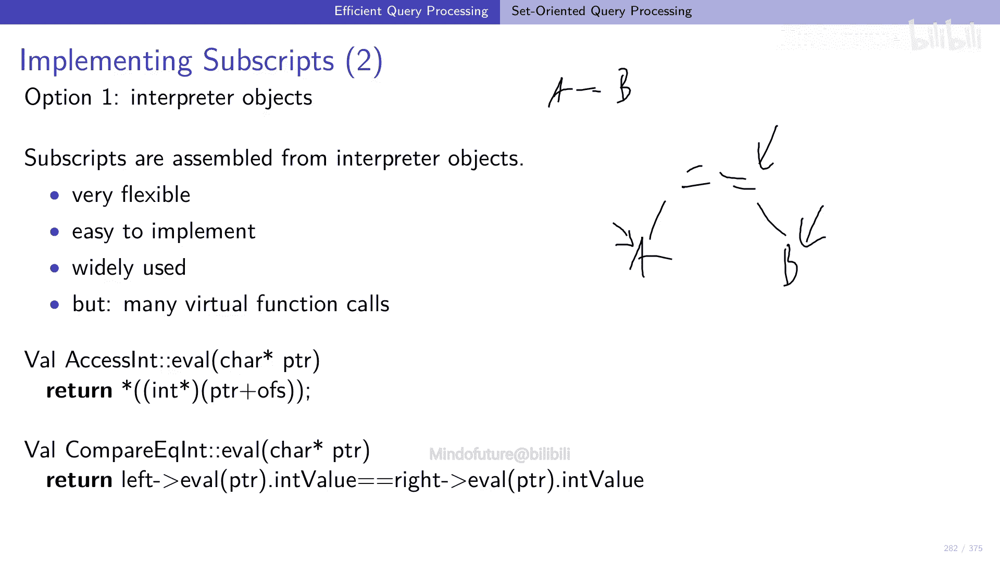

Now， what else can we do， And we can decide that， okay， instead of。

Using interpreter objective we compile my expressions into a smaller virtualrg machine。

Not sure if you are familiar with how virtual machines work like JVM for example or other engines。

 basically you you construct a so it sequence of like sort up codes that you can execute and each up code does something and then when you want to execute this you loop over this list of up codes and you evaluate whatever it is now so this is the equivalent what we saw before so you see here on the first line。

We look at the current instruction and then say okay look at the next instruction。

 take its command and then we do switch over whatever the command is then if the command here is access integer。

 then we do it here you see already here we here we loads the value just as that before before forward with the result we now store it here in some register file so if we register file and the output register stored in my up from upload as where the result be stored and then the comparison function comes here and so this is the next comparison then we say we get two argument from up。

 takes a register value from first argument， takes the register value from the second argument。

 compare them and writes the result here to this one and this you can also implement with the operation that you have。

😊，This is more efficient than。Interpreter objects now because you just have one big loop is a one big switch and you can if you are particular use tricks like computer go tos in your compiler。

 you can make this switch switch here very fast。 So this is so this is more efficient than calling。

Downside， of course， is also more complex to it generates this Basically you need a compiler that takes your secret expression and compiles it into some form of byte code。

 It's not very difficult to be such a compiler， but you must do this so you must now say， okay。

 I translate my expression into the sequence that I had a equals B。

Is now translated into a sequence of operations， like excess ins。Excess ends。

And then compare equalent and you through three instructions。Okay。

 this is also a decent choice and quite a few systems to this， so this is also a very valid option。

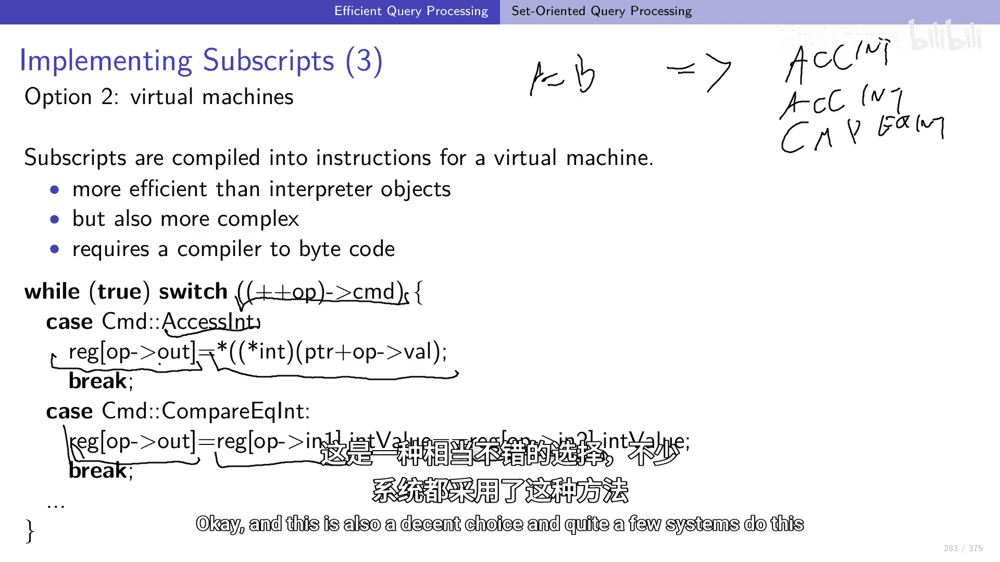

Now， another technique that is popular in systems like vectorwise， for example， is this one。 Yeah。

 as I say， yeah， of course， and we have a very different queries。

 but in relative is the number of primitive we have like plus minus plus equality and so on this is not that high。

 we can just have some prepared somewhere。 and what we can also do。

 we can hide the overhead of calling them。 like it interpreter object of course， that's the same。

 we also have prepared code for or primitive that we have our system but we want to hide it's a high calling overhead of interpreter。

 but not calling it for one value， but calling it for many values。

 therefore its called to code vectorized execution。 So we do process vector at a time。

 So here now you see a comparison function。😊，There takes is input two vectors。

 so this is one vector values， this is the second vector values。

 so two integer vectors and we output a result vectors which contains billion and of course we must tell how many elements it has and now what this function it does here it loops over all values in the about two vectors compare them here and write the results to the original output so you perform them of operations for and perform a primitive operation for a large number of input values this hides overhead。

This can be quite efficient in particular if you start using ZimD instructions also for comparisons so these precomped fragment can be quite efficient。

 but of course this requires that input is available as nice vectors that you can access。😊。

And so this more or less means you can only use this if your input as a column store and probably only for all up。

 so quite a few constraints that you have， but if you fall into this constraint。

 this is a very very vibrant strategy， performance of these engines is good。😊，Okay。

 so you can average substitute like this。

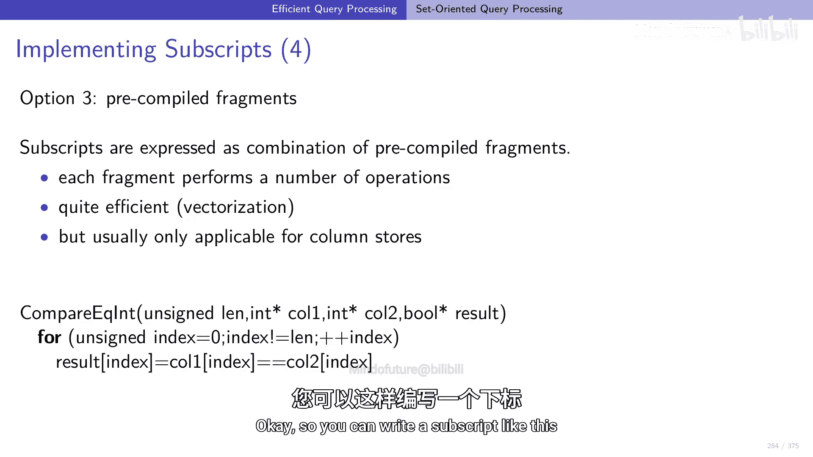

Or the first option is we take my sub and we generate machine code。Yeah。

 and so we yeah this is Im not sure if we're familiar with reading a similar code。

 but why what we're doing here is。We are lowering values。

So here be loading a pointer into my X register， loading a value relative to that pointer。

Yeah so this is so this will be my as a will be a column。

 a column point I' be loading a column point at a certain table ID here。

 so be loading value into my register and look at the second column。

 loads the second value and then I do a comparison okay so this is again we access two integer values and we compare。

This， of course， is about the most efficient agenda of this。YeahI mean。

 you generate here five asse codes if I asse instructions and basically you cannot do better。

 ZD can have sometimes， but in generally， this is about the most efficient you can do。

Only downside is， of course， is also the most difficult。 Yeah。

 So generating machine code is more involved than， of course， an interpreter objects。

 but also more involved than generating BM code。😊，Another problem here is probability。

 so what do you do if you want to run on the in but want to run an arm。

 so this is of course also a challenge we will look at this later in the lecture in the section cogen。

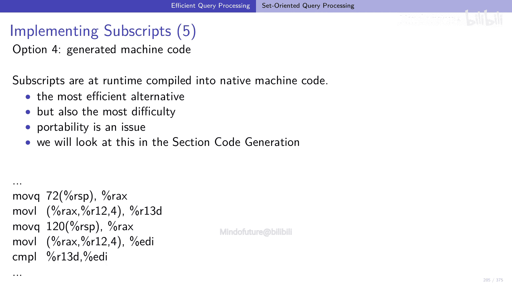

Okay， and another interesting thing to keep in mind when talking about operating implementations is pipelining and so now what do we mean with pipeing usually we try to avoid copying data around because each copy cost me something it cost me space but also cost me performance because I have to run a lot of instructions。

YeahAnd if， if you manage to pass data between operators without making your copies。

 this we call pipelining， so basically implicit passing。Data from one operator to another。

 Now sometimes this is not possible。 Yeah， so sometimes operator material input and then we call this operator a pipeline breaker so this operator where we cannot pass pass pass around。

And in even more extreme cases of this is if an operator consumes its input completely before producing any output。

 then we call this a full pipeline breaker， so this is the most extreme variant of a pipeline breaker。

 a full problem break， material everything and then start producing。

And so there are operators that binary operators in particular that break only one side。

 So it's not only you are a pipeline breaker I guess know。

 but also where are you breaking the pipeline So let's make an example So this one here selection this is not a pipeline breaker why because we can take a type of course you have for some condition here but we can take a tap check condition and just pass the data along to the next one So a selection is usually not a pipeline breaker。

So the other extreme end of the spectrum is this one here， sort。😊。

St clearly is a pipeline breaker and in fact， it is a full pipeline breaker。

 Why is it a full pipeline breaker Because the last input template to sort might be the first output template。

 therefore we cannot output anything before we have seen all the input and therefore salt breaks the pipeline fully we materialize all my input So this is the other extreme and then there are other forms like。

😊，For example， this one here， this is also a pipeline breaker。

 but it's not a full pipeline breaker why because we can output tablets even though at least on one side and even though we have not seen my input completely。

 for example， if you have fiber tablet that does have a drawn partner。

 it can immediately output this value doesn't matter what comess later。

 So this is not a full is a pipeline breaker but it's not a full pipeline breaker。And finally。

 this one here。So when we talk about hash join， this will breaks the pipeline on the left usually on the build side we draw it usually is the left see as built and probe so we do break the pipeline on the build side because we put the build side in a has table but we do not break the pipeline on the probe side because for a prop to we look at the has table check for h and then output the video so this is just to illustrate what is the pipeline break where when we do this of course if we break the pipeline or not this says implications for other operators like can we still access values。

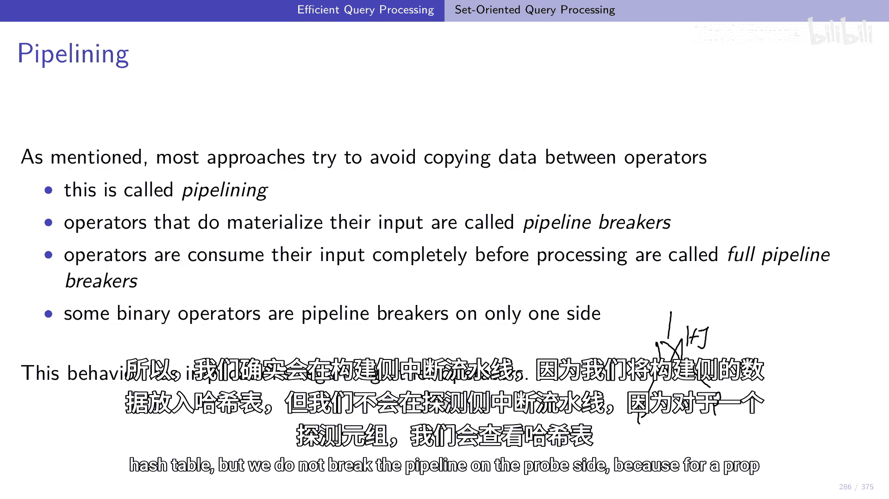

And so that if somebody breaks the pipeline， this usually means that pointers become invalid if a pipeline is broken。

 I can no longer reference tu by a pointer after the operator because the tu might long be gone from above a measure。

 but if my pipelines preserves the pipeline it is not broken。

 I can still continue using pointers as effects。

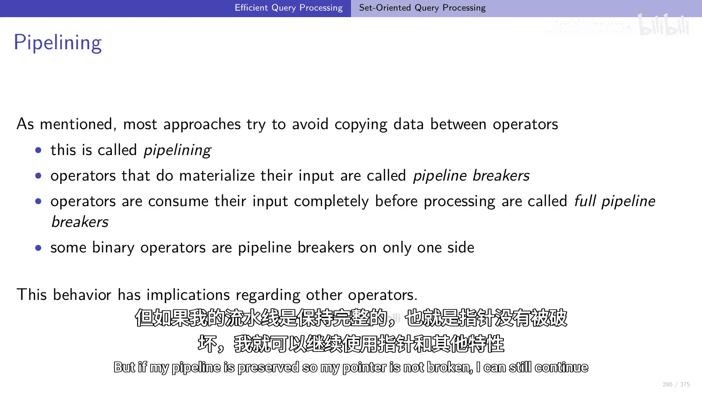

Okay yeah so this is just what said， so the effective area so if a pipeline break has between a swap and I think the original data is no longer accessible so pointers are becoming invalid and this is relevant if we do tricks like lazy attributebut access so which means we load an attribute only in the moment that we need it if somebody is about to break the pipeline and must load it at this point in time because otherwise my input is gone or think however do we do with strings do we have to make a copy of strings so its kind of tricks or we do top D joins if we only join or top ID D loads the rest later so there are all kinds of games and we must know this。

😊，And on the other hand， if see has a food proper break between as horizontal thing。

 then we know that my execution plan is broken into fragments。

 So everything before the food proper break and everything after。And if this occurs multiple times。

 I can， for example， execute the parts parallel So so full pipeline break really means these two RD cup so I can run them parallel or I can schedule them or all kinds of things and therefore to make this correct。

 the coregen must know if an operator is a pipeline break and whereas the pipeline is broken。And we。

 in fact， we will make it so that we makes this pipeline explicitly。

 so we say the pipeline goes from A to B， and then we know precisely how the data flow works。

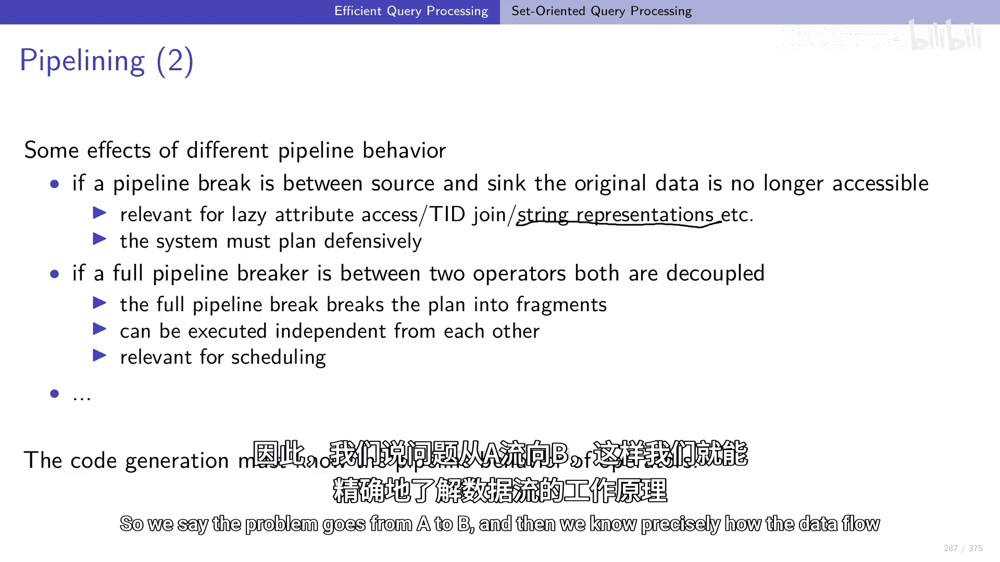

Okay， and now another interesting question is what do we do with parallelilization。

 So on today's machines， you have for quite a significant number of course。

 So like the desktop machine I'm currently sitting on has 16 cores 32 with hyper。

 if you include hyper thread。😊，Yeah， and this is not so super powerful machine。

 I mean it's a quite a good one， but you can definitely buy much larger machines。

 And so you can easily have a computer with 64 calls or even more。So if you have such a high number。

 of course， then of course it doesn't make sense to execute everything single is ready because otherwise you're wasting most of your system。

😊，And now， how should we do this Now the the easy problem， of course， is in query parallelism。

 which just means we take two que and rather than parallel。 This is super easy。

 we don't have to do anything special。 Now， if you want to parallellyize with query。

 So if you want to do inter query parallelism。Then this is much more difficult。

 but of course we in practice we need intracurism because could be that the user comes to us with a very big query。

 very complicated query， and we have only one query in my system so I must do my best execute goods as fast as we can。

 therefore we need intracur parallelism。😊，Now also here there are easy and also easy problems。

 so easy part so if we have independent parts of mycurry， for example。

 because of full pipeline breakers so I know that these parts are independent then I can just run them a parallel without doing anything this is also also easy Now if I want to parallelize in a single operator so then this is more difficult and for example it takes this one very very have a big table here。

 say a big table。😊，And then on top of this big table is a group I so there's only two operators a tables scanned in a group I。

 and here I compute sum a group I A and a computer sum or something like this。

So how do I do this in parallel？Usual the strategy is we look at the input of the group I of this big table and we partition it so we cut the relation into let's say 16 pieces if we have 16 cores and then each core aggregates 116 of the data and then union and we aggregates the results then we produce a real output。

Okay， now for this simple query， this still works quite easily in general it is more difficult how to make everything parallel and therefore we will cover this later in the lecture。

 but Id already want to mention this， this is the problem that we have to look at。😊。

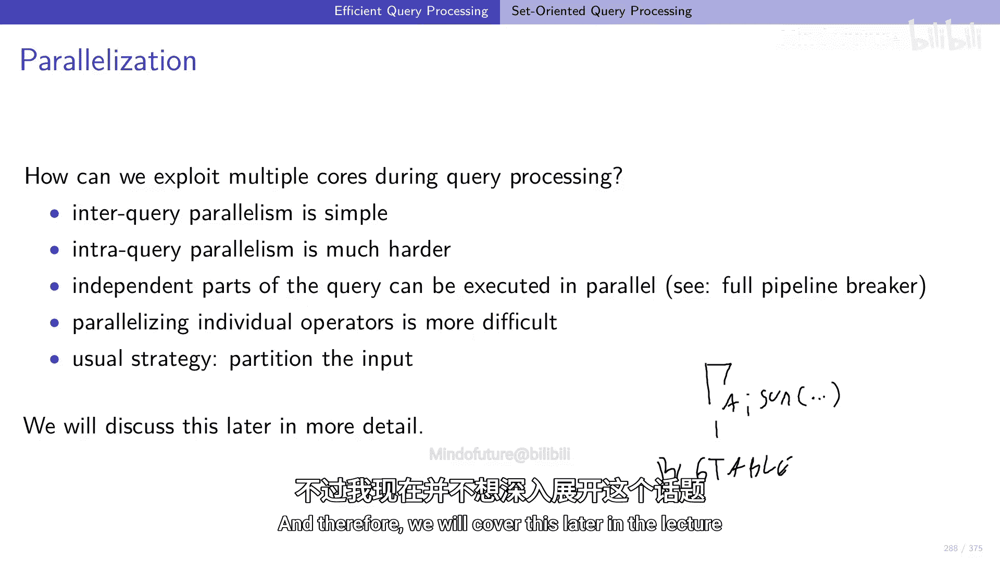

Okay， so now after giving a very brief overview over the high level aspects of set oriented processing and Ill want to look at the individual a operators and discuss how to implement these so because so far we have only looked at tables can select and cross product and these are of course all trivial operators as they don't do anything these are very easy so now we must look at more complex ones。

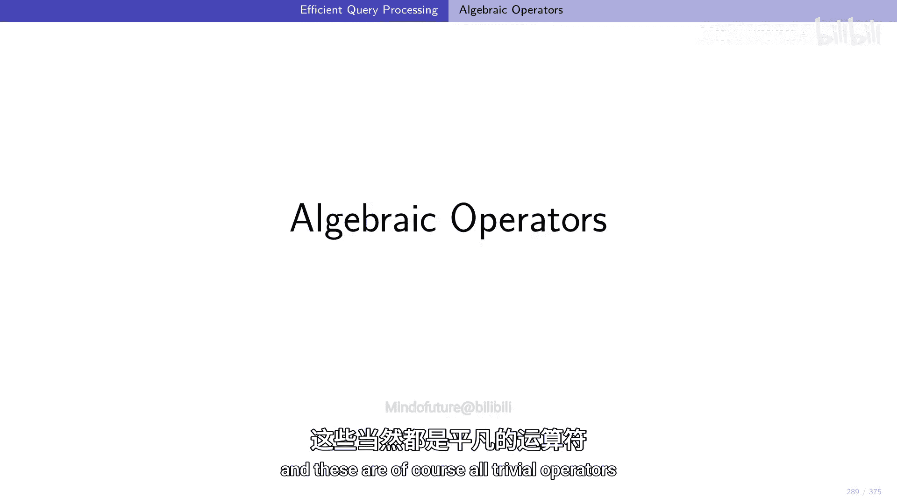

Okay， and so when we run queries， oil queries are at least in most systems。

 oil queries are translated into relation algebra。 So everything that we do we express using relation algebra。

And so we if we want to offer certain implementation。

 we must express this in these operators and often not always。

 but often we have more than one implementation。So why why do we need more than one implementation。

 for example， if I want to run a group I？So if， for example。

 I would know that my input is sorted on a and a grouper a。

 then the group is trivial don't you have to do anything because I know everything that belongs to the same group will be next to each other than the input as it's very。

 very simple while if my input is not sorted on a， then I must do something So therefore I have probably have a different implementation for this if if I want to cover the special case same with joints。

 you most likely have at least two joint implementations。Potentially more。

 but two is about the minimum that you that you need， and so you will have。

And probably as was operators， you will have different implementations sitting around。

Now we will start with simple operators and then look at more complex one where I just want to say the complexity between operators varies So there are a few operators that are very simple select。

 for example， it super simple Now so a few simple operators but most operators tend to be quite complex so join is a complex operator group buy even worse now so these are quite complicated operators。

And so as a rough rule of thumb， we can say pipeline operators tend to be simpler because they pass us per data around and pipeline breakers tend to be complex。

 It's not always true This rule of thumb， but most cases is true。

 So this gives you already quite an idea what to expect。

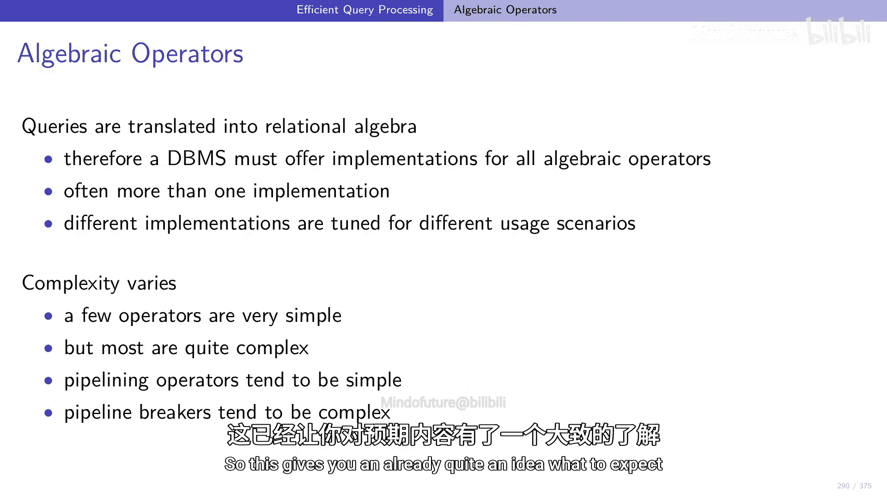

Okay， and we now look at the operators in a sequence again。

 we start with a very simple one tablet scan。 We just produce all tablets content in relation conceptual this is super simple and now the real implementation could be more involved so it depends on what the table scan does。

 first the tablet scan， of course has to navigate the physical representation which means we have to find the place where my data is stored which is not necessarily super complicated。

 but depending how your storage layer works can be not nontrivia。

 So here on the bottom you see example implementation of reasonable simple table scan。

So but as you say so what we do here in the first loop， we look at all page extends。

 we look at a sequence of pages that we have that belongs to the relations we look at the page extend E here then we loop over all pages in the page extend here then here we say we fix the page now finally that we have a page with tablets we loop over all tablets in the page and pass it to my consumer。

And， of course， implicitly here， not mentioned as there must be some kind of load logic or at least an lazy load。

 So there must be some way to load attribute value。

 so we attack my tappper and pass it to my consumer。 then when I'm done with the page。

 I unfix the page and go to。s the next page and by extent。Okay。

This is already more complicated than what we saw before， but this is still oversimplified。

 A real implementation will be more complicated like this。

 Why you have to a kinds of problems that you have to handle for example。

 what about snapshot isolation So if there are more than one transaction system。

 how do I make sure that I only see tablets that are visible to me and not tablets that are updated by another transaction。

 So this is probably there will be here some some transaction logic here。

In this volume now then you might want to handle deferred updates。

 for example now so sometimes you don't want to update it immediately because of a right problem so you want to delay this and then you have to merge this pending update into the scan the more as it comes。

All your tablet scan might be able to evaluate prediccateates。

 but actually is a good idea usually and so you could be that your tablet scan is not just outputting all tablets but you can tell your tablet scan I want to tablets via x equals5 and then the tablet scan will already filter doing that on this level instead of just the selection on top is a good idea if your physical representation allows you to skip tablets that are guaranteed not to qualify and this is often the case so therefore you have a certain incentive to teach your tablet scan or broad so predicates because this will make your tablet scan faster so even a tablet scan tends to be not so super small even though conceptually is very simple。

😊。

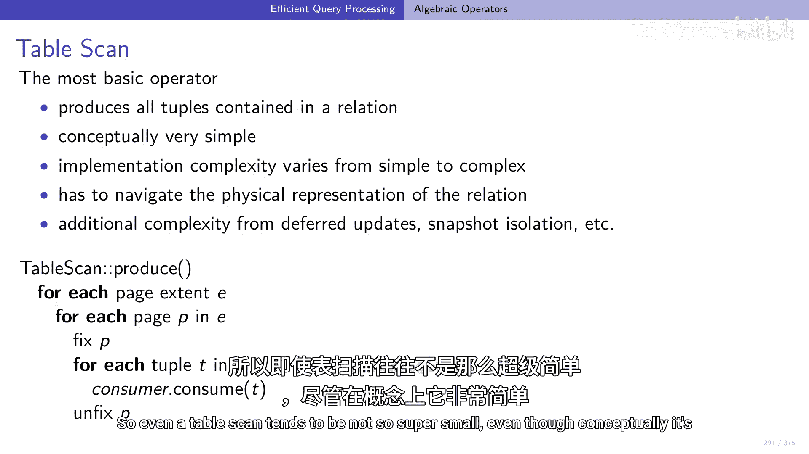

Now selection this is really simple， there's not much you can do about this and so we filter all tablets that do not satisfy a predicate P conceptually very simple and in fact many systems do not even implement it like this what you do instead is you piggyback the selection predicate on the previous operator so you look at the input of the select and you say hey。

 please check this when outputting tablets。So it sometimes makes sense again depends a lot on how your system is implemented。

 but this combining a selection into a whatever is below you is often a good idea。

 not necessarily if your table passing is really cheap then you can implement a separate operator but sometimes you want to merge it。

 So now if you look at a produced consumer interface or do you look at this。

Produce of select ass produce on its input， consumer select check the predicate。 If it's true。

 we call on my consumer。Otherwise， we just discard the tableoo。Okay。Now。

 a map map is also a simpler operator。 I think it's probably the last of simple operators。

 And what map does， it completes a new column by evaluating function F。And again。

 some systems allow to piggyback a map on whatever comes below， but this is more rare。

 so there are not that many systems I do this， but you can do this。

 And so the implementation is if you call it the map to produce values here we just call produce on my input if a tapr comes to me So somebody calls me with consumer now I evaluate a function F and then I compute a new column I attach it to my Tupper and then I pass the combined result to my consumer Okay so this is how we compute new columns。

During own trade seekers。

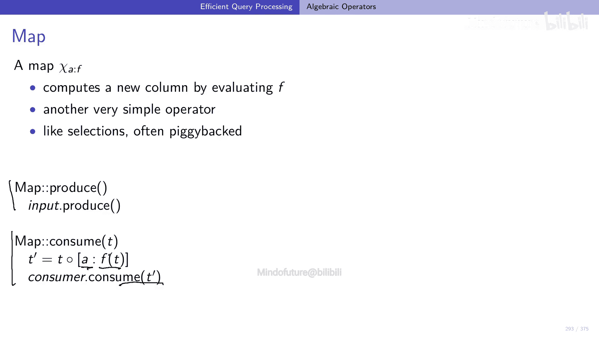

Okay， now， so these were all very simple。 Now we come to an operator that definitely not simple。

 Yeah， join is a very complicated operator。😊，And you will most likely have at least two implementations。

 they probably。Yeah， you。Probably you will even have three depends a bit on how yo。

 which a query optimizes， if your query optimizer is really strong， you might get away with only two。

 but two is the minimum that you need，3 is most likely the minimum that you need。Okay。

 why do we need three different implementation of John by the way and three is really the lower bound you could easily have four or five so you could have more。

 but three is a lower bound so why do we need three。😊，First case， here。If you join E1 with E2。

 if E2 depends on E1， then we must use in nest loop join。

So because this is a dependent join and we must evaluate the right hand side for every type from the left hand side。

 so this codes for an S loop join and this is our only choice we must use an S and this means of course that we must implement an S loop join。

By the when as lurons are absolutely terrible， you do not ever want to use an luron if you can avoid it now。

Sad。This system currently building does not have an acid loop join。

 now how can this be because I just said everybody needs an assist loop join the escape route is if yourque optimizer is smart enough so that we can eliminate the independent join。

😊，And so the user has formulated a query where a part of the query is correlated with other parts of the query。

 so basically you do a select。And then yeah， you do。From our， where。Some stuff。

 And then wed have a sary here， select。Lala， blah， blah from S。As the most of you we are。

R dot x equals S dot y， then here group pi or something。So this is a correlated subcurary。

 so we have a subcurary where we use inside the subary part of the outer query here， a correlation。

These forces are to do when loop drawing if we get terribly runtime。

If your a query compiler is smart， it can rewrite a query for you so that the inner query is no longer correlated without a query。

 And if you manage to do this， you don't need。And theres a luron。

But of course to fully eliminate it as a loopron， you must guarantee that this understanding always succeeds so that you are able to remove any kind of depends from que this is quite a bit of involved。

 but it is possible so you can build a system that does not need step1。

 but I'm only aware of currently two systems that can do this now so most database systems have to implement and new loopron for this reason。

😊，Okay this is one implementation second implementation。

 If my predicate here a joint predicate is a form a equals B， we can use any join algorithm。

 so this is quite an Ev join so we join checking for a of two values of course this is the most common case and in that case we can use everything and if we can use everything most of the time we will use a hash join because hash join is usually best the fastest implementation so this is what we can use here now K3 if my sites are not correlated but I also do not have an equal condition。

 then we can either use less luron if we don't want this for performance reasons table or we can use a block by luron。

And this gives you a list of join algorithms that you probably implement， you need an asset loop。

 probably you want to have a hash join and you want to have a block by N loopron。Okay。

 and if we will look look at and limitation of these algorithms in a moment。

 I'm just saying so these are the threes that you want。

 you might want to have more like sort much on and so。

 but this is the minimum that you that you need。

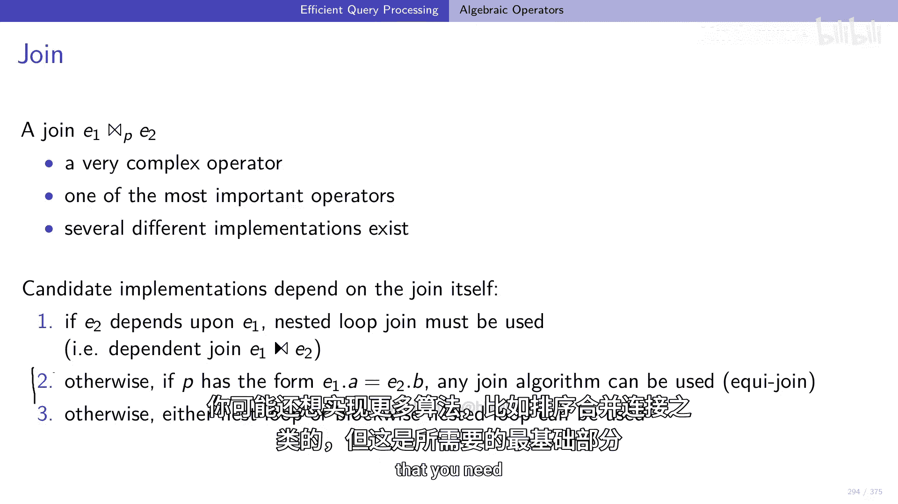

Okay， we start with the first one nest the luron， the nest the luron is the most flexible of the joint。

 but also the most simple and the most inefficient Now so you never want to use a less luron if you can avoid it nest the luron is terrible。

Yeah and now I' got very easy to code but don't do this Yeah so Bey what we do here is if you produce on Madness Luke John it quite produce on its left side。

 If you get a type from the left we store the on the left and we ask my right side to produce videos if we get a type from the right we concatetulate this new type with my existing left a checks the productcate and if it's true I call it to my consumers So this is like a cross product。

There is an implicit filter condition， not also what we saw before its crossed plus the filter。

So easy flexibility， you can use any practical piece that you might have。

 but you don't want to do this why it means easy to see the runtime here in the order of sides of my left side。

Times， size of my right side。So this is asymptically n square now and n square is usually unacceptable。

 Our valuess of n tend to be super large。And a million square is really an unpleasant number。

 And also therefore。Try to not to use an as loopt。

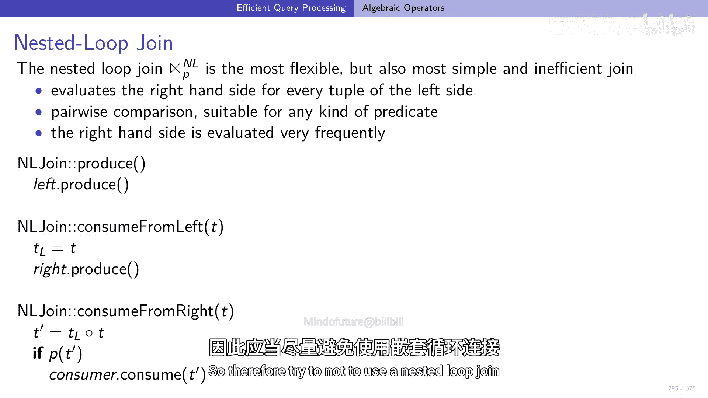

Okay， what let's can we do。 Now， So an improvement of the nest electron is a blockwise Ne electron。

 This is a more sane mutation。 This will be more efficient。Yeah。

But it it also can be used for any predicors。 It's good like the necessary lurons a block person has loopron can evaluate all predates yet you have like we can check for don't know。

 a is less than B or we can even do more fancy stuff A times B plus C co nodes of this is less than0 do or 01。

 something like this so if you want you can can evaluate this with block presence loopron and versus nest Luron any any preddiates possible。

And so how does this work asymptotic algorithmically。

 So remember unless unless a loop downloads one tap on the left and for each taper on the left it evaluates the right hand side。

 which of course means that we evaluate the right hand side extremely often。

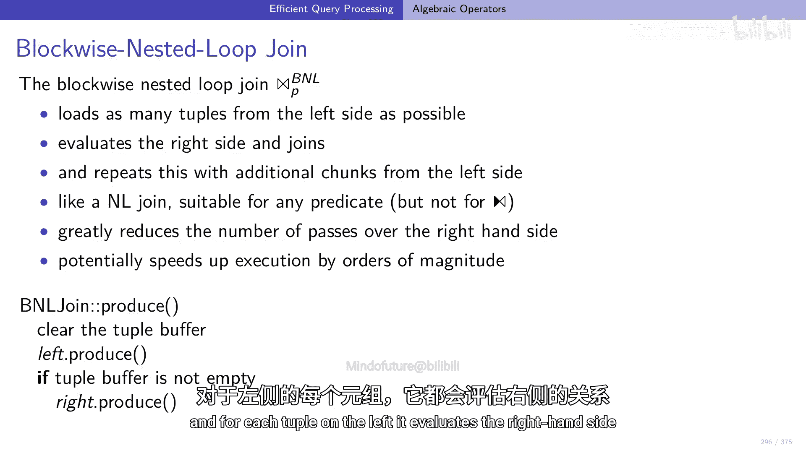

And this is expensive。 could， There could be something that exists， so。Ms。 Luke join。

I here the relation R and here I have something that's really expensive like not it doesn't have to be a single table could be group I。

 whatever and V evaluates for every trap from the left hand side And so this is terribly expensive。😊。

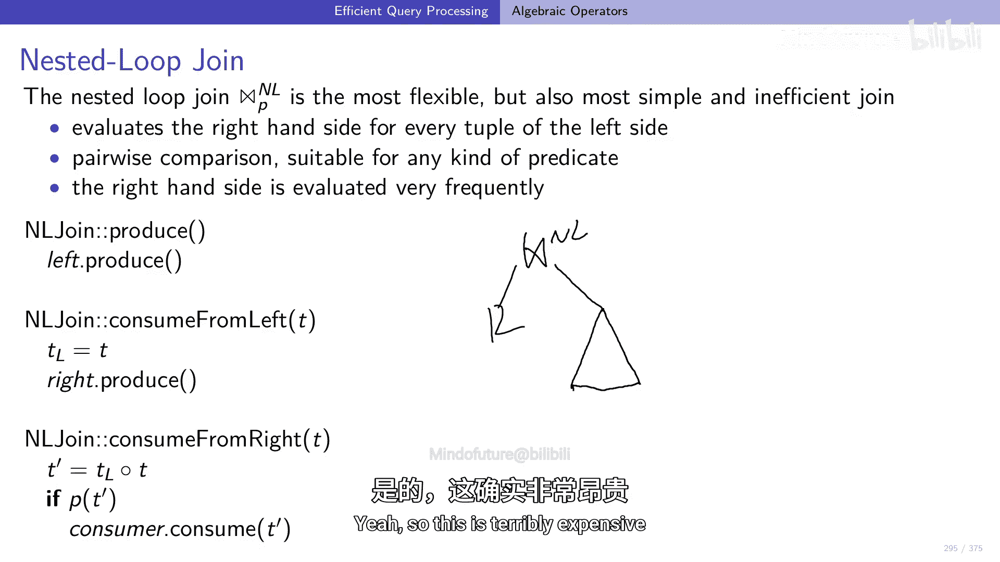

Therefore， the block person of the Luron says， okay， I also have to look at all pairs of values， yes。

 but at least it can reduce the number of passes over the right hand side。

And what you do is you load as many values from the left into a buffer as you can。

 as I have memory buffer， you fields this buffer have values from the left。😊。

Then we evaluate the right hand side and we compare all my various myth myths by buffer。

 and then I have a project as true， of course， I have a match。😊，And once we are done。

 we load a new batch of values into his left end and zoom buffer and we do this again。

Now you at least if you are more theory oriented， you could say how is an improvement because this is also n square just like the Nluron because after all I combine every type from the left is every temporal from the right and that's true but the great advantages that we reduce the number of passes over the right hand side by a factor m where m is my memory size this can easily be a value of 000 or 10000 or 100000 so yes asympically it's n square but we improve the runtime by a very large constant factor for for practical purposes this can be much faster than N Luron。

😊，Of course， even here it's true if you can avoid it， don't use a block question as a luron。

 use a hasstrron if you can， but some predicates you cannot evaluate with a hassterstrron。

 and then a block question as a luron is what you want to do。Okay， now。

How does is implementation work。 So if we need a buffer to store my tablets initially heavy we clear as the buffer。

 we just throw away everything that we might have。 Now we we call produce on my left side and note that the rearjo here happens in the moment we get tuts。

 So therefore we don't see anything but it could be that after we process our left side。

 my buffer is not empty actually it's quite likely that it's not empty。

 So I might still have tablets in my buffer。 And if that is the case we do one final pass over the right hand side to produce all result values。

 notice this is basically the left over here that we do in the last if。

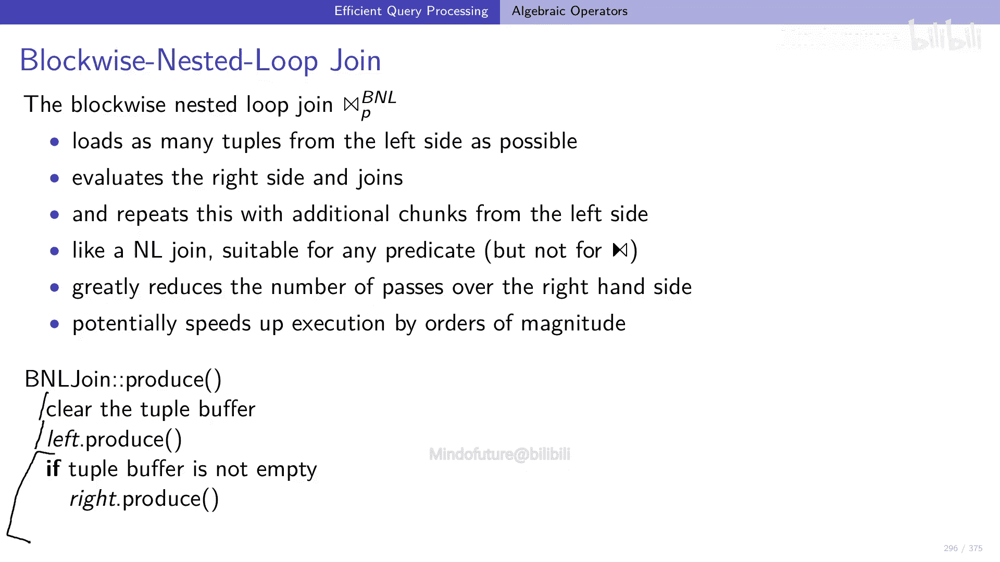

Now the interesting work happens in and the consume call。

 So when we get a tupper from the left so a new tupper comes from the left。

 we check if we still have space in my buffer。 So after all。

 I want to write all my templatets in a buffer。😊，And if my buffer is full so I cannot produce cannot stored in the buffer then I produce on my right hand side。

 so I ask my right hand side please give me all your tuples so we do this here and afterwards by the way this produce called implicitly joins with the content of my buffer so everything that I was in my buffer has now been joined with my right hand side therefore I can now clear my buffer so I'll throw away everything and now I can store my tut in the buffer because now I have new space。

😊，And when we get the tappper from the right， so in the second function， yes。

 so when we get a table from the right， we compared it with every table in the buffer checks the predicate。

 if is true， we pass it to a by consumer otherwise we throw it away。😊。

Now to illustrate the processing， let's say this is my left relation。This is my right relation。

So I load as much as I can， for example， this much here in memory and first So this is now in my buffer Now I do one pass here over my right hand side and compare everything here with my buffer content and if the is as true as I have ahead afterwards I throw away my buffer content so I clear the memory I'm not sure if I can draw this yeah so I clear my memory now because I have already joined it I know the next punch here in memory。

😊，To another pass over my data， compare it with Z Z bunch。 Afterwards， I forget。

My powerful content ands the rest here。And this is then the final call I do one more pass and that's it Okay so in this example here we have read the right hand side the left hand side once and the right hand side three times and because my left hand side was three times as large as my memory before。

😊，But so this compared to a nest loop drawing， this dramatically reduces the number of passes over the right hand side。

 so it will be much much fewer， depending of course， how much memory you have。

 the more memory you have， the less passes of the right hand side you need。

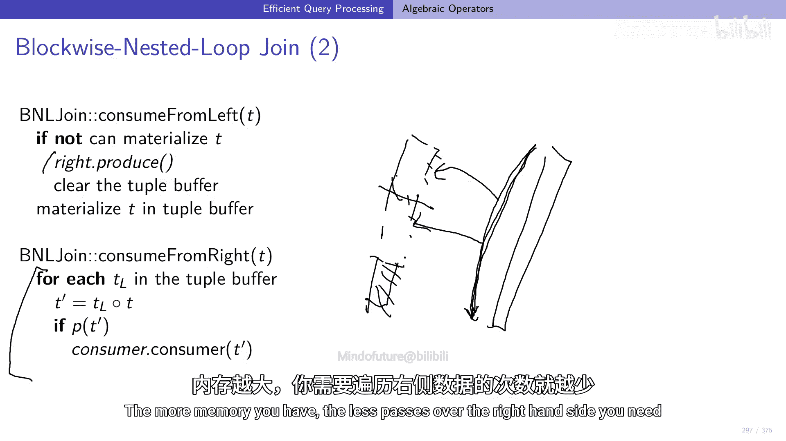

Okay， now， but notice this here subject in square just with better constant than the other one。😊。

Now for an operator that is more efficient so has better runtime than n square we look at the sort merge join。

 so this was historically is the first join algorithm that commercial systems implemented as a reasonable implementation so we say we want take my two inputs you want2 and I want to join them with sort merge and assume now that my predicate as a form you wanted a equals E2 do B and furthermore。

 I assume that you1 is sorted on a in the E2 is sorted on B。

Okay now yes some says also in the implementation， also in the naming what you see here。

 there's some confusion is what we consider sort mergestein Str speaking what we're talking about here is a merge drawing so we don't sort because I assume my input is already sorted in some implementations it is a true sort merge drawing in the sense that it first sort that input and then does a merge but we assume that sort will be implemented by different operators so we have a separate sort operators that if we need and so we consult them and so our sort mergestein assumes by input is already sorted。

Okay， so the the good thing about sword meron is。So if my is already sorted。

Then I just need a linear pass over both inputs here。 So I scan them group。

And I always skip over the smallest value。 And the moment it hits two values that are the same I have a join partner。

 Now so skip， join partner， skip， join button， skip and so on。Yeah。

 and always keeps the smallest one linearar pass over the input。No extra memory。

 So everything seems good。 So this operator is super efficient。 Le runtime， no memory。 but。

 of course， this heights effect， the expensive part of the submerge joint is not the merge。

 This is very， very cheap， but the salt。😊，The salt of course is an enlock and operation。

 the sorting is expensive， merging is then very cheap。

Okay and because here we talk about implementation that does not do the sort。

 therefore it looks like this operator would be super cheap and for practical purposes might not be Z cheap。

 so it's very fast we say here it's very fast and efficient after sorting so this is of course。

 the downside。😊，Another problem is a submer join is super easy in everything as long as you only do one to n joins also which means that one tablet can have n join partners。

 but it cannot happen that n tablets have Android partners Yeah so so this point is okay so I have one value here that joins with Z Z z Z so that's okay also the other direction of course is okay So if we have this here this is also okay one value here joins with many here here but what we do not allow at least now we have to allow we do allow。

 but let's say which makes your life much more difficult is this point here so if we have a values that joins with Z Z Z but also the other way around here So if we have such a scenario So this is an n to M join。

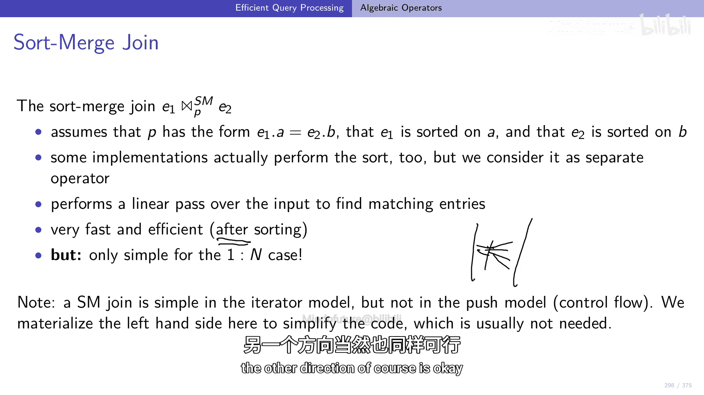

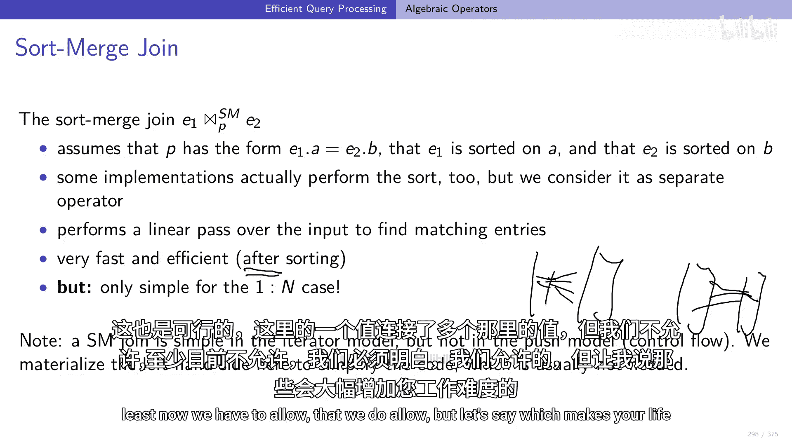

And the n values from the left join with n values on the right。

Then suddenly the sort notion is no longer that simple，12 n is easy， n2 m is not too easy。Okay， and。

Interestingly， the submer is about the only operator that cannot be implemented very nicely in the push model and it can。

 in fact， we will show you the code how to do this。

 but the push model has some problems with with a submer which is while the submerron is very easy in the iterator model So iterator model you can implement this easily in the push model it's more SDD so and we dance around this problem by materializing the lefthand side。

And so all my a operators assume that the left hand side is a smaller side so therefore materializing this side makes sense and if once you have implemented the left hand side then also implementation is even if the push model is reasonably easy but in the iterator model you could implement it without materializing any of the two sides and I just want to mention this。

😊。

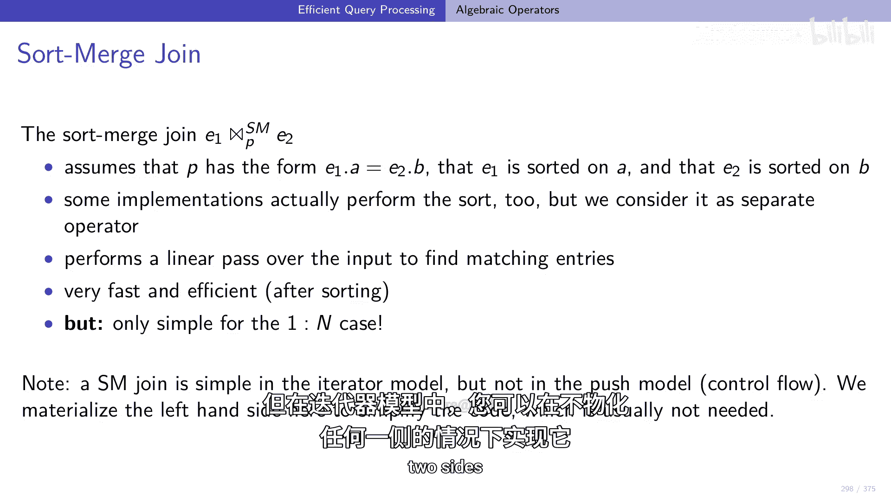

Okay， so now with that declaration， let's look at the code。

 So this is an implementation of a sort merge join。So when we are asked to produce values。

 so first we。We prepare some memory here because as I said。

 we materialize the left hand side so I prepare some memory or even some temporary segments where I can write values then I scan over my left side so I call left produce and then I remember so I have an iterator here so iterator over the left hand side and I set my iterator to the first pool tupper and then I scan over the right hand side okay。

Now what do we do if so this one is a trivial case， What do you do if we get the typeperform left。

 we don't do anything， we just pull the value to a temp segment。

 so we just write it into a temporary relation and then say okay here or once and memory buffer and then here we say here are all my values The real bar happens when we get the typeper from the right。

Okay， so when we get it up from the right， we check is my current iterator so remember we have an iterator over over the S values is my current iterator less than the value that' is currently coming if yes。

 I advance the iterator so I continue processing。😊，And。After Ive done this。

 so I make a so now I have found a values that is not less than my value so it's either equal or larger。

 not less。😊，Then I remember this position yeah， so I remember this。

 I make a copy of my iterator to the IB value。And then as long as the my IB value is equal to my Ch tablet。

 so as long as I've drawn partner， I output I be concorted my tablet and I advance IB plus1。Okay。

 now you could ask yourself why， why is this So why why why don't why do I use two different operators and so on Yeah。

 the reason of course， is duplicates now so assume my input is1，2，4，5，5，6，6，7。Then exists。Yeah。

 so then on my right hand side is2，3。5，6，6。So we start with setting the it here on one and then by first up it 82 comes。

Okay， I see2 is less than one。 so advance my iterator。I go here。Then I see2 is equal to 2。

 so I'll put the draw button， okay that's easy。So then the next value comes。three。

Three as Tuesday and three so advanced to here， I don't have a dried partner I stop。Next tab comes5。

4our is less than5， I advance。To here。I have a join button and now already you see my so my IL So this is IL。

 So now I start a new blocks therefore the IB iterated over the block because I joined with 5 and I also join with the next value。

 So therefore here and this loop I look at the next value2 and so I join with5 and I join with that5 and then I'm done now comes to6 I see if5 is less than 6。

 so therefore advanced there I pointed to the next five this5 is still less than 6 so advanced appointed to the next five。

😊，As we're run on the next the next value is then they get to six， if you find a drawing partner。😊。

We also look at the next value if we find a draw pattern。

 but know that we do not advance the IL sa sorry mixing German English so we don't advance the IL pointer。

 So were still pointing to the first6 not to the second six why when the next six comes what happens here。

😊，So then we must still find the first success partner。

 So therefore now if say here this here is a join partner and then we advance and then we say that here as a drawing partner。

 Okay， so this is the n to M cases， two drum values from the left turn with drawn is two values from the right。

😊，Okay， so but this is how it works。 Now I the n to M case is difficult and this code is not that difficult because we have cheated namely we have already materialized the left hand side。

 and therefore we can just read it multiple times as long as you want。 So this is no problem。

 Now there are some pretty tricky and advanced implementations。

 They do the n to M case correctly without making a copy of the left hand side。

 but this is more more involved to to process。😊，And so and also does not work well with a consumer produce model。

 It works with the iterator model or not with a produce consumer model。 Now， if you。

 if you do want to do this fancy handling without materialization。

 this is what we see here as a marked as better。What we do is we scan both lists in parallel。

 which we can do in the it model， we can ask each side。

 give me values if we scan both sets and parallel。 and as long as they are different。

 we just skip over the values only in the moment that we have found a match， we start making copies。

😊，So then we make a copy until the current block of value ends and so like for this example we visit at 12。

34，5，5，6，6， So if we scan here by make no copy， then we make a copy of the fives because we don't know how many fives on the right hand side we would see so we copy the values of five。

😊，Now when we are done with fives， we forget these fives now we're just making copies of6 as we only copy what we need to the M to M case。

Okay， but this is not so super easy to groom it so it's quite quite involved to do this here we get because we always materialize the selection side。

 our code is quite simple。By the way， as I historically thought Merstein was the first good joint implementation so the first efficient joint implementation。

 I think today it's largely irrelevant。Very few people will want to use a submer line why because sub merchant can it be paralleled very well。

 it depends on how course how your data is stored， but in the in general sub merchant is usually suitable for single thread execution but not for my thread execution。

And if you have a machine with6 for course， then thing related simply does not matter。

 Sing is related is an irrelevant case。 If you have a high number of courses。

Everything has to be done in parallel， and somerron is not very suited for parallel execution。

 Therefore， what you want to do is this one here has joined。

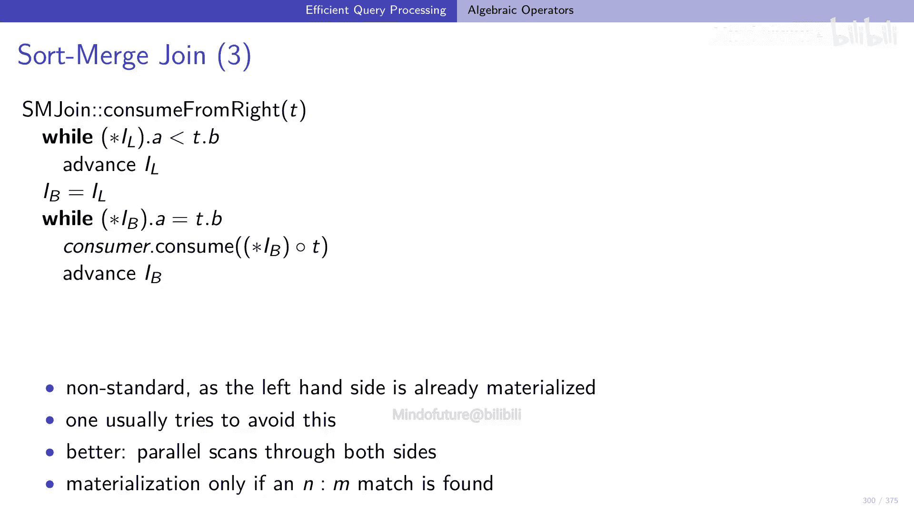

Okay， so we again， like a Sw merge join， we assume that my join prodicate has the form a equals B。

And what we do here is we build a hash table for the left side。

 and then we probe the hash value for the value from the right side。Now， of course。

 there are different cases of complexity。In in memory case in an external memory case。

 the in memory case is quite simple， the external memory case is not so simple and of course in reality you will probably want to have a hybrid implementation because you don't know reliable how large your input is。

😊，AndSo you will first try to do everything in memory。 and when you run out of memory。

 you fall back to the external memory。 So you switch to this。To the slower algorithm if you have to。

Okay， but because we don't know this in beforehand， this makes the code quite complicated here。

 we split them in separate code path。 we say we have one in memory has join。

 we have an external memory has join and we describe them separately because it makes much easier to talk about this。

 Okay， so let's start just looking at the in memory hash join。😊。

So when we call produce of the in memorymory restaurant。

 we prepare a hash table where all my values on the left side will be stored in。

Then I scan my left side， putting everything that was in the left side in the hash table。

 then I scan my right hand side and check the hash table for join partners。

YeahAnd if we have luck with statistics it of course we opposites that we have。

 then this algorithm has linear runtime now I shouldn't say linear run time mop is very very dangerous to say this it has linear runtime if you only have key form key joints。

Yeah so but in general， because it could be that we have growing joins so that my output is larger than my input and if that happens therefore。

 the runtime of this algorithm here is expected。 So if if we look at the runtime of a join R。

 so we expect that the runtime here is in the order of size of a。Plus， size of R， which is linear。

Plus， unfortunately， size of L join R。So this is what we want to have now why this term Yeah because you must produce your output and of course you cannot be faster than your output And if your output is super linear so output is larger than your input then of course your algorithm cannot be better than this so then we are also super linear but this is usually not the case most queries don't do this and therefore we expect here to have linear runtime in my hash join。

The just cause very good。

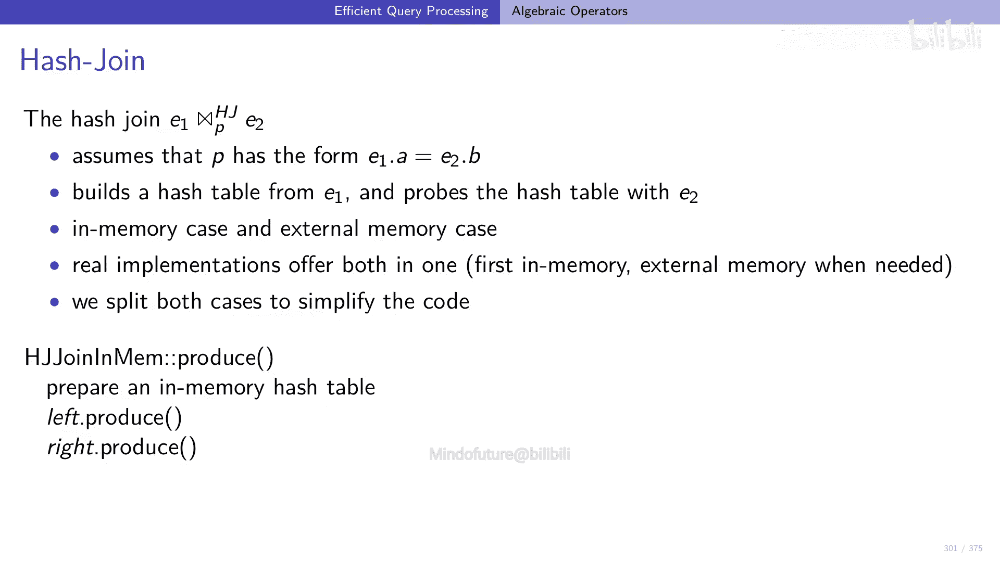

Now， how can we implement this， So we already saw the produce side now about the consumer side。

 then we get the tupper from the left。We just takes the tablet installed in a H table。

 And so we see this is myjo key。 I just say， hey for the value 5。

 I have that tablet for the value 10， I have that tablet。 we have a has table that tells me for each。

Jo key， What is corresponding table corresponding table， of course， can be a modable。You know， and。

Then we get a tapt from the right now we search this join partner。

 so here now I I my take a look my tablet I look into my hash table and check here okay。

 which tablets do we have that belong to this has key？

Now after we found them we still check the predicate， why if you remember back about hash tables。

 so this look up here will only find entries that have the same hash value。😊。

Yeah and could be that we have hash collisions， not very likely。

 but could be that we have two values that are relatively different。

 but by chance gets's the same hash value。Now here we have to check if this is the case。

 so we check the predicate just to be sure， and now if the project is approved。

 then we really have a job partner okay。😊，And so。Yeah。

 so the implementation of in memory hasron is actually quite simple。😊，If we want to be more flexible。

 of course， here， at some point we would have to check if we are full。

If you run out of memory here on agent we took your check before， of course， and before st an egg。

 it will check space。And if you run out of space， if we cannot close the table then we back to the external memory case and otherwise you try to be in memory okay。

 so this is how we would implement the hybrid implementation。

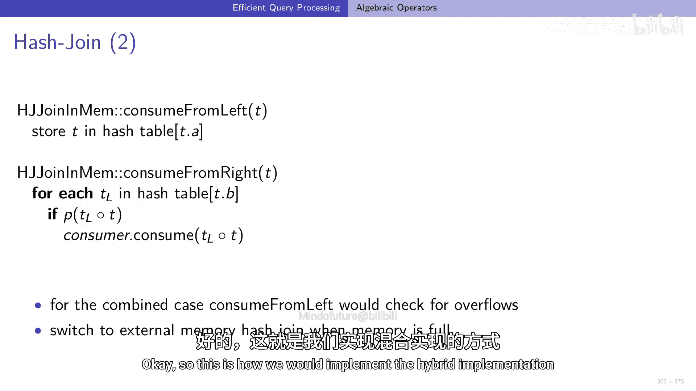

So in memorym has it's still quite simple。😊，Now， if we do not fit into your memory。

 then suddenly we become much， much， much more complicated。

 as you see already that we need multiple slides here。

 just because there are so many things that we have to do that can go wrong。😊，Okay。

 so let's look at this piece by piece。So how can we implement the external memory history。

 So we start by preparing in memory school buffer because。

We don't always want to write your disc so we keep as much in memory as we can。

Then we also prepare some space on disk some temporary segments that we can use for sping so then we write everything down。

Okay， then we define initial partition boundaries。 Now what does this mean So first。

 perhaps before looking into the code， I should explain the algorithm mean I hope actually that you have already looked at this in your introduction to databases now。

 because this here is the so called grace has joined。So raise has drawn。😔，And what does this join do？

 So if this is my left side and this is the domain of my left side。So let's say this is the value A。

 and this is a value B。And this is， of course， the smallest possible value。

And then this is the largest possible value， either by looking at the real values of one hour case。

 most likely we just look at the hash values after all via a hash join here。

 we compute the hash value of my of my join attributes。

 then I have a smallest possible hash value probably 0 and have a largest possible value probably2 to above 63 minus-1。

😊，Okay， and now if the smaller side would fit in memory then everything would be easy because it was just taught in h table that it would be done。

 but if I say the left side here is too large，😊，Where I can do it。

 I cut my side here into parts like this。4our parts in this case， such that each part fit in memory。

 Of course， the number of cuts that I do the number of partition depends on how large my relation is。

 The larger my relation is and more cuts do I need So I want to cut it such that my each partition fits in memory。

😊，Okay and then after deciding the petition a petitions other side too by the same criterion。

 for example， I mean let's just make up some numbers， of course this is totally bogu here。

 but I want to get a nice small number So they say this is0 and this is 16 exclusively。 So then Iqui。

 for example， say everything up to4 exclusive goes in the first part everything between 4 and 8 goes to second between 8 and 12 goes here and between 12 and 16 goes to this last one Okay and then I would do the same part on the other side even though you don't have to fit it memory but nevertheless you do it。

😊，And then so also here0，4，8，5， 16。And now you know that joint partners can only occur on this diagonal。

And nobodybody is can join。Why we know that these values must be equal in the end because my pres a equals B。

Therefore， I know I can only find a join partner but if my hash value is between 0 and 4。

 the hash value of as a guy must add between 04 so therefore I only have to look at this diagonal here and this is the idea of grace has join if you partition both sides and then we look at the corresponding partition。

 So basically this partition looks at Z this looks at Z this looks at Z and this looks at Z and we ignore everybody else so we only look at the corresponding partition and this allows me to to fight my drawing partners and now there there are some unpleasant that can happen namely we might have to recursively repartition we hope that this never happens。

Yeah， but hope is not truth。Because how kinds of happen that we might have to reppartition。

 we want to partition by input such that each partition and each partition from the left。

 at least so from the bed side that each partition from the left fits in memory。

 This is what we want。And by example， I said， for this， I break my and put it into four positions。😊。

But how do I know that I should use 4 by 4， why not 8 or the other value？

Basically what we do is we we want to use estimates。 We look at how large is my memory。

 how large example how many tablets do I have。 And then I estimate， okay。

 I believe we need four part。 And most in most cases， is probably true。

 Sometimes we wrong because tablet sides are very uneven or we simply did not know precisely how many tablets we would get。

 because it could be a predicate of the user predicate on input。

 So I don't know how large my input will be。 And then I guess wrong。And if this happens。

 then I might have to repartition recursively to until each part fits a memory so this is a rare case but this can happen。

Okay， and once I managed to break it into small enough pieces that everything fits。

 then the problem is easy again because then we basically come back to the in memorym case that we already saw。

😊，So and this is the highle algorithm here as now as a corresponding quote。

 I said already we prepare schooling bufferuffe in memory and we prepare apoing buffer disk。

 then we define initial page boundaries， of course basically means we guess not only guessing we look at statistics that we have but we try to find a good publish boundary。

 let's say。😊，Okay， and then we call produce on my left side and this partitions the left side into the chosen partitions。

Now then we flash the memory buffer if you have two because use could be actually it's quite likely if you still have tables in by buffer and we have finished。

😊，Then we reppartition the left hand side if we have two。

 so this now checks if if mats were fine or if you should have chosen finer partition。

 so this repetitions if needed。Afterwards， I read the right hand side and produce it into positions。

😊，Here we never have to repositionition again because we only want to partition such that the left hand side fits a memory if the right hand side is larger than the memory that's okay。

😊，Again， then we flush buffers if we save tapts in my buffers and finally we produce oil dry partners。

As you can already see， this is clearly a full pipeline breaker because we have processed both left and right side before producing any output failure。

Gooden。So classical gray as and breaks the pipeline on both sides。

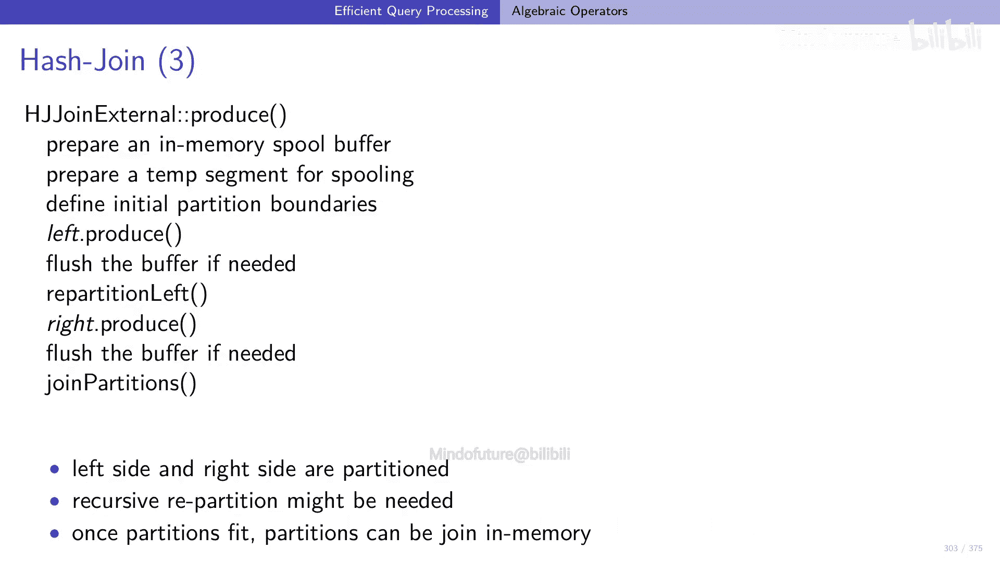

But as in memory case Brexit only on the right。 Okay， now let's look at the individual pieces here。

 First， what do we do if we get a tappper from the left， this is the first phase。

 if we get a tap from the left and what we want to do is you just want to put it into my in memorymory pool have above memory。

 we just put it in there。😊，And if you can't do this， it's just fine， we do it。 if a buffer is full。

 So this is what is if checks， So if checks， if a buffer is full。😊，If yes。

 so my can no longer store a new topic， then I must write my tablets to disk。

 And so this is an external memory has shown。 so we can we write everything to disk。 It doesn't fit。

So before we do this， we sort my values in the buffer by hash value。

And then we write the entries to the corresponding parts Okay and now you could ask yourself why sorting so we do sort because this means that taps that belong to the same partition will be next to each other and memory and this is good because this gives me a nice consecutive IO pattern so we can just write everything one partition out sequentially then the next part also sequential next out sequentially So we get sequential IO on disk and remember when we set in the past sequential IO is extremely important for disks So we want this for performance reasons even for SSDs by the way this is not only for rotating discs you want to have right locality So we therefore sorting memory pays off。

😊，Okay， then we update the part statistics so basically we remember how many tablets do we have and how large was each tablet or how much space did we use。

😊，Then we empty the buffer and then we now have space for the next tablepper okay。

 then after this we can install the tablepper and we do this to till till the end。

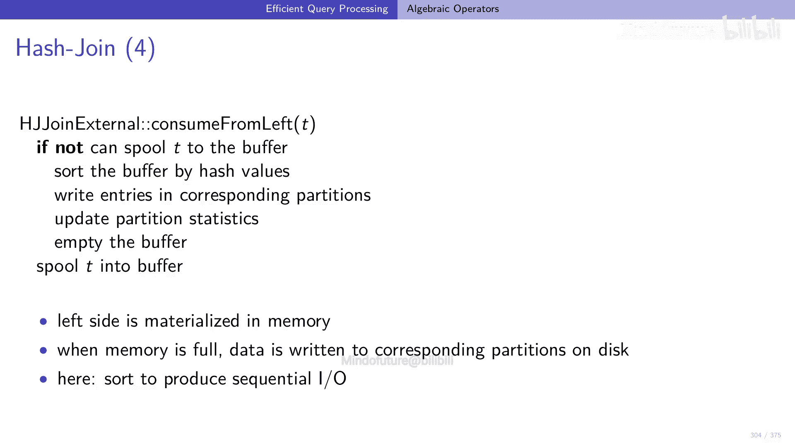

Okay， so after after we process the left hand side， everything was written out into partitions。

 Now we must check if we if this is fine， this could be that if you are lucky we don't have to do anything or if my partition is too large。

 it could be that my partition is larger than my memory。

 So this is what you check here and this function reppartition left。😊。

So basically what we do here is we loop over oil partitions and we check if the partition is larger than memory。

 if yes， lot of special cases， we check if the number of hash failures that we have is larger than one。

Basically what we remember is what is the largest and the smallest hash value that we have in a partition。

 if they are equal if only one value then have a problem and then if this happens then we mark the partition here overflow we say oh this this is a large partition with only one value we have to treat this special。

Okay， I hope that this never happens。And if we have more than one hash values。

 then we can find a newer partition boundary so I solve see for example。

 if hash values between 10 and let's say 30， and I know that my partition is two。

 three times larger than memory， then I will choose new boundaries yes here and here。

 such that everything is now evenly distributed。Okay。😊，And so we D yeah， this is during this line。

 we derive new new partition boundaries， We load a part in memory。

 and then we write out each part each part out into this final partition boundary。

 So we transform one big part， basically into。😊，Into three pages。And so first second insert。

 and of course， we hope that now these three parts do fit。Now， if we would be extremely unlucky。

 of course it could still be too large than we would repeat this until it fits。

 but hopefully this never happens。😊，Okay， and so basically we bring the external memory case down to the in memory case because once the position does fit in memory。

 everything else is quite simple。😊，Now coming back to this overflow case here this is a special case and this can happen。

 for example if we have a lot of duplicates in my relation it could be that my relation contains 1 million times the same value and if the value is really the same I can do anything if the values are the same of course have the same hash value so a new no partitioning strategy。

😊，Willever solves this problem for me。 So if you have real duplicates， all hash collisions。

 hash collisions could also be， but this is unlikely。 if you have fraction good hash collisions。

 not very likely。 But if you could have real collisions， as's real duplicates。

 and then we can have a position that is larger than manually and we cannot make it smaller。 Okay。

 if this happens， then we just remember it and treats。

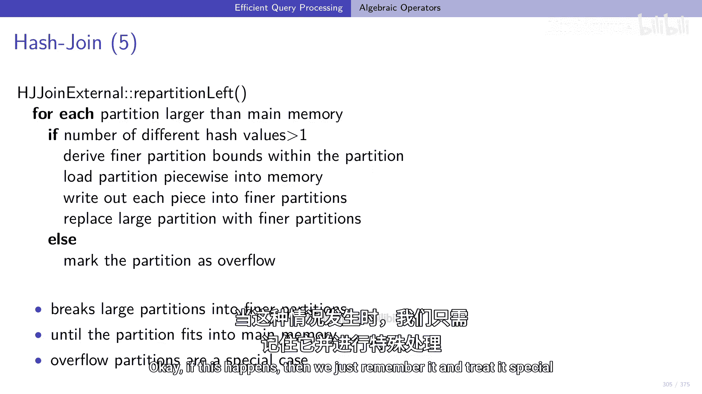

Now， if you get a tupper from the right， this is now looks Brie just like a get tupper from the left case。

😊，So the only difference is now we are sure that my part boundary is correct because the right hand side no longer has to guess position boundaries。

 then we scan the left hand side we have already after we scan the left hand side。

 we already picked my boundaries so at this point we do know。😊，Otherwise the code is the same。

 a templater comes， we check if there's space， if yes we just put it in the buffer if no。

 we swap my videos by hash radio， we put out my right on my values in the corresponding positions we empty the buffer and we continue okay。

😊。

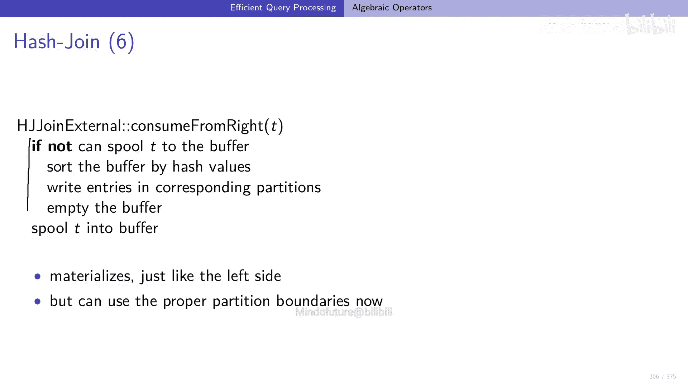

AndNow is the remaining interesting part， of course。

 is the join so because after this after this year we have partition both my left and my right hand side and we know that my left partitions do fit in memory The right hand side not necessarily they can be larger。

 but left side will be fit in memory。😊。

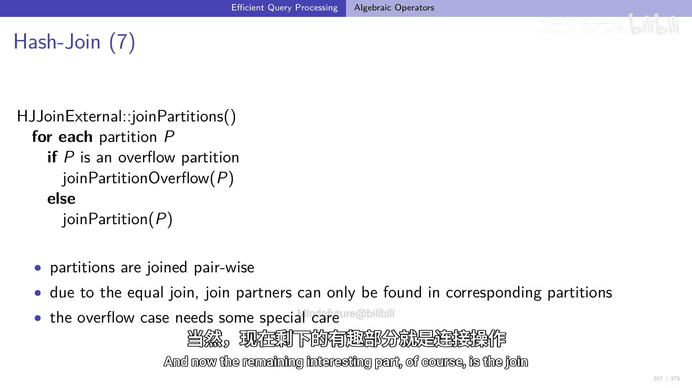

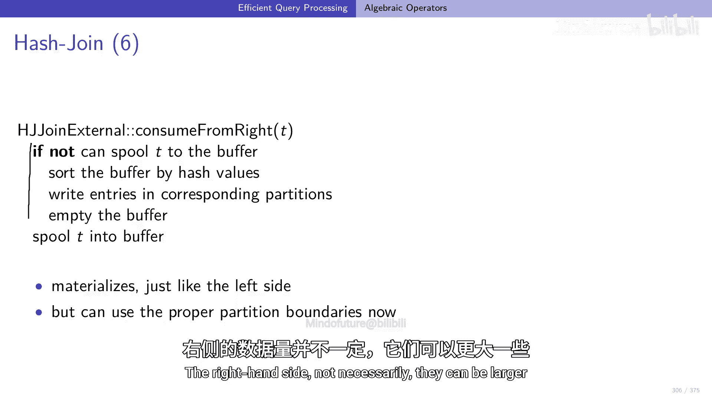

So now the final step is drawn partitions and this now produces the real output values for this。

 we look at all partitions。 there are two cases， here a good in the bad case。

 We check if P is an overflow partition that is the bad case If yes。

 we call it a function joint partition overflow special logic here otherwise the regular case we just call joint partition okay and。

😊，Again， this is a great as idea because we have an equiro and we know that we can only find corresponding partners within the partition so on the diagonal in this domain space and therefore it's sufficient to look at the same part in each side and again the overflow case needs some special care。

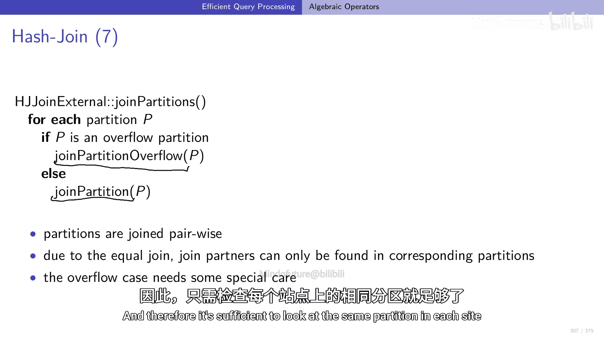

So first look at the regular case， the joint positionition case， we get a partition P。

 So then what we do is we load p through this part of my domain space into a memory in a hash table and we know that this is possible because we checked so this requestcurive repetitioning make sure that each partition is left fit this here must succeed we load in a hash table if it's possible and now this remaining code here。

 this looks basically like the in memorym hash join so so what we do is we loop over all tablets in the corresponding position on the right and so here then we check the hash table for a join part now here we check if this truly equal or not a hash collision here and if it's truly equally out result now so this basically at this point here we have reached the in memorymory case because we know that my left hand side must fit the right hand side can be outer really large mean this course makes you for each T and right position a bit more。

more difficult， but not really difficult yeah because also here we I mean if it's very large we just load a page with stops and after we have tried we throw away the page and loads an next page and so we loop over all pages that contain values but this is not so super complicated。

Okay and now the special case is that we did have to process this now is I said the other case was like in when we has joined this year log like block is a loopron because we know that my part doesn't fit because I have so many identical values all values are equal and of course the all valuess are equal and virtual I do and so I have to look at all of them in a sequence。

😊。

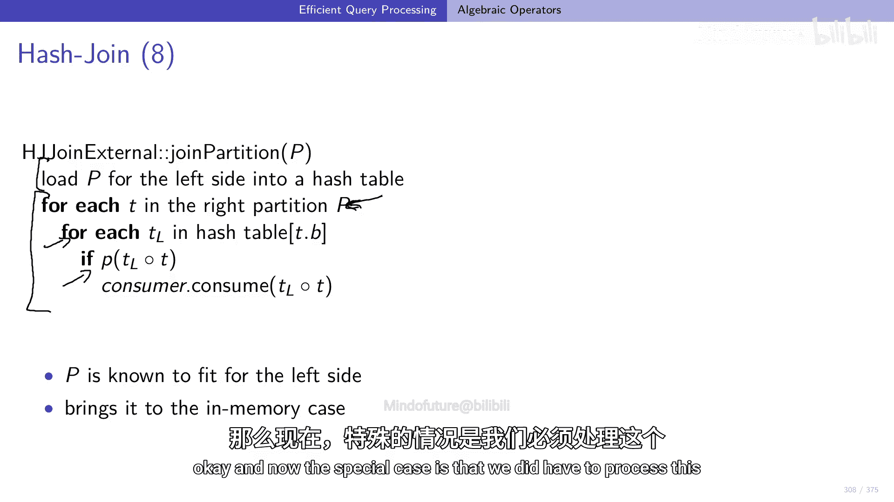

So。Here we look at we load from by， So you look at the button B。

 We load from P as much as we can in memory， which might not be everything because it could be too large。

 but we load as much as we can in memory。We put it in in has table and then runs the in memory has shown here。

And after we are done we load the next chunk see we basically do this repeatedly。

 this is like a cross here between a blockless has a loop join so we read the right hand side repeatedly add a hash join so we still use a table speed to speed up matches。

But the。Princally， we have to process the right hand side as often as we need to get the data into by system。

 so left hand side divided by memory size， this is the number of pars that we need。

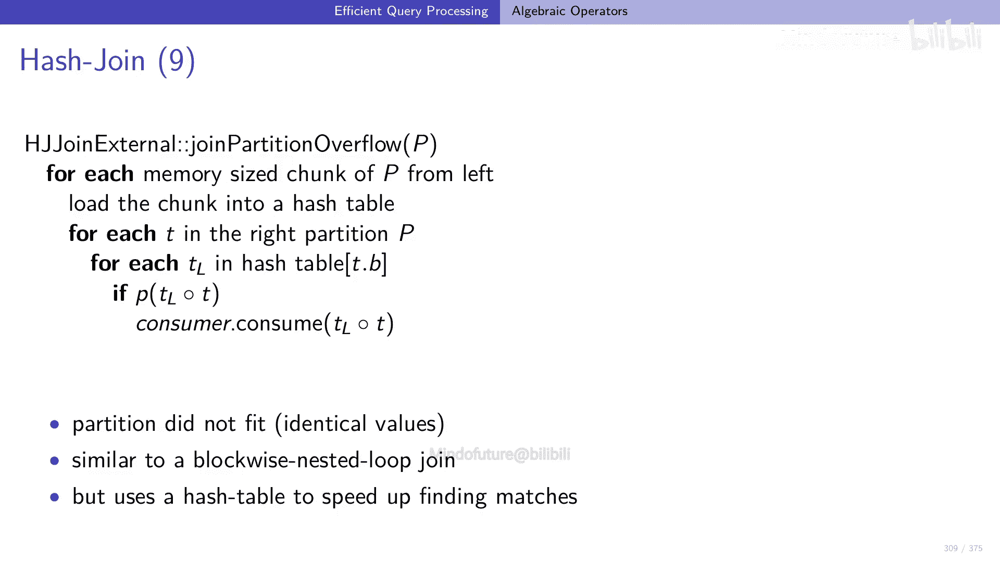

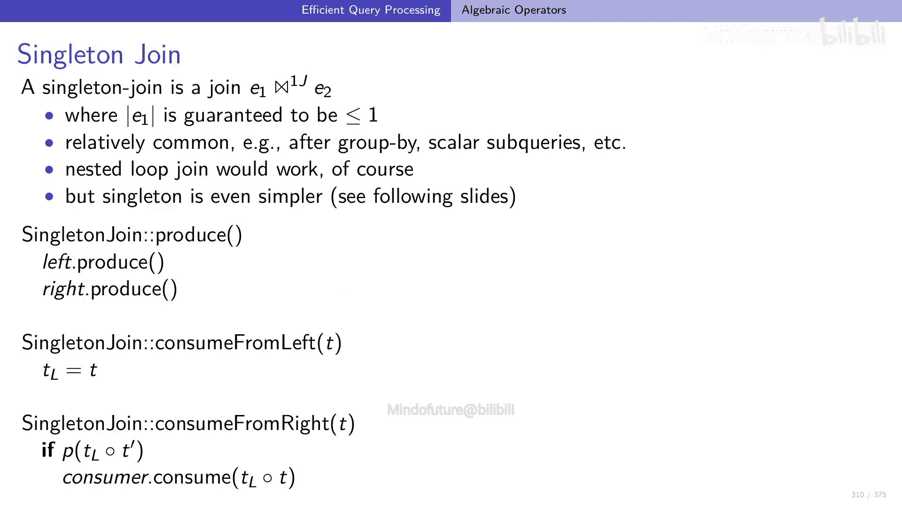

Okay， so are these are the bread and pat drawn algorithms basically so this is that we saw Nesle luron。

 blockness luron， soft match joint and has joint， and so this is so the most common so most systems will implement at least perhaps even all of them are at least many of them and so these are the most common ones。

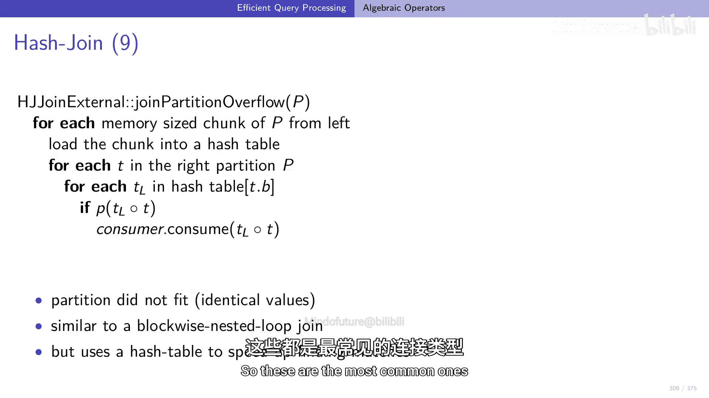

There some other stuff here as you can do， for example。

 you might potentially optimize for the case that you know for sure that the left hand side contains only a single tableu。

😊，Yeah， and why would you want to do this， because this is not that uncommon， For example。

 if you bind the primary key， you know that there will be only one taboo at most or none who could of course the individual doesn't exist。

 But if you have something here， let's say where。Where。K equals 7。

Then you know for sure that this gives you one table at most or none。Okay。

 and other cases are like you do a group I and then you know there can be only one value or you do have scale a subcurries it can also produce only one value this is quite common that this't happens。

😊，Okay， and if you can guarantee that youVF at most one values。

 then the joint implementationation is particularly simply。Okay。

 now you could say you can use as loopron， yeah， and it's true， of course。

 you can use them as a loopron， but in fact the single join is even simpler。

YeahAnd therefore because it's so easy to build， you might want to use this。To produce。

 we just call a produce on my left hand side。 And when we get a tupper from the left。

 we just copy it and remember that this happens at most once。

 as though there could be 0 or one tupper from the left， but never more。 as is therefore。

 we just store the tupper from the left in a variable thats it。😊。

And then when we get a template from the right and now this graph of course can be many。

 this happens here， I congrat a new template with my copied value and checks the predicate and if it's true I could upload it to a consumer so this is basically an optimized version to make this simple joint even even simpler so this is now super cheap。

😊。

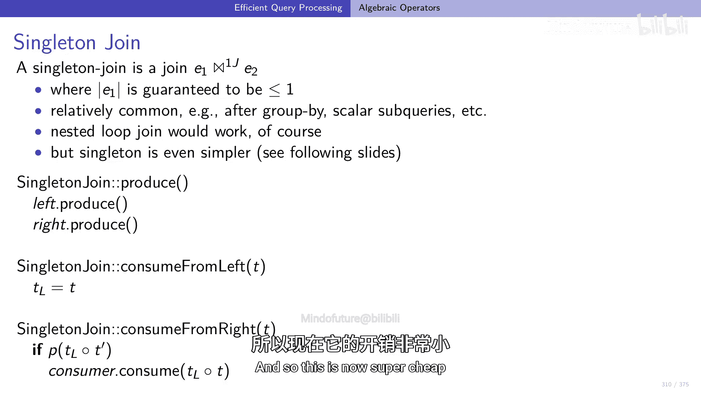

Okay， and another account of prominent that we have to implement is non inner joints。

Yeah so far we said all joins that we consider inner joins。

 we said here I want to find topts where the values are the same， but these are not the only ones。

 Yeah so first we have of course the outer joins like here left outer right outer full order so for these joins。

 you must even produce a topt if it does not have a join partner so remember introduction to a databases。

😊，In other drawing is like an inner drawing， but a tablet that doesnt did not find a drawing partner is paddted with Nile values and then outputed regardless。

 Now， we have to produce non matching tablets too。 And then we have also the semi drawings。

So here we have to output only matching tableplets with mypllicities。

 so this means if you have one drawn partner you must produce the value。

 if you have 10 drawn partners we must also produce the value but only once。😊，So let's say if my。

 if I do， here's this one here one。2，3，4。 and I'm my right this idea， I have2，4，4，4，5。

 and I then I do a simple jump between them。So and then the output here must be。

One ast does have a drawn button。2 has a drawn button。 Yes， so must be 2，3 does have a drawn button。

4 does have a drawn button。 In fact， it has multiple drop button buttons， but。People we don't care。

 We should only output for once。 Okay， so for this for s drawings。

 we have the problem with we the output only once。 and then for anti drawings。

 we only output tablets that do not have a drawn partner again， with automatic is the only ones。Okay。

 and now at a high level， we can in fact implement all these just like a regular drawing so we want to if your regular has join implementation。

 you can handle all these two， but you will need some additional bookkeeping in particularly you have to remember if somebody has a drawing partner or not。

😊。

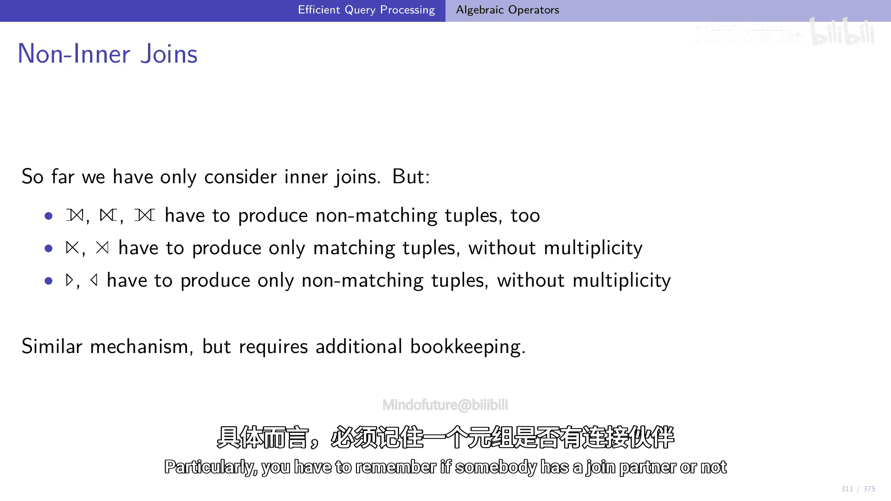

And so the idea is that for non inner drawings， you mark a topic it has a remembering if it has a join partner or not Okay。

 and so so when when we do this year， my input was。I say1，2，3， my output here was as size is 2，4，6。

 I do a regular drawing here。 I find a drawing partner。 and then I remember， okay。

2 had a drawing partner， these two had drawing partners。

 so I remember that these have drawn partners。And now then we do an outer join。

 we are depressed to use the regular inner join， and then we do an additional pass over my data and we check if my was marked。

And if yes， it has a join pattern， if not， we output the table padded with9 values。Okay， for example。

 if we would do。If you will do this one here， so a left outer join。Yeah， then we， if we do not。

 so in this in this particular case here， we would output2，2， of course， this was my first match。

 then we would output one N。And 3 and we figure this out by checking the marks afterwards。

 so we check the left side and and we check。 we do not have to check the right hand side because we don't care。

 And in fact， from this one we would not even mark the right hand side。

 I have did markers on both sides。 Of course， the system would be smart and realize the right hand side does not have to be marked So say in this case。

 we would only mark the right hand side as far as left side。 but in this case， for example。

 we would have to mark both sides。Now a full other join will to mark both sides。

 depending what you have。Okay， so the auto joins mark and visualization of output view outputs the values if if they are unmarked。

 So the same joins， they auto mark by the only outputs the value value if it is not marked yet。😊。

Yeah， so basically if I have a， if I find a match， I check。

 did this tapper already find another match。 If yes， don't do anything if。

 if no mark and do output it okay， if you want to do this might thread as requires to you to use atomics。

Basically you have to do is check and mark in one atomic operation so you must say okay。

Please mark this。 And if I am the first to mark it， then I will output。

So antid process like the auto drone more or less so we run the regular drive we mark。

 but we do not output tablets so we just mark with these throw away images afterwards。

 we just mark them and then we do an additional pass opposite the data the only outputs are nonmarked tablets because these were the ones that did not have a drawing partner this is what we want to have。

Okay， so this works nice。 The only problem is okay。

 where do we store the mark a bit so some of you must get a bit from somewhere that allows me to to say。

 okay， this has a join partner yes or no。

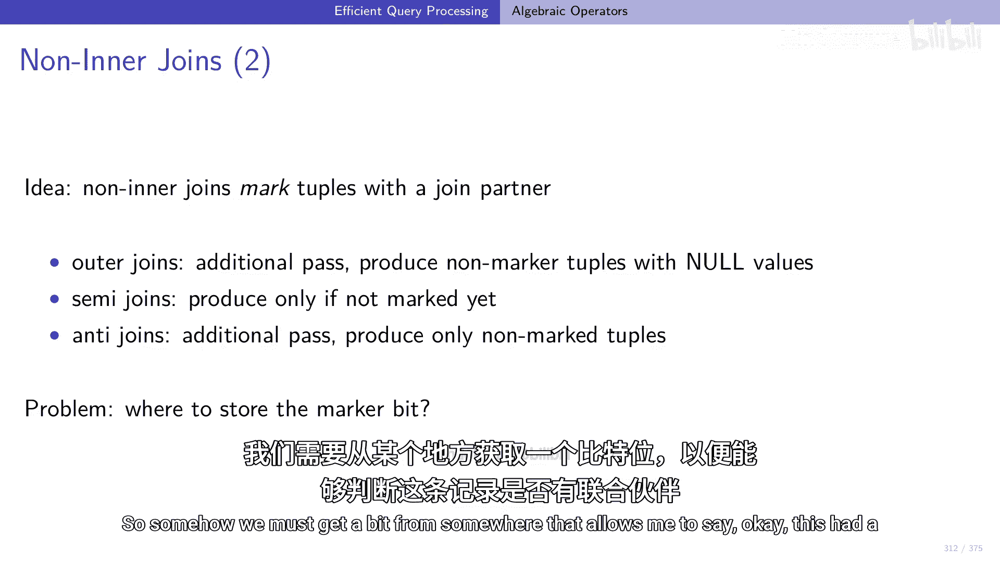

And now marking the left side is usually easy。😊，So the left side is the one that sits in the has table somewhere now so this is not a big deal。

Because what we can do is we just change just reserve a single bit or a single byte。

 whatever then we s， we makes the table tiny bit smaller sorry larger， no smaller tiny bit larger。

 then we reserve1 bit or1 by。 and then then we have a joint partner。 right in this by。 Yes。

 I ahead a join partner and then we can check this afterwards。 Okay， so this is this is easy。😊。

Maring the right hand this is not so easy。 depends on what kind of operator you are。

 if you read the right hand only once like in a He and has and reads the right hand only once。

 if you do a single pass on the right hand side， then it's okay because then we just have a local variable somewhere or register which works as a marker and then when we have a join button which sets this variable to true and afterwards。

 you checked it， we have a join button okay that's okay but if we do something like this。😊，Okay。

 who's so insane to do this， but where you know， you can potentially。

Then suddenly we have a problem because now we read the right hand multiple times。

Yeah and we must remember， of course， if in the previous pass over my right side。

 this topic was marked or not。So now this is more difficult because there's no obvious place where I can put the marker on of my right hand side so what you probably want to do in this case you want to maintain an extra data structure so it's an associative data structure that says okay T 5 was marked T 10 was marked T 20 was marked so you remember basically which templatets did find a drawn button。

Now one observation here is that in most queries， not always of course， but in most queries。

 you tend to have locality， which means either nothing is joined or everything is joined for particular range of tablets That's extremely common that you have a range of tablets that all have a drawn button then perhaps you might have another range that have non-d button。

 therefore this associated data structure you probably want to use interval compression So you don't want to just want to means that most trivial implementation。

 of course， would be to say just store a set of of tableid these or something would be possible Yeah but this would probably waste a lot of space instead what you want to have is some fancy data structure that stores okay。

😊，Tapts 10 to50 oil joint， taper 90 to 105 oil joint and so on。

 And so you want to store interval the runs of values。

 intervalverts of values and then you no longer have a problem mean think about the extreme case everybody finds a joint partner。

Now you can easily open and everywhere finds a drop partner and then you want yet this extra data structure that you have is very small and you don't want to make it as large as the relation。

😊，And so if you use In compression， it's not a problem because we just say， hey。

 from first topic to last stop it， everybody hass a join button。Now。

 implementing such a thing is not so super easy， but you can do this， for example， using a B3。

Where the inverts are stored in a battery tree and if an inverer grows and touches a neighboring intervalvert。

 its merged with its neighbor so then the number of inverts that you have is kept reasonably low。

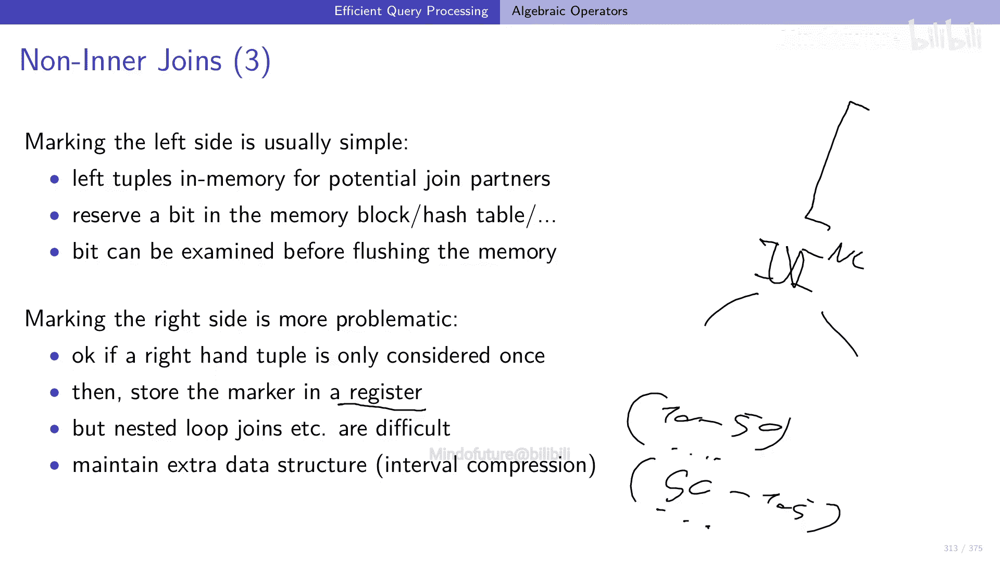

Okay， and just me quickly check the my time or I'm seeing I'm running out of time already。

 So we look today at different ways to implement joins。 Of course mes are super important operators。

 but they're not the only ones。 there are some others that we have to process like salt and groupi but this we do in the next lecture Okay。

 thank you。

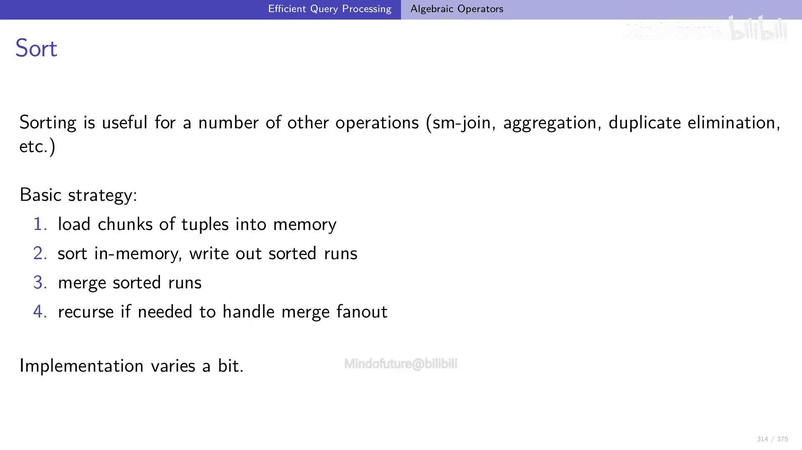