# 现代CPU架构上的数据库系统实现：11：操作符实现

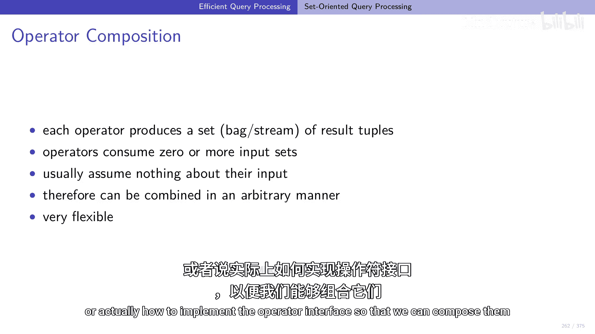

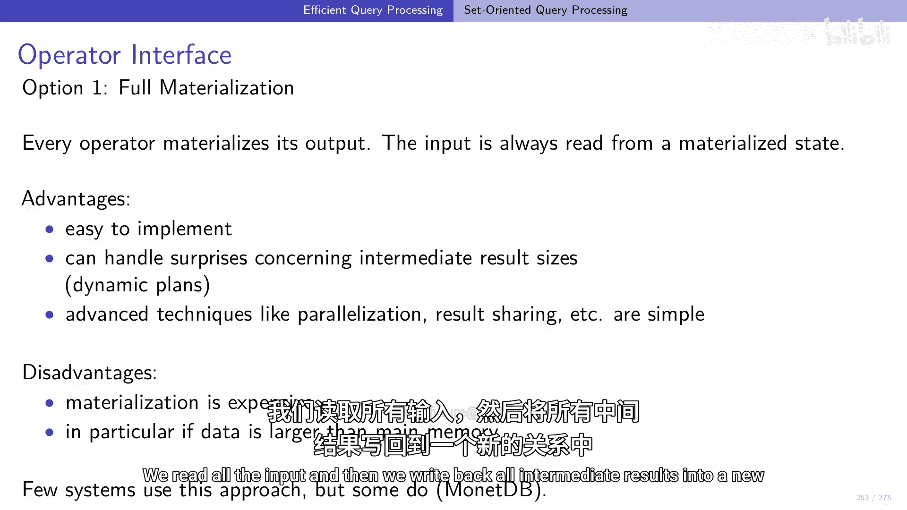

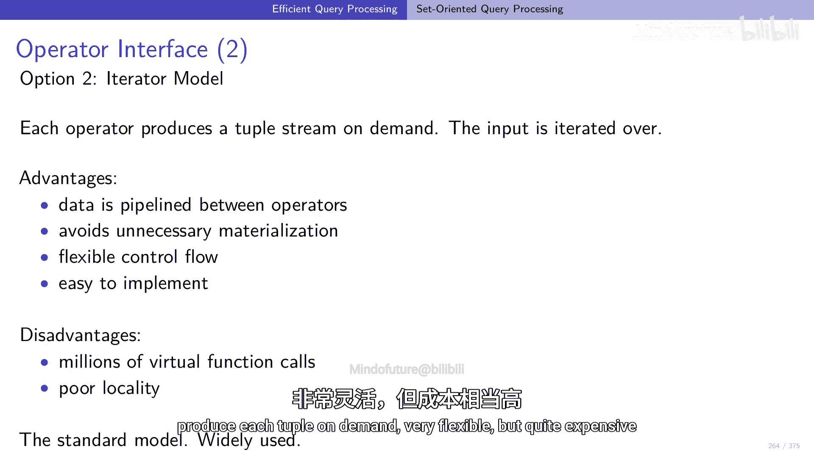

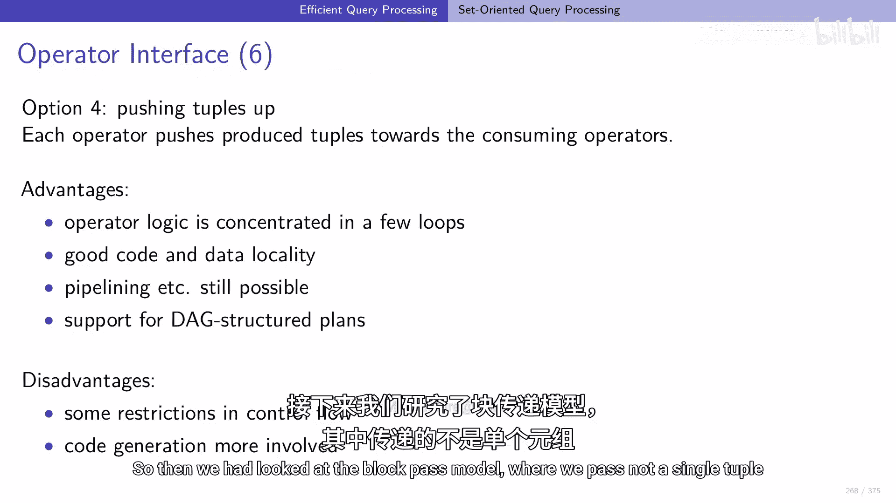

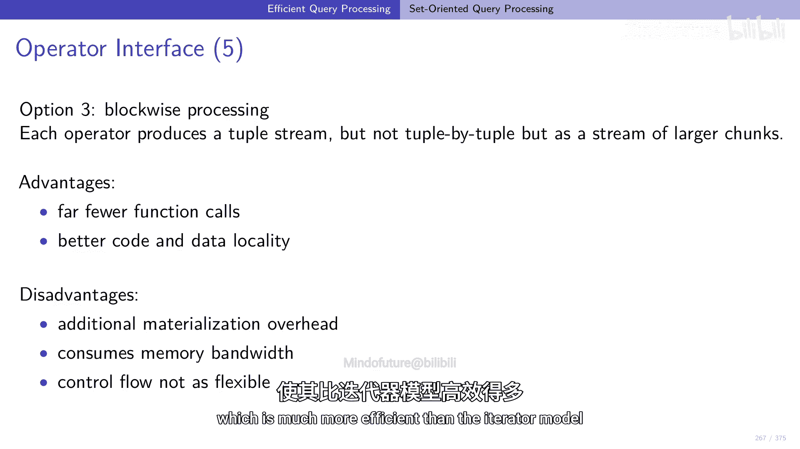

## 概述

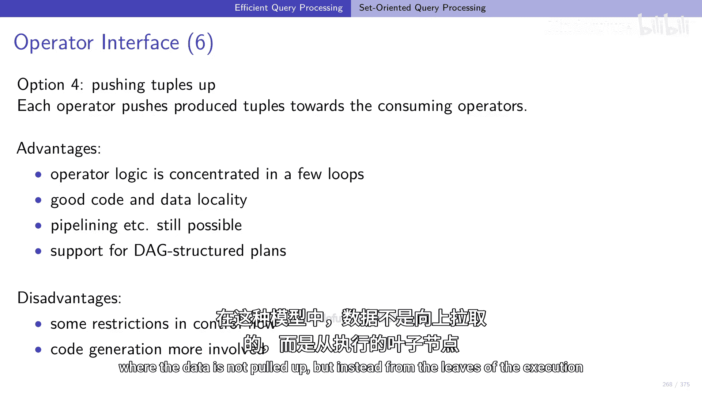

在本节课中，我们将学习数据库系统中核心操作符的实现方法。我们将从操作符的组合模型开始，深入探讨扫描、选择、连接等关键操作符的具体实现细节，并分析不同实现策略的优缺点。

---

## 操作符组合模型回顾

上一节我们介绍了操作符的不同组合方式。本节中，我们来看看如何实现操作符接口以便组合它们。

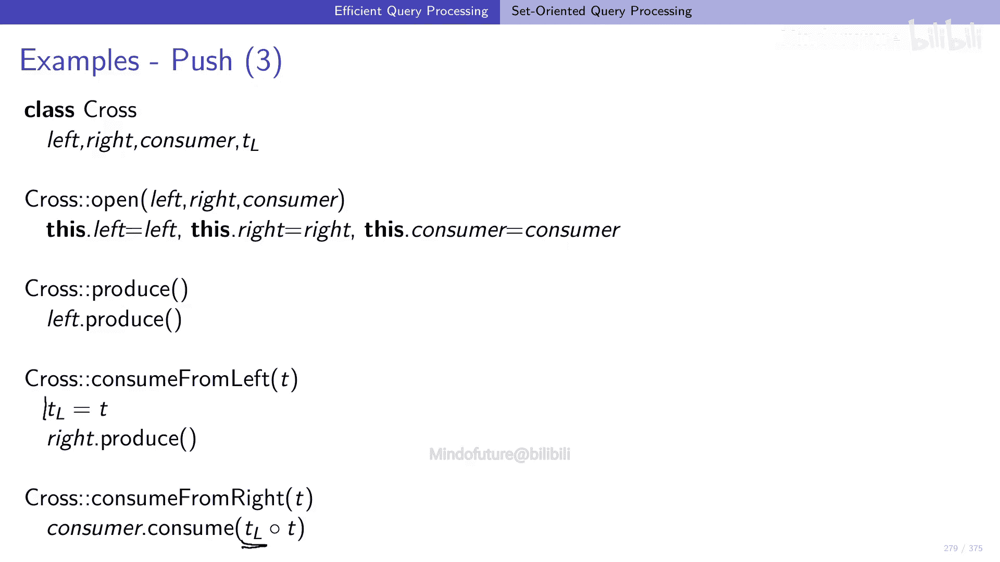

我们首先了解了完全物化模型。这是最简单的模型，我们读取所有输入，并将所有中间结果写入一个新关系。这种方法实现简单，但性能不佳。

接着我们研究了迭代器模型。该模型按需生成每个元组，非常灵活，但开销相当大。

然后我们探讨了块处理模型。该模型传递的不是单个元组，而是元组块。这大大减少了迭代器模型的整体开销，效率更高。

但块处理模型存在一个问题：我们需要写入相当多的数据。因此我们引入了推送模型。在该模型中，数据不是从执行树的叶子节点向上拉取，而是从子节点向上推送给父节点。我们还开始查看示例代码，例如排序物化迭代器和块处理。

---

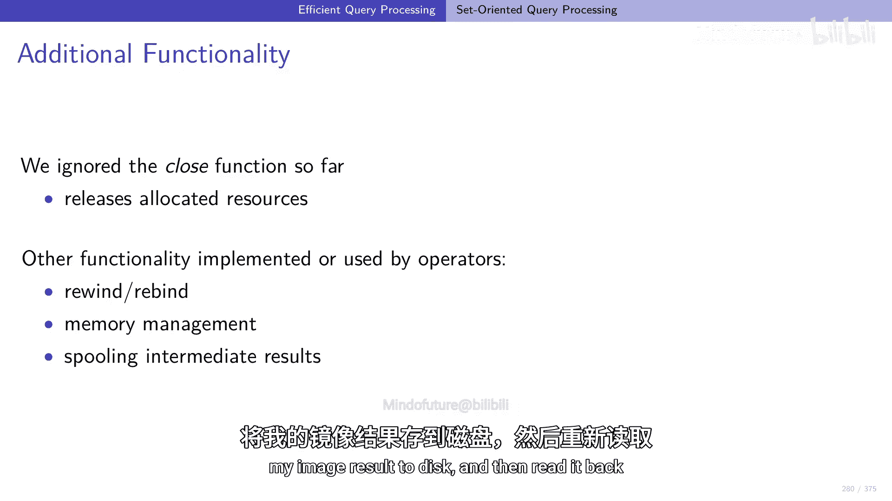

## 推送模型下的基本操作符实现

在推送模型中，我们如何实现三个最基本的操作符：扫描、选择和笛卡尔积？

以下是这些操作符的实现代码，实际上非常简单。

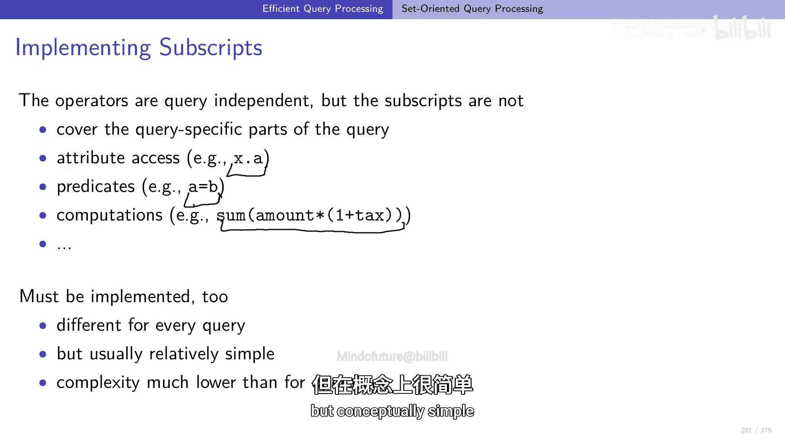

### 扫描操作符

在扫描代码中，我们扫描一个关系 R。当我们调用 `open` 时，只需记住要扫描的关系 R 以及谁要读取它（即消费者对象）。当我们想要生成数据时，只需遍历 R 中的所有元组，并将每个元组传递给消费者。注意，扫描作为叶子节点没有 `consume` 方法，因为它只有输出，没有输入。

### 选择操作符

选择操作符既有输入也有输出。当我们调用选择的 `produce` 方法时，我们只需在其输入上调用 `produce`。在 `consume` 回调中，当我们收到一个元组时，检查条件。如果为真，则将其传递给我们的消费者；否则丢弃。

### 笛卡尔积操作符

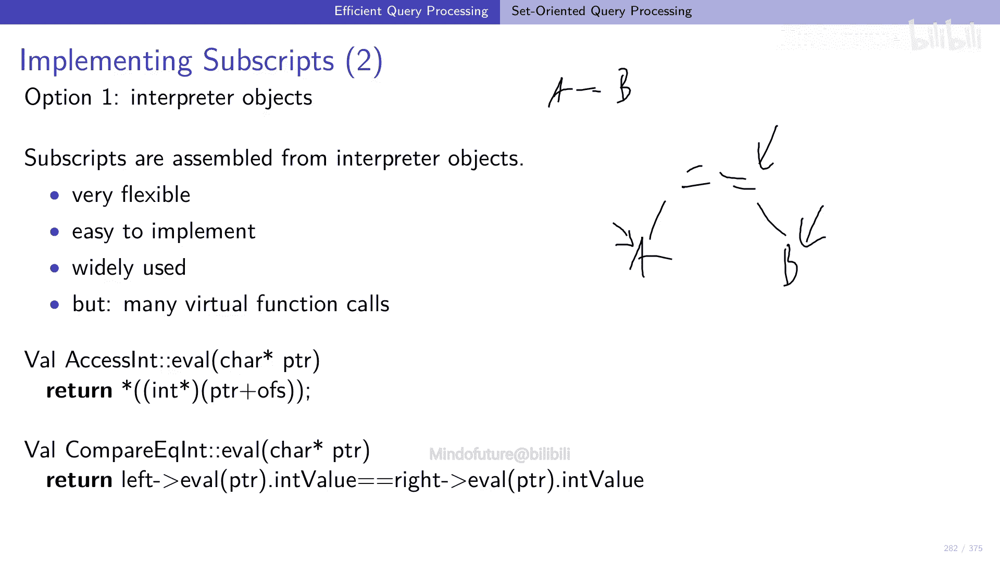

当我们想要构建两个输入的笛卡尔积时，在 `open` 方法中，我们记住左右输入和消费者。当我们调用 `crossproduce` 时，我们请求左侧生成元组。当我们从左侧节点收到一个元组时（注意，完整的接口可能还会知道元组来自哪个输入），我们存储该元组，然后在右侧调用 `produce`。如果从右侧收到任何元组，我们将其与存储的左侧元组合并，然后输出给消费者。

实际上，这里的代码非常、非常简单。当然，对于更复杂的操作符，情况并非如此简单。尽管如此，它没有迭代器模型需要记住执行位置以便随时停止的复杂性。

---

## 操作符的其他功能

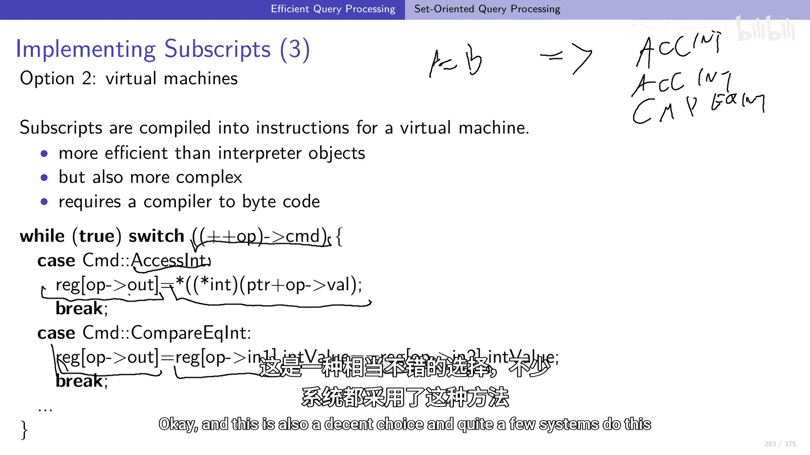

到目前为止，我们只关注了 `open` 和生成元组所需的方法。当然，还有其他必须实现的功能。

`close` 方法通常很简单，我们只需释放分配的资源，如释放内存、关闭文件等。

还有一些更高级的功能可能需要，例如 `rewind` 和 `rebind`。

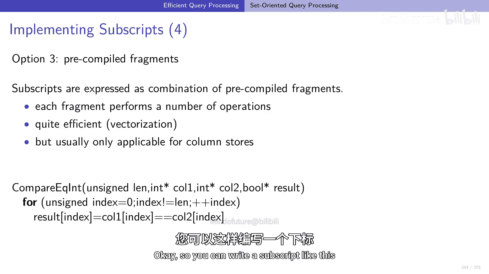

`rewind` 意味着如果调用重绕，则表示请准备重新执行，可以重用已有的结果。

`rebind` 意味着准备重新执行，但必须重新计算已有的结果。

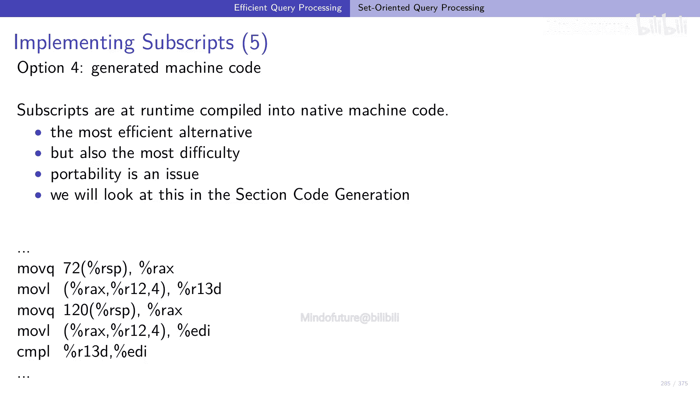

为什么需要这两个函数？最简单的例子是嵌套循环连接。我们读取 R 的一个元组，然后读取 S。当下一个来自 R 的元组到来时，我们告诉 S 请重新读取。如果 S 是一个分组操作符，它可以重用已有的分组表，而不必重新计算。

`rebind` 的情况我们需要用于另一种操作符，即依赖连接。例如，连接的右侧依赖于左侧，因为右侧使用了来自 R 的属性。当我们从 R 获得一个新值时，必须丢弃分组结果，不能重用，因此必须重新绑定。在实际实现中，我们甚至可能跟踪哪些属性发生了变化，因为有时可以重用计划的一部分，有时则不能。

我们通常还需要内存管理功能，因为操作符倾向于分配内存，我们希望适当地释放它们，或者在内存压力下释放。可能还需要更多功能用于溢出处理，例如，如果内存耗尽，我们希望将数据写入磁盘，然后读回。

---

## 谓词表达式的处理

另一个有趣的问题是，我们如何处理谓词表达式？例如 `A includes B` 或 `A equals B`，但其中可以包含任何内容，例如 `2 * A + B < C`。我们需要某种机制来评估这个表达式。

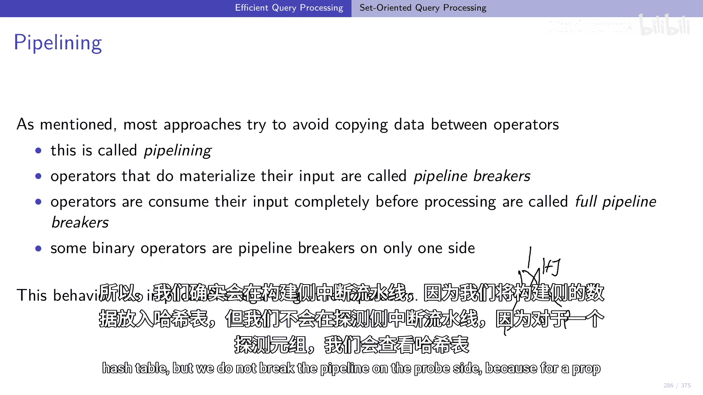

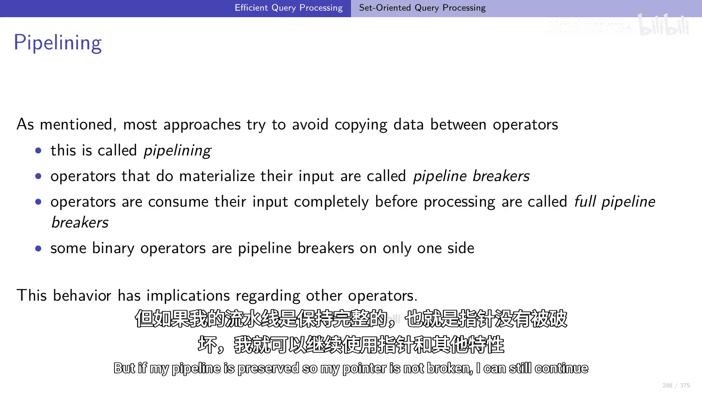

这些谓词是查询的特定部分。我们之前看到的其他操作符（如连接、选择、笛卡尔积）的实现并不真正关心查询，它们只处理控制流。所有查询特定的内容都由谓词处理。

谓词可以是简单的，如访问一个属性，也可以是一个谓词如 `A equals B`，或者一些计算，甚至可以是任何内容。我们需要以某种方式实现它，以便当用户给出查询时，我们能够评估查询中包含的任何表达式。

首先，当然，表达式看起来总是不同的。但好处是，它们通常非常简单。`A equals B` 是一个非常简单的表达式。可以编写复杂的表达式，但这发生得更少。即使编写了复杂的表达式，操作本身也很简单：比较、加、减、乘法。这些都是非常简单的操作，与连接或排序相比微不足道。这意味着必须以某种方式实现所有这些函数。数量很大，但概念上简单。

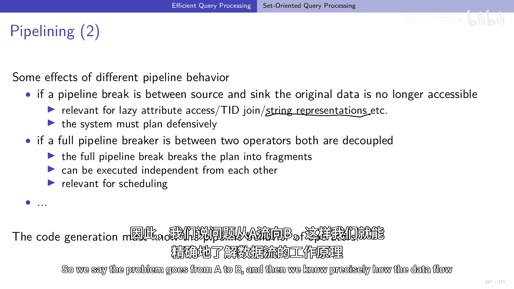

以下是实现谓词评估的几种方式：

### 解释器对象

第一种选择是使用解释器对象。这基本上意味着构建一个小树。例如，将 `A equals B` 表示为一个树，顶部是比较节点，输入是访问属性 A 和 B 的节点。对于更复杂的表达式如 `A + B equals C`，同样可以构建这样的对象树。要评估时，只需调用树根的 `evaluate` 方法。

访问属性时，我们获取一个指针，然后从相应的偏移量加载值并返回。进行比较时，我们调用左侧的 `evaluate`，调用右侧的 `evaluate`，然后比较两个值。可以为任何操作（加、减等）实现一个 `evaluate` 函数，然后按需组装它们。

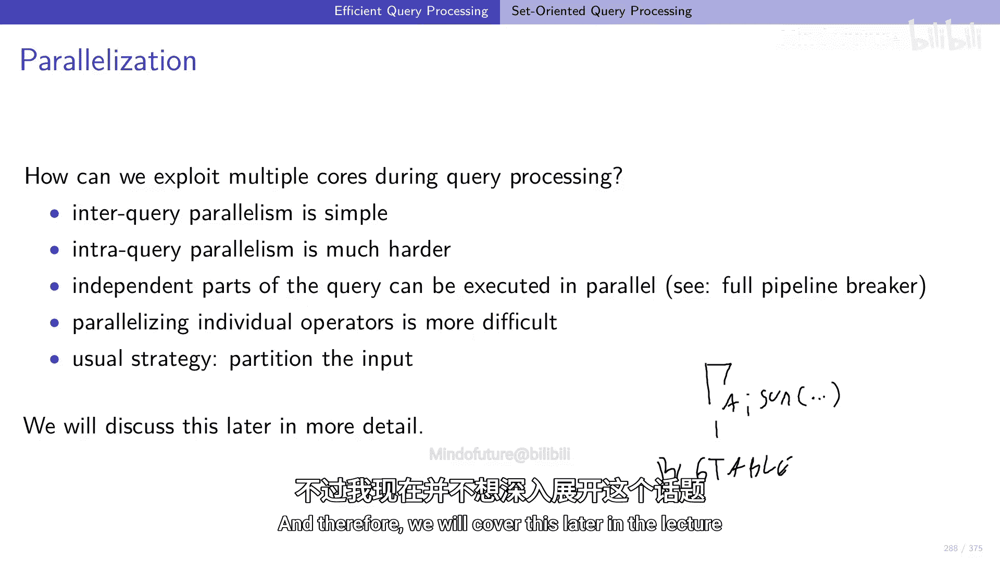

这种方法的优点是易于实现，基本上每个操作符只需要一两行代码，非常轻量级和灵活。但缺点是速度不快。即使是 `A equals B` 这样简单的表达式，也涉及三次虚函数调用（根节点、左侧、右侧），虚函数调用开销较大。

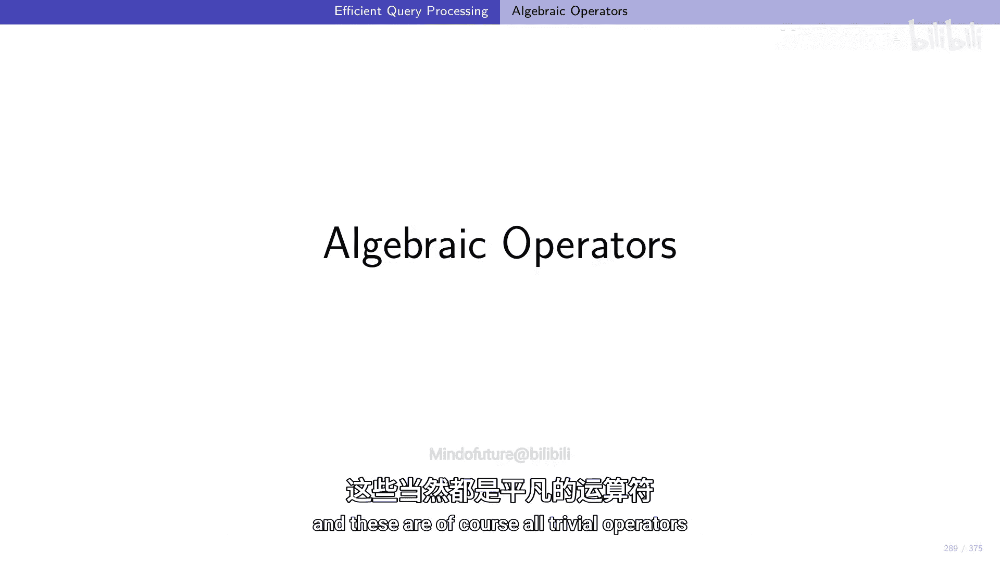

### 编译为字节码

我们可以决定将表达式编译成一个小的虚拟机字节码序列。这类似于 JVM 的工作原理。构造一个操作码序列，执行时循环遍历这个列表并评估。这相当于之前看到的解释器对象，但更高效。

例如，第一条指令可能是访问整数，我们从元组加载值并存储到某个寄存器文件中。比较函数获取两个参数，从寄存器取值比较，并将结果写入。这也可以使用已有的操作实现。

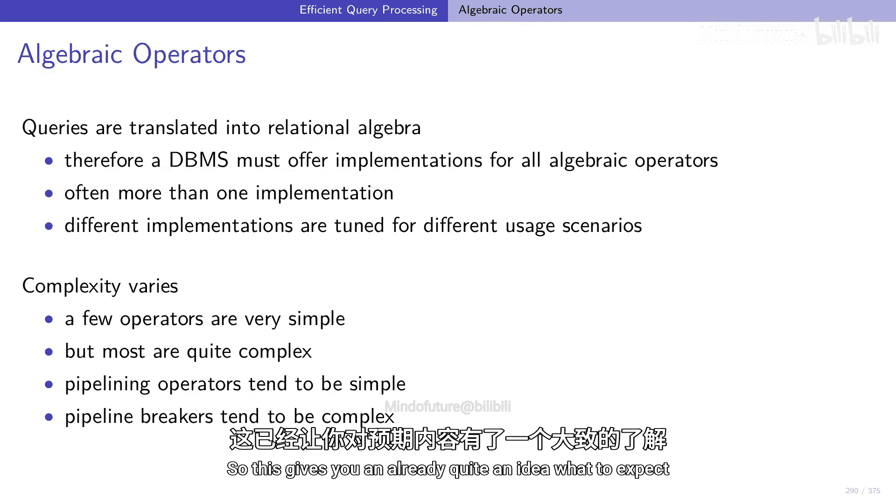

这比解释器对象更高效，因为只有一个大循环和一个大的 switch 语句。如果使用编译器技巧如计算 goto，可以使这个 switch 非常快。但缺点当然是更复杂，需要编译器将查询表达式编译成某种字节码形式。需要将表达式翻译成指令序列，例如 `A equals B` 翻译成 `access_int A`， `access_int B`， `compare_eq` 三条指令。这也是一个合理的选择，不少系统采用这种方法。

### 向量化执行

另一种在 Vectorwise 等系统中流行的技术是向量化执行。查询不同，但原始操作符（加、减、等于等）的数量并不高。我们可以预先准备一些代码，并隐藏调用开销。不是为单个值调用，而是为多个值调用，因此称为向量化执行。我们一次处理一个向量。

例如，比较函数接收两个向量作为输入（两个整型向量），输出一个结果向量（布尔型）。该函数循环遍历两个向量中的所有值进行比较，并将结果写入输出向量。这样，为大量输入值执行原始操作，隐藏了开销。

如果使用 SIMD 指令进行比较，这些预编译的代码片段会非常高效。但这要求输入可以作为良好的向量访问，基本上意味着只能在列存储中使用，可能只适用于某些操作。但如果满足这些约束，这是一种非常高效的策略。

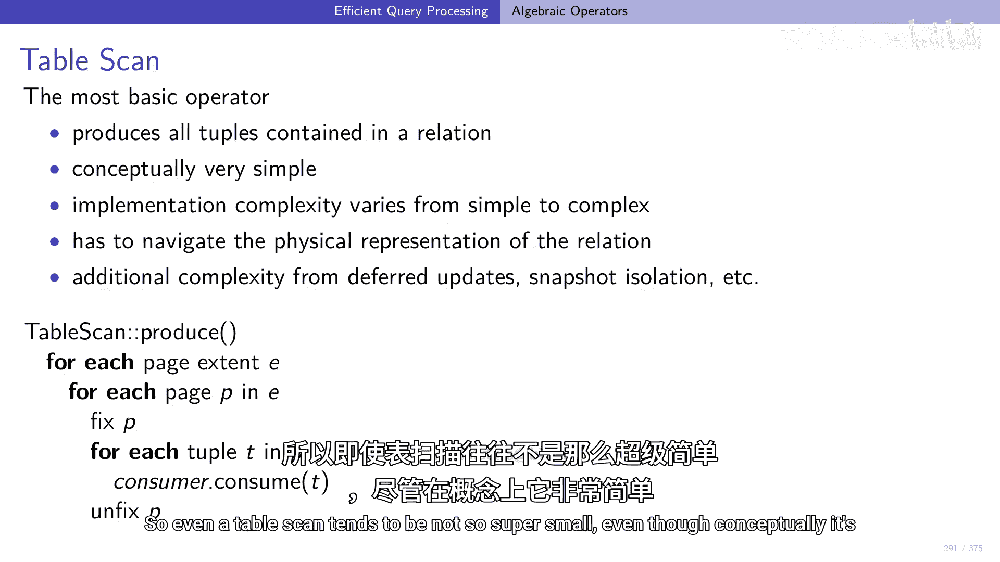

### 生成机器码

第一种选择是获取谓词并生成机器码。例如，加载一个指针到寄存器，加载相对于该指针的值（这将是列指针），加载第二个值，然后进行比较。这生成了大约五条汇编指令，基本上无法做得更好了。

当然，缺点也是最困难的。生成机器码比解释器对象更复杂，也比生成字节码更复杂。另一个问题是可移植性，如果想在 ARM 上运行，这也是一个挑战。

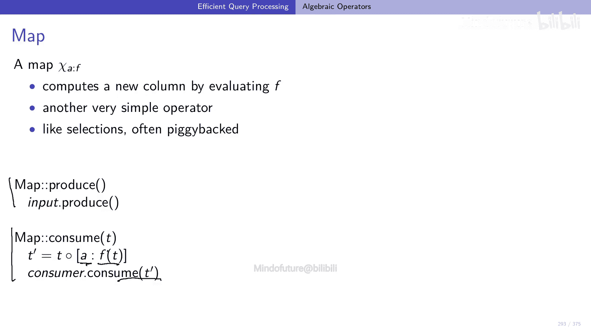

---

## 流水线与流水线中断器

在讨论操作符实现时，另一个需要记住的有趣概念是流水线。我们通常尽量避免复制数据，因为每次复制都会消耗空间和性能。如果能在操作符之间传递数据而不进行复制，我们称之为流水线，即隐式传递。

有时这是不可能的。有时操作符会物化其输入，我们称这种操作符为流水线中断器。更极端的情况是，如果操作符在产生任何输出之前完全消耗其输入，我们称之为完全流水线中断器。

例如，选择操作符通常不是流水线中断器，因为我们可以获取一个元组，检查条件，然后直接传递给下一个操作符。

另一个极端是排序操作符。它显然是一个流水线中断器，实际上是一个完全流水线中断器。因为排序的最后一个输入元组可能是第一个输出元组，因此在看到所有输入之前无法输出任何内容，因此排序完全中断流水线，物化所有输入。

还有其他形式，例如某些连接操作符。它也是流水线中断器，但不是完全流水线中断器，因为即使没有完全看到输入，我们也可以在一侧输出元组。例如，如果一个元组有连接伙伴，可以立即输出该值，而不关心后面的内容。

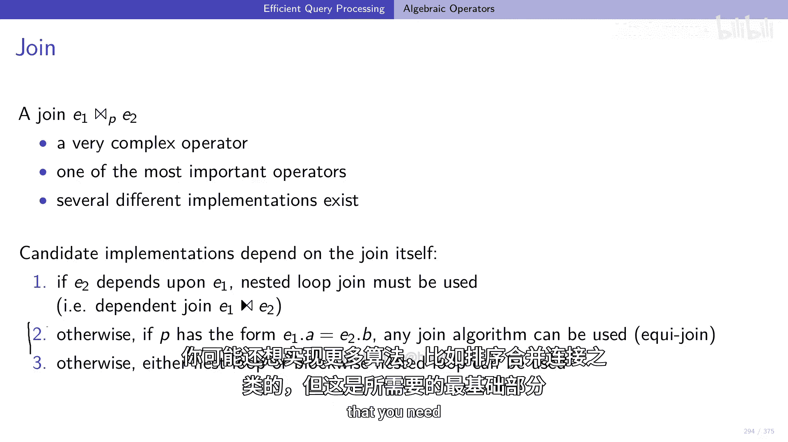

当我们讨论哈希连接时，它通常在构建侧（通常是左侧）中断流水线，因为我们将构建侧放入哈希表，但不在探测侧中断流水线，因为探测时查看哈希表并输出结果。

如果流水线被中断，这通常意味着指针变得无效。如果在交换和原始数据之间存在流水线中断，则不能再通过指针引用元组，因为元组可能早已不存在。但如果流水线保持，指针仍然有效。

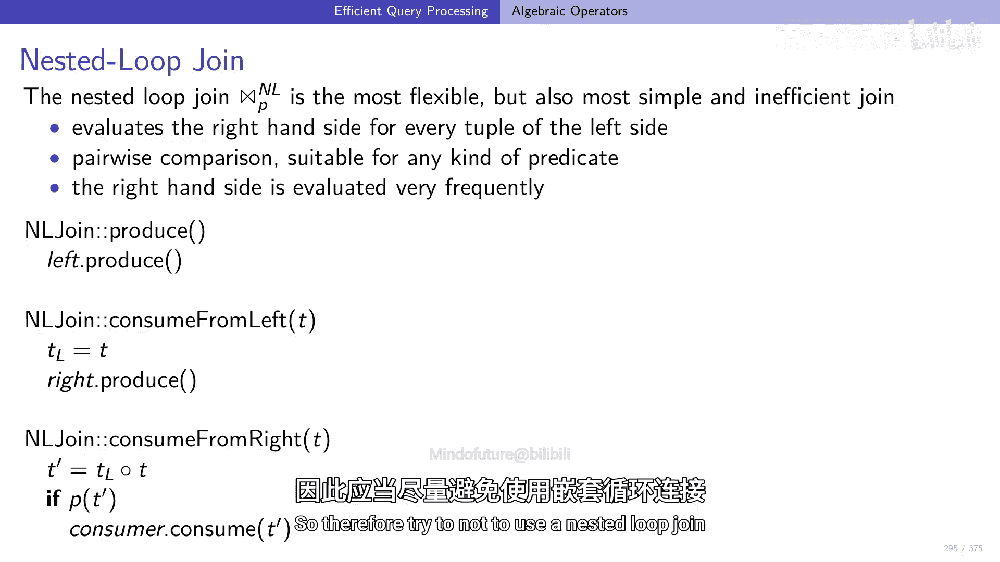

如果存在完全流水线中断，我们知道执行计划被分成片段。中断之前的一切和之后的一切。如果这种情况多次发生，我们可以并行执行这些部分。因此，为了使这正确，代码生成器必须知道操作符是否是流水线中断器，以及流水线在何处中断。事实上，我们将使流水线显式化，说明流水线从 A 到 B，从而精确知道数据流如何工作。

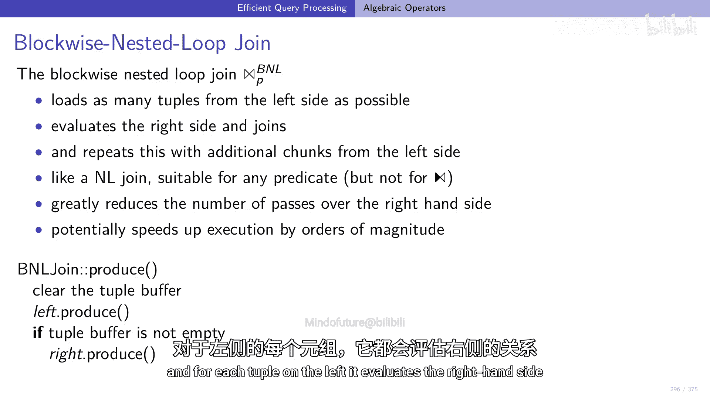

---

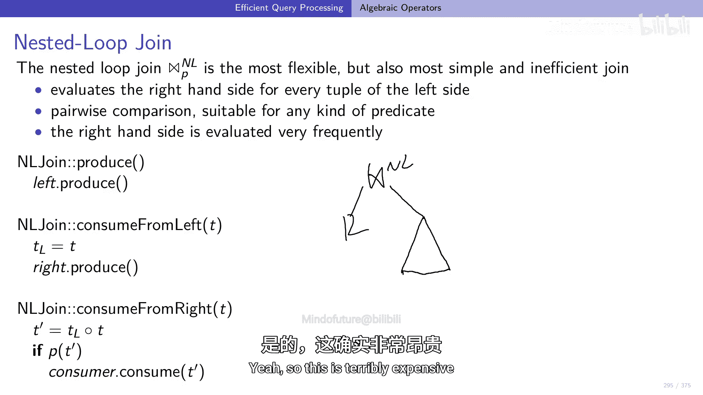

## 并行化

另一个有趣的问题是我们如何处理并行化。在当今的机器上，核心数量相当可观。例如，我当前使用的桌面机器有 16 个核心，如果包括超线程则是 32 个。这还不是非常强大的机器，你可以轻松购买拥有 64 个核心甚至更多的计算机。如果有这么多核心，单线程执行显然不合理，否则会浪费大部分系统资源。

简单的情况是查询间并行，即并行执行两个查询。这超级简单，不需要任何特殊处理。

如果我们想要并行化单个查询，即查询内并行，则要困难得多。但在实践中我们需要查询内并行，因为用户可能提交一个非常庞大复杂的查询，而系统中只有一个查询，因此我们必须尽力尽快执行。

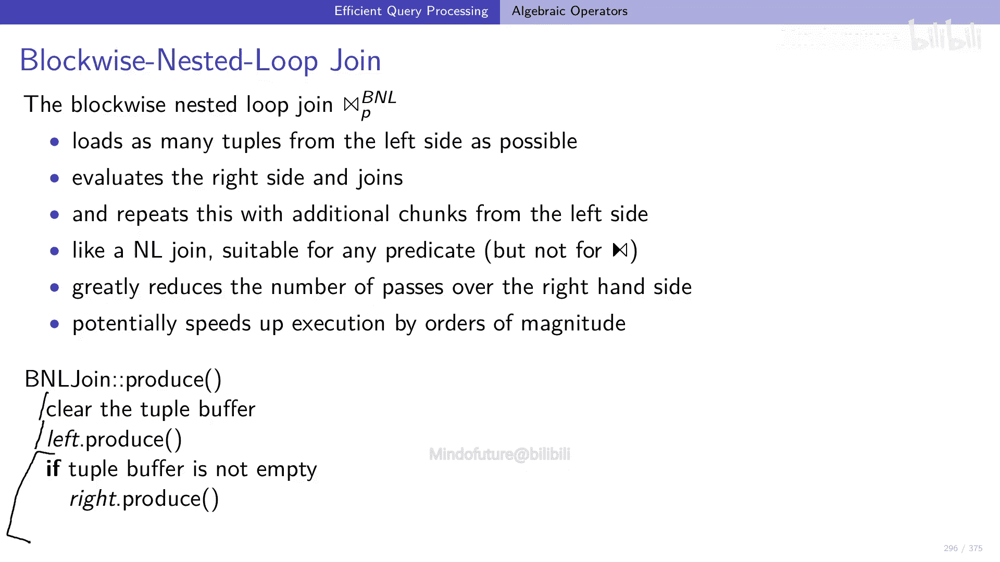

这里也有简单和困难的部分。简单的部分是，如果查询中有独立的部分（例如由于完全流水线中断器），我们知道这些部分是独立的，那么无需任何操作就可以并行运行它们。

如果我们想要在单个操作符内并行化，则更加困难。例如，有一个大表，上面有一个分组操作。通常的策略是查看分组操作符的输入，将这个关系分割成若干块（例如 16 块对应 16 个核心），每个核心聚合 1/16 的数据，然后合并结果。对于这个简单查询，这仍然很容易。但一般来说，使所有东西并行更加困难，我们将在后续课程中讨论。

---

## 操作符实现概览

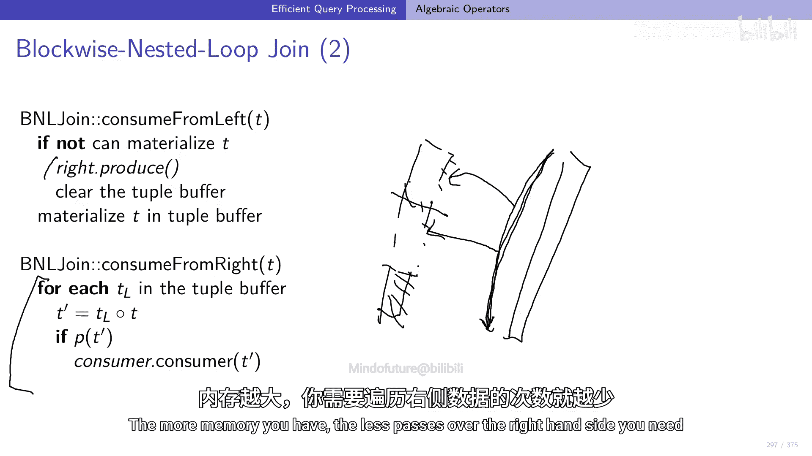

在简要概述了面向集合处理的高级方面之后，我们现在来看看各个操作符，并讨论如何实现它们。因为到目前为止，我们只看了表扫描、选择和笛卡尔积，这些都是非常简单的操作符。现在我们必须研究更复杂的操作符。

当运行查询时，大多数系统中的所有查询都被翻译成关系代数。因此，如果我们想要提供某种实现，必须用这些操作符来表达，并且通常不止一种实现。

为什么需要不止一种实现？例如，如果要运行分组，如果知道输入在分组属性 A 上已排序，那么分组是微不足道的，因为属于同一组的所有内容在输入中彼此相邻。如果输入未在 A 上排序，则必须做其他事情。因此，可能需要为此特殊情况提供不同的实现。连接也是如此，很可能至少有两种连接实现，可能更多。

我们将从简单的操作符开始，然后研究更复杂的操作符。操作符之间的复杂性差异很大。有一些操作符非常简单，例如选择。但大多数操作符往往相当复杂，例如连接是复杂操作符，分组甚至更复杂。

粗略的经验法则是，流水线操作符往往更简单，因为它们传递数据；而流水线中断器往往更复杂。这并不总是正确的，但在大多数情况下是正确的。

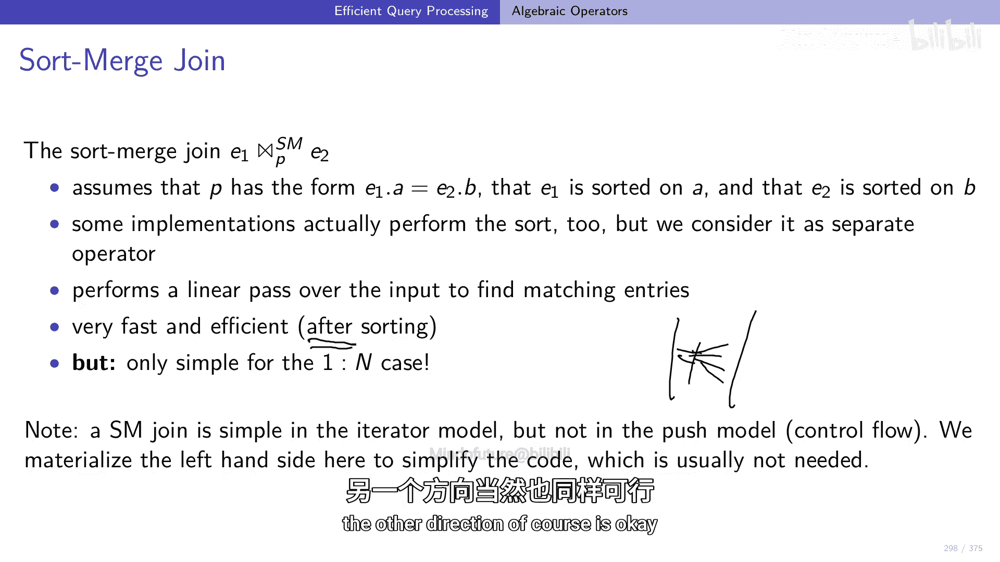

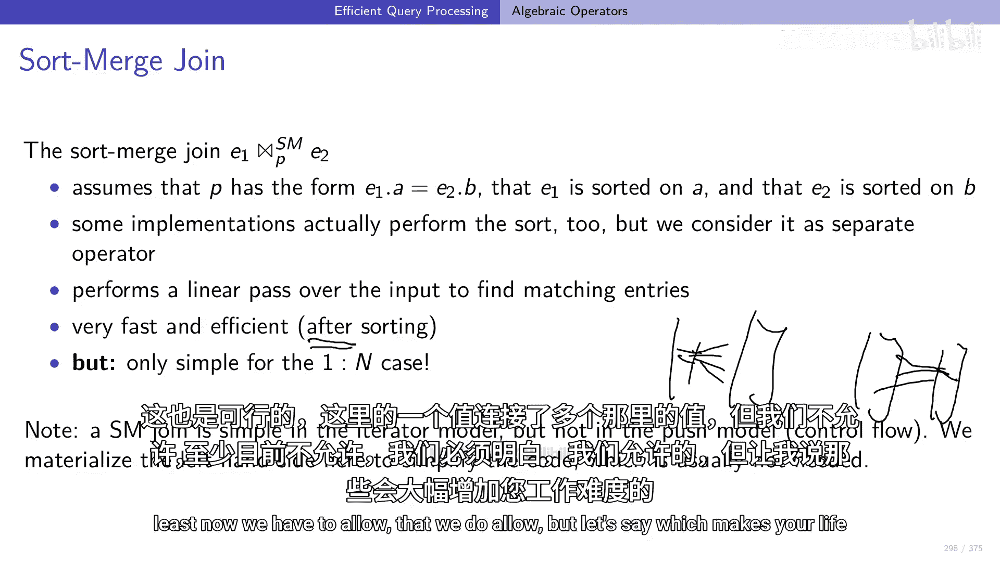

---

## 简单操作符的实现

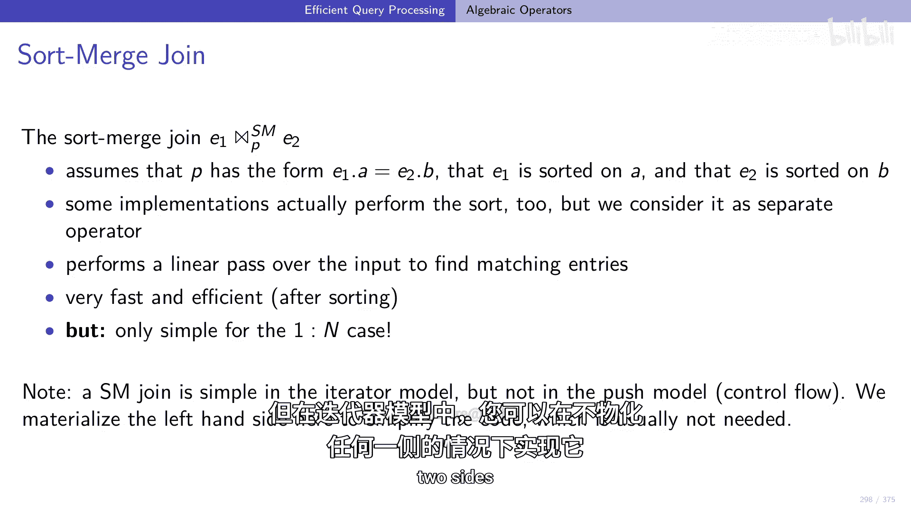

### 表扫描

表扫描只是产生关系中所有元组的内容。概念上超级简单，但实际实现可能更复杂，取决于表扫描做什么。

首先，表扫描必须导航物理表示，这意味着必须找到数据存储的位置，这可能不简单，取决于存储层的工作方式。

一个相对简单的表扫描实现示例如下：在第一个循环中，查看所有页区段，查看属于该关系的页面序列，查看页区段 E，然后循环遍历页区段中的所有页面，固定页面，最后循环遍历页面中的所有元组并将其传递给消费者。

当然，这里隐含地必须有某种加载逻辑或至少惰性加载。必须有某种方式加载属性值，附加元组并传递给消费者。当页面处理完毕后，取消固定页面并转到下一个页面或页区段。

这已经比之前看到的更复杂，但仍然过于简化。真正的实现会更加复杂，例如需要处理快照隔离：如果有多个事务，如何确保只看到对我可见的元组，而不是被另一个事务更新的元组？可能在这里有一些事务逻辑。可能还需要处理延迟更新，有时不想立即更新，因此必须将待处理的更新合并到扫描中。表扫描可能还能够评估谓词，这通常是个好主意。可以告诉表扫描只输出满足 `x = 5` 的元组，表扫描将在此级别过滤，而不是在顶部进行选择。如果物理表示允许跳过保证不符合条件的元组，这通常是个好主意。因此，有动机让表扫描理解谓词，因为这会使其更快。因此，即使表扫描在概念上非常简单，实现起来也可能不简单。

### 选择

选择确实非常简单，没有什么可做的。我们过滤所有不满足谓词 P 的元组。概念上非常简单，事实上许多系统甚至不这样实现。相反，将选择谓词附加到前一个操作符上。查看选择的输入，并说“请在输出元组时检查这个”。有时合并选择到下面的操作符是有意义的，但不一定。如果表扫描非常廉价，可以实现一个单独的操作符，但有时希望合并它。

在选择的生产者-消费者接口中，选择的 `produce` 在其输入上调用 `produce`，选择的 `consume` 检查谓词。如果为真，调用消费者的 `consume`；否则丢弃元组。

### 映射

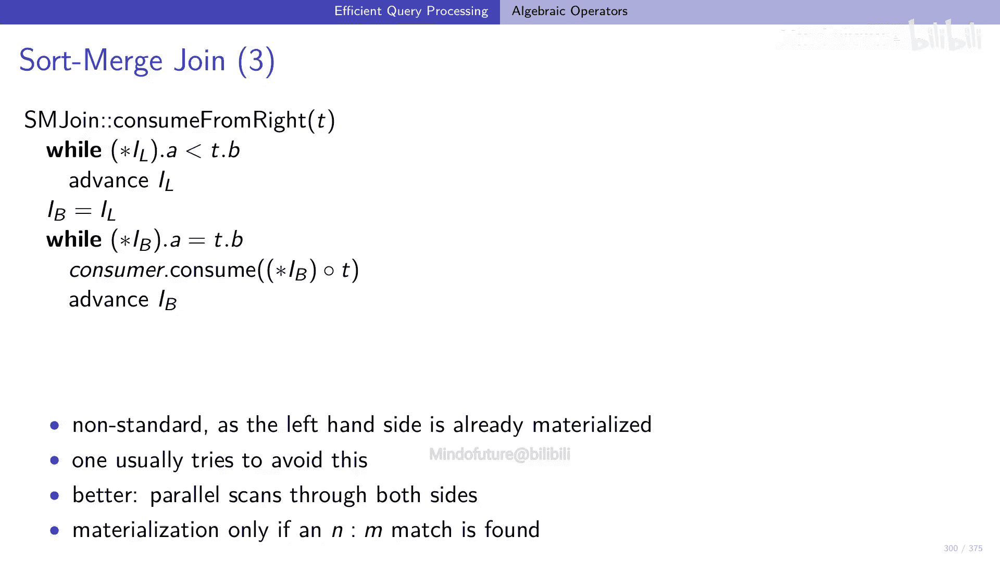

映射也是一个简单的操作符，可能是最后一个简单操作符。映射通过评估函数 F 来计算新列。同样，有些系统允许将映射附加到下面的操作符，但这更少见。实现是：如果调用映射生成值，我们只需在输入上调用 `produce`。如果元组到来，我们评估函数 F，计算新列，将其附加到元组，然后将组合结果传递给消费者。

---

## 连接操作符的实现

现在，我们来到一个绝对不简单的操作符：连接。这是一个非常复杂的操作符，很可能至少需要两种实现，甚至可能需要三种，这取决于查询优化器的能力。

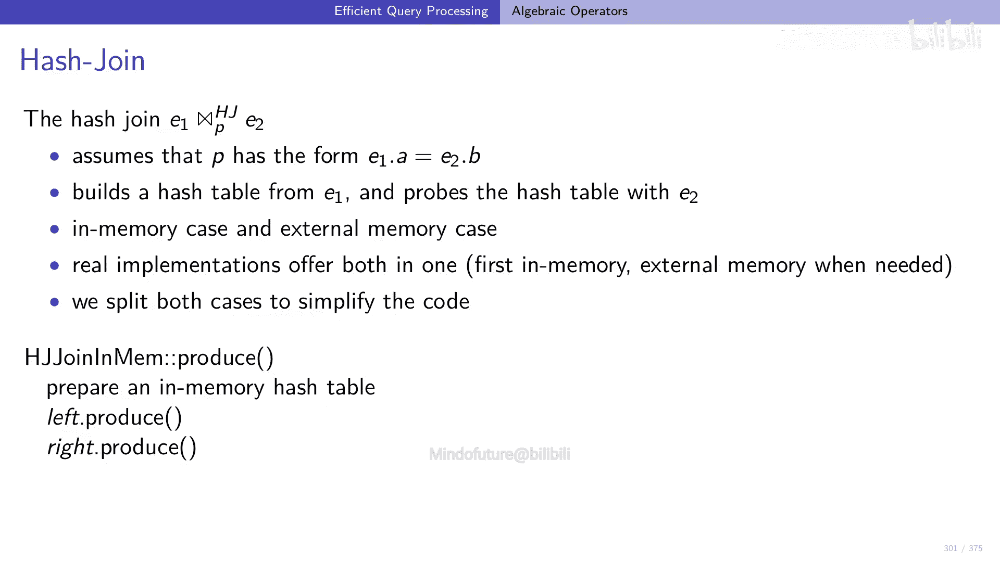

为什么至少需要三种不同的连接实现？三种是下限，可能很容易有四种或五种。

第一种情况：如果连接 E1 和 E2，且 E2 依赖于 E1，则必须使用嵌套循环连接。因为这是一个依赖连接，必须为左侧的每个元组评估右侧。这需要嵌套循环连接，这是我们唯一的选择。嵌套循环连接的性能非常差，应尽可能避免。有些正在构建的系统没有嵌套循环连接，这怎么可能？因为如果查询优化器足够智能，可以消除依赖连接。用户可能编写了一个包含相关子查询的查询，这迫使进行嵌套循环连接。如果查询编译器足够智能，可以重写查询，使内部查询不再与外部查询相关。如果能够做到这一点，就不需要嵌套循环连接。但要完全消除嵌套循环连接，必须保证这种重写总是成功，这相当复杂，但是可能的。大多数数据库系统必须实现嵌套循环连接。

第二种实现：如果连接谓词是 `A equals B` 的形式，可以使用任何连接算法。这是最常见的等值连接情况，大多数时候会使用哈希连接，因为它通常是最快的实现。

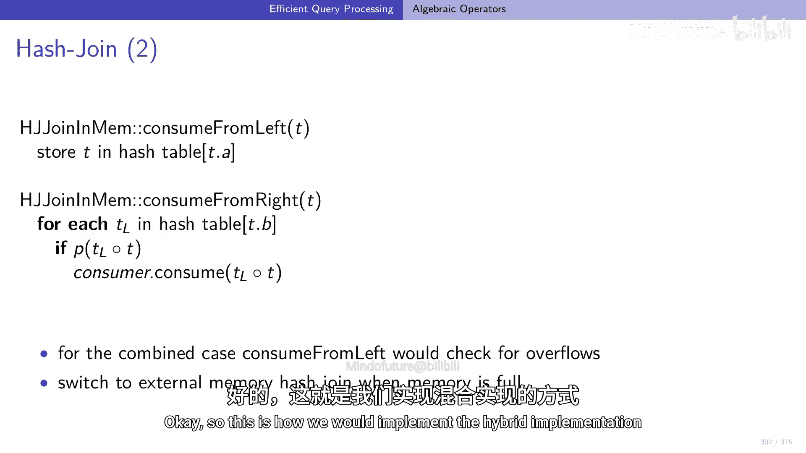

第三种情况：如果两侧不相关，但也没有相等条件，则可以使用嵌套循环连接（出于性能原因不希望）或块式嵌套循环连接。

因此，可能需要实现的连接算法列表包括：嵌套循环连接、哈希连接和块式嵌套循环连接。可能还想要更多，如排序合并连接，但这是最低需求。

### 嵌套循环连接

嵌套循环连接是最灵活的连接，也是最简单和最低效的。永远不要使用嵌套循环连接，如果可以避免的话。代码非常简单，但不要这样做。实现是：在嵌套循环连接上调用 `produce` 时，在其左侧调用 `produce`。当从左侧收到元组时，存储它，并请求右侧生成元组。当从右侧收到元组时，将其与存储的左侧元组合并，检查谓词，如果为真则调用消费者。这类似于笛卡尔积加上过滤。

灵活性高，可以使用任何谓词，但性能差，运行时间为 O(n²)，对于大数据集不可接受。

### 块式嵌套循环连接

嵌套循环连接的改进是块式嵌套循环连接，这是一种更合理的变体，效率更高。它也可以用于任何谓词，可以检查 `A < B` 或更复杂的条件。

算法上，嵌套循环连接为左侧的每个元组评估右侧，这非常昂贵。块式嵌套循环连接说，至少可以减少对右侧的遍历次数。做法是：将尽可能多的左侧值加载到内存缓冲区中，然后评估右侧，并将缓冲区中的所有值与右侧值比较。一旦完成，加载新一批左侧值到缓冲区并重复。

这仍然在渐近意义上是 O(n²)，但通过一个非常大的常数因子改进了运行时间，对于实际目的来说可能快得多。当然，如果可能，仍然应避免使用块式嵌套循环连接，使用哈希连接。但对于某些无法用哈希连接评估的谓词，块式嵌套循环连接是需要的。

实现时，需要一个缓冲区来存储元组。初始时清空缓冲区。调用左侧的 `produce`，当从左侧收到元组时，检查缓冲区是否还有空间。如果缓冲区已满，则在右侧调用 `produce`，这隐含地与缓冲区内容进行连接，然后清空缓冲区，存储新元组。当从右侧收到元组时，与缓冲区中的每个元组比较，检查谓词，如果为真则传递给消费者。

### 排序合并连接

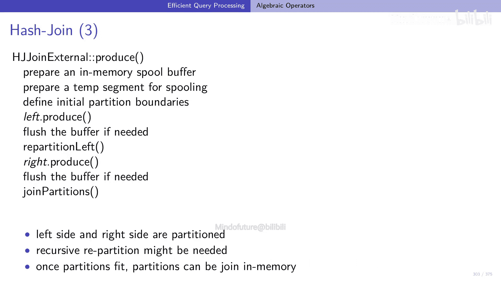

排序合并连接是历史上商业系统实现的第一个合理的连接算法。假设谓词形式为 `E1.A equals E2.B`，并且假设 E1 在 A 上已排序，E2 在 B 上已排序。

排序合并连接的好处是，如果输入已排序，则只需要对两个输入进行一次线性遍历。扫描它们，并始终跳过较小的值。当遇到两个相同的值时，就有一个连接伙伴。然后跳过，连接伙伴，跳过，依此类推。对输入进行线性遍历，无需额外内存。

但昂贵的部分不是合并，而是排序。排序是 O(n log n) 操作，合并则非常廉价。因为这里讨论的实现不进行排序，所以这个操作符看起来超级廉价，但排序是前提。

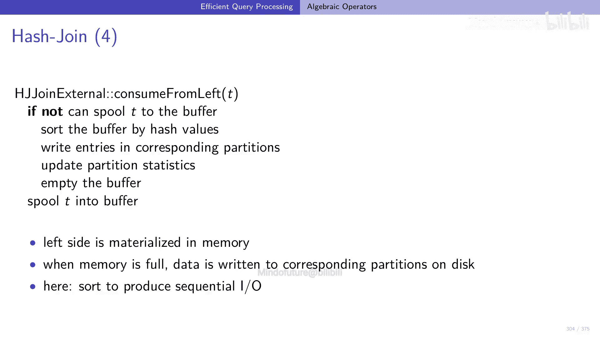

另一个问题是排序合并连接在只有一对多连接时超级简单，但如果出现多对多连接，则排序合并不再那么简单。有趣的是，排序合并连接是唯一一个在推送模型中不能很好实现的操作符，在迭代器模型中很容易实现。在推送模型中，我们通过物化左侧来解决这个问题。

实现排序合并连接时，准备一些内存来物化左侧。扫描左侧，将值写入临时段，并设置迭代器指向第一个元组。然后扫描右侧。当从右侧收到元组时，检查当前迭代器是否小于当前值，如果是则推进迭代器。然后记住这个位置，只要迭代器值等于当前元组，就输出连接结果并推进迭代器。这处理了重复值的情况。

### 哈希连接

再次像排序合并连接一样，假设连接谓词形式为 `A equals B`。做法是为左侧构建哈希表，然后探测右侧值的哈希值。当然，有内存中和外部内存的情况。内存中的情况相当简单，外部内存的情况则不那么简单。实际上，可能希望有一个混合实现，因为不知道输入有多大。首先尝试在内存中完成所有操作，如果内存耗尽，则回退到外部内存算法。

#### 内存哈希连接

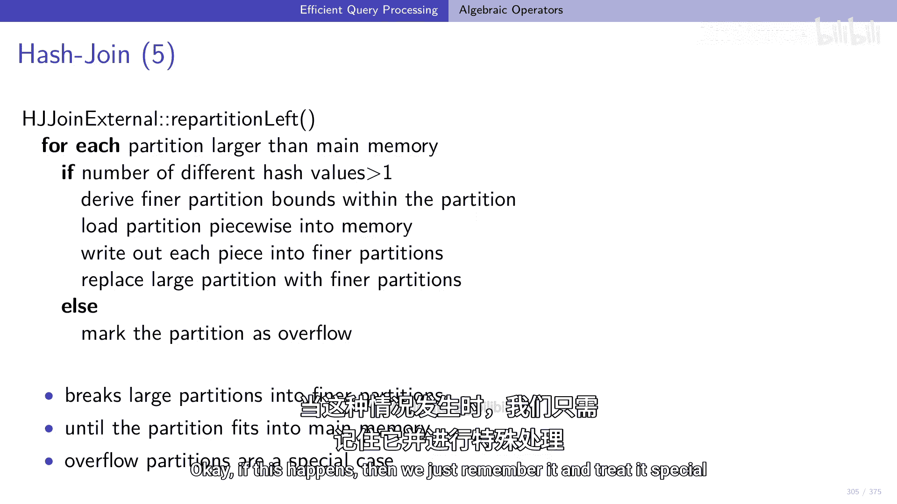

调用内存哈希连接的 `produce` 时，准备一个哈希表来存储左侧的所有值。然后扫描左侧，将所有内容放入哈希表。然后扫描右侧，检查哈希表中的连接伙伴。如果统计信息有利，该算法具有线性运行时间。但要注意，如果连接产生大量输出，运行时间可能超过线性。

实现时，当从左侧收到元组时，只需将其插入哈希表。当从右侧收到元组时，在哈希表中搜索连接伙伴。找到后，仍然需要检查谓词，因为哈希冲突可能导致误匹配。如果谓词通过，则确实有连接伙伴。

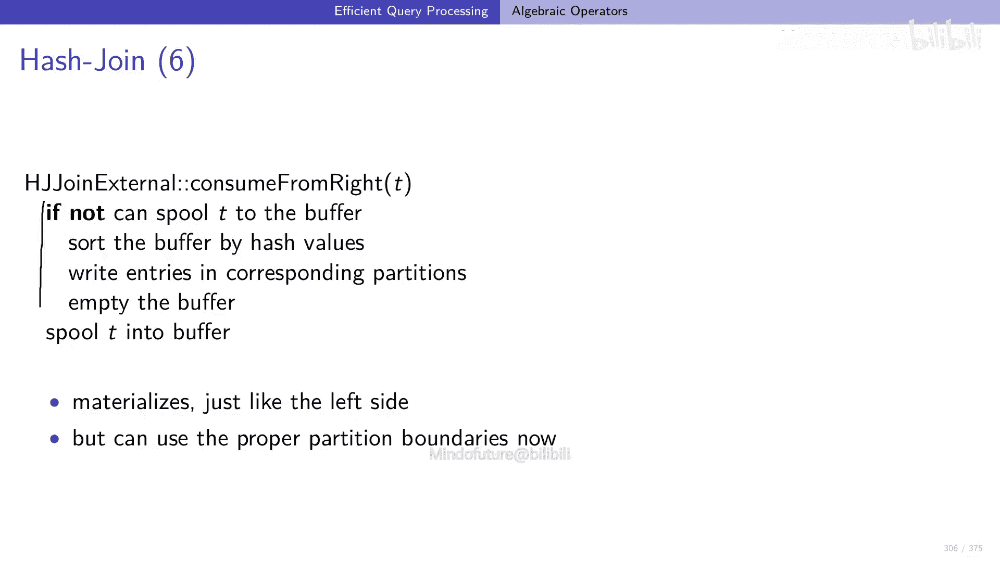

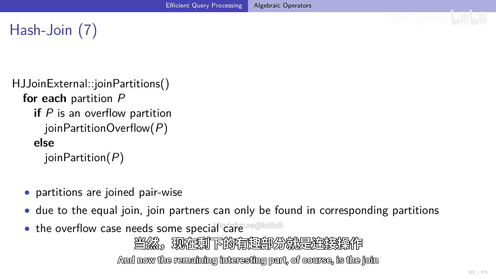

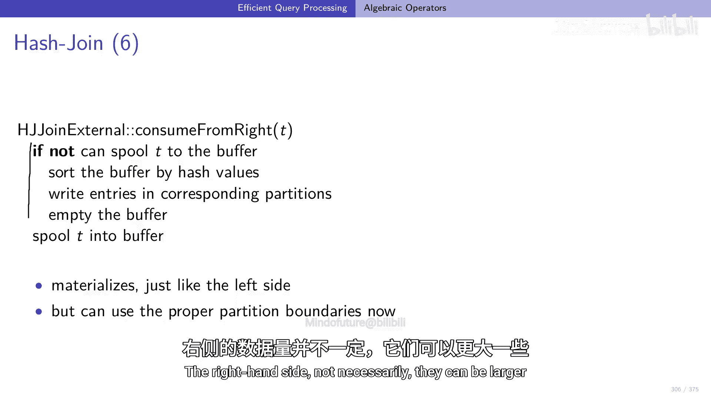

如果想要更灵活，在插入前检查空间。如果空间不足，则回退到外部内存情况。

#### 外部内存哈希连接（Grace 哈希连接）

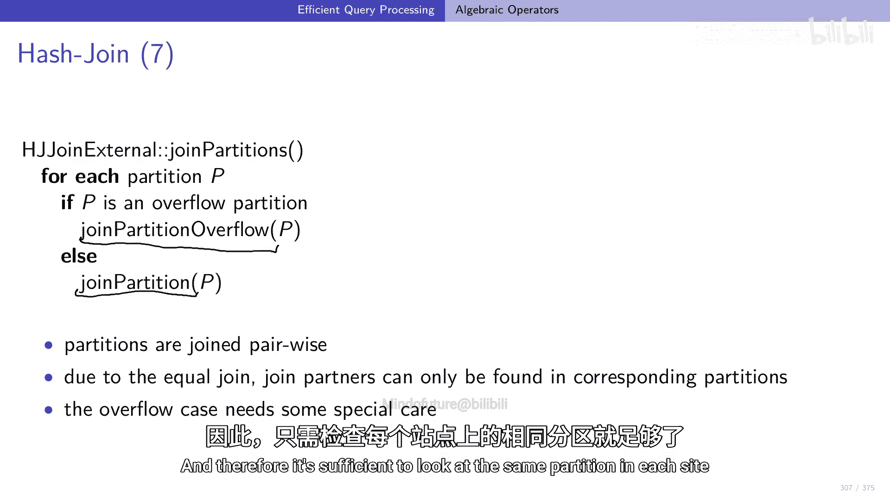

如果数据不适合内存，则变得非常复杂。这就是所谓的 Grace 哈希连接。

算法是：将左侧分割成若干分区，使得每个分区适合内存。分区数量取决于关系的大小。然后以相同标准分区右侧。连接伙伴只能出现在对应的分区中，因此只需查看对应分区。

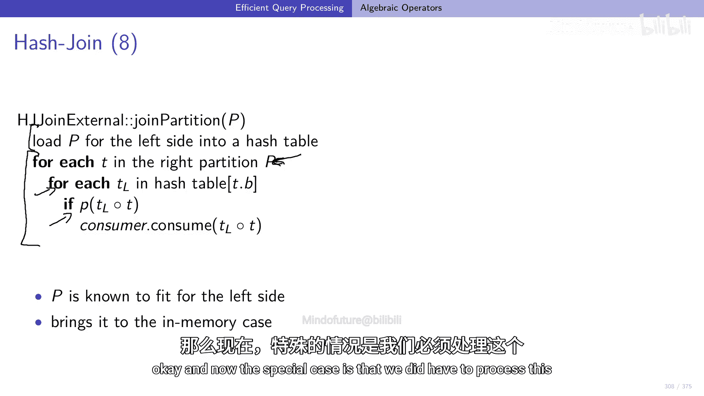

有时可能需要递归重新分区，因为我们希望分区使得左侧的每个分区适合内存。我们使用估计值，但有时可能猜错，如果分区仍然太大，则必须递归重新分区，直到每个部分适合内存。

一旦分区足够小，问题又变得简单，回到内存哈希连接的情况。

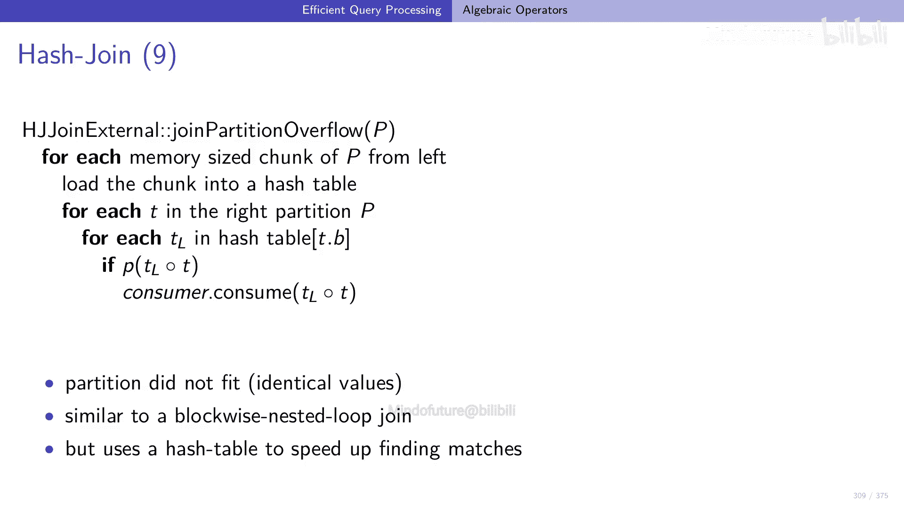

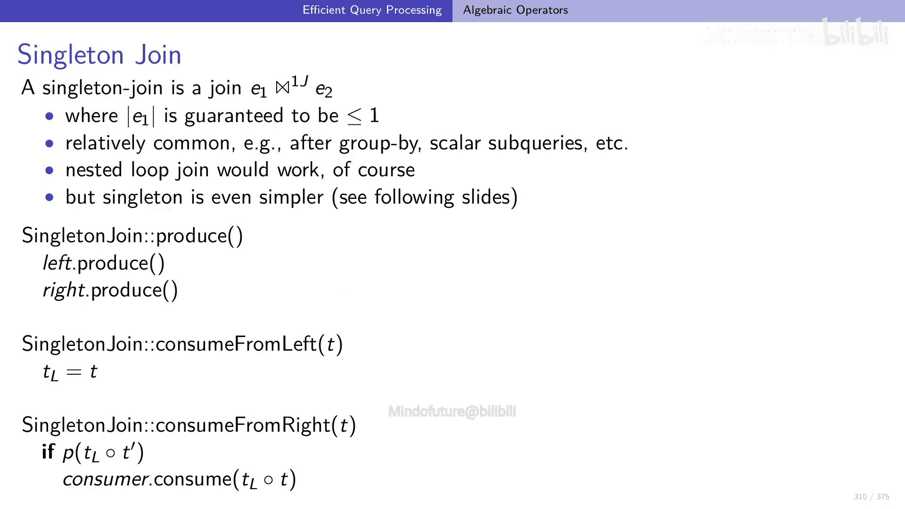

实现步骤：
1.  准备内存缓冲区和磁盘上的临时段。
2.  定义初始分区边界（基于统计信息猜测）。
3.  在左侧调用 `produce`，将左侧分区到选定的分区中。
4.  刷新内存缓冲区（如果仍有元组）。
5.  如果需要，重新分区左侧。
6.  读取右侧并将其分区。
7.  再次刷新缓冲区。
8.  最后，产生所有连接伙伴。

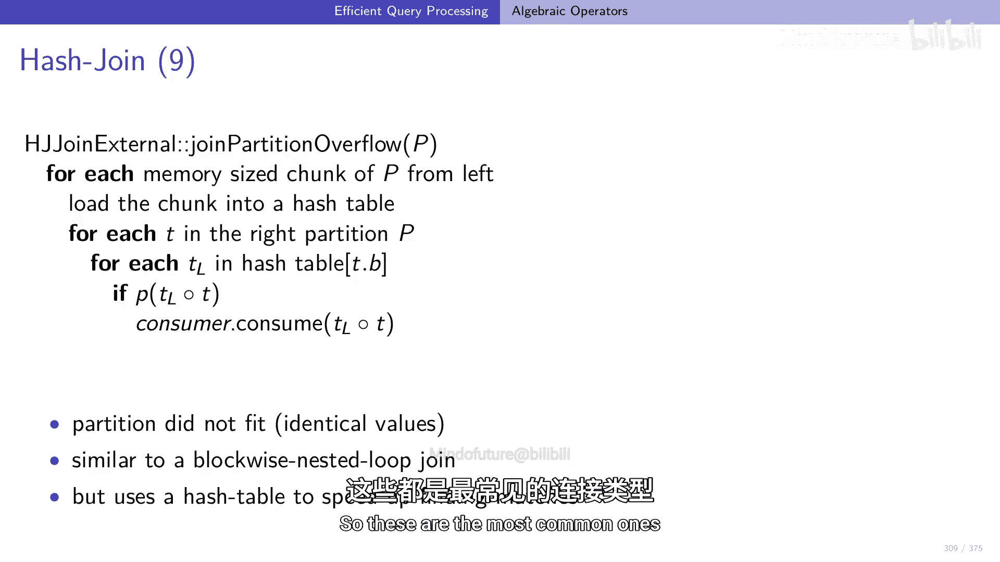

这是一个完全流水线中断器，因为在产生任何输出之前处理了左侧和右侧。

处理左侧元组时，尝试将其放入内存缓冲区。如果缓冲区已满，则按哈希值对缓冲区中的值排序，并将其写入磁盘上的相应分区。更新分区统计信息，清空缓冲区，然后存储新元组。

处理完左侧后，检查分区是否合适。如果分区太大，则重新分区：循环遍历所有分区，检查是否大于内存。如果是，检查哈希值范围。如果只有一个哈希值（大量重复），则标记为溢出分区。如果有多个哈希值，则找到新的分区边界，重新分区。

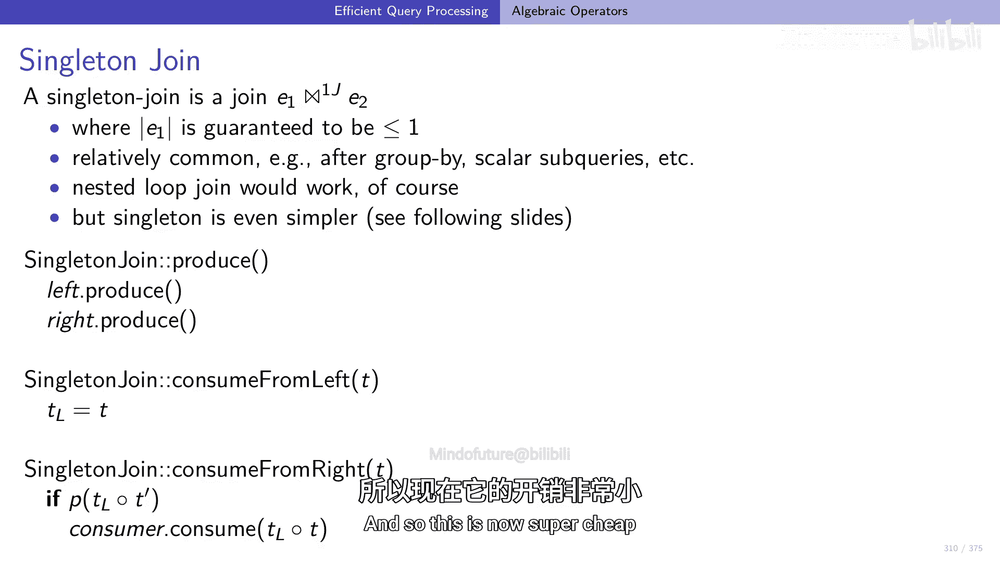

处理右侧元组时类似，但此时分区边界已确定。

最后，连接分区：对于每个分区，如果是常规分区，则将其加载到内存哈希表中，然后扫描右侧对应分区，进行连接。如果是溢出分区（大量重复值），则分块加载左侧到内存哈希表，然后多次扫描右侧分区，类似于块式嵌套循环连接和哈希连接的结合。

### 单值连接优化

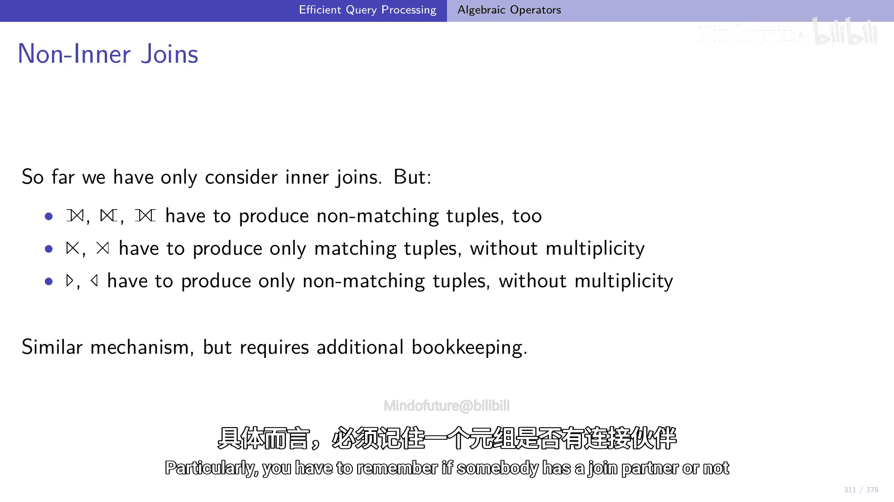

可能优化左侧最多只有一个元组的情况。例如，绑定主键时，最多只有一个元组。其他情况如分组或标量子查询也可能只产生一个值。

单值连接甚至比嵌套循环连接更简单。实现时，在左侧调用 `produce`。当从左侧收到元组时，复制它（最多发生一次）。当从右侧收到元组时，将其与复制的值合并，检查谓词，如果为真则输出给消费者。

### 非内连接实现

到目前为止，我们考虑的都是内连接。但还有外连接（左外、右外、全外）、半连接和反连接。

对于外连接，必须输出没有连接伙伴的元组（用 NULL 填充）。对于半连接，只输出有连接伙伴的元组（去重）。对于反连接，只输出没有连接伙伴的元组。

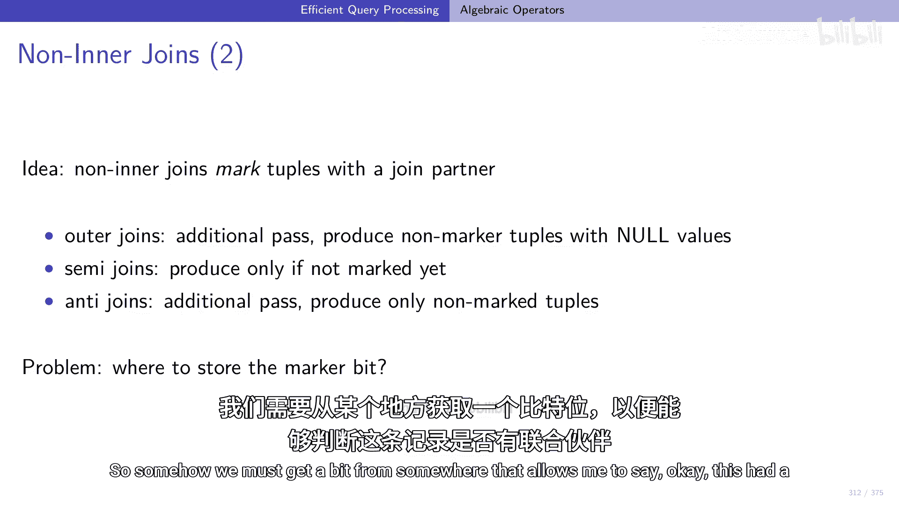

在高层次上，可以实现所有这些连接，就像常规连接一样，但需要额外的簿记，特别是需要记住一个元组是否有连接伙伴。

想法是对于非内连接，标记一个元组是否具有连接伙伴。运行常规内连接，找到连接伙伴时进行标记。然后对于外连接，额外遍历数据，检查标记。如果已标记（有连接伙伴），则已输出；如果未标记，则输出用 NULL 填充的元组。对于半连接，只在第一次找到连接伙伴时标记并输出。对于反连接，运行常规连接进行标记但不输出，然后额外遍历数据，只输出未标记的元组。

标记左侧通常很容易，因为左侧位于哈希表中，可以预留一个位或字节来标记。

标记右侧则不那么容易，取决于操作符类型。如果只读取右侧一次，可以使用局部变量标记。如果需要多次读取右侧，则需要维护一个额外的数据结构来记住哪些元组被标记了。由于查询中通常具有局部性（要么全部连接，要么全部不连接），可以使用区间压缩来高效存储标记信息，例如使用 B 树存储区间，并在区间相邻时合并。

---

## 总结

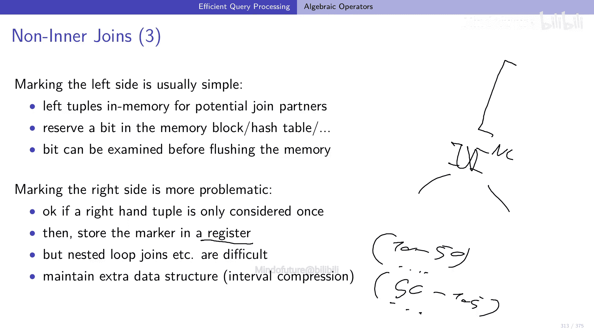

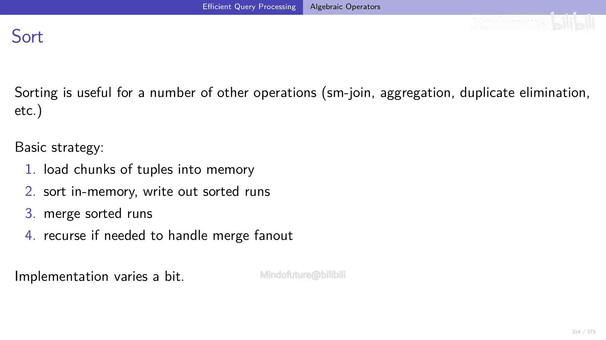

本节课中，我们一起学习了数据库系统中核心操作符的实现方法。我们从操作符的组合模型（完全物化、迭代器、块处理、推送）开始，然后深入探讨了扫描、选择、映射等简单操作符的实现。重点讨论了复杂的连接操作符，包括嵌套循环连接、块式嵌套循环连接、排序合并连接和哈希连接（内存和外部内存），并简要介绍了非内连接（外连接、半连接、反连接）的实现思路。我们还涉及了谓词表达式评估的几种策略（解释器对象、字节码、向量化、机器码生成）、流水线概念以及并行化的基本考虑。理解这些实现细节对于构建高效的数据库系统至关重要。