# 【慕尼黑理工大学】现代CPU架构上的数据库系统实现-｜-Database-Systems-On-Modern-Cpu-Architectures-2021-p12-P12_(最终)_12_代码生成--BV1asiJBeE6j_p12-

Welcome to this lecture on database implementation so in the last lecture we have looked at joint implementation and different ways to implementation non ands today we want to continue with the remaining operators。

So and we start with sort So is an incredibly useful operator because you can implement many of the other operators using sorting not necessarily a good idea from a performance perspective because usually we prefer heshing over sorting because hesing is usually faster but nevertheless sorting is a super versatile scheme and so if you want to minimize your implementation effort you can just implement sorting once then map nearly everything else to sorting for example sort merge on you can use do aggregation using sorting we can replicate elimination。

 many， many other things so sorting is a super powerful technique。So and now how do we sort。

 actually we talked already in the beginning of select about sorting if if I remember correctly you have implemented already external sorting at the beginning as an exercise if can clipse is reasonably brief。

 but basically what we do is。First， we load as much as we can into main memory。

And then this in memory。Using some algorithm。And then we write out a sorted run so we have a randomly sorted data input。

 then I make my memory a full as sort as memory and then I've write this to disk so then I have a sorted run so we code as a run。

 then we load the next piece in memory and write it out and so on and the ad we have many many sorted runs。

And now once we have this， what we can just do is we can merge them。

YeahAnd so we read them sequentially both of these here。

 we start reading this as we start reading that and we always look what is the smallest and then we create from these two sort runs a larger sort run。

 there's no the merge diagnoses now and if we are lucky we are done with just one merge pass if we arere unlucky we have to do this repeatedly to handle the merge vector so it could be that we cannot merge an arbitrary number of runs。

 but for example only two and then we have to use of course multiple times。Okay。

 so this is a very high level strategy for external sorting now how you really implement this so there are many。

 many details here what we can do to how we various implementation。😊。

And but first let's talk about the generic algorithm here。

 So this is sort as producer consumer model leaving out all the details。

 and also at least critical details。 So this is true basically for all implementations here。

 So when we ask the salt writer to produce data we just ask our own input here to produce data So at this point if we get all the data now we flush whatever we have into disk because could be that we still have data and disk and then we merge the partitions that we have only one partition left and now our problem is trivial because this part now sorted。

 So what we do is we just loop here over all templates in sorted partition and for each tu here to。

To my consumer。 Yeah so I just say here table and when we when we get a table here and those consume function。

 So then we check if we have still space， if yes， we just stored in memory if not my memory is full。

 I flash my memory and afterwards I have new space against all the data Okay so this is high level how sorting works。

 of course what left out here how do these functions work Yeah flash and merge。

 So this is basically critical questions。 So what do I do if my memory full What do I do after I have written or sort runs So these are basically the the design points I have when implementing sing。

😊。

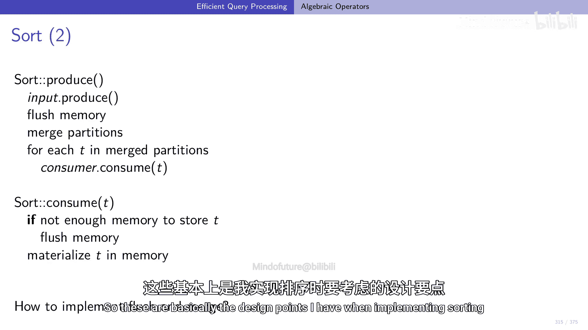

Okay， and now the easiest solution for flushing is。😊，You make your memory for it。

 then you call a quickword。Yeah， so at this point， if course everything is sorted。

 now you write everything out and we release memory。😊，Okay。

 good thing easy to implement Also the sort algorithm is fast now a quick thought if you may implement this carefully is a very fast algorithm。

 so this is a good choice if you implement this carefully。😊，And now。Stretly speaking。

 there are better ways to do this， of course， depends on your definition or better。

 but at least if you expect that you have a slow external memory。So if we go to disk basically。

 then we might favor the second solution here， namely we implement not Quicksaw but Heap salt br replacement selection。

OkayNow what does this mean， this is actually very interesting technique。

 so I hope you all remember how he sort works， so though we have here own arrays。

 this is a sorted he， so my smallest limit is here。😊，So I just create some random he here。Now。

 let's say。So this here， for example， would be a heap。

Yeah so every element is smaller than its its childrens and this is true here。

 So this here is sorted is is a has satisfied he condition。 Now。

 if a new value comes so let's say we want to insert for example as a basic with the heat we when tuts come the first which the heap until the heap is full。

 Now a new tupper comes。 Now， for example， we now comes the value let's say。6。So my hips foil。

 I kind of put he6 in deep What I do now is I've write out the smallest element is0。

 so I've right0 here my to my so then I remove the0， I replace it with the last element to my hip。😊。

F now I restore the hip condition。I see is this year violate hip condition。

 therefore I swap the five here with the small of my two children， so this year。5 ands 2。Yeah。

 and sorry， you know， again， restore zip conditions， this is again violated here。

 So we swap these two here。So now he condition is restored， and I am。

And I have a free space so I one free space so I can insert6 into my he and this in fact fits here。

 he condition is satisfied。 So now I successfully inserted 6 now just wrote a 0。

 So and I insert in okay so I can continue doing this until I can continue adding new elements so it takes the smallest limit from the he insert the new element into the hip until I hit an element that is smaller。

 Yeah， for example， the next limit I would remove the two of course， so then yeah again。

 I would restore the hip condition I would swap this for example with different ways implement this but once I swap it with6 again now hip condition is violated so I repair this swaps this here with three。

😊，And then， this。6ix and then again， a CSE violations was an I。So swaps us again。

And now my hip condition is restored。 Okay， now， but now what happens if somebody in now tries to insert a one。

So assume the new pages is coming there one。 So this。

 of course this I can no longer add it to myhiPA， of course， I've already written out two。

 So if I would add my one into myhip， I would violate my my sort order。And that。Therefore。

 what I do now is I say， okay I reduce my hip by one。 So I might make a double bar。 you say okay。

 my hip could just got one element smaller。 and instead I store the one into a new he on the other end。

 Okay and my I can continue running my current element again if a new element comes the one I have to to my extra he。

 but if next element that would come would， for example be at 2。

 So then then I could take the three here and next out。😊，Takes us three。So what put here is 6。

Restore the hip condition。So it first remove this restart hip condition， hip conditions violated。

 swap 6 and 4。6， no， hip condition satisfied to this is he begin。 I feel free space。

 So I enter the 2 and then I'm done。 Okay， so 2， I can do。 So and so of course。

 as long as my elements are roughly increasing， I can easily add them to the heap。 If I get outlier。

 So out I that as smaller than as smaller as this failure。 I have added。

 I add them to the end of the he and the he shrinks over time。 And at some point， of course。

 my hip is empty。 So my my first he is empty everything in the second he。 And then at this point。

 I stopper run。😊，And I can have use a new space that I have as new he Okay so this is called replacement selection。

 Hesshot with replacement selection。 And the good thing is if you do this you produce longer runs than if you do quickword because in a quick sort you only write that run that is as large as your memory memory with replacement selection is larger than your memory memory as we see in the example Now how much larger depends but so mean there are some cases you can see one is if input is already sorted or nearly sorted you write out only one run which is super great because it's not that uncommon that input is sorted like if relation that is sorted by date roughly because people insert in the date order So if you want to sort this result by date replacement selection。

 we could a single run so one pass of the data and you're done。😊。

By quickword would would cutes in many paces。 and on average。

 we can see that we expect that the run length we get is twice as long as my memory size。

 Now best case。😊，One run typical case， double memory size。

 And if you look in in the book the art of computer programming back news。

 he shows why we expect double double run as input。

 you also just talk about some implementation is in T Okay so this is great。

 So replace selection actually is better than quickword if you go to disk Now the only unpleasant thing is mean replacement selection is good if you input as fixed lengths because then I can easily remove and replace if you have variableize says input。

 then replace selection actually quite difficult to implement。 it can be implemented。

 but this is much more difficult to implement if you have variable Quickword， of course。

 the heads and left this problem。😊，Okay now what about them this is a flash side now what about the merge side So usually we merge on the fly。

 which means we take all runs here and so in first run， second run。

 third run and so on and we read all of them sequence in parallel and we always output the smallest element only question is how do we find the smallest element because in theory here this could be large number。

 at least a reasonably large numbers So some n here and you all have to find the smallest element from n things here the best way to implement is it means then if。

😊，We need the real Efa， of course， we don't do The really Efa would be to loop over all elements and fix the smallest。

 Don't do this terrible runtime。 Okay， don't do this better way， use the priorityq。

 Only problem is this is especially kind of pro Qq here namely we take the smallest element out。

 then we want to replace it with the next element in my run So for example。

 if this here has the smallest one1， then a5， then I priorityq I would have that one is the smallest for that one here and that4 is the smallest from that one。

 Also then I would want to remove one and replace it with5 and you can do this， of course。😊。

Using a regular project queue like a he but you can do better now the about the most efficient way to implement this is three of losers。

 which is also explained in the book by news or you can have some other fancy data structures that project queue that allows you to do updates efficiently so we keeps for example or some other implementation。

regulargular heap is also quite okay。 you do unfortunately so an Eva implements just twice the number of comparisons to have three of losesrs so three of losers improves the number of comparisons by factor2。

 but now is not a super great difference even in EHeap would be okay because at least you get local red cost。

And now the only question is what do you do is n is too large because depending on your hardware。

 it could be that you cannot merge an arbitrary number of runs mean historically when we I think in the beginning of lecture I talked true really this but usually I do perhaps I didn't reduce this recording usually I talk about external memory sorting with tapes because this is where the people who invented external memory sorting and of course there you can only merge giving how many tape drives you have if you have four tape drives you can only merge four runs of course and red you can merge less because you have to auto over write to the output but so you have a limited number of devices that you can read。

If you read from SSD， your magic might not be an issue for you to use and you can really emerge a height number。

Perhaps not an unbounded and high number because at some point it becomes inefficient to read from so many runs。

 So if you have too many runs， then you do a partial merge。

 which means you take a number of runs that you can merge and produce a larger run from this and you do this until a total merge becomes feasible so this is how you may implement external memory sorting。

😊，Now， what other operators do we need， one here what we need for a secret， of course， is group I。😊。

So let's say somebody uses assess。Yeah， select。Some x from。Group by。Rup by why。

And so this is supposed to be next。So the easiest way to implement this is you take your input。

 you sort it by y， because then you know that the is xy pairs， x y， so x4， y5。

 x 10 by 5 if you sort them。😊，5。So if you sort them。

 of course aggregate is trivial because I just read my inputs sequentially I sum up these numbers。

 I sum up that numbers and then I'm done Okay， so one main put to sorted problems solved trivial aggregation only problems of course I have to sort and sorting is not cheap Now sorting is N log n So this is not exactly cheap to do。

😊，The alternative is to use the hash basede group I。So in that case。

 you would aggregate into a big hash table， this works fine as long as everything fits if my data does not fit in memory then I have to split my hash table to disk and then I have to merge the speed partition this actually works just like a hash join if you think about this And so this is we built a hash table just in a hash join as long as everything fits great if it doesn't fit I split my input into partitions organized by hash value and then I merge within a partition so I have to reach the partition again and then find duplicates and then merge them。

😊。

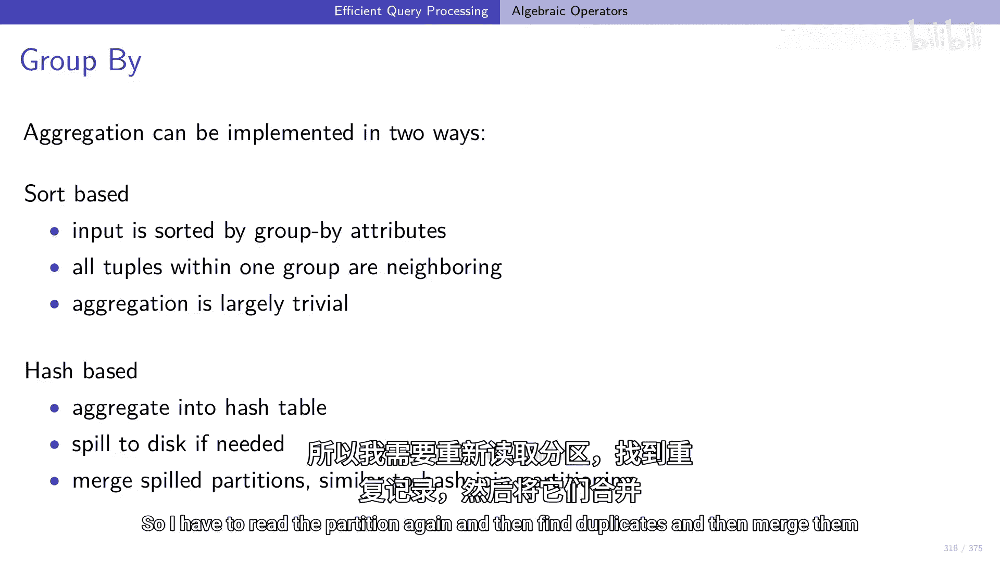

Okay， so the， so this is an implementation here for an in memory group I。

So we initialize an hash table in the beginning of course。

 then when I can produce and I read my input and afterward everything is done actually after my input is processed I have already reside so therefore I can to produce my output adjust scan or groups and hash table and I output each group to my consumer now also the real aggregation work is performed here and the consume function so the consume function a new topic comes and I assume a group by a here so this is my group I attribute so I check in the hash table if a group for the values a already exists。

😊，If yes， I update the group also if for sum I increase the sum of whatever I do。

 So if I count I increase the counter and this point I update my aggregation functions here。

 otherwise I create a new group for this for this value。 So therefore had had the examples here。

 but say I said I think X Y was something like3，5，6，5，7，5，2，6，8，6 and something exist。

 So I would in this case its sorted of。😊，Yes， seems really easy。 No， assumes it this is not sorted。

 or I don't know that this is sorted。 So I want to do it head paste。

So so these values now come to me so the first value comes I check the mesht mesht with empty so I create a new group say okay for the for the value 5。

 my aggregation is now3 okay next table comes which again check here5 and now I update my aggregate here from3 to6 next value comes I aggregate my update my aggregate from6 to 13。

😊，Then the next value comes over happen as this group I don't have already so I have create a new group with 2 Next value comes。

 I update a group where I value was28。😊，And that that's it。Okay， actually quite simple to implement。

 now I said it's quite simple to implement what is potentially not so simple is whatever means some count is okay。

 but what about min max。 Yeah， so you can also maintain minute max。😊，And。

For some attributes that here mean if these are numbers。

 no problem it just works just the same if these are strings。

 that is not so easy because could be that the smallest or the largest particular largest。

 but also the smallest is larger than the initial value that you get and so the first time you see this group by you see a certain and string value。

 but there could be other string values that by in short order greater or less。

 but in lengths longer。Yeah this is of course a problem and there are different ways to take it this but the easiest way to take it this is to reserve the maximum space because you know how long the values can be at most you can derive it from the schema so you reserve enough space to you can store those so the longest possible string then you can also evaluate million max or alternative would be you relocate so you create a new group there a different way to implement this but let's say a variable length is a bit tricky。

😊，But without reing， everything is okay。So this was a basic primitive so we have already talked to join sword group I。

 there are some other stuff you can do in a deadware system and one particular thing we can do as a set operations the union intersect except in a first glance look a bit like a join actually intersect here you want to find everything it occurs left and right So this is a bit like a drawing same is except looks a bit like an antijo but the behave slightly difference So therefore we we look at different ways to implement this and just for repetition here you hope you all know the difference between interect and intersect oil and it's the same for the other ones these left side here has set semantic。

😊，The right hand side here has multi set or back back is a different name for mighty set， multi set。

 semantic now or back。😊，So which means that the ones with oil do allow duplicates where the ones without oil removed duplicates and said duplicate free。

 might said can have duplicates， also therefore we may have them treat them somewhat differently。😊。

Okay， so first we look at engine oil I mean， this is trivial。 This does nothing。

 And so the oil is a trivial set operation， the only trivial set operationalally。

 we just take two relations in union them and。😊，Keeps them here。

 So here we say we take two tut streams。 I get two tu streams input it just concatets them。

 So everything from the left。 then everything from the right。 that's it。

 I might have to rename attributes， depending how it's implemented。 This does nothing。 Yeah。

 So most likely nearly no code。 Most likely this operator。 He does nearly nothing。

 we just execute one operator。 They execute another operator That's it。

 We might have to do some renaming。 but but it's trivial。 So no work is performed。

 So this is really easy。This one is not so easy， namely so this now we have to remove duplicates。

 so what we can could do is we could first run a union oil。😊，And then remove duplicates。

 iss actually a valid to implement it。 So this is what we see here。

 We say E1 union E2 is the same as running E1 union E2 with duplicates。 allowing duplicates。

 we draw by doing this this bar on top of this union operator。 So this means we do a union oil。

 we allow duplicates。 And afterwards， we group everything here by the the attributes this of course。

 remove duplicates。 group by remove duplicates。 therefore this is one way to implement。😊，Union。 Now。

 what we could do instead is we could directly write everything into one has table。

 like we built a has table and store everything from the left and everything from the right in the has table。

 this it could be a tiny bit more efficient than running a group I operator。 but in reality。

 this is nearly no difference。 And so this union is。

Nearly identical to groupi just union oil and groupi， so in fact， we can implement this。

 which's the same。Now what about others， So intersect So an intersect is similar to semi join。

 So basically E1 intersect E2 is roughly the same as E1 sim join E2 I say roughly the same because it's only the same if E1 is duplicate free now so if we have no duplicate in E1。

 then we can effect evaluate and intersect with a semi join。😊，And。

What we can do is we can figure out during the built phase so basically we put one of the two sites into a hash table and by building the hash table we can recognize if they have duplicates and if yes remove them so we don't solve duplicates in mesh table。

😊，And then afterwards， my Ht will step to get free， and then I can run a image on。😊。

And if I have already a drawn partner， I don't output the draw button again。

 so just use the mark technique that that we saw before So if that we saw for Zjo and so we remember if you have a join partner if not if you output this so this is one way to implement this。

Oh， alternative， if we look at how to implement you intersect O as we see in the next slide。

 and then we， we implemented。Basically using intersect equivalent to intersect oil。

 slightly different of course， that's equivalent。Now， from a performance perspective。

 this year is actually is a more efficient one。 But on the other hand。

 you have to implement intersect oil anyway。 Therefore。

 we can also lift into the intersect implementation if you want。

 I have over my time implemented both strategies。 Now So using intersect oil is easier。

 a separate implementation is a bit more efficient。😊，Okay， so how do we regulate inters oil？😊，Yeah。

 so it is this intersection with beximatic。 this is defined over the characteristic function。

 Now what does this mean characteristic function， This is basically the frequency function。

 So the characteristic function tells you how often an element occurs in a set。

 now so like if if you look at this mighty set here， it draws as a might set，3，4，5，5，6，6，6。😊，7。

 and I want to intersect this with set here that says1，5，5，6，6，9。Yeah， so that by the way。

 if you intersect this。It just oil， then we get a result here。Well it said 5，5，6，6， okay。

This is the answer。 and now how can we figure this out and if we look at the frequencies of these。

 we see the value 3 acquires once。😊，The value4 occurs once， value5 occurs twice。

 The value 6 occurs three times。 The value 7 occurs once。 This is the one side。

 The other side says the value 5 occurs two times。So value6 equals two times。 That's it。 no sorry。

1 equals one，52 times 6，2 times9 once。 Okay， and we say if we if we look at these frequencies here。

 we see in the inter and by the way this is quite characteristic function because this is a bijective mapping between the set and these frequencies。

 you can deduce one from the other。😊，And we can compute intersection now if it takes the minimum of the frequencies。

 so if we say we look at the value of 3， minimum of frequency of the port is0。

 so it's not on the set ones the same one minimum frequency is one， the mean frequency。😊，Good see。So。

4 minimum is 0。5 minimum is 2， therefore we have two in the set，6 minimum is 2，2 in the set，7，0，9，0。

 Okay so if we look basic， look at the frequencies of both sides， we count them。

 then if it takes the minimum of boths。😊，And then we output them。

OkayAnd how how do we computers if we just use a groupi because counting is just what a groupi operator does。

 So basically we do we take these two sets one， we computes we compute a12。

 here we compute a union all， then we do a group pi。😊，And then， of course。

 here we have to remember that we have come froms left。

 So basically we have to compute here value that says F is1， F is 2 or something like this。

 we have to figure out if we are left or right。 then we group by a。

 and here we then we we say here we we。Sum up。The value is there where f is 1。With sum of the values。

 the F is 2。Okay now I have gets the accounts from left right and after at the end here I filter that compute the minimum of these2 and then I shouldn't use filter use un basically。

Anest。😔，Un the quote this here count 1， count 2， and I un this here on min。C 1， C2。

So I take the minimum of these two counts and I replicate the top as often as the minimum of these two counts。

 and this is exactly the semantic of inter order。😊，Yeah， I。Count pos and just expensess。

 The good thing about this strategy is we have everythingsing already。

 engine oil is trivial group by wave oil also un， we didn't talk about un， but trust me。

 uns is a trivial operator。 We just take an integer value and then we replicate a template as often as integer value is So this is very easy here。

 And therefore it's pretty simple to implement。😊，And so we can use the standard algorithm that we have。

 we can also use as an external memory， everything is possible Now we can do slightly better if we are in memory。

😊，Because the way I have sketched it is we would count the occurrences on the left and on the right。

 So this is， on the other hand， if my memory is if my hast is in memory。😊。

And I get the top from the right， there no value from the left exists so I can immediately throw it away。

😊，And so basically， if I do， it is like all here of。One or two。

 and I get it a two value and I have no corresponding entry in in memory I do will create will never create a new group。

😊，If everything has fit because I know that obviously the count on the left must be0 if it is not in the memory。

 therefore I can find I never produce a nonzero count， I can immediately throw the table away。

 And so this is a small optimization that can be done here if my seeing everything did fit in memory。

 so the in memory case we can do slightly more efficient。😊。

And so the trick for intersect all is to go over the frequencies through the counts of the occurrences。

Okay， and。Now the last celebration that we are missing is accept So this is roughly like an antijo。

 the same argument as with inter in intersect intersect with this image join except as an antijo and we want to output everything from events one that does not exist in any too again only if it's duplicate free。

 but we just like with a nonin drawing implementation we can handle this using a flag and we can have a Fl data I have a drawn button I guess or no it never output it or no in this case it's safe anyway。

😊，Oh no， no， it's not safe。It's not not super precise。

 of course yeah now I must build a H table over E1 to do this。 And so then if I do this。

 then I can figure out if I have duplicates。😊，Or alternatively we know what's coming。

 we use the same strategy for except oil and except oil basically works like intersect oil。

 only in interect oil we did minimum in exact oil， we do minus。😊，No， so this is。

Insect oil again defined over the hereistic function count of occurrence down left and right。

 just identical to intersect oil。 the only difference is in this line here。😊。

Now namely in this line we say in the intersect case we take the minimum frequency and the except case we take the subtract occurrence from the left we say occurrence from the left minus occurrence from the right thus we reduce frequency so if a value occurs three times on the left and two times on the right then the output of course is1。

3 and because one did survive so these cross each other out。😊，The one3 survived。 Of course。

 if the right size occurs more frequencies， more values one on left end are to 0。

 therefore theBc is a maximum year of0 and the subtraction。

But basically if you know how to do intersect all G or to know how to do exceptoids basically the same only the computation slightly different and also heres this same argument holds as in the intersect case in the in memory case if we don't find a group in memory we can immediately stop we don't have to create a group and so we don't have to count if we are sure that my count will be0 in the end anyway so we can do this small optimization。

😊，So this was the the end of my operator。 So now we have seen all operators that we need for SQL。😊。

Now first， let me check if this is true。Did forget any。Now， I think this is in fact。

 at least for basic Ss， this is enough for window functions so we need more， but for basic S。

 this is enough you can express everything that we have in secret using these operators。Okay。

 what we did not talk about yet is this section yeah cogen Now we have mentioned repeatedly that when we want to evaluate operators and expressions we have to do something we have to produce something into executable form and today I want to look a bit at how we can really do this Okay so basically for for performance reasons we will have we have to。

Compile my at least my operator subscripts， potentially even some part of the operators themselves into some kind of execute reform。

 Now what is execute reform we have freedom here， So we could use Btecode。

 I've sketched you an implementation or using bytecode or we could generate machine code real executeable code。

😊，And of course from a performance perspective machine code is best so you want to produce machine code。

 this is the most efficient， it's also the most difficult。

 but I think at this point you I hope already did an exercise where you did yourself。

 I think you did already an exercise you generated machine code。And。

Generating machine code is really fun。 So it's not that not as daunting as as you might think。

 a performance， of course， is great very fast。😊，Now historically generating machine code has a bit fraudr upon because of course you have portability issues like you can generate machine code for one machine but then a new process that comes up and they know what do then yeah and For as therefore in the past people were assistant to do this so the very very first relational database system system out started by generating machine code。

😊，But then they wanted to port the system to a new machine then said。

 oh should I reim all my machine code generation， They said no。

 they switched instead to an interpretation framework so they went away nowadays you no longer have to do this because what you can do is you can just use existing cogen frameworks for you so you don't have to implement in yourself。

 So some well known toolkits here are for example， LVM and this I will probably recommend for you。

 So this is。Very much short， easy to use and works just fine。 Yeah So LBM is a very good choice。

 The is not the only one。 The other toolkits you can use Li lighting or another one that we have used also was is thismonia it are different different frameworks you can use to generate machine code for you。

😊，But definitely you really want to use a framework now you probably don't want to generate machine code yourselfa It's certificate and also not do not worth the effort other people have done this already。

 Why should you implemented yourself。And if you use such a toolkit。

 then generating machine code is not a， it's actually quite easy and many of these even offer you some optimization so they can even approve the code that you generate to make it faster to X code in particular LBM supports us。

😊。

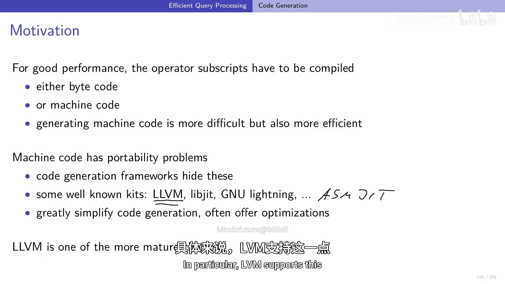

Okay and we will talk a bit about how to do this。 So now LVM so so name LVM by the way is lowleve virtual machine so it means abstracts away a computer but it's a pretty lowle abstraction So this looks if you ever saw a similar code for a real as code I mean the language of LVM looks a bit like ase code So they have very lowle primitives but it's not real asmbler so if you wish a highlevel assembler so abstracts away from you some of the problems So now what is the characteristic properties here first we pretend as if you would have an unbounded number of registers。

And a reallylay machines is not true of course， so a really processor has depending on which processor you use。

 but if you use 604 bit in， for example you have 16 general purpose res that you can use。

If you use the302bit until you have only six， but you shouldn't do this， and6 is really too late。

And 60 for bit more， we have 60 in which has least some reasonable number。

 Other processors have even more now， but nevertheless。

 you will have a significant number of registers at some point you will run out of registers and you will have to store your values on the stack instead because you cannot keep them on registers。

😊，But LVM hides this problem for you。😊，In LVM you can just pretend that you have as many as you need and this is how the code looks like here。

 this is a definition of a small LVM fragment and this defines a factorial function that we compute factorial。

😊，So if we define a function viial， if we get an aggregate at x。

So and therefore what you do here first if we say， okay， let's compare x with1。

 we check if x is larger than1 if so this is the result of this comparison is taught and this registers an unnamed register just gets a value1 so unnamed register1 and you can use as many as you need so this is a comparison if this is true so this is abuant flag here if this is true we jump to a1 otherwise you will let jump to a2。

😊，So you see already the second characteristic here unboard number of vers and strongly typed。

 so each register has a type here。😊，Namely in this ear。

 register 1 is a boolean Reg x is an 32 bit integer。 And so we have a type attached to the register。

 So if the weight is larger than 1， then we jump to label 1。

 This is here So what we do then is we subtract1 from x and we call factorial of so we subtract x1 from x this gives you the new value register2 and then we call factorial recursive passing is this new value2 here and then we text the result。

This is taught here， multiplies with x， and that's it。😊，And otherwise， we directly jump here。

So now here something funny happens， this is a fine node。

 now what is a fine node or actually why do we need fine node？😊。

LLBM has a second search property that is probably unusualed the first time you see this。

 namely it uses single static assignment。😊，Which means you can once you have assigned a value to register。

 you can never change it and so here we have assigned a value to a register one and register one now has this value and this can never be changed。

😊，OkayAnd single static assignment is great for if you want to analyze a data flow because we know that values never change so data flow node is much easier if you have single static assignment the only problem is now what do you do with loops for example And so if you would do for loop here we say x in1 to 10 so how do you implement this if I cannot update x So assign1 to x but I cannot update x so how do we translates this so and this is done using finals。

😊，So fine notes are ways to create new values depending on where you come from basically。😊。

We want to translate this。We we have do this using three bodies here。 we a before the loop before。

Then we have the loop body。And then we have after the loop。Okay， so and before loop。

 we do nothing basically， we just say a branch to body。😊，Po party。Okay， now within the。

 within the loop， we have this variable x。 we say this variable X。 Now what is x， We say x is。F note。

 And we say， we tax the value。One， if you come from before。Yeah。

 and we take the value don't know yet。 We will we will receive it。 but we take otherwise。 Okay。

 so this is my x value。 So then by an I can do I do something with my x。 So now the next value。

 of course， is next is x plus 1。😊，And then I check， I need more space， unfortunately。😊。

Next is as n is x plus 1， then continue is n is less than 10 less than equal to 10。Okay。

 and the end of these day， we say conditional branch。When when condition C is true。

 then we go to loop。Es we go to after。Okay， and then here's after。😊，Then， of course。

 you have something continuous。 And now you see what what we putting in the final， namely。

The first time we run into the loop， we takes the value 1。

 of course we start with one and it the second iteration。 so when we come from our own colopia。

 then we take the value n。😊，And then when we from when we come from loop， take n。

 the first time you take one， when you come from before， when you come from yourself， you take n。

 So this is what the final does， and this allows you to expresses without updating notice this value x has never updated and we assign x1s。

 that's it。😊，Yes this the first time you see this this takes some time to get used to。

 but this has many good properties so seeing said examine is very good and so you want to lose this because you can generate much better code for this。

 much easier we can generate code for this。😊，And in this more example。

 the factorial function we also need to find out namely when we to distinguish between controlflow。

 so when we took the branch we did the recur of course then we compute the value this one here。

 if we did not take branch then we want to output the value 1 this is what we see here we say is the value5 first compute as if we took the branch then we takes the value 4 if we do not take the branch then we takes the value 1。

😊，Okay， and then then we output the result of 5。So this computer factor function。

And you probably have already paid for in your exercises。

So and we we can take this here and can take a second flash framework and we can produce code reasonably easy。

 so as long as we only compute scalar expression like plus minus comparison those on we can directly translate this to eM is very easy because maps more or less to one of these maps to a few e instructions that is easy As if you just load scalar value intoM registers。

 we might need more registers for Nll indicator so if you have to handle Ns and we need something but。

Yeah， so and here has basic primitives we just。Directly map to LBM instructions very easy。

 Now some operations， of course， are complicated。Like like yeah a like predicate so this is a pretties this is a bit like a simplified regular expression。

 this is complicated for this doesn't make sense to generate code as this is a lot of code and the codes always the same that doesn't depend on the query therefore we just implement this once regular and C+ and then we call this form LVM because our generated code can call existing code just fine as we can mix existing code and generate codes。

 therefore this one is something that is clearly code while other stuff is generated and generally we try to generate codes that minimizes branching and minimizes the number function codes as you don't want to call unnecessary functions on the other hand also we don't want to generate needless code therefore theres a certain trait of between compile time and execution time。

😊，But nevertheless， expressions are easy。 The real challenge here is how about do we do sets？Yeah。

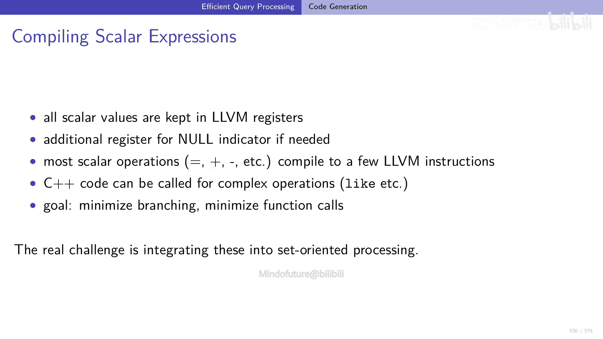

And so if you want to want to translate set operations， so like join and groupi and so on。

 then we have to do something different because LVM of course only handles individual values it knows nothing about relational algebra so for this we need some different mechanism。

Okay， and how do we， how do we do that， So of course。

What we have looked already at different ways to implement2 operators and we have seen the it model which is very widely used。

 but in reality the it model does not really mimic like CPUs work mean the iterator model is in way natural if you have implemented your if you have represented a curious relation algebra because directly photos relation algebra so therefore people have used this but if you think about the kind of computations that we perform Yeah then the it model does not really match what we would like to do because what we want is we would want to have locality like we want to touch data as rarely as possible if we want to do as much as we can on single piece of data before we look at the next。

There's an X one yeah so locality is important for performance。

 and this observation here brings us to the idea of data sent to a cure execution that is written here。

 So basically the first first rule， as you say， we should read and write data as rarely as possible because reading and writing is expensive mean not super expensive It's a memory。

 but it is expensive here memory is relatively slow compared to your CPU And so you the corresponding property is we will want to keep data and CPU registers as much as we can because CPU registers are much faster than memory。

😊，And first of all， what we see is the code should center around the data。

 not the data move according to the code， because this is what happens in the iterator model in the iterator model。

 the code corresponds tozo logic operators and we pass data between operators like we make copies or we store it somewhere so but we pass data between code fragments。

 but this is not what we should do we should instead organize the code in a way that data is touched as really as possible and the good thing is if you do this you increase locality like you touch the same part of the data repeatedly and you reduce branching which also good for performance。

😊。

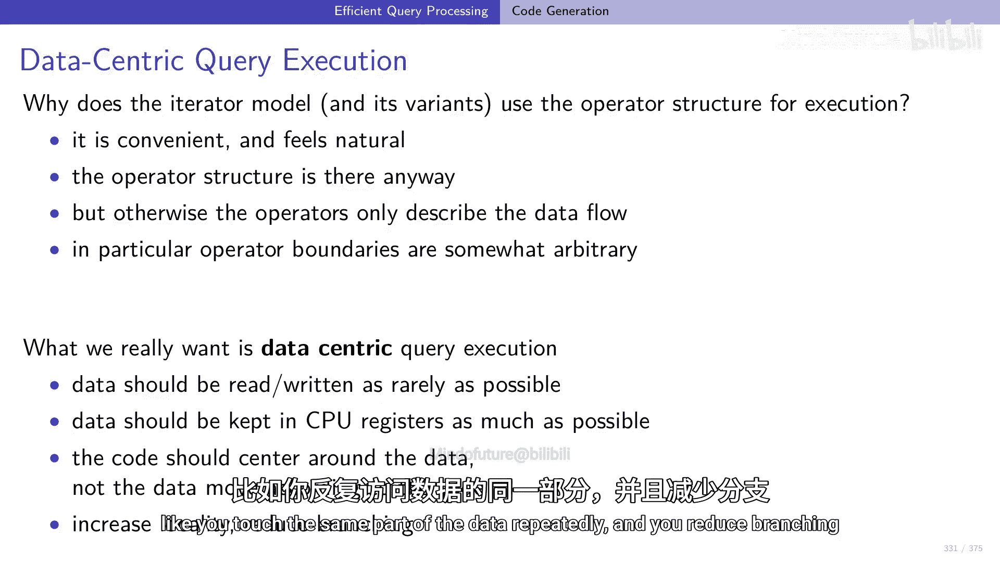

Okay， so this gives us the high level ideas of the approach now I want to show you an example of how to do this。

😊，So here we see data cent execution。😊，On an picture here with visible pipeline boundaries。

 we see what we compute here， we take three relations 1，2，3， we filter are 1， we filter are 2。

 we group by the filter 2， and then we take our three， and then we join everything here together。

And if you think about what's happening here， if you think about the pipeing。

 we see the first dotted boundary as this is my first pipeline， a drawn。😊，Mes it up now。

 so I draw a boundary about。 this is my first pipeline。

 So what we do here is we read everything from our1。

 we filter and then we write everything in the has table。 So this is one part。

 and we want to execute this all together because we touch the data from our one then we write it back。

 we want to execute this in in one one piece。😊，And the same here as our2。

 we read everything tool we filter I put it in a has table， we read a hash table。

 put it into another hash table and then here we read our3 and probe2 has tables and we want to execute so this is how the data flows and we want that my code follows the data flow basically and therefore what we want to do now is instead of iterating over the data and the iterator model we want to use the push model and we push the data through the pipeline we see how this works。

😊。

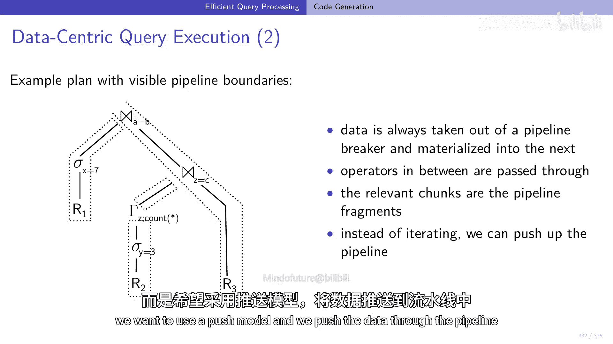

So the corresponding code that we want to get for this is this one here and you see that on next to the code we have this brackets here and each bracket corresponds to one pipeline。

 so this here the first pipeline name is that one here it's the first pipeline we say loop of autos in r1 we check the condition and the end we store them in in the h table this is one piece of code and we want to execute it like this so this is here corresponds to the push model we push it up and we generate code for exactly this sequence here。

Okay， then the next pipeline here' is the second pipeline here， saids。third and fourth。

Second pipeline， we loop over everything in2， we filter and it in a hash table，3。

 we redable build a new hash table and4 loop R3 probes the first hash table。

 probes the second hash table and then outputs the result。Okay。

 so this is the the kind of code that we want to get。

 And this is also the kind most of compact codes， as you can imagine。

 if you compare this to what would happen in the iterator model。

 the iterator model model would jump all over the code or the place here we have small tight loops that read data。

 do something right data。 This is obviously the primitive and we touch data as rarely as possible。😊。

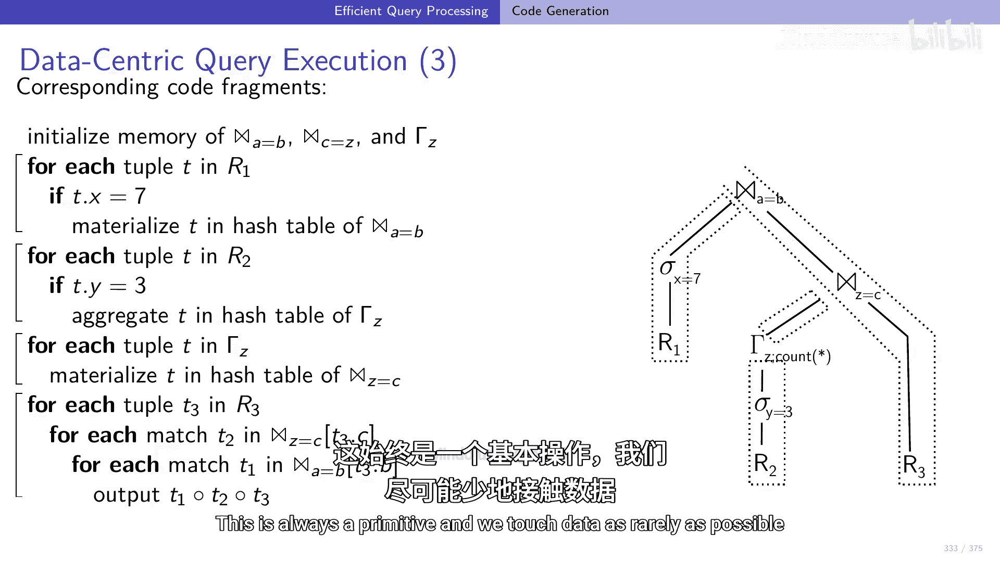

Okay。😊，So therefore the strategy here with the producing operator loops over all materializing templatets。

 the current templatet is loaded into CPU registers。

 all pipeing entrance operators are applied and then the templatet is materialize into the next pipeline breaker and our goal here is we want to maximize code and data locality。

And we have a tight loop that performs the number of operations and that does everything if we can So we we minimize memory access。

 So the the downside way is not really down。 but what of course。

 what happens here is that the operator boundaries are blurred so we no longer see the operators as clearly as before。

 Why so if you think about this this part， for example。

 belongs to this join here and this part also belongs to the join So the one operator here is ripped apart into pieces。

😊。

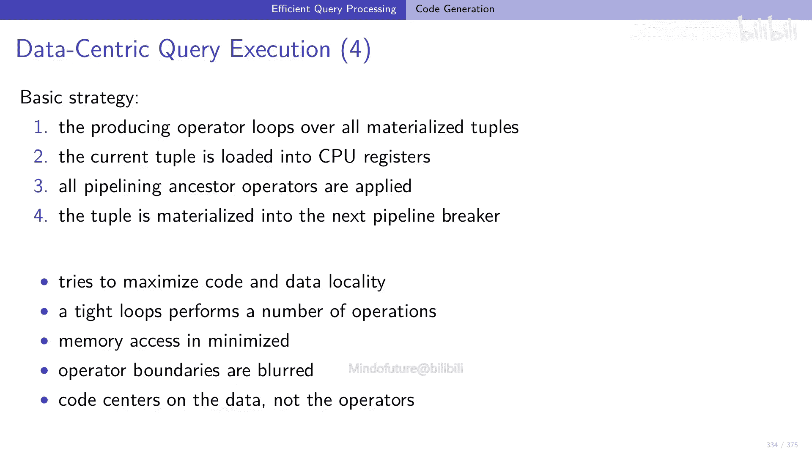

we no longer have a clearly visibility in the code what what belongs to what operator so this is distributed all over the place。

 but on other hand， this is a good thing。 mean first times。

 you see this looks a bit unusual particularly if we' are used to the iterator model。

 but performance wise this is a good thing。😊，And because we we perform the work when it's appropriate here and we want to jump we don't want to pass data around just to keep my coach nicely following the operator model Okay so therefore this is actually a good property here。

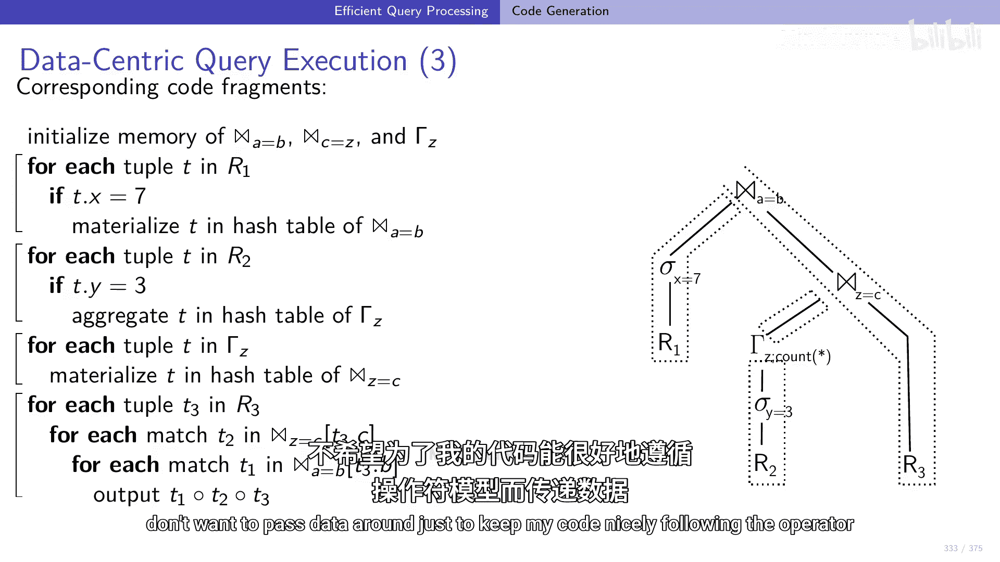

Yes， so the code center is around the data not on their own operators okay？

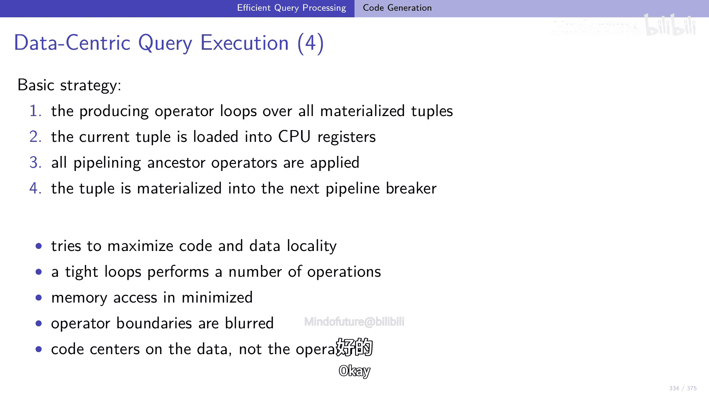

This is what you get now。This chapter here is called code generations， how do we generate a code？

So we now have to write code basically that generate this code for us。

And we do this by using a produce consumer interfaces that we already talked about in the when we talked about different moderate。

 now the big difference here is that the produce consumer factor do not really exist。😊。

Yeah so this is a concept basically so I mean when we talked about the push model。

 I pretended like the operator would really have a produce and consume function and showed you how to implement this but in reality this function doesn't exist instead what we do is we generate generate code that has a produced logic so that generates a code that you produce with template and we have a logic that generates codes that except incoming templates within's the generated code you no longer see the produce consume。

😊。

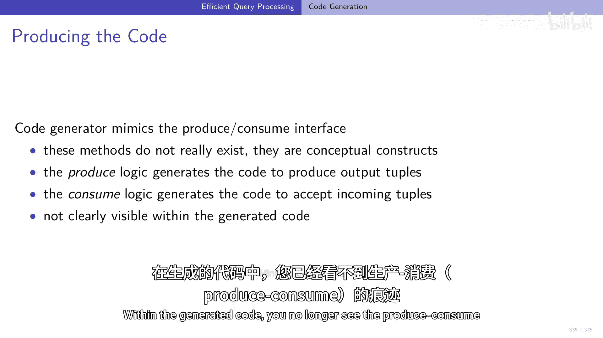

If you think about this example here， this is a push model。

 but you don't see a single core to produce and consume。

 it is simply invisible as there is no conceptualually it is producing consuming in here。

 but in the code it is no longer visible。

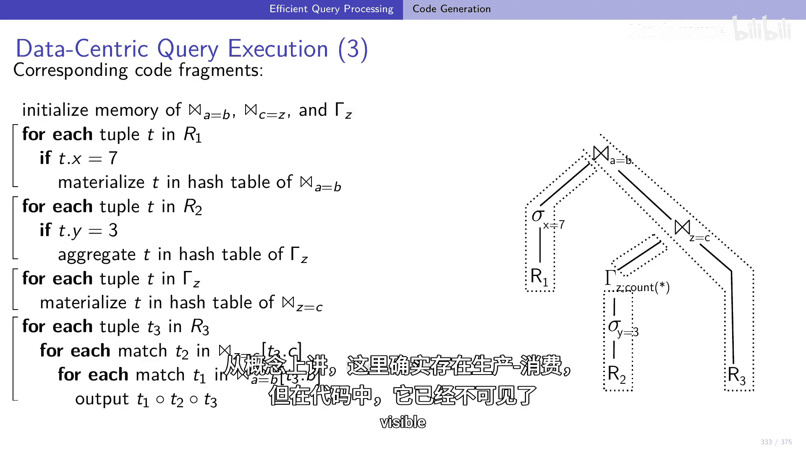

あ。Okay， so therefore， how can we produce this code So and。

I this is now here really simple a sketch here how to do this Basically when we have a has join and we ask the hasron。

 please produce code what we do is we we ask my my left part here produce code and this will now generate code that produces code now so here we call this drive plan function and produce a code and then ask my right side please generate a producer code and then we we can code this Okay。

 then we generate code as we we perform a code。😊，So this is a call to a heteroia from C+。

Okay and theres this and the consume function here。

 so this is the consume that we get and the consume checks。 okay。

 do I get a type from left off from the right if it's from the type from the left but we will do here as we collect by values note that this all happens here at compile time not at execution time and so therefore we just remember okay what are the columns that that will need so I collect here in a vector the columns。

 but only as I basically I could collect ideas of all columns that I will need store them here and then I will。

😊。

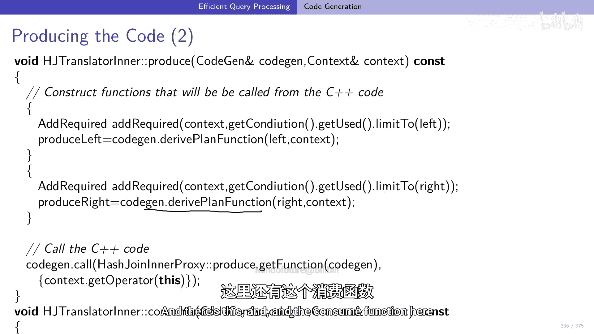

Use the help function that computes the sides of the tab。

I use hyper function that computes the hash rate of the。

 and these hyper function now they generate real code。😊，And then we call a function that says， okay。

 please store this tableple here and the left in a hash table and this is this is a size and this is my has value。

 And as a result we get a pointer to where your tablet should be。 Now So this here has not a pointer。

Where your tablet should be， then you generate new codes that really materializes the tut into that table。

Okay， so this is。How有呃。Geners and in the end you end up really with producing codes that looks less like this is product code of course。

 but you generate exactly this code here we have had this materialized T in H table。

 this is just the example that we have seen。

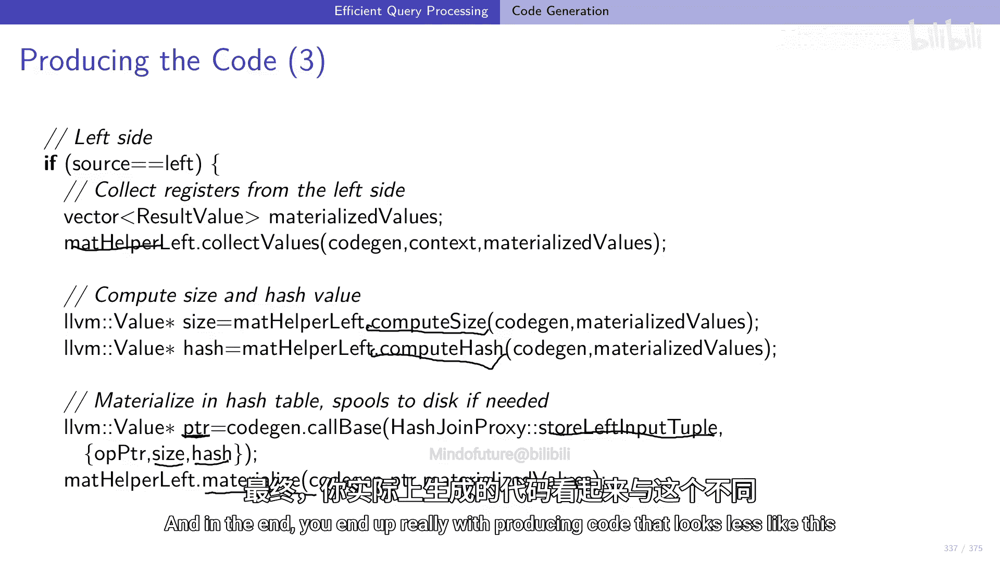

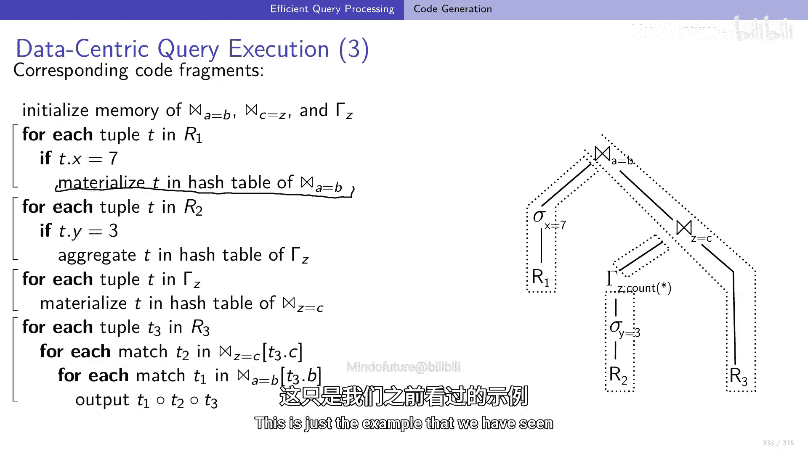

Okay and so the then for the right side， of course。

 when get tap from the right side comes we now this here is made for an external memory head join。

 therefore we auto materialize it right and tap and here we use here or say we put to disk if needed so we start tap to disk and then we write it if we would do an in memorymory case then we would not materialize the right hand side but we would just do probe and then perform lookup。

😊。

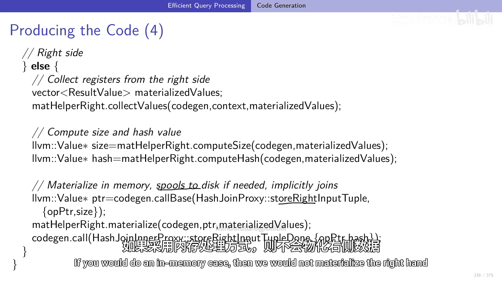

Okay， and so then the。When we when we this is a join function， basically。

 here we get two tables here， I get a from my left pointer to my left table pointed to the right table。

 I load by both values until the registers。So this is here we call hyper function says t material。

 which says load my left so what from my left table register load my right table then yeah say call the as the test test the conditions So I compare my left values is the right values if the predicate as forwards。

 please jump here so this is basic label in generate code value you jump to the conditions forward Now then you might have some residual predcateates or residual predicates predcateates that are not equal conditions like you could say one set a like B or something you cannot evaluate as with a has join therefore we check them afterwards this we do in this loop loop of all residual conditions we derives the values this is a boolean value now then here we check if the condition is true and so this is an if but note that this not regular if but this is a we know we generate code4 and if if we check if the condition is true and if it's。

then we jump to this label here， jump to for。 Otherwise we did find a match。

 So its never I look at my parent operator and called consume and then then do something。

 but know that this consume here that we call is called at compile time， not a execution time。

 So therefore the consume function here generates code to do something with with。😊。

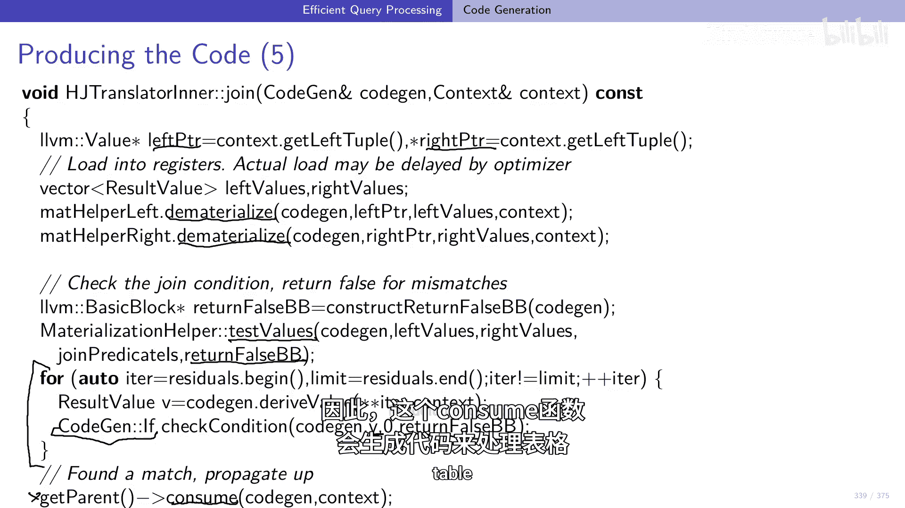

Okay。So this is how we can generate code Now let me briefly check my time I realized unfortunately you might have noticeds that we are coming uncomfortably close to the end of the semester not to say this is the last lecture unfortunately and my timing was not ideal so I mean I will will not squeeze everything in here but I definitely wanted to do a core generation because I think this is one of the more interesting and useful parts of the lecture and I also want to cover parallel execution I will probably not be able to cover the rest of the lecture but this is okay but at least most important parts I still wanted to do。

😊，Therefore， we we use the remaining time to look at purely clear execution。

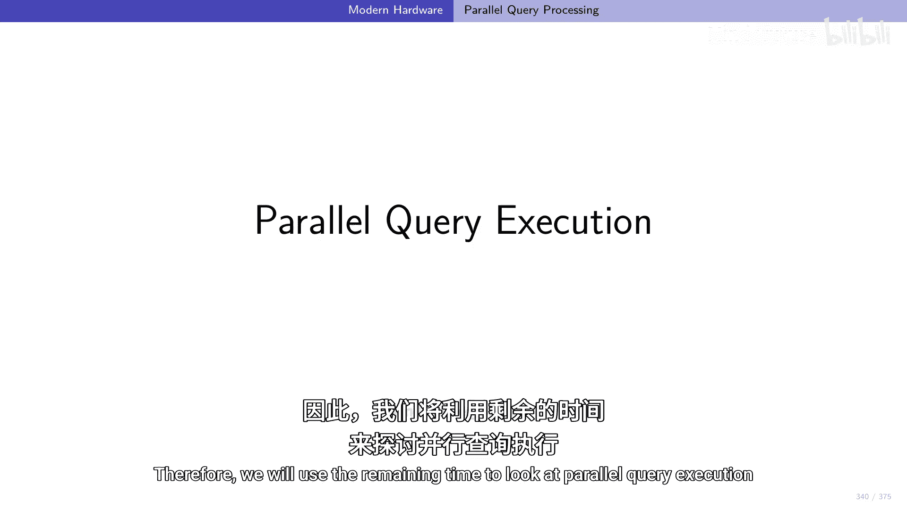

This is a particular interesting thing because mean there might be multiple reasons why you want to use a parallelilism。

😊，One reason， of course， is you might just have multiple users that are per。

 Yeah drawn curiouss at the same time。 Of course， you want to run them in parallel。

 but this is trivial。 This is very easy。 this is not an interesting case of expert execution。

 They auto relative uninteresting， more interesting， somewhat， but bit less interesting is。

Now now perhaps I shouldn't now shouldn't order like this。 so this is the boring case first one。

 multiple users is easy， just run query， run another experience different threads it's easy。😊。

The more challenging one is this one here。😊，On a modern CPU you will have more than one core mean probably even your laptop has at least two or four core。

 And if you look at desktop machines， the best machine I'm currently using have 16 core and you can also for affordable price。

 get 32 core nowadays and if you look at latest M D they even sell you desktop machines with 64 core at。

Somewhat reasonable price。 Now these start to get expensive， but that' are not so insanely expensive。

 So for a company that is perfectly affordable for a private customer， probably not。

 but for a company can afford us So we can expect that that a machine nowadays at at least probably 16 core up to 64 or if you have mighty soet machines even more can buy you can build a machine for a reasonable price that has 128 calls also even more so you have a high number。

 of course。 And if you have that many cause， of course。

 it doesn't make sense to run cigarette credit because if you have 64 core run cigarettes creditd。

And wasting 63 of my 64 course of cobed， and therefore on modern machines busy parallelism is a must。

Another reason why you want to use parallelism is there are some IO devices like SSDs that only give you best performance if you  query them for multiple threats and parallel think its thread you cannot get maximum bandwidth so this also forces you into parallelism but on the other end this is I think the most interesting case in the second one you just have an inside high number of course if we want to utilize them and if you look at parallelism。

 there are different greater parallelize interqueer parallelism and interactive parallelism。😊。

So Inqueer perilism just meet V random  query simultaneously and so for this。

 we map each  query to threat and then of course we need con control。

 but otherwise parallelilism this kind of parallelilism is for free but that's very easy。

 We just once't write one  query is that's easy。 So this is not the interesting case。

 So interesting in case is that one here。 Inque perilism。😊，And also within two different forms。

 vertical and horizontal， horizontal is in a way， the uninterest case again。

 like there are some parts like we have they have such such a query here。😊。

You can quickly realize that these two substrates here T1 and T2 are independent each they logically independent。

 therefore what we could do is we take one thread that executes T1 we run one thread that executes T2 and once both are done they also do the group I the sub in the group I and after both threads are done we join the result。

Okay。Again， it's a pretty simple form of parallelism but also not a very useful form because it's not that common that we have this structure and because we need a query basically where we can really cut myque into pieces and each piece is stored materialized to disk and or not necessarily disk at these material and some operator and then we can parallellyize this but how often this occur and also you have to realize means there are some expensive queries that are trivial like this one。

😊，We scan R and then group by。Well clearly there's only one operator and two operators if includes select。

 but there are very little number of operators， but this year could be huge and it could be that this year has a few gigabytes of data gigabytes of data So then of course we must run this imp even though it's a very low number of operators and this is what we talk about in the last part here vertical parallelism this means weize the operators themselves。

😊，And this is the most interesting case and also the most powerful because if you can parallellyize each individual operator。

 then of course we can also parallellyize the whole query。

 so this is the most powerful way to achieve this。😊。

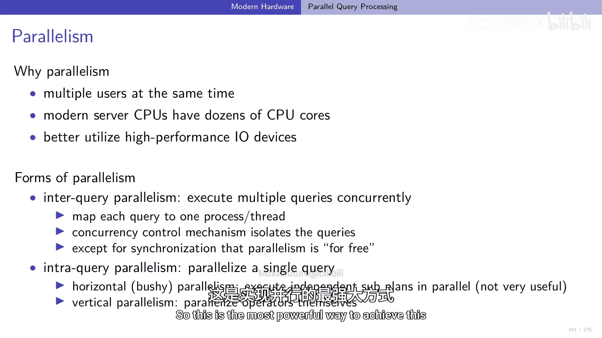

And now of course， one question is how do we do this？😊。

And when people first talked about parallelization， they they。

Invented a mechanism that is that called exchange operators so basically the idea was we height the fact that we run a parallel from the operators operators don't know this instead we we encapsulate the parallelism in explicit exchange steps that change data between threads and so this is an example so this is the left side here we see single execution we just take R we filter R then we group I if you want to do this in parallel。

 what we could do is we cut R into pieces。😊，We don't say how， but for example。

 this is simply the first words， the second those just by a by row count or something if we just so this is this is by big R。

 we just cut R until three pieces or1 or to a3。Nom sorry R21 or2 or3， we just cut R3 R two pieces。

 then I run the same operator as before， so I filter under I group to group I and these operators know nothing about parallelism。

 so they are run a parallel but they don't know this。😊，Then I do an exchange。😊，Exchange 31。

 which means I take three inputs that come in parallel and I output one output for one sequential output。

 so map three threads to one。And then I do another group I Now。

 first why do I need this clearly because the same group can occur multiple times。

 like the first part， I can have the group 7， then a certain value。 Let's that's assume I do sum。

 let's say I do a sum。 So then the first part I seen the value 10 for the group 7。

 The second part has seen the value 20。 And this third part has seen the value13。 Okay。

 and the final answer， of course， is。😊，I must output 743。And this is what this construct does。

 we do para groupi， then we exchange the result， and then we groupI again to get the final result。

And of course we we expect that these groups grouppi here will makes result much smaller because this has already removed all duplicates。

 therefore we we hope that this work here is not that much and therefore we can the final groupi is not so expensive compared to the original input。

 So this is a hope here that we have。 So this is parallelism this exchange also historically was was also invented for a distributed setting because you can just do the same that if we are distributed this is actually a strengths of the exchange My threads multiple machines makes no difference we can handle all of them the same。

😊，On the other hand， it's not a super powerful scheme so if you I mean there are commercial database systems that still uses。

 therefore we should know how it works and what it does。

 but on today's machines I believe it this scheme is largely obsolete and we will see in moment what kind of problems we have but first let's talk about exchange how we can model this。

😊。

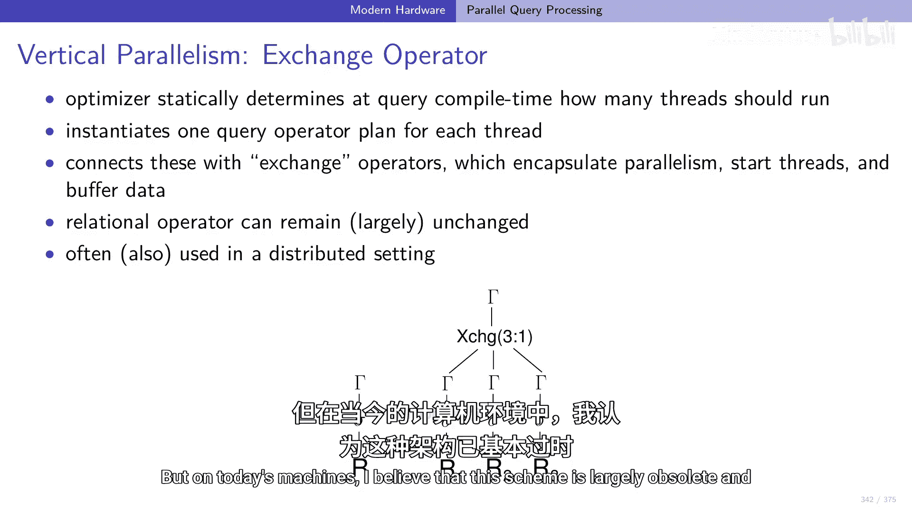

So we have this is a basic exchange here says we take n input and produce M outputs。😊。

And there are some special variance of this like we can exchange union or we can we can split maybe have multiple output streams。

 we can split by hash failure so that we know that a certain value must be in a certain part or we can do arrange split so we split by data range or we can do a broadcast split which says the full input is sent to all consumers so depending on the  query that you have all of these constructs can make sense so we can can express things using all these operators here。

And so。You see here some examples how we how we can process like so my original input was I take my so this is a single creditd。

 I take my R filter and group I So this is single redd second one here I cut my work I group by each each individual individual part of R and then I exchange and then do finally group by mean this here。

😊，Has problems the scheme if the same value occurs in oil groups。

 because then it doesn't work that great。 Yeah， so if you have。Everything occurs everywhere。

 then the final group eye can be nearly as expensive as the singled execution。😊。

And so if we are unlucky。And so if you want to avoid this， you can instead use this scheme here。😊。

So the second scheme says， okay， I take my input filter time makes sense because everybody can filter time and then I do an exchange hash。

 I don't group group I， but I do an exchange hash3，3。

 which means I take three input streams I put those three output streams but I guarantee you that a certain value will only occur on one stream So for example originally I said everybody can output the group 7 if you are unlucky if you do hash split then I know that the seven will occur only one of the three。

 for example this one of course already I don't know because it depends on the hash value but only one of them will get mini threes。

 yes three is three is three is3， everybody else will not get threes。😊。

Therefore we can do a group I in this particular stream then we output 17 and then we don't need a further group I and so no subsequent group I is needed。

 we just do an X 31 which means we convert the three input streams and one output streams at it。Okay。

😊，And so this way we avoided the duplication， on the other hand。

 if you would know that this the partition here so that we would aggregate everything into very small group。

😊，Here， and the output would be very small， this here would be more efficient So this is better if there are very。

 very few groups after the group I this here is better。

 if there are many groups after this initial group I So this depends or there's also something we can do if we can combine those techniques So we do a local preaggregation。

 So this is last alternative， we do a local preagggregation which already removes the duplicates then we do an exchange by value。

 So then we now find now now that this here we example only get the sevens and at most we get three7s。

 never more than three because thiss threes input。😊。

And then we do another group I and then we are done。Okay。😊，So this is how different ways。

 how we can express parallelism this exchange。

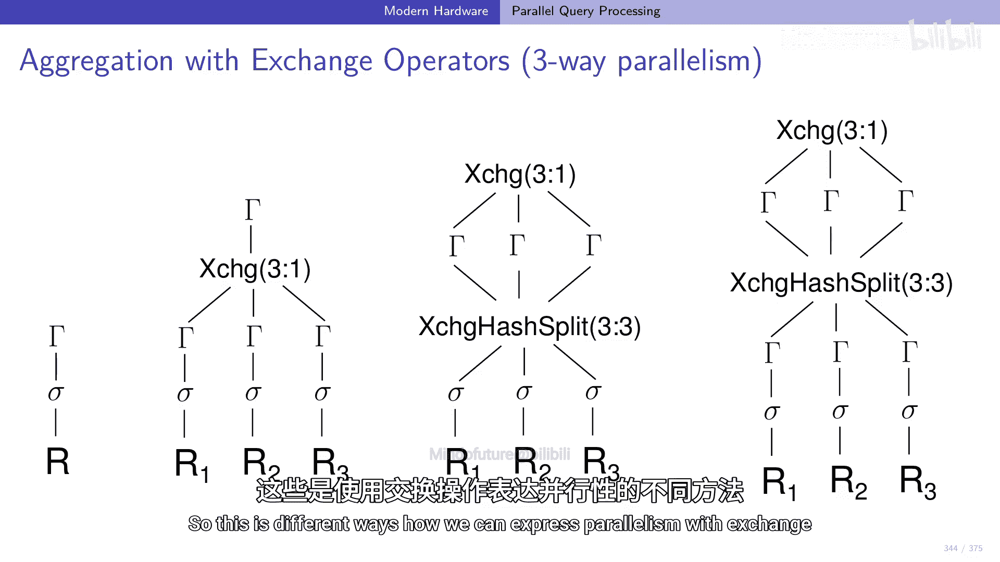

And we can do the same with joins So like if we have a single thread drawing we can make this mighty thread for example。

 here saying take a1 add hash plate where it distributes over three threads。

 each of them gets a third of the data roughly the same with other side we distribute over three threads by hash value and then each thread performs a regular join and we know because we did the potential by hash value that the my drawing partner must be come to me so I know that if we get join partners I will not need the data from anybody else So we can combine the final result versus31 exchange to produce a final result。

😊。

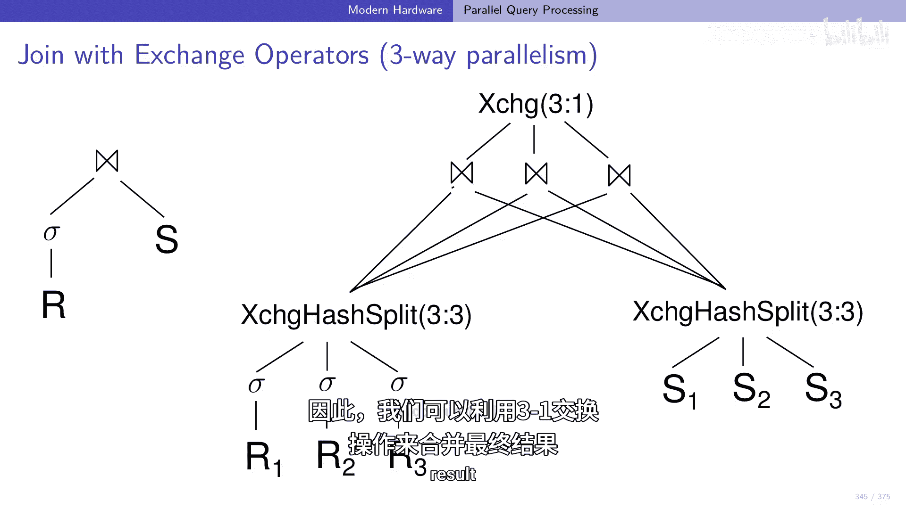

Okay。😊，Now is that means mean， the good thing about exchange is it's。

Pretty flexible and we can run a distributed ad the operators don't have to know anything about parallelism because the join is a group I had no idea that if they were running Midis Reddit so for them just looks like singer Redit。

😊，So this is a strength where some people know likes this。

 but if you ask me today this scheme is obsolete。The main problem here is that the degree of parallelism is baked into the plan。

 here if you think about this， this plan says okay， I run on three threads。

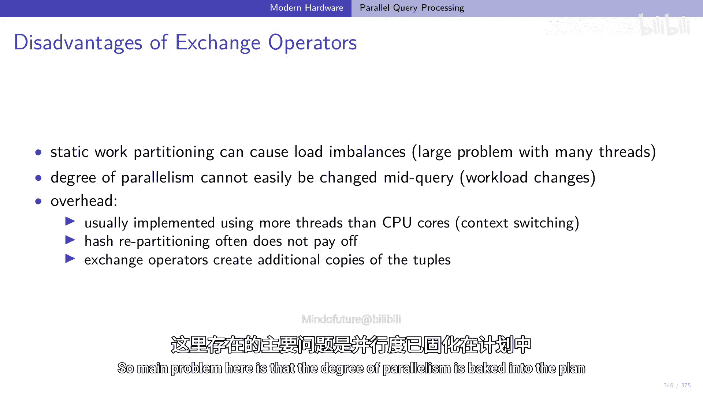

And you run on three threads now you cannot take four and you cannot take two at least not easily four you cannot do at all two you could do by doing multiple drops on the same threads but so with my parallelism is baked into into the plan and this is highly unattractive because I mean if you have 64 core of course I can schedule you 64 core。

 but what do I do if why query runs a new query comes up I cannot take away threads easily so。😊。

changing workload is a problem。 Second problem is if you think about this here we said let's look at this plan could be that this filter condition is nearly always。

 roughlys， roughly fors for this， which means our1 or two I have nearly no work。

 and this year has nearly always true， whether there are three does odd of work。😊。

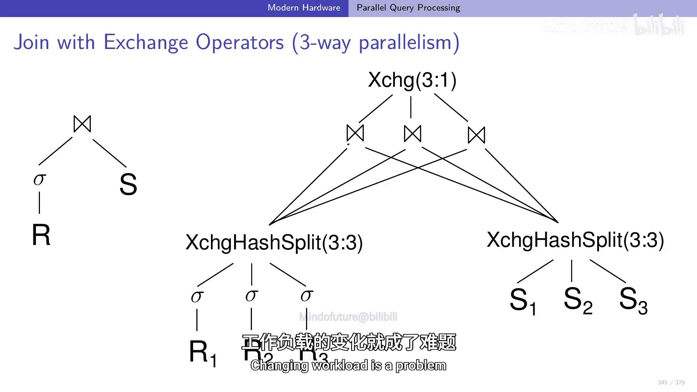

Yes this leads to a high imbal lengths， which means a1 and two will finish quickly and then do nothing。

 and then afterwards， you around seeing it thread it all your remaining work is done with and in this poor thread was the responsible for3。

 This is also bad。😊。

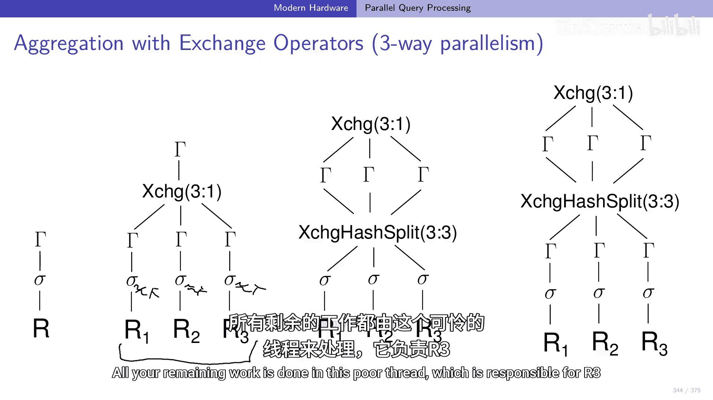

Baakking study petitioning into the plan has a lot of disadvantages。

Yeah and also the exchange itself is pretty expensive， like this hash exchange。

 hey you have to reppartition everything， this is expensive。

 you make copies of your data all the time， so this if you ask me you shouldn't do exchange I mean I teach it to you because some systems it was this。

 but if you ask me exchange is an obsolete sitting。😊。

So what we want instead is we want that the database system itself understands parallelism。

 so that each operator is aware that it's running my threaded and that multiple threads can access the same data。

😊，Okay， this， of course， makes your life more difficult。😊。

Like now we must make sure that my data structures are properly synchronized， for example。

 if you have H table， I have to some synchronize it so multiple threads can access them safely。😊，Yes。

 this is a challenge， but on the plus side we can now write algorithms that really are designed for parallelism and that can run the different relation operators efficiently in a and or in a parallel fashion。

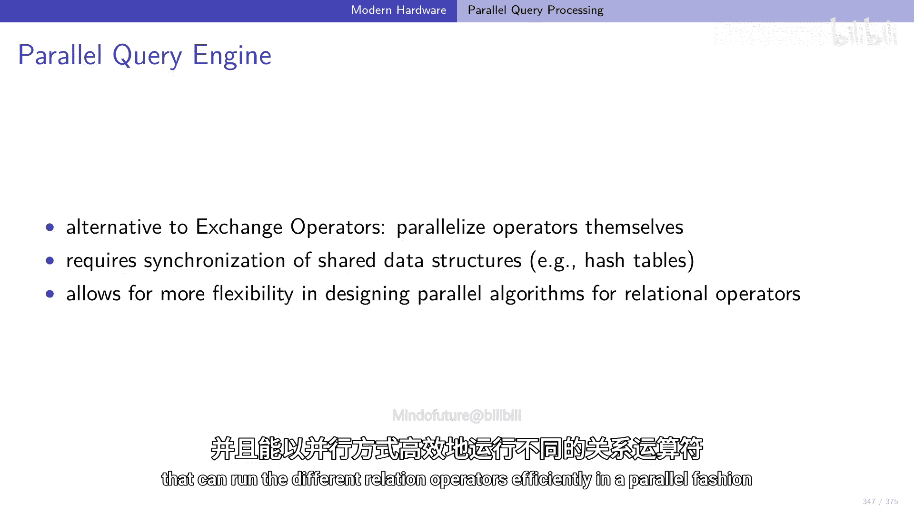

And one particular nice way to do this is what we call here as mostlyly driven parallelilism。😊，Now。

 what does this mean， So basically， we have have a。Tension here between flexibility and performance。

 this in a way mimics that when we talked about blockwise processing。Yeah。

 it's not really because we implemented it in a push fashion， but nevertheless。

 the same observation between the iterator model and the block while processing。

 iterator model is super expensive because we do this for each inverter typepper。😊。

Blockfa is more cheaper because we we do this and we can we can pass larger parts we we do less codes。

 for each core， we process large amount of data。 same here we we schedule work to threats。

And scheduling single tablets is too expensive， but what we can do is we look into my input。

 if we break my input into constant sized work units called morul now because call this morel because we aim to make this thing small not super small。

 but this should be not that large because if if in in worst case I could take my input and just cut it into。

😊，A chunk like if we have four threads I just cut input into four pieces。

 this we don't want to do because then we are no longer flexible because this is static parting just like in the exchange model。

 what we want to do instead is to say okay each threat processes， for example。

10000 or 100000 and after next after we do we process 1000 we look what happens next so we for each part here we run them。

 So this happens here what we see here。The first thread says， okay， I takes three template。

 of course already we do more， but for in this picture we do three。😊。

I do the first three tuts and the next thread says。

 okay I text next three tuts and then they have executed in parallel So the first thread here says okay let's probe that table and then probes next cache table and then I' write my result and I' write this result into a threat local data because when I said about synchronization what I meant of course is that we don't want to synchronize because synchronization between threads is expensive therefore the models that we use as we can read multiple times because having 10 threads read the same data not problem but when we write we always write to private memory so that nobody adds looking at because then we don't need synchronization therefore the first thread probes and write reside to local memory therefore the color here the same as the second thread here we picked data we picked data we probe another probe and then we write the results to my private memory and the dispatcher here says which thread should take which model like we can have some degree。

😊，The freedom here。😊，First like proation， we do this round Robin so we just take whatever is next。

 this is the easiest way。If you have a machine with Nus so where some memory is more expensive to access in others。

 you want to prefer reading from your local numer region。

 which means you want to prefer reading data that is sitting next to your CPU。

 therefore the dispatcher might do something smarter than just keeping use the next model。

 but nevertheless conceptually we just take a piece of data run then be right。

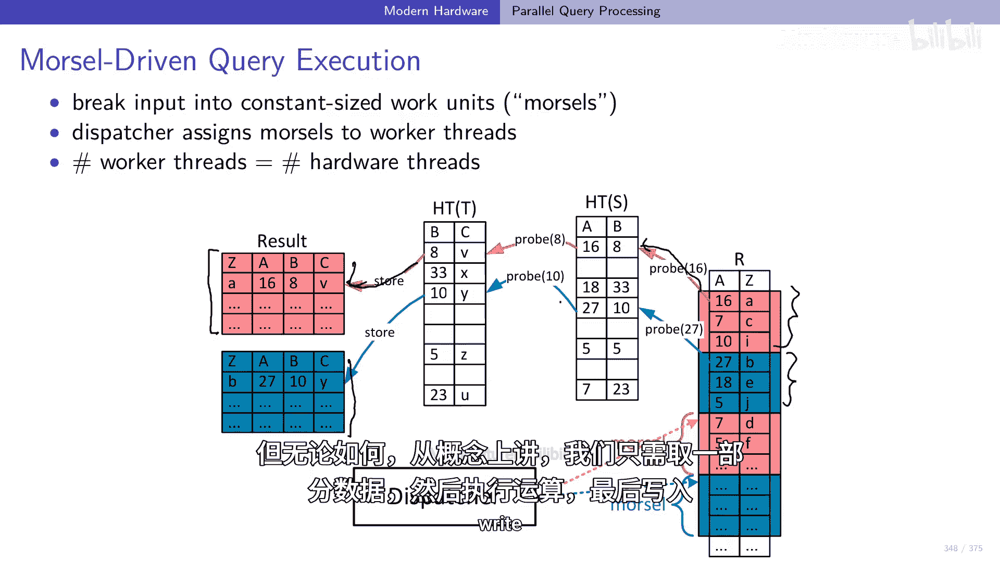

So its now why do we do this instead of static parting Because we observe that the runtime of mercury is dominated by the slowest threat。

 honestly， we always wait for whoever is lowestest。😊，In advance。

 we cannot know who slowest because could depend on the queer predicate。

 some predicate might be true for some part of the data and forth for somebody else we cannot know aesthetically。

Yeah so this CFVC of， for example， non uniform distribution。

 so some data might be more relevant than others and therefore the trick is we simply don't position the data at the beginning。

 but we use dynamic work stealing。😊，So each thread here takes so we have a synchronized queue for small drops we say this is the drops that I want to execute and then each thread grabs work from the queue and if somebody is slower than somebody else doesn't matter because then the other drops as other threads will simply take more slip away from him so we say in this picture here we say first we say thread1 thread22 thread1 thread2 but if we observe over times that thread1 gets slow because it simply preig are more true so then simply could be that we take more to T2 T T2 T2 then again T1 and so on simply whoever is finished with small so it takes the next piece of work and this makes sure that the runtime of odd threats is roughly the same and because each of them produces a small part of the work and therefore from my total execution time will be roughly the same threats and this is of course idea。

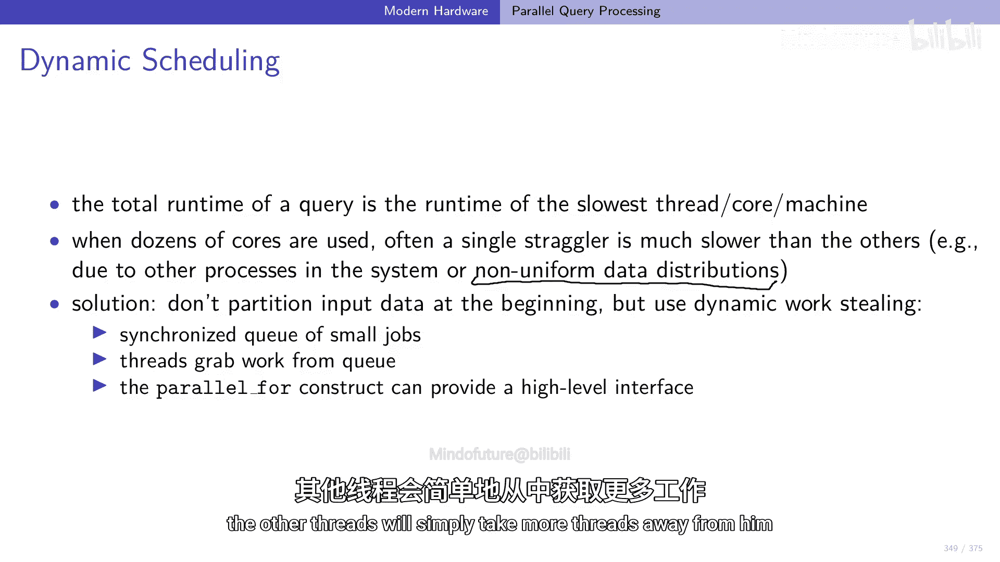

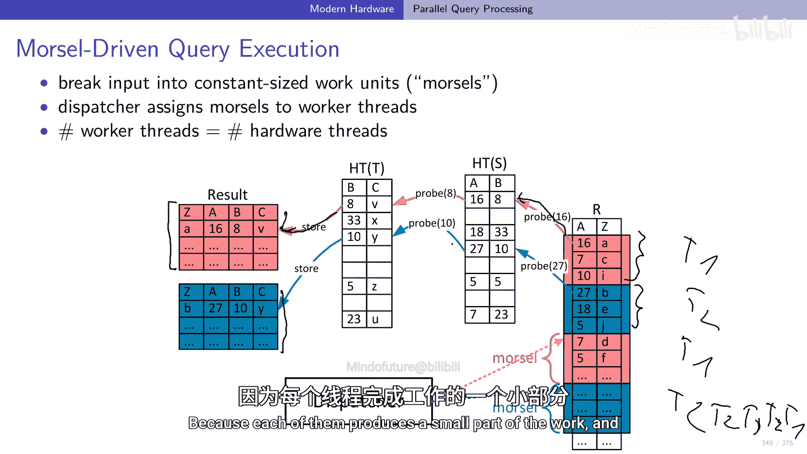

Then we don't have to struggle out for that word we're working。

and if you think about the application interface was this at least a highle application interface。

 if you are familiar with this Intelstr building blocks TB。

 they have a parallel4 so which says basically DB runs this and please dispatch this dynamically overstrs with box stealing just choose just prim that S we talked about here。

😊。

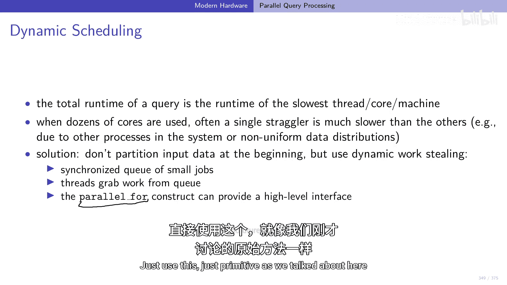

Okay， and so now how do we build an in memoryory has join？So in the build phase。

 each stretch scans part of the input using more sos so taking the next n tablet and processing them add material them and of course this materialization here happens in threat local storage so storage that nobody else can see so if we can just write them without any synchronization。

😊，So after this， we have collected oil tuts in a piece of memory。😊，Now。

 the good thing is we know how many tablets we have because we have already seen all tablets across all threads。

😊，Of course， a single threat has not seen all tablets， but the sum of all tablets is all threads。

 So after step 11， we know how large a hash table should be。

 so now we create a hash table of appropriate size so that everything can fit into and a great advantage of doing this this way is that we don't have to dynamically size a hash table because trust me a dynamically sized hash table that a threats save is an nightmare either it's super slow or it's super complicated to implement this is terribly difficult simply therefore the answer simply don't do this collect the tablet threat local and you would have to do this anyway because if you think about a chain hash table you have a dictionary and we have a lot of buckets here。

😊，And what we do in step 1 one is we create all these buckets。

 we just don't create the diction it's being， but all the buckets we can already create。😊。

And then in step 13， we scan over input again over the buckets that I have materialized and I just add this pointer here to the h table and this can be done in parallel because we can use if I want to enter a packet here into my h table I look at the current entry I put the current entry as my next N towards sort in the next one and then I do an atomic compare exchange。

 so I say please replace the pointer here to pointer to myself。😊。

And do this in an atomic fashion and if the point has changed in the meantime so somebody else has already put himself into's bucket。

 then yeah I will just update my next point again and try again。😊。

That why I can do this without I don't need a mut text or something。

 So I can do this with just using atomic operations。 I can add myself to this stable table。

 I can do this in parallel。 So this is your all， this is parallel。 This is parallel。 This here。

 I think it's ready， but this is very short face。 You just going to table。

 Everything is this parallel。😊，And then a probe phase this is fully parallel again。

 so we can because in the probe phase， we don't write through the H table we just read。

 So when a type come， we check if there a drawn partner and therefore we don't need we don't have to do anything。

 we can just。😊，O threads can pull parallel probe table。 You have to be slightly careful here。

 if you need markers， like if you think about non inner joins。

 then we have to use atomic operations again to， to mark。 Okay， this is mark， but nevertheless is。

We can see this tools this in parallel， we can do everything in parallel。

And then run this and then execute this across all trades。

Okay and this point I think I will have to stop already rushed a bit。

 unfortunately in when talking about parallelism in the slides。

 you have something about main memory databases， but will not do this because we just didn't finish and might have mass picture that's not overdo this I will stop here I will stop before the part main memory databases if you're interested we will put the slides online of course。

 but you don't have to for few of your future for life it might be useful for you to take a look ats the slides but we will not ask this in the exam so you don't have to word about that so therefore stop here I hope you have enjoyed it a lecture a bit and also I hope that you have enjoyed the practical exercises because most things that you have higher practical relevance very useful not only for databases but also for other kinds of data processing tasks。

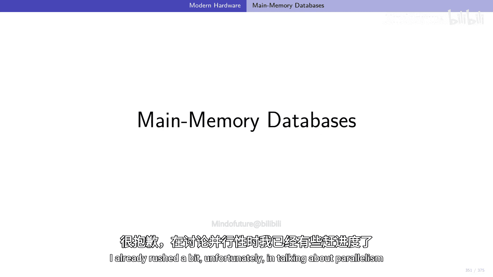

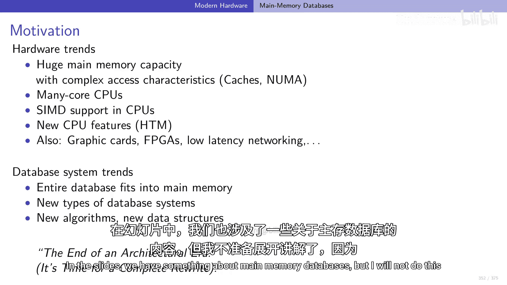

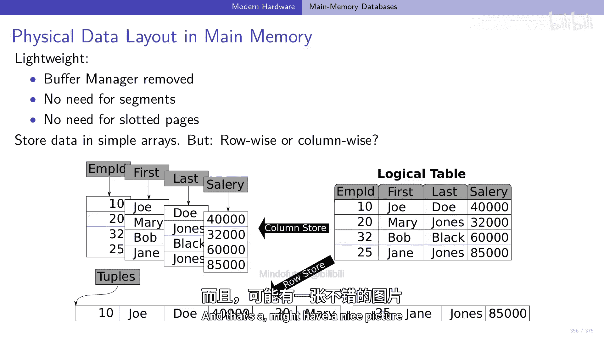

And therefore， I strongly encourage you to do the exercises。

 and also of course we will ask you similar stuff in the final。😊，Exercise so yeah。

 great exercise that we would do。😊，Okay， I will stop him and thank you。

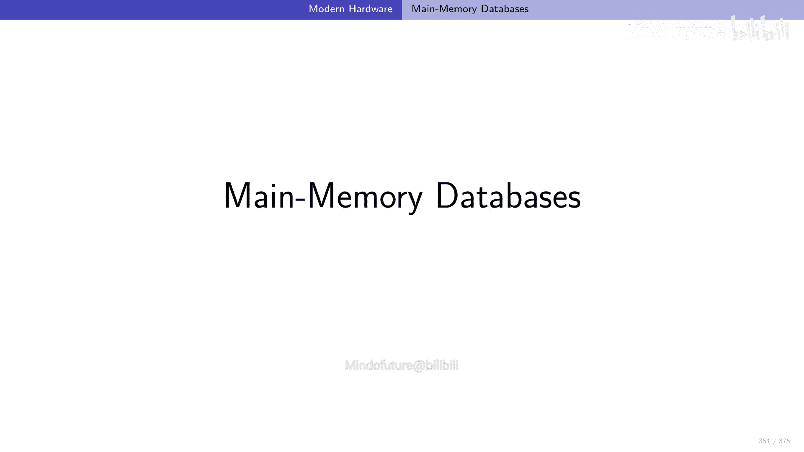