# 003：函数、函数对象与错误处理 🧩

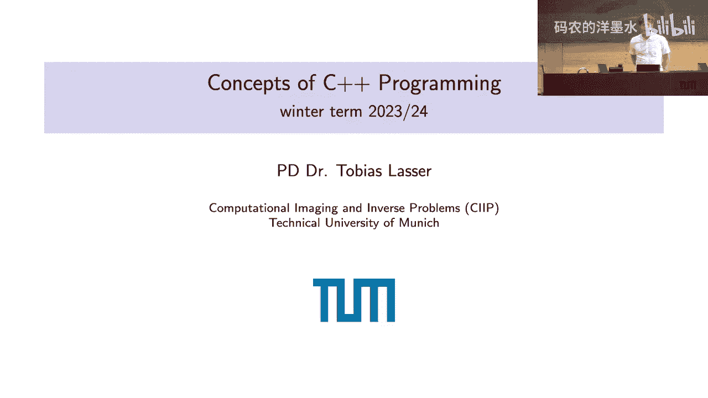

在本节课中，我们将要学习C++中关于函数、函数对象（如仿函数和Lambda表达式）以及错误处理的核心概念。我们将从函数的返回值、参数传递和重载开始，然后探讨如何创建和使用可调用对象，最后了解C++中处理错误的几种主要方式。

## 函数返回值

上一节我们介绍了函数的基本概念，本节中我们来看看函数如何返回值。

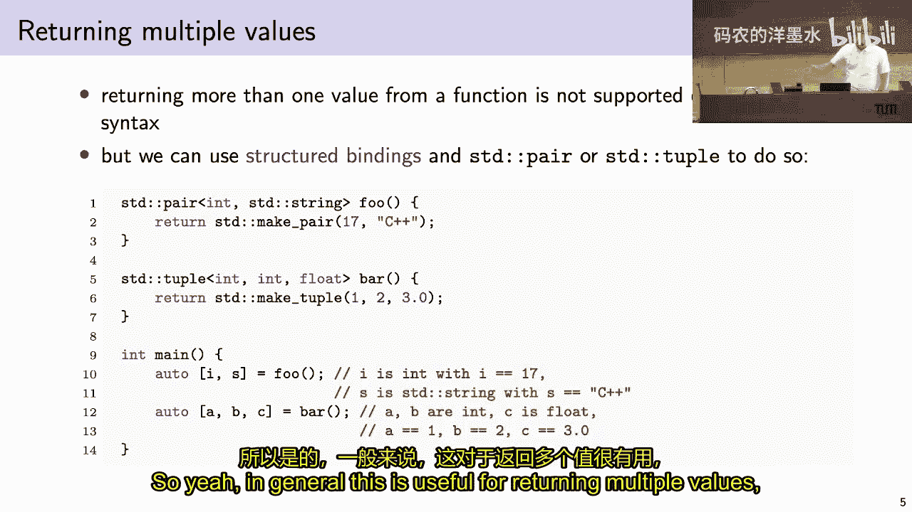

在C++中，函数可以返回一个值。返回类型写在函数名之前，例如 `int myFunction()`。C++11引入了**尾置返回类型**，允许将返回类型写在参数列表之后，使用 `auto` 关键字和箭头符号 `->` 来指定。

```cpp
// 常规返回类型
int add(int a, int b) {
    return a + b;
}

// 尾置返回类型
auto add(int a, int b) -> int {
    return a + b;
}
```

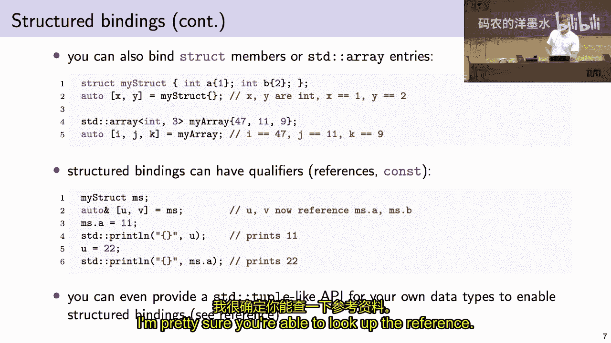

尾置返回类型的主要用途在于模板编程，当返回类型依赖于模板参数时，它非常有用。

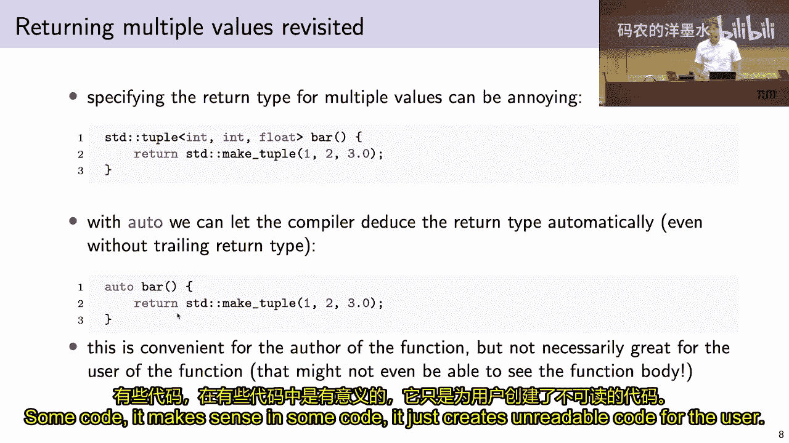

C++函数本身不支持直接返回多个值。但我们可以使用标准库类型来模拟这一功能。

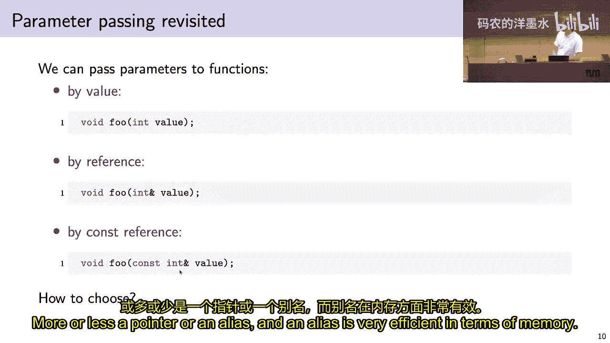

以下是返回多个值的几种方式：
*   **`std::pair`**：用于返回两个值。
*   **`std::tuple`**：用于返回两个或更多值。
*   **结构化绑定**：C++17引入的特性，可以方便地从 `pair` 或 `tuple` 中提取值并绑定到变量。

```cpp
#include <tuple>
#include <string>

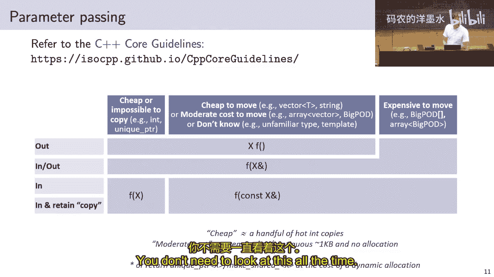

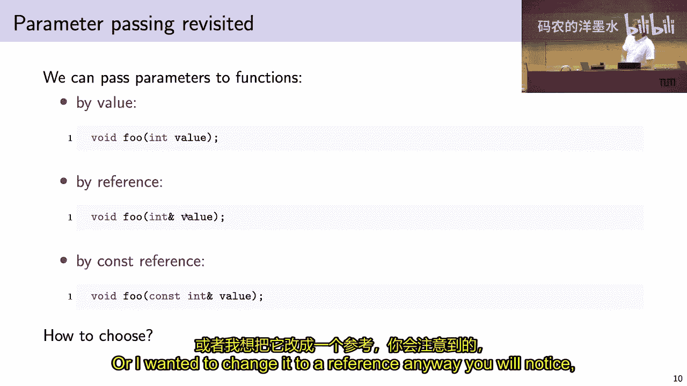

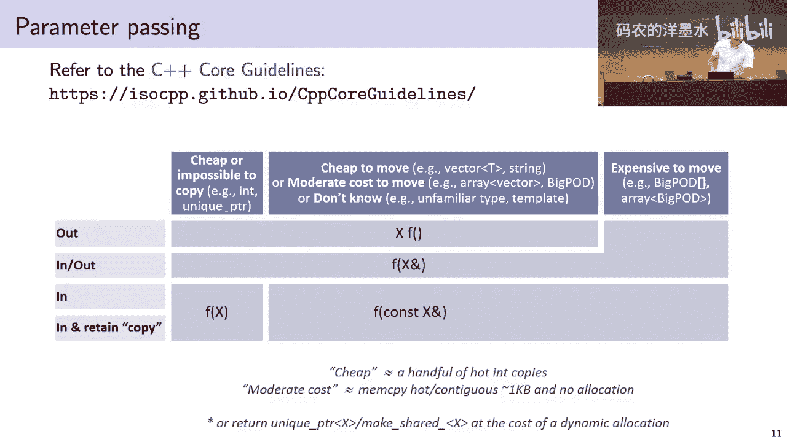

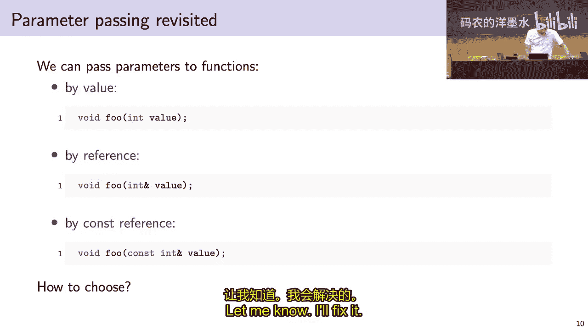

// 返回一个pair
std::pair<int, std::string> getPair() {
    return std::make_pair(42, "hello");
}

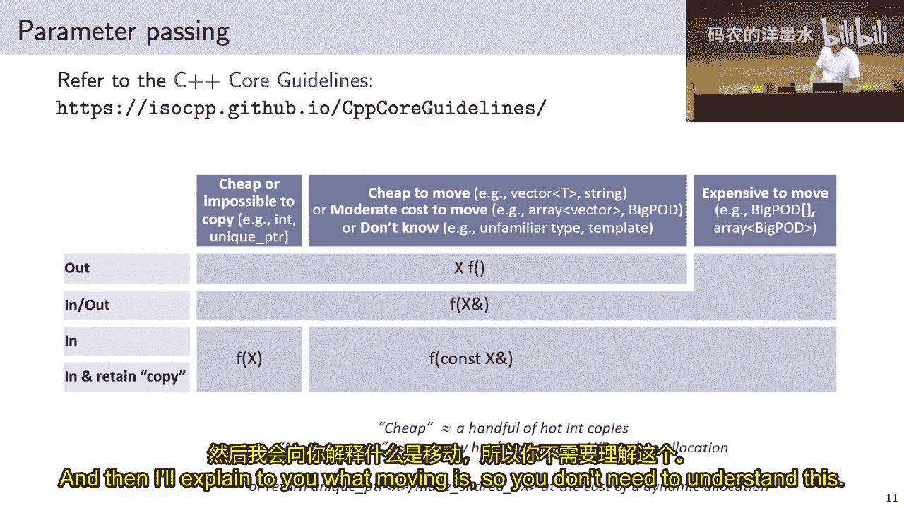

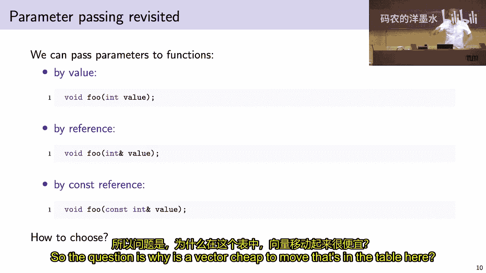

// 返回一个tuple
std::tuple<int, double, std::string> getTuple() {
    return std::make_tuple(1, 2.0, "three");
}

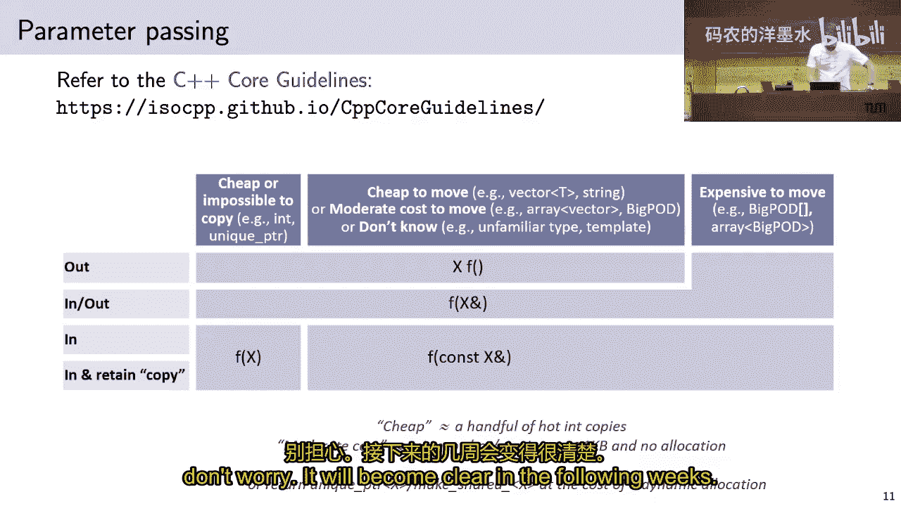

int main() {
    // 使用结构化绑定解包pair
    auto [num, str] = getPair();

    // 使用结构化绑定解包tuple
    auto [a, b, c] = getTuple();

    // 结构化绑定也常用于遍历map
    std::map<std::string, int> myMap = {{"a", 1}, {"b", 2}};
    for (const auto& [key, value] : myMap) {
        // 使用key和value
    }
    return 0;
}
```

此外，如果函数体简单，编译器可以自动推导返回类型，你可以使用 `auto` 作为返回类型（无需尾置语法）。但需注意，这可能会降低库接口的清晰度。

```cpp
// 编译器推导返回类型为int
auto add(int a, int b) {
    return a + b;
}
```

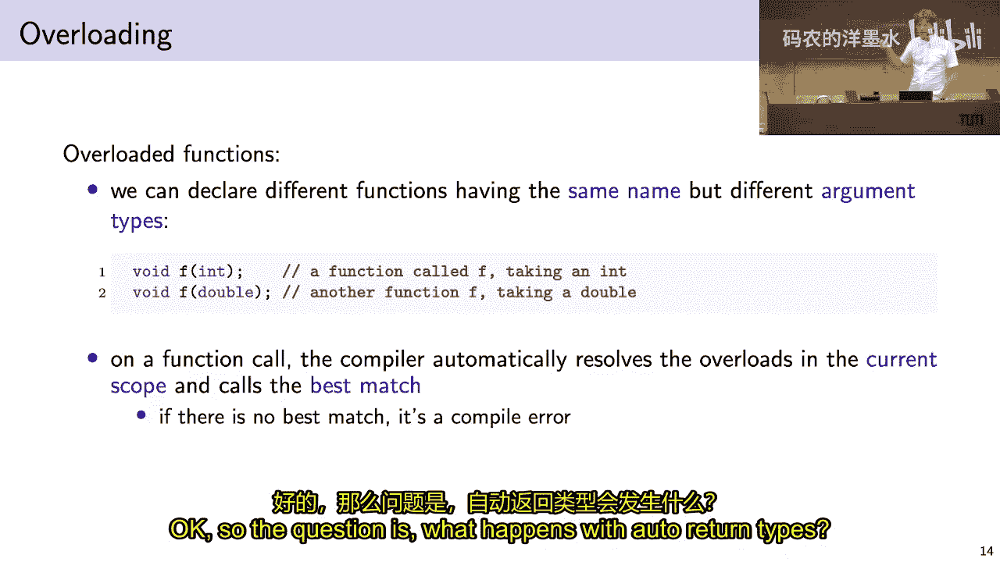

## 参数传递

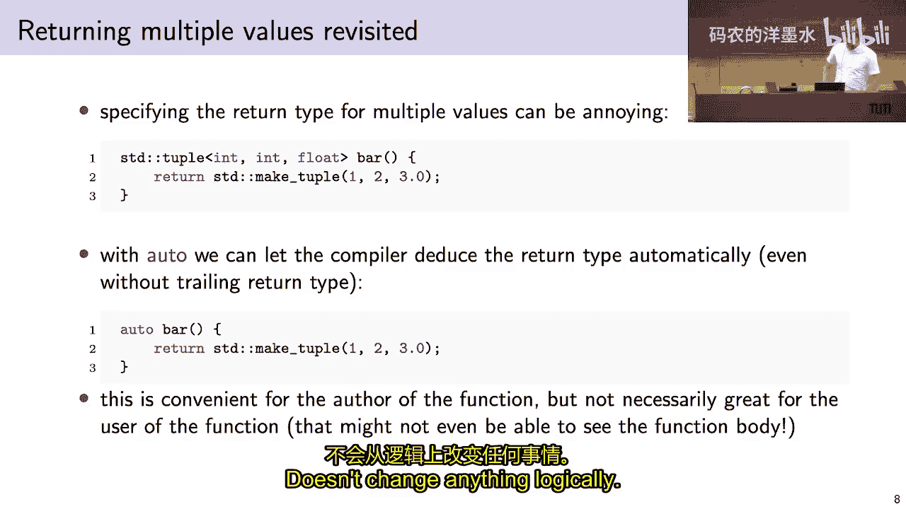

了解了如何返回值后，我们来看看如何将值传递给函数。

C++有三种主要的参数传递方式：
*   **按值传递**：创建参数的副本。修改副本不影响原始数据。
*   **按引用传递**：传递参数的别名。在函数内修改参数会影响原始数据。
*   **按常量引用传递**：传递只读的别名。无法在函数内修改参数，避免了复制开销。

```cpp
void byValue(int x) {}      // 复制x
void byReference(int& x) {} // x是传入变量的别名
void byConstRef(const int& x) {} // x是只读别名
```

如何选择传递方式？可以参考C++核心指南的建议：
*   **参数只进不出**：使用按值传递（如果类型复制成本低）或按常量引用传递（如果类型复制成本高，如大的数据结构）。
*   **参数先进后出（即需要修改）**：使用按（非常量）引用传递。
*   **参数只出不进**：应作为返回值。

对于初学者，一个简单的原则是：对于内置类型（如 `int`, `double`）和小型结构，默认使用按值传递；对于大型对象（如 `std::vector`, `std::string`），使用按常量引用传递；当你确实需要在函数内部修改调用者的变量时，使用按引用传递。

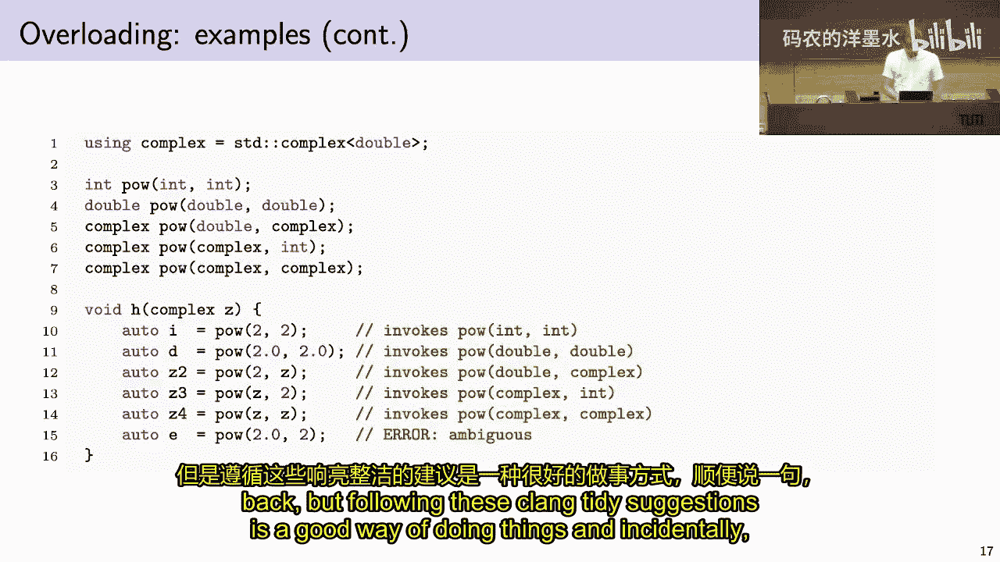

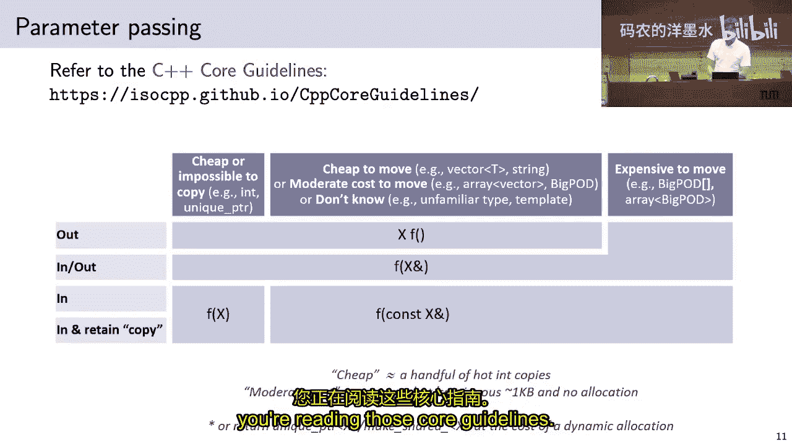

## 函数重载

C++允许**函数重载**，即多个函数可以拥有相同的名字，只要它们的参数列表（参数的类型、数量或顺序）不同。返回类型不参与重载决议。

```cpp
void print(int i) {
    std::cout << "int: " << i << std::endl;
}
void print(double d) {
    std::cout << "double: " << d << std::endl;
}
void print(const std::string& s) {
    std::cout << "string: " << s << std::endl;
}

int main() {
    print(5);        // 调用 print(int)
    print(3.14);     // 调用 print(double)
    print("hello");  // 调用 print(const std::string&)
    return 0;
}
```

当调用重载函数时，编译器会尝试寻找**最佳匹配**。匹配顺序通常是：精确匹配 > 类型提升 > 标准转换 > 用户定义转换。如果找不到匹配或存在歧义，编译器会报错。

## 函数对象（仿函数）

普通的C++函数不是对象，不能直接存储状态或像对象一样传递。**函数对象**（或称**仿函数**）是解决了这个问题的对象。任何重载了**函数调用运算符 `()`** 的类或结构体的对象，都是函数对象。

```cpp
struct Incrementor {
    int value = 0;
    // 重载函数调用运算符
    int operator()(int x) {
        value += x;
        return value;
    }
};

int main() {
    Incrementor inc;
    std::cout << inc(5) << std::endl; // 输出 5
    std::cout << inc(3) << std::endl; // 输出 8，保持了状态
    return 0;
}
```

标准库提供了 `std::function` 作为通用的函数包装器，它可以存储、复制和调用任何可调用对象（普通函数、Lambda表达式、仿函数等）。使用它会有轻微的性能开销（一次额外的间接调用）。

```cpp
#include <functional>
#include <iostream>

int add(int a, int b) { return a + b; }

int main() {
    // 包装一个普通函数
    std::function<int(int, int)> func = add;
    std::cout << func(2, 3) << std::endl; // 输出 5

    // 包装一个Lambda表达式
    std::function<int(int)> square = [](int x) { return x * x; };
    std::cout << square(4) << std::endl; // 输出 16
    return 0;
}
```

## Lambda表达式

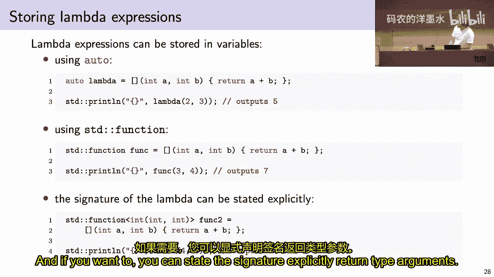

**Lambda表达式**是C++11引入的用于创建匿名函数对象的便捷语法。它本质上是一个编译器生成的、拥有唯一类型的匿名函数对象（闭包）。

一个Lambda表达式的基本语法如下：
`[捕获列表] (参数列表) -> 返回类型 { 函数体 }`

其中，参数列表和返回类型可以省略（返回类型由编译器推导）。

```cpp
// 一个简单的Lambda，接受一个int，返回它的平方
auto square = [](int x) { return x * x; };
std::cout << square(5) << std::endl; // 输出 25

// 在算法中使用Lambda
std::vector<int> v = {1, 2, 3, 4, 5};
std::sort(v.begin(), v.end(), [](int a, int b) { return a > b; }); // 降序排序
```

**捕获列表**允许Lambda访问其所在作用域中的变量。
*   `[=]`：以值（复制）的方式捕获所有外部变量。
*   `[&]`：以引用的方式捕获所有外部变量。
*   `[x, &y]`：以值捕获 `x`，以引用捕获 `y`。
*   `[this]`：捕获当前对象的 `this` 指针。

```cpp
int base = 10;
// 以值捕获base
auto add_base_val = [base](int x) { return x + base; };
// 以引用捕获base
auto add_base_ref = [&base](int x) { base += x; return base; };

std::cout << add_base_val(5) << std::endl; // 输出 15, base仍是10
std::cout << add_base_ref(5) << std::endl; // 输出 15, base变为15
```

**注意**：当Lambda捕获了局部变量的引用，并且该Lambda的生命周期超过了被捕获变量的生命周期时，会产生**悬垂引用**，导致未定义行为。应谨慎使用引用捕获，尤其是默认捕获 `[&]`。

## 错误处理

程序运行时难免出错，C++提供了几种主要的错误处理机制。

**1. 返回错误码**
这是C语言的传统方式。函数返回一个特殊值（如-1、NULL）表示错误，或设置一个全局错误变量（如 `errno`）。缺点是不够直观，容易忽略错误检查。

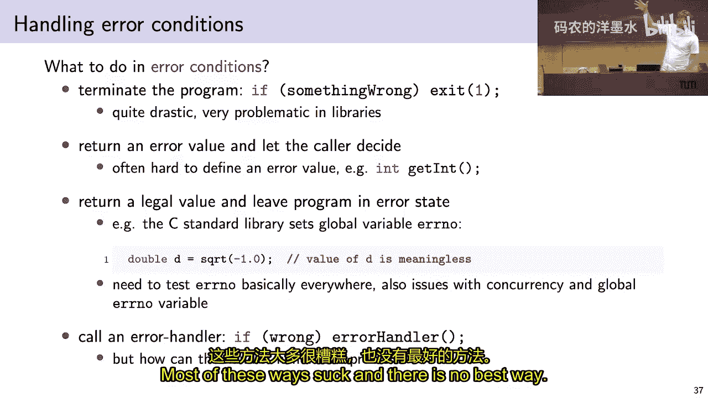

**2. 异常**
C++内置的异常处理机制。使用 `throw` 抛出异常，使用 `try` 和 `catch` 块捕获并处理异常。

```cpp
#include <stdexcept>
#include <iostream>

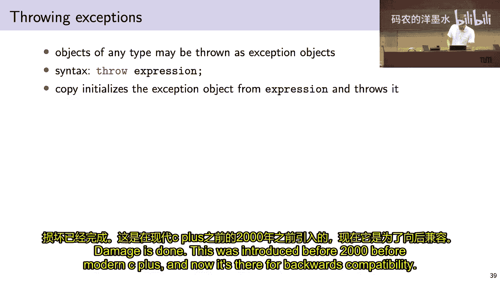

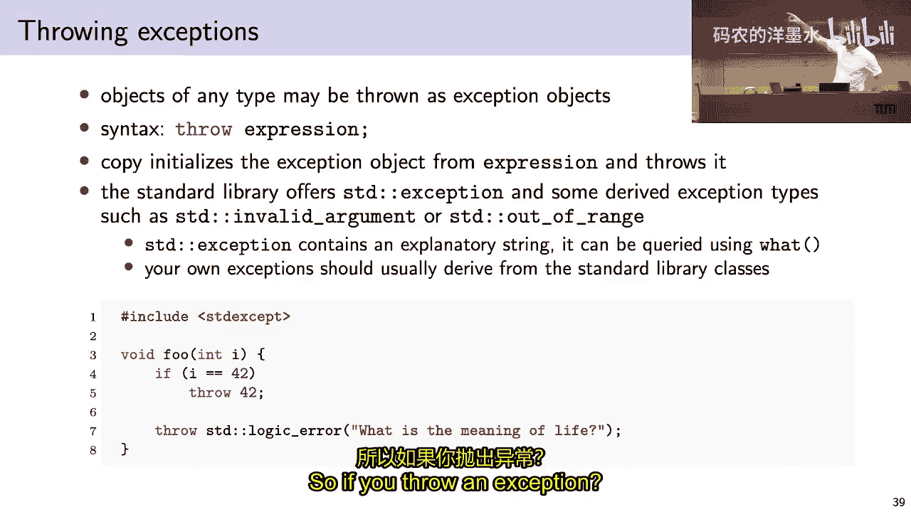

double divide(int a, int b) {
    if (b == 0) {
        throw std::invalid_argument("Division by zero!");
    }
    return static_cast<double>(a) / b;
}

int main() {
    try {
        double result = divide(10, 0);
        std::cout << result << std::endl;
    } catch (const std::invalid_argument& e) {
        std::cerr << "Caught an error: " << e.what() << std::endl;
    } catch (...) { // 捕获所有其他异常
        std::cerr << "Caught an unknown error!" << std::endl;
    }
    return 0;
}
```

异常处理会进行**栈展开**，自动调用局部对象的析构函数，有助于资源清理。但它会带来一些运行时开销，并且在实时或嵌入式系统中有时会被禁用。函数可以用 `noexcept` 关键字声明不抛出异常，但这并非强制契约。

**3. `std::expected` (C++23)**
这是一种受Rust等语言启发的新型错误处理方式。函数返回一个 `std::expected<T, E>` 对象，其中 `T` 是期望的成功结果类型，`E` 是错误类型。调用者必须显式检查是得到了值还是错误。

```cpp
#include <expected>
#include <string>
#include <iostream>

std::expected<int, std::string> parseNumber(const std::string& s) {
    try {
        return std::stoi(s);
    } catch (...) {
        return std::unexpected("Parse failed");
    }
}

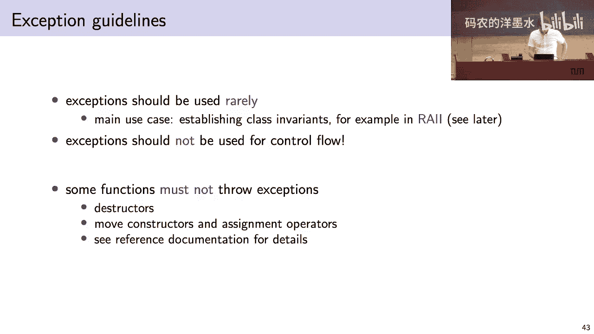

int main() {
    auto result = parseNumber("123");
    if (result.has_value()) {
        std::cout << "Got value: " << result.value() << std::endl;
    } else {
        std::cout << "Got error: " << result.error() << std::endl;
    }
    return 0;
}
```

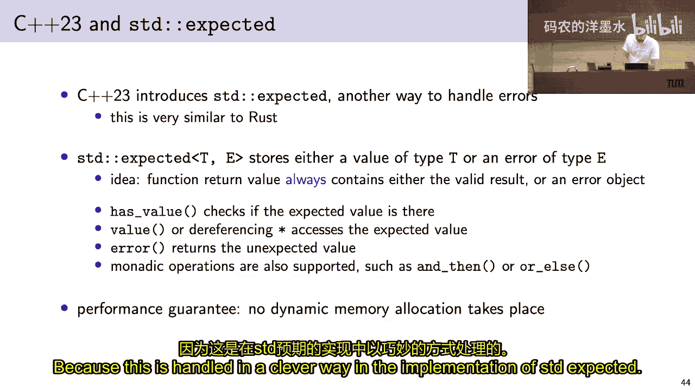

这种方式没有异常处理的栈展开开销，强制调用者处理错误，适用于那些“可预期的错误”（如解析失败）。异常则更适用于“不可预期的、严重的”错误（如内存耗尽）。

---

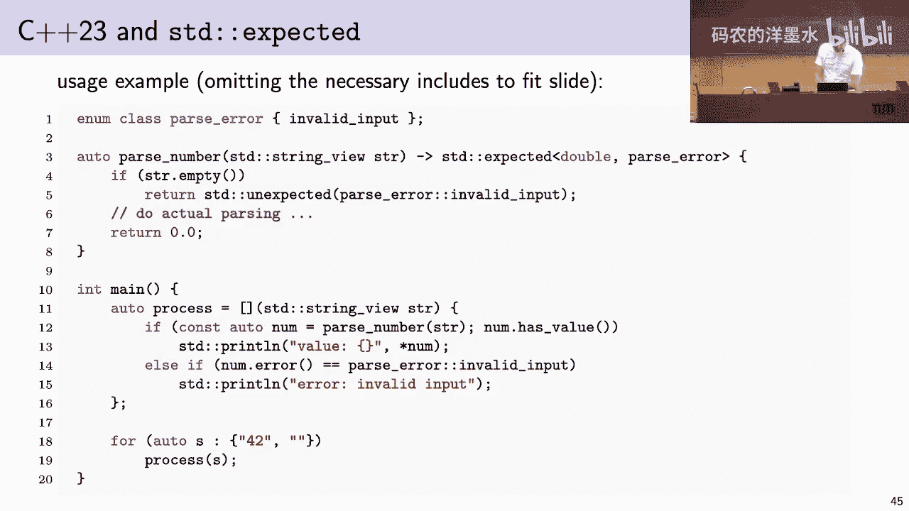

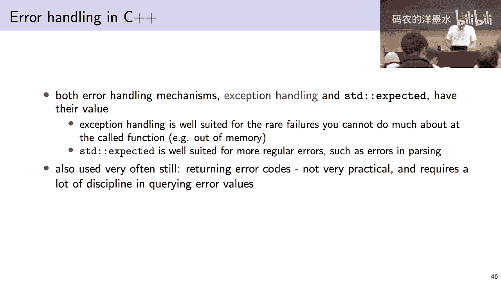

本节课中我们一起学习了C++函数的高级特性，包括多种返回值和参数传递方式、函数重载的规则。我们深入探讨了函数对象的概念，了解了如何使用仿函数和更现代的Lambda表达式来创建灵活的可调用单元。最后，我们对比了C++中几种主要的错误处理策略：传统的错误码、基于栈展开的异常机制，以及C++23引入的、类似于Rust的 `std::expected` 类型。理解这些概念和工具，将帮助你编写出更健壮、更清晰和更现代的C++代码。