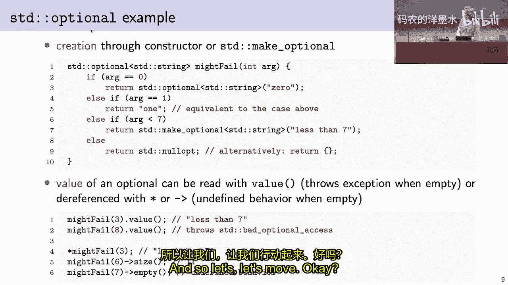
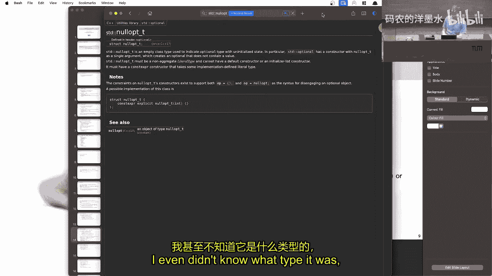
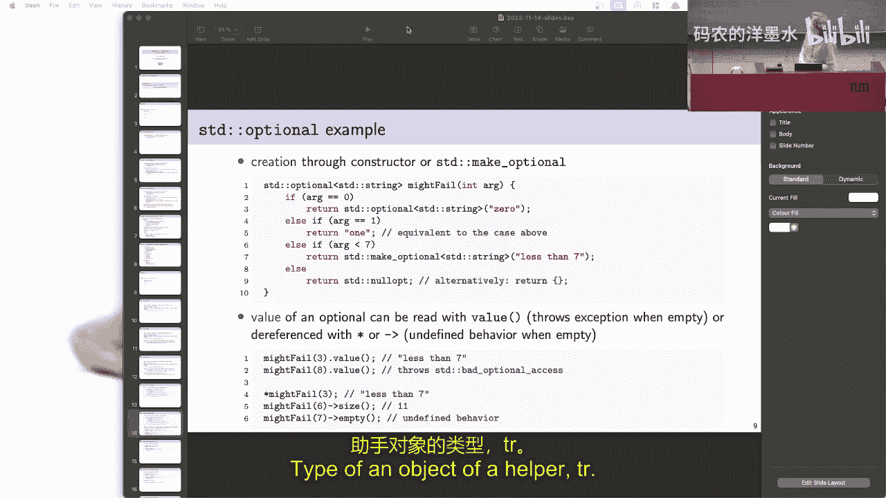
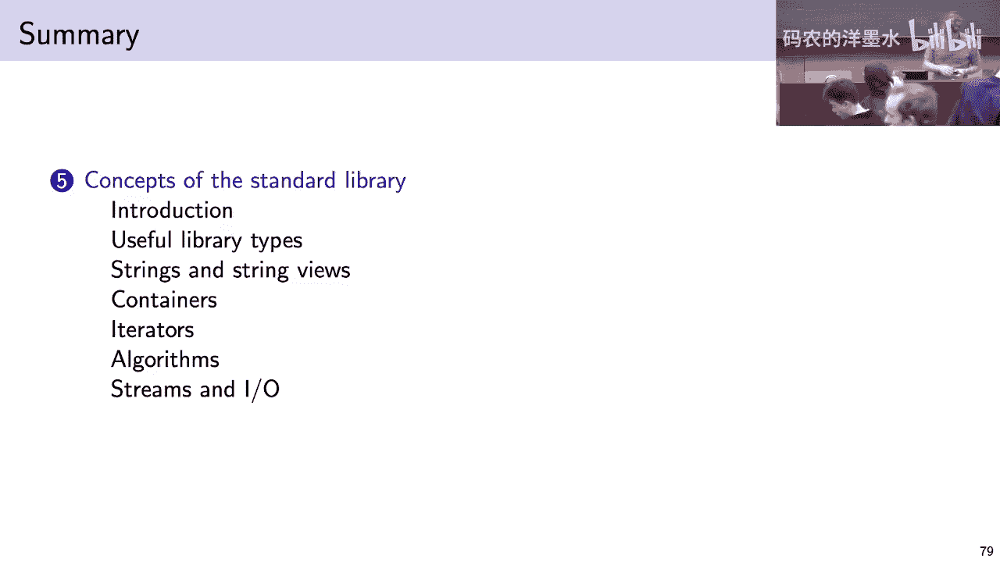

# 004：标准库概述

在本节课中，我们将学习C++标准库的核心组成部分。标准库是C++语言的重要组成部分，它提供了大量预定义的类、函数和模板，用于处理常见任务，如字符串操作、数据存储、算法和输入/输出。掌握标准库能极大地提高编程效率和代码质量。

标准库是一个由C++标准定义的类和函数的集合。所有内容都位于`std`命名空间中。C++是自托管的，这意味着标准库本身也是用C++实现的。标准只定义了接口和行为规范，具体实现由编译器供应商（如GCC的libstdc++、Clang的libc++、微软的MSVC STL）提供。标准库功能庞大，包含C标准库、内存管理工具、错误处理、时间处理、字符串、容器、算法、迭代器、数值计算、输入/输出、正则表达式等众多组件。

## 实用库类型

上一节我们介绍了标准库的整体概念，本节中我们来看看几个非常实用的库类型，它们能帮助我们更安全、更清晰地表达程序意图。

### std::optional

`std::optional`是一个模板类，表示一个**可能包含值，也可能不包含值**的对象。它常用于函数的返回值，以明确表示操作可能没有结果，避免了使用特殊值（如`-1`或`nullptr`）或额外的布尔标志。

**核心概念**：
*   `std::optional<T>`：可以存储一个`T`类型的值，或者为空。
*   `std::nullopt`：表示一个空的`optional`。
*   `has_value()` 或 `if (opt)`：检查是否包含值。
*   `value()` 或 `*opt`：获取存储的值（若为空则可能抛出异常或导致未定义行为）。
*   `value_or(default)`：获取值，若为空则返回默认值。

**代码示例**：
```cpp
#include <optional>
#include <string>
#include <iostream>

std::optional<std::string> might_fail(bool success) {
    if (success) {
        return "Operation succeeded"; // 隐式构造 optional
        // 等价于: return std::optional<std::string>{"Operation succeeded"};
        // 或: return std::make_optional("Operation succeeded");
    } else {
        return std::nullopt; // 返回空值
        // 等价于: return {};
    }
}



int main() {
    auto result = might_fail(true);
    if (result) { // 或 if (result.has_value())
        std::cout << result.value() << std::endl; // 安全地获取值
        // 或: std::cout << *result << std::endl;
    } else {
        std::cout << "Operation failed" << std::endl;
    }

    auto failed_result = might_fail(false);
    // 使用 value_or 提供默认值
    std::cout << failed_result.value_or("Default message") << std::endl;
}
```





### std::pair 和 std::tuple

`std::pair`和`std::tuple`用于将多个值组合成单个对象。`pair`用于两个值，`tuple`用于两个或更多值。它们在编译时处理，没有运行时开销。

**核心概念**：
*   `std::pair<T1, T2>`：存储两个值，通过`first`和`second`成员访问。
*   `std::tuple<Ts...>`：存储多个值，通过`std::get<I>(tuple)`或结构化绑定访问。
*   `std::make_pair`, `std::make_tuple`：辅助函数，用于创建对象。

**代码示例**：
```cpp
#include <utility> // for pair
#include <tuple>
#include <iostream>

int main() {
    // 使用 std::pair
    std::pair<int, std::string> p1{42, "hello"};
    std::cout << p1.first << ", " << p1.second << std::endl;

    auto p2 = std::make_pair(3.14, 'a'); // 自动推导类型

    // 使用 std::tuple
    std::tuple<int, double, std::string> t{1, 2.2, "test"};
    std::cout << std::get<0>(t) << ", " << std::get<2>(t) << std::endl;

    auto t2 = std::make_tuple(10, 20.5, "world");

    // 结构化绑定 (C++17)
    auto [x, y, z] = t2;
    std::cout << x << ", " << z << std::endl;
}
```

### std::variant

`std::variant`是一个类型安全的联合体（union），可以在运行时保存多种预定义类型中的一种。它比C风格的union更安全，因为会跟踪当前存储的类型。

**核心概念**：
*   `std::variant<Ts...>`：可以存储`Ts...`中的任意一种类型。
*   `std::get<T>(var)` 或 `std::get<I>(var)`：获取存储的值（若类型不匹配则抛出异常）。
*   `std::holds_alternative<T>(var)`：检查当前是否存储了类型`T`。
*   `std::visit(visitor, var)`：使用访问者模式处理variant。

**代码示例**：
```cpp
#include <variant>
#include <string>
#include <iostream>

int main() {
    std::variant<int, float, std::string> v;

    v = 42; // 存储 int
    std::cout << std::get<int>(v) << std::endl; // 输出 42
    // std::get<float>(v); // 错误！当前存储的是int，会抛出 std::bad_variant_access

    if (std::holds_alternative<int>(v)) {
        std::cout << "Holds an int" << std::endl;
    }

    v = 3.14f; // 改为存储 float
    v = "hello"; // 改为存储 string

    // 使用 std::visit 处理不同情况
    auto visitor = [](auto&& arg) {
        using T = std::decay_t<decltype(arg)>;
        if constexpr (std::is_same_v<T, int>)
            std::cout << "int: " << arg << std::endl;
        else if constexpr (std::is_same_v<T, float>)
            std::cout << "float: " << arg << std::endl;
        else if constexpr (std::is_same_v<T, std::string>)
            std::cout << "string: " << arg << std::endl;
    };
    std::visit(visitor, v);
}
```

## 字符串：std::string 和 std::string_view

处理文本是编程中的常见任务。C++提供了`std::string`类来管理动态字符串，以及`std::string_view`类来提供字符串的只读视图，无需复制数据。

### std::string

`std::string`是一个容器，用于存储和管理字符序列。它知道自己的长度，内存是连续的，并且提供了丰富的成员函数进行操作。

**核心概念**：
*   连续内存，知道自身长度。
*   支持类似容器的操作：`[]`, `.at()` (边界检查), 迭代器。
*   常用操作：`.size()`, `.empty()`, `.append()`, `+`, `.find()`, `.substr()`。

**代码示例**：
```cpp
#include <string>
#include <iostream>

int main() {
    std::string str1; // 默认构造，空字符串
    std::string str2 = "Hello";
    std::string str3("World");

    // 访问字符
    char c = str2[0]; // 'H'
    // str2.at(10); // 抛出 std::out_of_range 异常

    // 修改
    str2 += " "; // 追加
    str2.append(str3);

    // 查找
    size_t pos = str2.find("World");
    if (pos != std::string::npos) {
        std::cout << "Found at position: " << pos << std::endl;
    }

    // 子串 (可能涉及内存分配和复制)
    std::string sub = str2.substr(6, 5); // "World"
    std::cout << sub << std::endl;

    // 遍历
    for (char& ch : str2) {
        ch = std::toupper(ch);
    }
    std::cout << str2 << std::endl; // "HELLO WORLD"
}
```

### std::string_view

`std::string_view` (C++17) 是一个轻量级的、非拥有的字符串视图。它只包含一个指向常量字符序列的指针和一个长度，因此创建和复制成本极低。**重要**：它不管理所指向内存的生命周期，使用时必须确保底层字符串有效。

**核心概念**：
*   非拥有，只读视图。
*   创建和子串操作开销极低（O(1)）。
*   接口与`std::string`相似。

**代码示例**：
```cpp
#include <string_view>
#include <iostream>

void print_sv(std::string_view sv) { // 按值传递也很廉价
    std::cout << sv << std::endl;
}

int main() {
    std::string str = "A very long string that we don't want to copy";

    // 从 string 创建 string_view，无复制
    std::string_view sv1(str);
    // 从字面量创建
    std::string_view sv2 = "Hello View";

    print_sv(sv1);
    print_sv(sv2);

    // 获取子串视图，O(1) 操作
    std::string_view sub_sv = sv1.substr(2, 10); // "very long "
    std::cout << sub_sv << std::endl;

    // 移除前缀/后缀
    sv2.remove_prefix(1); // 现在视图是 "ello View"
    sv2.remove_suffix(1); // 现在视图是 "ello Vie"
    std::cout << sv2 << std::endl;

    // 注意：sv1 和 sub_sv 仍然依赖于 str 的生命周期
}
```

## 容器

容器是用于存储其他对象的对象。标准库提供了多种容器，每种都在不同操作上有性能权衡。它们具有类似的接口，使得学习和使用更加容易。

### 序列容器

序列容器按线性顺序存储元素。

**std::vector**
动态数组，在尾部插入/删除高效，支持随机访问。内存连续。
```cpp
#include <vector>
int main() {
    std::vector<int> vec = {1, 2, 3};
    vec.push_back(4); // 尾部添加
    int x = vec[2]; // 随机访问，不检查边界
    int y = vec.at(2); // 随机访问，检查边界
    for (int v : vec) { /* 遍历 */ }
    // 预先分配内存以避免多次重分配
    vec.reserve(100);
    for(int i=0; i<100; ++i) vec.push_back(i);
}
```

**std::deque**
双端队列，在头尾插入/删除高效。内存由多块连续缓冲区组成，并非完全连续。
```cpp
#include <deque>
std::deque<int> dq = {1, 2, 3};
dq.push_front(0); // 头部添加
dq.push_back(4);  // 尾部添加
```

**std::list / std::forward_list**
双向链表和单向链表。在任何位置插入/删除都高效（O(1)），但不支持随机访问。
```cpp
#include <list>
std::list<int> lst = {1, 2, 3};
lst.insert(std::next(lst.begin()), 99); // 在第二个位置插入
lst.erase(lst.begin()); // 删除第一个元素
```

### 关联容器

关联容器基于键来存储元素，便于快速查找。

**std::set / std::multiset**
有序集合，基于红黑树实现，元素自动排序。`set`键唯一，`multiset`允许重复键。查找、插入、删除复杂度为 O(log n)。
```cpp
#include <set>
std::set<int> s = {5, 2, 8, 2}; // 最终 {2, 5, 8}
s.insert(3);
if (s.find(5) != s.end()) { /* 找到了 */ }
```

**std::map / std::multimap**
有序映射，存储键值对。`map`键唯一，`multimap`允许重复键。同样基于红黑树，O(log n) 复杂度。
```cpp
#include <map>
std::map<std::string, int> age_map = {{"Alice", 30}, {"Bob", 25}};
age_map["Charlie"] = 28; // 插入或赋值
int alice_age = age_map.at("Alice"); // 访问，若键不存在则抛出异常
for (const auto& [name, age] : age_map) { /* 遍历 */ }
```

**std::unordered_set / std::unordered_map**
无序集合和映射，基于哈希表实现。平均情况下的插入、查找、删除为 O(1)，但最坏情况为 O(n)。元素不按顺序存储。
```cpp
#include <unordered_map>
std::unordered_map<std::string, int> u_map = {{"Apple", 1}, {"Banana", 2}};
u_map["Orange"] = 3;
if (u_map.contains("Apple")) { /* C++20 */ }
// 查找返回迭代器
auto it = u_map.find("Banana");
if (it != u_map.end()) {
    std::cout << it->first << ": " << it->second << std::endl;
}
```

## 迭代器

迭代器提供了遍历容器元素的统一方法，它抽象了不同容器的内部结构。你可以将迭代器理解为指向容器中元素的“智能指针”。

**核心概念**：
*   `begin()`: 返回指向第一个元素的迭代器。
*   `end()`: 返回指向**末尾后一个位置**的迭代器（哨兵），不可解引用。
*   支持的操作：`*it` (解引用), `++it` (前进), `it->member`, 以及对于某些迭代器：`--it`, `it + n`, `it1 == it2`。

**迭代器类别**：
1.  **输入迭代器**：只读，单次遍历。
2.  **输出迭代器**：只写，单次遍历。
3.  **前向迭代器**：可读写，可多次遍历。
4.  **双向迭代器**：在前向基础上可后退 (`--it`)。
5.  **随机访问迭代器**：支持所有指针算术运算 (`it + n`, `it1 - it2`, `it[n]`)，如 `vector`, `deque`, `array` 的迭代器。
6.  **连续迭代器** (C++17)：随机访问迭代器，且保证元素在内存中连续，如 `vector`, `array` 的迭代器。

**代码示例**：
```cpp
#include <vector>
#include <list>
#include <iostream>

int main() {
    std::vector<int> vec = {1, 2, 3, 4, 5};

    // 1. 使用迭代器手动遍历
    for (auto it = vec.begin(); it != vec.end(); ++it) {
        std::cout << *it << " ";
        (*it) += 1; // 可以修改元素
    }
    std::cout << std::endl; // 输出: 1 2 3 4 5

    // 2. 范围 for 循环 (底层使用迭代器)
    for (int& val : vec) {
        std::cout << val << " ";
    }
    std::cout << std::endl; // 输出: 2 3 4 5 6

    // 3. 不同容器的迭代器
    std::list<int> lst = {10, 20, 30};
    for (auto it = lst.begin(); it != lst.end(); ++it) {
        std::cout << *it << " ";
        // --it; // 双向迭代器支持后退
    }
    std::cout << std::endl;

    // 4. 迭代器失效示例 (在遍历时修改容器结构是危险的)
    // for(auto it = vec.begin(); it != vec.end(); ++it) {
    //     if (*it == 3) {
    //         vec.erase(it); // 错误！erase后it失效，再++是未定义行为
    //     }
    // }
    // 正确做法：利用erase的返回值
    for(auto it = vec.begin(); it != vec.end(); ) {
        if (*it == 3) {
            it = vec.erase(it); // erase返回被删除元素之后元素的迭代器
        } else {
            ++it;
        }
    }
}
```

## 范围库 (Ranges) 和算法 (Algorithms)

标准算法库 (`<algorithm>`) 提供了大量通用算法（如排序、查找、操作），它们通常通过迭代器对容器进行操作。C++20引入的范围库 (`<ranges>`) 提供了更现代、更易用的函数式编程接口。

### 标准算法示例

以下是几个常用算法的例子：

**代码示例**：
```cpp
#include <algorithm>
#include <vector>
#include <iostream>
#include <numeric> // for iota

int main() {
    std::vector<int> vec = {5, 3, 1, 4, 2};

    // 排序
    std::sort(vec.begin(), vec.end()); // 升序
    // std::sort(vec.begin(), vec.end(), std::greater<int>()); // 降序

    // 查找
    auto it = std::find(vec.begin(), vec.end(), 3);
    if (it != vec.end()) {
        std::cout << "Found at index: " << std::distance(vec.begin(), it) << std::endl;
    }

    // 计数
    int count = std::count(vec.begin(), vec.end(), 2);

    // 填充和生成
    std::vector<int> vec2(5);
    std::fill(vec2.begin(), vec2.end(), 42);
    std::iota(vec2.begin(), vec2.end(), 0); // 填充为 0, 1, 2, 3, 4

    // 变换 (map)
    std::vector<int> vec3;
    std::transform(vec.begin(), vec.end(), std::back_inserter(vec3),
                   [](int x) { return x * 2; });

    // 删除-擦除惯用法 (移除特定元素)
    vec.erase(std::remove(vec.begin(), vec.end(), 3), vec.end());

    for (int v : vec) std::cout << v << " ";
    std::cout << std::endl;
}
```

### 范围库 (C++20)

范围库提供了一种更简洁的方式来组合算法操作，支持惰性求值，并且语法更清晰。

**核心概念**：
*   **范围**：任何可以迭代的东西（如容器、视图）。
*   **视图**：对范围的轻量级转换，不复制数据，惰性求值。
*   使用管道运算符 `|` 来组合操作。

**代码示例**：
```cpp
#include <ranges>
#include <vector>
#include <iostream>

int main() {
    std::vector<int> vec = {1, 2, 3, 4, 5, 6, 7, 8, 9, 10};

    // 使用视图：过滤出偶数，然后乘以2
    auto even_doubled = vec
                      | std::views::filter([](int x) { return x % 2 == 0; })
                      | std::views::transform([](int x) { return x * 2; });

    // 视图是惰性的，此时还未进行计算
    for (int v : even_doubled) { // 在遍历时进行计算
        std::cout << v << " "; // 输出: 4 8 12 16 20
    }
    std::cout << std::endl;

    // 取前3个元素
    auto first_three = vec | std::views::take(3);
    for (int v : first_three) std::cout << v << " "; // 1 2 3

    // 范围算法 (C++20)
    namespace rng = std::ranges;
    if (rng::find(vec, 5) != vec.end()) {
        std::cout << "\nFound 5" << std::endl;
    }
    // 排序整个范围（更简洁）
    // rng::sort(vec);
}
```

## 输入/输出流

C++使用流（stream）来处理输入和输出。流是字节序列的抽象，可以关联到控制台、文件、字符串等。

### 标准流对象
*   `std::cin`：标准输入流（控制台输入）。
*   `std::cout`：标准输出流（控制台输出）。
*   `std::cerr`：标准错误流（无缓冲）。
*   `std::clog`：标准日志流（有缓冲）。

### 文件流
*   `std::ifstream`：用于读取文件。
*   `std::ofstream`：用于写入文件。
*   `std::fstream`：用于读写文件。

### 字符串流
*   `std::istringstream`：从字符串读取数据。
*   `std::ostringstream`：将数据写入字符串。
*   `std::stringstream`：读写字符串。

**代码示例**：
```cpp
#include <iostream>
#include <fstream>
#include <sstream>
#include <string>

int main() {
    // 控制台 I/O
    int num;
    std::cout << "Enter a number: ";
    std::cin >> num;
    std::cout << "You entered: " << num << std::endl;

    // 文件 I/O
    std::ofstream out_file("output.txt");
    if (out_file.is_open()) {
        out_file << "Writing to a file.\n";
        out_file << "Number: " << num << std::endl;
        out_file.close();
    }

    std::ifstream in_file("output.txt");
    std::string line;
    if (in_file.is_open()) {
        while (std::getline(in_file, line)) {
            std::cout << line << std::endl;
        }
        in_file.close();
    }

    // 字符串流
    std::ostringstream oss;
    oss << "The answer is " << 42 << ".";
    std::string result_str = oss.str();
    std::cout << result_str << std::endl;

    std::istringstream iss("100 200");
    int a, b;
    iss >> a >> b;
    std::cout << a + b << std::endl; // 300

    // 更现代的格式化输出 (C++20)
    #include <format>
    std::string formatted = std::format("Hello, {}! The value is {:.2f}.", "World", 3.14159);
    std::cout << formatted << std::endl;
    // C++23 的 print (部分编译器支持)
    // std::print("Hello {}!\n", "C++23");
}
```

## 总结

本节课中我们一起学习了C++标准库的核心组件。我们从整体概述开始，了解了标准库的构成和重要性。接着，我们探讨了几个实用的库类型：`std::optional`用于可选的返回值，`std::pair`和`std::tuple`用于组合数据，`std::variant`用于类型安全的联合。

然后，我们深入研究了字符串处理，比较了`std::string`和轻量级的`std::string_view`。在容器部分，我们介绍了序列容器（如`vector`, `list`）和关联容器（如`map`, `set`, `unordered_map`），并理解了它们各自适用的场景和性能特点。

迭代器作为遍历容器的通用抽象机制被详细解释。最后，我们了解了强大的算法库以及C++20引入的、更现代易用的范围库（Ranges），并简要回顾了基于流的输入/输出系统。



标准库是C++编程的利器，熟练使用它可以避免重复造轮子，写出更高效、更安全、更易维护的代码。建议在实践中多查阅标准库文档，不断探索其丰富的功能。