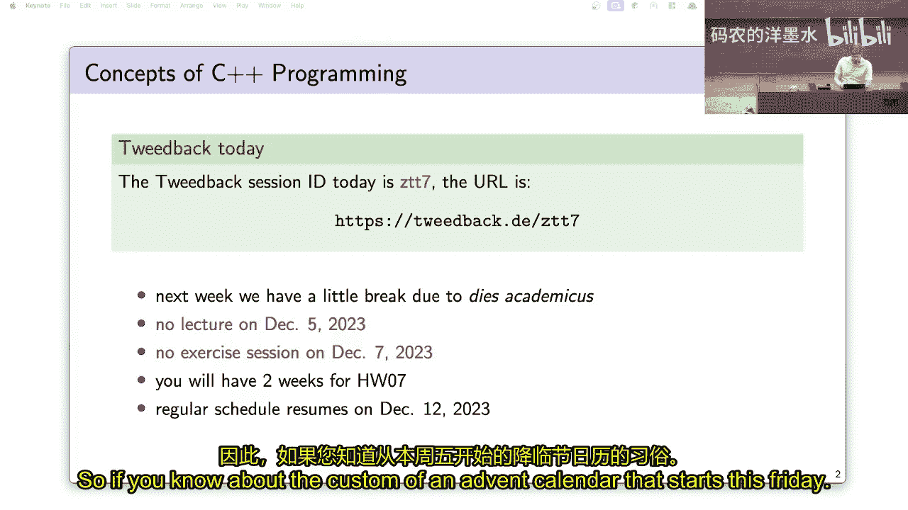
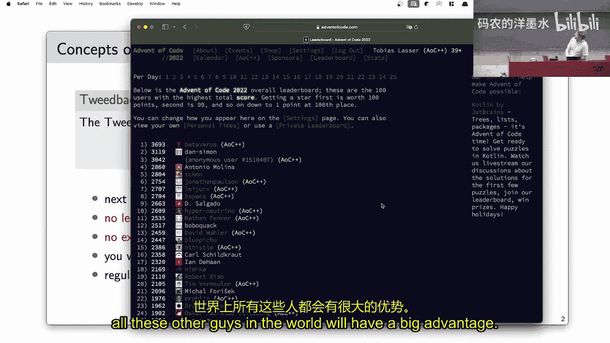
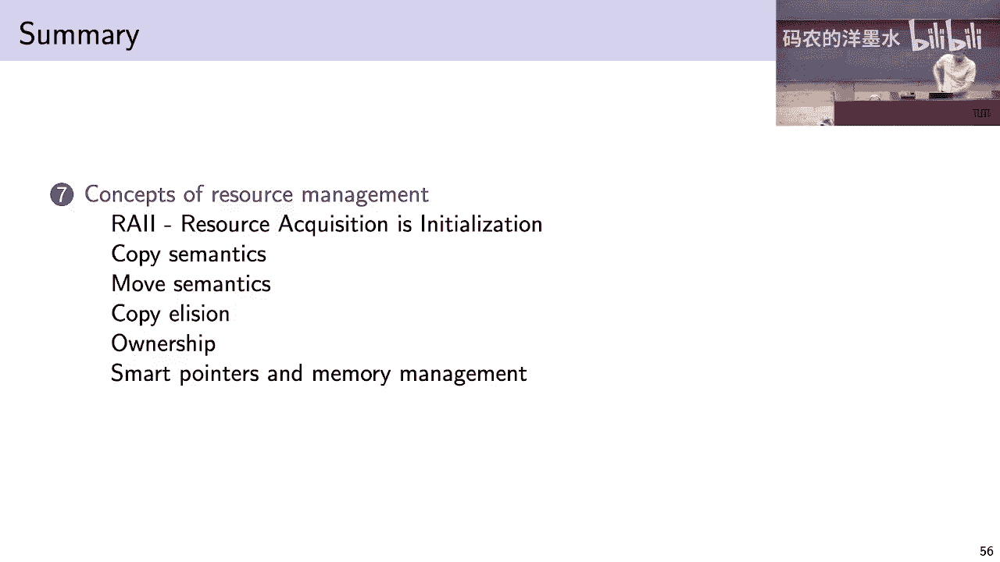

# 006：移动语义与资源管理



## 概述



在本节课中，我们将要学习C++中一个核心且强大的概念：资源管理。我们将重点探讨RAII（资源获取即初始化）原则，并深入理解移动语义如何帮助我们高效、安全地管理内存、文件句柄等资源。课程将涵盖拷贝操作、移动操作、智能指针，并解释为何在现代C++中应避免使用原始指针。

---

## 课程公告与安排

在开始今天的核心内容之前，有一些课程安排需要告知大家。

首先，下周课程将暂停一次。因为12月7日是学校的学术活动日，没有练习课。为了保持课程与练习的同步，12月5日的讲座也将取消。因此，下周大家可以稍作休息。

其次，关于家庭作业。作业7将于本周末发布，其提交期限为两周，所以大家有更充足的时间来完成。请放心，作业量不会因此增加，只是多了一周的完成时间。下周之后，我们将于12月12日恢复正常课程安排。

最后，我想向大家介绍一个有趣的编程活动。本周五是12月1日，标志着“编程降临节”（Advent of Code）的开始。这是一个从12月1日到25日，每天发布一道编程挑战的在线活动。题目从易到难，非常适合用来练习C++编程。我创建了一个本课程的私有排行榜，相关信息会发布在Moodle上，欢迎大家参与。

---

## 资源管理（RAII）的核心概念

上一节我们了解了课程安排，现在让我们进入今天的核心主题：资源管理。这是C++区别于C语言的关键领域之一，主要解决了C语言在资源管理上容易出错、不安全的问题。

C++的核心概念是**RAII**，即“资源获取即初始化”。这个缩写在你未来的C++开发生涯中会经常遇到。其主要思想是：将任何类型的资源（如内存、文件句柄、网络套接字、互斥锁、数据库连接等）的生命周期与一个对象的生命周期绑定。

其工作原理如下：
*   在对象的**构造函数**中获取或初始化资源。
*   在对象的**析构函数**中释放或清理资源。

由于编译器会自动管理具有自动存储期对象的构造和析构，这就确保了资源总能被正确清理，即使程序因异常而提前退出。你无法忘记清理，也不会重复清理。

### RAII实践示例

以下是一个简单的RAII实践示例。假设我们有一个向文件写入消息的函数，并且需要在多线程环境中进行同步。

```cpp
#include <fstream>
#include <mutex>
#include <stdexcept>

void write_message(const std::string& msg) {
    static std::mutex mtx; // 静态互斥锁，所有调用共享
    std::lock_guard<std::mutex> lock(mtx); // RAII包装器：构造时加锁，析构时解锁
    std::ofstream file("message.txt");
    if (!file.is_open()) {
        throw std::runtime_error("Could not open file");
    }
    file << msg << std::endl;
    // 无需手动关闭文件或解锁互斥锁！
}
```

在这个例子中：
*   `std::lock_guard` 和 `std::ofstream` 都是RAII类。
*   `lock_guard` 在构造时锁定互斥锁，在析构时（函数结束时）自动解锁。
*   `ofstream` 在析构时会自动关闭文件。
*   即使 `throw` 语句引发了异常，所有已完全构造的RAII对象也会被正确销毁，资源得到释放。

这种编程方式确保了线程安全和异常安全，使你几乎不可能犯资源泄漏的错误。

---

## 拷贝操作与“三法则”

上一节我们介绍了RAII的基本思想，本节中我们来看看实现RAII类时的一个关键细节：拷贝操作。

编译器会为自定义类型生成默认的拷贝构造函数和拷贝赋值运算符，执行**浅拷贝**（即逐成员拷贝）。对于管理资源的类（例如持有一个指向动态内存的指针），浅拷贝是危险的，因为它会复制资源句柄本身，而不是资源内容。这会导致两个对象指向同一资源，在析构时该资源会被释放两次，引发未定义行为（通常是程序崩溃）。

因此，对于管理资源的类，你必须自定义拷贝操作。以下是自定义拷贝操作的示例：

```cpp
#include <memory>
#include <algorithm>

class ManagedArray {
    std::unique_ptr<int[]> data; // RAII包装的指针
    size_t capacity;
public:
    // 构造函数
    explicit ManagedArray(size_t cap) : capacity(cap), data(std::make_unique<int[]>(cap)) {}
    
    // 拷贝构造函数
    ManagedArray(const ManagedArray& other) : ManagedArray(other.capacity) {
        std::copy(other.data.get(), other.data.get() + capacity, data.get());
    }
    
    // 拷贝赋值运算符
    ManagedArray& operator=(const ManagedArray& other) {
        if (this != &other) { // 自赋值检查
            if (capacity != other.capacity) {
                data = std::make_unique<int[]>(other.capacity); // 旧内存通过unique_ptr赋值自动释放
                capacity = other.capacity;
            }
            std::copy(other.data.get(), other.data.get() + capacity, data.get());
        }
        return *this;
    }
    // 析构函数由 std::unique_ptr 自动处理
};
```

**重要规则：三法则**
如果你需要为类显式定义**析构函数**、**拷贝构造函数**或**拷贝赋值运算符**中的任何一个，那么你很可能需要同时定义这三个。因为它们通常共同处理资源的生命周期管理。编译器生成的默认版本在存在资源管理时往往是错误的。

---

## 移动语义与“五法则”

上一节我们处理了拷贝，本节中我们来看看一种更高效的操作：移动。

有时我们不需要拷贝整个对象，特别是对于临时对象或即将销毁的对象。移动语义允许我们将资源从一个对象“转移”到另一个对象，避免昂贵的拷贝开销。这类似于现实中将物品递给别人，而不是复制一份。

移动操作通过**右值引用**（`T&&`）实现。你可以定义移动构造函数和移动赋值运算符。

```cpp
class MyClass {
public:
    // 移动构造函数
    MyClass(MyClass&& other) noexcept
        : data(std::move(other.data)), capacity(other.capacity) {
        other.capacity = 0; // 使被移动对象处于有效但未指定状态
    }
    // 移动赋值运算符
    MyClass& operator=(MyClass&& other) noexcept {
        if (this != &other) {
            data = std::move(other.data); // 转移资源所有权
            capacity = other.capacity;
            other.capacity = 0;
        }
        return *this;
    }
private:
    std::unique_ptr<int[]> data;
    size_t capacity;
};
```

要调用移动操作而非拷贝操作，可以使用 `std::move` 将左值转换为右值引用。

```cpp
MyClass a;
MyClass b = std::move(a); // 调用移动构造函数，a的资源被转移给b
```

移动语义的主要用途：
1.  **提升效率**：例如从函数返回大型对象时，避免拷贝。
2.  **实现“只移动”类型**：对于某些资源（如唯一文件句柄），拷贝无意义，但移动（转移所有权）是合理的。

**重要规则：五法则**
随着移动语义的引入，规则扩展为“五法则”：如果你定义了移动操作，通常也需要同时定义拷贝操作和析构函数（即总共五个特殊成员函数）。如果你希望禁止拷贝，可以显式地将拷贝操作标记为 `= delete`。

---

## 智能指针

上一节我们讨论了移动语义如何帮助管理所有权，本节中我们来看看C++标准库提供的、直接应用这些概念的工具：智能指针。

在传统C/C++中，使用 `new`/`malloc` 分配内存，必须手动使用 `delete`/`free` 释放，极易导致内存泄漏、重复释放等问题。现代C++使用**智能指针**作为RAII包装器来管理动态内存。

### `std::unique_ptr`
`std::unique_ptr` 表示对动态分配对象的**独占所有权**。它不可拷贝，但可以移动。当 `unique_ptr` 被销毁时，它会自动删除其管理的对象。

```cpp
#include <memory>
struct Widget { int x, y; };
void takeOwnership(std::unique_ptr<Widget> ptr); // 通过传值接受所有权

int main() {
    auto ptr = std::make_unique<Widget>(3, 4); // 使用 make_unique 创建
    // auto ptr2 = ptr; // 错误！不可拷贝
    auto ptr2 = std::move(ptr); // 正确：移动，ptr 现在为空
    takeOwnership(std::move(ptr2)); // 转移所有权给函数
    // 此后不能再使用 ptr 和 ptr2
}
```

### `std::shared_ptr`
`std::shared_ptr` 表示**共享所有权**。多个 `shared_ptr` 可以指向同一对象，内部通过引用计数管理生命周期。当最后一个 `shared_ptr` 被销毁时，对象才会被删除。它比 `unique_ptr` 开销大，应仅在需要共享所有权时使用。

```cpp
#include <memory>
int main() {
    auto sp1 = std::make_shared<int>(42);
    auto sp2 = sp1; // 拷贝，引用计数增加
    // sp1 和 sp2 指向同一个整数
} // sp1 和 sp2 析构，引用计数降为0，内存被释放
```

### 指南
*   **默认使用 `std::unique_ptr`**：用于明确的独占所有权，零开销。
*   **谨慎使用 `std::shared_ptr`**：仅在需要共享所有权时使用，注意循环引用问题。
*   **避免使用原始指针管理所有权**：几乎在所有情况下，智能指针都是更安全的选择。原始指针应仅用于不涉及所有权的观察和访问（这时可以使用引用或 `std::optional`）。

---

## 总结

本节课中我们一起学习了C++资源管理和移动语义的核心内容。

我们首先理解了**RAII原则**，它是C++管理资源（内存、文件、锁等）的基石，通过将资源生命周期绑定到对象生命周期，确保了异常安全和代码简洁性。

接着，我们探讨了**拷贝操作**和“三法则”，认识到对于管理资源的类，需要自定义拷贝构造函数和拷贝赋值运算符以避免浅拷贝带来的问题。

然后，我们深入学习了**移动语义**，它通过移动构造函数和移动赋值运算符，允许高效地转移资源所有权，避免了不必要的拷贝，并引入了“五法则”作为相关实践指南。

最后，我们介绍了现代C++中管理动态内存的工具：**智能指针**。`std::unique_ptr` 用于独占所有权，`std::shared_ptr` 用于共享所有权。我们强调了应优先使用智能指针，并避免使用原始指针进行资源管理。



掌握这些概念对于编写安全、高效、现代的C++代码至关重要。它们帮助你构建资源泄漏更少、性能更优、更易于维护的程序。